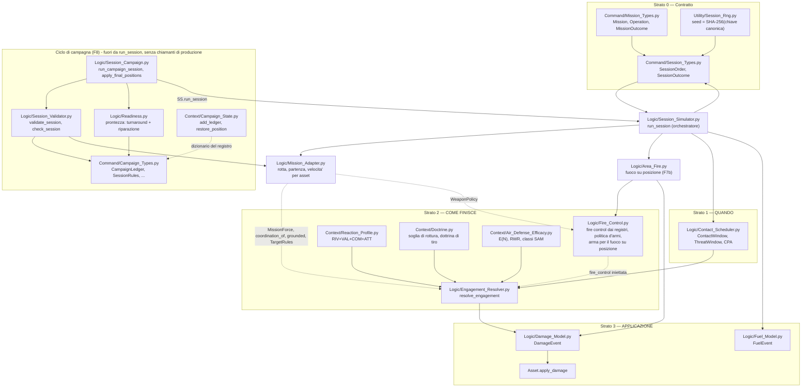

# Capitolo 1 — Scopo e motivazioni

> **Aggiornato al commit `fa5fbf1e`** (2026-10-23; rispetto a `dcedc541` del 2026-10-20 cambia la **fase F8**, sessione e campagna, v. sotto, e i
> riferimenti `:riga`). **Dalla F8** attorno al motore c'è un ciclo di campagna *fuori* da `run_session`: un validatore di sessione, la prontezza degli asset
> (turnaround e riparazione) e un conduttore che esegue una sessione alla volta, applica le posizioni finali e registra la sessione (capitolo 6
> §6.24-6.27, capitolo 2 §2.10). **Non è un quinto strato**: i quattro strati e le motivazioni di questo capitolo non cambiano, e il motore non legge mai il registro di
> campagna; è il primo pezzo del livello superiore (C2/campagna) che il motore, per costruzione, non conosce. **Il ciclo non ha ancora chiamanti di produzione**
> (solo test e lo scenario S30).
>
> *Aggiornamento precedente, a `dcedc541` (2026-10-20; rispetto a `a784a9e7` del 2026-10-18 cambiava la fase F7, v. sotto, e i
> riferimenti `:riga`).* Rispetto alla stesura iniziale cambiano quattro cose a
> livello d'architettura: la **Missione** (fasi F0-F3 del piano, capitolo 2 §2.6-2.7 e capitolo 6 §6.10) è il
> modo in cui un asset riceve rotta, partenza e velocità; dalla fase **F4** (2026-10-05/11) la missione è
> anche l'**unità d'ingaggio** (capitolo 6 §6.12-6.14, capitolo 4 §4.27), con un **dominio di coordinamento**
> che condivide fuoco, percezione e difesa di salva fra le missioni dello stesso blocco o della stessa
> Operazione (capitolo 4 §4.28-4.29) e con la **postura continua** degli asset senza missione; lo strato 2 ha inoltre
> acquisito la soglia di rottura stocastica, la difesa dai missili, la dottrina di tiro e la percezione RWR (capitolo 4
> §4.21-4.26). **Dalle fasi F5 e F6 e dai passi G1-G5 (2026-10-11/18)** l'asset di missione ha una **presenza nel
> tempo** (a terra prima del decollo, attese, TOT per missione: capitolo 6 §6.15-6.16), il **carburante vincola il
> movimento** e dà origine al **bingo** con rientro, albero di decisione e consumo in ingaggio (capitolo 5 §5.2, capitolo 6
> §6.17-6.20), i **criteri di fine missione** sono letti dal risolutore (capitolo 4 §4.31) e l'**ingaggio è un episodio nel
> tempo**, dopo il quale gli aerei sono ri-pianificati e i contatti ricalcolati (capitolo 6 §6.20). Le motivazioni di questo
> capitolo (§1.1, §1.3, §1.5) non sono cambiate: il motore resta un DES a coda eventi con contatti analitici, deterministico
> e indifferente al simulatore. **Dalla fase F7 (2026-10-18/20)** la missione decide anche **contro chi** e **con che arma** si
> spara (bersaglio designato, ROE, armi designate, politica d'armi per tipo di missione: capitolo 4 §4.32-4.33, capitolo 6
> §6.22) e un'artiglieria o una nave possono **sparare su una posizione stimata** senza che nessuno vi sia stato rilevato (fuoco
> su posizione, un terzo tipo di evento di sessione: capitolo 6 §6.23, nuovo modulo `Logic/Area_Fire.py`).

## 1.2 I quattro strati

L'architettura è a quattro strati, in secondi assoluti dall'inizio della sessione
(`Logic/Contact_Scheduler.py:1-19`, `Logic/Engagement_Resolver.py:1-11`):

0. **Contratto** — `SessionOrder`/`SessionOutcome`, solo tipi di dominio, più l'RNG di sessione
   seedato esplicitamente. È la "porta" a cui qualunque esecutore di sessione deve conformarsi:
   il risolutore sintetico del core oggi, un adapter DCS domani
   (`Command/Session_Types.py:1-42`). Dal 2026-10-05 la porta porta anche le **missioni**
   (`Command/Mission_Types.py`, `SessionOrder.missions`/`operations`, `SessionOutcome.mission_outcomes`,
   capitolo 2 §2.6) e la tassonomia dei tipi di missione di `Context/Context.py` (§2.7).
1. **Scheduler dei contatti** — risponde a **quando** (rotta↔volume di minaccia, CPA/TCPA,
   potatura gerarchica a livello `Block` prima delle coppie di asset).
2. **Risolutore d'ingaggio** — risponde a **come finisce**: Pd → latenza di reazione → regole
   d'ingaggio (`fire_control`, dottrina di tiro) → salva e saturazione (Hughes, con difesa dai missili per
   salva e tempo di reazione) → danno per colpo → disingaggio (soglia di rottura stocastica).
3. **Applicazione dello stato** — per-asset (danno, munizioni, carburante) → `SessionOutcome`:
   danno e munizioni subito dopo ogni ingaggio (dal G4a un **episodio** d'ingaggio, prima una componente connessa di forze),
   il carburante in un passo finale con i tratti definitivi (l'orchestratore, capitolo 6). L'orchestratore
   ricava prima rotta, partenza e velocità di ogni asset dalle missioni (`Logic/Mission_Adapter`) e
   costruisce le **forze d'ingaggio**: una vista per missione, il dominio di coordinamento di ciascuna e
   il programma degli aerei a terra (capitolo 6 §6.12-6.15).

*Nota sul diagramma D1* (aggiornato a `fa5fbf1e`: il blocco «Ciclo di campagna» e le sue frecce sono nuovi): `Session_Campaign` chiama `run_session` come attributo del modulo (`SS.run_session`) e
non è chiamato da nessun modulo del motore; `Session_Validator` importa `Session_Simulator` (per `session_blocks` e per leggere gli interruttori del bingo) e `Mission_Adapter`, ma nessuno di
loro importa il validatore. La freccia tratteggiata `CST` → `CT` non è un import: `Campaign_State` salva e restituisce il registro come dizionario (`to_dict`/`from_dict`), senza importare
`Command`. La freccia da `ORCH` a `ST` rappresenta l'uscita
(`assemble_session_outcome`, che produce il `SessionOutcome`), non una dipendenza a tempo di
import. La freccia tratteggiata da `MA` a `ER` rappresenta il **flusso dei dati**, non l'import: `Mission_Adapter` produce le viste di
missione (`MissionForce`), la mappa dei domini di coordinamento (`coordination_of`), l'insieme degli aerei
a terra (`grounded`) e, dalla F7a, le regole di bersaglio (`TargetRules`) che l'orchestratore passa a
`resolve_engagement` (capitolo 6 §6.12-6.14, §6.22). Gli **import** esistono comunque, per i tipi e le costanti:
`Mission_Adapter` importa `Engagement_Resolver` e `Fire_Control` (`Logic/Mission_Adapter.py:332-333`; usa `ER.TargetRules`,
`ER.ROE_*` e `FC.WeaponPolicy`). Il risolutore invece non importa `Mission_Adapter` né `Fire_Control`
(è `Fire_Control` che importa il risolutore, per `ShotSpec`). Le frecce tratteggiate `FC` → `ER` e `MA` → `FC` indicano
iniezione di dati o di callable verso il risolutore, non la direzione dell'import (v. il grafo reale degli import
nei diagrammi D58-D60 del capitolo 10, correzione del 2026-10-29: D1 mescola frecce di flusso dei dati, per esempio
`CS` → `ER`, `MT` → `ST` e `ST` → `ORCH`, e frecce di import). `Area_Fire` (F7b) è usato dal solo orchestratore: importa
`Fire_Control` (per l'arma), `Damage_Model` (per il colpo), `Mission_Adapter` (per gli istanti d'arrivo) e il tipo
`EngagementResult` del risolutore, ma **non** chiama `resolve_engagement`.

## 1.3 I vincoli di progetto, non negoziabili

Questi vincoli sono dell'utente, non conclusioni dell'analisi tecnica (v.
`Analysis/WIKI_LLM_SIMULATION/wiki/decisions/virtual-session-engine-des.md`, sezione "Vincoli
dell'utente registrati"), e si ritrovano nel codice come regole verificabili:

1. **10.000 asset è un limite superiore teorico**, non un caso tipico da ottimizzare al centro
   della distribuzione. La potatura gerarchica a livello `Block`
   (`Logic/Contact_Scheduler.py:1277-1374`, meccanismo C) esiste proprio per rendere quel limite
   trattabile senza un confronto O(N²) di tutte le coppie di asset.
2. **Riproducibilità da seed**, e l'**ordine di risoluzione degli eventi fa parte del
   contratto**: salvare solo il seed non basta, perché un PRNG riproduce la stessa sequenza solo
   a parità di ordine delle chiamate (`Utility/Session_Rng.py:1-9`). Concretamente: le liste di
   `ContactWindow` sono sempre ordinate per tempo e, a parità di tempo, per identificativo di
   dominio (`Logic/Contact_Scheduler.py:58-60`); la coda eventi del risolutore usa un tie-break
   deterministico `(t, tipo, id, sequenza)` (`Logic/Engagement_Resolver.py:385-390`, `:536-544`); l'RNG di
   ogni ingaggio è derivato da una chiave canonica che non dipende dall'ordine di iterazione di
   un dizionario Python (`Logic/Session_Simulator.py:993-1014`, `engagement_event_id`; `:405-437`).
3. **Perdite e danni per singolo asset**, mai aggregati. È il motivo per cui esiste
   `Logic/Damage_Model.py` (un `DamageEvent` per colpo risolto, non un delta di forza) e per cui
   `Logic/Tactical_Evaluation.calcFightResult` — il modello aggregato a rapporto di forze
   preesistente — resta un **fallback**, mai il risolutore primario
   (`Logic/Engagement_Resolver.py:419`).
4. **Budget di calcolo per sessione: fino a minuti.** Non verificato in questo manuale con
   misure a runtime; lo scenario S8 (capitolo 8) è quello dedicato esplicitamente a misurare il
   tempo di calcolo su una scala di decine di blocchi.

## 1.4 Il vincolo "core indifferente al simulatore"

Un vincolo architetturale trasversale, non specifico del motore DES ma che il motore DES deve
rispettare: il core Python deve restare **indifferente al simulatore** che esegue la sessione. Il
test operativo dichiarato è: *cancellando l'adapter DCS, la campagna deve continuare a girare con
sole sessioni sintetiche* (`Analysis/WIKI_LLM_SIMULATION/wiki/decisions/core-simulator-agnostic.md`,
memoria `feedback_core_simulator_agnostic`).

Concretamente, per il motore descritto in questo manuale, questo si traduce in:

- le porte `SessionOrder`/`SessionOutcome` e tutti i tipi atomici che trasportano (`ForceOutcome`,
  `DamageEvent`, `AmmunitionEvent`, `InterceptionEvent`, `FuelEvent`) contengono **solo tipi di
  dominio**: stringhe (id di dominio, mai id del simulatore), secondi assoluti come float, interi,
  frazioni, booleani, enum di dominio — mai un concetto del simulatore (`Command/Session_Types.py:9-18`); lo
  stesso vale dal 2026-10-05 per i tipi della Missione (`Mission`, `Operation`, `MissionOutcome`), con il test di
  contratto esteso (capitolo 2 §2.9);
- nessun modulo dello strato 0-3 importa alcunché legato a un simulatore specifico (lettori
  `.miz`/Lua, orologio del simulatore);
- oggi (a questo commit) **non esiste alcun adapter DCS** nell'albero Python
  (`Code/Dynamic_War_Manager/Source/`): l'integrazione con DCS vive interamente a livello di file
  `.miz`/Lua, fuori da questo albero. Il test "cancellando l'adapter la campagna gira" non ha
  quindi, oggi, nulla da cancellare — è un test di **contratto**, verificato staticamente
  (struttura dei tipi) e funzionalmente (l'intera catena gira end-to-end con dati costruiti solo
  in Python). Il dettaglio della verifica è nel capitolo 8.

## 1.5 Le due decisioni di modello che attraversano tutti gli strati

Due scelte di modello, prese durante l'analisi e verificate nel codice, meritano di essere
enunciate prima di entrare nel dettaglio strato per strato, perché ricorrono in più capitoli:

- **Il modello a salva di Hughes** per gli scenari molti-contro-molti: i colpi che arrivano su
  una forza nello stesso evento-salva sono prima confrontati con la capacità di intercettazione
  del bersaglio (saturazione), poi il surplus raggiunge il modello di danno colpo per colpo. Vive
  nello strato 2 (`Logic/Engagement_Resolver.py`, capitolo 4).
- **RNG di sessione seedato**, mai `random` di modulo: ogni estrazione stocastica dell'intero
  motore passa da un `random.Random` costruito da `Utility/Session_Rng.session_rng(session_id,
  mission_id, event_id, counter)`, il cui seed è un hash SHA-256 di una codifica canonica della
  chiave — mai `hash()` di Python, che è randomizzato per processo. V. capitolo 7.

