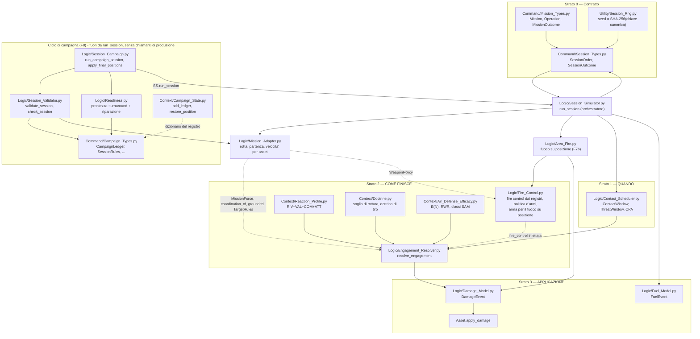

# Capitolo 1 — Scopo e motivazioni

> **Aggiornamento 2026-11-19 (solo testo, codice `31f81967`).** Il capitolo contiene di nuovo la **§1.1** («Il problema: simulare ore di combattimento in minuti di calcolo»), sparita per errore di rielaborazione in `234071d3` e citata dal capitolo 7 §7.3 e dalla nota seguente. Il capitolo è quindi: §1.1 il problema e la scelta del DES (perché non il tick a 1 ms, perché non la sola risoluzione probabilistica), §1.2 i quattro strati, §1.3 i vincoli di progetto, §1.4 il vincolo «core indifferente al simulatore», §1.5 le due decisioni di modello. La frase originale sul «micro-passo fine dentro una finestra d'ingaggio» è stata tolta: il codice non ha alcun micro-passo (§1.1).

> **Riverifica del 2026-11-13 (codice `a389cadb`).** Dopo `fa5fbf1e` il motore riceve quattro regole nuove, tutte nello strato 2 (capitolo 4 §4.35-§4.37, e §4.24 per la BI): la permanenza nel volume (D-5), i bersagli intercettabili dalle difese aeree (BI), la quota nel volume d'ingaggio (VA) e il rilevamento per passaggio nella portata propria (FP). Le prime tre sono dietro un interruttore del risolutore, **tutti e tre spenti a `a389cadb`** (**dal 2026-11-18 `D5_DWELL_TIME` è acceso di default**, `:596`, capitolo 4 §4.36; BI e VA restano spenti) (`D5_DWELL_TIME`, `BI_AD_TARGET_RULE`, `VA_ENGAGEMENT_ALTITUDE_BAND`, `Logic/Engagement_Resolver.py:591`, `:597`, `:608`); la FP è attiva **senza interruttore** (la pulizia del 2026-11-12 l'ha tolto). Né i quattro strati né i vincoli di §1.3 cambiano; cambia il **numero degli stream** dell'RNG di sessione (v. capitolo 7 e il D126): **tre** per ogni episodio d'ingaggio (ingaggio, tempra e passaggi) e uno per il fuoco su posizione, quindi quattro punti di apertura in tutto. I `:riga` di questo capitolo sono stati riportati a `a389cadb` (le righe del risolutore sono salite: 3872 → 4569 righe; `Contact_Scheduler` 1578 → 1662).
>
> **Aggiornato al commit `fa5fbf1e`** (2026-10-23; rispetto a `dcedc541` del 2026-10-20 cambia la **fase F8**, sessione e campagna, v. sotto, e i
> riferimenti `:riga`). **Dalla F8** attorno al motore c'è un ciclo di campagna *fuori* da `run_session`: un validatore di sessione, la prontezza degli asset
> (turnaround e riparazione) e un conduttore che esegue una sessione alla volta, applica le posizioni finali e registra la sessione (capitolo 6
> §6.24-6.27, capitolo 2 §2.10). **Non è un quinto strato**: i quattro strati e le motivazioni di questo capitolo non cambiano, e il motore non legge mai il registro di
> campagna; è il primo pezzo del livello superiore (C2/campagna) che il motore, per costruzione, non conosce. **Il ciclo non ha ancora chiamanti di produzione**
> (solo test e lo scenario S30).
>
> *Aggiornamento precedente, a `dcedc541` (2026-10-20; rispetto a `a784a9e7` del 2026-10-18 cambiava la fase F7, v. sotto, e i
> riferimenti `:riga`).* Rispetto alla stesura iniziale cambiano quattro cose a
> livello d'architettura: la **Missione** (fasi F0-F3 del piano, capitolo 2 §2.6-2.7 e capitolo 6 §6.10) è il
> modo in cui un asset riceve rotta, partenza e velocità; dalla fase **F4** (2026-10-05/11) la missione è
> anche l'**unità d'ingaggio** (capitolo 6 §6.12-6.14, capitolo 4 §4.27), con un **dominio di coordinamento**
> che condivide fuoco, percezione e difesa di salva fra le missioni dello stesso blocco o della stessa
> Operazione (capitolo 4 §4.28-4.29) e con la **postura continua** degli asset senza missione; lo strato 2 ha inoltre
> acquisito la soglia di rottura stocastica, la difesa dai missili, la dottrina di tiro e la percezione RWR (capitolo 4
> §4.21-4.26). **Dalle fasi F5 e F6 e dai passi G1-G5 (2026-10-11/18)** l'asset di missione ha una **presenza nel
> tempo** (a terra prima del decollo, attese, TOT per missione: capitolo 6 §6.15-6.16), il **carburante vincola il
> movimento** e dà origine al **bingo** con rientro, albero di decisione e consumo in ingaggio (capitolo 5 §5.2, capitolo 6
> §6.17-6.20), i **criteri di fine missione** sono letti dal risolutore (capitolo 4 §4.31) e l'**ingaggio è un episodio nel
> tempo**, dopo il quale gli aerei sono ri-pianificati e i contatti ricalcolati (capitolo 6 §6.20). Le motivazioni di questo
> capitolo (§1.1, §1.3, §1.5) non sono cambiate: il motore resta un DES a coda eventi con contatti analitici, deterministico
> e indifferente al simulatore. **Dalla fase F7 (2026-10-18/20)** la missione decide anche **contro chi** e **con che arma** si
> spara (bersaglio designato, ROE, armi designate, politica d'armi per tipo di missione: capitolo 4 §4.32-4.33, capitolo 6
> §6.22) e un'artiglieria o una nave possono **sparare su una posizione stimata** senza che nessuno vi sia stato rilevato (fuoco
> su posizione, un terzo tipo di evento di sessione: capitolo 6 §6.23, nuovo modulo `Logic/Area_Fire.py`).

## 1.1 Il problema: simulare ore di combattimento in minuti di calcolo

> **Sezione ripristinata il 2026-11-19.** La §1.1 era stata scritta nella stesura iniziale (`dfd86864`) e conservata fino a `355b1017`; è **sparita** in `234071d3` (2026-10-18, «manuale DES aggiornato a `a784a9e7`»), la cui rielaborazione del capitolo ha riscritto la nota d'apertura e tolto la sezione **senza spostarne il testo altrove** (il diff non mostra il contenuto in nessun altro punto del capitolo, e il manuale attuale non riporta più i numeri del confronto fra le strategie). La rimozione è quindi quasi certamente un errore di rielaborazione e non una scelta: la stessa nota d'apertura continuò a dire «le motivazioni di questo capitolo (§1.1, §1.3, §1.5) non sono cambiate», e il capitolo 7 §7.3 cita ancora «capitolo 1, §1.1». Il testo qui sotto è quello originale, **verificato di nuovo** contro il documento di analisi e il codice a `31f81967` e corretto dove non valeva più (v. «Che cosa è stato verificato»). Etichette: **[verificato]** = riscontrato leggendo il file citato; **[dal documento di analisi]** = numero o affermazione ripresi da `Analysis/Document/Architettura_esecuzione_sessioni_virtuali_ANALISI.md`, di cui ho ricontrollato l'aritmetica ma non le fonti esterne; **[non verificato]** = non riscontrabile da qui.

Il design C2 della campagna (`Analysis/WIKI_LLM_SIMULATION/wiki/decisions/c2-hierarchy-design.md`)
prevede sessioni «virtuali» — turni sintetici eseguiti senza un giocatore DCS — che devono
coprire ore di tempo di gioco in un budget di calcolo dichiarato dall'utente di **fino a
minuti**. Serviva un motore capace di farlo. Nella fase di analisi (documentata per esteso in
`Analysis/Document/Architettura_esecuzione_sessioni_virtuali_ANALISI.md`) erano state proposte
due strategie candidate.

### Perché non il tick a 1 ms

La prima proposta (la «Strategia 1») scomponeva il comportamento di ogni asset in quattro fasi di
reazione — RIV (rilevazione), VAL (valutazione), COM (comando), ATT (attuazione), un OODA loop
esplicito — e le faceva avanzare con un ciclo a passo fisso di circa 1 ms, dimensionato sul
missile ipersonico (10 m percorsi a 27 mach = 1,077 ms, documento di analisi §3.1 e §3.5). Il
conto è insostenibile **[dal documento di analisi, §3.3]**: 2 ore di sessione × 10.000 asset (limite
superiore teorico dichiarato dall'utente, non un caso tipico: §1.3, vincolo 1) fanno
6,687·10¹⁰ aggiornamenti-asset. Anche al solo costo del loop vuoto di CPython (0,17 µs, senza
fare nulla dentro) servono 3,2 ore; al costo reale di un motore ad agenti comparabile (Mesa,
95,7 µs per agente e passo) servono **74 giorni**; se il rilevamento fra asset è O(N) per asset
(come sarebbe con un controllo ingenuo a ogni tick) si arriva a 3,6–21 **anni** (rispettivamente
a 0,17 µs e a 1 µs per controllo di distanza). Ho rifatto i prodotti: 6,687·10¹⁰ × 0,17 µs ≈
11.369 s, × 95,7 µs ≈ 6,40·10⁶ s ≈ 74 giorni, 6,687·10¹⁴ × 0,17 µs ≈ 3,6 anni **[verificato:
aritmetica]**; i costi unitari (0,17 µs, 95,7 µs) sono misure citate dal documento di analisi,
**non misurate in questo repo [non verificato]**.
Nessun simulatore entity-level reale in letteratura funziona a tick fissi su questa scala
**[dal documento di analisi, §4.1; fonti esterne non riverificate]**: JTLS è a passo fisso ma
**aggregato** (battaglione/brigata, equazioni di Lanchester); JCATS è a eventi, BRAWLER è a
eventi, AFSIM è a coda eventi, ESAMS è una sequenza di fasi per singolo ingaggio.

Quello che la prima proposta aveva comunque di valido — e che il motore descritto in questo
manuale conserva — è la decomposizione RIV/VAL/COM/ATT: è l'unica cosa che risponde alla domanda
«chi spara per primo», cioè all'iniziativa, la cui assenza è ciò che fa fallire empiricamente i
modelli puramente aggregati a rapporto di forze (documento di analisi §4.5 **[dal documento di
analisi]**). Nel motore reale queste latenze non contano cicli: sono **parametri per tipo di
sistema** che schedulano eventi futuri («questo asset lancerà fra 26 secondi»)
**[verificato]**: `Context/Reaction_Profile.py:1-16` lo dichiara in questi termini e
il risolutore le usa per accodare eventi (`_push`, `Logic/Engagement_Resolver.py:2618-2620`).
V. capitolo 7 §7.3, `Context/Reaction_Profile.py`.

### Perché non la sola risoluzione probabilistica

La seconda proposta (la «Strategia 2») risolveva l'esito di un ingaggio per via probabilistica,
senza simulazione passo-passo. La direzione è giusta ma la proposta è incompleta: non specifica
**quando e se** due forze si incontrano affatto. È il buco più grave delle due proposte, e va
colmato analiticamente — con geometria e tempo, non con un tick — non ignorato
(`Logic/Contact_Scheduler.py:7-10` lo dice nei termini «la strategia a tick rispondeva "quando"
solo pagando 1 ms di risoluzione globale, quella probabilistica non ci rispondeva affatto»
**[verificato]**).

### La scelta: DES a coda eventi con contatti analitici

Il motore descritto in questo manuale è un **DES (discrete event simulation) a coda eventi**, in
secondi assoluti, senza alcun tick globale **[verificato]**. Non c'è un orologio che avanza a
passi fissi: la simulazione salta da un evento al successivo (un lancio, un impatto, la fine di un
movimento), qualunque sia la distanza in tempo fra i due. Nel codice le code sono due, entrambe
heap su `(tempo, tipo, chiave, sequenza)`: quella dell'**orchestratore**
(`Logic/Session_Simulator.py:3019-3020`, tipi `ENGAGEMENT_EVENT`, `AREA_FIRE_EVENT`, `MOVEMENT_EVENT`
a `:797-799`; una coda locale per il fuoco su posizione a `:2965`) e quella del **risolutore**
dentro un singolo episodio d'ingaggio (`Logic/Engagement_Resolver.py:4256-4257`, tipi
`_LAUNCH`, `_IMPACT`, `_RESOLVE`, `_DECIDE`, `_WAKE` a `:669-677`); in ognuna `now` salta
direttamente al tempo dell'evento estratto.

> **Il «micro-passo fine» della stesura iniziale non esiste nel codice.** La versione originale
> di questa sezione aggiungeva: «Un micro-passo fine è ammesso **solo dentro una finestra di
> ingaggio attiva**, mai come passo globale». La frase riprendeva il «micro-passo opzionale»
> del documento di analisi (§6, «si ammette un passo fine (1-5 s) solo dentro la finestra attiva e
> solo sugli asset coinvolti»), che era una **possibilità** lasciata aperta, non una funzione
> costruita. **Verificato a `31f81967`**: in `Logic/Engagement_Resolver.py`,
> `Logic/Session_Simulator.py`, `Logic/Contact_Scheduler.py`, `Logic/Area_Fire.py` e in
> `Context/`, `Command/`, `Utility/` una ricerca per parola chiave (`micro`, `tick`, `passo fisso`,
> `passo fine`, `campion`, `sampl`, `linspace`, `arange`, `time step`) non trova alcun passo di tempo
> nel motore: nei quattro moduli del motore le uniche occorrenze sono commenti che dicono il
> contrario (`Logic/Contact_Scheduler.py:7-10`, `Logic/Engagement_Resolver.py:1261`,
> `Logic/Session_Simulator.py:678`, più un «micrometro» a `Logic/Engagement_Resolver.py:657`);
> le altre occorrenze sono in `Context/Combat_Power_Estimation.py` (campioni statistici), nei sistemi
> fuzzy di `Utility/Utility.py` e in un grafico di `Utility/visualizer.py`, estranee al tempo di
> sessione. Dentro la finestra
> d'ingaggio il risolutore **non campiona il tempo**: sceglie gli eventi in coda (lanci, impatti,
> decisioni, risvegli) e calcola gli istanti per via analitica; per esempio il rilevamento usa
> **una sola estrazione** che dà il raggio di rilevamento, e da quello il primo istante in cui la distanza scende sotto
> il raggio, «senza campionare la finestra nel tempo» (`detection_radius`,
> `Logic/Engagement_Resolver.py:1255-1262`). La frase è quindi tolta dal testo principale. Limite
> di questa verifica: è una ricerca per parole chiave, **non ho riletto ogni ciclo** delle
> ~4.600 righe del risolutore **[non verificato]**; l'assenza di un passo di tempo globale è
> invece riscontrata dalla struttura a coda sopra citata.

Il pezzo che mancava a entrambe le proposte originali — **quando** due forze si incontrano — è
risolto in modo **analitico** **[verificato]**: intersezione rotta↔cilindro di minaccia (via
`Cylinder.getIntersection`, già esistente, chiamata in `Logic/Contact_Scheduler.py:654`) e CPA/TCPA
(*closest point of approach* / *time of closest approach*) fra mobili con la formula del moto
relativo rettilineo uniforme `t* = -(Δr·Δv)/|Δv|²` (`s = -_dot(dr, dv) / speed2`,
`Logic/Contact_Scheduler.py:852`), applicata su ogni tratto a velocità relativa costante di una
rotta a spezzata. Nessun campionamento nel tempo: si risolve un'equazione, non si itera un ciclo.
V. capitolo 3, `Logic/Contact_Scheduler.py`.

### Che cosa è stato verificato nel 2026-11-19, rispetto allo stato attuale del motore

- **Le regole arrivate dopo la stesura iniziale non reintroducono un passo di tempo.** La
  permanenza nel volume (D-5, acceso di default dal 2026-11-18), il rilevamento per passaggio
  nella portata propria (FP), la quota nel volume d'ingaggio (VA) e i bersagli intercettabili
  dalle difese aeree (BI) lavorano su **intervalli** calcolati per via analitica dallo scheduler
  (`range_intervals`, `altitude_intervals`, `intersect_intervals`: capitolo 3 §3.2, capitolo 4
  §4.35-§4.37) e su **estrazioni dell'RNG di sessione**, mai su un campionamento temporale
  (**verificato** per quanto riguarda l'assenza di un passo, v. sopra; il dettaglio di ciascuna
  regola è nel capitolo 4).
- **Quello che il motore conserva della Strategia 1 è solo la decomposizione RIV/VAL/COM/ATT**
  (capitolo 7 §7.3). Quel capitolo dichiara che i totali rilevazione → lancio sono documentati
  mentre la **scomposizione nelle quattro fasi è una stima** (v. il suo «statuto dei numeri»):
  non sono dati tarati.
- **Il budget «fino a minuti» non è verificato qui con misure a runtime**: v. §1.3, vincolo 4.

## 1.2 I quattro strati

L'architettura è a quattro strati, in secondi assoluti dall'inizio della sessione
(`Logic/Contact_Scheduler.py:1-19`, `Logic/Engagement_Resolver.py:1-11`):

0. **Contratto** — `SessionOrder`/`SessionOutcome`, solo tipi di dominio, più l'RNG di sessione
   seedato esplicitamente. È la "porta" a cui qualunque esecutore di sessione deve conformarsi:
   il risolutore sintetico del core oggi, un adapter DCS domani
   (`Command/Session_Types.py:1-42`). Dal 2026-10-05 la porta porta anche le **missioni**
   (`Command/Mission_Types.py`, `SessionOrder.missions`/`operations`, `SessionOutcome.mission_outcomes`,
   capitolo 2 §2.6) e la tassonomia dei tipi di missione di `Context/Context.py` (§2.7).
1. **Scheduler dei contatti** — risponde a **quando** (rotta↔volume di minaccia, CPA/TCPA,
   potatura gerarchica a livello `Block` prima delle coppie di asset).
2. **Risolutore d'ingaggio** — risponde a **come finisce**: Pd → latenza di reazione → regole
   d'ingaggio (`fire_control`, dottrina di tiro) → salva e saturazione (Hughes, con difesa dai missili per
   salva e tempo di reazione) → danno per colpo → disingaggio (soglia di rottura stocastica).
3. **Applicazione dello stato** — per-asset (danno, munizioni, carburante) → `SessionOutcome`:
   danno e munizioni subito dopo ogni ingaggio (dal G4a un **episodio** d'ingaggio, prima una componente connessa di forze),
   il carburante in un passo finale con i tratti definitivi (l'orchestratore, capitolo 6). L'orchestratore
   ricava prima rotta, partenza e velocità di ogni asset dalle missioni (`Logic/Mission_Adapter`) e
   costruisce le **forze d'ingaggio**: una vista per missione, il dominio di coordinamento di ciascuna e
   il programma degli aerei a terra (capitolo 6 §6.12-6.15).

*Nota sul diagramma D1* (aggiornato a `fa5fbf1e`: il blocco «Ciclo di campagna» e le sue frecce sono nuovi): `Session_Campaign` chiama `run_session` come attributo del modulo (`SS.run_session`) e
non è chiamato da nessun modulo del motore; `Session_Validator` importa `Session_Simulator` (per `session_blocks` e per leggere gli interruttori del bingo) e `Mission_Adapter`, ma nessuno di
loro importa il validatore. La freccia tratteggiata `CST` → `CT` non è un import: `Campaign_State` salva e restituisce il registro come dizionario (`to_dict`/`from_dict`), senza importare
`Command`. La freccia da `ORCH` a `ST` rappresenta l'uscita
(`assemble_session_outcome`, che produce il `SessionOutcome`), non una dipendenza a tempo di
import. La freccia tratteggiata da `MA` a `ER` rappresenta il **flusso dei dati**, non l'import: `Mission_Adapter` produce le viste di
missione (`MissionForce`), la mappa dei domini di coordinamento (`coordination_of`), l'insieme degli aerei
a terra (`grounded`) e, dalla F7a, le regole di bersaglio (`TargetRules`) che l'orchestratore passa a
`resolve_engagement` (capitolo 6 §6.12-6.14, §6.22). Gli **import** esistono comunque, per i tipi e le costanti:
`Mission_Adapter` importa `Engagement_Resolver` e `Fire_Control` (`Logic/Mission_Adapter.py:332-333`; usa `ER.TargetRules`,
`ER.ROE_*` e `FC.WeaponPolicy`). Il risolutore invece non importa `Mission_Adapter` né `Fire_Control`
(è `Fire_Control` che importa il risolutore, per `ShotSpec`). Le frecce tratteggiate `FC` → `ER` e `MA` → `FC` indicano
iniezione di dati o di callable verso il risolutore, non la direzione dell'import (v. il grafo reale degli import
nei diagrammi D58-D60 del capitolo 10, correzione del 2026-10-29: D1 mescola frecce di flusso dei dati, per esempio
`CS` → `ER`, `MT` → `ST` e `ST` → `ORCH`, e frecce di import). `Area_Fire` (F7b) è usato dal solo orchestratore: importa
`Fire_Control` (per l'arma), `Damage_Model` (per il colpo), `Mission_Adapter` (per gli istanti d'arrivo) e il tipo
`EngagementResult` del risolutore, ma **non** chiama `resolve_engagement`.

## 1.3 I vincoli di progetto, non negoziabili

Questi vincoli sono dell'utente, non conclusioni dell'analisi tecnica (v.
`Analysis/WIKI_LLM_SIMULATION/wiki/decisions/virtual-session-engine-des.md`, sezione "Vincoli
dell'utente registrati"), e si ritrovano nel codice come regole verificabili:

1. **10.000 asset è un limite superiore teorico**, non un caso tipico da ottimizzare al centro
   della distribuzione. La potatura gerarchica a livello `Block`
   (`Logic/Contact_Scheduler.py:1361-1458`, meccanismo C) esiste proprio per rendere quel limite
   trattabile senza un confronto O(N²) di tutte le coppie di asset.
2. **Riproducibilità da seed**, e l'**ordine di risoluzione degli eventi fa parte del
   contratto**: salvare solo il seed non basta, perché un PRNG riproduce la stessa sequenza solo
   a parità di ordine delle chiamate (`Utility/Session_Rng.py:1-9`). Concretamente: le liste di
   `ContactWindow` sono sempre ordinate per tempo e, a parità di tempo, per identificativo di
   dominio (`Logic/Contact_Scheduler.py:58-60`); la coda eventi del risolutore usa un tie-break
   deterministico `(t, tipo, id, sequenza)` (`Logic/Engagement_Resolver.py:472-479`, `:659-667`); l'RNG di
   ogni ingaggio è derivato da una chiave canonica che non dipende dall'ordine di iterazione di
   un dizionario Python (`Logic/Session_Simulator.py:1007-1028`, `engagement_event_id`; `:405-437`).
3. **Perdite e danni per singolo asset**, mai aggregati. È il motivo per cui esiste
   `Logic/Damage_Model.py` (un `DamageEvent` per colpo risolto, non un delta di forza) e per cui
   `Logic/Tactical_Evaluation.calcFightResult` — il modello aggregato a rapporto di forze
   preesistente — resta un **fallback**, mai il risolutore primario
   (`Logic/Engagement_Resolver.py:508`).
4. **Budget di calcolo per sessione: fino a minuti.** Non verificato in questo manuale con
   misure a runtime; lo scenario S8 (capitolo 8) è quello dedicato esplicitamente a misurare il
   tempo di calcolo su una scala di decine di blocchi.

## 1.4 Il vincolo "core indifferente al simulatore"

Un vincolo architetturale trasversale, non specifico del motore DES ma che il motore DES deve
rispettare: il core Python deve restare **indifferente al simulatore** che esegue la sessione. Il
test operativo dichiarato è: *cancellando l'adapter DCS, la campagna deve continuare a girare con
sole sessioni sintetiche* (`Analysis/WIKI_LLM_SIMULATION/wiki/decisions/core-simulator-agnostic.md`,
memoria `feedback_core_simulator_agnostic`).

Concretamente, per il motore descritto in questo manuale, questo si traduce in:

- le porte `SessionOrder`/`SessionOutcome` e tutti i tipi atomici che trasportano (`ForceOutcome`,
  `DamageEvent`, `AmmunitionEvent`, `InterceptionEvent`, `FuelEvent`) contengono **solo tipi di
  dominio**: stringhe (id di dominio, mai id del simulatore), secondi assoluti come float, interi,
  frazioni, booleani, enum di dominio — mai un concetto del simulatore (`Command/Session_Types.py:9-18`); lo
  stesso vale dal 2026-10-05 per i tipi della Missione (`Mission`, `Operation`, `MissionOutcome`), con il test di
  contratto esteso (capitolo 2 §2.9);
- nessun modulo dello strato 0-3 importa alcunché legato a un simulatore specifico (lettori
  `.miz`/Lua, orologio del simulatore);
- oggi (a questo commit) **non esiste alcun adapter DCS** nell'albero Python
  (`Code/Dynamic_War_Manager/Source/`): l'integrazione con DCS vive interamente a livello di file
  `.miz`/Lua, fuori da questo albero. Il test "cancellando l'adapter la campagna gira" non ha
  quindi, oggi, nulla da cancellare — è un test di **contratto**, verificato staticamente
  (struttura dei tipi) e funzionalmente (l'intera catena gira end-to-end con dati costruiti solo
  in Python). Il dettaglio della verifica è nel capitolo 8.

## 1.5 Le due decisioni di modello che attraversano tutti gli strati

Due scelte di modello, prese durante l'analisi e verificate nel codice, meritano di essere
enunciate prima di entrare nel dettaglio strato per strato, perché ricorrono in più capitoli:

- **Il modello a salva di Hughes** per gli scenari molti-contro-molti: i colpi che arrivano su
  una forza nello stesso evento-salva sono prima confrontati con la capacità di intercettazione
  del bersaglio (saturazione), poi il surplus raggiunge il modello di danno colpo per colpo. Vive
  nello strato 2 (`Logic/Engagement_Resolver.py`, capitolo 4).
- **RNG di sessione seedato**, mai `random` di modulo: ogni estrazione stocastica dell'intero
  motore passa da un `random.Random` costruito da `Utility/Session_Rng.session_rng(session_id,
  mission_id, event_id, counter)`, il cui seed è un hash SHA-256 di una codifica canonica della
  chiave — mai `hash()` di Python, che è randomizzato per processo. V. capitolo 7.

