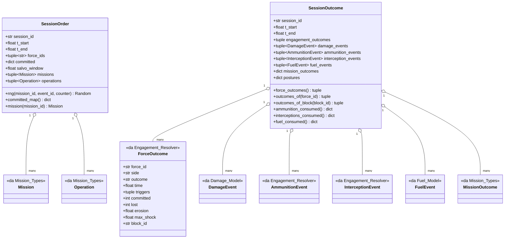
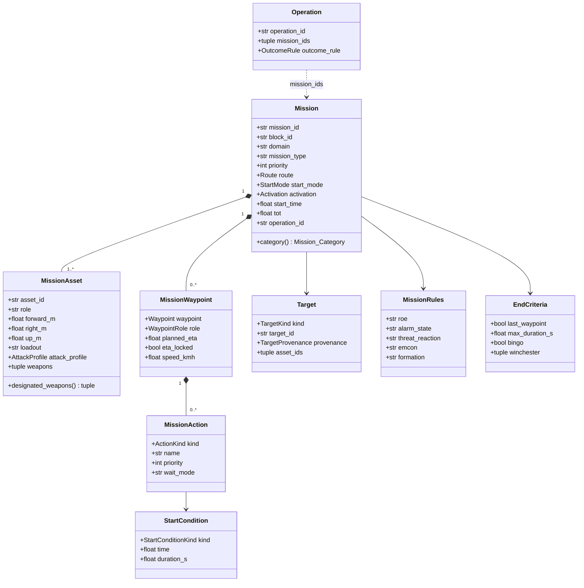
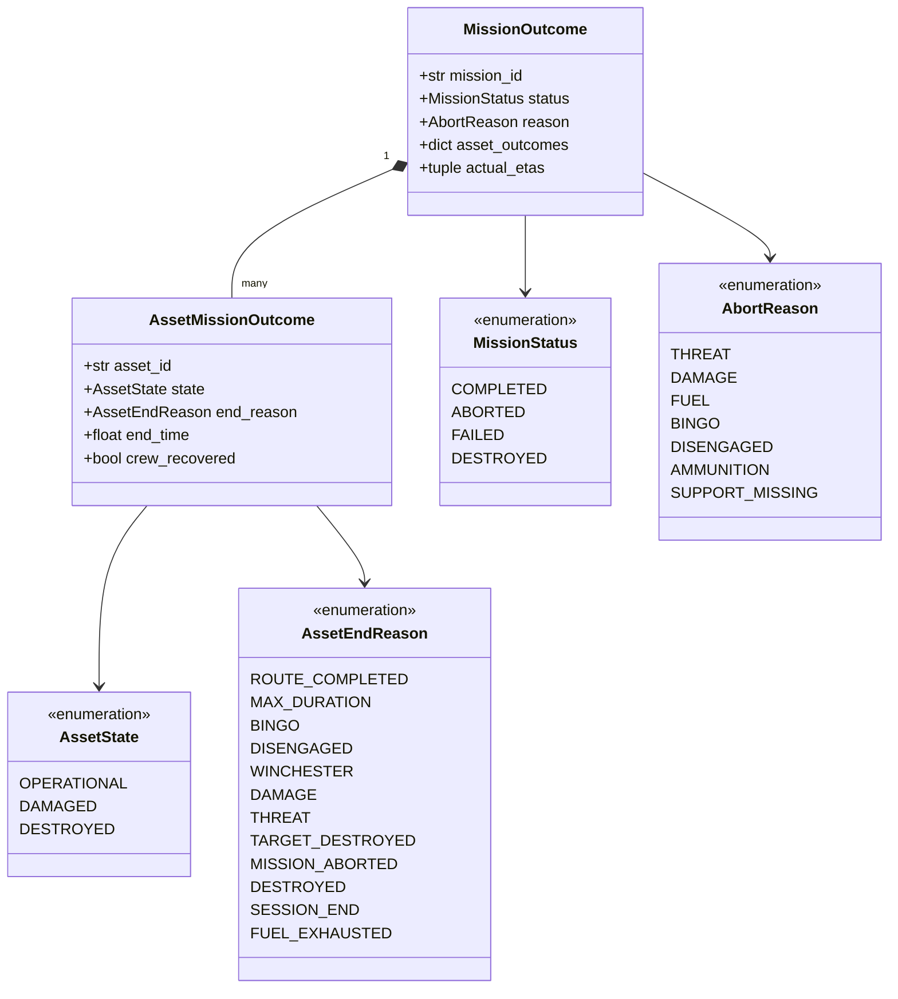
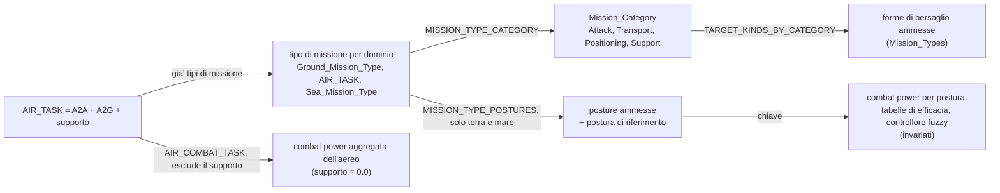

# Capitolo 2 — Lo strato 0: il contratto delle porte

Moduli: `Command/Session_Types.py` (le due porte) e, dalla fase F3 del piano della Missione
(`533cd1f5`), `Command/Mission_Types.py` (i tipi di dominio della Missione che attraversano la porta,
§2.6) con la tassonomia dei tipi di missione di `Context/Context.py` (§2.7).

> **Aggiornamento a `dcedc541` (2026-10-20; fase F7 della Missione: F7a 2026-10-18, F7b 2026-10-20).** Le porte
> (`SessionOrder`, `SessionOutcome`, `assemble_session_outcome`) **non cambiano**: `Command/Session_Types.py` passa da 556 a
> 558 righe per un solo docstring (pulizia documentale `d1686b28`, voce 17 di §9.6). Cambiano i **tipi della Missione**
> (`Command/Mission_Types.py`, da 1250 a 1341 righe, §2.6): **`Target.asset_ids`** (sottoinsieme esplicito di un bersaglio
> `GROUP`), **`MissionAsset.weapons`** e la proprietà `designated_weapons` (armi designate), la costante
> **`FIRE_AT_POINT_ACTION = 'Fire_At_Point'`** con la sua validazione (`Mission._validate_fire_actions`), e il fatto che il
> motore ora **legge** `Mission.target`, `Mission.rules.roe` e `MissionAsset.weapons` (non più "solo validati": capitolo 4
> §4.32, capitolo 6 §6.22). In `Context/Context.py` (da 2149 a 2225 righe, §2.7) la tabella della **politica d'armi per tipo di
> missione** (`MISSION_WEAPON_POLICY`). I riferimenti `:riga` di questo capitolo sono ricalcolati su `dcedc541`.
>
> Aggiornamento precedente, a `a784a9e7` (2026-10-18; fasi F5, F6 e passi G1-G5 della Missione). Le porte non cambiano
> di struttura da `84a47670`; cambia ciò che vi transita. `SessionOutcome` ha un campo nuovo, **`postures`**
> (la postura di ogni asset a fine sessione, F5-B, §2.3), e `assemble_session_outcome` un parametro nuovo,
> **`chained`** (G4a, §2.4). Nei tipi della Missione (§2.6): **`Operation` non ha più il TOT comune** (il TOT è
> di ogni missione), **`AssetMissionOutcome.crew_recovered`**, due motivi nuovi di fine asset
> (`FUEL_EXHAUSTED`, `DISENGAGED`) e uno di aborto (`DISENGAGED`; `BINGO` esisteva solo per l'asset), e i
> `EndCriteria` non sono più "solo validati": il motore li legge (F6-B1/B2). Un `ForceOutcome` è ora **uno per
> episodio d'ingaggio e per forza** (G4a, §2.3). (A `a784a9e7` `Command/Session_Types.py` aveva 556 righe,
> `Command/Mission_Types.py` 1250.)
>
> Aggiornamento precedente, a `84a47670` (fase F4 della Missione, 2026-10-05/11): le porte non cambiavano di
> forma, cambiava il **significato di `force_id`** negli esiti: dalla F4b la forza d'ingaggio è la **missione**,
> quindi `ForceOutcome.force_id` è il `mission_id` e `ForceOutcome` ha un campo `block_id` (§2.3);
> `SessionOutcome` ha un metodo `outcomes_of_block` (§2.3); `SessionOrder.committed` resta chiavato per blocco ma
> è applicato per missione (§2.2); il `mission_id` entra nell'RNG di sessione attraverso l'`event_id` (§2.8).

## 2.1 Scopo

Definisce le due "porte" di dominio a cui qualunque esecutore di sessione deve conformarsi: il
risolutore sintetico del core oggi, un adapter DCS domani
(`Command/Session_Types.py:4-18`). `SessionOrder` è la porta di ingresso (core → sessione),
`SessionOutcome` la porta di uscita (sessione → core). Il modulo non contiene alcuna logica di
calcolo oltre a validazione e aggregazione — stesso stile di `Command/Command_Types.py`
(`Command/Session_Types.py:38-40`).

**Aggiornamento a `533cd1f5` (fase F3 della Missione, 2026-10-05).** Alla stesura iniziale la porta non
portava nessuna missione: rotte, partenze e velocità degli asset entravano in `run_session` come tre
mappe separate. Ora `SessionOrder` porta le `Mission` e le `Operation` (`Command/Session_Types.py:20-26`) e
`SessionOutcome` porta l'esito di ogni missione (`mission_outcomes`): **le missioni sono l'unica
strada** con cui un asset riceve rotta, partenza e velocità in una sessione (le tre mappe sono state
rimosse da `run_session`, capitolo 6 §6.1). La Missione è un tipo di dominio: stringhe (id), secondi
dall'inizio della sessione, metri, km/h, enum di valori di dominio — nessun concetto del simulatore
(§2.6, §2.9).

Cosa **non** c'è, di proposito (`Command/Session_Types.py:28-36`): nessun concetto che il codice
non ha ancora — obiettivi di campagna, finestre di sessione di campagna (fase F8), re-scheduling (il
livello superiore nascerà con il futuro `Theater_Session_Manager`); nessuna scrittura in
`Campaign_State`; nessun componente LLM.

## 2.2 `SessionOrder` — porta di ingresso

`Command/Session_Types.py:139-311`. Dataclass frozen. Campi (`:175-182`):

| Campo | Tipo | Significato |
|---|---|---|
| `session_id` | `str` | Id di dominio della sessione. È anche la **radice del seed**: tutte le estrazioni della sessione derivano da `Session_Rng.session_seed(session_id, ...)`. |
| `t_start` | `float` | Inizio sessione, secondi assoluti. |
| `t_end` | `Optional[float]` | Fine dichiarata; `None` = sessione aperta, la durata la decide l'esecutore (v. capitolo 6, §6.6). |
| `force_ids` | `Tuple[str, ...]` | Id di dominio delle forze coinvolte (i `Military.name`). |
| `committed` | `Optional[Mapping[str, Tuple[str, ...]]]` | `{force_id: (asset_id, ...)}` per impegnare solo una parte di una forza; stessa forma di `resolve_engagement(committed=...)`. **Chiavato per BLOCCO** (i `force_ids` della porta sono blocchi) anche dopo la F4b: `Session_Simulator` lo traduce per forza d'ingaggio, intersecando la restrizione del blocco con gli asset di ciascuna missione (`_engagement_committed`, capitolo 6 §6.12). |
| `salvo_window` | `float` | Secondi che raggruppano impatti successivi in un unico evento-salva, passato tale e quale a `resolve_engagement` (default 0.0). |
| `missions` | `Tuple[Mission, ...]` | Le missioni della sessione (F3), default nessuna. Gli asset senza missione non si muovono (dalla F4c gli aerei sono a terra e le unità di superficie in difesa); gli asset di missione, dalla F5, sono presenti anche fuori dalla rotta (docstring riscritto da `d1686b28`, `Command/Session_Types.py:163-166`). |
| `operations` | `Tuple[Operation, ...]` | Le operazioni della sessione (F3), default nessuna. |

Metodi: `rng(mission_id=None, event_id=None, counter=0)` (`Command/Session_Types.py:305-307`)
restituisce il `random.Random` di questa sessione per la chiave data; `committed_map()`
(`:309-311`) converte `committed` in un dict ordinario per `resolve_engagement`;
`mission(mission_id)` (`:297-303`) restituisce la missione dell'ordine o solleva `KeyError`.

**Validazione di `missions` e `operations`** (`_validate_missions`, `:236-259`;
`_validate_operations`, `:261-295`; solo validazione strutturale, l'appartenenza degli asset al
blocco si verifica con gli oggetti del modello in `run_session`, capitolo 6 §6.1):

- `mission_id` unici nell'ordine;
- `block_id` di ogni missione fra i `force_ids`, se `force_ids` non è vuoto;
- un asset in **al più una** missione della sessione (regola dell'utente, 2026-10-05); un blocco può
  invece avere **più missioni nella stessa sessione** (es. fighter e fighter-bomber nella stessa
  missione, ciascuno col proprio loadout, oppure in due missioni distinte);
- `operation_id` unici; ogni `mission_ids` di un'operazione riferisce missioni di **questo** ordine; una
  missione sta in al più un'operazione e, se dichiara un `operation_id`, deve essere quello
  dell'operazione che la elenca.

## 2.3 `SessionOutcome` — porta di uscita

`Command/Session_Types.py:316-428`. Dataclass frozen, immutabile.

| Campo | Tipo | Significato |
|---|---|---|
| `session_id`, `t_start`, `t_end` | | Intervallo effettivamente coperto (`t_start`/`t_end` possono essere `None` se la sessione non ha prodotto nulla). |
| `engagement_outcomes` | `Tuple[Tuple[ForceOutcome, ...], ...]` | Per ogni ingaggio, nell'ordine di risoluzione, gli esiti delle forze coinvolte. Tenuti raggruppati per ingaggio: un `ForceOutcome` è relativo al SUO ingaggio (v. §2.5). |
| `damage_events` | `Tuple[DamageEvent, ...]` | Ordinati per tempo (v. §2.4). |
| `ammunition_events` | `Tuple[AmmunitionEvent, ...]` | Solo fuoco offensivo (salve), non intercettazioni. |
| `interception_events` | `Tuple[InterceptionEvent, ...]` | Solo intercettazioni. |
| `fuel_events` | `Tuple[FuelEvent, ...]` | Consumo carburante per movimento. |
| `mission_outcomes` | `Mapping[str, MissionOutcome]` | `{mission_id: MissionOutcome}`, mapping immutabile (`MappingProxyType`), una voce per missione dell'ordine (F3); vuoto se l'ordine non ha missioni. La chiave deve coincidere con `MissionOutcome.mission_id` (`_check_mission_outcomes`, `:96-117`). |
| `postures` | `Mapping[str, str]` | `{asset_id: postura}` **a fine sessione** (F5-B, deviazione 12 del piano), mapping immutabile ordinato per id (`_check_postures`, `:120-130`): **tutti** gli asset delle forze passate, anche di blocchi senza missioni e senza contatti. Etichette di dominio: il tipo di missione per un aereo in volo, `parking_cold` per un aereo a terra, `Defense` per terra e mare fermi, `off_scene` per un aereo uscito di scena, `destroyed` per un asset distrutto (capitolo 6 §6.15). Valorizzato da `Session_Simulator`; vuoto se l'esecutore non le riporta. |

**Dal G4a gli ingaggi della porta sono *episodi*.** `engagement_outcomes` ha una tupla interna per ogni
`resolve_engagement`, e dal G4a l'orchestratore ne esegue una per **episodio d'ingaggio** (capitolo 6 §6.20), non
più una per componente connessa di forze: una stessa forza che combatte in due momenti distinti della sessione
compare quindi con **due** `ForceOutcome` (uno per episodio), e `outcomes_of(force_id)` ne restituisce due, nell'ordine
di risoluzione. Anche i `fuel_events` hanno una forma nuova: dalla F6-A uno **per tratto** (con `t_start`,
`duration`, `stationary`) e dal G3 un evento **istantaneo** di consumo in ingaggio con `regime = 'engagement'`
(capitolo 5 §5.2).

Nessuno di questi tipi atomici è duplicato qui: `ForceOutcome`/`AmmunitionEvent`/
`InterceptionEvent`/`EngagementResult` vengono da `Logic/Engagement_Resolver.py`, `DamageEvent`
da `Logic/Damage_Model.py`, `FuelEvent` da `Logic/Fuel_Model.py`, `MissionOutcome` da
`Command/Mission_Types.py` (`Command/Session_Types.py:16-18`, `:20-26`). Il modulo definisce solo i
contenitori.

Metodi di lettura (nessuna mutazione, nessun ricalcolo): `force_outcomes`
(`:361-364`, appiattisce tutti gli esiti di forza), `outcomes_of(force_id)` (`:366-368`),
`outcomes_of_block(block_id)` (`:370-379`, nuovo dalla F4b, v. sotto),
`ammunition_consumed()` (`:381-395`, colpi sparati offensivamente per asset),
`ammunition_consumed_by_weapon()` (`:397-410`, `{asset: {arma | None: unità}}`: la scorta per arma
non va appiattita all'uscita, è la forma che la porta verso il simulatore riceverà dall'altro lato),
`interceptions_consumed()` (`:412-419`), `fuel_consumed()` (`:421-428`).

**L'esito di un blocco è un insieme di esiti, non un esito** (F4b, `outcomes_of_block`,
`Command/Session_Types.py:370-379`). Dalla F4b `ForceOutcome.force_id` è l'id della **forza d'ingaggio**,
cioè il `mission_id` di una missione; il nuovo campo `ForceOutcome.block_id` dice a quale blocco appartiene
la missione (`Logic/Engagement_Resolver.py:927-964`, campo a `:963`). Per la **vista residua** degli asset
senza missione (capitolo 6 §6.12) `force_id` è l'id del blocco e `block_id` è l'id del blocco; per un
**blocco senza missioni** (passato al risolutore com'è) `force_id` è l'id del blocco e `block_id` è `None`.
`outcomes_of_block(block_id)` restituisce gli esiti delle forze d'ingaggio del blocco nell'ordine degli
ingaggi: quelli con `block_id` uguale, più quelli con `block_id` assente e `force_id` uguale all'id del
blocco. **Non esiste un `ForceOutcome` sintetico per il blocco**: due missioni dello stesso blocco hanno
combattuto e disingaggiato separatamente (capitolo 4 §4.27), e fondere erosione, perdite e stato di forze
che hanno combattuto separatamente vorrebbe dire reinventarne la semantica (stessa ragione per cui
`SessionOutcome` non fonde gli esiti di ingaggi diversi, `Logic/Session_Simulator.py:150-155`). Una missione
è dunque `DESTROYED`, `DISENGAGED` o `HELD` a prescindere dal destino delle altre missioni del suo blocco.

Nota sul conteggio munizioni (`Command/Session_Types.py:382-388`): fino al 2026-09-23
`ammunition_consumed()` sommava anche le intercettazioni; ora sono due contatori distinti per
scopo — fuoco offensivo e intercettazione restano due eventi diversi anche quando è la stessa
arma a farli entrambi (v. capitolo 4, §4.4). **Aggiornamento 2026-09-26** (v. capitolo 4, §4.19):
per un'arma modellata per scorta che ha anche un ruolo antiaereo, le due voci
(`ammunition_consumed()` e `interceptions_consumed()`) scalano la **stessa** voce fisica di
`Mobile.stores` — il calo totale della scorta fisica di quel modello d'arma è quindi la somma dei
due conteggi, non più solo per il caso speciale del "SAM puro" (regola ormai eliminata,
`Mobile.interceptor_shares_ammunition` non esiste più), ma per costruzione per ogni asset con
scorta per arma.

## 2.4 `assemble_session_outcome` — la funzione pura di aggregazione

`Command/Session_Types.py:440-545`. Firma:

```python
assemble_session_outcome(session_id, engagement_results, fuel_events=(),
                          t_start=None, t_end=None, mission_outcomes=None, postures=None,
                          chained=False) -> SessionOutcome
```

Aggrega gli esiti di più chiamate a `resolve_engagement` (dal G4a una per episodio d'ingaggio, prima una per
componente connessa di forze, v. capitolo 6) in un unico `SessionOutcome`. `postures` (F5-B) è riportato **tale e
quale**, come `mission_outcomes` (`None` = nessuna); `chained` (G4a) dichiara che l'esecutore ha applicato ogni
esito prima di risolvere il successivo (v. il limite noto qui sotto). È una **funzione pura**: non tocca alcun asset, non
scrive `Campaign_State`, non estrae numeri casuali (`:449-451`). `mission_outcomes` (F3) sono
riportati **tali e quali** (`None` = nessuna missione): sono già calcolati dall'esecutore, la funzione
non li ricalcola (`:463-466`, `:544-545`).

Regole rilevanti:

- I risultati `None` (che `resolve_engagement` restituisce quando un ingaggio non è risolvibile,
  v. capitolo 4) sono saltati con un log di debug, non un errore (`:498-502`).
- **Ordine degli eventi nel risultato**: per ciascun tipo, ordinamento **stabile** per `time`
  sulla concatenazione degli eventi nell'ordine degli ingaggi (`:472-476`, `:519-523`). Dentro un
  ingaggio gli eventi sono già in ordine di tempo non decrescente (la coda del risolutore); a
  parità di istante fra ingaggi diversi vale l'ordine degli ingaggi. Stesso input → stesso
  output.
- Se `t_start`/`t_end` sono dichiarati, ogni ingaggio ed evento deve caderci dentro, altrimenti
  `ValueError` (`:530-534`); se non dichiarati, sono ricavati come min/max delle attività
  (`:525-528`, `:537-538`).
- **Limite noto, dichiarato** (`_warn_shared_targets`, `:548-558`): se due ingaggi della stessa sessione
  coinvolgono lo stesso asset e sono stati risolti **senza** applicare il primo esito prima di risolvere il
  secondo, i campi `health_before`/`health_after` dei loro `DamageEvent` non sono concatenabili (ogni ingaggio ha
  letto la salute di partenza). I delta restano applicabili in sequenza; un warning segnala il caso. Evitarlo è
  responsabilità dell'orchestratore. Dalla Fase 6 risolveva ogni **componente connessa** con una sola chiamata
  (componenti disgiunte: il limite non si presentava); **dal G4a** lo stesso asset può comparire in più episodi
  della sessione, ma l'orchestratore applica **subito** l'esito di ciascuno, quindi gli episodi successivi partono
  dallo stato già consumato e i `health_before`/`health_after` sono concatenati: passa `chained=True`, e
  `assemble_session_outcome` **non emette più il warning** (`if not chained: _warn_shared_targets(...)`, `:516-517`).
  Il default `False` conserva il comportamento di prima per chi chiama la funzione da altrove.

## 2.5 Diagramma D2 — tipi di dominio delle porte



I tipi con lo stereotipo `<<da ...>>` sono definiti nel loro modulo di origine (capitoli 4 e 5 e,
per `Mission`/`Operation`/`MissionOutcome`, §2.6) e solo riesposti come contenuto delle porte:
`Session_Types.py` non li ridefinisce (v. §2.1). `mission_outcomes` è in realtà un mapping
`{mission_id: MissionOutcome}`: il diagramma lo mostra come composizione per leggibilità.
`ForceOutcome` è mostrato con i soli campi che interessano la porta (i campi della soglia di rottura sono nel
diagramma D4, capitolo 4); `block_id` e `outcomes_of_block` sono dalla F4b, `postures` dalla F5-B (§2.3).
Il campo `engagement_outcomes` è in realtà una tupla **di tuple** di `ForceOutcome`
(una tupla interna per ogni ingaggio, v. §2.3): il diagramma lo mostra semplificato a `tuple` per
restare leggibile in sintassi mermaid; la relazione di composizione con `ForceOutcome` sotto
resta corretta nella cardinalità "molti".

## 2.6 La Missione: `Command/Mission_Types.py` (fase F1, 2026-10-05, commit `20b6de72`, `680dfcb6`)

Modulo nuovo (1189 righe alla F3, 1250 a `a784a9e7`, **1341 a `dcedc541`**) con i tipi di dominio della **Missione**, dalle decisioni D1-D6 e N1-N3 di
`Analysis/Document/Proposta_Struttura_Missione_Decisioni.md` e dal piano
`Analysis/Document/Piano_Implementazione_Missione.md` (fasi F0-F9; a `dcedc541` sono fatte F0-F7 — F4a, F4b, F4b+, F4b++, F4c, F5-A/B/C, F6-A, F6-B1, F6-B2/B2bis, F7a, F7b — più i passi G1-G5 del modello di bingo; restano F8-F9, v.
capitolo 9 §9.5). Stile di `Command/Attack_Types.py` e `Command/Session_Types.py`: dataclass immutabili,
validazione in `__post_init__`, mapping resi immutabili con `MappingProxyType`; dipendenze `sympy`,
`Context`, `DataType` e `Command.Attack_Types`, **nessun** modulo di `Logic` (nessun ciclo d'import,
`Command/Mission_Types.py:1-63`; `:35-40` "Cosa NON c'è"; le due sezioni "Fuoco su posizione (F7b)" e "Regole d'ingaggio di missione (F7a)", `:42-51`,
dicono che questo modulo resta **solo validazione strutturale** anche se il motore ora ne legge bersaglio, ROE e armi designate). Contiene solo **struttura e validazione**: nessuna logica di calcolo
(ETA derivate, posizioni di formazione, esito di un'operazione): dalla F3 la logica che ricava rotta,
partenza e velocità per asset è in `Logic/Mission_Adapter` (capitolo 6 §6.10), e l'esito di missione lo
produce `Logic/Session_Simulator` (capitolo 6 §6.11).

**Terminologia** (D3.a, dal documento originale dell'utente): **Missione** = azioni di attacco,
trasporto, posizionamento o supporto svolte da asset di **un solo** blocco, con un bersaglio (o nessuno),
una rotta di riferimento e le direttive (ROE, ...); **Operazione** = insieme facoltativo di missioni
(anche di blocchi diversi) per uno stesso scopo, con una regola d'esito. **Nessun TOT comune** (decisione dell'utente
del 2026-10-12, commit `03d77640`): il TOT è di **ogni** missione (`Mission.tot`), anche nella stessa Operazione
(per esempio uno sweep di caccia che anticipa di qualche minuto l'arrivo dello strike sulla stessa zona ha un TOT
diverso da quello dei bombardieri).

### I tipi

| Tipo | Contenuto | Riga |
|---|---|---|
| `Target` | forma `TargetKind` (`ASSET`, `GROUP`, `POINT`, `AREA`, `ZONE`, `NONE`) e **provenienza** `TargetProvenance` (`OBSERVED`: `target_id` + `observed_at`; `ESTIMATED`: posizione + `estimated_at` + `uncertainty_m`). Gli istanti possono essere negativi (osservazione precedente alla sessione). Un `ASSET`/`GROUP` è sempre `OBSERVED`: una posizione stimata è un bersaglio `POINT`/`AREA`. **`asset_ids`** (F7a, decisione 9 del 2026-10-18, `:477`): per un `GROUP`, il sottoinsieme *esplicito* di asset del gruppo `target_id` (id di dominio non vuoti e distinti; vuoto = tutto il gruppo); con una forma diversa da `GROUP` è `ValueError` (`:495-506`). Il fuoco su posizione (F7b) usa la posizione **stimata** (`target.position`), non quella vera (nebbia di guerra, N3.e: capitolo 6 §6.23) | `:444-552` |
| `StartCondition` | condizione d'avvio **pre-calcolabile** di un'azione: `ON_ARRIVAL`, `AT_TIME` (istante), `AFTER_DURATION` (secondi dall'arrivo); nessuna dipende dallo stato della sessione | `:557-595` |
| `MissionAction` | `ActionKind` (`TASK`, `RULE`, `COMMAND`, `WAIT`), nome di dominio, `params` (mapping immutabile, valori non validati dall'azione), priorità (0 = massima), `StartCondition`; per `WAIT`: `wait_mode` (`hold`/`orbit`) e **uno** fra `wait_duration_s` e `wait_until`. Dalla F7b l'azione `TASK` di nome **`FIRE_AT_POINT_ACTION = 'Fire_At_Point'`** (`:305`) con `params = {'rounds': int >= 1, 'weapon': id (facoltativo)}` è una missione di fuoco su posizione: la valida `Mission._validate_fire_actions` (sotto) e la legge `Logic/Area_Fire` (capitolo 6 §6.23) | `:598-653` |
| `MissionWaypoint` | **contiene** un `DataType.Waypoint` (lo stesso oggetto della `Route`): ruolo `WaypointRole` (12 valori: `DEPARTURE`, `JOIN`, `NAV`, `IP`, `ATTACK`, `EGRESS`, `SPLIT`, `LAND`, `STATION`, `ASSEMBLY`, `OBJECTIVE`, `HOLD`), ETA pianificata (`planned_eta`, `eta_locked` = istante bloccato), velocità del tratto in arrivo, riferimento di quota (`MSL`/`AGL`), azioni | `:656-706` |
| `MissionAsset` | `asset_id`, **ruolo = posizione nella formazione**, offset di formazione (`forward_m`, `right_m`, `up_m` nella terna della direzione di marcia), `loadout` e `attack_profile` **per asset** (solo aria). **`weapons`** (F7a, decisione 10 del 2026-10-18, `:742`, **tutti i domini**): le armi *designate*, id di modello del registro d'arma, distinte; sul bersaglio designato si usano solo queste, sui non designati sono *riservate* (escluse). La proprietà `designated_weapons` (`:773-781`) dà `weapons`, altrimenti l'arma di `attack_profile`, altrimenti `()`; se `weapons` e `attack_profile` sono entrambi dichiarati l'arma del profilo deve essere fra le `weapons` (`ValueError`) | `:714-781` |
| `EndCriteria` | criteri di fine **dichiarati**: `last_waypoint` (default `True`), `max_duration_s`, `bingo` (default `True`), `winchester` (categorie d'arma), `abort_on_threat`, `damage_threshold`, `target_destroyed`; almeno uno fra `last_waypoint` e `max_duration_s`. **Letti dal motore** (F6-B1/B2): `winchester`, `damage_threshold`, `target_destroyed` (bersaglio `ASSET`, o `GROUP` eventualmente ristretto da `Target.asset_ids`, F7a; per `POINT`/`AREA`/`ZONE` il criterio non è rappresentabile — decisione 12 della F7a: non c'è nessun asset da distruggere, nemmeno per una missione di fuoco su posizione — ed è ignorato con un warning), `max_duration_s` e `bingo`; **non letti** `abort_on_threat` (fuori dal piano della F6) e `last_waypoint` (la rotta completata è sempre una fine, anche con `False`); `bingo=False` = la missione non rientra al bingo (capitolo 6 §6.18-6.19) | `:784-859` |
| `MissionRules` | ROE, stato di allerta, reazione alla minaccia, EMCON, formazione; un campo `None` = default del dominio, risolto da `for_domain`. **Letta dal motore dalla F7a la sola `roe`** (capitolo 4 §4.32); allerta, reazione alla minaccia, EMCON e formazione restano validate e portate dalla porta ma **non lette** da `Logic`. ROE per dominio (`:237-241`): aria `weapon_free`, `priority_designated`, `only_designated`, `return_fire`, `weapon_hold`; terra e mare solo `weapon_free`, `return_fire`, `weapon_hold` | `:865-907` |
| `Mission` | `mission_id`, `block_id`, `domain`, `mission_type`, asset, bersaglio, priorità, rotta di riferimento (`DataType.Route`) e `MissionWaypoint`, `start_time`, `start_mode`, `activation`, `tot`, regole, criteri di fine, `operation_id`; dalla F7b valida anche le azioni di fuoco su posizione (`_validate_fire_actions`) | `:912-1147` |
| `Operation` | `operation_id`, scopo, `mission_ids`, `OutcomeRule` (`MAIN_MISSION`, `ALL`, `ANY`), `main_mission_id`; **senza `tot`** (rimosso il 2026-10-12: passare `tot=` è un `TypeError`) | `:1182-1223` |
| `AssetMissionOutcome` | `asset_id`, `AssetState` (`OPERATIONAL`, `DAMAGED`, `DESTROYED`), `AssetEndReason` (**12 valori**: `ROUTE_COMPLETED`, `MAX_DURATION`, `BINGO`, **`DISENGAGED`**, `WINCHESTER`, `DAMAGE`, `THREAT`, `TARGET_DESTROYED`, `MISSION_ABORTED`, `DESTROYED`, `SESSION_END`, **`FUEL_EXHAUSTED`**), istante di fine, **`crew_recovered`** (`Optional[bool]`, G2: `True` per l'aereo *perso per esaurimento del carburante in volo*, `None` altrimenti, comprese le perdite in combattimento — l'equipaggio non è modellato; un valore booleano è ammesso solo con stato `DESTROYED`). Invarianti: `end_reason DESTROYED` richiede `state DESTROYED`; `state DESTROYED` ammette `DESTROYED` (combattimento) o `FUEL_EXHAUSTED` (aereo a secco senza base raggiungibile in planata) | `:1228-1274` |
| `MissionOutcome` | `MissionStatus` (`COMPLETED`, `ABORTED` con `AbortReason`, `FAILED`, `DESTROYED`), esiti per asset, ETA effettive per waypoint (in sessione gli istanti d'**arrivo** ai punti, attese comprese: N2.b). `AbortReason` ha **7 valori**: `THREAT`, `DAMAGE`, `FUEL`, **`BINGO`**, **`DISENGAGED`**, `AMMUNITION`, `SUPPORT_MISSING` (`THREAT` e `SUPPORT_MISSING` non sono prodotti) | `:1275-1341` |

La rotta resta **geometrica** (`DataType.Route`, decisione N2.a = C): tempi, ruoli e azioni dei punti
vivono in `MissionWaypoint`, che *contiene* il waypoint. `route_waypoints(route)` (`:423-439`) dà i
waypoint nell'ordine di percorrenza (l'ordine di inserimento di `route.edges`; `Route.getWaypoints()` non
serve, è un heap ordinato per nome).

### Validazioni di `Mission` (`__post_init__`, `:958-1000`, e sottofunzioni)

- `mission_type` è una chiave di `Context.MISSION_TYPES[domain]` (§2.7);
- **asset** (`_validate_assets`, `:1002-1022`): almeno uno, id distinti, ruolo ammesso per il dominio
  (`MISSION_ASSET_ROLES`), `loadout`/`attack_profile` solo in missioni aeree;
- **bersaglio coerente con la categoria** (`TARGET_KINDS_BY_CATEGORY`, `:291-297`): `ATTACK` accetta
  asset/gruppo/punto/area/zona; `TRANSPORT` e `POSITIONING` zona/punto/area/gruppo; `SUPPORT`
  zona/punto/nessuno;
- **rotta e waypoint** (`_validate_route_and_waypoints`, `:1024-1045`): `route_type` ammesso per il dominio
  (`ROUTE_TYPES_BY_DOMAIN`); se c'è la rotta, i `MissionWaypoint` devono contenere **gli stessi oggetti**
  waypoint, nello stesso ordine; una missione aerea ha sempre waypoint;
- **partenza** (`_validate_start`, `:1073-1100`): `start_mode` ammesso e di default per dominio (aria:
  `PARKING_COLD`, dal parcheggio a motori spenti; terra e mare: `GROUND`); una missione aerea non già in
  volo inizia con un waypoint `DEPARTURE` e **finisce con `LAND`** (D2.c); `ON_EVENT` richiede
  `activation_event` ed è **solo dichiarabile**: nessun esecutore lo esegue (re-scheduling non
  implementato);
- **tempi** (`_validate_times`, `:1102-1134`): almeno **un istante bloccato** (`start_time`, `tot` o un
  waypoint con `eta_locked`); ETA pianificate strettamente crescenti e non anteriori a `start_time`;
  `tot` non anteriore a `start_time`;
- **azioni di fuoco su posizione** (`_validate_fire_actions`, `:1047-1070`, F7b, chiamata da `__post_init__` a `:980`): un'azione di
  nome `FIRE_AT_POINT_ACTION` deve essere `TASK`, solo in missioni di **terra o di mare** (mai `air`), con bersaglio `POINT` o
  `AREA`, `params['rounds']` intero ≥ 1 (bool escluso) e `params['weapon']` facoltativo (id di dominio); altrimenti `ValueError`.
  Non dipende da nessun interruttore;
- le regole sono conservate **già risolte** per il dominio; `target_destroyed` richiede un bersaglio
  distruggibile (non `NONE`/`ZONE`).

`check_mission_assets(mission, block)` (`:1150-1177`) è separata dal costruttore: verifica che il
blocco sia quello della missione e che ogni asset ne faccia parte, con il criterio d'identità del
motore (`id`, poi `name`) sugli oggetti, non sulle chiavi del dizionario; la chiama `run_session`
(capitolo 6 §6.1). `MissionOutcome` impone la coerenza: `reason` obbligatorio se e solo se `ABORTED`;
`DESTROYED` se e solo se tutti gli asset sono distrutti; ETA effettive non decrescenti
(`:1276-1341`).

### Elenchi chiusi

`MISSION_ASSET_ROLES` (`:230-234`), `FORMATIONS` (`:256-260`), `DEFAULT_RULES` (`:265-272`),
`DEFAULT_START_MODE` (`:281-283`) e i default del bingo sono **rivisti e confermati dall'utente il
2026-10-05**; `EMCON_STATES` (`:252`) e `THREAT_REACTIONS` (`:248-249`) restano di **prima stesura**
(stime di progetto, non dati tarati; la seconda è il vocabolario di DCS reso di dominio). Indicazione
dell'utente (2026-10-05, commit `680dfcb6`): **lead/wingman sono ruoli, strike/SEAD/scorta sono tipi di
missione** — i ruoli sono posizioni nella formazione e nella catena di comando della missione (aria:
`lead`, `element_lead`, `wingman`; terra: `lead`, `main`, `rear`; mare: `lead`, `main`, `screen`), ciò
che un asset *fa* dipende dal tipo di missione e dal **suo** loadout. Default delle regole per dominio:
ROE `weapon_free`, reazione `evade_fire` (aria), allerta `auto` (terra e mare), EMCON `free`,
formazione `None` (lasciata alla dottrina dell'esecutore). Valori d'ammissibilità: ROE aria a 5 livelli,
terra/mare a 3; allerta solo terra/mare; reazione alla minaccia solo aria.

**Vincolo simulator-agnostic**: solo id di dominio (stringhe), secondi dall'inizio della sessione, metri,
km/h; le regole sono valori di dominio che un adapter tradurrà nel proprio vocabolario (DCS è stato solo
uno spunto per gli elenchi, `Command/Mission_Types.py:24-33`).

### Diagramma D16 — modello dei tipi della Missione (e, più sotto, D17: esiti)



D16 è aggiornato a `dcedc541` (F7a: `Target.asset_ids`, `MissionAsset.weapons` e `designated_weapons`).
I due ultimi attributi di `Mission` non mostrati (`waypoints`, `assets`) sono le tuple delle composizioni
sopra; `Mission.rules` è sempre un `MissionRules` già risolto (`for_domain`). Gli **esiti** hanno un
diagramma a parte, perché sono prodotti dall'esecutore e non dal pianificatore:

*Diagramma D17 — esiti della Missione (`MissionOutcome`, `AssetMissionOutcome` e relativi enum). Aggiornato a
`a784a9e7`: `crew_recovered`, i motivi `FUEL_EXHAUSTED`/`DISENGAGED`/`BINGO` e l'enum `AssetEndReason`.*



## 2.7 La tassonomia dei tipi di missione in `Context/Context.py` (fase F2, commit `4e18d7d8`, `8f16cc3c`)

Il **tipo di missione** è un asse **separato** dalla **postura tattica** (decisione N3.f = B,
`Proposta_Struttura_Missione_Decisioni.md`): la postura (`Ground_Action`, `Sea_Task`,
`Context/Context.py:356-360`, `:437-440`) resta l'output del controllore fuzzy
(`Tactical_Evaluation.evaluateGroundTacticalAction`) e la chiave della combat power e delle tabelle di
efficacia, **invariata** (salvo il rename `Retrait` → `Retreat`, v. sotto); il tipo di missione è un
attributo della Missione, sotto un livello comune `Mission_Category`. Per ora la tabella che collega i
due assi (`MISSION_TYPE_POSTURES`) è **solo un dato**: nessun modulo di produzione la legge
(`Context/Context.py:452-467`, verificato con una ricerca sull'albero); l'unico consumatore della
tassonomia è `Mission.category` (`Command/Mission_Types.py:1138-1143`), che usa `MISSION_TYPE_CATEGORY` per
validare la forma del bersaglio. Il secondo stadio "postura → tipi di missione compatibili" andrà
progettato con il pianificatore.

| Elemento | Contenuto | Riga |
|---|---|---|
| `Mission_Category` | `Attack`, `Transport`, `Positioning`, `Support` (N3.a, con il "Supporto" di N3.a-bis); `Command/Mission_Types.py` lo riesporta come `MissionCategory` | `:468-474` |
| `Ground_Mission_Type` | `Attack`, `Defense`, `Maintain`, `Retreat` (coincidono per nome con le posture di `Ground_Action`) + `Fire_Support`, `Movement`, `Recon`, `Supply` | `:479-488` |
| `Sea_Mission_Type` | `Attack`, `Defense`, `Retreat` (coincidono con `Sea_Task`) + `Patrol`, `Escort`, `Shore_Bombardment`, `Transport` | `:493-501` |
| `Air_Support_Task` | `AWACS`, `Tanker`, `Transport`: task di **supporto**, non di combattimento | `:416-424` |
| `AIR_COMBAT_TASK` | `AIR_TO_AIR_TASK \| AIR_TO_GROUND_TASK`: i soli task aerei con un `combat_score` e che entrano nella combat power aggregata dell'aereo | `:431` |
| `AIR_TASK` | `AIR_COMBAT_TASK \| AIR_SUPPORT_TASK`: **tutti** i task aerei, cioè i tipi di missione aerea (i task di combattimento restano in testa nell'ordine di inserimento) | `:435` |
| `MISSION_TYPES` | `{dominio: tipi}`; per l'aria sono i task di `AIR_TASK` | `:506-510` |
| `MISSION_TYPE_CATEGORY` | tipo → `Mission_Category` (valori di progetto, **confermati dall'utente il 2026-10-05**) | `:515-550` |
| `MISSION_TYPE_POSTURES` | tipo → posture ammesse e postura di riferimento per la combat power (terra e mare soltanto; **confermata dall'utente il 2026-10-05**, N3.f = B) | `:558-578` |
| `mission_category_of`, `postures_for` | funzioni di lettura (sollevano `TypeError`/`ValueError` per dominio o tipo non validi; `postures_for('air', ...)` dà `ValueError`: l'aria non ha posture) | `:598-606`, `:609-624` |
| `TARGET_CLASSES`, `WEAPON_RULE_ANY`, `WEAPON_RULE_SELF_DEFENCE` | **F7a**: le quattro classi di bersaglio della politica d'armi (`air`, `air_defence`, `ship`, `surface`) e i due valori speciali di regola | `:634-644` |
| `MISSION_WEAPON_POLICY`, `mission_weapon_policy(domain, mission_type)` | **F7a**: tipo di missione aerea → `{classe di bersaglio: regola d'arma}`; terra e mare `None`; la funzione di lettura solleva `TypeError`/`ValueError` per dominio o tipo non validi | `:662-683`, `:686-700` |

Categorie dei tipi (`MISSION_TYPE_CATEGORY`): **Attack** — terra `Attack`, `Fire_Support`; aria
`Fighter_Sweep`, `Intercept`, `CAS`, `Strike`, `Pinpoint_Strike`, `SEAD`, `Anti_Ship`; mare `Attack`,
`Shore_Bombardment`. **Positioning** — terra `Defense`, `Maintain`, `Retreat`, `Movement`; aria `CAP`,
`Escort`; mare `Defense`, `Retreat`, `Patrol`, `Escort`. **Support** — terra `Recon`; aria `Recon`,
`AWACS`, `Tanker`. **Transport** — terra `Supply`; aria `Transport`; mare `Transport`.

Esempi di `MISSION_TYPE_POSTURES` (ammesse → riferimento): terra `Fire_Support` → (`Attack`, `Defense`) →
`Attack`; `Movement` → (`Maintain`, `Retreat`) → `Maintain`; `Recon` → (`Defense`, `Maintain`) → `Defense`;
`Supply` → (`Defense`) → `Defense` (nessuna postura offensiva, la combat power di autodifesa); mare
`Patrol` → (`Defense`, `Attack`) → `Defense`; `Transport` → (`Defense`, `Retreat`) → `Defense`;
`Shore_Bombardment` → (`Attack`) → `Attack`.

**La politica d'armi per tipo di missione (F7a, `9f87a3ad`).** Alla fine della sezione dei dati (`Context/Context.py:627-700`, 76
righe nuove da `a784a9e7`) sta la tabella che dice **quali armi** un aereo di una missione di un dato tipo può usare contro una
data *classe di bersaglio* (aereo in volo, difesa aerea, nave, altra superficie): una regola per classe, `any` (tutte), `self_defence` (tutte, ma solo
con `self_escort_capability` nel loadout) o un insieme di task d'arma dei registri; classe assente = non ingaggiabile. Per terra e mare
la tabella è `None` (nessun vincolo d'arma: valgono le sole ROE). I tipi di missione aerea sono i 13 di `AIR_TASK`, tutti coperti.
**È una scelta di progetto, non un dato tarato** (confermata dall'utente il 2026-10-18 riga per riga). La **tabella completa**, la
sua semantica e chi la applica (`Fire_Control.restrict_by_policy`, un involucro puro della `fire_control`, non il risolutore) sono nel
capitolo 4 §4.33; qui è solo il dato, con lo stesso statuto di `MISSION_TYPE_POSTURES` ma, a differenza di quella, **letto da
codice di produzione** (`Mission_Adapter.weapon_policies`, capitolo 6 §6.22).

**Effetti collaterali dei nuovi task aerei** (F2): `Aircraft.set_combat_power` assegna `0.0` ai task di
supporto (`Asset/Aircraft.py:480`: un AWACS o un tanker non aggiunge combat power); i punteggi per task
di `Aircraft_Data` (`:883`, `:983-995`, `:1065`) e la valutazione tattica
(`Logic/Tactical_Evaluation.py:635`) iterano su `AIR_COMBAT_TASK`, non su `AIR_TASK`, così i task di
supporto non cambiano quei valori; 13 loadout di `Aircraft_Loadouts` (AWACS, tanker, trasporti) hanno
ora un task di supporto.

**Rename `Retrait` → `Retreat`** (decisione N3, commit `1d5dc863`, 2026-10-05): `Ground_Action.RETREAT` e
`Sea_Task.RETREAT`, valore `'Retreat'` (etichetta fuzzy di `evaluateGroundTacticalAction` e test
allineati, 11 file); nessun dato salvato conteneva il valore. I documenti storici del progetto
conservano la grafia precedente.

### Diagramma D18 — i due assi: postura e tipo di missione



## 2.8 La Missione attraversa la porta: cosa fa la porta e cosa fa l'esecutore

La porta (`Session_Types`) fa solo **validazione strutturale** dell'ordine (§2.2: unicità e riferimenti).
Cinque cose restano all'esecutore, `Logic/Session_Simulator.run_session` (capitolo 6):

1. verificare che ogni missione si riferisca a un blocco passato fra le forze, che i suoi asset gli
   appartengano e che nessun tratto superi la velocità massima del mezzo più lento (regola A: `_check_missions`,
   `check_mission_assets`, `Mission_Adapter.check_mission_speed`, capitolo 6 §6.1 e §6.10);
2. ricavare da ogni missione rotta, partenza, velocità, **attese e presenza** di ogni asset
   (`Logic/Mission_Adapter`, capitolo 6 §6.10, §6.15-6.16);
3. **dalla F4b** costruire le **forze d'ingaggio** (una vista per missione, capitolo 6 §6.12) e il loro dominio
   di coordinamento (capitolo 6 §6.13): ciò che la porta chiama `force_id` negli esiti è il `mission_id`;
4. produrre il `MissionOutcome` di ogni missione. Alla F3 era una **prima forma** (completata, distrutta o non
   completata entro la sessione); **dalla F6-B1 segue la regola unica** `DESTROYED > COMPLETED > ABORTED(motivo) >
   FAILED`, con i motivi di aborto `FUEL`, `BINGO`, `DISENGAGED`, `AMMUNITION`, `DAMAGE` (capitolo 6 §6.11 e §6.18),
   che `assemble_session_outcome` riporta in `SessionOutcome.mission_outcomes`;
5. calcolare la **postura di fine sessione** di ogni asset (`SessionOutcome.postures`, capitolo 6 §6.15).

**Cosa la porta *non* chiede, e il motore non fa.** I due **validatori di pianificazione** del carburante,
`Mission_Adapter.check_mission_fuel` (minimo di pianificazione) e `Mission_Adapter.check_mission_bingo` (bingo a
priori), sono chiamate che spettano a chi *compone* l'ordine (il futuro pianificatore/C2, fase F8): **`run_session`
non le chiama**, e l'esecutore non rifiuta un ordine ma, in volo, fa rientrare l'aereo al bingo (capitolo 6 §6.19).
La porta non porta quindi un esito "ordine rifiutato per carburante".

Il **`mission_id` entra nell'RNG di sessione dalla F4b, ma attraverso l'`event_id` dell'ingaggio**, non
attraverso lo slot `mission_id` di `order.rng(...)`: l'ingaggio è fra più forze (missioni di entrambi i lati) e
nessuna ne possiede lo stream, quindi `run_session` chiama ancora `order.rng(mission_id=None, event_id=...)`
(`Logic/Session_Simulator.py:2723`, `:2731-2733`), ma l'`event_id` è `['engagement', id ordinati delle forze]` con
gli id delle **missioni** e, dal G4a, il `counter` è l'**ordinale dell'episodio** fra quelli con lo stesso insieme di
forze (capitolo 6 §6.4). Lo slot `mission_id` di `Session_Rng` era libero per le
estrazioni che appartengono a una sola missione (nessuna fino alla F7a); **dalla F7b lo usa il fuoco su posizione**, che appartiene a
UNA missione: `order.rng(mission_id=<missione>, event_id='area_fire|<missione>|<asset>|<wp>|<azione>', counter=0)`
(`Logic/Session_Simulator.py:2432`, capitolo 6 §6.23). Alla F3 il `mission_id` non entrava affatto
(fotografia identica, capitolo 8 §8.7); l'ingresso nell'RNG ha cambiato le estrazioni, e per questo la fotografia
è stata rigenerata in F4b (capitolo 8 §8.7).

## 2.9 Test di contratto esteso alle porte della Missione

Il test di agnosticismo (capitolo 8 §8.3) è stato esteso nella stessa fase F3: `Operation`,
`MissionOutcome` e `AssetMissionOutcome` sono fra i tipi della catena delle porte; gli **enum di dominio**
(valori stringa) sono ammessi come tipi di campo; la `Mission` è un tipo di dominio composto che porta la
geometria `DataType.Route` e il profilo d'attacco, accettato come foglia e coperto da
`Test/Test_Mission_Types.py`, ma i **nomi dei campi** di tutti i tipi di `Mission_Types` sono comunque
controllati contro il lessico del simulatore (`Test/Test_Session_Validation.py:141-151`, `:165-175`).
