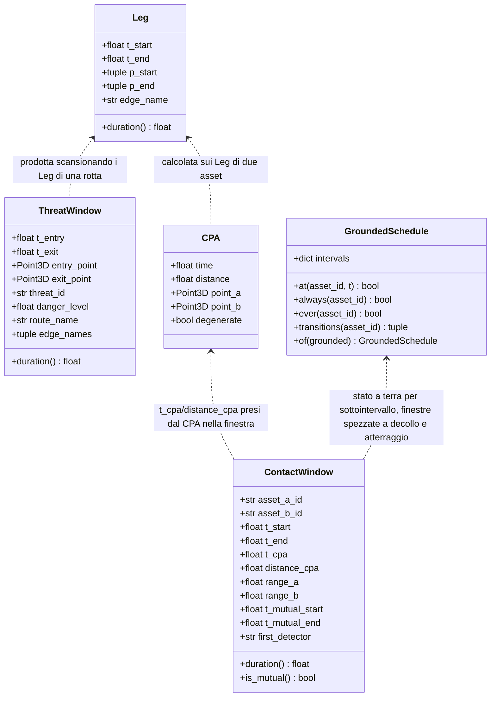

# Capitolo 3 — Lo strato 1: lo scheduler dei contatti

Modulo: `Logic/Contact_Scheduler.py`.

> **Verificato a `fa5fbf1e` (2026-10-23): il modulo è invariato da `dcedc541`** (`Logic/Contact_Scheduler.py` non compare in `git diff dcedc541..HEAD -- Code`; la
> fase F8 non lo tocca: `position_on_legs` è usata dalla porta di uscita per le `final_positions`, capitolo 6 §6.24). Cambiano solo i riferimenti ai moduli che cambiano
> (`Session_Simulator`), ricalcolati su `fa5fbf1e`; quelli a questo file restano validi.
>
> **Verificato a `dcedc541` (2026-10-20): il modulo è invariato da `a784a9e7`** (`Logic/Contact_Scheduler.py` non compare nel
> `git diff a784a9e7 HEAD`, 1578 righe come prima); i riferimenti `:riga` a questo file sono quindi quelli di `a784a9e7`, mentre sono
> stati ricalcolati su `dcedc541` quelli ai moduli che cambiano (`Session_Simulator`). La fase F7 non tocca lo scheduler: il fuoco su
> posizione non passa dallo scheduler (nessun contatto, capitolo 6 §6.23) e usa solo `Contact_Scheduler.position_on_legs` (`Logic/Contact_Scheduler.py:508-531`: posizione a un istante lungo i tratti, saturata agli estremi) per le posizioni.
>
> *Aggiornato a `a784a9e7` (2026-10-18).* Fino a `533cd1f5` il modulo era invariato rispetto a `6754bf1c`; la
> fase **F4c** (`af2efbe6`) gli aveva dato il primo concetto nuovo, l'**aereo a terra** come insieme di id. Da
> `84a47670` a `a784a9e7` (Logic/Contact_Scheduler.py passa da 1332 a 1578 righe) le novità sono quattro, tutte
> additive e a comportamento invariato quando non sono usate: (1) **`GroundedSchedule`**, lo stato "a terra"
> **dipendente dal tempo** (F5-A, `e723e82a`), con le finestre spezzate a decollo e atterraggio (§3.8); (2) il
> parametro **`legs`** di `schedule_contacts`, cioè i tratti già calcolati dal chiamante (presenza, attese,
> esaurimento del carburante, rientri; F5-B/C, F6-A); (3) **`trim_contact_window`**, il ritaglio di una finestra
> (G4a, §3.9); (4) il parametro **`only_assets`**, il ricalcolo dei contatti per i soli asset ri-pianificati (G4b,
> §3.6). Tutto il resto — rotta↔cilindro, CPA/TCPA, potatura a livello blocco — è invariato, e lo scheduler
> **non conosce le missioni né il dominio di coordinamento né il carburante**: le finestre sono per coppia di
> asset, quindi sono le stesse a prescindere da come il chiamante raggruppa gli asset in forze (capitolo 6
> §6.12). Gli argomenti `routes`/`starts`/`speeds` di `schedule_contacts` li produce
> `Logic/Mission_Adapter.session_movements` a partire dalle `Mission` dell'ordine (capitolo 6 §6.10); dalla F5-B
> la sessione passa però allo scheduler anche i tratti completi (`legs`), che hanno la precedenza. I riferimenti
> `:riga` di questo capitolo sono ricalcolati su `a784a9e7` (e restano validi a `dcedc541`).

## 3.1 Scopo e confine

Risponde a **quando** due forze si incontrano. Non risolve alcun ingaggio: non decide chi rileva
davvero (Pd), chi spara per primo (latenze di reazione), chi colpisce (Pk) — è il lavoro dello
strato 2 (`Logic/Engagement_Resolver.py`), che consuma ciò che qui viene prodotto. Il confine è
netto di proposito: questo strato è **deterministico e verificabile con la sola
trigonometria**, quello stocastico e ha bisogno dell'RNG di sessione
(`Logic/Contact_Scheduler.py:12-19`).

## 3.2 I tre meccanismi

### A — Rotta contro volume di minaccia

`threat_windows`/`route_threat_windows` (`Logic/Contact_Scheduler.py:553-637`, `:704-732`). Una
rotta attraversa il cilindro di un `ThreatAA`: si compone `Cylinder.getIntersection` (geometria
già esistente e testata) con la scansione temporale della rotta (`route_legs`, equivalente a
`Route.travelTimeToEdge` + `Route.positionAtTime`). Si lavora **solo** su `DataType.Route/Edge/
Waypoint`, il modello canonico di dominio confermato dalla decisione Q1 (v. wiki
`decisions/route-model-unification`), mai sul modello interno di `Air_Route_Manager`
(`:22-29`).

Tre casi degeneri disambiguati (`:559-575`): arco interamente dentro il cilindro (nessun
attraversamento di superficie: `getIntersection` restituirebbe `(False, None)`, indistinguibile
da "nessuna intersezione" — disambiguato con `Cylinder.innerPoint` sugli estremi); arco con un
solo estremo dentro; tangenza (un solo punto, nessun estremo interno: `getIntersection` solleva
`ValueError` "Intersezione anomala", trattato come contatto di misura nulla, non un errore di
programmazione, `:569-571`, `:652-658`). Le finestre di archi consecutivi sono **fuse**: una
rotta che entra sull'arco *i* ed esce sull'arco *i+2* produce una sola `ThreatWindow`
(`:573-575`, `_merge_threat_intervals` a `:683-701`).

### B — CPA/TCPA fra mobili

`closest_point_of_approach` (`:803-870`) e `range_intervals` (`:873-934`). Due asset su rotte
proprie: `t* = -(Δr·Δv)/|Δv|²` dà l'istante di massimo avvicinamento, valido per moto relativo
rettilineo uniforme. Poiché una rotta è una **spezzata**, il calcolo non si fa una volta sulla
rotta intera ma su ogni sottointervallo delimitato dai waypoint **di entrambe** le rotte
(`_breakpoints`, `:754-778`), dove le due velocità sono costanti per costruzione; il risultato
globale è il minimo dei minimi locali. Il caso degenere `|Δv|² ~ 0` (fermi, o paralleli alla
stessa velocità) non divide per zero: la distanza è costante e si prende l'estremo iniziale
(`:847-849`, costante `VELOCITY_EPS` a `:94-98`).

Per il rilevamento non basta il solo CPA (dice *quanto* ci si è avvicinati, non *da quando a
quando* si è stati a tiro): `range_intervals` risolve l'equazione completa
`|Δr + Δv s|² = R²` su ogni sottointervallo, e fonde gli intervalli disgiunti risultanti
(due rotte che si incrociano più volte entrano e escono dal raggio più volte, `:873-934`).

### C — Potatura gerarchica a livello `Block`

`block_pair_candidates`/`region_block_pairs` (`:1277-1374`). Valutare il CPA di tutte le coppie
di asset è O(N²), impraticabile fino al limite dichiarato di 10.000 asset
(`Logic/Contact_Scheduler.py:41-48`). Si scartano prima le coppie di `Block`/`Military` il cui
**inviluppo di movimento** nella finestra considerata non può in nessun caso produrre un
contatto: due blocchi più distanti di

```
(v_max_A + v_max_B) * orizzonte + portata_A + portata_B [+ margin]
```

non si incontrano, punto (`:1280-1294`). Il test è un confronto fra due numeri per coppia di
**blocchi**, ordini di grandezza meno numerosi degli asset. Il criterio è **conservativo**: un
blocco senza posizione nota non viene mai scartato (`:1292-1294`, l'assenza di dato non è una
prova di lontananza — la stessa logica, applicata al contrario, della memoria
`feedback_no_visibility_low_priority`). `block_max_speed` (`:1187-1222`) considera anche il ramo
`off_road` dei veicoli, perché il movimento tattico non avviene su strada e usare solo il regime
stradale sottostimerebbe l'inviluppo — sottostimare l'inviluppo scarterebbe coppie che si
sarebbero incontrate, l'unico errore inaccettabile per un filtro conservativo.

## 3.3 Convenzioni rispettate da tutto il modulo

(`Logic/Contact_Scheduler.py:50-65`)

- **Tempo in secondi assoluti**: ogni rotta ha il proprio `t0`, due asset che partono in momenti
  diversi sono la norma.
- **Nessuna sorgente di casualità**: lo strato è puramente geometrico.
- **Ordinamento deterministico dei risultati**: fa parte del contratto di riproducibilità
  (v. capitolo 1, §1.3, vincolo 2).
- **Mai eccezioni per dati mancanti** (asset senza rotta, senza `detection_range`, rotta con
  velocità indefinita): `None` o lista vuota, più un log. Le eccezioni restano per gli argomenti
  fuori dominio.

## 3.4 Da rotta a `Leg`: `route_legs`/`static_legs`

`route_legs(route, t0=0.0, speed=None, horizon=None)` (`:382-441`) è la porta d'ingresso di
tutto il modulo: da qui in poi non si parla più di rotte ma di `Leg` (tratto a velocità costante,
in tempo assoluto). Lista vuota se la rotta è vuota o ha un arco a velocità indefinita — mai
un'eccezione (`:403-406`).

`static_legs(position, t_start, t_end)` (`:444-465`) produce il `Leg` unico di un asset **fermo**
(sito SAM, deposito, blocco in posizione): il caso più frequente di contatto in campagna non è
rotta contro rotta ma rotta contro bersaglio fermo, e senza questa funzione il chiamante dovrebbe
fabbricare una rotta fittizia solo per interrogare lo scheduler (`:444-450`).

## 3.5 Da rilevamento geometrico a `ContactWindow`

`contact_windows(asset_a, legs_a, asset_b, legs_b, range_a=None, range_b=None, range_type=...)`
(`:1023-1100`) è l'uscita principale del modulo verso lo strato 2. Le portate, se non fornite dal
chiamante, sono ricavate da `mutual_detection_ranges` (`:972-1020`), che interroga ciascun asset
**sul dominio dell'altro** — `Mobile.detection_range(mode, range_type=...)`, dove `mode` è
'ground'/'air'/'sea' a seconda della classe del bersaglio (`DETECTION_MODE_BY_CLASS`,
`:104-109`) — perché lo stesso radar ha portate diverse contro un carro e contro un aereo.
`range_type` di default `DEFAULT_DETECTION_RANGE_TYPE = 'acquisition_range'`
(`Asset/Mobile.py:85`); con `'engagement_range'` la stessa funzione risponde a "quando sono a
tiro" invece che "quando si vedono" (`:1039-1041`).

**Aereo a terra (F4c).** `mutual_detection_ranges(asset_a, asset_b, range_type, *, grounded_a=False,
grounded_b=False)` (`:972-1020`) e `contact_windows(..., *, grounded_a=False, grounded_b=False)` (`:1023-1100`)
hanno due parametri keyword nuovi che dicono se l'asset è un aereo parcheggiato (nessuna missione, capitolo 4
§4.30). L'effetto è confinato alla funzione interna `_range(observer, target, observer_grounded,
target_grounded)` (`:995-1018`):

- come **osservatore** un aereo a terra non ha portata (`None`: sensori spenti, passivo);
- come **bersaglio** è interrogato nel modo `GROUNDED_DETECTION_MODE = 'ground'` (`:113`), cioè come un veicolo
  o una struttura, non come un aereo (`'air'`): il suo rilevatore usa la portata contro bersagli di superficie.

Con entrambi i flag `False` (default) il comportamento è quello di prima. I flag valgono solo per le portate
**derivate**: una portata imposta dal chiamante (`range_a`/`range_b`) resta quella (`:1043-1044`). La finestra
risultante, quando solo uno dei due ha portata, è **unidirezionale** (`t_mutual_start`/`t_mutual_end` `None`,
`:1075`, `first_detector` è chi vede). Dalla F5 i due flag non li calcola più `schedule_contacts` da un insieme
costante ma, per ogni sottointervallo a stato costante di una coppia, da un `GroundedSchedule` (§3.7).

La distinzione fra rilevamento **unidirezionale** e **bidirezionale** è esplicita perché decide
chi spara per primo (`:203-211`):

- `[t_start, t_end]` usa la portata **maggiore** delle due: il primo contatto in assoluto, e chi
  lo ottiene è `first_detector`;
- `[t_mutual_start, t_mutual_end]` usa la portata **minore**: da quel momento entrambi si vedono;
  `None` se uno dei due non vede mai l'altro.

## 3.6 Orchestrazione: `schedule_contacts`

```python
schedule_contacts(blocks_a, blocks_b, horizon, routes=None, starts=None, speeds=None, t0=0.0,
                  margin=0.0, range_type=..., skip_same_side=True, grounded=None, legs=None,
                  only_assets=None)
```

(`Logic/Contact_Scheduler.py:1379-1489`) mette insieme i tre meccanismi nell'ordine che li rende trattabili:
prima la potatura a livello blocco (C), poi il CPA solo sulle coppie di asset superstiti (B). Un asset senza
rotta in `routes` non è ignorato: se ha una posizione, è trattato come **fermo** per tutta la finestra
(`static_legs`, ricaduta finale di `_asset_legs`, `:1578`) — il caso più comune in campagna (un sito SAM, un
deposito, una base). Dal 2026-10-05 le tre mappe `routes`/`starts`/`speeds` arrivano a `schedule_contacts` da
`Mission_Adapter.session_movements` (`Logic/Session_Simulator.py:2255`, `:2385-2387`): un asset senza missione è
"senza rotta", cioè fermo. Tre parametri facoltativi, tutti a comportamento invariato se omessi:

- **`grounded`** (F4c, esteso dalla F5): oggi è un iterabile di id (l'insieme della F4c: sempre a terra), una
  mappa `{asset_id: [(lo, hi), ...]}` o un `GroundedSchedule` (§3.7); `GroundedSchedule.of` (`:293`) normalizza
  le tre forme (`:1441`) e, per ogni coppia di asset superstite alla potatura, `_pair_windows` (`:1492-1524`) chiama
  `contact_windows` con `grounded_a`/`grounded_b` calcolati allo stato della coppia. **La potatura per blocco non
  cambia**: `block_max_speed` e `block_reach` (§3.2 C) continuano a contare velocità e portata degli aerei a terra
  nell'inviluppo del loro blocco, anche se sono fermi e senza sensori. È una scelta **conservativa** dichiarata nel
  docstring (`:1417-1418`): si esaminano più coppie di blocchi di quante servirebbero, ma nessun contatto va perso.
  Resta quindi un costo, non un errore.
- **`legs`** (F5-B/C, F6-A): `{asset_id: [Leg, ...]}`, i tratti **già calcolati dal chiamante**. Hanno la
  precedenza su `routes` per quegli asset (`_asset_legs`, `:1538-1578`) e sono usati tali e quali se stanno nella
  finestra `[t0, t0 + horizon]` (un secondo ritaglio rifarebbe l'interpolazione degli estremi), altrimenti
  ritagliati con `clamp_legs`. In sessione portano la presenza ferma prima della partenza e dopo la fine, le attese,
  il troncamento all'esaurimento del carburante e i rientri al bingo (capitolo 6 §6.15-6.19). Una lista **vuota**
  data per un asset significa "l'asset non esiste nella sessione" (aereo perso alla partenza): nessuna ricaduta
  sulla rotta né sulla posizione (`:1553-1556`).
- **`only_assets`** (G4b): insieme di id; se dato, `schedule_contacts` calcola **solo** le finestre delle coppie
  con almeno uno dei due asset fra questi (`:1451`, `:1466-1478`), che è esattamente il sottoinsieme delle finestre
  senza filtro (stessa potatura, stesso ordine), senza spendere il calcolo sulle altre coppie. È il ricalcolo dei
  contatti degli aerei ri-pianificati dopo un episodio d'ingaggio (capitolo 6 §6.20). Nota: `_operative_assets`
  (`:1527-1535`) filtra gli asset non operativi *allo stato corrente*, quindi un ricalcolo a metà sessione non
  produce finestre nuove per un asset ormai distrutto o fuori combattimento; le sue finestre del primo scheduling
  restano a cura della sessione.

Restituisce una lista di `ContactWindow` ordinata per `(t_start, asset_a_id, asset_b_id)` (`:1487`):
**l'ordine è parte del contratto**, è ciò che rende la sessione riproducibile a parità di seed,
non il seed da solo (`:1429-1432`).

## 3.7 `GroundedSchedule`: gli aerei a terra nel tempo (F5-A, `e723e82a`)

Nella F4c "a terra" era un **insieme di id** valido per tutta la sessione (gli aerei senza missione). Dalla F5 un
aereo *con* missione è a terra anche prima del decollo (partenza dal parcheggio o dalla pista) e, se atterra su
una base vera, dopo la fine della rotta (capitolo 6 §6.15): lo stato dipende dal tempo. `GroundedSchedule`
(`Logic/Contact_Scheduler.py:243-353`) è la **forma unica** che scheduler e risolutore interrogano.

- **Contenuto**: per asset, gli intervalli **semiaperti** `[lo, hi)` in cui è a terra — all'istante del decollo è
  già in volo, all'istante dell'atterraggio è già a terra (`at`, `:311-317`). Immutabile, `__slots__`, intervalli
  ordinati e **fusi** se sovrapposti o contigui (`:261-291`); un intervallo con `hi <= lo` è un `ValueError`.
- **Retro-compatibilità**: l'insieme semplice di id della F4c è un programma in cui ogni id è a terra su
  `ALWAYS = (-inf, +inf)` (`:116`). `GroundedSchedule.of(...)` (`:293-309`) accetta `None`, uno schedule (se
  stesso), una mappa `{id: [(lo, hi)]}` o un iterabile di id; una stringa è un `TypeError`.
- **Interrogazioni**: `at(id, t)`, `always(id)` (sempre a terra: gli aerei senza missione, `:319`), `ever(id)`,
  `intervals(id)`, `transitions(id)` (gli istanti **finiti** di decollo e atterraggio, `:330`), `always_ids()`,
  `ids()`.
- **Perché lo scheduler spezza le finestre**: `_pair_windows` (`:1492-1524`) taglia la sovrapposizione dei due span
  ad ogni transizione di uno dei due asset (decollo, atterraggio) e chiama `contact_windows` su ciascun
  sottointervallo, con le portate derivate per **quello** stato (bersaglio in modo `'ground'`, osservatore senza
  sensori, §3.5). Ogni finestra prodotta ha quindi uno stato costante per entrambi gli asset, e il risolutore lo
  legge al suo punto medio (capitolo 4 §4.30). Senza transizioni dentro la sovrapposizione — sempre, con l'insieme
  semplice della F4c — è la sola chiamata a `contact_windows` di prima, con lo stato sondato al punto medio.

## 3.8 `trim_contact_window`: il ritaglio di una finestra (G4a, `9de461e0`)

`trim_contact_window(window, t_from, legs_a, legs_b)` (`Logic/Contact_Scheduler.py:1129-1172`) restituisce la
finestra ritagliata a `[t_from, t_end]`: `window` stessa se `t_from` non la taglia (`t_from <= t_start`), `None` se
`t_from` è alla fine o oltre (nessuna durata residua), altrimenti una finestra nuova. Dentro `[t_start, t_end]` la
distanza è già entro la portata maggiore per costruzione, quindi la parte rimasta è ancora **una** finestra; si
ricalcolano sui tratti ritagliati, con la stessa regola di `contact_windows`, il massimo avvicinamento
(`t_cpa`/`distance_cpa`) e il primo intervallo di rilevamento reciproco; portate, `first_detector` e `t_end`
restano quelli della finestra. La usa `Session_Simulator` per la **forza occupata** (una forza impegnata in un
episodio fino a `t_from` non può cominciare un altro contatto prima: capitolo 6 §6.20) e per ritagliare le finestre
nuove dei ricalcoli del G4b a `t_r`.

## 3.9 Diagramma D3 — tipi di dominio dello scheduler



Le frecce tratteggiate (`<..`) indicano una dipendenza funzionale (una funzione che consuma un
tipo per produrne un altro), non un'associazione strutturale permanente: nessuno di questi
oggetti mantiene un riferimento agli altri dopo la costruzione.
