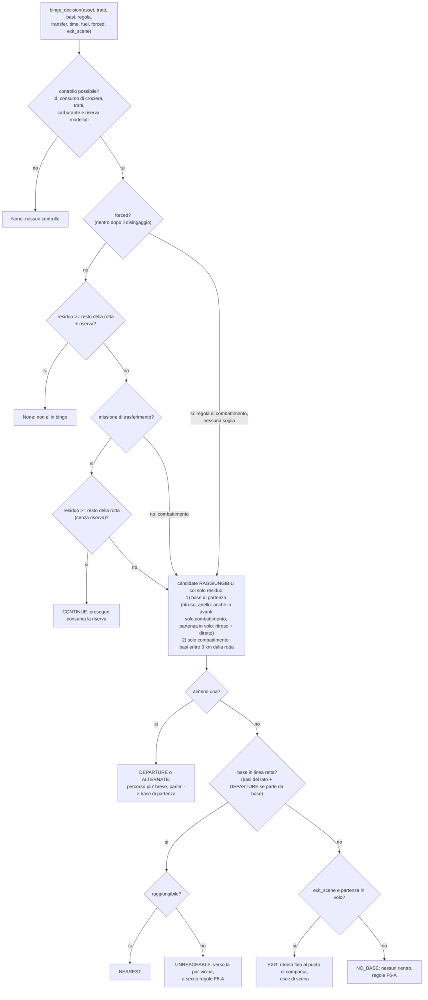
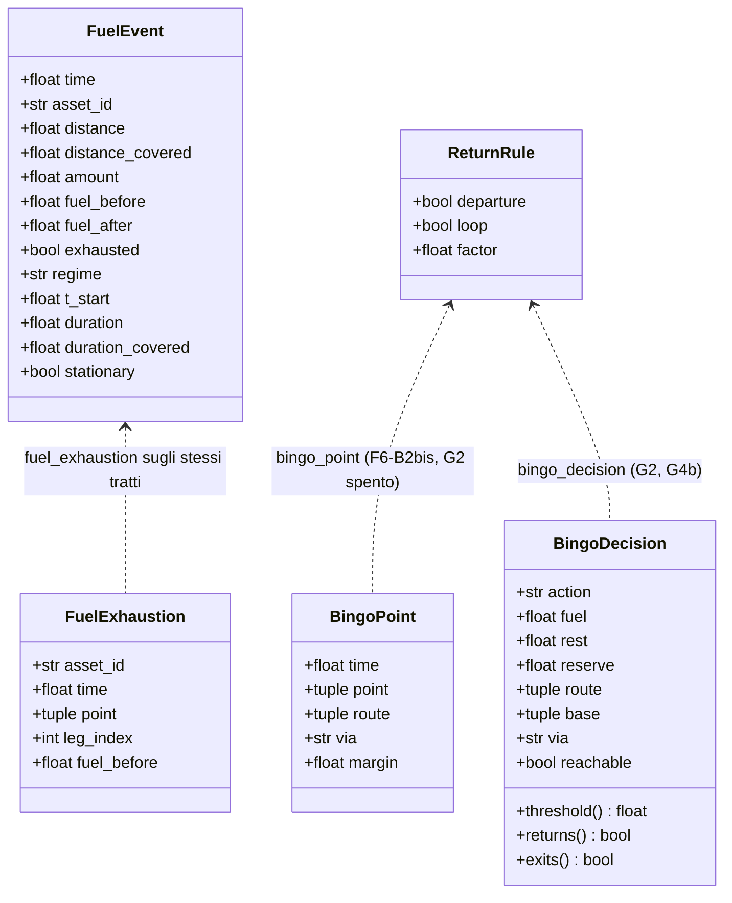
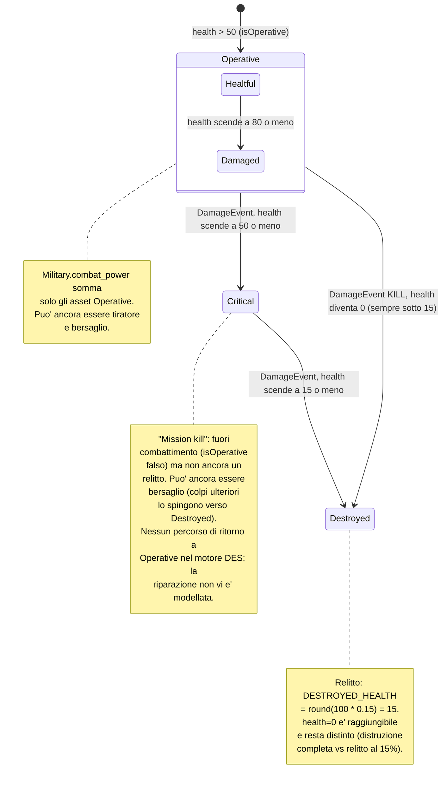

# Capitolo 5 — Lo strato 3: applicazione dello stato

> **Verificato a `fa5fbf1e` (2026-10-23, fase F8): nessun modulo di questo capitolo è cambiato da `dcedc541`** (`Logic/Damage_Model.py`,
> `Asset/Asset.py`, `Logic/Fuel_Model.py` e `Logic/Engagement_Resolver.py` non compaiono in `git diff dcedc541..HEAD -- Code`). Cambia
> solo il **contorno**: il rifornimento, che qui è dichiarato assente (§5.2.1), ha ora un chiamante, ma **fuori** da questo strato e
> fuori da `run_session`: lo fa `Logic/Readiness._rearm_and_refuel` alla fine del turnaround, fra una sessione e l'altra, riassegnando il
> loadout agli aerei e richiamando i caricamenti dai registri per veicoli e navi (capitolo 6 §6.26). Gli asset che arrivano a una sessione
> successiva col carburante consumato dalla precedente sono quindi rifatti pieni **da quel passo**, non dal modello del carburante. La
> contabilità di questo capitolo (consumo per tratto, bingo, `FuelEvent`) non cambia. I riferimenti `:riga` del capitolo ai moduli
> invariati restano quelli di prima.
>
> **Verificato a `dcedc541` (2026-10-20): nessun modulo di questo capitolo è cambiato da `a784a9e7`** (`Logic/Damage_Model.py`,
> `Asset/Asset.py`, `Logic/Fuel_Model.py` non compaiono nel `git diff`; `apply_engagement_result` ha solo righe diverse perché il
> risolutore sopra di lei è cresciuto, v. §5.3). Dalla fase F7 la funzione ha un **secondo chiamante**: il fuoco su posizione applica
> subito un esito con `forces=()` a tutti i blocchi (capitolo 6 §6.23); non serve nessuna modifica, perché l'applicazione legge gli
> asset dalle forze passate e non dall'esito.
>
> *Aggiornato a `a784a9e7` (2026-10-18): `Logic/Fuel_Model.py` è cambiato molto* (da 165 a 1576 righe), mentre `Logic/Damage_Model.py` e `Asset/Asset.py` sono **invariati** (nessuno dei due è nel
> `git diff` da `84a47670`) e `apply_engagement_result` non ha una riga diversa (solo i riferimenti slittano, v.
> §5.3). Il carburante, che a `84a47670` era *un evento per asset a fine movimento, per distanza*, è oggi il cuore
> di quattro fasi della Missione: il consumo **per tratto e nel tempo** con il vincolo del movimento (F6-A), la
> **planata** dell'aereo a secco (F6-A), il **bingo** in volo con rientro (F6-B2, F6-B2bis) e il suo modello finale
> **G1-G5** (riserva di disimpegno, soglia e albero di decisione, consumo in ingaggio, funzioni per la
> ri-pianificazione). Il modulo resta **puro**: nessuna estrazione casuale, nessun concetto del simulatore,
> nessun accesso a danno o scorte; quando e con che regime i suoi calcoli si applicano lo decide l'orchestratore
> (capitolo 6 §6.17-6.21). Il `FuelEvent` ha campi nuovi e una forma diversa (§5.2). Cambia il contorno anche per
> due fatti già dichiarati a `84a47670`: dalla F4b la funzione di applicazione riceve le forze della run come
> **viste di missione** (`MissionForce`) invece di blocchi, ma legge solo `assets`; dalla F4b++ un
> `InterceptionEvent` può avere come intercettore un asset di un'altra forza del dominio, e
> `apply_engagement_result` costruisce la mappa degli asset sull'unione delle forze passate (capitolo 4 §4.12,
> §4.29); un aereo a terra (capitolo 4 §4.30) è danneggiato da `Damage_Model` come ogni altro asset.
> L'esito di missione (`MissionOutcome`) non è un'applicazione di stato ma un resoconto prodotto
> dall'orchestratore (capitolo 6 §6.11). I riferimenti `:riga` di §5.2 sono su `a784a9e7` e restano validi a `dcedc541` (`Fuel_Model` è invariato).

Moduli: `Logic/Damage_Model.py`, `Asset/Asset.py` (`apply_damage`), `Logic/Fuel_Model.py`, più
`Logic/Engagement_Resolver.apply_engagement_result` (già descritta in capitolo 4, §4.12, ripresa
qui per completezza dello strato).

## 5.1 `Logic/Damage_Model.py` — il contratto del danno per singolo asset

Fissa la trasformazione da "arma che spara" a "salute che cala": prima della sua introduzione
`Asset.health` era un intero 0-100 con setter diretto e nessuna logica
(`Logic/Damage_Model.py:1-8`). La parte stocastica (chi spara, quando, quante volte) resta al
risolutore d'ingaggio (capitolo 4); questo modulo fissa **solo** il contratto colpo-per-colpo.

### Il contratto, punto per punto (`:10-53`)

1. **Unità di scambio: `DamageEvent`** — un evento per ogni colpo risolto, non un aggregato. Solo
   id di dominio, secondi assoluti, e un campo `provenance` che dichiara se il dato è
   `MEASURED` (adapter DCS), `DERIVED` (risolutore sintetico) o `ESTIMATED` (ricognizione)
   (`:94-99`).
2. **`accuracy` = P(colpo a segno)**, **`destroy_capacity` = P(distruzione | colpo a segno)**.
   Non è un'invenzione: è la lettura naturale dei due campi già presenti nei registri d'arma
   (`Ground_Weapon_Data`, `Ship_Weapon_Data`, `Aircraft_Weapon_Data`), entrambi in [0,1]. Il loro
   prodotto è la Pk già usata come principio di punteggio in tutto il progetto, qui scomposta in
   Ph e Pk|h. **Nessuna costante nuova**.
3. **Tre esiti per colpo**, mutuamente esclusivi: `KILL` (p = accuracy·destroy_capacity, l'asset
   è distrutto), `DAMAGE` (p = accuracy·(1-destroy_capacity), la salute cala di
   `round(100·destroy_capacity)` punti, minimo `MIN_EFFECTIVE_HIT_DAMAGE=1`), `MISS`
   (p = 1-accuracy). La stessa `destroy_capacity` misura sia la probabilità di uccidere sia
   l'entità del danno non letale: servono circa `1/destroy_capacity` colpi a segno non letali per
   mettere fuori uso il bersaglio — l'**accumulo è una proprietà emergente**, non un parametro.
4. **Un colpo può uccidere direttamente**: nessun pavimento artificiale che obblighi a degradare
   per gradi.
5. **La soglia `Destroyed` resta a `health <= 15`** (`DataType/State.py`, `HEALTH_LEVEL`), **non**
   0. Il residuo del 15% è il relitto: l'asset non combatte più ma esiste ancora come oggetto
   recuperabile (`repair_time`). `health = 0` resta raggiungibile e significa distruzione
   completa. La messa fuori combattimento avviene **prima**: `State.isOperative()` è già falso
   sotto il 50% (stato `Critical`), e `Military.combat_power` somma solo gli asset operativi — il
   modello distingue da sé "mission kill" (≤50) da "distruzione" (≤15).
6. **Nessuna estrazione casuale qui dentro**: `resolve_hit` riceve `draw` dal chiamante (l'RNG di
   sessione). L'ordine delle soglie (KILL, poi DAMAGE, poi MISS) **fa parte del contratto**:
   cambiarlo cambierebbe l'esito a parità di seed.

### Cosa non è deciso qui (`:55-61`)

La penetrazione contro corazza: i record d'arma non hanno un campo `penetration`; finché non c'è,
`destroy_capacity` per taglia/tipo di bersaglio è il solo discriminante disponibile. La
riparazione: `repair_time` esiste ma nessuno lo consuma — il contratto è volutamente a senso
unico (solo danno).

### API

`resolve_hit(accuracy, destroy_capacity, draw) -> str` (`:155-176`) applica le soglie di §5.1
punto 3 e restituisce uno di `HIT_OUTCOMES = (MISS, DAMAGE, KILL)`.

`health_delta_for_outcome(outcome, destroy_capacity, current_health) -> int` (`:179-200`)
calcola il delta (≤0): `KILL` porta a 0 la salute, `DAMAGE` toglie `max(1,
round(100·destroy_capacity))` punti (mai più della salute residua), `MISS` non toglie nulla.

`build_damage_event(asset, accuracy, destroy_capacity, draw, time=0.0, source_id=None,
weapon=None, provenance=DERIVED) -> Optional[DamageEvent]` (`:203-246`) risolve un colpo e ne
descrive l'esito **senza applicarlo**: separare calcolo e applicazione serve al risolutore
d'ingaggio, che deve poter calcolare tutti gli esiti di una salva, ordinarli deterministicamente
e solo poi applicarli — è proprio il modello a salva di Hughes: chi spara per primo non deve
dipendere dall'ordine di iterazione di un dizionario (`:211-216`). Restituisce `None` (con un
log) se l'asset non espone una salute leggibile.

`apply_damage_event(asset, event) -> Optional[int]` (`:249-268`) applica il delta con
`asset.apply_damage(event.health_delta)`. **Non idempotente per design**: applicare due volte lo
stesso evento toglie due volte la salute, "perché un colpo ripetuto è un altro colpo" — la
responsabilità di non applicare due volte lo stesso evento è di chi tiene la coda
(`:253-254`).

### `Asset.apply_damage` (`Asset/Asset.py:212-252`)

È l'**unico punto** in cui la salute cala per effetto del combattimento: il setter `health`
resta per inizializzazione e persistenza, `apply_damage` per l'attrito. Non contiene alcuna
estrazione casuale né alcuna nozione di arma — quanto danno faccia un colpo lo decide
`Damage_Model`, che è anche l'unico posto in cui il contratto è documentato. Solleva `TypeError`
se `health_delta` non è un intero e `ValueError` se è positivo (`:236-240`): la riparazione non
passa di qui. La salute è saturata a 0 con `max(0, current + health_delta)` (mai negativa,
`:242-248`); se lo stato dell'asset non è leggibile (`self._state` assente), restituisce `None`
con un log invece di sollevare un'eccezione (`:244-246`).

## 5.2 `Logic/Fuel_Model.py` — il carburante: dall'evento per distanza al modello di bingo (F6-A, F6-B2, G1-G5)

Stessa separazione calcolo/applicazione di `Damage_Model` (`Logic/Fuel_Model.py:1-16`). Il contatore vive
sull'asset (`Mobile.fuel`, **frazione del carico pieno** in [0, 1], `FUEL_FULL = 1.0`, `Asset/Mobile.py:233-257`;
`None` = carburante non modellato, nessun vincolo — v. capitolo 7, §7.6); questo modulo produce gli atomi che entrano
nel `SessionOutcome` e **tutte le funzioni di calcolo** che l'orchestratore usa per decidere dove un aereo si ferma,
quando rientra e quanto consuma. Il modulo è organizzato in sezioni: eventi e consumo (§5.2.1-5.2.3), planata
(§5.2.4), bingo (§5.2.5-5.2.7), consumo in ingaggio (§5.2.8), uscita di scena e costanti (§5.2.9).

### 5.2.1 Contratto

(`:17-49`)

- Consumo **deterministico**, proporzionale alla distanza (`Mobile.fuel_for_distance`, `Asset/Mobile.py:1311`):
  **nessuna estrazione casuale**, nessun RNG richiesto, in nessuna funzione del modulo.
- L'evento è **già limitato** al carburante disponibile: se la tratta richiede più di quanto c'è, `amount` è il
  residuo, `distance_covered < distance` e `exhausted` è `True`.
- Nessun concetto del simulatore: id di dominio, metri, secondi assoluti, `provenance` dichiarata (stesse
  costanti di `Damage_Model`: un adapter DCS produrrebbe eventi `MEASURED`).
- **Mai eccezioni per dati mancanti**: carburante non modellato o asset senza id → `None` (o "nessun controllo") più
  un log.
- Il rifornimento **non** c'è: nessuna funzione **di questo modulo** aumenta il carburante. Dalla F8c lo fa il ciclo di campagna, **fuori** da
  `Fuel_Model` e da `run_session`: `Logic/Readiness._rearm_and_refuel` (`:262-281`), chiamata da `apply_campaign_processes` quando un
  record di turnaround è concluso, riassegna `assigned_loadout` all'aereo (il setter ricarica scorta **e** carburante del loadout:
  `Asset/Aircraft.py:176-214`) o richiama `load_stores_from_registry`/`load_fuel_from_registry` per veicoli e navi, **senza consumare
  le scorte del blocco** (la logistica è un limite dichiarato, capitolo 9 §9.1). Un aereo senza loadout assegnato non è rifornito
  («non modellato»).
- Il modulo non integra il consumo nel risolutore d'ingaggio (che non legge il carburante, capitolo 4 §4.31): lo fa
  l'orchestratore, che tronca i tratti all'esaurimento *prima* dello scheduler e contabilizza i consumi *dopo* gli
  ingaggi (capitolo 6 §6.17).

### 5.2.2 `FuelEvent`: dall'evento per asset all'evento per tratto (F6-A)

`FuelEvent` (`:164-203`) è l'atomo del `SessionOutcome`. Fino a `84a47670` ne esisteva uno per asset, per distanza;
dalla F6-A ne esiste **uno per tratto**, e dal G3 anche uno **istantaneo** per ogni consumo in ingaggio. I campi
nuovi hanno un default, quindi la forma precedente (`build_fuel_event`) resta valida.

| Campo | Significato |
|---|---|
| `time` | secondi assoluti: la **fine** del tratto (o l'istante dell'ingaggio per l'evento istantaneo) |
| `asset_id` | id di dominio |
| `distance`/`distance_covered` | metri richiesti / metri percorribili col carburante disponibile (nulli per un tratto fermo e per l'evento d'ingaggio) |
| `amount` | carburante consumato [frazione del carico pieno], già limitato al disponibile |
| `fuel_before`/`fuel_after` | prima e dopo |
| `exhausted` | `True` se dopo l'evento il carburante è finito |
| `regime` | regime di `Mobile.FUEL_REGIMES` (`'nominal'`/`'max'`), oppure l'etichetta `ENGAGEMENT_REGIME = 'engagement'` per l'evento d'ingaggio (non è una chiave di `FUEL_REGIMES`, `:1110`) |
| `provenance` | una di `Damage_Model.PROVENANCES` |
| `t_start` | **(F6-A)** inizio del tratto; `None` per l'evento per distanza della forma precedente |
| `duration`/`duration_covered` | **(F6-A)** durata del tratto / secondi percorsi o trascorsi col carburante disponibile |
| `stationary` | **(F6-A)** tratto FERMO (attesa, orbita, sosta): consumo nel tempo |

`build_fuel_event(asset, distance, time, regime, provenance)` (`:235-288`) è la forma originale: calcola
`amount = min(required, fuel_before)`; se `required <= 0` o `amount >= required` l'intera `distance` è coperta,
altrimenti `covered = distance × amount / required`. Restituisce `None` (con un log) se l'asset non ha id o il
carburante non è modellato. `apply_fuel_event(asset, event)` (`:291-310`) applica con `Mobile.consume_fuel(amount)`;
stessa non-idempotenza dichiarata di `apply_damage_event`.

### 5.2.3 Consumo per tratto e nel tempo, esaurimento a monte, residuo analitico (F6-A, G4b)

**Un tratto, un evento** (`build_leg_fuel_event`, `:380-412`). I tratti sono i `Contact_Scheduler.Leg` (il modulo li
legge per attributo, non importa lo scheduler):

- **tratto di movimento**: in distanza, come prima (`leg_fuel_demand`, `:361-377`, al regime richiesto);
- **tratto fermo** (`is_stationary`, `:325`: attese e orbite della F5-C, sosta di un'unità di superficie): il consumo è
  **nel tempo**, pari a quello del movimento alla velocità di **crociera** dell'asset (`cruise_speed`, `:330`: il
  regime `'nominal'` del profilo cinematico `Mobile.speed`): distanza equivalente = durata × crociera, consumata al
  regime `HOLD_REGIME = 'nominal'` (`:154`) qualunque sia il regime del movimento. **Nessuna costante nuova.** È
  un'ipotesi **dichiarata e pessimistica per gli aerei** (il loiter reale consuma meno della crociera, ma il dato non
  c'è nei registri); stesso criterio per terra e mare (un'unità ferma con il motore acceso consuma come in marcia:
  sovrastima). Un asset senza velocità di crociera nota non consuma nelle soste (nessun evento, log).

**Esaurimento a monte** (`fuel_exhaustion`, `:415-462` → `FuelExhaustion`, `:206-221`). Il carburante dipende solo dai
tratti e dal carburante di partenza, quindi l'istante e il punto in cui finisce si calcolano **prima** dello
scheduler, sottraendo in ordine il fabbisogno di ogni tratto (alla crociera): nel tratto in cui il fabbisogno supera il
residuo, l'esaurimento è nella frazione `residuo / fabbisogno` del tratto (consumo uniforme), con posizione
interpolata. L'orchestratore usa il risultato per **troncare i tratti** (oltre il punto l'asset non si muove e non ha
contatti). Dal G4b il parametro `fuel` permette di ricalcolarlo **da un istante qualunque** con un residuo dato, senza
mutare l'asset.

**Residuo analitico** (`fuel_at`, `:465-517`, G4b): il carburante d'inizio dei tratti meno (a) il fabbisogno dei tratti
che consumano finiti entro `time`, e del tratto in corso la parte già volata (in proporzione al tempo, la stessa ipotesi
di `fuel_exhaustion`), meno (b) i consumi istantanei `charges = [(istante, quantità), ...]` (G3) con istante entro
`time`. È la **stessa aritmetica della contabilità** della sessione (un evento per tratto, uno istantaneo per consumo
d'ingaggio, ciascuno limitato al disponibile): le sottrazioni limitate a zero danno lo stesso residuo finale in qualunque
ordine, quindi oltre la fine dei tratti il valore coincide con il carburante finale della contabilità (verificato dal
test `TestFuelAt.test_end_value_is_the_accounting`). Mai negativo (0 = esaurito).

### 5.2.4 La planata di un aereo a secco (F6-A)

`glide_range(altitude, ratio)` (`:522-527`) dà la distanza orizzontale percorribile in planata: `quota × GLIDE_RATIO`
(0 se a terra o sotto). `nearest_reachable_base(point, bases, ratio)` (`:530-544`) restituisce la base `(x, y)` più
vicina in orizzontale entro quel raggio, a parità di distanza la coppia `(x, y)` minore (deterministico, mai l'ordine
d'ingresso). **`GLIDE_RATIO = 10.0` è una STIMA DI PROGETTO, non un dato tarato** (`:161`): i registri non hanno un
dato di planata; 10:1 è l'ordine di grandezza indicato dall'utente per un caccia a motore spento (un aliante supera
30:1, un caccia pulito sta fra circa 7:1 e 12:1), unico per tutti gli aerei. La quota è trattata come altezza sulla
base d'arrivo (terreno non modellato). Chi decide l'esito dell'esaurimento (fermo / planata / perso) è l'orchestratore
(`_exhaustion_end`, capitolo 6 §6.17).

### 5.2.5 Il bingo: la storia in breve (F6-B2 e F6-B2bis)

Un aereo in **bingo** è un aereo che deve interrompere la missione e tornare. Il modello è stato rifatto due volte e
oggi vale quello finale (§5.2.6-5.2.8); le due versioni precedenti restano nel codice dietro interruttori spenti.

1. **F6-B2** (2026-10-13): bingo a priori (validatore) e in volo; rientro **in linea retta** alla base idonea più vicina
   con una riserva fissa `BINGO_RESERVE = 0,10` del pieno (`:597`, STIMA: l'ordine di grandezza delle riserve finali di
   dottrina). `return_margin` (`:877-914`) = carburante − fabbisogno dei tratti − rientro − riserva; `bingo_point`
   (`:917-1010`) dà il primo istante in cui il residuo basta appena. Giudicato irrealistico dall'utente (ignora rotta,
   terreno e minacce).
2. **F6-B2bis** (2026-10-15): il rientro è la **rotta percorsa a ritroso** fino al `DEPARTURE` (partenza in volo: fino al
   punto di comparsa, poi diretto alla base più vicina; missione ad **anello** — `LAND` sulla base del `DEPARTURE`: la
   via più breve fra ritroso e resto della rotta), alle quote dei waypoint e senza ripercorrere le soste; fabbisogno =
   `BINGO_RETURN_FACTOR = 1,2` (`:603`, STIMA dell'utente) × il carburante del ritorno. `ReturnRule` (`:611-635`)
   descrive la regola della missione (`departure`, `loop`, `factor`), `BingoPoint` (`:638-668`) porta l'istante, il
   punto, la spezzata del rientro (`route`), la via (`RETURN_DIRECT`, `RETURN_REVERSE`, `RETURN_FORWARD`,
   `:606-608`) e il margine. Il profilo lineare a tratti è risolto in forma chiusa (`_reverse_profile`, `_pieces`,
   `_first_nonpositive`, `:729-799`).

Del rientro a ritroso il modello finale **riusa la geometria** (`_return_route`, `:820-842`: i punti d'inizio dei tratti di
movimento già percorsi in ordine inverso, senza le soste, più l'eventuale base di comparsa), ma non più la regola 1,2 né
la riserva fissa. Entrambe le versioni precedenti si ottengono con `Session_Simulator.F6_BINGO_DISENGAGE_RESERVE`
spento (capitolo 6 §6.21).

### 5.2.6 La riserva di disimpegno (G1, 2026-10-15)

Il modello dell'utente (G1-G5) ha tre grandezze:

- la **riserva** = il carburante per `DISENGAGE_TIME = 300 s` (5 minuti, **STIMA dell'utente**, `:1035`: il tempo per
  disimpegnarsi da un'intercettazione e tornare in rotta) alla **massima spinta militare** (senza postbruciatore);
- il **minimo di pianificazione** = carburante caricato **>** rotta intera + riserva;
- la **soglia di bingo in volo** = residuo **<** resto della rotta + riserva.

`disengagement_reserve_with_source(asset, duration)` (`:1063-1088`) e `disengagement_reserve` (`:1091`) calcolano la
riserva come frazione del carico pieno:

```
riserva = consumo_militare [kg/h] × DISENGAGE_TIME / 3600 / capacità_del_loadout [kg]
```

con il consumo da `Aircraft.emergency_fuel_flow()` (`Asset/Aircraft.py:392-421`: `speed_data['emergency']['consume']` del
registro `Aircraft_Data`) e la capacità da `Aircraft.fuel_capacity_kg()` (`Asset/Aircraft.py:334`: carburante interno più
serbatoi esterni del loadout, coerente con il contatore). La **provenienza** è restituita (`RESERVE_FROM_MILITARY_FLOW`),
con un ripiego dichiarato (`RESERVE_FROM_MAX_REGIME`) se mancano il dato o la capacità: il carburante per volare
`velocità massima × DISENGAGE_TIME` al regime `'max'` del loadout; altrimenti `None` (riserva non modellata: nessun
controllo).

**Dato non tarato, dichiarato.** L'unità del campo `emergency.consume` **non è documentata** nel registro
(l'intestazione dei dati documenta solo velocità, quota e portate; il campo non era usato da nessun altro codice). È
stata **dedotta kg/h** per coerenza con il regime `sustained` e con valori reali noti (F-16C: `sustained` 1150,
`emergency` 4500; A-10C: 3000 contro circa 2 × 1500 kg/h dei TF34 alla spinta massima); le ipotesi lb/h, kg/min e "kg nel
`time` del regime" danno valori incompatibili. Per i caccia **con postbruciatore** il valore è circa la spinta
*militare* (o meno) e **sottostima di circa 1/6 il consumo a postbruciatore pieno** (F-16A: 4200 contro circa
25 000-27 000 kg/h). La scelta dell'utente (strada A) è stata di usare il dato com'è e di **ridefinire la riserva come
"5 minuti alla massima spinta militare"**: con un vero postbruciatore pieno la riserva dell'F-16 sarebbe circa il 70%
del carburante interno e molte missioni non supererebbero il minimo. La riserva così calcolata, sul solo carburante
interno, va dal 5,2% (A-10C) al 21,4% (Mirage 2000C) del pieno nel campione di otto aerei del Piano (deviazione 17).
La correzione del registro (valori `emergency.consume` e `time`, distinzione dei motori con postbruciatore) è
**arretrato dichiarato**, non fatto. Anche `DISENGAGE_TIME` e quindi la riserva sono STIME.

### 5.2.7 Soglia di bingo e albero di decisione (G2, 2026-10-15)

`bingo_decision(asset, legs, bases, rule, transfer, time, fuel, reserve, max_offset, forced, exit_scene)`
(`:1484-1576`) è la funzione **generale**: dato l'aereo, i tratti della missione intera fino al `LAND`, **un istante e
un residuo qualunque**, dice se l'aereo è in bingo e cosa fa (`BingoDecision`, `:1254-1303`). La sessione la chiama
all'inizio dei tratti (G2) e alla fine di ogni episodio d'ingaggio (G4b).

**La soglia** (`bingo_threshold`, `:1345-1351`; `remaining_route_demand`, `:1322-1342`): bingo ⇔ `residuo < resto della
rotta fino al LAND (attese comprese, alla crociera) + riserva di disimpegno`. Riserva non modellata = nessun controllo.

**L'albero** dipende dal tipo di missione (`transfer`, `Mission_Adapter.is_transfer_mission`: categoria `TRANSPORT`; ogni
altro tipo — aria-aria, aria-suolo, AWACS, tanker, ricognizione — segue la regola di **combattimento**). Le azioni
(`BingoDecision.action`, `:1242-1248`):

| Azione | Significato |
|---|---|
| `BINGO_CONTINUE` | trasferimento: il residuo basta a concludere la rotta (senza la riserva): **prosegue consumando la riserva**, nessun aborto |
| `BINGO_DEPARTURE` | rientro alla base di partenza: a ritroso; sull'anello (solo combattimento) anche il resto della rotta; partenza in volo: ritroso fino al punto di comparsa e poi diretto alla base più vicina |
| `BINGO_ALTERNATE` | combattimento: rientro su una base aerea amica **entro `ALTERNATE_BASE_MAX_OFFSET = 3000 m`** (`:1239`, STIMA dell'utente, distinta da `AIR_BASE_AREA_RADIUS_M` anche se oggi vale uguale) in orizzontale dalla rotta programmata: lungo la rotta (in avanti o a ritroso) fino al punto più vicino alla base, poi un tratto diretto in discesa a quota 0 |
| `BINGO_NEAREST` | nessuna candidata raggiungibile ma la base più vicina in linea retta lo è |
| `BINGO_UNREACHABLE` | nessuna base raggiungibile: verso la più vicina e, all'esaurimento, le regole della F6-A (planata o perdita) |
| `BINGO_NO_BASE` | nessuna base possibile (partenza in volo senza basi del lato): nessun rientro, regole della F6-A |
| `BINGO_EXIT` | come `NO_BASE` ma con `exit_scene` (G4b, §5.2.9 e capitolo 6 §6.20): ritroso fino al punto di comparsa, dove l'aereo **esce di scena** senza atterrare |

*Raggiungibile* = il residuo basta per il **solo percorso** alla crociera (la riserva si può consumare nel rientro:
`rate × lunghezza <= fuel`). Fra più candidate raggiungibili (`_base_options`, `:1450-1481`) vince il percorso più
breve; a parità la base di partenza, poi la coppia `(x, y)` minore. Il "punto della rotta più vicino" a una base
alternativa è il minimo globale della distanza *orizzontale* dalla spezzata dei tratti di movimento
(`_closest_on_route`, `:1387-1401`).

*Diagramma D38 — l'albero di decisione al bingo (`Fuel_Model.bingo_decision`).*



**Rientro forzato** (`forced`, G4b): la forza d'ingaggio dell'aereo si è **disingaggiata**; l'aereo interrompe la
missione e rientra *indipendentemente dalla soglia*. Il controllo di soglia e il passo "continua" sono saltati, il resto
dell'albero è lo stesso; la sessione lo chiama sempre con `transfer=False` (regola di combattimento anche per un
trasferimento, decisione dell'utente del 2026-10-17). Con la riserva non modellata il rientro forzato è comunque deciso
(la riserva serve solo alla soglia: vale 0, `:1532-1533`).

**Perché un residuo qualunque.** Con il solo consumo di movimento residuo e resto della rotta calano insieme, quindi la
soglia scatterebbe all'inizio dei tratti o mai; il consumo d'ingaggio (§5.2.8) abbassa il residuo senza accorciare la
rotta, e solo da quel momento la soglia può scattare *in volo*. Per questo la funzione è generale e il G2 l'ha resa tale
prima del G4.

**`BingoDecision`** (`:1254-1303`): `asset_id`, `time`/`point`/`leg_index` (dove cade la decisione lungo i tratti),
`fuel` (il residuo valutato), `rest` (carburante per il resto della rotta), `reserve`, `action`, `route` (i punti del
rientro dal punto della decisione all'atterraggio compresi), `base` (il punto d'atterraggio, ultimo di `route`; per
`EXIT` il punto di comparsa), `via` (`RETURN_REVERSE`, `RETURN_FORWARD`, `RETURN_ALONG`, `RETURN_DIRECT`),
`return_length`, `reachable`; proprietà `threshold` (`rest + reserve`), `returns` (tutte le azioni tranne `CONTINUE` e
`NO_BASE`) ed `exits` (`EXIT`).

### 5.2.8 Il consumo in ingaggio (G3, 2026-10-15/16)

Regola dell'utente: a **ogni ingaggio** a cui un aereo partecipa, nell'**istante** dell'ingaggio, l'aereo consuma il
carburante di `DISENGAGE_TIME` (5 minuti) alla massima spinta militare, **la stessa quantità** della riserva di
disimpegno. `engagement_fuel_with_source` / `engagement_fuel` (`:1113-1136`) delegano a
`disengagement_reserve_with_source`: è l'**unico punto di calcolo** (nessuna formula duplicata; la provenienza è la
stessa, con lo stesso ripiego). `build_engagement_fuel_event(asset, time, provenance)` (`:1139-1192`) ne fa un
`FuelEvent` **istantaneo** (distanza e durata nulle, `regime = ENGAGEMENT_REGIME`, `t_start = time`), limitato al
disponibile (se non basta, `amount` è il residuo ed `exhausted` è vero); `None` con serbatoio già vuoto o consumo non
modellato. Il movimento resta al suo regime normale (crociera, attese comprese): il consumo d'ingaggio **sostituisce**,
per gli aerei, la regola della F6-A "chi ha combattuto consuma tutto il movimento al regime `'max'`" (una sovrastima
pessimistica). Il modello è **a scatto**: i 5 minuti di manovra non sono distribuiti nel tempo né lungo la rotta.

**Regola futura, NON implementata.** Per gli aerei la cui emergenza dura meno di 5 minuti (Seconda guerra mondiale) il
consumo sarà "regime `emergency` per `min(300 s, speed_data['emergency']['time'])`, poi regime `'combat'` per il
resto" (indicazione dell'utente, docstring di `engagement_fuel_with_source`, `:1121-1127`). Non è fatta perché il campo
`time` del registro **non è affidabile** (unità ignota; oggi letto come minuti, 60 di emergenza, incompatibile con un
postbruciatore); quando verrà introdotta va deciso anche se la riserva del G1 la segue (oggi coincidono per
costruzione).

### 5.2.9 Uscita di scena (G4b, 2026-10-17) e riepilogo delle costanti

`bingo_decision(..., exit_scene=True)` restituisce `BINGO_EXIT` **al posto di** `BINGO_NO_BASE` nello stesso punto
dell'albero (nessuna candidata, nessuna base in linea retta) e **solo con partenza in volo** (`not rule.departure`: da
una base il `DEPARTURE` c'è sempre). La rotta è il ritroso (`_return_route` senza il tratto diretto finale), la `base`
è il **punto di comparsa**, `reachable` come per le altre (`:1562-1568`). Chi la chiede è solo la ri-pianificazione
dopo un episodio (capitolo 6 §6.20), non la decisione alla partenza né il validatore.

| Costante | Valore | Natura | Dove |
|---|---|---|---|
| `GLIDE_RATIO` | 10,0 | STIMA di progetto (ordine di grandezza dell'utente), non tarata | `:161` |
| `BINGO_RESERVE` | 0,10 del pieno | STIMA, solo a G2 e F6-B2bis spenti (regola F6-B2) | `:597` |
| `BINGO_RETURN_FACTOR` | 1,2 | decisione dell'utente, STIMA, solo a G2 spento (regola F6-B2bis) | `:603` |
| `DISENGAGE_TIME` | 300 s | decisione dell'utente, STIMA; lega anche `EPISODE_GAP` (capitolo 6 §6.20) | `:1035` |
| `ALTERNATE_BASE_MAX_OFFSET` | 3000 m | decisione dell'utente, STIMA | `:1239` |
| `HOLD_REGIME` | `'nominal'` | ipotesi dichiarata: le soste consumano alla crociera | `:154` |
| `emergency.consume` del registro | kg/h (dedotto) | dato **non tarato**: unità non documentata, sottostima di ~1/6 il postbruciatore pieno | `Aircraft_Data`, `Asset/Aircraft.py:392` |

*Diagramma D39 — i tipi di `Fuel_Model` e le funzioni che li producono.*



Le frecce tratteggiate sono dipendenze funzionali (una funzione che consuma un tipo per produrne un altro); le
funzioni del modulo (`build_leg_fuel_event`, `build_engagement_fuel_event`, `fuel_at`, `disengagement_reserve`,
`engagement_fuel`, `bingo_threshold`) non sono rappresentate perché non producono tipi propri.

## 5.3 Applicazione unificata: `apply_engagement_result`

Già descritta in dettaglio nel capitolo 4, §4.12 (`Logic/Engagement_Resolver.py:3794-3872`): è il
passo che collega lo strato 2 allo strato 3 per un singolo ingaggio, applicando in sequenza
`DamageEvent` (via `Damage_Model.apply_damage_event`), `AmmunitionEvent` (via
`Mobile.consume_ammunition`) e `InterceptionEvent` (via `Mobile.consume_interceptor_stock`).
L'orchestratore (capitolo 6) la chiama **subito** dopo ogni ingaggio risolto — dal G4a ogni **episodio**
d'ingaggio, prima ogni componente connessa — passando **tutte** le forze dell'ingaggio
(`ER.apply_engagement_result(result, *component)`, `Logic/Session_Simulator.py:2790`): è la condizione perché gli
asset di un intercettore di dominio (capitolo 4 §4.29) vengano trovati, e perché l'episodio successivo parta dallo
stato già consumato (salute e scorte).

**Dalla F7b la chiamano anche i fuochi su posizione** (`fire_area`, `Logic/Session_Simulator.py:2486`): l'esito di un
`Area_Fire.resolve_area_fire` — `forces=()`, `DamageEvent` a `t_impact` e un `AmmunitionEvent` a `t_fire` — è applicato subito con
`ER.apply_engagement_result(result, *blocks.values())`, cioè a **tutti** i blocchi (il tiratore consuma la scorta, i colpiti
perdono salute). Nessun `InterceptionEvent`. Il contratto della funzione non cambia (capitolo 6 §6.23).

**Il carburante non passa di qui.** I `FuelEvent` non sono applicati da `apply_engagement_result` ma
dall'orchestratore in un **passo finale**, dopo tutti gli ingaggi (capitolo 6 §6.17), con `Fuel_Model.apply_fuel_event`;
l'unica eccezione è l'aereo **perso per esaurimento in volo** (F6-A), che l'orchestratore porta a salute 0 con
`Asset.apply_damage` — lo stesso canale del danno — **senza un `DamageEvent`** nell'esito (non è un colpo: nessun
tiratore, nessuna arma).

## 5.4 Diagramma D7 — stati operativi di un asset (salute)

Le soglie sono in `DataType/State.py:32-37` (`HEALTH_LEVEL`) e applicate da `State.update`
(`DataType/State.py:178-199`), come frazioni della salute massima (100): `Damaged` 0.8,
`Critical` 0.5, `Destroyed` 0.15. Gli stati reali sono quattro — `Healtful` (> 80),
`Damaged` (50 < h ≤ 80), `Critical` (15 < h ≤ 50), `Destroyed` (≤ 15) — e `isOperative`
(`DataType/State.py:162`) è vero per `Healtful` **o** `Damaged`. Nel diagramma i primi due sono
raggruppati nello stato composto `Operative`, l'unico che conta per il motore DES.


