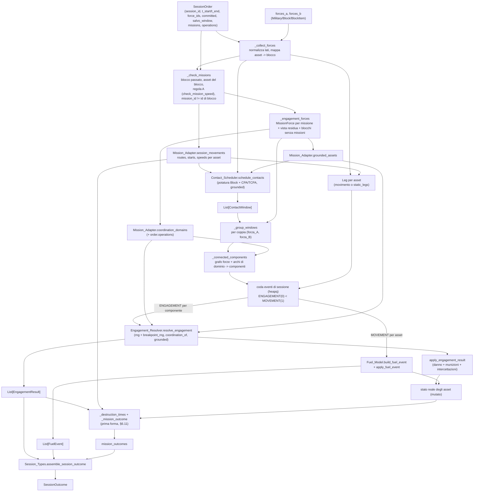
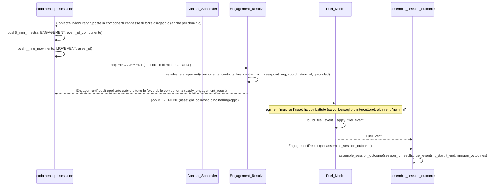
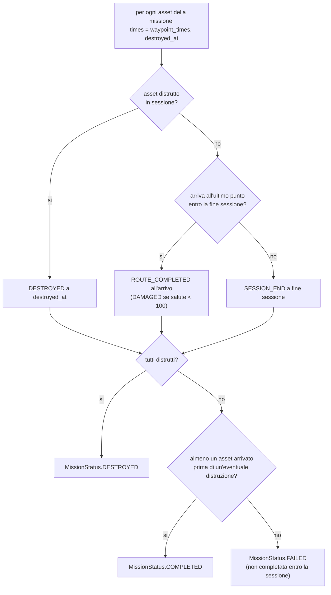
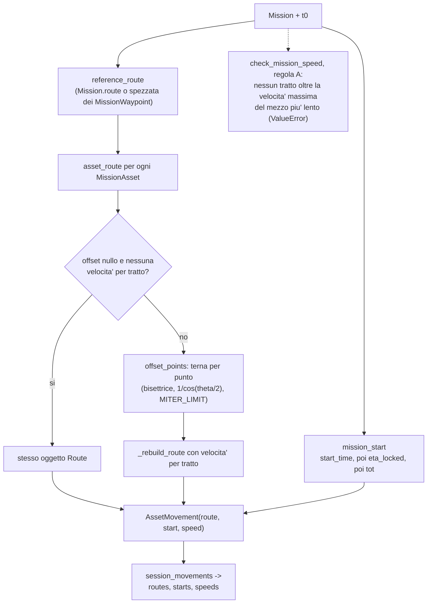
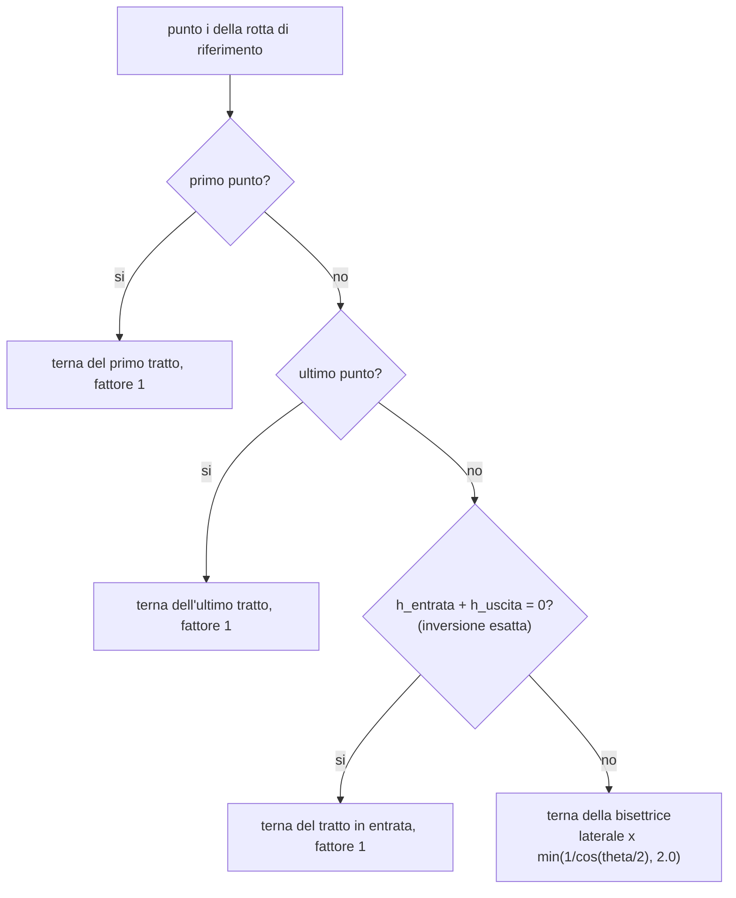
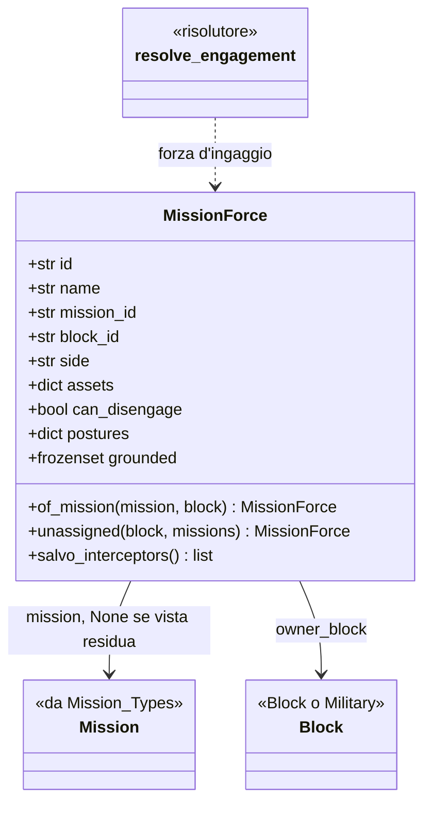
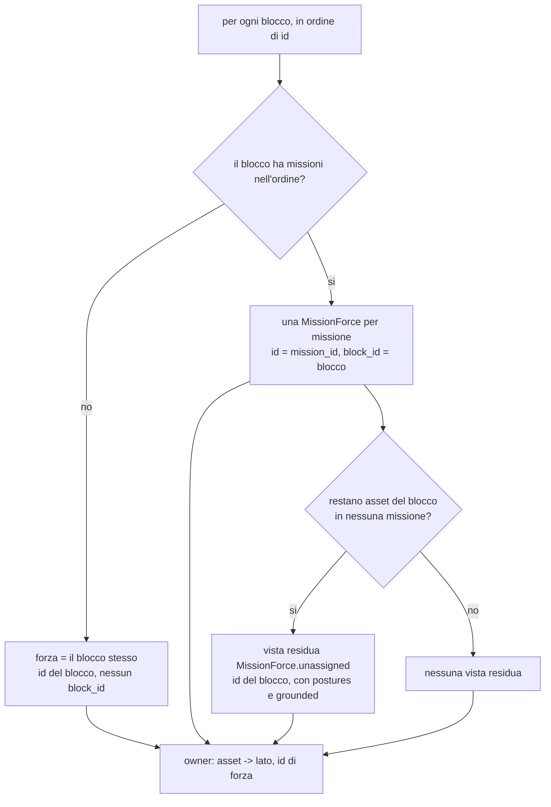
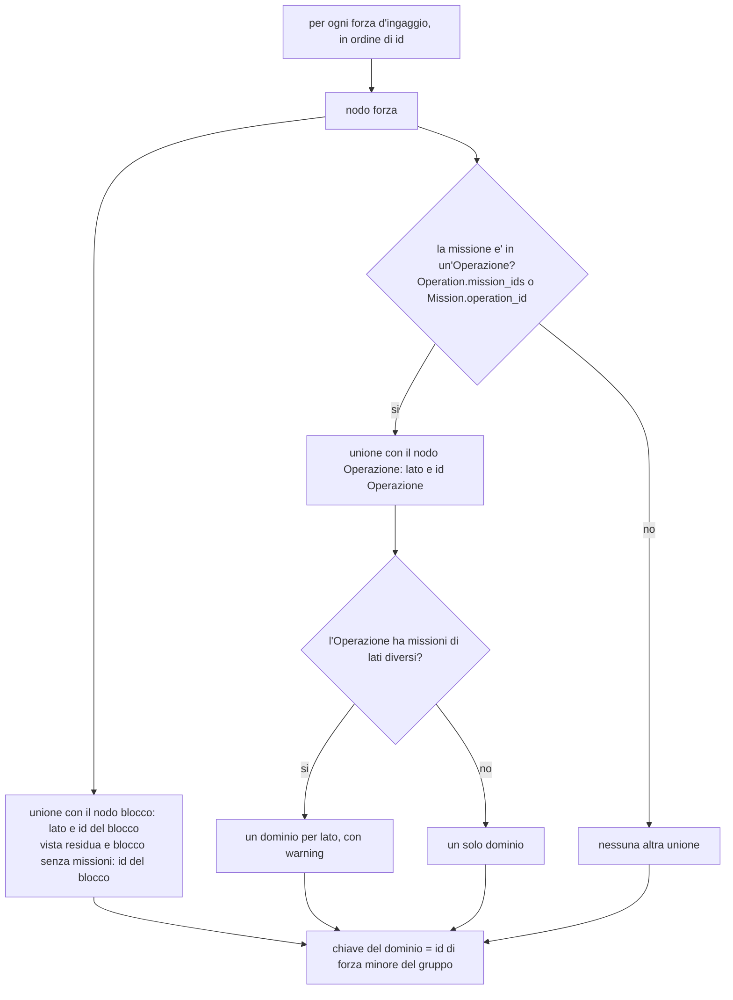
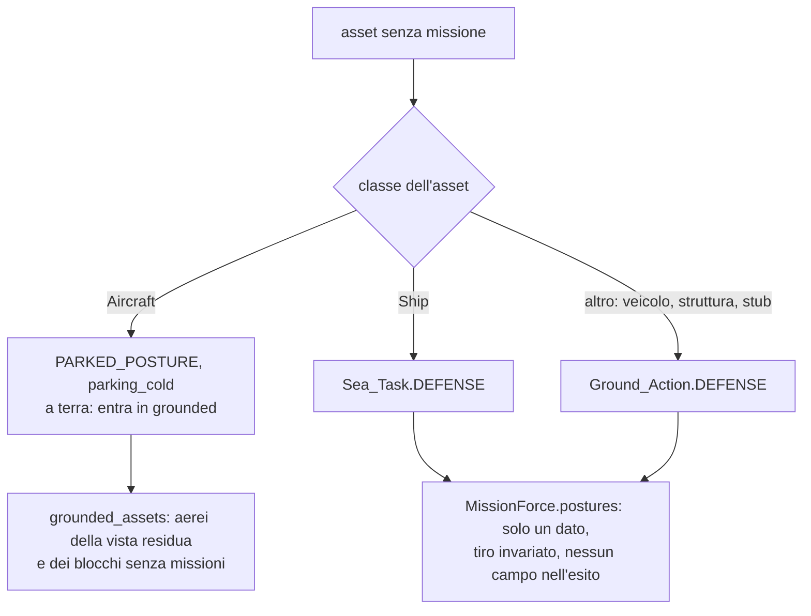

# Capitolo 6 — L'orchestratore: `Session_Simulator.run_session`

Modulo: `Logic/Session_Simulator.py` (937 righe a `84a47670`, 774 a `533cd1f5`). Mette in fila, per la prima volta,
i pezzi prodotti dalle fasi precedenti (`Logic/Session_Simulator.py:1-18`); dalla fase F3 della Missione
(2026-10-05) la fila comincia dalle **missioni** dell'ordine e dalla F4 (2026-10-05/11) la missione è anche la
**forza d'ingaggio**:

```
SessionOrder.missions ──> Mission_Adapter.session_movements   (rotta, partenza, velocità per asset)
                      ──> _engagement_forces                   (una forza per missione, §6.12)
                      ──> Mission_Adapter.coordination_domains (dominio di coordinamento, §6.13)
                      ──> Mission_Adapter.grounded_assets      (aerei a terra, §6.14)
SessionOrder ──> Contact_Scheduler.schedule_contacts          (strato 1: QUANDO)
             ──> raggruppamento in componenti connesse di forze (anche per dominio)
             ──> Engagement_Resolver.resolve_engagement        (strato 2: COME FINISCE)
             ──> apply_engagement_result                       (strato 3: danno, munizioni)
             ──> Fuel_Model.build/apply_fuel_event             (strato 3: carburante)
             ──> esito di missione per ogni Mission            (prima forma, §6.11)
             ──> Session_Types.assemble_session_outcome        (porta di uscita)
```

Questo modulo è **solo** quella fila: non reimplementa geometria, Pd, latenze, salve, danno o consumi.
Ogni numero che produce viene da uno dei moduli chiamati; la geometria di formazione e la derivazione
di partenza e velocità sono in `Logic/Mission_Adapter` (§6.10), la vista di missione, il dominio di
coordinamento e la postura continua anch'essi (§6.12-6.14), non qui.

## 6.1 La funzione pubblica

```python
run_session(order, forces_a, forces_b, fire_control, *, horizon=None, margin=0.0,
            range_type=DEFAULT_DETECTION_RANGE_TYPE, thresholds=None,
            reaction_profile_for=None, detection_factor=None, provenance=DM.DERIVED,
            morale_for=None, enemy_estimate_for=None, fire_doctrine=None)
            -> SessionOutcome
```

(`Logic/Session_Simulator.py:742-937`, firma a `:742-753`; **la firma non è cambiata dalla F3**). **Muta gli
asset**: danno, munizioni e carburante sono applicati man mano che gli eventi sono risolti. Il
`SessionOutcome` restituito è il resoconto di ciò che è stato applicato. Si combatte solo fra `forces_a` e
`forces_b`, mai dentro lo stesso lato.

**Cambiamenti rispetto a `6754bf1c` (fino a `533cd1f5`):**

- **Rimossi `routes`, `starts`, `speeds`** (decisione Q2 dell'utente: una sola strada, docstring `:34-43`):
  rotta, partenza e velocità di ogni asset vengono **solo** dalle missioni dell'ordine (`order.missions`);
  `Mission_Adapter.session_movements(order.missions, t0)` ne ricava le tre mappe che il resto della fila
  consuma esattamente come prima (`:812-813`). Gli asset senza missione restano fermi, come gli asset senza
  rotta di prima (dalla F4c con una postura, §6.14). A parità di rotte la fotografia di non regressione degli
  scenari (capitolo 8 §8.7) era uguale in tutte le 292 esecuzioni della F3.
- **Aggiunti `morale_for`, `enemy_estimate_for`, `fire_doctrine`** (2026-09-29): inoltrati a
  `resolve_engagement`; a questi si aggiunge il flusso `breakpoint_rng` della tempra, costruito
  dall'orchestratore (§6.4). `rwr_catalogue` di `resolve_engagement` **non** è inoltrato da `run_session`
  (disponibile solo chiamando il risolutore direttamente; capitolo 9 §9.6).
- Il valore restituito porta un `MissionOutcome` per ogni missione dell'ordine (§6.11).

**Cambiamenti da `533cd1f5` a `84a47670` (fase F4):**

- **Validazione delle missioni** (`_check_missions`, `:579-595`): oltre a "la missione si riferisce a un blocco
  passato fra le forze" (`ValueError`, `:585-587`) e "ogni suo asset appartiene a quel blocco"
  (`Mission_Types.check_mission_assets`, `:589`), dalla F4a vale la **regola A** — una missione si muove insieme,
  alla velocità del mezzo più lento: `Mission_Adapter.check_mission_speed(mission, assets, order.t_start)`
  (`:590-591`, §6.10) solleva `ValueError` se un tratto pianificato supera la velocità massima del mezzo più
  lento; e dalla F4b un `mission_id` non può coincidere con l'id di un blocco passato (`:593-595`: sarebbero due
  forze con lo stesso id).
- **Le forze d'ingaggio sono missioni**, non blocchi (F4b): `_engagement_forces` (`:598-641`, §6.12). Lo
  scheduler riceve ancora i **blocchi** (`items_a`/`items_b`, `:816`): le finestre sono per coppia di asset e la
  potatura per blocco non dipende da come gli asset sono raggruppati in forze.
- **Dominio di coordinamento** (F4b+): `coordination_domains` (`:809`) è passato a `_connected_components` (`:848`)
  e a ogni `resolve_engagement` come `coordination_of` (`:884`), §6.13.
- **Aerei a terra** (F4c): `grounded_assets` (`:811`) è passato a `schedule_contacts` (`grounded=`, `:818`) e a ogni
  `resolve_engagement` (`grounded=`, `:885`), §6.14.
- **`SessionOrder.committed`** resta chiavato per blocco; `_engagement_committed` (`:644-664`) lo traduce per forza
  d'ingaggio (§6.12).

## 6.2 La coda eventi di sessione

Due tipi di evento, in un `heapq` con chiave `(t, tipo, id, sequenza)` (`:20-30`, `:844-856`):

- **ENGAGEMENT** — uno per componente connessa di forze d'ingaggio (§6.3); istante = inizio della prima
  finestra fra qualunque coppia della componente. Risolve l'intera componente con **una**
  chiamata a `resolve_engagement` e ne applica subito l'esito a tutte le sue forze (`:866-892`).
- **MOVEMENT** — uno per asset con rotta schedulabile nella sessione; istante = fine del suo
  movimento dentro la sessione. Produce e applica il suo `FuelEvent` (`:893-910`).

A parità d'istante `ENGAGEMENT_EVENT(0) < MOVEMENT_EVENT(1)` (`:275-276`, docstring `:114-117`), poi
l'id (stringa canonica, mai l'ordine di un dizionario Python). Le finestre di un asset mobile cadono
tutte dentro lo span dei suoi tratti, quindi quando il suo MOVEMENT viene estratto ogni ingaggio che lo
coinvolge è già stato risolto: il regime di consumo (§6.5) è noto.

## 6.3 Forze impegnate su più fronti: componenti connesse

**Prima del 2026-09-23**: un ingaggio per coppia (lato A, lato B), applicato subito. Restava un
difetto: se X era in contatto con A e con B in finestre **sovrapposte**, l'ingaggio (X,A)
estratto per primo veniva svolto fino in fondo e applicato, e (X,B) leggeva uno stato di X già
consumato anche per le salve che, in tempo di sessione, precedevano la fine di (X,A). L'ordine
della coda decideva chi "arrivava prima" alla salute e alle scorte di X — un artefatto
d'implementazione, non la fisica del combattimento (`:121-131`).

**Ora**: un ingaggio per **componente connessa** di forze d'ingaggio. Si costruisce il grafo non orientato con
un nodo per forza e un arco per ogni coppia (lato A, lato B) con almeno una finestra (`_group_windows`,
`:456-478`: raggruppa le finestre per coppia di *forze* d'ingaggio, dalla mappa `{asset_id: (lato, id di
forza)}`), e se ne cercano le componenti connesse (`_connected_components`, `:481-546`, visita in ampiezza
deterministica per id — mai l'ordine di un dizionario). **Dalla F4b+ il grafo ha anche archi fra forze dello
stesso dominio di coordinamento** (`domain_of`, `:504-513`): le forze di uno stesso dominio sono messe nella
stessa run **anche se non hanno nemici in comune**, perché la condivisione di fuoco, percezione e difesa di salva
(capitolo 4 §4.28-4.29) vale solo dentro una run. Senza questi archi due missioni di un blocco su fronti
disgiunti sarebbero risolte in run separate, mentre il blocco prima della F4b era una forza sola. I nodi restano
le sole forze che compaiono in almeno una coppia con finestre (`:498-502`): una forza di un dominio senza
nessuna finestra non entra in nessuna run. La componente unita ha l'`event_id` delle forze riunite (§6.4).

Ogni componente è risolta con **una** chiamata a `resolve_engagement`: `force_a`/`force_b` = le prime due forze
per id, `extra_forces` = le altre, per id (`:867-871`). Dentro la run lo stato ombra di X evolve in un'unica
timeline consumata da tutti i fronti; un disingaggio è per-forza (capitolo 4, §4.8), non ferma un eventuale altro
fronte della componente — nemmeno un'altra missione dello stesso blocco.

Le componenti sono **disgiunte**: nessuna forza compare in due ingaggi della stessa sessione,
quindi il limite di `assemble_session_outcome` (capitolo 2, §2.4) non si presenta mai nella
pratica di `run_session`.

**Deliberatamente conservativa rispetto al tempo** (`:147-151`): non si distingue se le finestre di
una componente si sovrappongono davvero o sono in sequenza (X contro A al mattino, contro B la
sera): anche in quel caso {X, A, B} è risolta con una sola run. È sempre corretto, perché la coda
eventi **interna** del risolutore ordina comunque gli eventi nel tempo esatto.

**Che cosa è cambiato con la F4.** A `533cd1f5` l'unità d'ingaggio era la forza = il blocco: ingaggi, RNG e
disingaggio erano per blocco, e due missioni dello stesso blocco condividevano lo stesso destino. Dalla F4b
(`a4d8acf0`) l'unità è la **missione**: ogni missione ha il proprio ingaggio, la propria tempra e il proprio
disingaggio (capitolo 4 §4.27); dalla F4b+ (`098671d7`) fuoco e percezione sono condivisi nel dominio, e le
componenti ne tengono conto (sopra).

## 6.4 RNG: uno stream per ingaggio, uno stream per la tempra

`order.rng(mission_id=None, event_id=engagement_event_id(*forze), counter=0)` (`:870`):

- `mission_id=None`: è il livello "di sessione" di `Session_Rng`. **Dalla F4b il `mission_id` entra nell'RNG
  attraverso l'`event_id`**, non attraverso lo slot `mission_id`: un ingaggio è fra DUE O PIÙ forze, tipicamente
  missioni di entrambi i lati, e nessuna ne possiede lo stream. Lo slot resta `None` (livello "di sessione") per le
  estrazioni che appartengono a una sola missione (nessuna, oggi; docstring `:153-169`). **Nota**: il piano della
  Missione prevedeva il `mission_id` reale già in F3; il codice l'ha rimandato a F4b (deviazione 1 del piano, con
  l'`event_id` al posto dello slot, deviazione 4: capitolo 9 §9.6).
- `event_id`: `engagement_event_id(*force_ids)` (`:311-332`) è la codifica JSON di
  `['engagement', id_1, id_2, ...]` con gli id della componente **ordinati** — funzione pura
  dell'**insieme** delle forze, mai dell'ordine di iterazione o di passaggio a `run_session`. Dalla F4b gli id sono
  quelli delle **forze d'ingaggio**: i `mission_id` (o l'id del blocco per un blocco senza missioni e per la vista
  residua). Rinominare una missione cambia solo lo stream degli ingaggi che la coinvolgono
  (`test_renaming_a_mission_changes_its_stream_only`), e l'unione di una componente per dominio cambia l'`event_id`
  (è un ingaggio diverso, con forze diverse).
- `counter=0`: ogni componente è risolta una sola volta per sessione; il contatore resta libero
  per un futuro re-ingaggio (re-scheduling dopo un disingaggio, non implementato, v. capitolo 4
  §4.9).

**Secondo stream: la tempra delle forze** (2026-09-29). `temper_event_id(*force_ids)` (`:335-345`) ha
la stessa forma e gli stessi vincoli ma il tag `'temper'` (`TEMPER_EVENT_TAG`, `:282`) invece di
`'engagement'`; `run_session` lo passa a `resolve_engagement` come `breakpoint_rng`
(`order.rng(mission_id=None, event_id=temper_event_id(*force_ids), counter=0)`, `:878-880`). Così estrarre
la tempra non sposta le estrazioni di rilevamento e danno dell'ingaggio (capitolo 4 §4.11, §4.21).

**Precondizione di riproducibilità**: gli id di forza devono essere **stabili** fra le
esecuzioni. `Block.__init__` genera l'id con `Utility.setId`, che aggiunge un suffisso casuale —
due `Military` costruite da zero con lo stesso nome avrebbero id diversi, quindi seed diversi e
un diverso ordine della coda. Corretto 2026-09-23: `Block.__init__`/`Military.__init__`
accettano ora un parametro `id` esplicito (`:171-179`); chi costruisce forze da zero per un
replay/test deve passarlo. In campagna l'id è comunque quello dell'istanza già in memoria
(persistito), quindi il caso comune non è mai stato a rischio.

## 6.5 Carburante

Per ogni asset con rotta (dalle missioni) si prendono i tratti ritagliati alla sessione (stessa
costruzione di `Contact_Scheduler.schedule_contacts`: `route_legs` + `clamp_legs`, partenza e velocità
dalla missione, `_movement_legs`, `:426-443`) e la distanza è la somma delle lunghezze dei tratti
(`_legs_distance`, `:446-453`); un solo `FuelEvent` per asset, all'istante di fine movimento
(`:196-201`).

**Regime** (`:203-211`): `'max'` se l'asset ha **combattuto** nella sessione — ha lanciato una
salva, è stato bersaglio di una salva, o ha intercettato (`_engaged_assets`, `:549-563`) —
altrimenti `'nominal'`. Per gli aerei `'max'` legge il profilo `attack` del loadout, per veicoli e
navi il registro non distingue (v. capitolo 7, §7.6). Tutto il tragitto è consumato al regime
scelto: per chi ha combattuto è una sovrastima **pessimistica** del consumo (il tratto di
crociera è contato a regime di combattimento), preferita a una ripartizione per intervalli che
richiederebbe di inventare quando comincia e finisce la manovra di combattimento. Se `'max'` non
è ricavabile si ricade su `'nominal'` (`_build_fuel`, `:566-576`).

**Limiti dichiarati** (`:213-220`): nessun movimento fisico — se il carburante finisce a metà
(`FuelEvent.exhausted`, `distance_covered < distance`) l'asset non viene fermato sulla rotta e i
contatti già calcolati non vengono ricalcolati; un asset distrutto a metà rotta consuma comunque
il tragitto intero; un asset senza rotta (fermo) non produce `FuelEvent`. Il consumo **nel tempo**
(attese, orbite) e il bingo a priori non esistono ancora: sono la fase F6 del piano della Missione.

## 6.6 Sessione aperta e attività oltre la fine

`SessionOrder.t_end is None` (sessione aperta): la durata **non si deduce**, il chiamante deve
passare `horizon` esplicito; con `t_end` valorizzato, `horizon` è ricavato (se passato comunque
deve coincidere) — `_session_horizon`, `:350-369`. Nessuna durata di default inventata
(`:222-226`).

Una salva lanciata poco prima della fine arriva comunque (payload congelato): impatti e
risoluzioni possono cadere dopo `t_start + horizon`. L'esito non viene troncato (sarebbe
cancellare danni già decisi): il `t_end` del `SessionOutcome` è esteso fino all'ultima
attività, con un log (`:913-929`). I contatti invece sono cercati **solo** dentro la sessione
(`:228-233`).

## 6.7 Cosa non fa (`:235-239`)

Non costruisce `Theater_Session_Manager`, non legge/scrive `Campaign_State`. Non rifornisce (munizioni o
carburante), non ri-instrada le forze che si disingaggiano (restano solo segnalate nell'esito). La
selezione dell'arma dai registri non è dell'orchestratore: la `fire_control` è **una sola callable
iniettata**, passata tale e quale a ogni ingaggio (può essere `Fire_Control.make_registry_fire_control`,
capitolo 4 §4.16; **il docstring del modulo non è stato aggiornato in proposito, nemmeno a `84a47670`**:
dice ancora che la selezione dell'arma "resta fuori (rimandata dalla Fase 4)", `:191-192`, e "non seleziona
l'arma", `:237`; la sua firma `ShotSpec | None`, `:188`, non cita la sequenza di opzioni; v. capitolo 9 §9.6).
Non applica ancora alcun criterio di stato di missione (bingo, winchester, soglia di danno, minaccia: fase F6),
non modella attese (`WAIT`), né la presenza di un asset prima della partenza o dopo la fine della missione
(fase F5: l'insieme `grounded`, §6.14, è per tutta la sessione), né il filtro delle armi per tipo di missione
(fase F7). Non propaga nessuna postura nell'esito di forza (§6.14). Nessun componente LLM.

## 6.8 Diagramma D8 — flusso dati di `run_session`

Aggiornato a `84a47670`: dopo la validazione delle missioni (con la regola A) l'orchestratore costruisce le
**forze d'ingaggio**, il **dominio di coordinamento** e l'insieme degli **aerei a terra**; lo scheduler riceve i
blocchi e `grounded`, le componenti connesse tengono conto del dominio, il risolutore riceve le forze,
`coordination_of` e `grounded`.



## 6.9 Diagramma D9 — coda eventi di sessione (schema)

Esempio minimo: una componente connessa (due forze d'ingaggio, cioè due missioni, in contatto) e un asset in
movimento la cui rotta termina dopo la fine dell'ingaggio. Aggiornato a `84a47670`: le componenti si formano
anche per dominio di coordinamento, e il risolutore riceve `coordination_of` e `grounded`.



## 6.10 La Missione nell'orchestratore: `Logic/Mission_Adapter.py` (fase F3, commit `533cd1f5`; esteso dalla F4)

Modulo nato in F3 (483 righe) e arrivato a **926 righe a `84a47670`**: la **logica** che ricava, per ogni asset
di una `Mission`, la forma che `run_session` consuma — le tre mappe `routes`/`starts`/`speeds` di
`Contact_Scheduler.schedule_contacts`. Dalla F4 contiene anche la **regola A** (velocità del mezzo più lento,
sotto), la **vista d'ingaggio** `MissionForce` (§6.12), il **dominio di coordinamento** (§6.13) e la **postura
continua** con l'insieme degli aerei a terra (§6.14). `Command/Mission_Types` (capitolo 2 §2.6) è solo
struttura. Funzioni pure: nessun RNG, nessuna mutazione (`Logic/Mission_Adapter.py:1-179`, docstring del
modulo).

### Rotta per asset: rotta di riferimento + offset di formazione (D3.b)

La missione ha **una** rotta di riferimento (`Mission.route`, o in mancanza la spezzata dei
`MissionWaypoint`, `reference_route`, `:290-305`; `_route_from_waypoints`, `:267-287`, richiede la velocità
dichiarata su ogni punto d'arrivo, altrimenti `ValueError`); ogni `MissionAsset` dichiara un offset
(`forward_m`, `right_m`, `up_m`) nella terna della direzione di marcia, con la convenzione del progetto
(nord = +y, est = +x, azimut orario):

- **avanti**: versore **orizzontale** della direzione di marcia (la quota non inclina la formazione);
- **destra**: avanti ruotato di 90° in senso orario visto dall'alto, `(hy, −hx)` (`:411`);
- **alto**: `+z`.

`asset_route(mission, mission_asset)` (`:445-473`) restituisce `(rotta, velocità uniforme)`. **Offset nullo e
nessuna velocità per tratto = la STESSA rotta** (lo stesso oggetto `Route`): i tratti sono identici a quelli
della rotta di riferimento, senza alcuna aritmetica in mezzo.

**Regola ai cambi di direzione, decisa in F3: la formazione ruota con la rotta, sulla bisettrice**
(`offset_points`, `:380-418`; `_point_frame`, `:360-377`). L'offset si applica **punto per punto**, non tratto
per tratto (applicarlo per tratto staccherebbe i tratti consecutivi):

- primo punto: terna del primo tratto; ultimo punto: terna dell'ultimo tratto;
- punto intermedio: terna della **bisettrice** `b = normalizzato(h_entrata + h_uscita)`, la direzione media
  fra il tratto in arrivo e quello in partenza;
- la componente **laterale** è scalata di `1/cos(θ/2)` (θ = angolo di virata; giunzione "a spigolo", la
  stessa delle spezzate parallele): i tratti dell'asset restano **paralleli** a quelli di riferimento, a
  distanza `right_m`, prima e dopo la virata. Il fattore è limitato a `MITER_LIMIT = 2.0` (`:212`, **stima di
  progetto**, esatto fino a virate di 120°, tagliato oltre); la componente **avanti** è presa lungo la
  bisettrice, senza scala;
- **inversione esatta** (`h_uscita = −h_entrata`, bisettrice indefinita): si usa la terna del tratto in
  **entrata**; il tratto successivo porta l'asset nella terna d'uscita al punto dopo (in una virata di 180° il
  gregario di destra finisce dall'altra parte del riferimento, come in una formazione vera);
- i tratti senza componente orizzontale (salita o discesa sulla verticale, punti ripetuti) ereditano la
  direzione dal tratto orizzontale più vicino (prima il precedente, `_leg_headings`, `:340-357`); una rotta
  senza alcun tratto orizzontale ammette solo `up_m` (altrimenti `ValueError`);
- le coordinate sono arrotondate al micrometro (`OFFSET_DECIMALS = 6`, `:215`): il rumore della rotazione
  (ordine 1e-12 m) non ha significato fisico e non deve comparire come differenza di posizione (sympy
  `Point3D` conserva i float come razionali).

**Conseguenza da sapere**: una formazione che trasla *rigidamente* (stesso spostamento per ogni punto)
coincide con "rotta di riferimento + offset" **solo** se la rotta non cambia direzione; con virate la traslata
è un'altra geometria. Per questo `Scenario_Fixtures.missions_for` (capitolo 8 §8.1) accetta un offset solo se
`asset_route` riproduce **esattamente** la rotta traslata dell'asset, altrimenti l'asset ha una missione
propria.

### Velocità

`MissionWaypoint.speed_kmh` è la velocità del tratto **in arrivo** al punto (`None` = quella dell'arco della
rotta, in m/s); quella del primo punto non ha tratto in arrivo ed è ignorata (`_leg_speeds`, `:308-325`).
Nessuna velocità dichiarata: valgono quelle degli archi, nessuna voce in `speeds`. Tutti i tratti dichiarano la
**stessa** velocità: una voce in `speeds` [m/s] (sostituisce quella degli archi, semantica di `route_legs`),
rotta invariata. Dichiarazioni diverse o parziali: la rotta per asset è ricostruita (`_rebuild_route`,
`:421-440`) con la velocità dichiarata sui tratti che la dichiarano e quella dell'arco sugli altri.
Conversione `kmh_to_ms` (`:241-243`): `km/h / 3.6`.

**Regola A: la missione si muove insieme, alla velocità del mezzo più lento** (F4a, `951b0ee2`, decisione
dell'utente: una missione è un gruppo, come un gruppo DCS; chi vuole velocità diverse fa missioni separate,
eventualmente coordinate da un'Operazione). `check_mission_speed(mission, assets, t0)` (`:619-667`, chiamata da
`Session_Simulator._check_missions`, `:589-591`) verifica che la velocità pianificata di ogni tratto
(`planned_speeds`, `:608-616`: quella di missione, o in mancanza quella dell'arco) non superi la velocità
**massima** (`asset.speed['max']`, m/s, `_max_speed`, `:597-605`) del mezzo più lento della missione; altrimenti
`ValueError`. Ritorna il limite applicato, o `None` se nessun asset ha il dato o la missione non si muove.
Dettagli (docstring `:74-89`):

- un asset senza velocità massima nota (modello senza dato, asset non `Mobile`) è **escluso dal confronto con un
  warning**, non blocca la missione (`:647-650`);
- il limite è il regime `'max'` **generico**, non quello per terreno (`speed['off_road']['max']`): gli scenari
  pianificano oggi i mezzi terrestri al regime nominale su archi 'offroad', e il vincolo per tipo d'arco va
  deciso con il modulo mappe (limite noto);
- tolleranza `SPEED_TOLERANCE = 1e-6` m/s (`:228`): rumore di conversione delle unità, non un margine fisico.

Negli scenari il controllo non scatta mai: le velocità pianificate sono le nominali del registro, sotto le
massime. Esempio verificato sul registro (`Asset/Vehicle_Data.py`): M1A2 con velocità sostenuta 55 km/h e massima
67 km/h (18,611 m/s), M2-Bradley 56 e 66 km/h (18,333 m/s); la missione Blue-Armor procede a 55 km/h
(15,278 m/s), la nominale del più lento (capitolo 8 §8.1).

### Partenza (`mission_start`, `:489-532`)

Gli istanti di una missione sono in secondi dall'inizio della sessione; la partenza assoluta è `t0 + ...` con
`t0 = SessionOrder.t_start`. In ordine di precedenza: (1) `start_time`; (2) il primo waypoint con
`eta_locked`: partenza = ETA − tempo di percorrenza fino a quel punto sulla rotta di riferimento (con le
velocità di missione, `_travel_time_to`, `:476-486`); (3) `tot`, ancorato al primo waypoint `ATTACK` (o, in
mancanza, `OBJECTIVE`, `_TOT_ANCHOR_ROLES`, `:231`): stessa derivazione; senza punto d'ancoraggio
`ValueError`. Tutti gli asset di una missione partono **insieme** (la formazione è una). Una partenza
derivata **anteriore all'inizio della sessione** è un errore (le missioni fuori finestra saranno rifiutate dal
validatore della fase F8; qui non si tagliano in silenzio). `Activation.ON_EVENT` è solo dichiarabile:
`ValueError`.

### API

`AssetMovement(mission_id, asset_id, route, start, speed)` (`:248-262`); `mission_movements(mission, t0)`
(`:535-544`, uno per asset nell'ordine degli asset); `session_movements(missions, t0)` (`:547-580`):
`(routes, starts, speeds)` per `schedule_contacts`, **solo** per gli asset con rotta (gli altri restano
fermi) e `speeds` solo per quelli con velocità uniforme dichiarata; solleva `ValueError` se un asset è in due
missioni (già vietato da `SessionOrder`, qui per chi chiama direttamente); `waypoint_times(movement)`
(`:583-594`): gli istanti assoluti di passaggio ai punti della rotta dell'asset, senza taglio alla sessione
(base delle ETA effettive, §6.11); `mission_routes` (`:670-672`); `check_mission_speed` (regola A, sopra).

**Cosa non fa** (`:174-178`): nessuna attesa (`WAIT`), nessuna presenza prima della partenza o dopo la fine
(F5); non usa ruoli, regole, bersaglio, criteri di fine (F5-F7); nessuna postura per gli asset *con* missione
(arriva con la postura di fine missione, F5). Nessun RNG, nessuna mutazione: funzioni pure (la vista non copia
né muta gli asset).

## 6.11 Esito di missione, prima forma (`_mission_outcome`, `:687-737`)

Dopo che tutti gli eventi sono stati applicati, `run_session` calcola un `MissionOutcome` per ogni missione
dell'ordine (`:931-934`), con gli asset nello stato **finale** (salute dopo l'applicazione). La regola
(docstring `:100-112`):

**Per asset** (`AssetMissionOutcome`):

- `DESTROYED` (stato e motivo) all'istante del primo `DamageEvent` che lo distrugge, o a `t0` se era già
  distrutto all'inizio (`_destruction_times`, `:667-684`);
- altrimenti `ROUTE_COMPLETED` all'istante d'arrivo all'ultimo punto, se lo raggiunge dentro la sessione
  (stato `DAMAGED` se la salute finale è < 100, altrimenti `OPERATIONAL`);
- altrimenti `SESSION_END` alla fine della sessione: rotta tagliata dalla fine della sessione, o missione
  senza rotta (sul posto), ancora in corso.

**Per missione**: `DESTROYED` se tutti gli asset sono distrutti; `COMPLETED` se almeno un asset ha raggiunto
l'ultimo punto **prima** di un'eventuale distruzione; altrimenti `FAILED`, che in questa prima forma significa
"non completata entro la sessione" (manca uno stato "in corso", decisione D4.e, che lo distinguerebbe da un
fallimento vero). **ETA effettive** per punto (`actual_etas`): il primo passaggio, fra gli asset non ancora
distrutti a quell'istante, dentro la sessione; `None` se nessuno ci arriva. Nessun criterio di stato (bingo,
winchester, danno, minaccia) e nessun `ABORTED`: sono la fase F6.

Conseguenza dichiarata dal codice, non dal piano: una missione **senza rotta** (sul posto) e con almeno un
asset sopravvissuto risulta `FAILED` (nessun asset raggiunge "l'ultimo punto"); il piano della Missione la
descrive come "ancora in corso", stato che il `MissionStatus` non ha (capitolo 9 §9.5).

*Diagramma D19 — esito di missione, prima forma (`_mission_outcome`).*



*Diagramma D20 — pipeline di `Mission_Adapter`: dalla `Mission` a rotta, partenza e velocità per asset.*



*Diagramma D21 — regola dell'offset di formazione ai cambi di direzione (`_point_frame`).*



## 6.12 La missione come forza d'ingaggio: `_engagement_forces` e `MissionForce` (F4b, `a4d8acf0`)

**Che cosa fa.** Dalla F4b `run_session` non passa al risolutore i blocchi ma una *forza d'ingaggio* per
missione. Lo scheduler continua a ricevere i blocchi (`items_a`/`items_b`): le finestre di contatto sono per
coppia di asset e la potatura per blocco non dipende da come gli asset sono raggruppati in forze, quindi le
finestre sono **le stesse di prima**. Il raggruppamento in forze avviene dopo lo scheduler.

**`_engagement_forces(order, blocks, block_owner)`** (`:598-641`) costruisce, per ogni blocco in ordine di id:

- **blocco senza missioni**: la forza è il blocco stesso (stesso id e stessa classe di prima della F4b);
- **blocco con missioni**: una `MissionForce.of_mission(mission, block)` per missione, nell'ordine dell'ordine di
  sessione (`id` = `mission_id`); e, se restano asset del blocco in nessuna missione, la **vista residua**
  `MissionForce.unassigned(block, missions)` con l'id del blocco.

Restituisce `forces` (`{id di forza: forza}`) e `owner` (`{asset_id: (lato, id di forza)}`), che
`_group_windows` usa per raggruppare le finestre per coppia di forze (§6.3). Un `mission_id` uguale all'id di un
blocco passato è rifiutato in `_check_missions` (`:593-595`).

**`MissionForce`** (`Logic/Mission_Adapter.py:744-841`) è una *vista*, non una copia: i suoi `assets` sono gli
oggetti **reali** del blocco ristretti a quelli della vista (con le chiavi e nell'ordine del blocco), quindi danno,
munizioni e carburante applicati dal motore arrivano al blocco; il blocco resta l'unità di appartenenza,
rifornimento e comando (`asset.block` non cambia). Espone solo ciò che il risolutore legge (capitolo 4 §4.27):

| Attributo | Significato |
|---|---|
| `id`, `name` | `mission_id` (vista residua: id e nome del blocco) |
| `mission_id`, `mission` | l'id e la `Mission` (entrambi `None` per la vista residua); il risolutore non li legge |
| `owner_block`, `block_id` | il blocco d'appartenenza e il suo id di dominio. Il riferimento si chiama `owner_block`, **non** `block`: `Contact_Scheduler._as_block` e `Session_Simulator._as_block` scartano un `.block` (forma del `BlockItem`) e scambierebbero la vista per il suo blocco |
| `side` | lato del blocco |
| `assets` | `{chiave: asset}` del blocco ristretto alla vista |
| `can_disengage` | calcolato sul **blocco** con la regola di `_can_disengage` (`validate_class(block, 'Military') or not validate_class(block, 'Block')`, `:786`): adattatore, perché la vista non è né `Military` né `Block` (capitolo 4 §4.7) |
| `postures`, `grounded` | postura continua e insieme degli aerei a terra della vista: valorizzati **solo** per la vista residua, vuoti per una vista di missione (`:793-795`, §6.14) |
| `salvo_interceptors()` | quella del blocco ristretta agli asset della vista, stesso ordine (`:828-837`) |

Non c'è nessuna delega generica degli attributi al blocco (niente `__getattr__`): le grandezze aggregate del
blocco (potenza di combattimento, volumi, ...) riguardano **tutti** i suoi asset e, lette sulla vista, sarebbero
sbagliate in silenzio. Un asset che non appartiene al blocco, o un blocco senza id di dominio, solleva
`ValueError`; `of_mission` solleva `TypeError` se non riceve una `Mission` e `ValueError` se il blocco non è
quello della missione.

**`SessionOrder.committed` per forza.** La porta lo chiavava per blocco e continua a farlo.
`_engagement_committed` (`:644-664`) lo traduce: per ogni forza d'ingaggio, se il blocco della forza è in
`committed`, la restrizione vale **intersecata con gli asset della forza**; una forza di un blocco non elencato
non ha restrizione. `None` se l'ordine non restringe nulla.

**Esito.** Un `ForceOutcome` per forza d'ingaggio, con `force_id` = `mission_id` e `block_id` = blocco; per la
vista residua e per un blocco senza missioni `force_id` è l'id del blocco (capitolo 2 §2.3). L'esito di un blocco
è `SessionOutcome.outcomes_of_block`, un insieme. **Il `MissionOutcome` non cambia**: è calcolato per missione
come in §6.11, a prescindere dall'ingaggio.

*Diagramma D30 — la vista di missione `MissionForce` e ciò che il risolutore ne legge (§6.12).*



*Diagramma D31 — come `_engagement_forces` costruisce le forze di un blocco (§6.12).*



## 6.13 Il dominio di coordinamento: `coordination_domains` (F4b+, `098671d7`)

`Mission_Adapter.coordination_domains(forces, operations)` (`Logic/Mission_Adapter.py:846-926`) assegna a ogni
forza d'ingaggio la **chiave del suo dominio di coordinamento** che il risolutore riceve come `coordination_of`
(capitolo 4 §4.28). La regola è dell'utente (decisioni 6 e 7 del 2026-10-11): due forze **dello stesso lato**
sono nello stesso dominio se hanno lo stesso **blocco** *oppure* appartengono alla stessa **Operazione**, con
**unione transitiva**. Realizzata con un union-find (`find`/`union`, `:875-888`) su nodi `('force', id)`,
`('block', lato, id del blocco)` e `('operation', lato, id dell'Operazione)`:

- ogni forza è unita al proprio nodo-blocco (`:906`): per una `MissionForce` è `block_id`, per un blocco senza
  missioni è l'id del blocco; **la vista residua e il blocco senza missioni hanno l'id del blocco, quindi stanno
  nel dominio delle missioni del blocco**;
- se la forza è una missione in un'Operazione, è unita anche al nodo-Operazione (`:908-913`). L'appartenenza si
  legge da `Operation.mission_ids` e da `Mission.operation_id` (`SessionOrder` ne garantisce la coerenza);
- **mai a cavallo di due lati**: i nodi-blocco e -Operazione portano il lato nella chiave, quindi un'Operazione
  che elenca missioni di lati diversi (`SessionOrder` non conosce i blocchi e non può vietarlo) lega solo le
  missioni dello stesso lato — **un dominio per lato**, con un `warning` (`:915-919`). È una scelta dichiarata:
  l'Operazione è un raggruppamento di scopo, non di comando, quindi l'ordine non è rifiutato. Il risolutore
  verifica comunque l'invariante (`ValueError`, capitolo 4 §4.28);
- **chiave** = l'id di forza minore (ordine delle stringhe) fra i membri del dominio (`:921-926`): è l'id di una
  delle sue forze, quindi non può coincidere con la chiave di un altro dominio, e senza legami la chiave di una
  forza è il suo id (comportamento precedente). La funzione è pura, deterministica, indipendente dall'ordine dei
  dizionari.

Solleva `TypeError` se `forces` non è una mappa o se `operations` contiene altro che `Operation`
(`:861-868`). Chi la usa: `run_session` (`:809`) la passa a `_connected_components` (le forze di un dominio vanno
nella stessa run, §6.3) e a ogni `resolve_engagement`.

*Diagramma D35 — regole di unione di `coordination_domains` (§6.13).*



## 6.14 Postura continua e aerei a terra: `continuous_posture`, `grounded_assets` (F4c, `af2efbe6`)

**La decisione** (utente, 2026-10-11, D1.c): gli asset di un blocco **senza missione** non sono più semplicemente
"fermi": hanno una *postura continua*. Un **aereo** è a terra; un'**unità terrestre o navale** è in postura
`Defense` dichiarata, con il tiro invariato (capitolo 4 §4.30).

**`continuous_posture(asset)`** (`Logic/Mission_Adapter.py:690-703`) è una funzione pura che legge solo la classe
dell'asset (`validate_class`), senza leggere né mutare il suo stato: `Aircraft` → `PARKED_POSTURE`
(`StartMode.PARKING_COLD.value`, cioè `'parking_cold'`, "l'aereo sul parcheggio a motori spenti"); `Ship` →
`SEA_DEFENSE_POSTURE` (`Sea_Task.DEFENSE.value`, `'Defense'`); ogni altro asset (veicolo, struttura, stub) →
`GROUND_DEFENSE_POSTURE` (`Ground_Action.DEFENSE.value`, `'Defense'`); le costanti sono a `:236-238`. Le etichette
sono **valori già esistenti** di `Context`/`Mission_Types`, non costanti nuove. `unassigned_postures(assets)`
(`:706-716`) dà `{asset_id: postura}` saltando gli asset senza id.

**`grounded_assets(forces)`** (`:719-741`) raccoglie gli id degli aerei a terra fra le forze d'ingaggio della
sessione: per una `MissionForce` residua è `force.grounded` (`:794-795`, aerei con postura `PARKED_POSTURE`);
per un **blocco senza missioni** (passato tale e quale) si applica la stessa regola agli asset del blocco
(`:738-739`); gli aerei di una vista di **missione** non sono a terra (`grounded` vuoto, `postures` vuota,
`:793`). Restituisce un `frozenset`; vuoto se non ci sono aerei fuori missione, e allora la sessione è identica a
quella precedente alla F4c. `run_session` lo calcola una volta (`:811`) e lo passa allo scheduler e a ogni
ingaggio (§6.1).

**La postura è un dato della vista, non un effetto.** `MissionForce.postures` non cambia estrazioni né esiti
(`Defense` non entra nel fattore di postura della soglia di rottura, che si legge dai tratti di rotta: capitolo 4
§4.21) e **non è nell'esito di forza**: `ForceOutcome` non ha un campo postura. L'utente ha deciso che la postura
entrerà nell'esito con la F5.

**Predisposizione per la F5 (non implementata).** Il criterio è un *insieme di asset passato al motore*, non una
proprietà della forza: la F5 (presenza prima della partenza, dove anche un aereo con missione non ancora partita
sarà a terra) lo estenderà con la finestra temporale del parcheggio senza toccare la vista né il protocollo di
fire control. Oggi `grounded` vale per **tutta** la sessione.

*Diagramma D36 — postura continua di un asset senza missione (§6.14).*


