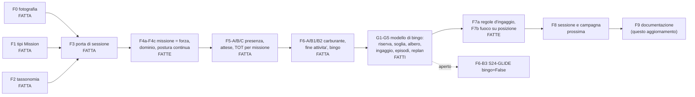

# Capitolo 9 — Limiti noti, punti di estensione, divergenze codice/wiki

> **Stato descritto: commit `dcedc541` (2026-10-20).** Il manuale descrive il motore a quel commit, cioè dopo le fasi
> F0-F7 del piano di implementazione della Missione (`Analysis/Document/Piano_Implementazione_Missione.md`) e i passi
> G1-G5 del modello di bingo: la fase F4 (F4a regola A, F4b la missione è l'unità d'ingaggio, F4b+ dominio di
> coordinamento, F4b++ difesa di salva per dominio, F4c postura continua), la fase F5 (presenza fuori dalla rotta,
> `grounded` nel tempo, attese WAIT, ETA bloccate, TOT per missione), la fase F6 (carburante per tratto e nel tempo, criteri
> di fine attività e stato di missione, postura `destroyed`, bingo e rientro), i passi G1-G5 (riserva di disimpegno, soglia e
> albero di decisione, consumo in ingaggio, episodi d'ingaggio, ri-pianificazione, uscita di scena, scenari S26-S27) e, **dal
> 2026-10-18/20, la fase F7**: F7a (regole d'ingaggio di missione — bersaglio designato, ROE, armi designate, politica d'armi per
> tipo di missione — con lo scenario S28) e F7b (fuoco su posizione, nuovo modulo `Logic/Area_Fire.py`, terzo tipo di evento di
> sessione, scenario S29). Restano **da fare** le fasi **F8** (sessione e campagna: validatore di sessione, prontezza,
> posizione persistente) e **F9** (documentazione: questo stesso aggiornamento ne è parte), più il **F6-B3** (S24-GLIDE
> dichiara ancora `bingo=False`). Il loro stato è in §9.5. Tutto ciò che il capitolo elenca come "limite" va letto rispetto a
> quel commit. Dall'aggiornamento a `a784a9e7` sono **superati**: «il filtro per tipo di missione/bersaglio (ROE) non esiste»
> (decisione A4, ora F7a), «`ifv_only`/`maverick_only_fire_control` come stand-in di test» (sostituiti dalle regole di missione
> in S19AD), «la salva su area/il bersaglio di posizione stimata non è rappresentabile» (ora il fuoco su posizione della F7b, per
> terra e mare), «`target_destroyed` su `GROUP` solo intero» (ora ristretto da `Target.asset_ids`); sono **nuovi** quelli delle
> sezioni «Regole d'ingaggio di missione (F7a)» e «Fuoco su posizione (F7b)» più sotto. Dall'aggiornamento a `84a47670` erano
> superati: «nessuna presenza prima della partenza né dopo la fine», «nessun `WAIT`», «esito di missione di prima forma /
> nessun `ABORTED`», «`grounded` per tutta la sessione», «la postura non è nell'esito», «un solo `FuelEvent` per asset, nessun
> consumo nel tempo, nessun bingo», «carburante esaurito a metà rotta: l'asset non viene fermato», «re-scheduling dopo un cambio
> di rotta: non esiste» (a livello di sessione) e «il TOT comune dell'Operazione»; nuovi quelli della sezione «Limiti introdotti
> dalle fasi F5, F6 e G1-G5». (Dall'aggiornamento a `533cd1f5` erano già superati «l'unità d'ingaggio è ancora il blocco», «il
> `mission_id` non entra nell'RNG» e «nessuna condivisione dei rilevamenti fra missioni».)

## 9.1 Limiti noti (dichiarati nel codice, non difetti nascosti)

Raccolti dai "Cosa NON fa" dei singoli moduli, già citati nei capitoli precedenti; qui riuniti
per avere un solo punto di riferimento.

### Selezione dell'arma dai registri — fatta (2026-09-24), estesa al cannone di bordo (2026-09-26) e alla gittata delle bombe (2026-09-27)

Aggiornamento rispetto alla stesura iniziale di questo manuale: `fire_control` resta sempre
**iniettata** dal chiamante (`Logic/Engagement_Resolver.py:24-30`, il contratto non è cambiato,
esteso solo per accettare anche una sequenza di opzioni, v. sotto), ma esiste ora
un'implementazione che seleziona davvero l'arma dai registri
(`Logic/Fire_Control.make_registry_fire_control`, capitolo 4, §4.16), consultando
`Ground_Weapon_Data`/`Ship_Weapon_Data`/il loadout assegnato dell'aereo invece di una tabella di
ruoli. Dal 2026-09-26 (decisione A5) non seleziona più solo l'arma a Pk massima: restituisce
**tutte** le armi adatte in ordine di preferenza Pk/costo (`rank_weapons`, capitolo 4, §4.16), e
il risolutore prova le opzioni in ordine, sparando con la prima che ha ancora scorta (v. sotto).
Resta da fare, dichiarato nel modulo stesso (`Logic/Fire_Control.py:181-190`): la modulazione
della Pk con la posizione nell'inviluppo (distanza, aspetto) — i valori restano quelli di
template, indipendenti da dove avviene realmente il tiro nella finestra. (Fino a `a784a9e7` si aggiungeva: «il filtro per
tipo di missione/bersaglio (ROE) non esiste, decisione A4 rimandata»: **superato dalla F7a**, v. oltre.) **Aggiornamento a `533cd1f5`**: l'entità
`Mission` ora esiste (fase F1, capitolo 2 §2.6) e attraversa la porta di sessione (F3), ma **né il
risolutore né la `fire_control` la consultano**: il filtro delle armi per tipo di missione, ruolo
dell'asset e categoria d'arma è la fase F7 — un caccia intercettore sceglierebbe oggi le stesse armi in
missione CAP o in missione strike. Gli scenari lo simulano con stand-in di test (`ifv_only`,
`maverick_only_fire_control` di S19AD, capitolo 8 §8.6). **Aggiornamento a `84a47670`**: la `Mission` è anche la
forza d'ingaggio (F4b), ma il risolutore ne legge solo l'identità e gli asset (capitolo 4 §4.27): niente tipo di
missione, ruoli, bersaglio o regole; resta valido tutto quanto scritto qui sopra. **Aggiornamento a `dcedc541` (F7a)**: il filtro
c'è, in due strati — la politica d'armi per tipo di missione come *involucro* della `fire_control`
(`Fire_Control.restrict_by_policy`, capitolo 4 §4.33) e le regole di bersaglio nel risolutore (`TargetRules`, §4.32), che
continua a **non leggere la `Mission`**; i due stand-in di S19AD sono stati sostituiti dalle regole di missione (capitolo 8
§8.6). Restano valide le altre voci: modulazione della Pk con la posizione nell'inviluppo, terra e mare senza vincoli d'arma.

**Risolto rispetto alla stesura precedente di questo manuale — il cannone di bordo è ora candidato**
(decisione A2, 2026-09-26, commit `8bd69727`, v. capitolo 4 §4.16bis): campo `gun` di
`Aircraft_Data` (37 modelli) più `get_aircraft_gun_rounds` per la ripartizione proporzionale di un
armamento misto, propria voce di scorta e candidatura in `_candidate_weapons`. Il filtro per tipo di missione (A4) è
dalla F7a l'involucro `restrict_by_policy` (che toglie per esempio il cannone a un CAP contro il suolo, capitolo 4 §4.16bis); l'AJ/ASJ 37 Viggen resta senza `gun` per un'anomalia
dei dati (`gun_rounds` nel loadout ma nessun cannone interno proprio nel registro per quella
variante — v. capitolo 4 §4.16bis).

**Risolto in parte rispetto alla stesura precedente — le bombe hanno ora gittata e tempo di caduta
reali** (decisione B6, 2026-09-27, commit `6754bf1c`, v. capitolo 4 §4.20): per le 29 bombe su 32
con dati di rilascio (`AIR_WEAPONS['BOMBS'][...]['release']`, commit `4ddbb089`), `shot_spec_for`
non produce più `max_range = None` contro un bersaglio di superficie, ma la gittata obliqua e il
tempo di caduta dalla balistica di `Logic/Weapon_Delivery.bomb_engagement_estimate`, alla quota
tiratore−bersaglio e alla velocità `attack` del loadout. **Risolto il 2026-09-28 (decisione D4)**: le tre
KGBU-2AO/2PTAB/96r senza dati di rilascio erano un dispenser KMGU-2 mal identificato; ora `KMGU-2AO` e
`KMGU-2PTAB` hanno dati di rilascio (KGBU-96r è eliminata) e, dopo l'aggiunta di 23 bombe DCS
(`0df5ddf9`), **tutte le 54 bombe** del registro hanno il campo `release` (capitolo 7 §7.12): nessuna bomba
produce più `max_range = None` per mancanza di dato. Restano, dichiarati nel modulo `Weapon_Delivery` (v. capitolo 7,
§7.9): la geometria della picchiata/cabrata non entra nel tratto valutato per la gittata (solo
nella balistica); la sfera di portata del DES non ha distanza minima; quota e velocità fuori dalla
finestra di rilascio sono portate (clampate) al bordo ammesso invece di far fallire il tiro, come
fa l'IA di DCS. Negli scenari di validazione (capitolo 8) il ruolo di `fire_control` è ancora
coperto anche da `Scenario_Fixtures.make_fire_control`, dichiarato esplicitamente come tabella di
ruoli non calibrata, per gli scenari che non hanno bisogno di una selezione reale dai registri.

### Scorta munizioni indifferenziata per arma — **risolta** (2026-09-26, decisione A1/A3, commit `1d0c1127`)

Aggiornamento rispetto alla stesura iniziale di questo manuale: fino a questa data la scorta di
un asset era **un contatore scalare aggregato** (`Mobile.ammunition`, decisione R3 del
2026-09-23) che sommava armi eterogenee — bombe, missili, colpi di cannone — in un solo intero.
La fire control sceglieva un'arma specifica per nome, ma il risolutore consumava sempre lo stesso
scalare aggregato, **indipendentemente** da quale arma avesse davvero sparato: un A-10 con 4
Maverick reali a bordo ne lanciava 642 nella simulazione, pagati dai colpi del cannone nello
stesso contatore; un BMP-2 con 4 missili Konkurs poteva lanciarne 252. Non era un limite
dichiarato nella stesura iniziale di questo manuale (il capitolo 4, §4.4, descriveva
semplicemente il contatore aggregato come lo stato dell'epoca), ma un difetto di modello
verificato e corretto (`Analysis/Document/Proposta_Munizioni_Compatibili_e_Rotte_Attacco.md §1`).

**Risoluzione**: la scorta **per modello d'arma** (`Mobile._stores`, nuovo modulo
`Asset/Weapon_Stores.py`) è ora lo stato primario; `ammunition`/`interceptor_stock` sono viste
calcolate su di essa; `Fire_Control` dichiara l'arma in ogni `ShotSpec.weapon` e il risolutore
consuma la voce di quell'arma, non più l'aggregato (v. capitolo 4, §4.19, e capitolo 7, §7.6, per
il dettaglio completo). La regola del "SAM puro" (`interceptor_shares_ammunition`) non serve più
ed è stata eliminata: la condivisione fra fuoco offensivo e intercettazione sulla stessa voce di
scorta è ora per costruzione, per qualunque asset con armi AD modellate per arma.

**Limiti noti che RESTANO, non corretti da questo lavoro**:

- Il **cannone di bordo** degli aerei — risolto separatamente il 2026-09-26 (decisione A2, commit
  `8bd69727`, v. sopra e capitolo 4 §4.16bis): ha ora una propria voce di scorta ed è candidato
  della fire control.
- ~~Il **filtro per tipo di missione/bersaglio** (ROE) non esiste (decisione A4 rimandata alla fase F7)~~ — **superato dalla F7a**
  (`9f87a3ad`, 2026-10-18): la politica d'armi per tipo di missione è un involucro della fire control (capitolo 4 §4.33) e le regole di
  bersaglio (ROE, bersaglio e armi designate) sono lette dal risolutore (§4.32); restano i limiti della sezione «Regole d'ingaggio di
  missione (F7a)» più sotto. L'ordine di preferenza delle armi (v. §4.16) non cambia: l'involucro lo filtra soltanto.
- La **scelta dell'arma precede il controllo di portata** (v. capitolo 4, §4.17): il risolutore
  fissa prima la prima opzione della fire control che ha ancora scorta, e solo su quella applica
  il controllo di portata (§4.17). Se l'opzione preferita ha scorta ma è fuori portata, il
  candidato è rimandato o esaurito **anche se** un'opzione meno preferita della stessa
  `fire_control` sarebbe già in portata — il tiratore non "scende" alla seconda opzione per
  motivi di portata, solo per motivi di scorta esaurita. Non corretto: richiederebbe che la
  scelta dell'arma conoscesse la geometria della finestra prima di essere fissata.
- La **taratura della formula Pk/costo** (`WEAPON_COST_EXPONENT = 0.5`, decisione A5) resta una
  stima di principio confermata dall'utente, non un valore calibrato — v. capitolo 4, §4.16.

### Fog-of-war reale — collegato al rilevamento (2026-09-25), ma "debole", e con un bug a monte

Aggiornamento rispetto alla stesura iniziale: il fog-of-war informativo di livello C2
(`Context/Region`/`Logic/Tactical_Analysis`, `recon_cp_snapshot`, `use_recon`, la policy "non
visto → priorità bassa" di `feedback_no_visibility_low_priority`) **è ora collegato** al
rilevamento del motore, tramite `region_recon_detection_factor` (capitolo 4, §4.18): la stessa
istantanea di ricognizione che alimenta le priorità di targeting (`build_recon_cp_snapshot`) è
usata anche per costruire il `detection_factor` iniettato in `resolve_engagement`. Le due nozioni
di "visibilità" — geometrica (nel raggio di un sensore, ciò che `Contact_Scheduler` calcola) e
informativa (confermata dal C2) — sono quindi collegate per la Pd, restando comunque due
meccanismi distinti (l'informativa non decide *se* un sensore rileva, solo *quanto* è probabile
che lo faccia).

**Limite noto, dichiarato, non corretto — la nebbia è "debole"**: `Block.get_recognition_report`
produce sempre un report con `block_id` per **ogni** `Military` nemica selezionata nella regione
(`Block/Block.py:504-521`: `block_id` non è condizionato da `report_item_probability`, a
differenza di `position`/`dimension`/`efficiency`, che possono risultare `None`). Di conseguenza
`unseen` (bersaglio "non visto") oggi scatta **solo per condizioni strutturali** — blocco fuori
regione, non `Military`, categoria non mappata da `Context.MILITARY_CATEGORY_TO_FORCE`, o asset
bersaglio senza blocco — non per un criterio più stringente come `position is None` nel report
stesso. È una scelta **deliberata** per restare fedele alla ricetta già esistente di
`Region.update_military_priorities` (stessa istantanea, stesso significato di "visto"), non un
bug: ma il risultato è che la nebbia di guerra copre oggi meno casi di quanto il nome
suggerirebbe. Un criterio più stringente è un'estensione futura (v. §9.3).

**Bug trovato durante l'implementazione (2026-09-25), non corretto**:
`Region.get_blocks_by_criteria(category='Military')` (`Context/Region.py:291-301`) scarta
`Military` **reali** la cui `category` non è esattamente la stringa `'Military'` — comune nelle
fixture di test che non la impostano esplicitamente (default `''`). La causa è la struttura
`if`/`elif`/`elif`/`elif`: la prima condizione (`category == 'Military' and not
isinstance(block, Military)`) è pensata per "lasciare passare" una vera `Military` quando è
**falsa**, ma essendo un `elif` e non un `else` indipendente, Python valuta comunque l'ultimo
ramo della catena (`elif block.category != category: continue`) anche quando il blocco È una
`Military` — e lo scarta se il suo attributo `category` non vale letteralmente `'Military'`.
Impatta ogni chiamante che filtra per `category='Military'`, **incluse** `side_recon_efficiency`
(§4.18) e `Region.get_recon_reports` — quindi potenzialmente sia la nebbia di guerra sia
`update_military_priorities` (già esistente, non introdotto da questo lavoro). Non corretto:
tocca chiamanti esistenti al di fuori del perimetro di questo lavoro, da decidere a parte (v.
memoria di progetto `project_session_2026_09_25_summary.md`).

### Re-scheduling delle finestre di contatto dopo un cambio di rotta — fatto dal G4b a livello di sessione, non nel risolutore

Se un asset cambia rotta durante una finestra di contatto già calcolata dallo scheduler, la finestra va invalidata e
ricalcolata. **Dentro `resolve_engagement` questo meccanismo non esiste ancora**, e il docstring del risolutore lo dice
(`Logic/Engagement_Resolver.py:374-377`, R4 seconda parte: «il nuovo instradamento e il ricalcolo delle finestre di contatto
non li fa questo modulo: dal G4b li fa la sessione»): una forza che si disingaggia è **solo segnalata** nell'esito della run (`ForceOutcome.outcome =
DISENGAGED`). **Dal G4b lo fa però l'orchestratore, fra un episodio e il successivo** (capitolo 6 §6.20): gli aerei di
missione interessati sono ri-pianificati (bingo, esaurimento in ingaggio, rientro forzato dopo il disingaggio, uscita di
scena), i loro tratti sono sostituiti e i contatti non ancora risolti sono ricalcolati con `schedule_contacts(only_assets=)`.
Resta **non fatto** per le forze **terrestri e navali** che si disingaggiano (restano passive sulla rotta, G4a), per un
cambio di rotta *durante* un episodio (la decisione è alla fine dell'episodio) e per le condizioni su eventi
(`Activation.ON_EVENT`). V. §9.2 per la divergenza fra questo comportamento e il testo originale della decisione.

### La Pd non distingue radar da ottico

`weather_detection_factor` applica un fattore di degradazione **unico** a qualunque sensore
abbia prodotto la portata della finestra di contatto, perché la finestra stessa non porta
l'informazione "quale sensore" (`Logic/Engagement_Resolver.py:461-473`, `:1105-1152`). Un radar non dovrebbe
subire la stessa degradazione notturna di un sensore ottico, ma oggi la subisce comunque, con un
compromesso pesato verso il radar. La discriminazione per tipo di sensore richiede che la
finestra di contatto porti anche il sensore che l'ha prodotta — un cambiamento nello strato 1.

### Altri limiti dichiarati, minori

- **Ripartizione del fuoco**: round-robin locale per tiratore, sul **dominio di coordinamento** dalla F4b+
  (`_schedule_next`,
  `Logic/Engagement_Resolver.py:2230-2419`), non un'assegnazione ottima arma-bersaglio (nessun
  WTA, nessun peso per valore del bersaglio; la Pk della coppia entra solo nella saturazione della
  dottrina di tiro, §4.25). Dal 2026-09-28/29 il round-robin è preceduto dalla priorità ai lanciatori
  (L2/L3, §4.24) e dal filtro dei bersagli bloccati (§4.25).
- **`salvo_window` di default 0.0**: solo impatti simultanei formano un evento-salva; la finestra
  giusta per raggruppare impatti ravvicinati è un punto aperto di modello, da decidere con la
  taratura (`Logic/Engagement_Resolver.py:3626`, `:3674-3676`).
- **Nessun movimento fisico fra sessioni**: `run_session` non aggiorna `asset.position` a fine
  rotta; una campagna che concatena sessioni vede le forze ripartire dalle posizioni iniziali a
  ogni sessione, a meno che il chiamante non aggiorni le posizioni da sé
  (`Test/Test_Session_Validation.py:281-285`, v. capitolo 8, §8.3).
- ~~**Carburante esaurito a metà rotta**: l'asset non viene fermato sulla rotta~~ — **superato dalla F6-A**: i tratti sono
  troncati al punto di esaurimento e l'asset si ferma, plana o è perso (capitolo 6 §6.17); dal G4b il punto è ricalcolato
  anche dopo un consumo in ingaggio (capitolo 6 §6.20). Resta il limite del vincolo calcolato a monte alla crociera per i
  consumi che il motore non modella (il regime `'max'` di terra/mare coincide con la crociera).
- **`calcFightResult` (fallback aggregato a rapporto di forze) resta invariato**: nessuna delle 7
  fasi lo ha toccato, per scelta esplicita (wiki `decisions/soglie-disingaggio-e-attrito-aggregato`
  §P2); se mai verrà riscritto, il bersaglio dichiarato è una forma eterogenea a matrice di
  letalità incrociata con coefficienti solo da ATCAL interno, mai da tabelle a mano.
- **Sensori 'ground' assenti nei registri** per carri/corazzati/artiglieria e per le navi (v.
  capitolo 8, §8.1): senza un'iniezione esplicita, due forze terrestri non si vedono mai. Non è
  un bug del motore, è un dato mancante nei registri d'arma che nessun chiamante di produzione
  compensa ancora.
- **Nessun rifornimento nel motore**: né di munizioni né di carburante. È dichiarato materia del
  ciclo di campagna in entrambi i moduli (`Logic/Fuel_Model.py:49`, `:132-133`, wiki
  `decisions/risolutore-ingaggio-salva-fase4` §R3).

### Limiti introdotti o resi evidenti dalle estensioni del 2026-09-28/30 (commit `72c7f7c8`...`a500fdf3`)

**Soglia di rottura stocastica** (capitolo 4 §4.7, §4.21; `Proposta_Soglia_Rottura_Stocastica.md` §8):

- **Coefficienti dichiarati, non tarati**: `erosion = 0.30` è una stima di partenza; dispersione, pesi di
  morale, rapporto di forze, fuoco senza risposta, postura e `shock_min_losses` sono stime senza fonte
  (`Context/Doctrine.py:115-127`), da ricalibrare con ATCAL. I tre lati hanno gli stessi valori.
- **Rottura parziale non modellata**: il disingaggio resta per **forza intera** (decisione P1): una parte
  della forza non può cedere mentre l'altra resiste. Nessun contagio fra forze dello stesso lato né legame C2
  (Fase 0 della gerarchia C2, mai toccata).
- **Il morale non è alimentato**: il risolutore lo riceve come ingresso (`morale_for`); `Block.morale`
  (`Block/Block.py:434-449`) vale `0.0` quando manca il dato e nessun modulo registra gli esiti delle
  missioni. **Nessun chiamante di produzione** passa `morale_for` né `enemy_estimate_for` a `run_session`:
  oggi il fattore di morale è sempre neutro e la stima a priori sempre assente (decisione D9: correggere
  `Block.morale` più avanti).
- **Minaccia percepita sulla scorta di dotazione**: un SAM che ha sparato tutto continua a pesare come se
  fosse carico (decisione dell'utente, 2026-09-29): chi osserva non conosce la scorta residua.
- **Fuoco senza risposta** conta solo la percezione del tiratore, non la capacità di ingaggiarlo; **senza
  RWR un aereo non percepisce mai i SAM** (nessun sensore in modo `ground` nei registri aerei).

**E(N) e pesi di minaccia** (capitolo 4 §4.22): bersaglio di riferimento fisso (`Aircraft_Attacker` med),
velocità 200 m/s e attraversamento lungo il diametro sono stime dichiarate; `EFFICACY_CORRECTIONS` è vuota;
il peso di superficie è binario (1 o 0, SAM puri a 0) e quello aereo dei caccia è fisso a 1.

**RWR e classi** (capitolo 4 §4.23, capitolo 7 §7.10): settori, `ewr` e `confidence` sono nei dati ma non
consumati da nessun codice (rimandati a rotte/evasione e a un SEAD); la classe RWR pesa con la **media** del
catalogo (può sottostimare); `run_session` non inoltra `rwr_catalogue`; il catalogo di default è l'intero
registro, non l'inventario del nemico (serve la corrispondenza lato → paesi).

**Difesa dai missili A6** (capitolo 4 §4.24): il **legame C2 fra unità non è modellato** (ogni tiratore usa il
proprio profilo di reazione: una batteria integrata assegnerebbe più in fretta di unità indipendenti); Osa e
Stinger non sono intercettori (D-AM1, in attesa di una verifica in DCS di quali unità l'IA fa sparare contro
missili); la regola L1 valuta il volume del **singolo** intercettore (Q1); i colpi lanciati da dentro la zona
non si intercettano mai (Q2); il lanciatore deve essere già rilevato dal tiratore (Q5).

**Dottrina di tiro** (capitolo 4 §4.25): le intercettazioni possibili sono ignorate nella stima di copertura
(stima ottimistica); il tetto "due missili" conta solo i colpi **in volo** dello stesso tiratore; i valori
0.9 e 2 sono stime dichiarate (0.9 scelto dall'utente); la regola è greedy locale, non un'assegnazione ottima.

**R-INT** (capitolo 4 §4.26): tempo di volo dell'intercettore trascurato, RCS del colpo non modellata,
traiettoria rettilinea, rilevamento per asset e non per forza (tutte semplificazioni ottimistiche per la
difesa, dichiarate nella proposta §4).

### Limiti della Missione a `dcedc541` (fasi F0-F7 e G1-G5 fatte, F8-F9 no)

Ciò che segue è **atteso** dal piano e non un difetto nascosto; v. §9.5 per la mappa fase per fase. (Questa sezione era
«Limiti della Missione a `a784a9e7`» e prima «a `84a47670`»: sono stati tolti i limiti risolti dalle fasi F5, F6 e F7, elencati
in testa al capitolo.)

- **Il motore consulta della Missione la geometria, l'identità, le attese, i criteri di fine, il bersaglio, la ROE e le armi
  designate**:
  rotta, partenza, velocità e offset di formazione (capitolo 6 §6.10); dalla F4b l'identità della forza d'ingaggio (id,
  blocco, asset, capitolo 4 §4.27); dalla F4b+ l'appartenenza a un'Operazione, **solo** per il dominio di coordinamento
  (`Operation.mission_ids` e `Mission.operation_id`, capitolo 6 §6.13); dalla F5-C le azioni `WAIT`, le ETA bloccate e il TOT
  (capitolo 6 §6.16); dalla F6-B1/B2 i criteri di `EndCriteria` — `winchester`, `damage_threshold`, `target_destroyed`,
  `max_duration_s`, `bingo` — e il bersaglio per `target_destroyed` (capitolo 6 §6.18-6.19); dal G2 il tipo di missione
  (categoria `TRANSPORT` o no) per l'albero del bingo; **dalla F7a** `Mission.target` (con `Target.asset_ids`), `Mission.rules.roe`,
  `MissionAsset.weapons` e il tipo di missione (per la politica d'armi aerea), tutti tradotti da `Mission_Adapter` nelle forme
  `TargetRules` e `WeaponPolicy` (capitolo 6 §6.22); **dalla F7b** le azioni `Fire_At_Point` (capitolo 6 §6.23). **Non sono letti**
  da alcun modulo di `Logic`: i ruoli degli asset (se non per le posizioni della formazione), le regole **diverse dalla ROE**
  (allerta, EMCON, reazione alla minaccia, formazione), `abort_on_threat` e `last_waypoint` di `EndCriteria`, la
  `OutcomeRule` dell'Operazione e la missione principale (verificato con una ricerca nei moduli `Logic/`; il risolutore non
  legge `mission`: riceve `target_rules`).
- **Esito di missione**: la regola unica `DESTROYED > COMPLETED > ABORTED(motivo) > FAILED` (capitolo 6 §6.11) produce
  tutti gli stati; **non sono prodotti** `THREAT` e `SUPPORT_MISSING` (motivi di aborto) né `THREAT` e `MISSION_ABORTED` (fine
  dell'asset: i gregari che seguono la missione che abortisce, D3.d). Una missione **senza rotta** con asset sopravvissuti
  risulta ancora `FAILED` perché manca lo stato «in corso» (capitolo 6 §6.11, D4.e); l'esito di un'`Operation` non è calcolato
  da nessuno.
- **`Activation.ON_EVENT` è solo dichiarabile**: `mission_start` solleva `ValueError`; condizioni sullo stato e
  re-scheduling guidato da eventi restano fuori piano (N2.d, R4 seconda parte).
- **Missioni fuori finestra**: una partenza derivata anteriore all'inizio della sessione è un errore, ma una
  rotta che supera la fine è ritagliata in silenzio (`clamp_legs`) e i controlli di durata (default 2 h,
  massimo 4 h) sono della F8.
- **Vincolo di sessione**: un asset in **una sola** missione per sessione (un blocco può averne più).
- **Elenchi di prima stesura**: `EMCON_STATES`, `THREAT_REACTIONS`, `FORMATIONS` come nomi generici, e
  `MITER_LIMIT = 2.0` dell'offset di formazione sono stime di progetto (capitolo 2 §2.6, capitolo 6 §6.10);
  la tabella `MISSION_TYPE_POSTURES` è solo un dato, il secondo stadio "postura → tipi di missione" non esiste.
- **Aircraft**: 13 loadout hanno un task di supporto; ne resta **1 con `tasks` vuoto** (An-30M Recon, volutamente:
  ricognizione fotografica, `Asset/Aircraft_Loadouts.py:3620-3625`; il piano ne ipotizzava 14 da assegnare).
- **Regola A: il limite di velocità è il regime `'max'` generico**, non quello per terreno
  (`speed['off_road']['max']`): gli scenari pianificano oggi i mezzi terrestri al regime nominale su archi
  'offroad'; il vincolo per tipo d'arco va deciso con il modulo mappe. Un asset senza velocità massima nota è
  escluso dal controllo con un warning, non lo blocca (capitolo 6 §6.10).

### Limiti introdotti dalla fase F4 (2026-10-05/11, dichiarati nei docstring e in `F4_Differenze_Scenari.md`)

Sono limiti del **modello** scelti consapevolmente, ciascuno con la fase o la decisione che li riprenderà. (Due sono
stati **superati** dalla F5: `grounded` per tutta la sessione e la postura fuori dall'esito; v. sotto.)

**Dominio di coordinamento (F4b+, F4b++)** — capitolo 4 §4.28-4.29:

- **Nessun cueing del tiro**: un tiratore spara solo ai bersagli che ha rilevato *lui* (i candidati di tiro sono
  per osservatore). Assegnare un bersaglio da un sensore a un tiratore — EWR→SAM, AWACS→caccia,
  scorta→strike — è una funzionalità futura, da proporre a parte con la Fase 0 C2. Anche i tempi R-INT restano
  per intercettore: la percezione condivisa non anticipa la traccia del colpo.
- **Condivisione istantanea, senza latenza né perdite del canale**: un rilevamento, una salva in volo o un
  lanciatore noto a una forza del dominio valgono per tutte dall'istante in cui avvengono. Approssimazione
  dichiarata nei docstring di `Engagement_Resolver` e `Session_Simulator`; data link, voce e C2 non sono
  modellati.
- **Canali di intercettazione condivisi solo nello stesso istante**: due forze del dominio colpite a istanti
  diversi ma ravvicinati (meno di `salvo_window`) ricevono ciascuna i canali pieni, come una forza sola che
  subisce due eventi-salva distinti (`instant_interceptions`, capitolo 4 §4.29).
- **Nessuno scenario esercita la difesa di salva per dominio**: la fotografia è identica (328 su 328) con e senza
  la F4b++; il caso è coperto da stub nel risolutore. Nella prova fuori repository su una variante di S16 le
  corvette non intercettano per la regola R-INT.
- **Un'Operazione con missioni di lati diversi lega solo quelle dello stesso lato** (un dominio per lato, con
  un warning): scelta dichiarata, perché `SessionOrder` non conosce i blocchi e quindi non può vietarla, e
  l'Operazione è un raggruppamento di scopo, non di comando.

**Missione come unità d'ingaggio (F4b)** — capitolo 4 §4.27:

- **Una missione di un solo asset è `DESTROYED` alla prima perdita** (S19, la missione di Strike di un B-52H):
  conseguenza diretta di avere il disingaggio e la distruzione per missione; la stessa perdita non basta a
  rompere il blocco di 5 aerei.
- **Nessun legame fra il disingaggio di una missione e quello della gemella**: il dominio condivide fuoco e
  percezione, non il destino di disingaggio. Un'Operazione non produce un esito comune (nessuno calcola la
  `OutcomeRule`).
- **`SessionOrder.committed` resta chiavato per blocco**: non si può impegnare una parte di *una* missione
  indipendentemente dal blocco; vale la restrizione del blocco intersecata con gli asset di ciascuna missione.
- **`morale_for` e `enemy_estimate_for` ricevono la vista di missione** (con `owner_block`), ma nessun chiamante
  di produzione li fornisce.

**Postura continua e aerei a terra (F4c, F5)** — capitolo 4 §4.30, capitolo 6 §6.14-6.15:

- **~~`grounded` vale per tutta la sessione~~** — *superato dalla F5*: `grounded` è un `GroundedSchedule` nel tempo e
  gli aerei con missione sono a terra prima del decollo e dopo l'atterraggio su una base vera (capitolo 3 §3.7). Resta
  «sempre a terra» per gli aerei senza missione.
- **Un aereo a terra resta nella posizione registrata** anche se la quota è di volo (caso `VAL-agn`, sessioni 2-3:
  i 2 A-10C a 3000 m ora non sparano): la posizione non persiste fra sessioni (D1.d, F8) e il motore non porta
  l'aereo a terra. Un aereo con missione che parte dal parcheggio è a terra nel **primo punto** della rotta, alla
  quota di quel punto: la rotta deve cominciare sulla base.
- **Nessuno shelter/hangar**: un aereo parcheggiato è `'Soft'` come all'aperto.
- **Gli aerei a terra non hanno sensori né RWR**: non contribuiscono alla percezione della base.
- **Una fire control che non dichiara `target_grounded`** classifica gli aerei a terra come gli altri aerei
  (con un warning per run).
- **~~La postura `Defense` ... non entra nell'esito~~** — *superato dalla F5-B*: la postura di ogni asset è in
  `SessionOutcome.postures` (capitolo 2 §2.3). Resta vero che la postura `Defense` delle unità di superficie senza
  missione è **solo dichiarata**: non cambia tiro né rilevamento (nessun ROE «hold fire»).
- **La potatura per blocco dello scheduler conta ancora velocità e portata degli aerei a terra**: è
  conservativa (più coppie di blocchi esaminate, nessun contatto perso), un costo e non un errore (capitolo 3 §3.6).

### Limiti introdotti dalle fasi F5, F6 e G1-G5 (2026-10-11/18, dichiarati nei docstring e in `F4_Differenze_Scenari.md`)

Sono limiti del **modello** scelti consapevolmente o conseguenze di dati non tarati. Quelli che il Piano raccoglie al
§5, deviazione 22, come «limiti residui noti» che il piano G1-G5 si lascia aperti sono marcati con **[dev. 22]**.

**Dati e stime del modello di bingo** (capitolo 5 §5.2):

- **[dev. 22] Dati `speed_data['emergency']` del registro `Aircraft_Data` non tarati.** `consume` è letto in **kg/h** per
  deduzione (unità non documentata; coerente con il regime `sustained` e con dati reali noti) e **sottostima di circa 1/6 il
  consumo a postbruciatore pieno** per i caccia che lo hanno; `time` è di unità ignota e **non è usato**. La riserva di
  disimpegno e il consumo in ingaggio, che ne derivano, restano **STIME**. La correzione del registro (valori di
  `emergency.consume` e `time` dei 66 aerei, distinzione dei motori con postbruciatore) è un arretrato dichiarato dalla
  deviazione 17 del Piano, non fatto.
- **[dev. 22] Regola per gli aerei la cui emergenza dura meno di 5 minuti (Seconda guerra mondiale) NON implementata**:
  «emergenza per `min(300 s, time)`, poi regime `'combat'`» (indicazione dell'utente), in attesa di un `time` affidabile
  (docstring di `Fuel_Model.engagement_fuel_with_source`, capitolo 5 §5.2.8). Va deciso allora se la riserva del G1 la segue.
- **Costanti STIMATE, non tarate**: `DISENGAGE_TIME` = 300 s e `ALTERNATE_BASE_MAX_OFFSET` = 3000 m (decisioni dell'utente);
  `GLIDE_RATIO` = 10 (ordine di grandezza); `BINGO_RESERVE` = 0,10 e `BINGO_RETURN_FACTOR` = 1,2 (solo a interruttori spenti);
  `AIR_BASE_AREA_RADIUS_M` = 3000 m (area di una base per il criterio d'atterraggio: da sostituire con il perimetro reale
  quando arriverà il modulo mappe); `EPISODE_GAP` = `DISENGAGE_TIME`, legato per costruzione.
- **Consumo in ingaggio a scatto**: i 5 minuti di manovra sono consumati nell'istante della prima partecipazione, non
  distribuiti nel tempo né lungo la rotta; il consumo delle soste (attese e orbite) è pari alla **crociera**, anche per il
  loiter (sovrastima per gli aerei) e per terra/mare (sovrastima, nessun dato di consumo da fermo nei registri).

**Pianificazione e validatori:**

- **[dev. 22] I validatori `check_mission_fuel` (minimo di pianificazione) e `check_mission_bingo` (bingo a priori) NON sono
  chiamati da `run_session`**: sono del pianificatore (fase F8, validatore di sessione, da confermare). Nessun codice di
  produzione li chiama (solo test e S26). Un ordine che parte sotto la soglia non è rifiutato dall'esecutore: l'aereo va in
  bingo alla partenza.
- **Idoneità della base non modellata**: qualunque base aerea amica va bene (pista, elicotteri, portaerei); terreno non
  modellato (discesa rettilinea a quota 0, quota = altezza sulla base); la base è la posizione di un asset non aereo di un
  blocco `is_Air_Base()` del lato.

**Comportamento in volo:**

- **[dev. 22] Nessuna salva offensiva dopo il bingo** (scelta della F6-B2): dal rientro l'aereo resta solo bersaglio e
  intercettore, non attacca più nemmeno una minaccia che reincontra sul ritroso.
- **[dev. 22] Decisione presa alla FINE dell'episodio, non a metà**: l'episodio è risolto in blocco con i tratti di prima; il
  rientro a ritroso **ripercorre le minacce dell'andata** (in episodi nuovi, passivo); **nessun rientro per danno** (un aereo
  oltre la soglia di danno della F6-B1 resta passivo sulla rotta); **terra e mare senza bingo** (restano fermi nel punto
  d'esaurimento, nessun consumo d'ingaggio).
- **Uscita di scena sempre al punto di comparsa** (decisione dell'utente), anche se il resto della rotta in avanti fosse più
  corto o portasse fuori dalla zona delle minacce, e **solo dopo un episodio**: alla partenza (G2) un aereo senza basi non
  esce di scena ma segue le regole della F6-A (`BINGO_NO_BASE`).
- **Forza occupata per forza intera, non per asset**: una forza che entra tardi in un episodio lungo è «occupata»
  dall'inizio dell'episodio, e un suo contatto in un altro episodio dentro quell'intervallo è spostato alla fine; un aereo
  ri-pianificato che incontrerebbe una forza ancora occupata in un episodio già risolto la incontra solo dopo la fine di
  quell'episodio.
- **La formazione si può dividere**: le decisioni sul carburante sono per aereo, il rientro forzato per forza; gli aerei di una
  forza disingaggiata ancora a terra (non decollati) a `t_r` non sono ri-pianificati.
- **[dev. 22] G4a: esito degli episodi «vuoti» per finestre di aerei già distrutti**: lo scheduler non le tronca (filtra gli
  asset operativi allo stato corrente, ma le finestre calcolate all'inizio restano).
- **Durante la planata l'aereo è un aereo in volo come gli altri** (può essere ingaggiato e sparare): l'esaurimento non è
  fra i criteri di fine attività.

**Attese, presenza e fine attività:**

- **Orbita senza circuito**: l'aereo è fermo nel punto (errore di posizione pari al raggio del circuito reale, qualche km per
  un caccia); nessuna velocità d'orbita, quindi nessun effetto della cinematica sul rilevamento o sul tiro durante l'attesa.
  Il raffinamento (distanza di riferimento/zona) è da decidere (capitolo 6 §6.16).
- **In ritardo su un'ETA bloccata la missione non accelera** (warning, ETA effettiva); il TOT si applica con le attese: una
  missione con `start_time` troppo tardo non lo rispetta.
- **Bersagli `POINT`/`AREA`/`ZONE`**: `target_destroyed` **non è rappresentabile** (criterio ignorato con un warning;
  decisione 12 della F7a: non c'è nessun asset da distruggere, confermata dalla F7b anche per una missione di fuoco su posizione);
  per un `GROUP` il criterio può invece essere ristretto da `Target.asset_ids`; nel risolutore il bersaglio distrutto vede solo le
  distruzioni della propria run e degli ingaggi già risolti; nessuna latenza di valutazione dei criteri.
- **`abort_on_threat` e `last_waypoint` non letti**; `MISSION_ABORTED`/`THREAT` non prodotti.
- **[dev. 22] F6-B3 aperto**: S24-GLIDE dichiara ancora `EndCriteria(bingo=False)`; con il bingo di default cambierebbero 24
  delle sue esecuzioni (decisione dell'utente da prendere).
- **S27 senza intercettori aerei veri**: il doppio ingaggio è contro siti terrestri con tiro marcatore (storia deterministica,
  nessun danno né disingaggio): non copre il caso con danno e disingaggio in mezzo (capitolo 8 §8.10).
- A fine sessione un aereo ancora in volo sul rientro ha come postura il tipo di missione, non una postura di rientro
  (`_postures_after_bingo`, `:1625-1639`).

### Regole d'ingaggio di missione (F7a, 2026-10-18: decisioni dell'utente, capitolo 4 §4.32-4.33, capitolo 6 §6.22)

Limiti dichiarati nei docstring e in `F4_Differenze_Scenari.md` («F7a»), verificati sul codice:

- **La tabella della politica d'armi è una SCELTA DI PROGETTO, non un dato tarato** (`Context.MISSION_WEAPON_POLICY`, confermata
  dall'utente il 2026-10-18 riga per riga); copre i soli tipi di missione **aerei**: **terra e mare non hanno vincoli d'arma** (valgono
  solo le ROE, che per loro sono tre: `weapon_free`, `return_fire`, `weapon_hold`). Un'arma non a registro (`test:*`) non ha vincoli.
  La tabella non distingue la CAS contro un carro da quella contro una nave. Un'arma *sempre* esclusa da una politica non si
  esaurisce mai e quindi non fa scattare il criterio `winchester`.
- **Designazione geometrica valutata alla prima decisione** (limite dichiarato, non implementato per decisione dell'utente): un
  bersaglio fuori area alla prima valutazione della coppia è escluso come un `None` della fire control (candidato esaurito per la
  finestra) anche se poi entra nell'area; S28-ZONE ha Red-In dentro la zona fin dalla partenza.
- **`priority_designated`**: la fine dell'attacco per **distruzione** vale solo per i designati *per id*, non per quelli geometrici; la
  fine per **passaggio** cerca il punto `ATTACK` sui tratti reali con tolleranza `ATTACK_POINT_TOLERANCE_M` = 1 m (rumore di
  arrotondamento, non un margine fisico); con più punti `ATTACK` vale l'ultimo; senza punto `ATTACK`, o con un punto mai raggiunto (aereo
  ri-pianificato prima, tratti troncati), l'aereo **resta in avvicinamento per sempre** (conservativo, dichiarato).
- **Priorità solo locale** (per tiratore, nessuna coordinazione fra i tiratori della missione); **nessun cueing**: la designazione non
  dà rilevamento, un designato non rilevato non è un candidato.
- **`return_fire`**: ostile = ha già lanciato contro il *dominio di coordinamento* del tiratore, non contro il tiratore; la memoria
  degli episodi è per dominio e per sessione (`hostile_of`). Il tiratore ostile è riesaminato dopo il `refire_interval`, non subito.
- **STIME dichiarate**: `Mission_Adapter.TARGET_POINT_RADIUS_M` = 500 m (raggio efficace di un `POINT` senza raggio, decisione 11);
  le costanti dei sensori e le geometrie degli scenari S28 sono **dichiarate di test**.
- **`self_escort_capability`** è un dato di registro (corretto per l'A-10C il 2026-10-18, `3cbb4226`): se manca o è `False` il loadout non ha
  autodifesa aria-aria sotto la politica; il caso negativo è coperto da un loadout di test, non da uno scenario.
- **Validazione del loadout**: `MissionAsset.loadout` diverso da `Aircraft.assigned_loadout` è `ValueError` in `_check_missions`
  (fuori dagli interruttori): chi compone l'ordine deve dichiarare lo stesso loadout dell'aereo.

### Fuoco su posizione (F7b, 2026-10-20: decisione 15 dell'utente, `Logic/Area_Fire`, capitolo 6 §6.23)

Modello **volutamente semplice**, con costanti **STIMATE** (non tarate: nessun dato d'arma le fonda), dichiarate nel codice
(`Logic/Area_Fire.py:88-98`): dispersione minima `AREA_FIRE_MIN_DISPERSION_M` = **50 m** (uniforme nel disco di raggio
`max(radius_m, uncertainty_m se ESTIMATED, 50 m)`), letalità **a soglia** con raggio letale `AREA_FIRE_LETHAL_RADIUS_PER_MM` =
**0,25 m/mm** x calibro (152 mm: 38 m), ripiego `AREA_FIRE_LETHAL_RADIUS_M` = **25 m** senza calibro nel registro; l'effetto di un colpo
entro il raggio letale è la sola `destroy_capacity` della riga del template. Limiti dichiarati:

- **solo terra e mare** (artiglieria, fuoco navale; l'azione è valida solo per missioni non aeree): un aereo non è un tiratore
  (15a) e le armi `missile` sono escluse (15e); **niente fuoco amico** (solo i nemici dell'**altro schieramento** A/B, non il `side`
  del blocco: 15d), **niente intercettazione**, **niente effetti dottrinali** (tempra, disingaggio, shock) sul lato colpito: l'esito
  ha zero forze d'ingaggio (15g);
- gli aerei **in volo** non sono mai colpiti (un impatto al suolo non li raggiunge; `area_fire_pk` dà `None`); un aereo a terra è un
  bersaglio di superficie, come nella fire control;
- **un solo evento all'impatto**: un bersaglio distrutto da un altro episodio fra `t_fire` e `t_impact` è già distrutto
  all'impatto (corretto), ma la scorta è consumata nell'ordine di applicazione anche se l'`AmmunitionEvent` porta l'istante
  `t_fire`; un nemico distrutto da un episodio già risolto con un impatto posteriore a quello dell'evento è visto come già
  distrutto;
- l'istante d'impatto che **ordina** l'evento è stimato con l'arma preferita **senza la scorta**: se all'impatto quell'arma è
  esaurita e subentra un'altra con un tempo di volo diverso, l'esito porta il suo istante e non quello d'ordinamento; un ordine senza
  arma, portata o posizione alla pianificazione, o con `t_fire` oltre la fine della sessione, non è schedulato (un warning);
- **«a secco»** significa la fine del carburante (`FuelEnd.time`, `FUEL_HALT`) a `t_fire` o prima: l'asset fermo nel punto non spara; con
  la scorta per arma non modellata il tiratore spara tutti i `rounds` richiesti;
- **ordine delle estrazioni** (parte del contratto, scelta dove il piano lasciava margine): *per colpo*, 2 per il punto
  d'impatto e poi 1 per ogni nemico a segno, in ordine di id — non tutti i punti prima e poi i danni;
- `target_destroyed` per `POINT`/`AREA` resta non rappresentabile (decisione 12 della F7a);
- nessuno scenario preesistente dichiara l'azione, quindi con l'interruttore acceso nessuna sessione precedente cambia (la fotografia a
  970 esecuzioni è rimasta identica).

### Limiti del pianificatore di rotta e del pianificatore d'attacco (2026-09-26/27, commit `815dc35f`/`6754bf1c`)

Non fanno parte del motore DES in senso stretto (v. capitolo 7, §7.8-7.9), ma ne alimentano
l'input (§4.20) o condividono lo stesso schema di volumi (`ThreatAA`/`DetectionThreat`); raccolti
qui perché dichiarati esplicitamente nel codice come punti aperti:

- **`Contact_Scheduler.route_threat_windows` resta senza consumatori di produzione**: sia il
  pianificatore di rotta (`Logic/Air_Route_Manager.py`, metriche di rilevamento del `Path`) sia il
  pianificatore d'attacco (`Logic/Weapon_Delivery._evaluate_exposure`) usano l'intervallo analitico
  più veloce `Air_Route_Manager._segment_cylinder_interval` — geometria sympy della funzione del
  capitolo 3 resta disponibile, ma su segmenti rettilinei dà lo stesso risultato e nessun
  chiamante di produzione la esercita ancora.
- **Geometria di picchiata/cabrata isolata dalla balistica**: `plan_attack_profile` valuta
  l'esposizione alle minacce sul tratto IP → sgancio → uscita a quota e velocità **costanti**; il
  profilo (livellato/picchiata/cabrata) entra solo nel calcolo di gittata e tempo di caduta
  (`Weapon_Delivery` livello 1), non nella traiettoria usata per calcolare quanto tempo l'aereo
  passa dentro un volume di minaccia.
- **La sfera di portata del DES non ha una distanza minima**: sia per il controllo di portata di
  §4.17 sia per la gittata delle bombe di §4.20, un aereo già sopra (o vicinissimo a) il bersaglio
  risulta "in portata" per costruzione — nessun vincolo geometrico impedisce uno sgancio a distanza
  quasi nulla.
- **Clamp della quota/velocità fuori dalla finestra di rilascio**: sia `bomb_engagement_estimate`
  (DES, §4.20) sia `plan_attack_profile` (pianificazione, §7.9) portano un tiratore fuori
  inviluppo al bordo ammesso più vicino invece di rifiutare il tiro — scelta dichiarata, identica
  al comportamento noto dell'IA di DCS ("will choose closest altitude"), non un errore silenzioso.
- **Dati di rilevamento mancanti per alcuni asset** (decisione D-4, sospesa): ZSU-57-2 e M163-VADS
  non hanno sensori nei registri, quindi `build_detection_threat` restituisce sempre `None` per
  loro (nessun volume di rilevamento, non un errore); i dati EWR dedicati e il sensore visivo di
  ripiego (D-4b/c) restano da ricercare separatamente.
- **Reti di sensori/cueing EWR→SAM (D-7) fuori perimetro**: ogni sito calcola il proprio
  rilevamento in isolamento; un EWR che passa una traccia a un SAM lontano non è modellato.
- **Attraversamento a corda limitata del solo rilevamento (D-5, opzione 2) non implementato**:
  richiederebbe un dato di tempo di permanenza del sensore e un cambio della legge di Pd del
  risolutore, non fatto in questo lavoro.
- ~~**KGBU-2AO/2PTAB/96r senza dati di rilascio**~~ (RISOLTO 2026-09-28, v. §9.1).

## 9.2 Divergenze fra il codice e la wiki di progetto

Verificate confrontando il codice a HEAD con i tre documenti indicati come fonte
(`Analysis/WIKI_LLM_SIMULATION/wiki/decisions/virtual-session-engine-des.md`,
`risolutore-ingaggio-salva-fase4.md`, `soglie-disingaggio-e-attrito-aggregato.md`). Il codice
prevale; qui si segnala dove il testo della wiki, letto alla lettera, descrive un comportamento
diverso da quello implementato.

### D1 — Re-scheduling dopo disingaggio: la proposta originale (P1) è oggi realizzata a livello di sessione, per gli aerei

Il corpo della decisione P1 in `soglie-disingaggio-e-attrito-aggregato.md` (§"P1 — Soglia di
disingaggio come esito di ingaggio di prima classe") dice testualmente: *"al superamento,
l'ingaggio termina con esito `DISENGAGED` distinto da `DESTROYED`, e **la forza che si
disingaggia rientra nello scheduler dei contatti con una nuova rotta** (non sparisce)"*.

**Fino a `84a47670` il codice non faceva questo**: il docstring di `Logic/Engagement_Resolver.py` (oggi a `:374-377`, riscritto il
2026-10-19 da `d1686b28`; allora diceva «rimandato») dichiarava esplicitamente che il **re-scheduling delle finestre** (di cui il rientro nello scheduler
con una nuova rotta è un caso) è la **seconda parte di R4, rimandata** — non Fase 4. Il blocco di
stato in cima a `soglie-disingaggio-e-attrito-aggregato.md` (`status: accepted`, aggiornato
2026-09-23) e il blocco equivalente in `risolutore-ingaggio-salva-fase4.md` §"Punti aperti —
RISOLTI" registrano correttamente che "R4: re-scheduling ora o rimandato → **rimandato** ...al
primo consumatore reale". Il corpo originale della proposta P1, però, non è stato riscritto per
riflettere questa decisione successiva.

**Dal G4b (2026-10-17) la divergenza si è ridotta, ma non è sparita.** La forza **aerea** disingaggiata rientra
davvero: dalla fine dell'episodio gli aerei di missione ripercorrono la rotta a ritroso fino alla base di partenza o a una
base alternativa (o, comparsi in volo senza basi, fino al punto di comparsa, dove escono di scena), i loro tratti sono
sostituiti e lo scheduler è rieseguito per i contatti rimasti (capitolo 6 §6.20) — cioè *«rientra nello scheduler con una
nuova rotta»*, ma **per decisione dell'orchestratore, fra due episodi, e non dentro `resolve_engagement`**, che resta a
stato ombra e non muta rotte. Per le forze **terrestri e navali** vale ancora il comportamento di prima (solo segnalate,
dal G4a passive negli episodi successivi). Il docstring del risolutore (`:374-377`) descrive solo la parte del
risolutore ed è corretto alla lettera; dal 2026-10-19 (`d1686b28`) dice anche che «dal G4b li fa la sessione», quindi non è più
ambiguo (voce 18 di §9.6): vale comunque la lettura di §9.1 e del capitolo 4 §4.9.

### D2 — Nessun'altra divergenza sostanziale trovata

Il resto dei tre documenti (decisioni Q1-Q3, R1-R4 prima parte, P1 negli esiti/soglie, P3) è
coerente con il codice a HEAD punto per punto, per quanto verificato nella stesura di questo
manuale: soglie di dottrina in `Context/Doctrine.py` come dichiarato; saturazione con funzione
dedicata (`Military.salvo_interception_capacity`, distinta da `air_defense_power`) come
dichiarato in R1; munizioni per asset senza rifornimento nel motore come dichiarato in R3;
congelamento del payload come dichiarato in R4 prima parte; batteria S1-S19 con la stessa regola
dichiarata in P3 (composizione e domanda, mai numeri precalcolati).

## 9.3 Punti di estensione (dove agganciare sviluppi futuri)

Riassunto operativo per chi estenderà il motore, con il punto esatto del codice:

| Estensione | Punto di aggancio |
|---|---|
| Selezione arma dai registri | **Fatta** (`Logic/Fire_Control.make_registry_fire_control`, capitolo 4 §4.16), con ordine di preferenza Pk/costo dal 2026-09-26, cannone di bordo candidato dal 2026-09-26 (§4.16bis) e gittata/tempo di caduta reali per le bombe dal 2026-09-27 (§4.20); resta da fare: modulare la Pk con la posizione nell'inviluppo di tiro (distanza, aspetto), (i dati di rilascio delle KGBU, ora KMGU-2*, sono stati aggiunti il 2026-09-28, D4 chiusa). |
| Scorta per modello d'arma | **Fatta** (`Asset/Weapon_Stores.py`, decisione A1/A3, capitolo 4 §4.19, capitolo 7 §7.6), cannone di bordo incluso dal 2026-09-26 (decisione A2); resta da fare: far precedere il controllo di portata alla scelta per scorta (v. §9.1). Il filtro missione/bersaglio (decisione A4) è **fatto dalla F7a** (riga «Filtro armi e bersagli espliciti»). |
| Fog-of-war reale | **Fatto** (`region_recon_detection_factor`/`recon_detection_factor_fn`, capitolo 4 §4.18, composto con il meteo tramite `combine_detection_factors`); resta da fare: un criterio di "non visto" più stringente (es. `position is None` nel report) per una nebbia meno "debole" (v. §9.1), e la correzione del bug di `Region.get_blocks_by_criteria(category='Military')` (`Context/Region.py:291-301`, v. §9.1) che la sessione di lavoro ha trovato ma non corretto. |
| Volumi di rilevamento e intercettazione nel pianificatore di rotta | **Fatto** (`Logic/Air_Route_Manager.py`, `ThreatAA`/`DetectionThreat`, `ThreatMode.AVOID_DETECTION`, capitolo 7 §7.8); resta da fare: dati EWR/sensore visivo per ZSU-57-2/M163 (D-4b/c), reti di sensori/cueing EWR→SAM (D-7), attraversamento a corda limitata del solo rilevamento (D-5 opzione 2), cambio di quota per aggirare un volume di rilevamento (ricostruzione alla nuova quota, proposta §3.6 Attività D). |
| Pianificatore d'attacco (quota e profilo di sgancio) | **Fatto** (`Logic/Weapon_Delivery.py`, `Command/Attack_Types.py`, capitolo 7 §7.9, alimenta il DES via §4.20); resta da fare: collegare `MissionAsset.attack_profile` (campo già presente, capitolo 2 §2.6) al motore — dalla F7a ne è letta **solo l'arma** (`AttackProfile.weapon` è l'arma designata implicita, `MissionAsset.designated_weapons`), non la quota né il profilo di sgancio —, missili aria-superficie (fuori scope dichiarato), geometria di picchiata/cabrata nel tratto d'esposizione (v. §9.1). |
| Missione come unità d'ingaggio | **Fatta** (F4b, `a4d8acf0`): vista di forza per missione `Mission_Adapter.MissionForce` (`:1622-1719`) passata a `resolve_engagement`, che accetta "qualunque oggetto con `assets`, `side`, `name`" (docstring `:3641-3645`); il `mission_id` entra nell'RNG attraverso l'`event_id` dell'ingaggio (`Logic/Session_Simulator.py:2723`); la verifica su `morale_for`, `enemy_estimate_for`, soglia di rottura e `committed` è fatta (capitolo 4 §4.27). Dalla F5-F6 il motore legge anche attese, TOT, criteri di fine e il bersaglio dei criteri (capitolo 6 §6.16, §6.18); **dalla F7a** legge anche bersaglio, ROE e armi designate, mediante `Mission_Adapter` (capitolo 6 §6.22), e dalla F7b le azioni `Fire_At_Point`; resta da fare: usare i ruoli degli asset e le regole diverse dalla ROE (allerta, EMCON, reazione alla minaccia, formazione). |
| Dominio di coordinamento: cueing e latenza | **Fatto** il dominio (fuoco, percezione, difesa di salva: F4b+/F4b++, capitolo 4 §4.28-4.29). Resta da fare: il **cueing** del tiro (un sensore che assegna un bersaglio a un tiratore: EWR→SAM, AWACS→caccia, scorta→strike) e una **latenza/perdita** della condivisione, entrambi con la Fase 0 C2; i candidati di tiro per osservatore (`candidates`) sono il punto d'aggancio. |
| Postura continua, presenza, attese | **Fatte** (F4c, F5-A/B/C): `GroundedSchedule` (capitolo 3 §3.7), presenza prima e dopo la rotta (`Mission_Adapter.movement_legs`, capitolo 6 §6.15), azione `WAIT`, ETA bloccate e TOT per missione (`mission_holds`, capitolo 6 §6.16), postura nell'esito (`SessionOutcome.postures`); resta da fare: circuito geometrico dell'orbita (raggio e velocità d'orbita nella `MissionAction`), shelter/hangar per gli aerei parcheggiati, perimetro reale di una base al posto di `AIR_BASE_AREA_RADIUS_M` (modulo mappe). |
| Carburante e fine missione | **Fatti** (F6-A, F6-B1, F6-B2, G1-G5): `Fuel_Model` per tratto e nel tempo (capitolo 5 §5.2), criteri di `EndCriteria` come «fine di attività» senza cambio di rotta (capitolo 4 §4.31), `MissionOutcome` completo con regola unica, bingo con albero di decisione, consumo in ingaggio, episodi e ri-pianificazione (capitolo 6 §6.17-6.20); resta da fare: taratura del registro `emergency` (`consume`, `time`, motori con postbruciatore), regola WW2 per l'emergenza di durata inferiore a 5 minuti, salve offensive dal bingo, rientro per danno, `abort_on_threat`, idoneità delle basi per tipo d'aereo. |
| Validazione di pianificazione (F8) | `Mission_Adapter.check_mission_fuel` e `check_mission_bingo` (capitolo 6 §6.19) esistono e sono testati ma **nessun produttore le chiama**: il punto d'aggancio è il validatore di sessione/pianificatore della fase F8, che le chiamerà con lo stato della campagna (carburante caricato, basi del lato). |
| Filtro armi e bersagli espliciti | **Fatto** (F7a, `9f87a3ad`): involucro di `fire_control` per missione (`Fire_Control.restrict_by_policy`, capitolo 4 §4.33) e regole di bersaglio nel risolutore (`TargetRules`, §4.32), con i filtri di test di S19AD sostituiti. Resta da fare: politica d'armi per terra e mare (`Fire_Support`, `Shore_Bombardment`: chiavi già presenti con `None`), designazione geometrica rivalutata nel tempo, priorità coordinata fra i tiratori. |
| Fuoco su posizione (salva su area) | **Fatto** (F7b, `dcedc541`): `Logic/Area_Fire.py`, evento di sessione `AREA_FIRE_EVENT`, arma da `Fire_Control.area_fire_weapon` (capitolo 6 §6.23, capitolo 4 §4.34). Punti di aggancio per estenderlo: costanti STIMATE da tarare (`AREA_FIRE_*`), tiratori aerei (bombardamento di un punto), armi `missile`, intercettazione, effetti dottrinali sul colpito, fuoco amico. |
| Alimentazione di morale e stima del nemico | Fornire `morale_for`/`enemy_estimate_for` a `run_session` da `Block.morale` corretto (decisione D9) e dalla ricognizione/C2 (capitolo 4 §4.21). |
| Settori RWR, `ewr`, `confidence` | Consumo nel modulo rotte/evasione e in un futuro SEAD (`Asset/Aircraft_Rwr_Data.py`, capitolo 7 §7.10). |
| Legame C2 fra unità di difesa | Fase 0 della gerarchia C2: tracce condivise per R-INT (§4.26), assegnazione più rapida per L3 (§4.24). |
| Re-scheduling dopo disingaggio | **Fatto per gli aerei dal G4b**, a livello di sessione (`Session_Simulator.replan`/`reschedule`, capitolo 6 §6.20): rientro forzato, bingo e esaurimento dopo un episodio con ricalcolo dei contatti (`schedule_contacts(only_assets=)`). Resta da fare: forze terrestri e navali (oggi passive sulla rotta), cambio di rotta *durante* un episodio, condizioni su eventi (`ON_EVENT`); il risolutore resta a stato ombra e non muta rotte. |
| Pd per tipo di sensore | La finestra di contatto (`ContactWindow`) dovrebbe portare il sensore che l'ha prodotta, non solo la portata; `detection_factor` potrebbe allora distinguere radar da ottico (`Logic/Contact_Scheduler.py:195-230`, `Logic/Engagement_Resolver.py:1105-1152`). |
| Assegnazione ottima arma-bersaglio | Sostituire la regola greedy round-robin di `_schedule_next` (`Logic/Engagement_Resolver.py:2230-2419`) con un algoritmo di weapon-target assignment, mantenendo l'invariante del payload congelato (R4 prima parte). |
| Movimento fisico persistente fra sessioni | Far scrivere a `run_session` (o a un futuro `Theater_Session_Manager`) la posizione finale di ogni asset mobile a fine sessione, oggi non aggiornata (`Logic/Session_Simulator.py`, v. capitolo 6 §6.5 e capitolo 8 §8.3). |
| Rifornimento (munizioni/carburante) | Materia esplicitamente del ciclo di campagna, non del motore DES: da costruire come passo separato che precede una nuova `SessionOrder`, consumando `Mobile.load_stores_from_registry`/`load_fuel_from_registry` o equivalenti. |

## 9.4 Stato del motore a questo commit

Le 7 fasi della roadmap (contratto+RNG, cinematica, percezione, scheduler dei contatti,
risolutore d'ingaggio, applicazione dello stato/carburante, orchestratore, validazione — 7 fasi
enumerate nella wiki, con la cinematica e la percezione assorbite nelle precondizioni delle fasi
successive) sono **complete**: non c'è un "prossimo passo obbligatorio" per il motore DES in sé.
Le due estensioni allora "in corso in parallelo" — selezione arma dai registri e collegamento del
fog-of-war reale — sono state completate dopo la stesura iniziale di questo manuale (commit
`15350cc5` e `388e6ea3`, capitolo 4 §4.16-4.18) e aggiornate qui di conseguenza. Una terza
estensione, non prevista nella stesura iniziale, è stata completata il 2026-09-26 (commit
`1d0c1127`, "Proposta A"): la scorta per modello d'arma (`Asset/Weapon_Stores.py`, capitolo 4
§4.19), che ha sostituito il contatore aggregato per asset come stato primario delle munizioni e
ha reso l'ordine di preferenza della fire control sensibile anche al costo dell'arma (decisione
A5, capitolo 4 §4.16), non solo alla Pk.

**Aggiornamento 2026-09-28/30 e fasi F0-F3 della Missione (a `533cd1f5`)**: dopo le estensioni di
settembre il motore ha acquisito, in ordine: la capacità `Anti_Missile` e l'ordine F fra intercettori
(`37ca477e`), lo scenario S19AD (`aedd7fa5`), le regole L1 (`24a43d10`) e L2/L3 (`6f31333e`), la soglia di
rottura stocastica con l'efficacia antiaerea E(N) (`72c7f7c8`), il puntamento condiviso e la minaccia su
dotazione stimata (`4d225ffb`), la classificazione SAM e la RWR per classi (`d261062c`), la dottrina di tiro
contro l'overkill (`22cbe91e`), la regola R-INT (`a500fdf3`) e il peso di classe della RWR (`440a8823`);
sul lato dati le armi DCS mancanti (`0df5ddf9`), il KMGU-2 (`89f1aa34`) e il rename `Retrait` → `Retreat`
(`1d5dc863`); poi la Missione: fotografia di non regressione (`d3af6980`), tipi di dominio (`20b6de72`,
`680dfcb6`), tassonomia (`4e18d7d8`, `8f16cc3c`), porta di sessione (`533cd1f5`). Diversamente dalle
estensioni di settembre, le ultime sono **modifiche al risolutore e alla porta**, non solo ai moduli
satellite. La suite è a **3922 test, OK (skipped=7)**.

**Aggiornamento 2026-10-05 → 2026-10-11 e fase F4 della Missione (a `84a47670`)**: in ordine, la regola A
(una missione si muove alla velocità del mezzo più lento, `951b0ee2`); la missione come unità d'ingaggio con la
vista `MissionForce` (`a4d8acf0`); il dominio di coordinamento per fuoco e percezione (`098671d7`); la difesa di
salva per dominio (`e6f59d21`); la riprogettazione dei test S3 e S5 (`8bf7b11f`, solo test e docstring); la
postura continua degli asset senza missione, con gli aerei a terra (`af2efbe6`). Sono **di nuovo modifiche al
risolutore, all'orchestratore e allo scheduler** (capitolo 2 §2.3, capitolo 3 §3.5-3.6, capitolo 4
§4.27-4.30, capitolo 6 §6.12-6.14), più tre scenari nuovi (S20, S21, S21R). La suite è a **4039 test, OK**
(messaggio del commit `af2efbe6`), la fotografia di non regressione a **370 esecuzioni** (capitolo 8 §8.7).

**Aggiornamento 2026-10-11 → 2026-10-18 e fasi F5, F6 e G1-G5 della Missione (a `a784a9e7`)**: in ordine, il `grounded`
dipendente dal tempo (`e723e82a`); la presenza fuori dalla rotta e la postura nell'esito (`90f2d4de`); le attese WAIT, le ETA
bloccate e il TOT (`4da618b1`, poi **per missione** con la rimozione di `Operation.tot`, `03d77640`); il carburante per tratto
e nel tempo con il vincolo sul movimento, la planata e la perdita (`00b6b531`); i criteri di fine attività, lo stato di
missione a regola unica e la postura `destroyed` (`15ac3d3d`); il bingo con rientro, prima rettilineo (`6b1b7225`) poi a ritroso
(`96942ca7`); infine il modello finale — riserva di disimpegno (`c1c0f576`), soglia e albero di decisione (`e1d08121`,
approvato in `e5465b31`), consumo in ingaggio (`b1931ec3`, approvato in `20f0e0db`), episodi d'ingaggio, ri-pianificazione e
uscita di scena (proposta `f526cc0a`, codice e approvazione `9de461e0`), scenari S26-S27 (`6e7a9b81`). A differenza della F4, **il risolutore
cambia poco** (`grounded` nel tempo e `activity_criteria`: capitolo 4 §4.30-4.31); cambiano **molto lo scheduler** (capitolo 3
§3.6-3.8), **`Fuel_Model`** (da 165 a 1576 righe, capitolo 5 §5.2), **`Mission_Adapter`** (da 926 a 1776 righe, capitolo 6
§6.10, §6.15-6.19) e **l'orchestratore** (da 937 a 2851 righe, capitolo 6 §6.2-6.21), più sei scenari nuovi (S22-S27, capitolo 8
§8.10). La suite è a **4385 test, OK** (capitolo 8 §8.10), la fotografia di non regressione a **918 esecuzioni** (capitolo 8
§8.7). Il codice del motore a `a784a9e7` è identico a quello di `9de461e0`: i commit `6e7a9b81` (G5) e `a784a9e7` toccano solo
test, scenari, fotografia, documenti e configurazione degli agenti.

**Aggiornamento 2026-10-18 → 2026-10-20 e fase F7 della Missione (a `dcedc541`)**: in ordine, le regole d'ingaggio di missione —
politica d'armi per tipo di missione, bersaglio designato, ROE, armi designate, `return_fire` e `priority_designated` a due fasi
(F7a, `9f87a3ad`) — con lo scenario S28; la correzione dei dati dei loadout A-10C (`3cbb4226`); la pulizia documentale delle voci
14-18 di §9.6, che ha toccato solo commenti e docstring (`d1686b28`); infine il fuoco su posizione (F7b, `dcedc541`), un modulo
nuovo, `Logic/Area_Fire.py`, un terzo tipo di evento di sessione e lo scenario S29. Il **risolutore** guadagna `TargetRules` e un
tipo di evento, `_WAKE` (capitolo 4 §4.32); **`Fire_Control`** passa da 810 a 1088 righe (involucro della politica d'armi, arma per
il fuoco su posizione: capitolo 4 §4.33-4.34); `Mission_Adapter` da 1776 a 1973 righe, `Session_Simulator` da 2851 a 3102,
`Mission_Types` da 1250 a 1341, `Context` da 2149 a 2225 (capitolo 2 §2.6-2.7, capitolo 6 §6.22-6.23). Tutto è dietro tre
interruttori (`F7_WEAPON_POLICY`, `F7_TARGET_RULES`, `F7_AREA_FIRE`, default acceso) il cui spegnimento riporta il comportamento
precedente, e **nessuna esecuzione preesistente alla F7 cambia**. La suite è a **4555 test, OK (skipped=7)** (capitolo 8 §8.11), la
fotografia di non regressione a **982 esecuzioni** (capitolo 8 §8.7).

**Aggiornamento 2026-09-26/27**: quattro estensioni ulteriori, tutte sui moduli satellite che
alimentano il motore dall'esterno, non sul motore in sé: (1) le finestre di rilascio di 29 bombe
su 32 (commit `4ddbb089`, dato di registro, prerequisito delle altre); (2) il cannone di bordo come
arma candidata reale, con propria voce di scorta (commit `8bd69727`, decisione A2, capitolo 4
§4.16bis); (3) i volumi di rilevamento e intercettazione distinti nel pianificatore di rotta
(commit `815dc35f`, capitolo 7 §7.8); (4) il pianificatore d'attacco con quota e profilo di
sgancio, che alimenta il DES con una gittata e un tempo di caduta reali per le bombe (commit
`6754bf1c`, decisione B6, capitolo 4 §4.20, capitolo 7 §7.9). La suite di test è passata da 3371 a
**3645 test, OK (skipped=5)** attraverso queste sette estensioni (capitolo 8).

I seguiti possibili restano quelli di §9.3: i limiti "minori ma non corretti" già presenti (bug di
`get_blocks_by_criteria`; ~~le tre KGBU senza dati di rilascio~~, risolte il 2026-09-28) più quelli aggiunti
(filtro missione/bersaglio assente — decisione A4, **fatto dalla F7a**; scelta per scorta che precede
il controllo di portata; modulazione della Pk con la posizione nell'inviluppo; un criterio di "non
visto" più stringente; geometria di picchiata/cabrata isolata dalla balistica nel pianificatore
d'attacco; dati EWR/sensore visivo mancanti per alcuni asset AD; reti di sensori/cueing EWR→SAM;
`route_threat_windows` ancora senza consumatori di produzione), e il resto della lista già presente
(assegnazione ottima arma-bersaglio, movimento persistente fra sessioni, rifornimento, Pd per tipo
di sensore).

## 9.5 Stato del piano della Missione (F0-F9) a `dcedc541`

Fonte: `Analysis/Document/Piano_Implementazione_Missione.md` (§5, tabella di avanzamento e deviazioni 1-24) e
`Analysis/Document/F4_Differenze_Scenari.md`. **Il manuale descrive lo stato di `dcedc541`**: le fasi F8 e successive non sono
descritte come codice.

| Fase | Contenuto | Stato a `dcedc541` | Dove nel manuale |
|---|---|---|---|
| F0 | fotografia di non regressione degli scenari | **fatta** (`d3af6980`) | cap. 8 §8.7 |
| F1 | tipi di dominio della Missione (`Mission_Types`) | **fatta** (`20b6de72`, `680dfcb6`) | cap. 2 §2.6 |
| F2 | tassonomia dei tipi di missione, tabella tipo → posture | **fatta** (`4e18d7d8`, `8f16cc3c`) | cap. 2 §2.7 |
| F3 | la Missione attraversa la porta di sessione; `Mission_Adapter`; esito di prima forma | **fatta** (`533cd1f5`) | cap. 2 §2.2-2.3, cap. 6 §6.10-6.11 |
| F4a | regola A: una missione si muove alla velocità del mezzo più lento | **fatta** (`951b0ee2`) | cap. 6 §6.10, cap. 8 §8.1 |
| F4b | la missione è l'unità d'ingaggio (`MissionForce`), `mission_id` nell'RNG, esito del blocco = insieme degli esiti | **fatta** (`a4d8acf0`) | cap. 2 §2.3, cap. 4 §4.27, cap. 6 §6.12 |
| F4b+ | dominio di coordinamento: fuoco e percezione condivisi (deviazioni 6 e 7) | **fatta** (`098671d7`) | cap. 4 §4.28, cap. 6 §6.13 |
| F4b++ | difesa di salva per dominio (deviazione 8c) | **fatta** (`e6f59d21`) | cap. 4 §4.29 |
| test S3/S5 | riprogettazione dei test al limite statistico (deviazione 9) | **fatta** (`8bf7b11f`) | cap. 8 §8.9 |
| F4c | postura continua: aerei a terra, unità di superficie in difesa (D1.c, deviazione 11) | **fatta** (`af2efbe6`) | cap. 4 §4.30, cap. 6 §6.14 |
| F5-A | `grounded` dipendente dal tempo (`GroundedSchedule`) | **fatta** (`e723e82a`) | cap. 3 §3.7, cap. 4 §4.30 |
| F5-B | presenza fuori dalla rotta, postura nell'esito (`SessionOutcome.postures`); scenario S22 | **fatta** (`90f2d4de`) | cap. 6 §6.15, cap. 8 §8.10 |
| F5-C | azione WAIT, ETA bloccate, **TOT per missione**, ETA effettive; scenario S23 | **fatta** (`4da618b1`, `03d77640`) | cap. 6 §6.16, cap. 8 §8.10 |
| F6-A | carburante per tratto e nel tempo, vincolo di movimento e contatti, planata e perdita; scenario S24 | **fatta** (`00b6b531`) | cap. 5 §5.2, cap. 6 §6.17 |
| F6-B1 | criteri di fine attività, stato di missione a regola unica, postura `destroyed`; scenario S25 | **fatta** (`15ac3d3d`) | cap. 4 §4.31, cap. 6 §6.11, §6.18 |
| F6-B2 / B2bis | bingo a priori (validatore) e in volo con rientro: rettilineo, poi a ritroso; scenario S26 | **fatta** (`6b1b7225`, `96942ca7`), **superata dal G2** | cap. 5 §5.2.5, cap. 6 §6.19 |
| G1 | riserva di disimpegno (5 min alla massima spinta militare) e minimo di pianificazione | **fatta** (`c1c0f576`) | cap. 5 §5.2.6, cap. 6 §6.19 |
| G2 | soglia di bingo e albero di decisione (trasferimento / combattimento, basi alternative entro 3 km) | **fatta**, approvata 2026-10-16 (`e1d08121`, `e5465b31`) | cap. 5 §5.2.7, cap. 6 §6.19 |
| G3 | consumo di carburante in ingaggio | **fatto**, approvato 2026-10-17 (`b1931ec3`, `20f0e0db`) | cap. 5 §5.2.8, cap. 6 §6.20 |
| G4a | episodi d'ingaggio | **fatto**, approvato 2026-10-17 (`9de461e0`; proposta `f526cc0a`) | cap. 6 §6.20 |
| G4b | ri-pianificazione dopo l'episodio, rientro forzato dopo il disingaggio, uscita di scena senza basi | **fatto**, approvato 2026-10-17 (`9de461e0`; proposta `f526cc0a`) | cap. 6 §6.20 |
| G5 | S26 riorganizzato sul modello finale, S27 doppio ingaggio, chiusura del piano G1-G5 | **fatta**, approvata 2026-10-18 (`6e7a9b81`) | cap. 8 §8.10 |
| F6-B3 | S24-GLIDE dichiara `bingo=False`: con il bingo di default cambierebbero 24 esecuzioni | **aperto** (decisione dell'utente) | cap. 9 §9.1, cap. 8 §8.10 |
| F7a | regole d'ingaggio di missione: politica d'armi per tipo di missione (strato W), bersaglio designato, ROE e armi designate (strato T); scenario S28 | **fatta**, approvata 2026-10-18 (`9f87a3ad`; dati A-10C `3cbb4226`) | cap. 4 §4.32-4.33, cap. 6 §6.22, cap. 8 §8.11 |
| F7b | fuoco su posizione (salva su area, Q3): `Logic/Area_Fire`, `AREA_FIRE_EVENT`, azione `Fire_At_Point`; scenario S29 | **fatta**, approvata 2026-10-20 (`dcedc541`, messaggio del commit; il Piano la dice ancora «da verificare e approvare», v. §9.6 voce 23) | cap. 4 §4.34, cap. 6 §6.23, cap. 8 §8.11 |
| F8 | validatore di sessione e campagna (durata, prontezza, posizione persistente; chiamerà i validatori del carburante) | **da fare** | §9.1 |
| F9 | documentazione | questo aggiornamento (documentare F7a e F7b; prima: togliere il «TOT comune», documentare F5/F6); sintesi/proposta da allineare | — |

`abort_on_threat` è fuori dal Piano di F6. Fuori piano per decisione (D5.a, N2.d/D2.a/R4 seconda parte, N1, N3.f secondo
stadio, C2/TSM): rifornimento in volo simulato, condizioni sullo stato e re-scheduling guidato da eventi, adapter DCS,
secondo stadio di scelta del tipo di missione nel pianificatore, `Theater_Session_Manager`. Domande ancora aperte nel
piano: nessuna fra quelle citate dal manuale (la Q3, la proposta di dettaglio per la salva su area, è stata soddisfatta da `Proposta_F7_Bersagli_Filtro_Armi.md` e la salva su area dalla F7b, decisione 15 del 2026-10-20).

*Diagramma D29 — fasi F0-F9 del piano della Missione e loro stato a `dcedc541`.*

## 9.6 Incoerenze trovate fra documenti di progetto e codice a `dcedc541`

Il codice prevale; qui sono **riportate, non corrette**. Letti: `Piano_Implementazione_Missione.md`,
`F4_Differenze_Scenari.md`, `Proposta_F7_Bersagli_Filtro_Armi.md`, `Proposta_Pulizia_Incongruenze_Doc.md`,
`Rapporti/Rapporto_pulizia-doc_oc-developer.md`, `Proposta_G4_Ri_scheduling.md`, `Proposta_Struttura_Missione_Decisioni.md`,
`Proposta_Regole_Allocazione_SAM.md`, `Proposta_Soglia_Rottura_Stocastica.md`, `Proposta_Uso_Classi_Settori_RWR.md`,
`Proposta_Intercettazione_Reazione.md` e i docstring dei moduli. Le voci 1-10 sono quelle del manuale a `533cd1f5`, le
voci 11-14 quelle aggiunte a `84a47670`, le voci 15-21 quelle aggiunte a `a784a9e7`: tutte **ricontrollate una per una sul
codice e sui documenti a `dcedc541`**; le voci 22-23 sono nuove di questo aggiornamento. **Le voci 14-18 sono ora CHIUSE**: le ha
chiuse la pulizia documentale `d1686b28` (piano `Proposta_Pulizia_Incongruenze_Doc.md`, eseguita da `oc-developer`, rapporto
`Rapporti/Rapporto_pulizia-doc_oc-developer.md`: 8 correzioni testuali in 3 file di codice — commenti e docstring — e 3 documenti;
suite 4490 OK e fotografia a 970 identica, secondo il rapporto), e il riscontro qui sotto è fatto sul codice attuale. Le voci
**11, 12, 19 e 21** sono state riverificate sul codice e sui documenti attuali; il loro stato reale è riportato sotto e **non è
stato corretto** nulla.

**Riepilogo dello stato a `dcedc541`**: CHIUSE 1, 2, 3, 4, 12, 13, 14, 15, 16, 17, 18, 20; APERTE 5, 6, 7, 9, 10, 11, 19, 21, 22, 23;
CHIUSA parzialmente 8.

**Voci della stesura a `533cd1f5`: stato a `dcedc541`**

1. **`mission_id` nell'RNG** — **CHIUSA**. Il piano (F3) lo prevedeva reale nell'RNG; a `533cd1f5` il codice lo
   rimandava a F4. Dalla F4b (`a4d8acf0`) il `mission_id` entra nell'RNG *attraverso l'`event_id`*
   (`engagement_event_id`, `Logic/Session_Simulator.py:966-987`, `:2723`), con lo slot `mission_id` di
   `Session_Rng` `None` per gli ingaggi; il piano (deviazioni 1 e 4 di §5) documenta l'una e l'altra scelta. La
   fotografia è stata rigenerata (capitolo 8 §8.7). *Aggiornamento a `dcedc541`*: lo slot `mission_id` è ora **usato** dal fuoco su
   posizione della F7b (`Session_Simulator.py:2432`, capitolo 6 §6.23), come il piano della F7b dichiarava («primo uso dello slot»).
2. **Parametri `routes`/`starts`/`speeds`** — **CHIUSA**. Il codice li ha rimossi (Q2: una sola strada, `run_session` non
   li ha più). Il corpo della Fase 3 (§1, «Compatibilità») dice ora «**[Esito: rimossi in F3, v. §5.]**»: il testo del piano è
   stato allineato dopo `84a47670` (riscontrato anche a `dcedc541`).
3. **Rotta aerea "da base a base"** (piano F1, validazione D2.c) — **CHIUSA**: `Mission` controlla solo i
   **ruoli** (`DEPARTURE` all'inizio, `LAND` alla fine, `Command/Mission_Types.py:1073-1100`), non che i punti
   siano basi; il piano lo registra come deviazione 10 (§5). Il rientro vero che quella deviazione rimandava a F5-F6 esiste
   oggi solo come **bingo** (capitolo 6 §6.19) e come atterraggio su una base vera riconosciuto per riferimento o per area
   (`lands_on_air_base`, capitolo 6 §6.15); gli scenari aerei finiscono ancora per lo più senza rientro.
4. **Loadout con task vuoto** (piano F2) — **CHIUSA**: il piano ne ipotizzava 14; ne sono stati assegnati 13 e
   resta l'An-30M Recon con `tasks` vuoto (`Asset/Aircraft_Loadouts.py:3620-3625`); la riga F2 della tabella di §5
   del piano riporta «**13** loadout su 14 con task assegnati (An-30M Recon lasciato vuoto)».
5. **`Salvo.launch_position`** (proposta SAM §7.5) — **APERTA**: il campo opzionale non esiste in `Salvo`
   (`Logic/Engagement_Resolver.py:631-650`); L1 ricava le posizioni all'istante del lancio dai tratti di rotta
   (`_position_at`, `:2984-2997`).
6. **Regola L2 come "primo elemento della chiave"** (proposta SAM §7.7 Q3) — **APERTA**: nel codice è una
   selezione di pool (`pool = priority or self._designated_first(shooter, viable) or viable`, `Logic/Engagement_Resolver.py:2366`;
   fino a `a784a9e7` era `priority or viable`: la F7a vi ha inserito, **dopo** la priorità L2, la precedenza al designato di
   `priority_designated`, capitolo 4 §4.32) che ignora anche la restrizione al primo istante utile (`not priority and
   t_fire > t_first`, `:2380`); equivalente nello spirito, non nella forma.
7. **Esito di una missione sul posto** — **APERTA**: il piano la descrive "ancora in corso"; `MissionStatus` non
   ha quello stato e l'esito è `FAILED` (capitolo 6 §6.11). Il piano la elenca ancora fra i suoi punti aperti.
8. **Docstring di `Session_Simulator` obsolete** — **CHIUSA parzialmente** (già a `84a47670`): le due frasi sulla
   selezione dell'arma sono state corrette e rimandano a `Fire_Control.make_registry_fire_control` (la `fire_control`
   resta comunque iniettata). Resta la firma descritta come `ShotSpec | None` (`:438-440`) che non cita la sequenza di
   opzioni: imprecisione minore (riscontrata a `dcedc541`; il docstring ha ora anche la frase sulla politica d'armi della F7a).
   Il docstring del modulo, riscritto per F5, F6, G1-G5 e F7, descrive invece correttamente lo stato attuale (verificato su
   tutte le sezioni «Bingo», «Episodi d'ingaggio», «Ri-pianificazione», e per la F7 su «Regole d'ingaggio di missione» e «Fuoco su
   posizione» contro il codice).
9. **`rwr_catalogue`** (proposta R-CLS §2, "aggancio per il futuro") — **APERTA**: è un parametro di
   `resolve_engagement` ma `run_session` non lo inoltra (nessuna occorrenza in `Session_Simulator.py`): per
   usarlo bisogna chiamare il risolutore direttamente.
10. **Morale e stima del nemico** — **APERTA**: la proposta li descrive come ingressi del risolutore; nel codice
    di produzione nessuno li fornisce (`morale_for`/`enemy_estimate_for` sono inoltrati da `run_session` e
    consumati dal risolutore, ma usati solo dai test), quindi l'effetto descritto in proposta §3.2-3.3 non si
    manifesta oltre i test. Dalla F4b ricevono la vista di missione, non il blocco.

**Voci aggiunte a `84a47670`: stato a `dcedc541`**

11. **Piano: intestazione e tabella di avanzamento non allineate** — **APERTA** (riverificata sul Piano attuale). La riga F4c
    dice «fotografia rigenerata a 370 esecuzioni (2 cambiate accettate dall'utente)» e le colonne «Commit» di F4b+, F4b++, test S3/S5
    e F4c sono riempite: la parte di `84a47670` è sanata. Restano però: l'**intestazione** (riga 3: «fatte F0, F1, F2, F3, F4a, F4b,
    F4b+, F4b++, la riprogettazione dei test S3/S5, F4c, (2026-10-18) F7a e (2026-10-20) F7b, in attesa di approvazione»), che dalla F7
    cita le fasi nuove ma **non cita ancora F5, F6 e G1-G5**, pur date FATTE dalla tabella; la colonna «Commit» con segnaposto
    («(commit F5-B)», «(commit F5-C)», «(commit F6-A)», «(commit F6-B1)», «(commit F6-B2)»; commit reali `90f2d4de`, `4da618b1`,
    `00b6b531`, `15ac3d3d`, `6b1b7225`) e **vuota** per F6-B2bis, G1-G5, F7a e F7b; la riga F5-A riporta `94859d8a` — il commit «WIP
    F5-A ... (NON verificato)», che **non è un antenato di `HEAD`** — mentre il commit che la introduce nel ramo è `e723e82a`; le
    righe F6-B2bis e G1 dicono ancora «FATTA (da verificare e committare)» pur essendo committate (`96942ca7`, `c1c0f576`) e approvate.
12. **Piano: elenco dei «punti aperti rilevati dall'aggiornamento del manuale»** — **CHIUSA** (riverificata). L'ultima riga dice ora
    «ruoli e criteri di fine: i ruoli restano validati ma non letti da `Logic`; bersaglio e regole (ROE, armi designate) sono letti
    dalla F7a e le azioni `Fire_At_Point` dalla F7b (F5-F6 per i criteri di fine); `Operation` è letta dalla F4b+ (`coordination_domains`)»,
    ed è **coerente con il codice** (verificato con una ricerca in `Logic/`: `Mission_Adapter.coordination_domains` legge
    `Operation.mission_ids`/`Mission.operation_id`; `mission.rules.roe` è letta da `Mission_Adapter.target_rules`; i ruoli degli asset no).
    Resta un'imprecisione per omissione, minore: la riga non elenca ciò che *non* è letto (allerta, EMCON, reazione alla minaccia e
    formazione di `MissionRules`; `abort_on_threat`, `last_waypoint`; `OutcomeRule` e missione principale dell'`Operation`).
13. **Manuale a `533cd1f5`: riferimento stantio** — **CHIUSA**. Il §9.2 D1 citava `Logic/Engagement_Resolver.py:160-162`
    per il «re-scheduling delle finestre»; corretto già a `84a47670`. Il testo vero è oggi a `:374-377` (era `:322-324` a `a784a9e7`:
    la F7a ha inserito 50 righe di docstring sopra).
14. **Commento del risolutore: `domain_of`** — **CHIUSA** (`d1686b28`, piano P1). Il commento di `_EngagementRun.__init__`
    (`Logic/Engagement_Resolver.py:1677-1679`) dice ora che `domain_of` è «calcolato in `_build_domains` (chiamato subito dopo
    `_build_forces`)»: riscontrato sul codice, `_build_domains` è a `:1862` e la chiamata sta a `:1753`, subito dopo
    `_build_forces` (`:1752`).

**Voci aggiunte a `a784a9e7`: stato a `dcedc541`**

15. **TOT comune: testo di piano superato dalla decisione del 2026-10-12** — **CHIUSA** (nel manuale già a `a784a9e7`; i residui nei
    documenti sono ora sanati da `d1686b28`, piano P6-P8). Il codice (`Operation` senza `tot`, `Mission_Adapter` senza
    `operation_tots`) non ha più il TOT comune dal commit `03d77640`. Riscontrato sui documenti attuali:
    `Piano_Implementazione_Missione.md` Fase 5 dice «Rende possibili TOT per missione, CAP con tempo sulla stazione e sosta a terra
    **[Esito: il TOT comune d'Operazione previsto qui è stato rimosso il 2026-10-12 ...]**»; `Proposta_Struttura_Missione_Decisioni.md`
    dice «Serve a rispettare il TOT di ogni missione **[Esito 2026-10-12: nessun TOT comune d'Operazione ...]**»;
    `F4_Differenze_Scenari.md`, sezione «F5 passo (c)-(d)», ha sotto il titolo una **nota del 2026-10-19** che rimanda a «Correzione: TOT
    per missione» in fondo alla sezione (il titolo e il corpo parlano ancora di «TOT comune», ma come storia dichiarata della F5-C).
16. **Docstring di `Mission_Adapter` sulla postura `off_scene`: «finché la F6 non porterà il rientro»** — **CHIUSA** (`d1686b28`,
    piani P3-P4). Il docstring del modulo (`Logic/Mission_Adapter.py:164-166`) dice ora «esce di scena all'arrivo (postura
    `OFF_SCENE_POSTURE`; dal G4b la stessa postura vale per chi esce di scena per `BINGO_EXIT`)» e il commento di `OFF_SCENE_POSTURE`
    (`:371-373`) «ETICHETTA (non più provvisoria: il rientro portato dalla F6 è il bingo)»: riscontrato sul codice; è coerente con il
    comportamento (capitolo 6 §6.15, §6.20).
17. **`Session_Types.SessionOrder`: «gli asset senza missione restano fermi»** — **CHIUSA** (`d1686b28`, piano P5). Il docstring del
    campo `missions` (`Command/Session_Types.py:163-166`) dice ora «Gli asset senza missione non si muovono (dalla F4c gli aerei sono a
    terra e le unità di superficie in difesa); gli asset di missione, dalla F5, sono presenti anche fuori dalla rotta»: riscontrato sul
    codice, coerente con il capitolo 6 §6.14-6.15. (Resta la riga della tabella dei campi in capitolo 2 §2.2, riscritta in questo
    aggiornamento.)
18. **Docstring del risolutore: «Re-scheduling NON implementato (R4, seconda parte)»** — **CHIUSA** (`d1686b28`, piano P2). Il docstring
    di `Engagement_Resolver` (`:374-377`) dice ora «Re-scheduling delle finestre NON implementato **nel risolutore** (R4, seconda parte)
    ... non li fa questo modulo: dal G4b li fa la sessione (`Session_Simulator`, ri-pianificazione dopo il disingaggio)»: riscontrato
    sul codice, non è più ambiguo; è coerente con capitolo 6 §6.20 e §9.2 D1.
19. **Piano, deviazione 15 (F6-B2): «scelte DA CONFERMARE»** — **APERTA, storica** (riverificata). La deviazione 15 del Piano
    (riga 321) ha ancora il titolo «F6-B2, scelte di implementazione DA CONFERMARE (2026-10-13)» ed elenca la riserva fissa
    `BINGO_RESERVE` = 0,10 e il rientro in linea retta come scelte da confermare; non è marcata come confermata o superata, benché le
    deviazioni 16-18 (F6-B2bis, G1, G2) la sostituiscano. Nel codice sono oggi i percorsi a interruttori spenti
    (`F6_BINGO_REVERSE_ROUTE`, `F6_BINGO_DISENGAGE_RESERVE`, capitolo 6 §6.21): superata dal G2 per decisione dell'utente.
20. **Piano, deviazione 19 e G2: «bingo valutato solo alla partenza», «un consumo per aereo e per sessione», «esaurimento in
    ingaggio = solo contatore a zero»** — **CHIUSA dal piano stesso**: sono superati dalle deviazioni 20 (G4a) e 21 (G4b), che
    lo dichiarano. Il codice è coerente con le deviazioni 20-22 punto per punto per quanto verificato (`EPISODE_GAP`
    = 300 s, `t_d` = `min(t_r, fine dei tratti)`, rientro forzato con `forced=True`, interruttori e loro default, S26 con 96
    esecuzioni identiche); nessuna discrepanza trovata fra la deviazione 22 e il codice. (La fotografia da allora è a 982: §8.7.)
21. **Conteggi di test nei documenti** — **APERTA, minore** (riverificata). `F4_Differenze_Scenari.md` dichiara 16 test per S22 e 17 per
    S23; i moduli definiscono 13 e 16 metodi `test_`, perché i test dei mixin (`_GroundChecks`, `_EtaChecks`) sono eseguiti una volta
    per classe (S22: 13 + 3 = 16; S23: 16 + 1 = 17). Non è un errore del codice, ma i numeri non si ritrovano contando i metodi.
    **Nuova istanza, non spiegata da mixin** (F7a): lo stesso documento elenca `Test_Engagement_Resolver.TestTargetRules` con **30** test,
    ma la classe definisce **29** metodi `test_` (nessun mixin) e il totale dichiarato dei test nuovi della F7a (104) torna solo con 29.

**Voci nuove di questo aggiornamento (a `dcedc541`)**

22. **Documenti della F7a/A-10C: «5 loadout A-10C II con AIM-9M», «Low Level Bomb Run resta False»** — **APERTA, minore**.
    `F4_Differenze_Scenari.md` («Correzione dati A-10C») e il `Piano_Implementazione_Missione.md` (deviazione 23) dicono che
    `self_escort_capability` è stata portata a `True` sui «5 loadout A-10C II con AIM-9M» e che `Low Level Bomb Run` (senza AIM-9) resta
    `False`. Nel registro (`Asset/Aircraft_Loadouts.py:1679, 1713, 1746, 1784, 1818`) i cinque loadout appartengono a **due modelli**:
    tre a `'A-10C Thunderbolt II'` (`Maverick/Gun CAS`, `GBU Precision Strike`, `Heavy CAS`) e due a `'A-10C II Thunderbolt II'`
    (`Maverick/Gun CAS`, `Precision Strike`), e tutti i loadout A-10C dei due modelli sono ora `True`; `Low Level Bomb Run` è un loadout
    dell'**A-20G Havoc** (`:1850`), non dell'A-10C. L'effetto descritto (4 esecuzioni di S28 cambiate) è corretto.
23. **Piano: stato della F7b** — **APERTA, minore**. Il messaggio del commit `dcedc541` dice «F7b verificata e approvata», ma il
    `Piano_Implementazione_Missione.md` riporta ancora la riga F7b come «FATTA (da verificare e approvare)» e l'intestazione (riga 3) «...
    (2026-10-20) F7b, in attesa di approvazione». Il codice e la fotografia (982) sono quelli approvati; è il Piano a non essere stato
    aggiornato (stessa famiglia della voce 11).

**Divergenze fra `Proposta_F7_Bersagli_Filtro_Armi.md` §6 e il codice della F7b** (non sono errori: le dichiara `F4_Differenze_Scenari.md`,
sezione F7b, «Scelte dove il piano lasciava margine»; qui verificate sul codice): `fire_orders(mission, movement, t0)` invece di
`(mission, movement, asset)` (l'asset è in `movement.asset_id`, `t0` serve alle condizioni `AT_TIME`, `Logic/Area_Fire.py:144`);
`area_fire_weapon(shooter, distance_m, weapon=None, stock_of=None)` con il parametro `stock_of` in più e un `AreaWeapon` invece del
record privato (`Logic/Fire_Control.py:1013`); `area_fire_pk(weapon, target, grounded=False)`; `resolve_area_fire(..., *, inactive_from,
grounded_at)` con due parametri keyword in più e valore di ritorno `Optional` (`Logic/Area_Fire.py:231`); l'istante `AT_TIME` è
`max(arrivo, t0 + time)` (il piano scriveva `max(arrivo, time)`); l'esito è applicato a **tutti** i blocchi, non solo al blocco del
tiratore e ai colpiti; il «nemico» è l'altro schieramento A/B (`block_owner`), non il `side` del blocco; un aereo *in volo* non è
mai colpito (il piano non lo diceva).

**Limiti nuovi dichiarati nella documentazione di progetto** (non sono incoerenze: sono limiti di modello dichiarati in
`F4_Differenze_Scenari.md`, nel Piano (deviazioni 22-24) e nei docstring, e verificati sul codice; il dettaglio è in §9.1,
sezioni «Limiti introdotti dalla fase F4», «Limiti introdotti dalle fasi F5, F6 e G1-G5», «Regole d'ingaggio di missione (F7a)» e
«Fuoco su posizione (F7b)»): dati `emergency` del registro non tarati; regola WW2 non implementata; validatori di pianificazione
fuori da `run_session`; nessuna salva offensiva dopo il bingo; decisione presa alla fine dell'episodio; nessun rientro per danno; terra
e mare senza bingo; F6-B3 S24-GLIDE aperto; episodi «vuoti» per finestre di aerei distrutti; S27 senza intercettori aerei veri; nessun
cueing del tiro; condivisione istantanea; nessuno shelter o hangar; **politica d'armi solo per le missioni aeree e tabella di
progetto non tarata; designazione geometrica alla prima decisione; fuoco su posizione con costanti STIMATE (50 m, 0,25 m/mm, 25 m), solo
terra e mare, niente intercettazione né fuoco amico**.
