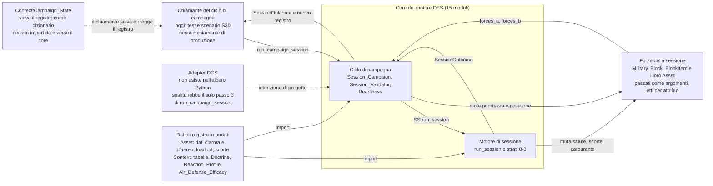
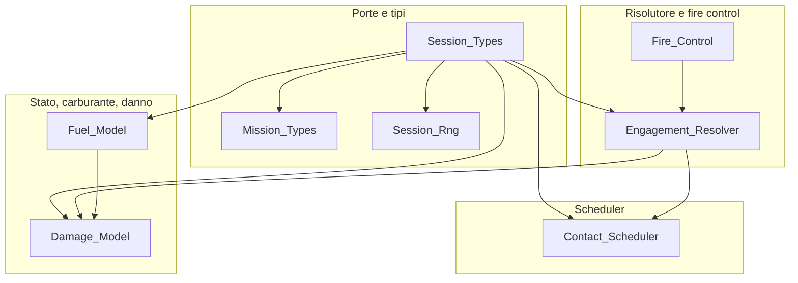
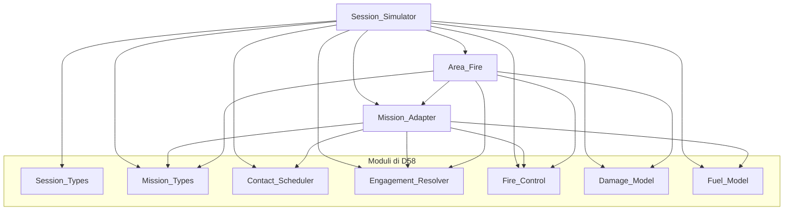
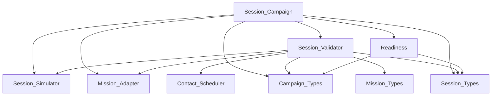
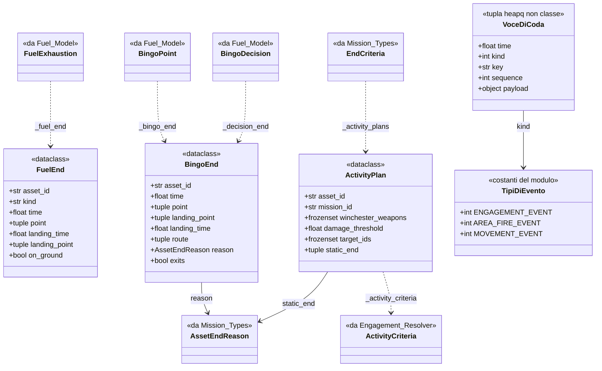
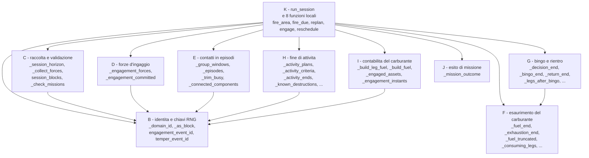
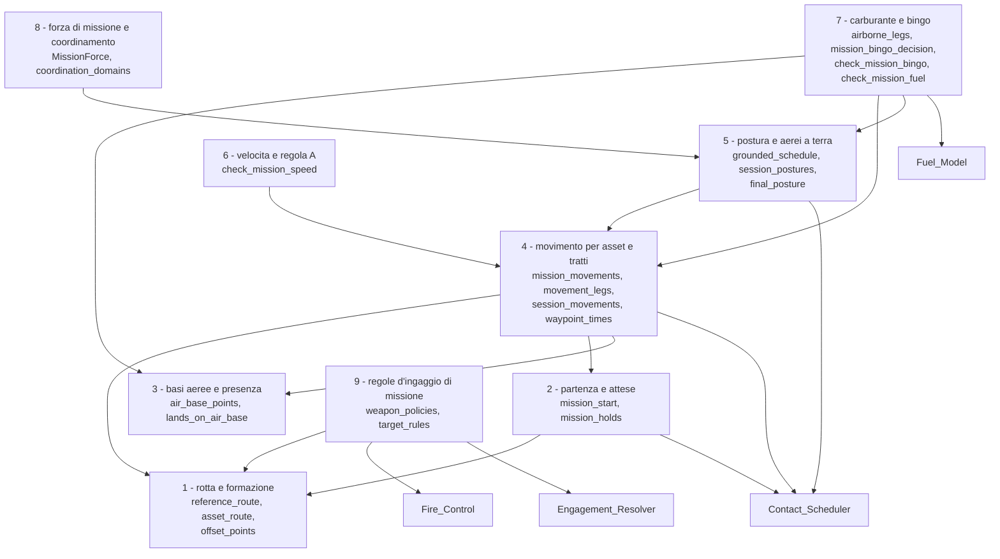
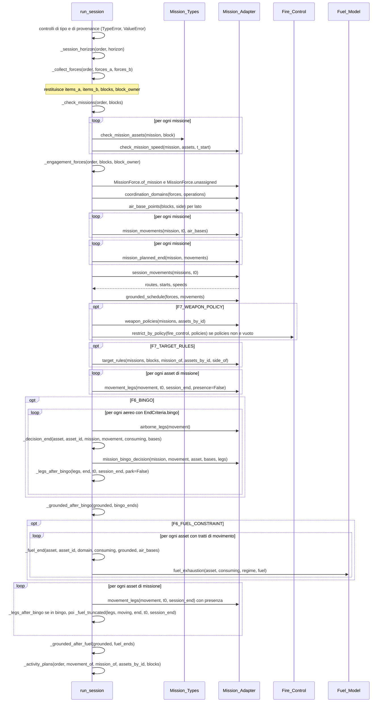
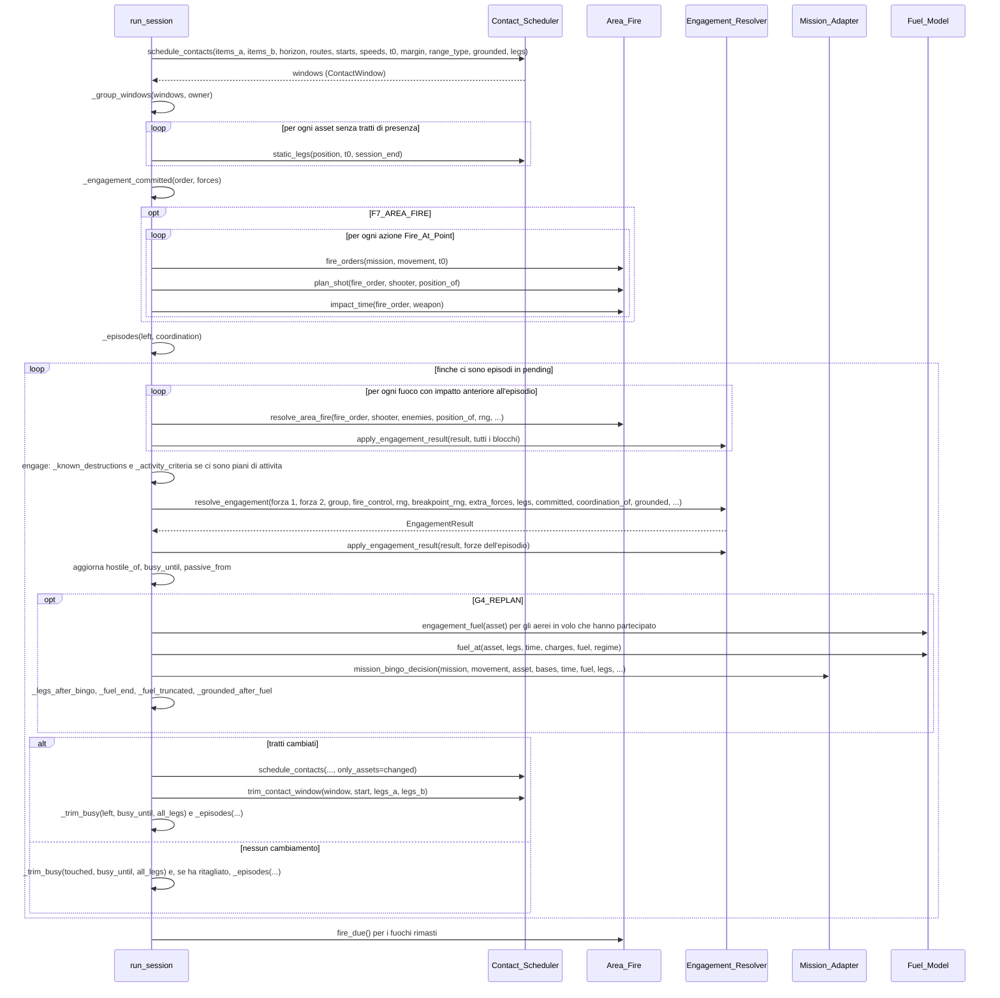
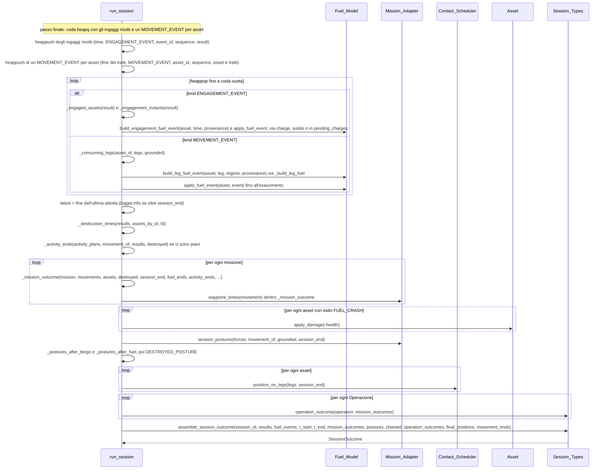

# Capitolo 10 — Atlante dei diagrammi (pilota, parti A-C)

Questo capitolo non descrive codice nuovo: **ordina** i diagrammi del manuale per livello di dettaglio e aggiunge quelli che mancavano (contesto,
architettura con il grafo reale degli import, i moduli grandi `Logic/Session_Simulator` e `Logic/Mission_Adapter`, le sequenze di chiamata complete di
`run_session`). È un **pilota**: copre due moduli per il livello L2 e un flusso per il livello L3; la sezione 10.7 dice cosa manca e come estenderlo.

## 10.1 La scala dei livelli e come leggerla

| Livello | Domanda a cui risponde | Tipo di diagramma | Che cosa contiene |
|---|---|---|---|
| **L0 Contesto** | Dove sta il DES rispetto alla campagna, ai registri (Asset, Block, Region) e al simulatore? | `flowchart` | Il core come scatola, chi lo chiama, che cosa muta, che cosa importa dai registri |
| **L1 Architettura** | Quali moduli, in quali strati, con quali dipendenze? | `flowchart` | I moduli del core e i **soli** import reali fra loro |
| **L2 Moduli** | Quali tipi e quale API pubblica ha un modulo? | `classDiagram` selettivo + tabella completa | Tipi con i campi, funzioni e metodi raggruppati per ruolo, con `:riga` |
| **L3 Interazione** | Chi chiama chi, in che ordine, in un flusso completo? | `sequenceDiagram` | Messaggi = funzioni reali, nell'ordine del codice |
| **L4 Algoritmo** | Come funziona una regola? | `flowchart`, `stateDiagram` | I diagrammi D1-D56 dei capitoli 1-8 (non toccati) |

**Come leggerla.** Si scende di un livello alla volta: L0 dice che il core esiste e che cosa lo circonda; L1 lo apre in moduli; L2 apre un modulo in tipi e
funzioni; L3 mostra le funzioni che si chiamano in un flusso; L4 spiega la regola dentro una funzione. Un diagramma di livello Lx rimanda sempre al
livello sotto nel testo, e la tabella-atlante (§10.2) è l'indice di tutti.

**Convenzioni.**

- Nei diagrammi di **import** (L1) la freccia `A --> B` significa «`A` importa `B`», **non** «i dati vanno da `A` a `B`». Nei diagrammi di sequenza
  (L3) `RS->>RS` è la chiamata a una funzione privata dello stesso modulo (`RS` = `Session_Simulator.run_session`).
- I riferimenti sono `percorso:riga`, **relativi a `Code/Dynamic_War_Manager/Source/`**, come nel resto del manuale.
- Le didascalie hanno la forma `*Diagramma Dnn — ... (livello Lx, verificato a f009eb43).*`. I diagrammi nuovi sono **D57-D66**.
- I nomi (classi, campi, funzioni) dei diagrammi nuovi sono stati controllati sul codice con `_strumenti/inventario.py` (estrazione con `ast`, sola
  lettura) e poi **riletti nel codice**: l'estrazione non dice chi chiama chi in quale ramo, quindi le sequenze L3 sono state scritte leggendo
  `run_session` riga per riga.

**Stato di verifica.** Codice verificato a `f009eb43` (ultimo commit che tocca il codice sorgente sotto `Code/`). Dopo di esso `git diff f009eb43 HEAD -- Code/`
mostra **un solo file**, `Test/baseline/scenario_baseline.json` (+352 righe, la fotografia a 989 esecuzioni, commit `643fff87`): nessun sorgente cambia. Le righe
dei moduli (`grep -c ''`) sono quelle della tabella di §10.4. Non sono stati eseguiti test per questo capitolo: nessun codice è stato toccato.

## 10.2 Tabella-atlante

I link portano al capitolo che contiene il diagramma; il titolo di ogni D1-D56 è quello dell'«Elenco dei diagrammi» di `Manuale_Motore_DES.md`.
I diagrammi esistenti sono stati assegnati ai livelli **per tipo mermaid**, come richiesto (flowchart di regola → L4, classDiagram → L2, sequenceDiagram → L3);
le eccezioni sono segnate (D1 → L1; D8 → L3; D29, D55, D56 fuori scala; `stateDiagram` → L4).

### L0 — Contesto

| Dnn | Diagramma | Tipo | Capitolo |
|---|---|---|---|
| D57 (nuovo) | Il core DES nel suo contesto: chiamanti, forze e registri, dati importati, simulatore | `flowchart LR` | 10 §10.3 |

### L1 — Architettura

| Dnn | Diagramma | Tipo | Capitolo |
|---|---|---|---|
| D1 | Moduli e dipendenze dei quattro strati (flusso concettuale, con il blocco «Ciclo di campagna») | `flowchart TD` | [1](02_Scopo_e_Motivazioni.md) |
| D58 (nuovo) | Import reali: porte, scheduler, risolutore, stato | `flowchart TD` | 10 §10.4 |
| D59 (nuovo) | Import reali: orchestratore, adapter di missione, fuoco su posizione | `flowchart TD` | 10 §10.4 |
| D60 (nuovo) | Import reali: il ciclo di campagna (F8) | `flowchart TD` | 10 §10.4 |

### L2 — Moduli (tipi e API)

| Dnn | Diagramma | Tipo | Capitolo |
|---|---|---|---|
| D2 | Tipi di dominio — porte di sessione (`SessionOrder`/`SessionOutcome`) | `classDiagram` | [2](03_Strato0_Contratto_Porte.md) |
| D3 | Tipi di dominio — geometria dei contatti (`Contact_Scheduler`) | `classDiagram` | [3](04_Strato1_Scheduler_Contatti.md) |
| D4 | Tipi di dominio — ingaggio (`Engagement_Resolver`) | `classDiagram` | [4](05_Strato2_Risolutore_Ingaggio.md) |
| D14 | Volumi di rilevamento e intercettazione: tipi e modalità del pianificatore di rotta | `classDiagram` | [7](08_Supporto_Trasversale.md) |
| D16 | Modello dei tipi della Missione (`Mission`, `MissionAsset`, `MissionWaypoint`, ...) | `classDiagram` | [2](03_Strato0_Contratto_Porte.md) |
| D17 | Esiti della Missione (`MissionOutcome`, `AssetMissionOutcome`) | `classDiagram` | [2](03_Strato0_Contratto_Porte.md) |
| D28 | `Air_Defense_Efficacy`: profili, dati RWR, funzioni | `classDiagram` | [7](08_Supporto_Trasversale.md) |
| D30 | La vista di missione `MissionForce` e ciò che il risolutore ne legge | `classDiagram` | [6](07_Orchestratore_Session_Simulator.md) |
| D39 | Tipi di `Fuel_Model` | `classDiagram` | [5](06_Strato3_Applicazione_Stato.md) |
| D47 | I tipi nuovi della F7 (`TargetRules`, `WeaponPolicy`, `AreaWeapon`) e chi li consuma | `classDiagram` | [4](05_Strato2_Risolutore_Ingaggio.md) |
| D51 | I tipi di `Command/Campaign_Types.py` | `classDiagram` | [2](03_Strato0_Contratto_Porte.md) |
| D61 (nuovo) | `Session_Simulator`: tipi interni, voce di coda e tipi di evento | `classDiagram` | 10 §10.5 |
| D62 (nuovo) | `Session_Simulator`: le funzioni per ruolo | `flowchart TD` | 10 §10.5 |
| D63 (nuovo) | `Mission_Adapter`: i gruppi di funzioni e le loro dipendenze | `flowchart TD` | 10 §10.5 |

### L3 — Interazione (sequenze di chiamata)

| Dnn | Diagramma | Tipo | Capitolo |
|---|---|---|---|
| D5 | Sequenza della coda eventi dentro un ingaggio | `sequenceDiagram` | [4](05_Strato2_Risolutore_Ingaggio.md) |
| D8 | Flusso dati di `run_session` (eccezione: è un `flowchart`, ma è il flusso dati dell'intera funzione, non una regola) | `flowchart TD` | [6](07_Orchestratore_Session_Simulator.md) |
| D9 | Coda eventi di sessione (schema) | `sequenceDiagram` | [6](07_Orchestratore_Session_Simulator.md) |
| D11 | Controllo di portata: rimando `not_before` di un candidato | `sequenceDiagram` | [4](05_Strato2_Risolutore_Ingaggio.md) |
| D25 | Priorità ai lanciatori: prelazione L3 | `sequenceDiagram` | [4](05_Strato2_Risolutore_Ingaggio.md) |
| D40 | Ciclo episodio → ri-pianificazione → ri-scheduling → contabilità del carburante | `sequenceDiagram` | [6](07_Orchestratore_Session_Simulator.md) |
| D45 | `return_fire`: attesa di un ostile e risveglio `_WAKE` | `sequenceDiagram` | [4](05_Strato2_Risolutore_Ingaggio.md) |
| D50 | Il fuoco su posizione nella coda di sessione | `sequenceDiagram` | [6](07_Orchestratore_Session_Simulator.md) |
| D54 | Un passo del ciclo di campagna (`run_campaign_session`) | `sequenceDiagram` | [6](07_Orchestratore_Session_Simulator.md) |
| D64 (nuovo) | `run_session` 1/3: preparazione e validazione | `sequenceDiagram` | 10 §10.6 |
| D65 (nuovo) | `run_session` 2/3: contatti, episodi, risolutore, stato e ri-pianificazione | `sequenceDiagram` | 10 §10.6 |
| D66 (nuovo) | `run_session` 3/3: passo finale del carburante, esiti e `assemble_session_outcome` | `sequenceDiagram` | 10 §10.6 |

### L4 — Algoritmo (diagrammi esistenti, non toccati)

| Tipo | Diagrammi (capitolo) |
|---|---|
| `flowchart` di regola | D10, D12, D13, D22, D23, D24, D26, D27, D32, D33, D34, D37, D43, D46 ([4](05_Strato2_Risolutore_Ingaggio.md)); D38 ([5](06_Strato3_Applicazione_Stato.md)); D19, D20, D21, D31, D35, D36, D42, D48, D49, D52, D53 ([6](07_Orchestratore_Session_Simulator.md)); D15 ([7](08_Supporto_Trasversale.md), pianificatore d'attacco: **satellite**, fuori dal perimetro del core); D18 ([2](03_Strato0_Contratto_Porte.md), i due assi postura/tipo di missione: è un diagramma di concetto) |
| `stateDiagram-v2` | D6 ([4](05_Strato2_Risolutore_Ingaggio.md)); D7 ([5](06_Strato3_Applicazione_Stato.md)); D41 ([6](07_Orchestratore_Session_Simulator.md)); D44 ([4](05_Strato2_Risolutore_Ingaggio.md)) |

**Fuori scala** (non descrivono il motore): D29 (fasi del piano F0-F9, [9](10_Limiti_Estensioni_Divergenze.md)), D55 e D56 (sequenze degli scenari S30, [8](09_Validazione.md)).
Conteggio: L1 1 esistente, L2 11, L3 9 (8 sequenze più D8), L4 32 (28 flowchart, 4 stati), fuori scala 3: **56**, tutti i D1-D56.

### Stato del pilota per modulo del core

«coperto» = diagramma più tabella completa di funzioni/metodi; «parziale» = diagramma esistente, senza la tabella completa; «da fare» = niente a questo livello.
Nessun modulo ha oggi un diagramma L2 con la tabella completa se non i due del pilota.
**Aggiornamento 2026-10-30:** la tabella qui sotto e' lo stato **del pilota**. Con le parti A, B e C (§10.2bis) ogni modulo del core ha ora il diagramma L2 con la tabella completa dei simboli e almeno una sequenza L3, compresi `Session_Rng` (D125-D126) e `Damage_Model` (D122-D124).

| Modulo | L1 | L2 | L3 | L4 |
|---|---|---|---|---|
| `Command/Session_Types` | coperto (D58) | parziale (D2) | parziale (D66, ultima chiamata) | — |
| `Command/Mission_Types` | coperto (D58) | parziale (D16, D17) | — | — |
| `Command/Campaign_Types` | coperto (D60) | parziale (D51) | — | — |
| `Utility/Session_Rng` | coperto (D58) | da fare (2 funzioni, v. cap. 7 §7.1) | — | — |
| `Logic/Contact_Scheduler` | coperto (D58) | parziale (D3) | da fare | D34 |
| `Logic/Engagement_Resolver` | coperto (D58) | parziale (D4, D47) | parziale (D5, D25, D45) | D22-D24, D26, D27, D32, D33, D37, D43, D44, D6 |
| `Logic/Fire_Control` | coperto (D58) | parziale (D47) | parziale (D11) | D10, D46 |
| `Logic/Area_Fire` | coperto (D59) | parziale (D47) | parziale (D50) | D49 |
| `Logic/Damage_Model` | coperto (D58) | da fare | da fare | D7 |
| `Logic/Fuel_Model` | coperto (D58) | parziale (D39) | parziale (D40) | D38 |
| `Logic/Mission_Adapter` | coperto (D59) | **coperto** (D63, più D30 per `MissionForce`) | parziale (D64) | D20, D21, D35, D36 |
| `Logic/Session_Simulator` | coperto (D59) | **coperto** (D61, D62) | **coperto** (D64-D66; anche D9, D40, D50) | D19, D31, D42, D48, D41 |
| `Logic/Session_Validator` | coperto (D60) | da fare | parziale (D54) | D52 |
| `Logic/Readiness` | coperto (D60) | da fare | parziale (D54) | D53 |
| `Logic/Session_Campaign` | coperto (D60) | da fare (3 funzioni, v. cap. 6 §6.27) | **coperto** (D54) | — |

## 10.2bis Estensione dell'atlante: parti A, B e C

Il pilota copriva due moduli. Le tre parti seguenti estendono i livelli L2 e L3 a **tutto** il core, con la tabella completa dei simboli di ciascun modulo (`:riga`, `Chiamata da`): [parte A](11a_Atlante_Risolutore.md) = 10A (`Contact_Scheduler`, `Fire_Control`, `Engagement_Resolver`, D67-D87); [parte B](11b_Atlante_Missione_Carburante.md) = 10B (`Mission_Types`, `Fuel_Model`, `Area_Fire`, D90-D109); [parte C](11c_Atlante_Porte_Campagna.md) = 10C (`Session_Types`, `Campaign_Types`, `Session_Validator`, `Session_Campaign`, `Readiness`, `Damage_Model`, `Session_Rng`, mappa dei dati, D110-D129). D88 e D89 non sono usati. La riclassificazione dei diagrammi esistenti resta quella di §10.2: D8 in L3, D18 e D29 fuori dalla regola per tipo, D55 e D56 fuori scala. Le colonne sono le stesse di §10.2; il capitolo e' il file della parte.

### L1 — Architettura (parti A-C)

| Dnn | Diagramma | Tipo | Modulo | Capitolo |
|---|---|---|---|---|
| D127 | Mappa dei dati: il percorso in una sessione, dagli argomenti di `run_session` al `SessionOutcome` (frecce = dati) | `flowchart LR` | trasversale | [10C.9](11c_Atlante_Porte_Campagna.md) |

### L2 — Moduli (tipi e API) (parti A-C)

| Dnn | Diagramma | Tipo | Modulo | Capitolo |
|---|---|---|---|---|
| D67 | Tipi dello scheduler con tutti i membri (`Leg`, `ThreatWindow`, `CPA`, `ContactWindow`, `GroundedSchedule`) | `classDiagram` | `Contact_Scheduler` | [10A.2](11a_Atlante_Risolutore.md) |
| D68 | Le funzioni dello scheduler per ruolo e le dipendenze fra i gruppi | `flowchart TD` | `Contact_Scheduler` | [10A.2](11a_Atlante_Risolutore.md) |
| D71 | Tipi della fire control (`_Weapon`, `WeaponPolicy`, `AreaWeapon`) e `ShotSpec` | `classDiagram` | `Fire_Control` | [10A.3](11a_Atlante_Risolutore.md) |
| D72 | Le funzioni della fire control per ruolo e le dipendenze | `flowchart TD` | `Fire_Control` | [10A.3](11a_Atlante_Risolutore.md) |
| D76 | I tipi interni della run (`_Shadow`, `_Candidate`, `_ForceState`, `_PendingGroup`, `_EngagementRun`) | `classDiagram` | `Engagement_Resolver` | [10A.4](11a_Atlante_Risolutore.md) |
| D77 | Le funzioni di modulo e i tipi per ruolo | `flowchart TD` | `Engagement_Resolver` | [10A.4](11a_Atlante_Risolutore.md) |
| D78 | Le fabbriche del fattore di rilevamento `detection_factor` | `flowchart TD` | `Engagement_Resolver` | [10A.4](11a_Atlante_Risolutore.md) |
| D79 | I metodi di `_EngagementRun` per ruolo 1/2: costruzione, rilevamento, scelta del tiro | `flowchart TD` | `Engagement_Resolver` | [10A.4](11a_Atlante_Risolutore.md) |
| D80 | I metodi di `_EngagementRun` per ruolo 2/2: risoluzione, intercettazione, disingaggio, regole F7a | `flowchart TD` | `Engagement_Resolver` | [10A.4](11a_Atlante_Risolutore.md) |
| D87 | Che cosa il core importa da `Engagement_Resolver`, e chi | `flowchart LR` | `Engagement_Resolver` | [10A.4](11a_Atlante_Risolutore.md) |
| D90 | Le tredici enumerazioni della Missione con tutti i membri | `classDiagram` | `Mission_Types` | [10B.2](11b_Atlante_Missione_Carburante.md) |
| D91 | Gli elementi della Missione con tutti i membri (`Target`, `StartCondition`, `MissionAction`, `MissionWaypoint`, `MissionAsset`) | `classDiagram` | `Mission_Types` | [10B.2](11b_Atlante_Missione_Carburante.md) |
| D92 | La Missione e l'Operazione con tutti i membri (`Mission`, `MissionRules`, `EndCriteria`, `Operation`) | `classDiagram` | `Mission_Types` | [10B.2](11b_Atlante_Missione_Carburante.md) |
| D93 | Gli esiti con tutti i membri (`AssetMissionOutcome`, `MissionOutcome`, `OperationOutcome`) | `classDiagram` | `Mission_Types` | [10B.2](11b_Atlante_Missione_Carburante.md) |
| D94 | Le funzioni di `Mission_Types` per ruolo e le dipendenze fra i gruppi | `flowchart TD` | `Mission_Types` | [10B.2](11b_Atlante_Missione_Carburante.md) |
| D98 | I tipi di `Fuel_Model` con tutti i membri, compresi `_Step` e `_Segment` | `classDiagram` | `Fuel_Model` | [10B.3](11b_Atlante_Missione_Carburante.md) |
| D99 | Le funzioni di `Fuel_Model` per ruolo e le dipendenze fra i gruppi | `flowchart TD` | `Fuel_Model` | [10B.3](11b_Atlante_Missione_Carburante.md) |
| D105 | Che cosa il core importa da `Fuel_Model`, e chi | `flowchart LR` | `Fuel_Model` | [10B.3](11b_Atlante_Missione_Carburante.md) |
| D106 | `FireOrder` e `_Hit` con tutti i membri e i tipi esterni | `classDiagram` | `Area_Fire` | [10B.4](11b_Atlante_Missione_Carburante.md) |
| D107 | Le funzioni di `Area_Fire` per ruolo e le dipendenze | `flowchart TD` | `Area_Fire` | [10B.4](11b_Atlante_Missione_Carburante.md) |
| D110 | `SessionOrder` con tutti i membri e i tipi da cui dipende | `classDiagram` | `Session_Types` | [10C.2](11c_Atlante_Porte_Campagna.md) |
| D111 | `SessionOutcome` con tutti i membri e i tipi degli eventi che contiene | `classDiagram` | `Session_Types` | [10C.2](11c_Atlante_Porte_Campagna.md) |
| D112 | Le funzioni di `Session_Types` per ruolo e le chiamate fra i gruppi | `flowchart TD` | `Session_Types` | [10C.2](11c_Atlante_Porte_Campagna.md) |
| D114 | `ViolationCode`, `SessionRules`, `SessionViolation` e `SessionValidationError` con tutti i membri | `classDiagram` | `Campaign_Types` | [10C.3](11c_Atlante_Porte_Campagna.md) |
| D115 | `SessionRecord`, `ReadyRecord` e `CampaignLedger` con tutti i membri | `classDiagram` | `Campaign_Types` | [10C.3](11c_Atlante_Porte_Campagna.md) |
| D119 | Le funzioni di `Readiness` per ruolo, le dipendenze e il solo chiamante | `flowchart TD` | `Readiness` | [10C.6](11c_Atlante_Porte_Campagna.md) |
| D122 | `DamageEvent`, le funzioni e le costanti di `Damage_Model` e i tipi che lo usano | `classDiagram` | `Damage_Model` | [10C.7](11c_Atlante_Porte_Campagna.md) |
| D124 | Il percorso di un `DamageEvent`: dove nasce, dove è applicato, chi lo legge (frecce = dati) | `flowchart LR` | `Damage_Model` | [10C.7](11c_Atlante_Porte_Campagna.md) |
| D126 | Chi apre quale stream: le chiavi di `engage` e `fire_area` e i consumatori (frecce = stream) | `flowchart LR` | `Session_Rng` | [10C.8](11c_Atlante_Porte_Campagna.md) |
| D128 | Mappa dei dati: le versioni del `CampaignLedger` e i dati in un passo di `run_campaign_session` (frecce = dati) | `flowchart LR` | trasversale | [10C.9](11c_Atlante_Porte_Campagna.md) |
| D129 | Mappa dei dati: i campi del `SessionOutcome`, chi li produce e chi li legge (frecce = dati) | `flowchart LR` | trasversale | [10C.9](11c_Atlante_Porte_Campagna.md) |

### L3 — Interazione (sequenze di chiamata) (parti A-C)

| Dnn | Diagramma | Tipo | Modulo | Capitolo |
|---|---|---|---|---|
| D69 | `schedule_contacts`: dalla potatura per blocco alle finestre di coppia | `sequenceDiagram` | `Contact_Scheduler` | [10A.2](11a_Atlante_Risolutore.md) |
| D70 | `contact_windows`: portate, intervalli, CPA e finestre | `sequenceDiagram` | `Contact_Scheduler` | [10A.2](11a_Atlante_Risolutore.md) |
| D73 | La fire control dai registri: dalla coppia (tiratore, bersaglio) alla tupla di `ShotSpec` | `sequenceDiagram` | `Fire_Control` | [10A.3](11a_Atlante_Risolutore.md) |
| D74 | L'involucro `restrict_by_policy`: dalla politica d'armi alla chiamata nel risolutore | `sequenceDiagram` | `Fire_Control` | [10A.3](11a_Atlante_Risolutore.md) |
| D75 | L'arma per il fuoco su posizione: `area_fire_weapon` e `area_fire_pk` | `sequenceDiagram` | `Fire_Control` | [10A.3](11a_Atlante_Risolutore.md) |
| D81 | `resolve_engagement`: validazione, costruzione della run e ciclo principale | `sequenceDiagram` | `Engagement_Resolver` | [10A.4](11a_Atlante_Risolutore.md) |
| D82 | `_detect_direction`: una estrazione di rilevamento | `sequenceDiagram` | `Engagement_Resolver` | [10A.4](11a_Atlante_Risolutore.md) |
| D83 | `_schedule_next`: l'ordine delle chiamate della scelta del tiro | `sequenceDiagram` | `Engagement_Resolver` | [10A.4](11a_Atlante_Risolutore.md) |
| D84 | `_on_launch`: dal lancio alla salva in volo | `sequenceDiagram` | `Engagement_Resolver` | [10A.4](11a_Atlante_Risolutore.md) |
| D85 | `_on_resolve`: intercettazione, danno per colpo e dottrina | `sequenceDiagram` | `Engagement_Resolver` | [10A.4](11a_Atlante_Risolutore.md) |
| D86 | `apply_engagement_result`: danni e consumi sugli asset reali | `sequenceDiagram` | `Engagement_Resolver` | [10A.4](11a_Atlante_Risolutore.md) |
| D95 | `Mission.__post_init__`: l'ordine delle validazioni alla costruzione | `sequenceDiagram` | `Mission_Types` | [10B.2](11b_Atlante_Missione_Carburante.md) |
| D96 | Dalla costruzione della Missione alla porta di sessione: `SessionOrder`, `_check_missions`, `validate_session` | `sequenceDiagram` | `Mission_Types` | [10B.2](11b_Atlante_Missione_Carburante.md) |
| D97 | Dagli esiti per asset all'esito di sessione: `_mission_outcome`, `operation_outcome`, `assemble_session_outcome` | `sequenceDiagram` | `Mission_Types` | [10B.2](11b_Atlante_Missione_Carburante.md) |
| D100 | Il consumo di un tratto: `build_leg_fuel_event`, `build_fuel_event`, `apply_fuel_event` | `sequenceDiagram` | `Fuel_Model` | [10B.3](11b_Atlante_Missione_Carburante.md) |
| D101 | Esaurimento e residuo analitico: `fuel_exhaustion` e `fuel_at` | `sequenceDiagram` | `Fuel_Model` | [10B.3](11b_Atlante_Missione_Carburante.md) |
| D102 | La riserva di disimpegno e il consumo in ingaggio: `build_engagement_fuel_event` | `sequenceDiagram` | `Fuel_Model` | [10B.3](11b_Atlante_Missione_Carburante.md) |
| D103 | Il punto di bingo: `bingo_point` nelle regole F6-B2bis e F6-B2 | `sequenceDiagram` | `Fuel_Model` | [10B.3](11b_Atlante_Missione_Carburante.md) |
| D104 | L'albero di decisione al bingo: l'ordine delle chiamate di `bingo_decision` | `sequenceDiagram` | `Fuel_Model` | [10B.3](11b_Atlante_Missione_Carburante.md) |
| D108 | Gli ordini di fuoco: `fire_orders`, `plan_shot` senza scorta, `impact_time` | `sequenceDiagram` | `Area_Fire` | [10B.4](11b_Atlante_Missione_Carburante.md) |
| D109 | `resolve_area_fire`: ordine delle chiamate e delle estrazioni | `sequenceDiagram` | `Area_Fire` | [10B.4](11b_Atlante_Missione_Carburante.md) |
| D113 | `assemble_session_outcome`: controlli, raggruppamento, costruzione e `SessionOutcome.__post_init__` | `sequenceDiagram` | `Session_Types` | [10C.2](11c_Atlante_Porte_Campagna.md) |
| D116 | La vita del registro: costruzione, `with_session`, `with_readiness` e andata e ritorno su `Campaign_State` | `sequenceDiagram` | `Campaign_Types` | [10C.3](11c_Atlante_Porte_Campagna.md) |
| D117 | `check_session` e `validate_session`: l'ordine delle chiamate verso registro, simulatore e adapter | `sequenceDiagram` | `Session_Validator` | [10C.4](11c_Atlante_Porte_Campagna.md) |
| D118 | `apply_final_positions`: dalle posizioni dell'esito alla posizione degli asset | `sequenceDiagram` | `Session_Campaign` | [10C.5](11c_Atlante_Porte_Campagna.md) |
| D120 | `record_session` e `readiness_after_session`: dal registro vecchio al registro nuovo | `sequenceDiagram` | `Readiness` | [10C.6](11c_Atlante_Porte_Campagna.md) |
| D121 | Il difetto 26: il record di un asset assente attraverso `apply_campaign_processes` e `readiness_after_session` | `sequenceDiagram` | `Readiness` | [10C.6](11c_Atlante_Porte_Campagna.md) |
| D123 | `build_damage_event`: controlli, esito e delta di salute dentro il modulo | `sequenceDiagram` | `Damage_Model` | [10C.7](11c_Atlante_Porte_Campagna.md) |
| D125 | Dalla chiave all'istanza: `SessionOrder.rng`, `session_rng`, `session_seed` | `sequenceDiagram` | `Session_Rng` | [10C.8](11c_Atlante_Porte_Campagna.md) |

Conteggio delle parti A-C: L1 1, L2 31, L3 29: **61** diagrammi, che con D1-D66 fanno 127 in tutto.

## 10.3 L0 — Il core nel suo contesto

Fatti verificati sul codice, che il diagramma D57 rappresenta:

1. **Chi chiama il core.** `Logic/Session_Campaign.run_campaign_session` (`:109`) è l'unico punto di ingresso del ciclo di campagna; chiama `SS.run_session`
   (`:147`) come attributo del modulo. Nessun modulo fuori dal core importa `Session_Simulator`, `Session_Campaign`, `Session_Validator`, `Readiness`,
   `Session_Types` o `Campaign_Types` (`grep` degli `import` sotto `Source/`, escluso `Test/`): **oggi i chiamanti sono solo i test e gli scenari**
   (S30 incluso). Nessun `Theater_Session_Manager` (`Logic/Session_Simulator.py:731`).
2. **Che cosa muta.** `run_session` muta gli asset (`Logic/Session_Simulator.py:2175`: «**Muta gli asset.**»; salute e scorte con `ER.apply_engagement_result` `:2486`
   e `:2790`, carburante con `FM.apply_fuel_event` `:2978`, `:3037`, `:3066`, salute a zero per l'aereo perso `:3120`). `Readiness.apply_campaign_processes` muta gli asset
   (`Logic/Readiness.py:295`, docstring del modulo: «funzioni pure salvo `apply_campaign_processes`») e `apply_final_positions` assegna `asset.position`
   (`Logic/Session_Campaign.py:103`).
3. **Le forze arrivano come argomenti, non come import.** `forces_a`/`forces_b` sono `Military`/`Block`/`BlockItem` (`Logic/Session_Simulator.py:2194`); il core li legge per
   attributi (`id`/`name`, `assets`, `side`, `block`: `_domain_id` `:973`, `_as_block` `:988`) e per nome di classe (`validate_class(asset, 'Aircraft')`,
   `Logic/Readiness.py:56`, `Logic/Session_Campaign.py:96`). Nessun modulo del core importa `Block/*`.
4. **Che cosa il core importa dai registri** (import a livello di modulo salvo dove detto):
   `Asset/Mobile` (la costante `DEFAULT_DETECTION_RANGE_TYPE`, `Logic/Session_Simulator.py:749`, `Logic/Contact_Scheduler.py:73`); i registri di dati d'arma e d'aereo
   (`Asset/Aircraft_Data`, `Aircraft_Loadouts`, `Aircraft_Weapon_Data`, `Ground_Weapon_Data`, `Ship_Data`, `Ship_Weapon_Data`, `Vehicle_Data`, importati da `Logic/Fire_Control.py:198-204`;
   `Aircraft_Loadouts` anche da `Logic/Mission_Adapter.py:318`; `Aircraft_Data` in `Logic/Readiness.py:91`, import locale); `Asset/Weapon_Stores` (`Logic/Engagement_Resolver.py:430`);
   `Context/Context` (tabelle: `Logic/Mission_Adapter.py:319`, `Logic/Readiness.py:36`, `Command/Mission_Types.py:68`), `Context/Doctrine`, `Reaction_Profile`, `Air_Defense_Efficacy`
   (`Logic/Engagement_Resolver.py:431-433`); `DataType/State`, `Route`, `Edge`, `Waypoint`; `Command/Attack_Types` (`Command/Mission_Types.py:67`) e `Logic/Weapon_Delivery` (`Logic/Fire_Control.py:208`).
5. **`Region` e il meteo, solo come aiuti opzionali.** `Context.Region` (`BlockCategory`), `Logic.Tactical_Analysis` e `Logic.Meteo_Analysis` sono importati **dentro** due funzioni di
   `Logic/Engagement_Resolver.py` (`:1337`, `:1384`, `:1179`: `region_recon_detection_factor` e `meteo_detection_factor`), che costruiscono il callable che il chiamante
   può passare come `detection_factor`. `run_session` non le chiama (`grep` in `Session_Simulator.py`: nessuna occorrenza).
6. **`Campaign_State` non è importato dal core.** `Context/Campaign_State.py` importa solo il logger (`:10`); il registro di campagna ci passa come dizionario
   (`add_ledger` `:245`, `get_ledger` `:260`), chiamato da chi usa il conduttore (`Logic/Session_Campaign.py`, docstring: il conduttore «non è il `Theater_Session_Manager`»;
   `Logic/Readiness.py:9`: «Nessuna scrittura in `Campaign_State`»).
7. **Il simulatore DCS.** Nessun modulo del core importa un modulo legato al simulatore (grafo degli import di §10.4: i soli import fuori dal core sono registri, tipi di dominio e logger) e
   nell'albero `Source/` non c'è nessun file con `dcs` nel nome. `Test/Test_Session_Validation.py:159-162` (moduli del motore e import vietati) verifica che i moduli del motore non importino `lupa`, `zipfile`, `minizip`.
   Un adapter DCS **non esiste** nell'albero Python (`Test/Test_Session_Validation.py:22`, che lo dice nel docstring); il contratto lo prevede («il risolutore sintetico del core oggi, un adapter
   DCS domani», `Command/Session_Types.py:11`) e il conduttore dichiara che «un adapter DCS sostituirebbe il solo punto (3) di `run_campaign_session`» (`Logic/Session_Campaign.py:13`). Il diagramma lo
   mostra come nodo tratteggiato proprio per questo: **è un'intenzione di progetto, non un modulo**. Su che cosa farebbe l'adapter non si afferma altro.

*Diagramma D57 — il core DES nel suo contesto: chi lo chiama, che cosa muta, che cosa importa (livello L0, verificato a f009eb43).*

## 10.4 L1 — Architettura: i moduli e gli import reali

**Rapporto con D1.** D1 (capitolo 1) **resta**: spiega i quattro strati e contiene già il blocco «Ciclo di campagna (F8)» (`Session_Campaign`, `Session_Validator`,
`Readiness`, `Campaign_Types`, `Campaign_State`). Quello che D1 non è, e che qui si aggiunge, è il **grafo reale degli import**: D1 mescola frecce di flusso dei dati
(per esempio `CS --> ER`: nel codice è `Engagement_Resolver` che importa `Contact_Scheduler`; `MT --> ST` e `ST --> ORCH` sono anch'esse invertite rispetto all'import) e frecce
di import (`ORCH --> MA`, `AF --> FC`), e non disegna diversi import che esistono (sotto). D58-D60 mostrano **solo** import, estratti con `inventario.py --dipendenze`
e riscontrati sugli `import` in testa ai moduli; sono **43 archi**, divisi in tre diagrammi (10 + 19 + 14) perché in uno solo sarebbero illeggibili.

Differenze fra D1 (e la sua nota) e il grafo reale, trovate nel confronto:

- `Mission_Adapter` **importa** `Engagement_Resolver` e `Fire_Control` (`Logic/Mission_Adapter.py:332-333`; usa `ER.TargetRules`, `ER.ROE_WEAPON_FREE`, `ER.ROE_PRIORITY_DESIGNATED` in `target_rules` `:1970` e
  `FC.WeaponPolicy` in `weapon_policies` `:1918`). La nota di D1 dice che le frecce tratteggiate `MA` → `ER` e `MA` → `FC` «non sono un import»: è vero per il flusso delle viste di missione, ma gli import esistono (per i tipi e le costanti).
  Resta vero che `Engagement_Resolver` non importa né `Mission_Adapter` né `Fire_Control`.
- Import non disegnati in D1 (qualcuno compare solo nella sua nota): `Mission_Adapter` → `Contact_Scheduler`, `Fuel_Model`, `Mission_Types`; `Session_Validator` → `Session_Simulator`, `Session_Types`, `Mission_Types`, `Contact_Scheduler`; `Session_Campaign` → `Session_Types`, `Mission_Adapter`, `Campaign_Types`;
  `Readiness` → `Session_Types`; `Session_Types` → `Contact_Scheduler`, `Damage_Model`, `Engagement_Resolver`, `Fuel_Model` (per i tipi dei campi della porta di uscita).
- `Command/Session_Types` sta **sopra** gli strati nel grafo degli import, non sotto: importa a livello di modulo i tipi dei tre strati (`Logic/Contact_Scheduler`, `Damage_Model`, `Engagement_Resolver`, `Fuel_Model`) e `Utility/Session_Rng`
  (`Command/Session_Types.py:52-70`, import in testa al file), e il suo docstring dice perché non ci sono cicli: «nessun modulo di `Logic`/`Asset`/`Context` importa questo file» (`:42`). Lo «strato 0» è un contratto, non un livello di dipendenza.

**Gli strati dei diagrammi.** Raggruppamento per ruolo (stesso del Manuale; `Area_Fire` è messo con l'orchestratore perché importa `Mission_Adapter`):

| Strato | Moduli |
|---|---|
| porte e tipi | `Command/Session_Types`, `Command/Mission_Types`, `Command/Campaign_Types`, `Utility/Session_Rng` |
| scheduler | `Logic/Contact_Scheduler` |
| risolutore e fire control | `Logic/Engagement_Resolver`, `Logic/Fire_Control` |
| stato, carburante, danno | `Logic/Damage_Model`, `Logic/Fuel_Model` |
| orchestratore e adapter | `Logic/Session_Simulator`, `Logic/Mission_Adapter`, `Logic/Area_Fire` |
| campagna (F8) | `Logic/Session_Campaign`, `Logic/Session_Validator`, `Logic/Readiness` |

*Diagramma D58 — import reali fra porte, scheduler, risolutore e stato; la freccia `A --> B` è «A importa B» (livello L1, verificato a f009eb43).*

Lettura: `Contact_Scheduler`, `Damage_Model`, `Mission_Types` e `Session_Rng` non importano nessun altro modulo del core (foglie, come `Campaign_Types`, che non compare in D58). `Fire_Control` importa il risolutore (per `ShotSpec`), non viceversa.

*Diagramma D59 — import reali dell'orchestratore, dell'adapter di missione e del fuoco su posizione verso i moduli di D58 (livello L1, verificato a f009eb43).*

Lettura: `Session_Simulator` è l'unico modulo che importa **tutti** gli strati (9 archi). `Mission_Adapter` non importa né `Session_Simulator` né `Session_Types`; `Area_Fire` importa `Mission_Adapter` (usa solo `waypoint_times`, `Logic/Area_Fire.py:160`) e non chiama `resolve_engagement`.

*Diagramma D60 — import reali del ciclo di campagna (F8) (livello L1, verificato a f009eb43).*

Lettura: nessun modulo fuori da `Session_Campaign` e `Session_Validator` importa il validatore, e nessuno importa `Session_Campaign`. `Readiness` non importa `Session_Simulator` né `Mission_Adapter`. Ciascuno dei tre moduli ha il proprio `_domain_id` (`Logic/Session_Campaign.py:34`, `Logic/Session_Validator.py:249`, `Logic/Readiness.py:351`).
`Readiness` importa anche `Context/Context` (tabelle di turnaround e riparazione, `:36`), che D60 non disegna perché non è un modulo del core.

### Tabella modulo → responsabilità → righe → capitolo

Righe da `grep -c ''` sul codice a `f009eb43`. «Importa» e «importato da» sono nel perimetro del core (le 15 righe qui sotto).

| Modulo | Responsabilità (una riga) | Righe | Importa | Importato da | Capitolo |
|---|---|---|---|---|---|
| `Command/Session_Types` | Porte `SessionOrder`/`SessionOutcome`, `assemble_session_outcome`, `operation_outcome` | 712 | 6 | 4 | [2](03_Strato0_Contratto_Porte.md) §2.1-2.5 |
| `Command/Mission_Types` | Tipi di dominio di Missione, Operazione, esiti e validazioni strutturali (`check_mission_assets`) | 1387 | 0 | 5 | [2](03_Strato0_Contratto_Porte.md) §2.6 |
| `Command/Campaign_Types` | Regole di finestra, registro di campagna, record di prontezza, violazioni | 406 | 0 | 3 | [2](03_Strato0_Contratto_Porte.md) §2.10 |
| `Utility/Session_Rng` | Seme deterministico per sessione/missione/evento/contatore; unica sorgente di casualità | 113 | 0 | 1 | [7](08_Supporto_Trasversale.md) §7.1 |
| `Logic/Contact_Scheduler` | Strato 1: quando — finestre di contatto, tratti di rotta, CPA/TCPA, potatura per blocco | 1578 | 0 | 5 | [3](04_Strato1_Scheduler_Contatti.md) |
| `Logic/Engagement_Resolver` | Strato 2: come finisce un ingaggio — `resolve_engagement`, salve, danno, disingaggio, `apply_engagement_result` | 3872 | 2 | 5 | [4](05_Strato2_Risolutore_Ingaggio.md) |
| `Logic/Fire_Control` | Selezione dell'arma dai registri, politica d'armi, arma per il fuoco su posizione | 1088 | 1 | 3 | [4](05_Strato2_Risolutore_Ingaggio.md) §4.16, §4.33-4.34 |
| `Logic/Damage_Model` | `DamageEvent` e la sua applicazione a un asset | 288 | 0 | 5 | [5](06_Strato3_Applicazione_Stato.md) §5.1 |
| `Logic/Fuel_Model` | Carburante: `FuelEvent` per tratto, esaurimento, planata, bingo, consumo in ingaggio | 1576 | 1 | 3 | [5](06_Strato3_Applicazione_Stato.md) §5.2 |
| `Logic/Mission_Adapter` | Dalla `Mission` a rotta, partenza, velocità, tratti, postura e forza d'ingaggio per asset | 2000 | 5 | 4 | [6](07_Orchestratore_Session_Simulator.md) §6.10-6.16, §6.19, §6.22 |
| `Logic/Area_Fire` | Fuoco su posizione: ordini di fuoco, tiro, impatto | 326 | 5 | 1 | [6](07_Orchestratore_Session_Simulator.md) §6.23 |
| `Logic/Session_Simulator` | Orchestratore: `run_session` e i suoi passi (forze, tratti, episodi, carburante, esiti) | 3163 | 9 | 2 | [6](07_Orchestratore_Session_Simulator.md) |
| `Logic/Session_Validator` | Validatore di sessione: `validate_session`, `check_session` | 269 | 6 | 1 | [6](07_Orchestratore_Session_Simulator.md) §6.25 |
| `Logic/Readiness` | Prontezza degli asset e processi fra sessioni | 357 | 2 | 1 | [6](07_Orchestratore_Session_Simulator.md) §6.26 |
| `Logic/Session_Campaign` | Conduttore minimo del ciclo di campagna e posizione persistente | 154 | 6 | 0 | [6](07_Orchestratore_Session_Simulator.md) §6.27 |

## 10.5 L2 — Moduli: `Session_Simulator` e `Mission_Adapter`

Per gli altri moduli del core il livello L2 è già in un diagramma di classi esistente (tabella di §10.2): `Session_Types` D2; `Mission_Types` D16 e D17; `Campaign_Types` D51;
`Contact_Scheduler` D3; `Engagement_Resolver` D4 e D47; `Fuel_Model` D39; `MissionForce` D30. Mancano le **tabelle complete** di funzioni e metodi di quei moduli (§10.7).

### 10.5.1 `Logic/Session_Simulator` (3163 righe)

Il modulo ha **tre soli tipi interni**, tutti `dataclass` congelate (`FuelEnd`, `BingoEnd` e, a metà modulo, `ActivityPlan`), 45 funzioni di primo livello e 8 funzioni locali dentro `run_session`. Non ha altre classi.
Le costanti del modulo (`:785-919`): i tre tipi di evento di sessione `ENGAGEMENT_EVENT` = 0, `AREA_FIRE_EVENT` = 1, `MOVEMENT_EVENT` = 2 (`:785-787`, «nell'ordine di risoluzione a parità d'istante»);
i tag dell'event_id `ENGAGEMENT_EVENT_TAG` (`:790`) e `TEMPER_EVENT_TAG` (`:793`); i regimi `CRUISE_REGIME` (`:796`) e `COMBAT_REGIME` (`:797`); i **15 interruttori** (`:807-908`, capitolo 6 §6.21); `EPISODE_GAP` (`:914`, = `FM.DISENGAGE_TIME`);
gli esiti di esaurimento `FUEL_HALT`, `FUEL_GLIDE`, `FUEL_CRASH` (`:917-919`); e due tabelle private, `_ACTIVITY_ORDER` (`:1679`) e `_ABORT_REASON_OF` (`:1685`).

La **coda** della sessione non è una classe: è una tupla `(time, kind, key, sequence, payload)` messa in un `heapq` (`:2919`, `:2924`, `:2959`, `:2963`; estratta a `:2929` e `:2984`). Con i default
(`G4_EPISODES` acceso) la coda con `heapq` serve **solo** al passo finale del carburante (`:2954-2963`); gli ingaggi sono una lista `pending` di episodi (`:2874`). La coda mista ENGAGEMENT/AREA_FIRE con
`heapq` (`:2913-2936`) è il ramo con `G4_EPISODES` spento. Nel diagramma la tupla è una «voce di coda» disegnata come pseudo-classe (`VoceDiCoda`) e i tre tipi come `TipiDiEvento`: **non esistono classi con questi nomi**, sono un modo di mostrare una struttura che nel codice è una tupla.

*Diagramma D61 — `Session_Simulator`: i tipi interni, la voce di coda e i tipi di evento, con i tipi esterni che li producono o li consumano (livello L2, verificato a f009eb43).*

Note a D61: `FuelEnd.kind` vale `FUEL_HALT`, `FUEL_GLIDE` o `FUEL_CRASH` (`:926-931`); `BingoEnd.reason` è `BINGO` o, dal G4b, `DISENGAGED` (`:955`); `BingoEnd.exits` è l'uscita di scena (`:957`).
`ActivityPlan` è il piano di fine attività di un asset: `_activity_criteria` lo traduce in `ER.ActivityCriteria` (`winchester_weapons`, `damage_threshold`, `target_ids`, `destroyed_targets`, `until`, `reference_health`, `:1856-1873`).
Il payload della voce di coda dipende da `kind`: `(force_ids, group)` per un ENGAGEMENT del ramo con `G4_EPISODES` spento, un `EngagementResult` per l'ENGAGEMENT del passo finale, un `AF.FireOrder` per AREA_FIRE, `(asset, legs)` per MOVEMENT.

*Diagramma D62 — `Session_Simulator`: i gruppi di funzioni per ruolo; `run_session` le chiama tutte, e `_domain_id`/`_as_block`/le chiavi RNG (gruppo B) servono a molti (livello L2, verificato a f009eb43).*

Lettura: G dipende da F perché `_return_end` usa `_moving_speed` (`:1559`, `:1415`); C, D, E, H e I chiamano le funzioni di identità del gruppo B (`_domain_id`, `engagement_event_id`, `_as_block`). `_mission_outcome` (J) non chiama nessuna funzione privata del modulo: legge gli esiti già calcolati che `run_session` gli passa (`:2049-2158`).

**Tabella completa delle funzioni di `Logic/Session_Simulator`** (riga di definizione; firma abbreviata ai nomi dei parametri; «da» = chi la chiama nel core).

| Gruppo | Funzione | Riga | Che cosa fa | Da |
|---|---|---|---|---|
| tipo | `FuelEnd` | `:923` | Fine del movimento per esaurimento del carburante, calcolata a monte (F6-A) | `_exhaustion_end` |
| tipo | `BingoEnd` | `:944` | Rientro di un aereo al bingo (F6-B2, F6-B2bis; dal G4b anche per disingaggio) | `_return_end` |
| tipo | `ActivityPlan` | `:1693` | Criteri di fine attività di un asset di missione (F6-B1) | `_activity_plans` |
| B | `_domain_id(obj)` | `:973` | Id di dominio: `id`, poi `name` (stesso criterio di risolutore e scheduler) | molte |
| B | `_as_block(item)` | `:988` | `Block` da `Block` o `BlockItem` (`.block`) | `_collect_forces` |
| B | `engagement_event_id(*force_ids)` | `:993` | `event_id` dell'RNG per l'ingaggio fra le forze date | `_episodes`, `run_session`, `temper_event_id` |
| B | `temper_event_id(*force_ids)` | `:1017` | `event_id` del flusso della tempra (soglia di rottura) | `run_session` |
| C | `_session_horizon(order, horizon)` | `:1032` | Durata [s] della sessione; `ValueError` se mancante o incoerente | `run_session` |
| C | `_collect_forces(order, forces_a, forces_b)` | `:1054` | Normalizza i lati, costruisce `blocks` e `{asset: (lato, blocco)}` | `run_session`, `session_blocks` |
| C | `session_blocks(order, forces_a, forces_b)` | `:1108` | I blocchi per id con le stesse verifiche di `run_session` | `Session_Validator` |
| C | `_check_missions(order, blocks)` | `:1931` | Blocco passato, asset del blocco, regola A, loadout, `mission_id` diverso dagli id di blocco | `run_session` |
| D | `_engagement_forces(order, blocks, block_owner)` | `:1960` | Una `MissionForce` per missione più la vista residua; `(forces, owner)` | `run_session` |
| D | `_engagement_committed(order, forces)` | `:2006` | `committed` di blocco tradotto per forza d'ingaggio | `run_session` |
| E | `_group_windows(windows, owner)` | `:1124` | Finestre raggruppate per coppia (forza A, forza B) | `run_session` |
| E | `_connected_components(groups, domain_of)` | `:1149` | Componenti connesse del grafo delle forze (ramo con `G4_EPISODES` spento) | `run_session` |
| E | `_episodes(groups, domain_of, gap)` | `:1217` | Episodi d'ingaggio (G4a) con le loro finestre, in ordine di tempo | `run_session` |
| E | `_trim_busy(left, busy_until, legs)` | `:1291` | Forza occupata: ritaglia sul posto le finestre non ancora risolte | `run_session` |
| F | `_consuming_legs(asset_id, legs, grounded)` | `:1395` | Tratti che consumano (esclude sosta a terra e tratti degeneri) | `run_session` |
| F | `_moving_speed(legs, time)` | `:1415` | Velocità del tratto di movimento in corso a `time` | `_exhaustion_end`, `_return_end` |
| F | `_fuel_end(asset, asset_id, domain, consuming, grounded, air_bases, fuel)` | `:1428` | Esaurimento sui tratti e suo esito, o `None` | `run_session` |
| F | `_exhaustion_end(asset, asset_id, domain, time, point, consuming, grounded, air_bases)` | `:1442` | Esito dell'esaurimento in un punto: fermo, planata o perso | `_fuel_end`, `run_session` |
| F | `_truncate_at_fuel_end(legs, end, t0, session_end)` | `:1475` | Tratti di presenza fino all'esaurimento, poi l'esito | `_fuel_truncated` |
| F | `_grounded_after_fuel(grounded, ends)` | `:1491` | Programma degli aerei a terra corretto per gli esaurimenti | `run_session` |
| F | `_fuel_truncated(presence, moving, end, t0, session_end)` | `:1522` | `(presenza, movimento)` dell'asset con l'esaurimento | `run_session` |
| F | `_postures_after_fuel(postures, ends, domains, mission_types, grounded, session_end)` | `:1534` | Postura finale degli asset a secco | `run_session` |
| G | `_return_end(asset, asset_id, consuming, found)` | `:1559` | `BingoEnd` di un rientro già deciso (`BingoPoint` o `BingoDecision`) | `_bingo_end`, `_decision_end`, `run_session` |
| G | `_bingo_end(asset, asset_id, consuming, air_bases, rule)` | `:1570` | Bingo sui tratti che consumano e suo rientro (regole F6-B2, F6-B2bis) | `run_session` |
| G | `_decision_end(asset, asset_id, mission, movement, consuming, air_bases)` | `:1582` | Decisione al bingo del G2 e suo rientro | `run_session` |
| G | `_return_legs(end)` | `:1602` | Tratti del rientro lungo `end.route` a velocità costante | `_legs_after_bingo` |
| G | `_legs_after_bingo(legs, end, t0, session_end, park)` | `:1623` | Tratti fino al bingo, poi il rientro | `run_session` |
| G | `_grounded_after_bingo(grounded, ends)` | `:1638` | Programma a terra corretto per i rientri | `run_session` |
| G | `_postures_after_bingo(postures, ends, mission_types, grounded, session_end)` | `:1658` | Postura finale degli aerei rientrati | `run_session` |
| H | `_restrict_to_asset_ids(mission, members)` | `:1714` | Ristringe a `Target.asset_ids` se dichiarati (F7a) | `_mission_target_ids` |
| H | `_mission_target_ids(mission, blocks, mission_of, assets)` | `:1730` | Asset bersaglio della missione per il criterio `target_destroyed` | `_activity_plans` |
| H | `_winchester_weapons(asset, asset_id, domain, categories)` | `:1767` | Voci della scorta nelle categorie del criterio winchester | `_activity_plans` |
| H | `_activity_plans(order, movement_of, mission_of, assets, blocks)` | `:1796` | Piani di fine attività (vuoti con `F6_END_CRITERIA` spento o senza criteri) | `run_session` |
| H | `_known_destructions(results, assets, t0, fuel_ends)` | `:1842` | `{asset: istante}` delle distruzioni note, anche per carburante | `run_session` |
| H | `_activity_criteria(plans, known, reference_health)` | `:1856` | I piani nella forma del risolutore (`ER.ActivityCriteria`) | `run_session` |
| H | `_targets_destroyed_time(target_ids, destroyed)` | `:1876` | Istante in cui tutti i bersagli sono distrutti | `_activity_ends` |
| H | `_activity_ends(plans, movement_of, results, destroyed)` | `:1885` | Fine di attività di ogni asset con un piano | `run_session` |
| H | `_destruction_times(results, assets, t0)` | `:2029` | `{asset: istante di distruzione}` dagli ingaggi | `_known_destructions`, `run_session` |
| I | `_legs_distance(legs)` | `:1114` | Lunghezza del tragitto | `run_session` |
| I | `_engaged_assets(result)` | `:1327` | Asset che hanno combattuto in un ingaggio | `run_session` |
| I | `_engagement_instants(result)` | `:1344` | Istante della prima partecipazione di ogni asset (G3) | `run_session` |
| I | `_build_fuel(asset, distance, time, regime, provenance)` | `:1367` | `build_fuel_event` con ricaduta su 'nominal' | `run_session` |
| I | `_build_leg_fuel(asset, leg, regime, provenance)` | `:1380` | `build_leg_fuel_event` con la stessa ricaduta | `run_session` |
| J | `_mission_outcome(mission, movements, assets, destroyed, session_end, fuel_ends, activity_ends, target_declared, target_time, bingo_ends)` | `:2049` | Esito di missione a regola unica (D19) | `run_session` |
| K | `run_session(order, forces_a, forces_b, fire_control, horizon, margin, range_type, thresholds, reaction_profile_for, detection_factor, provenance, morale_for, enemy_estimate_for, fire_doctrine)` | `:2163` | Esegue la sessione e restituisce il `SessionOutcome`; muta gli asset (dopo `forces_a`, `forces_b`, `fire_control`: solo parametri con nome, `:2164`) | `Session_Campaign` |

**Funzioni locali di `run_session`** (chiusure sulle variabili della funzione, non importabili):

| Funzione | Riga | Che cosa fa |
|---|---|---|
| `position_of(asset_id, time)` | `:2439` | Posizione di un asset a `time` da `all_legs` (`CS.position_on_legs`) |
| `inactive_from(asset_id)` | `:2443` | Istante dal quale l'asset non spara più (distrutto, passivo, fine nota a monte, a secco) |
| `fire_area(fire_order)` | `:2467` | Risolve un fuoco su posizione (`AF.resolve_area_fire`) e lo applica a tutti i blocchi |
| `fire_due(before)` | `:2488` | Risolve i fuochi con impatto anteriore a `before`, o tutti quelli rimasti con `None` |
| `replan(result)` | `:2516` | Ri-pianifica gli aerei coinvolti a fine episodio (G4b); restituisce `{asset: istante}` dei tratti cambiati |
| `engage(time, force_ids, group, event_id)` | `:2702` | Risolve un episodio: criteri, regole di bersaglio, `ER.resolve_engagement`, applicazione, stato di forza occupata |
| `reschedule(changed, t_r, left, pairs_of)` | `:2823` | Ricalcola i contatti degli aerei ri-pianificati (`only_assets`) |
| `charge(asset, time)` | `:2973` | Consumo istantaneo d'ingaggio (G3) applicato all'asset |

### 10.5.2 `Logic/Mission_Adapter` (2000 righe)

È un **modulo di funzioni** con due sole classi, `AssetMovement` (`:418`) e `MissionForce` (`:1649`, già in D30). Le 55 funzioni di primo livello si raggruppano per ruolo in nove gruppi. D63 disegna i gruppi e le loro
dipendenze (chi chiama chi **dentro** il modulo, ricavato dalle chiamate a nome; più i quattro moduli del core da cui il gruppo prende tipi o funzioni). Per la sequenza con cui il modulo produce rotta e partenza di un asset
v. D20 (capitolo 6): D63 è la mappa dei gruppi, D20 il percorso dei dati.

I helper `_xyz` (`:513`) e `_domain_id` (`:1519`) servono a molti gruppi e non sono disegnati. Costanti: `MITER_LIMIT` (`:346`), `OFFSET_DECIMALS` (`:349`), `SPEED_TOLERANCE` (`:362`), le posture
`PARKED_POSTURE`, `GROUND_DEFENSE_POSTURE`, `SEA_DEFENSE_POSTURE`, `OFF_SCENE_POSTURE`, `DESTROYED_POSTURE` (`:370-381`), `AIR_BASE_AREA_RADIUS_M` (`:387`), `TARGET_POINT_RADIUS_M` (`:392`) e i due interruttori
`F5_PRESENCE`, `F5_WAITS` (`:406-407`).

*Diagramma D63 — `Mission_Adapter`: i nove gruppi di funzioni e le dipendenze fra loro e verso `Contact_Scheduler`, `Fuel_Model`, `Fire_Control`, `Engagement_Resolver` (livello L2, verificato a f009eb43).*

Come si legge: il gruppo 4 è il **centro** del modulo (`mission_movements` chiama `mission_start`, `mission_holds`, `_presence` e `asset_route`; `_timeline` sta nello stesso gruppo e ne dipendono i gruppi 5 e 7); i gruppi 6 e 7 (i validatori di pianificazione)
richiamano `mission_movements` per ripercorrere gli stessi tratti della sessione. Il gruppo 7 usa `grounded_intervals` (gruppo 5) da `airborne_legs` e `is_air_base_reference` (gruppo 3) da `is_loop_mission`. Il gruppo 8 dipende dal 5 perché `MissionForce` usa `unassigned_postures`
(`:1698`). Gli archi verso i moduli esterni sono quelli delle chiamate `CS.`, `FM.`, `FC.`, `ER.` nel gruppo (estrazione con `ast`: `route_legs`, `Leg`, `clamp_legs`, `GroundedSchedule`; `bingo_decision`, `bingo_point`, `ReturnRule`; `WeaponPolicy`; `TargetRules`, `ROE_*`).

**Chi chiama il modulo, nel core.** `Session_Simulator`: `air_base_points`, `mission_movements`, `mission_planned_end`, `session_movements`, `grounded_schedule`, `movement_legs`, `airborne_legs`, `bingo_return_rule`, `mission_bingo_decision`, `check_mission_speed`
(da `_check_missions`), `coordination_domains`, `session_postures`, `weapon_policies`, `target_rules`, `MissionForce` e le costanti di postura. `Session_Validator`: `air_base_points`, `mission_movements`, `mission_planned_end`, `check_mission_speed`, `check_mission_bingo`, `check_mission_fuel`.
`Area_Fire`: `waypoint_times`. `Session_Campaign`: solo costanti (`OFF_SCENE_POSTURE`, `PARKED_POSTURE`, `DESTROYED_POSTURE`, `OFFSET_DECIMALS`). **Nessun chiamante nel core** per `mission_routes` (`:1512`, nemmeno interno). Le funzioni con trattino basso non sono riferite come `MA.nome` da nessun altro modulo del core.

**Tabella completa delle funzioni e dei metodi di `Logic/Mission_Adapter`.**

| Gruppo | Funzione o metodo | Riga | Che cosa fa |
|---|---|---|---|
| 1 | `kmh_to_ms(speed_kmh)` | `:410` | km/h → m/s |
| 1 | `_route_from_waypoints(mission)` | `:450` | Rotta dai `MissionWaypoint` quando la missione non ha una `Route` |
| 1 | `reference_route(mission)` | `:473` | La rotta di riferimento (None se la missione non si muove) |
| 1 | `_leg_speeds(mission, route)` | `:491` | Velocità uniforme o per tratto dichiarate dai waypoint |
| 1 | `_xyz(point)` | `:513` | `(x, y, z)` di un punto |
| 1 | `_horizontal_heading(a, b)` | `:517` | Versore orizzontale da `a` a `b` (None se nullo) |
| 1 | `_leg_headings(points)` | `:523` | Direzione di ogni tratto; i tratti verticali la ereditano |
| 1 | `_point_frame(h_in, h_out)` | `:543` | Terna di formazione al punto (bisettrice, fattore laterale) |
| 1 | `offset_points(points, forward_m, right_m, up_m)` | `:563` | Punti spostati dell'offset di formazione |
| 1 | `_rebuild_route(route, points, speeds, suffix)` | `:604` | Copia della rotta con punti e velocità nuovi |
| 1 | `asset_route(mission, mission_asset)` | `:628` | Rotta dell'asset e velocità uniforme |
| 2 | `_travel_time_to(route, speed, index)` | `:659` | Tempo dalla partenza al waypoint `index` |
| 2 | `mission_start(mission, t0)` | `:672` | Istante assoluto di partenza della missione |
| 2 | `_wait_actions(actions)` | `:732` | Le azioni di attesa di un punto |
| 2 | `_relative_wait(actions)` | `:736` | Somma delle attese di durata di un punto |
| 2 | `_wait_end(actions, arrival, t0)` | `:753` | Istante in cui l'asset lascia il punto dopo le attese |
| 2 | `_locked_targets(mission, t0)` | `:779` | `{indice: istante}` dei punti con ETA bloccata e ancoraggio del TOT |
| 2 | `mission_holds(mission, start, t0)` | `:798` | Attese per punto `((indice, durata), ...)` |
| 3 | `is_air_base_reference(reference)` | `:858` | Il riferimento è una base aerea vera |
| 3 | `air_base_points(blocks, side)` | `:874` | Posizioni (x, y) che definiscono l'area delle basi aeree vere |
| 3 | `lands_on_air_base(mission, air_bases)` | `:906` | La missione aerea finisce con un `LAND` su una base vera |
| 3 | `_presence(mission, air_bases)` | `:929` | Presenza e stato a terra prima della partenza e dopo la fine |
| 4 | `AssetMovement` (classe) | `:418` | Movimento di un asset: `mission_id`, `asset_id`, `route`, `start`, `speed`, `holds`, `present_before`, `present_after`, `grounded_before`, `grounded_after` |
| 4 | `mission_movements(mission, t0, air_bases)` | `:939` | Un `AssetMovement` per asset della missione |
| 4 | `_timeline(movement)` | `:959` | Tratti con le attese e istanti d'arrivo ai punti, senza taglio alla sessione |
| 4 | `movement_legs(movement, t0, t_end, presence)` | `:1002` | Tratti dell'asset nella sessione, nella forma dello scheduler |
| 4 | `session_movements(missions, t0)` | `:1071` | `(routes, starts, speeds)` per `schedule_contacts` |
| 4 | `mission_routes(missions, t0)` | `:1512` | Le sole rotte di `session_movements` |
| 4 | `waypoint_times(movement)` | `:1109` | Istanti assoluti d'arrivo ai punti, attese comprese |
| 4 | `mission_planned_end(mission, movements)` | `:1116` | Fine pianificata della missione (il più tardo fra gli asset) |
| 5 | `grounded_intervals(movement)` | `:1030` | Intervalli a terra di un aereo di missione |
| 5 | `grounded_schedule(forces, movements)` | `:1054` | `GroundedSchedule` degli aerei a terra della sessione |
| 5 | `continuous_posture(asset)` | `:1532` | Postura continua di un asset senza missione |
| 5 | `unassigned_postures(assets)` | `:1548` | `{asset: postura continua}` degli asset senza missione |
| 5 | `grounded_assets(forces)` | `:1561` | Id degli aerei a terra fra le forze |
| 5 | `final_posture(mission, movement, grounded, session_end)` | `:1589` | Postura di un asset di missione a fine sessione |
| 5 | `session_postures(forces, movements, grounded, session_end)` | `:1619` | Postura finale di tutti gli asset delle forze |
| 6 | `_max_speed(asset)` | `:1141` | Velocità massima dal profilo cinematico |
| 6 | `planned_speeds(movement)` | `:1152` | Velocità pianificate dei tratti |
| 6 | `check_mission_speed(mission, assets, t0)` | `:1163` | Regola A: nessun tratto più veloce del mezzo più lento |
| 7 | `airborne_legs(movement)` | `:1216` | Tratti che consumano, senza taglio alla sessione |
| 7 | `is_loop_mission(mission)` | `:1241` | La missione aerea è ad anello |
| 7 | `bingo_return_rule(mission)` | `:1268` | `ReturnRule` del rientro al bingo |
| 7 | `is_transfer_mission(mission)` | `:1277` | La missione è un trasferimento per l'albero di bingo |
| 7 | `mission_bingo_decision(mission, movement, asset, air_bases, time, fuel, legs, forced, exit_scene)` | `:1284` | Soglia e albero di decisione del G2 per un asset |
| 7 | `check_mission_bingo(mission, assets, air_bases, t0, reserve, reverse_route, disengage_reserve)` | `:1307` | Bingo a priori (validatore di pianificazione) |
| 7 | `_check_reserve_bingo(mission, assets, bases, t0)` | `:1399` | `check_mission_bingo` con la regola del G2 |
| 7 | `route_fuel_demand(asset, legs)` | `:1433` | Carburante dei tratti `legs` |
| 7 | `check_mission_fuel(mission, assets, t0, air_bases)` | `:1449` | Minimo di pianificazione del carburante (G1) |
| 8 | `MissionForce` (classe) | `:1649` | Vista di missione come forza d'ingaggio (D30); metodi `__init__` `:1674`, `of_mission` `:1703`, `unassigned` `:1720`, `salvo_interceptors` `:1733`, `__repr__` `:1744` |
| 8 | `_domain_id(obj)` | `:1519` | Id di dominio (`id`, poi `name`) |
| 8 | `coordination_domains(forces, operations)` | `:1751` | `{forza: chiave di dominio}` |
| 9 | `_asset_sides(blocks)` | `:1836` | `{asset: lato del blocco proprietario}` |
| 9 | `designated_targets(mission, blocks, mission_of, assets, side)` | `:1852` | Bersaglio designato dalla missione: id degli asset nemici e area |
| 9 | `weapon_policies(missions, assets)` | `:1918` | `{asset: WeaponPolicy}` per gli asset con vincoli (F7a, strato W) |
| 9 | `attack_point(mission, mission_asset)` | `:1948` | Posizione del punto ATTACK sulla rotta dell'asset |
| 9 | `target_rules(missions, blocks, mission_of, assets, side_of)` | `:1970` | `{asset: TargetRules}` per il risolutore (F7a, strato T) |

## 10.6 L3 — La sequenza di chiamate di `run_session`

`run_session` (`Logic/Session_Simulator.py:2163-3163`, circa mille righe) è spezzata in tre sequenze che seguono l'ordine del codice. Partecipanti = moduli (`RS` = `Session_Simulator.run_session` stessa: `RS->>RS` è una
funzione privata del modulo o una funzione locale). I messaggi sono nomi di funzioni reali; le condizioni sono gli interruttori del modulo (§6.21, tutti accesi di default) e i rami del codice. Dentro `resolve_engagement` la
sequenza è D5 (capitolo 4): qui il risolutore è una scatola.

I punti in cui il flusso **non** è quello che ci si aspetterebbe:

- La fire control non è chiamata da `run_session`: è passata a `resolve_engagement` (D64 la avvolge con `restrict_by_policy`, D65 la usa).
- Con i default la coda `heapq` non ordina gli ingaggi: gli episodi sono una lista (`pending`, `:2874`) e la coda con `heapq` serve solo al passo finale del carburante (D66).
- `_mission_outcome` è calcolato **prima** che l'aereo perso per carburante sia portato a salute zero (`:3098` e `:3110-3120`): gli esiti leggono `fuel_ends`, non la salute finale.

### 10.6.1 Preparazione e validazione

*Diagramma D64 — `run_session` 1/3: dai controlli di tipo ai piani di fine attività (`:2221-2381`) (livello L3, verificato a f009eb43).*

Righe: controlli `:2221-2228`; `_session_horizon` `:2230`; `_collect_forces` `:2234`; `_check_missions` `:2235` (dentro: `check_mission_assets` `:1942`, `MA.check_mission_speed` `:1944`); `_engagement_forces` `:2236`
(dentro: `MA.MissionForce.of_mission` `:1987`, `MA.MissionForce.unassigned` `:1989`); `coordination_domains` `:2237`; `air_base_points` `:2240`; `mission_movements` `:2243`; `mission_planned_end` e il warning E4 `:2249-2254`;
`session_movements` `:2255`; `grounded_schedule` `:2258`; `weapon_policies`/`restrict_by_policy` `:2273-2277`; `target_rules` `:2279`; `movement_legs(presence=False)` `:2293`; bingo `:2305-2335`
(con `F6_BINGO_DISENGAGE_RESERVE` acceso, `_decision_end` `:2316`; spento, `_bingo_end` `:2322` o `:2328`); `_grounded_after_bingo` `:2337`; esaurimento `:2339-2353`; tratti di presenza `:2365-2374`; `_grounded_after_fuel` `:2379`; `_activity_plans` `:2381`.

### 10.6.2 Il ciclo: contatti, episodi, risolutore, stato e ri-pianificazione

*Diagramma D65 — `run_session` 2/3: dallo scheduler al fine degli episodi, con i fuochi su posizione e la ri-pianificazione (`:2384-2910`, ramo con `G4_EPISODES` acceso) (livello L3, verificato a f009eb43).*

Righe: `schedule_contacts` `:2385`; `_group_windows` `:2388`; `static_legs` `:2404`; `_engagement_committed` `:2407`; ordini di fuoco `:2494-2510` (`fire_orders` `:2499`, `plan_shot` `:2500`, `impact_time` `:2507`);
`_episodes` `:2874`; ciclo `while pending` `:2878`; `fire_due` `:2881` (dentro, `fire_area` `:2467`: `resolve_area_fire` `:2474`, `apply_engagement_result` `:2486`); `engage` `:2882` (corpo `:2702-2821`: `_known_destructions`/`_activity_criteria` `:2714-2715`,
`ER.resolve_engagement` `:2765`, `ER.apply_engagement_result` `:2790`, `hostile_of` `:2794`, `busy_until`/`passive_from` `:2802-2819`); `replan` `:2894` (corpo `:2516-2700`: `FM.engagement_fuel` `:2537`, `FM.fuel_at` `:2587`,
`MA.mission_bingo_decision` `:2621`, `:2632`); `reschedule` `:2898` (corpo `:2823-2861`: `CS.schedule_contacts(only_assets=...)` `:2832`, `CS.trim_contact_window` `:2844`); `_trim_busy` `:2899`, `:2906`; `fire_due()` finale `:2910`.
Il RNG di `resolve_engagement` è `order.rng(mission_id=None, event_id=event_id, counter=counter)` (`:2766`) e quello della tempra `order.rng(mission_id=None, event_id=temper_event_id(*force_ids), counter=counter)` (`:2774-2776`);
quello del fuoco su posizione `order.rng(mission_id=fire_order.mission_id, event_id=event_id, counter=0)` (`:2475`). Il ramo con `G4_EPISODES` spento (`:2911-2936`) mette ingaggi per componente e fuochi nella stessa coda `heapq`
(`_connected_components` `:2916`) e non ri-pianifica: non è nel diagramma. Un ordine di fuoco senza arma, portata o posizione utilizzabili è scartato con un warning (`:2502-2505`).

### 10.6.3 Chiusura: passo finale del carburante, esiti e `assemble_session_outcome`

*Diagramma D66 — `run_session` 3/3: dal passo finale del carburante all'`assemble_session_outcome` (`:2938-3163`) (livello L3, verificato a f009eb43).*

Righe: coda `:2954-2963`; ciclo `:2983`; ramo ENGAGEMENT `:2986-3006` (`_engaged_assets` `:2990`, `_engagement_instants` `:2997`, `charge` `:2973` con `FM.build_engagement_fuel_event` `:2975` e `FM.apply_fuel_event` `:2978`);
ramo MOVEMENT `:3007-3072` (con `F6_FUEL_PER_LEG` acceso: `_consuming_legs` `:3022`, `_build_leg_fuel` `:3034`, `FM.apply_fuel_event` `:3037`; spento: `_build_fuel` `:3063`); `latest` `:3075-3091`;
`_destruction_times` `:3093`; `_activity_ends` `:3095`; `_mission_outcome` `:3098` (`MA.waypoint_times` a `:2067`); `apply_damage` `:3120`; `session_postures` `:3123`; `_postures_after_bingo` `:3124`;
`_postures_after_fuel` `:3127`; `DESTROYED_POSTURE` `:3132-3139`; `final_positions` `:3144-3151`, `movement_ends` `:3153`, `operation_outcome` `:3154`; `assemble_session_outcome` `:3158-3163`.

### 10.6.4 Il quarto diagramma: `run_campaign_session` che richiama il motore

Esiste già: è **D54** (capitolo 6 §6.27, `Logic/Session_Campaign.py:109-154`, `sequenceDiagram`): `apply_campaign_processes` → `check_session` → `SS.run_session` → `apply_final_positions` → `record_session`.
Non è stato duplicato. Si innesta qui così: il passo 3 di D54 è l'intera sequenza D64 → D65 → D66, e il `SessionOutcome` che D66 restituisce è quello con cui D54 prosegue (`final_positions`, `movement_ends`, `operation_outcomes`).

## 10.7 Limiti del pilota e domande

> **Esito (2026-10-30):** le proposte 1 e 3 sono state eseguite con le parti A-C (§10.2bis): tabelle complete e sequenze per tutti i moduli del core, compresa `resolve_engagement` (D81). Restano la colonna «Livello» nell'Elenco (non aggiunta), la proposta 4 (controllo automatico dei `:riga`) e la proposta 5. L'id `AS` dei partecipanti e' stato sostituito con `AST` (parola chiave di Mermaid).

**Che cosa è stato difficile.**

- *Il grafo degli import non è quello di D1.* Le frecce di D1 mescolano flusso dei dati e import; il confronto ha trovato due affermazioni imprecise nella nota di D1 (import `Mission_Adapter` → `ER`/`FC` descritti come «non un import», §10.4).
  **Non ho corretto il capitolo 1** (regola: non toccare gli altri capitoli); la correzione è una riga della nota.
- *Densità.* Con 43 archi il grafo degli import non entra in un diagramma leggibile: è diviso in tre (D58-D60). D59 ha 19 archi su 10 nodi ed è il più denso; se risulta illeggibile si può dimezzare mettendo `Area_Fire` in un diagramma a parte.
- *Le sequenze di `run_session`.* La funzione è lunga e piena di chiusure: la divisione in tre diagrammi segue le «fasi» del codice, non una struttura esplicita. Un messaggio `RS->>RS: _funzione(...)` nasconde le chiamate interne (per esempio `_check_missions` chiama `check_mission_assets`
  e `MA.check_mission_speed`: l'ho mostrato perché è il punto in cui il motore valida; `_fuel_end` chiama `_exhaustion_end`, che chiama `FM.nearest_reachable_base` e `FM.cruise_speed`: non l'ho mostrato). Le sequenze sono **verificate per ordine di comparsa nel codice**
  e per il ramo con i default accesi; un errore di ordine è possibile nei punti con più rami (`replan` ha una decina di condizioni).
- *Il «tipo di evento» non è una classe.* La coda è una tupla, i tipi di evento sono costanti intere: D61 li disegna come pseudo-classi con stereotipo esplicito. Se si preferisce non mescolare, si può togliere `VoceDiCoda`/`TipiDiEvento` e lasciare la descrizione a parole.
- *Assegnazione dei livelli per tipo mermaid.* È una regola grossolana: D8 (flusso dati) e D20 (pipeline di `Mission_Adapter`) sono più vicini a L3, D18 e D15 non sono di regola né di core, D55-D56 non descrivono il motore. L'ho segnalato nelle tabelle ma non ho riclassificato i diagrammi esistenti oltre ai casi D1, D8, D29, D55, D56.

**Che cosa ho omesso e perché.**

- Le tabelle complete di funzioni/metodi degli altri 13 moduli del core: fuori dal pilota (richiesta di due moduli). Per ciascuno esiste un diagramma L2 (D2, D3, D4, D16, D17, D39, D47, D51) o nessuno (`Damage_Model`, `Session_Rng`, `Readiness`, `Session_Validator`, `Session_Campaign`, `Contact_Scheduler` per le funzioni).
- I moduli **satellite** dei registri (`Asset/*`, `Block/*`, `Context/*`) e del pianificatore (`Air_Route_Manager`, `Weapon_Delivery`): non sono nel perimetro dello strumento (`CORE` in `inventario.py`). In D57 compaiono solo come «dati di registro» e «forze».
- La sequenza **dentro** `resolve_engagement` (D5 è lo schema; una sequenza completa con le funzioni private del risolutore avrebbe decine di partecipanti).
- Il ramo con `G4_EPISODES` spento in D65: è il comportamento storico, descritto a parole.
- L'**adapter DCS**: non esiste nell'albero Python (§10.3, punto 7); D57 lo mostra come intenzione di progetto. Non ho affermato nulla su come sarebbe fatto.
- Il livello L0 non mostra `Region` come nodo: il core lo importa solo dentro un aiuto opzionale (§10.3, punto 5).

**Affermazioni non verificate o dubbie.**

- «Nessun chiamante di produzione» del core: verificato con `grep` degli `import` sotto `Source/` (escluso `Test/`); non ho cercato importazioni dinamiche (`importlib`) né script fuori da `Source/`.
- «Nessun file con `dcs` nel nome» vale per l'albero `Code/Dynamic_War_Manager/Source/`; altre directory del repo non sono state esaminate. Diversi moduli non del core (`Scenario_Manager`, `Air_Route_Manager`, `Weapon_Delivery`, `Context/Context`, `Asset/*`) contengono la stringa `dcs` nel testo: non li ho letti.
- Le dipendenze **dentro** `Mission_Adapter` (D63) sono ricavate dalle chiamate a nome di funzione di primo livello (`ast`), non da un'analisi di flusso: un riferimento passato come valore (non chiamato) non è contato.
- La colonna «Da» della tabella di `Session_Simulator` elenca i chiamanti **nel core e dentro il modulo**; i test chiamano molte funzioni private direttamente e non sono contati.
- «Che cosa fa» delle funzioni è una sintesi mia dai docstring e dal corpo; per le regole il riferimento resta il capitolo indicato.

**Proposte per estendere.**

1. *Per modulo*: ripetere D61-D63 (classDiagram dei tipi più flowchart dei gruppi più tabella completa) per i moduli grandi rimasti: `Engagement_Resolver` (3872 righe, ha già D4 e D47), `Contact_Scheduler`, `Fuel_Model`, `Command/Mission_Types`, `Fire_Control`. Lo strumento `inventario.py` produce già l'elenco; il costo sta nel raggruppare per ruolo e nel descrivere.
2. *Una colonna «Livello» in «Elenco dei diagrammi»*: non l'ho aggiunta perché obbligava a riscrivere le 56 righe esistenti (§10.2 dà già il livello di ciascuno). Se la si vuole, è una modifica meccanica a un solo file.
3. *Sequenze L3 per i flussi che hanno già una descrizione a parole*: `resolve_engagement` (da D5 e dal capitolo 4 §4.1), `Readiness.readiness_after_session` (D53 è una regola), `Session_Validator.validate_session` (D52 è una regola).
4. *Un controllo automatico*: oggi `inventario.py --controlla` segnala identificatori sconosciuti in modo rumoroso; uno script che verifichi anche i `:riga` citati e che ogni funzione del core compaia in una tabella L2 renderebbe l'atlante verificabile a ogni commit di codice.
5. *Una vista per flusso di campagna* (L0 con il tempo): chi chiama il conduttore e quando, quando il futuro `Theater_Session_Manager` sarà scritto; oggi sarebbe un diagramma di un modulo inesistente.

**Domande per l'utente.**

- La densità di D58-D60 e delle sequenze D64-D66 (circa 25-30 messaggi) è accettabile, o preferisce sequenze più brevi con meno funzioni private?
- Il perimetro dei livelli per tipo mermaid va bene, o i diagrammi di concetto (D18, D29) vanno in un livello a parte?
- Estendere D61-D63 a tutti i moduli del core, o solo ai tre più grandi (`Engagement_Resolver`, `Contact_Scheduler`, `Fuel_Model`)?
- Si vuole correggere la nota di D1 (import `MA` → `ER`/`FC`) in un aggiornamento del capitolo 1?
