# Capitolo 10, parte A — Atlante dei diagrammi: scheduler, fire control e risolutore d'ingaggio

Questo file è la **parte A** del capitolo 10 (l'atlante dei diagrammi). Il pilota, con la scala dei livelli L0-L4, le convenzioni e i diagrammi D57-D66, è in
[`11_Atlante_Diagrammi.md`](11_Atlante_Diagrammi.md): qui non si ripete la scala, si **estende** il livello L2 (tipi e API pubblica, con la tabella completa dei simboli)
e il livello L3 (sequenze di chiamata) a tre moduli del core che nel pilota erano «parziali» o «da fare»: `Logic/Contact_Scheduler`, `Logic/Fire_Control` e
`Logic/Engagement_Resolver`. I diagrammi nuovi sono **D67-D87**. I diagrammi D1-D56 dei capitoli 1-8 non sono toccati: dove una regola ha già il suo diagramma (livello L4)
il nuovo diagramma rimanda a quello e non lo duplica.

**Come leggere.** I riferimenti sono `percorso:riga`, **relativi a `Code/Dynamic_War_Manager/Source/`**, come nel resto del manuale; una riga senza percorso (`:1379`) è del modulo di cui si sta parlando.
Nei diagrammi di sequenza `X->>X` è la chiamata a una funzione privata dello stesso modulo; nei diagrammi di funzioni per ruolo (flowchart) una freccia `A --> B` significa «le funzioni di `A`
**chiamano** funzioni di `B`» (non «i dati vanno da `A` a `B`»). Le didascalie hanno la forma `*Diagramma Dnn — ... (livello Lx, verificato a f009eb43).*`.

**Come sono stati verificati.** Codice a `f009eb43` (ultimo commit che tocca il codice sotto `Code/`; `git diff f009eb43 HEAD -- Code/` mostra solo `Test/baseline/scenario_baseline.json`,
nessun sorgente cambia). Elenchi di classi, campi, metodi e funzioni con `_strumenti/inventario.py --tabella` (estrazione con `ast`, sola lettura); chiamanti **dentro il modulo** e **nel core**
con una seconda estrazione `ast` dei nomi chiamati (scritta per questo capitolo, non è nello strumento); ordine delle chiamate nelle sequenze **letto nel codice, riga per riga**,
perché l'estrazione non dice in quale ramo si chiama. Nessun test eseguito: nessun codice è stato toccato.

## 10A.1 I diagrammi di questa parte

| Dnn | Livello | Tipo | Titolo | Modulo | Sezione | Si collega a |
|---|---|---|---|---|---|---|
| D67 | L2 | `classDiagram` | Tipi dello scheduler con tutti i membri (`Leg`, `ThreatWindow`, `CPA`, `ContactWindow`, `GroundedSchedule`) | `Contact_Scheduler` | 10A.2 | D3, D34 |
| D68 | L2 | `flowchart TD` | Le funzioni dello scheduler per ruolo e le dipendenze fra i gruppi | `Contact_Scheduler` | 10A.2 | D1, D58 |
| D69 | L3 | `sequenceDiagram` | `schedule_contacts`: dalla potatura per blocco alle finestre di coppia | `Contact_Scheduler` | 10A.2 | D34, D65 |
| D70 | L3 | `sequenceDiagram` | `contact_windows`: portate, intervalli, CPA e finestre | `Contact_Scheduler` | 10A.2 | D3, D65 |
| D71 | L2 | `classDiagram` | Tipi della fire control (`_Weapon`, `WeaponPolicy`, `AreaWeapon`) e `ShotSpec` | `Fire_Control` | 10A.3 | D47, D4 |
| D72 | L2 | `flowchart TD` | Le funzioni della fire control per ruolo e le dipendenze | `Fire_Control` | 10A.3 | D10, D58 |
| D73 | L3 | `sequenceDiagram` | La fire control dai registri: dalla coppia (tiratore, bersaglio) alla tupla di `ShotSpec` | `Fire_Control` | 10A.3 | D10, D13, D11 |
| D74 | L3 | `sequenceDiagram` | L'involucro `restrict_by_policy`: dalla politica d'armi alla chiamata nel risolutore | `Fire_Control` | 10A.3 | D46, D48, D43 |
| D75 | L3 | `sequenceDiagram` | L'arma per il fuoco su posizione: `area_fire_weapon` e `area_fire_pk` | `Fire_Control` | 10A.3 | D49, D50 |
| D76 | L2 | `classDiagram` | I tipi interni della run (`_Shadow`, `_Candidate`, `_ForceState`, `_PendingGroup`, `_EngagementRun`) | `Engagement_Resolver` | 10A.4 | D4, D47 |
| D77 | L2 | `flowchart TD` | Le funzioni di modulo e i tipi per ruolo | `Engagement_Resolver` | 10A.4 | D58 |
| D78 | L2 | `flowchart TD` | Le fabbriche del fattore di rilevamento `detection_factor` | `Engagement_Resolver` | 10A.4 | D12 |
| D79 | L2 | `flowchart TD` | I metodi di `_EngagementRun` per ruolo 1/2: costruzione, rilevamento, scelta del tiro | `Engagement_Resolver` | 10A.4 | D5, D25, D26 |
| D80 | L2 | `flowchart TD` | I metodi di `_EngagementRun` per ruolo 2/2: risoluzione, intercettazione, disingaggio, regole F7a | `Engagement_Resolver` | 10A.4 | D6, D22, D24, D37, D43 |
| D81 | L3 | `sequenceDiagram` | `resolve_engagement`: validazione, costruzione della run e ciclo principale | `Engagement_Resolver` | 10A.4 | D5 |
| D82 | L3 | `sequenceDiagram` | `_detect_direction`: una estrazione di rilevamento | `Engagement_Resolver` | 10A.4 | D5, D23 |
| D83 | L3 | `sequenceDiagram` | `_schedule_next`: l'ordine delle chiamate della scelta del tiro | `Engagement_Resolver` | 10A.4 | D11, D13, D25, D26, D43, D44 |
| D84 | L3 | `sequenceDiagram` | `_on_launch`: dal lancio alla salva in volo | `Engagement_Resolver` | 10A.4 | D5, D25, D37, D45 |
| D85 | L3 | `sequenceDiagram` | `_on_resolve`: intercettazione, danno per colpo e dottrina | `Engagement_Resolver` | 10A.4 | D5, D22, D24, D27, D33 |
| D86 | L3 | `sequenceDiagram` | `apply_engagement_result`: danni e consumi sugli asset reali | `Engagement_Resolver` | 10A.4 | D9, D13 |
| D87 | L2 | `flowchart LR` | Che cosa il core importa da `Engagement_Resolver`, e chi | `Engagement_Resolver` | 10A.4 | D58, D59 |

Conteggio: **L2** = D67, D68, D71, D72, D76, D77, D78, D79, D80, D87 (10); **L3** = D69, D70, D73, D74, D75, D81, D82, D83, D84, D85, D86 (11); totale **21** (D67-D87).

Sequenze già esistenti, **non duplicate**: D5 (la coda degli eventi dentro un ingaggio), D11 (rimando `not_before`), D25 (prelazione ai lanciatori), D45 (`return_fire` e `_WAKE`), D50 (fuoco su posizione nella coda di sessione),
D65 (`run_session` 2/3, che chiama `schedule_contacts` e `resolve_engagement` come scatole). I nuovi diagrammi L3 mostrano **dentro** queste scatole.

## 10A.2 L2 e L3 — `Logic/Contact_Scheduler` (1578 righe, 61 simboli)

Lo strato 1 calcola **quando**: tratti di rotta (`Leg`), finestre di contatto (`ContactWindow`), CPA/TCPA, potatura per blocco. È puramente geometrico, senza RNG
(docstring del modulo, «Nessuna sorgente di casualità»). Il modulo ha **cinque tipi** (quattro `dataclass(frozen=True)`: `Leg` `:122`, `ThreatWindow` `:147`, `CPA` `:181`, `ContactWindow` `:197`,
più `GroundedSchedule` `:243`, classe normale con `__slots__ = ('_intervals',)` `:259`), **39 funzioni** di primo livello e nessun'altra classe. Costanti: `DEFAULT_INTERSECTION_TOLERANCE` `:86`,
`TIME_EPS` `:92`, `VELOCITY_EPS` `:98`, `DETECTION_MODE_BY_CLASS` `:104`, `GROUNDED_DETECTION_MODE` `:113`, `ALWAYS` `:116`.

I tre «meccanismi» del docstring sono tre gruppi di funzioni: **A** rotta contro volume di minaccia (`threat_windows`, `route_threat_windows`), **B** CPA/TCPA e intervalli di portata
(`closest_point_of_approach`, `range_intervals`, `contact_windows`), **C** potatura gerarchica per blocco (`block_pair_candidates`, `region_block_pairs`). Un fatto che il codice mostra e che il pilota
non diceva: **il meccanismo A (`threat_windows`, `route_threat_windows`) e `region_block_pairs` non hanno nessun chiamante sotto `Source/` fuori dal modulo e dai test** (`grep` sui sorgenti non di test;
`Logic/Weapon_Delivery.py:73` li nomina solo in un commento). Il percorso di produzione del core usa `schedule_contacts` (che usa `block_pair_candidates`), `trim_contact_window`, `route_legs`,
`static_legs`, `clamp_legs`, `position_on_legs`, `range_intervals`, `GroundedSchedule`.

### Tipi (D67)

*Diagramma D67 — i tipi di `Contact_Scheduler` con tutti i membri pubblici e i loro legami funzionali (livello L2, verificato a f009eb43).*

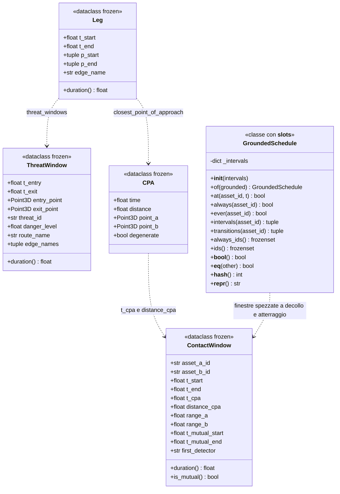

Rapporto con **D3** (capitolo 3 §3.9), che resta: D3 disegna gli stessi cinque tipi. Qui si aggiungono la stereotipia (`frozen`, `__slots__`) e **tutti** i membri di `GroundedSchedule`, compresi quelli del protocollo Python.
Una differenza trovata nel confronto: D3 mostra in `GroundedSchedule` un campo `+dict intervals`; nel codice `intervals` è un **metodo** (`intervals(asset_id)`, `:327`) e l'unico attributo è `_intervals` (privato, `:259`). **Non ho corretto D3**
(regola: non toccare i capitoli 1-8). `Leg.duration`, `ThreatWindow.duration` e `ContactWindow.duration` sono `@property` (`:141`, `:174`, `:233`), come `ContactWindow.is_mutual` (`:237`): si leggono come attributi, non si chiamano.
`GroundedSchedule.of` è un `@classmethod` (`:292`); il diagramma non ha un marcatore per questo. `Leg`, `CPA`, `ThreatWindow` non sono mai modificati dopo la costruzione (frozen): i consumatori ne creano di nuovi
(es. `Mission_Adapter._timeline` costruisce `CS.Leg(...)`, `Logic/Mission_Adapter.py:991`).

### Le funzioni per ruolo (D68)

*Diagramma D68 — i gruppi di funzioni di `Contact_Scheduler` e le chiamate fra gruppi; «consumatori» = `Session_Simulator`, `Mission_Adapter`, `Engagement_Resolver` (livello L2, verificato a f009eb43).*

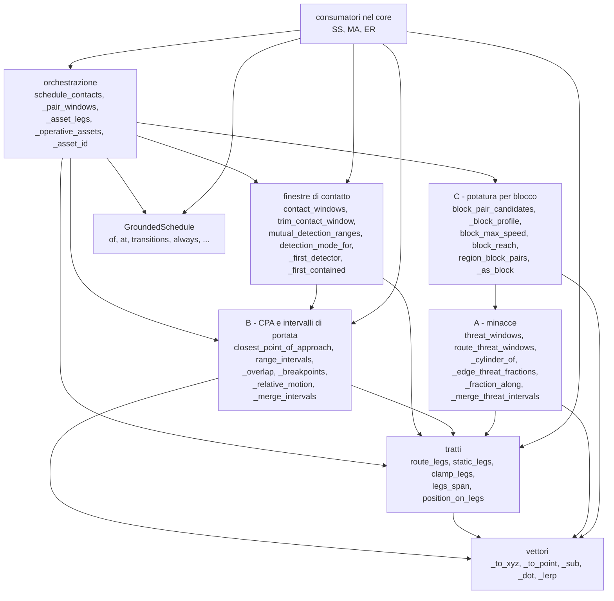

Lettura: le frecce sono le chiamate a nome di funzione fra gruppi (estrazione `ast`; un riferimento passato come valore non è contato). `P --> M` esiste per un solo motivo: `block_reach` usa `_cylinder_of`
(`:1226`, `:536`) per includere il raggio dei volumi di difesa nel raggio d'azione del blocco; per il resto il meccanismo A è isolato dal percorso di produzione. I consumatori nel core chiamano:
`Session_Simulator` → `schedule_contacts`, `trim_contact_window`, `clamp_legs`, `static_legs`, `position_on_legs`, `GroundedSchedule`, `Leg`; `Mission_Adapter` → `route_legs`, `clamp_legs`, `Leg`, `GroundedSchedule`;
`Engagement_Resolver` → `position_on_legs`, `range_intervals`, `GroundedSchedule`, `TIME_EPS` (import `Logic/Engagement_Resolver.py:436-441`). Rimando a **D58** (import fra i moduli) e a **D34** (come `GroundedSchedule` attraversa scheduler, risolutore e fire control).

### La sequenza di `schedule_contacts` (D69)

*Diagramma D69 — `schedule_contacts`: potatura per blocco, tratti degli asset e finestre di ogni coppia (livello L3, verificato a f009eb43).*

```mermaid
sequenceDiagram
    participant SS as run_session
    participant SC as schedule_contacts
    participant BP as block_pair_candidates
    participant GS as GroundedSchedule
    participant AL as _asset_legs
    participant PW as _pair_windows
    participant CW as contact_windows
    SS->>SC: schedule_contacts(items_a, items_b, horizon, routes, starts, speeds, t0, margin, range_type, grounded, legs, only_assets)
    SC->>GS: GroundedSchedule.of(grounded)
    SC->>BP: block_pair_candidates(blocks_a, blocks_b, horizon, margin, skip_same_side)
    Note over BP: per ogni blocco _block_profile con block_max_speed e block_reach, scarto se la distanza dei centroidi supera la somma degli inviluppi piu margin
    BP-->>SC: coppie (item_a, item_b), oggetti originali
    opt nessuna coppia superstite
        SC-->>SS: lista vuota
    end
    loop per ogni coppia
        SC->>SC: _operative_assets(_as_block(item_a)) e _operative_assets(_as_block(item_b))
        loop per ogni asset A, poi per ogni asset B (filtro only_assets)
            SC->>AL: _legs_for(asset) con cache per id(asset)
            AL-->>SC: tratti dati dal chiamante, dalla rotta o fermo
            SC->>PW: _pair_windows(asset_a, legs_a, asset_b, legs_b, range_type, grounded)
            PW->>GS: transitions(id_a) e transitions(id_b), poi at(id, istante) per lo stato
            PW->>CW: contact_windows(...) una volta, o una per sottointervallo a stato costante
            CW-->>PW: ContactWindow
            PW-->>SC: finestre della coppia
        end
    end
    SC->>SC: windows.sort per (t_start, asset_a_id, asset_b_id)
    SC-->>SS: lista di ContactWindow
```

Righe: `GroundedSchedule.of` `:1441`; `block_pair_candidates` `:1443-1444` (uscita se vuota `:1445-1446`); `only_assets` → `wanted` `:1451`; `_legs_for` `:1453` (cache `legs_cache`, chiave `id(asset)`; chiama `_asset_legs` `:1457`);
`_operative_assets(_as_block(...))` `:1462-1463`; `_pair_windows` `:1485`; ordinamento finale `:1487`. Dentro `_asset_legs` (`:1538`) l'ordine è: lista **vuota** data dal chiamante = asset assente dalla sessione (ritorna `[]`, F6-A);
lista data non vuota = tratti usati tali e quali se stanno nella finestra, altrimenti `clamp_legs`; altrimenti `route_legs` + `clamp_legs` dalla rotta (`routes`, `starts`, `speeds`); altrimenti `static_legs` sulla posizione.
Dentro `_pair_windows` (`:1492`): `_overlap` `:1503`, tagli alle transizioni di `GroundedSchedule` dentro la sovrapposizione `:1507`; senza tagli una sola `contact_windows` con lo stato letto al punto medio (`:1512`), con tagli una per sottointervallo
con `clamp_legs` e lo stato al punto medio (`:1520`). L'**ordine delle finestre fa parte del contratto** di riproducibilità (docstring di `schedule_contacts`): è la riga `:1487`. Per il chiamante in sessione v. **D65** (`only_assets` dopo una ri-pianificazione, D40).

### La sequenza di `contact_windows` (D70)

*Diagramma D70 — `contact_windows`: portate derivate, intervalli di portata maggiore e minore, CPA e finestra (livello L3, verificato a f009eb43).*

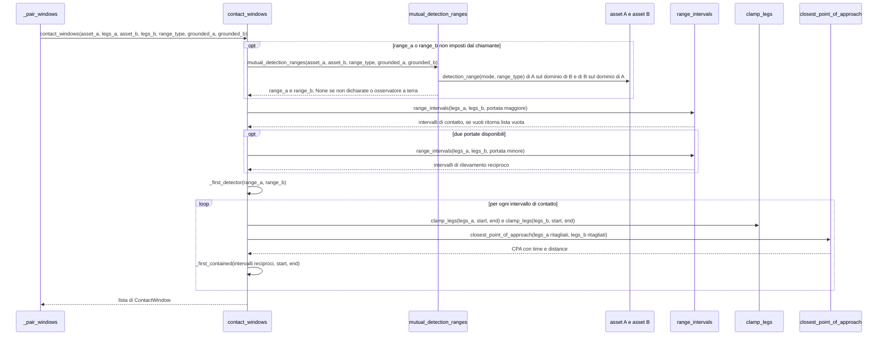

Righe: `mutual_detection_ranges` `:1056` (solo se una delle due portate è `None`; chiamata da `_pair_windows` senza portate imposte, quindi **sempre** nel percorso di sessione); `range_intervals` portata maggiore `:1070`, minore `:1075`
(solo con due portate, `:1075`); `_first_detector` `:1079`; per intervallo: `clamp_legs` e `closest_point_of_approach` `:1084-1085`, `_first_contained` `:1086`, `ContactWindow(...)` `:1088`. Dentro `range_intervals` (`:874`) l'ordine è
`_overlap`, `_breakpoints`, poi `_relative_motion` per ogni sottointervallo (risolve `|Δr + Δv s|² = R²`), infine `_merge_intervals`; `closest_point_of_approach` (`:804`) ha lo stesso scheletro con `t* = -(Δr·Δv)/|Δv|²` clampato al sottointervallo
e il caso degenere `|Δv|² <= VELOCITY_EPS`. `mutual_detection_ranges` (`:972`): un osservatore a terra ha portata `None` (sensori spenti); un bersaglio a terra è interrogato nel modo `GROUNDED_DETECTION_MODE` (`'ground'`), altrimenti nel modo
di `detection_mode_for(target)` (dalla classe del bersaglio, `DETECTION_MODE_BY_CLASS`). **`trim_contact_window`** (`:1129`) non ha un diagramma proprio: riusa gli stessi pezzi (`clamp_legs`, `closest_point_of_approach`, `_first_contained`, `range_intervals`
solo con due portate) su `[t_from, t_end]` e mantiene portate e `first_detector` della finestra originale; la usa `Session_Simulator` per la «forza occupata» (v. D40 e D65).

### Tabella completa dei simboli di `Logic/Contact_Scheduler`

Le colonne «Tipo», «Simbolo», «Firma» e «Riga» sono l'uscita di `inventario.py --tabella Logic/Contact_Scheduler` (61 righe, nell'ordine del file). «Gruppo» è il ruolo di D68; «Che cosa fa» è una sintesi dai docstring;
«Chiamata da» elenca i chiamanti **dentro il modulo** e **nel core** (`SS` = `Session_Simulator`, `MA` = `Mission_Adapter`, `ER` = `Engagement_Resolver`), ricavati con l'estrazione `ast` dei nomi chiamati: i test non sono contati.

| Gruppo | Tipo | Simbolo | Firma | Riga | Che cosa fa | Chiamata da |
|---|---|---|---|---|---|---|
| tipi | classe | `Leg` | `Leg`; campi: t_start, t_end, p_start, p_end, edge_name | `:122` | Tratto di rotta a velocità costante, in tempo assoluto. | `clamp_legs`, `route_legs`, `static_legs`, `MA:_timeline`, `MA:movement_legs`, `SS:_legs_after_bingo`, `SS:_return_legs`, `SS:_truncate_at_fuel_end` |
| tipi | metodo | `Leg.duration` | `duration(self)` | `:142` | Proprietà: `t_end - t_start`. | lettura dell'attributo in `SS:_consuming_legs`, `SS:_moving_speed`, `MA:airborne_legs` (`:1228`), `MA:mission_holds` (`:834`) |
| tipi | classe | `ThreatWindow` | `ThreatWindow`; campi: t_entry, t_exit, entry_point, exit_point, threat_id, danger_level, route_name, edge_names | `:147` | Intervallo in cui una rotta si trova dentro un volume di minaccia. | `threat_windows` |
| tipi | metodo | `ThreatWindow.duration` | `duration(self)` | `:175` | Tempo di esposizione alla minaccia [s]. | nessun chiamante nel core (solo test) |
| tipi | classe | `CPA` | `CPA`; campi: time, distance, point_a, point_b, degenerate | `:181` | Punto di massimo avvicinamento fra due mobili (Closest Point of Approach). | `closest_point_of_approach` (costruttore) |
| tipi | classe | `ContactWindow` | `ContactWindow`; campi: asset_a_id, asset_b_id, t_start, t_end, t_cpa, distance_cpa, range_a, range_b, t_mutual_start, t_mutual_end, first_detector | `:197` | Intervallo in cui due asset sono nel raggio di rilevamento (almeno unidirezionale). | `contact_windows`, `trim_contact_window` (costruttore); annotazione di tipo in `SS:_group_windows`; `ER:_detect` ne legge gli attributi senza importarla |
| tipi | metodo | `ContactWindow.duration` | `duration(self)` | `:234` | Proprietà: `t_end - t_start`. | nessun chiamante nel core |
| tipi | metodo | `ContactWindow.is_mutual` | `is_mutual(self)` | `:238` | True se esiste un intervallo in cui entrambi rilevano l'altro. | nessun chiamante nel core |
| GroundedSchedule | classe | `GroundedSchedule` | `GroundedSchedule`; campi: __slots__ | `:243` | Aerei a terra nel tempo (F5): per asset, gli intervalli `[t_inizio, t_fine)` a terra. | `MA:grounded_schedule`, `SS:_grounded_after_bingo`, `SS:_grounded_after_fuel` |
| GroundedSchedule | metodo | `GroundedSchedule.__init__` | `__init__(self, intervals)` | `:261` | Normalizza `{asset_id: [(lo, hi)]}`: ordina, fonde e valida gli intervalli. | `GroundedSchedule.of`; `MA:grounded_schedule` (costruttore) |
| GroundedSchedule | metodo | `GroundedSchedule.of` | `of(cls, grounded)` | `:293` | Normalizza None, `GroundedSchedule`, mappa di intervalli o iterabile di id (sempre a terra su `ALWAYS`). | `schedule_contacts`; `ER:_EngagementRun.__init__` (`:1669`) |
| GroundedSchedule | metodo | `GroundedSchedule.at` | `at(self, asset_id, t)` | `:311` | L'asset è a terra all'istante `t`. | `_pair_windows`; `ER` (`_gone`, `_grounded_in`, `_schedule_next`, `_on_launch`, `_on_resolve`, ...); `SS` (es. `_consuming_legs`); `MA:final_posture` |
| GroundedSchedule | metodo | `GroundedSchedule.always` | `always(self, asset_id)` | `:319` | L'asset è a terra su tutta la linea del tempo (insieme semplice, asset senza missione). | `always_ids`; `ER` (`_build_forces`, `_interceptors_of`, `_schedule_next`, `_init_breakpoints`) |
| GroundedSchedule | metodo | `GroundedSchedule.ever` | `ever(self, asset_id)` | `:323` | L'asset è a terra in qualche istante. | nessun chiamante nel core (solo test) |
| GroundedSchedule | metodo | `GroundedSchedule.intervals` | `intervals(self, asset_id)` | `:327` | Gli intervalli `(lo, hi)` a terra dell'asset (tupla vuota se non ne ha). | `SS:_grounded_after_fuel` (`:1498`), `SS:_grounded_after_bingo` (`:1645`) |
| GroundedSchedule | metodo | `GroundedSchedule.transitions` | `transitions(self, asset_id)` | `:330` | Istanti finiti in cui lo stato dell'asset cambia (decollo, atterraggio), ordinati. | `_pair_windows` |
| GroundedSchedule | metodo | `GroundedSchedule.always_ids` | `always_ids(self)` | `:335` | Id degli asset sempre a terra (l'insieme della F4c). | nessun chiamante nel core (solo test) |
| GroundedSchedule | metodo | `GroundedSchedule.ids` | `ids(self)` | `:339` | Id degli asset a terra in qualche istante. | `SS:_grounded_after_fuel` (`:1498`), `SS:_grounded_after_bingo` (`:1645`) |
| GroundedSchedule | metodo | `GroundedSchedule.__bool__` | `__bool__(self)` | `:343` | Protocollo Python: vero se almeno un asset ha intervalli. | implicito (`if grounded`) |
| GroundedSchedule | metodo | `GroundedSchedule.__eq__` | `__eq__(self, other)` | `:346` | Protocollo Python: uguaglianza per intervalli. | implicito |
| GroundedSchedule | metodo | `GroundedSchedule.__hash__` | `__hash__(self)` | `:349` | Protocollo Python: hash dei soli intervalli ordinati. | implicito |
| GroundedSchedule | metodo | `GroundedSchedule.__repr__` | `__repr__(self)` | `:352` | Protocollo Python: rappresentazione ordinata per asset. | implicito |
| vettori | funzione | `_to_xyz` | `_to_xyz(point)` | `:358` | `Point3D` (o qualunque oggetto con x/y/z) → terna di float. | `_block_profile`, `_edge_threat_fractions`, `route_legs`, `static_legs` |
| vettori | funzione | `_to_point` | `_to_point(xyz)` | `:363` | Terna di float → `Point3D`. | `closest_point_of_approach`, `threat_windows` |
| vettori | funzione | `_sub` | `_sub(u, v)` | `:367` | Differenza fra due terne. | `_fraction_along`, `_relative_motion`, `block_pair_candidates`, `closest_point_of_approach`, `range_intervals` |
| vettori | funzione | `_dot` | `_dot(u, v)` | `:371` | Prodotto scalare fra due terne. | `_fraction_along`, `block_pair_candidates`, `closest_point_of_approach`, `range_intervals` |
| vettori | funzione | `_lerp` | `_lerp(p0, p1, f)` | `:375` | Interpolazione lineare fra due terne con frazione `f`. | `clamp_legs`, `position_on_legs` |
| tratti | funzione | `route_legs` | `route_legs(route, t0, speed, horizon)` | `:383` | Scompone una `DataType.Route` nei suoi tratti, in tempo assoluto. | `_asset_legs`, `threat_windows`, `MA:_timeline`, `MA:_travel_time_to`, `MA:mission_holds` |
| tratti | funzione | `static_legs` | `static_legs(position, t_start, t_end)` | `:445` | Tratto unico di un asset fermo: un sito SAM, un deposito, un blocco in posizione. | `_asset_legs`, `SS:run_session` |
| tratti | funzione | `clamp_legs` | `clamp_legs(legs, lo, hi)` | `:469` | Ritaglia i tratti all'intervallo `[lo, hi]`, interpolando gli estremi tagliati. | `_asset_legs`, `_pair_windows`, `contact_windows`, `route_legs`, `trim_contact_window`, `MA:movement_legs`, `SS:_fuel_truncated`, `SS:_legs_after_bingo`, `SS:_truncate_at_fuel_end`, `SS:run_session` |
| tratti | funzione | `legs_span` | `legs_span(legs)` | `:495` | Intervallo di validità `[primo istante, ultimo istante]`, None se non ci sono tratti. | `_overlap` |
| tratti | funzione | `position_on_legs` | `position_on_legs(legs, t)` | `:508` | Posizione all'istante assoluto `t`, terna di float. None se non ci sono tratti. | `_relative_motion`, `closest_point_of_approach`, `range_intervals`, `threat_windows`, `ER:_position_at`, `SS:run_session` |
| minacce (A) | funzione | `_cylinder_of` | `_cylinder_of(threat)` | `:536` | Il `Cylinder` di una minaccia: accetta un `ThreatAA` o direttamente un `Cylinder`. | `block_reach`, `threat_windows` |
| minacce (A) | funzione | `_fraction_along` | `_fraction_along(p_start, p_end, point)` | `:541` | Frazione in [0, 1] del punto proiettato sul tratto `p_start -> p_end`. | `_edge_threat_fractions` |
| minacce (A) | funzione | `threat_windows` | `threat_windows(route, threat, t0, speed, horizon, threat_id, tolerance)` | `:554` | Intervalli di tempo assoluto in cui `route` attraversa il volume di `threat`. | `route_threat_windows`; nessun altro chiamante fuori dai test |
| minacce (A) | funzione | `_edge_threat_fractions` | `_edge_threat_fractions(cylinder, edge, tolerance)` | `:641` | Frazioni di ingresso/uscita di un arco nel cilindro, None se l'arco non lo tocca. | `threat_windows` |
| minacce (A) | funzione | `_merge_threat_intervals` | `_merge_threat_intervals(raw)` | `:684` | Fonde gli intervalli contigui (fine di uno == inizio del successivo, entro `TIME_EPS`). | `threat_windows` |
| minacce (A) | funzione | `route_threat_windows` | `route_threat_windows(route, threats, t0, speed, horizon, tolerance)` | `:705` | `threat_windows` su più minacce in una volta. | nessun chiamante nel core (solo test) |
| CPA e portata (B) | funzione | `_overlap` | `_overlap(legs_a, legs_b)` | `:738` | Intervallo in cui entrambi gli asset esistono, None se non si sovrappongono. | `_pair_windows`, `closest_point_of_approach`, `range_intervals` |
| CPA e portata (B) | funzione | `_breakpoints` | `_breakpoints(legs_a, legs_b, lo, hi)` | `:755` | Istanti in cui almeno uno dei due cambia velocità, più gli estremi. | `closest_point_of_approach`, `range_intervals` |
| CPA e portata (B) | funzione | `_relative_motion` | `_relative_motion(legs_a, legs_b, u, v)` | `:782` | (Δr, Δv, durata) del moto relativo sul sottointervallo `[u, v]`. | `closest_point_of_approach`, `range_intervals` |
| CPA e portata (B) | funzione | `closest_point_of_approach` | `closest_point_of_approach(legs_a, legs_b)` | `:804` | Istante e distanza di massimo avvicinamento fra due mobili. | `contact_windows`, `trim_contact_window` |
| CPA e portata (B) | funzione | `range_intervals` | `range_intervals(legs_a, legs_b, radius)` | `:874` | Intervalli in cui la distanza fra i due mobili è `<= radius`. | `contact_windows`, `trim_contact_window`, `ER:_detection_time`, `ER:engagement_intervals` |
| CPA e portata (B) | funzione | `_merge_intervals` | `_merge_intervals(intervals)` | `:938` | Fonde gli intervalli che si toccano o si sovrappongono (entro `TIME_EPS`). | `range_intervals` |
| finestre di contatto | funzione | `detection_mode_for` | `detection_mode_for(asset)` | `:957` | Modo di rilevamento con cui un bersaglio di questa classe va interrogato. | `mutual_detection_ranges` |
| finestre di contatto | funzione | `mutual_detection_ranges` | `mutual_detection_ranges(asset_a, asset_b, range_type, grounded_a, grounded_b)` | `:972` | Portate [m] con cui A vede B e B vede A. | `contact_windows` |
| finestre di contatto | funzione | `contact_windows` | `contact_windows(asset_a, legs_a, asset_b, legs_b, range_a, range_b, range_type, grounded_a, grounded_b)` | `:1023` | Finestre in cui due asset sono a portata di rilevamento l'uno dell'altro. | `_pair_windows` |
| finestre di contatto | funzione | `_first_detector` | `_first_detector(range_a, range_b)` | `:1103` | Chi ottiene il primo contatto: chi ha la portata più lunga. | `contact_windows` |
| finestre di contatto | funzione | `_first_contained` | `_first_contained(intervals, start, end)` | `:1117` | Il primo intervallo che cade dentro `[start, end]`, ritagliato ad esso. | `contact_windows`, `trim_contact_window` |
| finestre di contatto | funzione | `trim_contact_window` | `trim_contact_window(window, t_from, legs_a, legs_b)` | `:1129` | La finestra ritagliata a `[t_from, t_end]`, oppure None se il ritaglio la svuota (G4a). | `SS:_trim_busy`, `SS:run_session` |
| orchestrazione | funzione | `_asset_id` | `_asset_id(asset)` | `:1175` | Identificativo di dominio di un asset o di un blocco. Mai un id del simulatore. | `_asset_legs`, `_pair_windows`, `contact_windows`, `schedule_contacts` |
| potatura per blocco (C) | funzione | `block_max_speed` | `block_max_speed(block)` | `:1188` | Velocità massima [m/s] fra gli asset operativi del blocco, 0.0 se nessuno si muove. | `_block_profile` |
| potatura per blocco (C) | funzione | `block_reach` | `block_reach(block, mode)` | `:1226` | Raggio d'azione [m] del blocco: la più lunga fra portata di fuoco e di rilevamento. | `_block_profile` |
| potatura per blocco (C) | funzione | `_as_block` | `_as_block(item)` | `:1273` | Accetta indifferentemente un `Block` o un `BlockItem` (che lo incapsula in `.block`). | `block_pair_candidates`, `schedule_contacts` |
| potatura per blocco (C) | funzione | `block_pair_candidates` | `block_pair_candidates(blocks_a, blocks_b, horizon, margin, skip_same_side)` | `:1278` | Coppie di blocchi per cui un contatto non è escludibile nella finestra `horizon`. | `schedule_contacts`, `region_block_pairs` |
| potatura per blocco (C) | funzione | `_block_profile` | `_block_profile(block, horizon)` | `:1353` | (side, posizione, inviluppo) di un blocco: tutto ciò che serve alla potatura. | `block_pair_candidates` |
| potatura per blocco (C) | funzione | `region_block_pairs` | `region_block_pairs(region, side_a, side_b, horizon, category, margin)` | `:1362` | `block_pair_candidates` applicata ai blocchi di due schieramenti di una `Region`. | nessun chiamante nel core (solo test) |
| orchestrazione | funzione | `schedule_contacts` | `schedule_contacts(blocks_a, blocks_b, horizon, routes, starts, speeds, t0, margin, range_type, skip_same_side, grounded, legs, only_assets)` | `:1379` | Tutte le finestre di contatto fra due insiemi di blocchi, in `[t0, t0 + horizon]`. | `SS:run_session` |
| orchestrazione | funzione | `_pair_windows` | `_pair_windows(asset_a, legs_a, asset_b, legs_b, range_type, grounded)` | `:1492` | Finestre di una coppia, spezzate agli istanti di decollo/atterraggio dei due asset (F5). | `schedule_contacts` |
| orchestrazione | funzione | `_operative_assets` | `_operative_assets(block)` | `:1527` | Asset operativi di un blocco; lista vuota se il blocco non ne ha. | `schedule_contacts` |
| orchestrazione | funzione | `_asset_legs` | `_asset_legs(asset, routes, starts, speeds, t0, horizon, given)` | `:1538` | Tratti dell'asset: quelli dati dal chiamante, altrimenti dalla rotta (`route_legs`), altrimenti fermo (`static_legs`). | `schedule_contacts` |

## 10A.3 L2 e L3 — `Logic/Fire_Control` (1088 righe, 34 simboli)

La fire control sceglie **con che cosa** spara un tiratore. Il risolutore la riceve come funzione iniettata `fire_control(shooter, target) -> ShotSpec | sequenza | None`; questo modulo ne fornisce una che legge i registri
d'arma (`make_registry_fire_control`), un involucro che la ristringe con la politica d'armi di missione (`restrict_by_policy`, F7a) e due funzioni per il fuoco su posizione (`area_fire_weapon`, `area_fire_pk`, F7b). Il modulo ha
**tre tipi** (`_Weapon` `:355`, classe con `__slots__` e non dataclass; `WeaponPolicy` `:882` e `AreaWeapon` `:993`, `dataclass(frozen=True)`), **27 funzioni** di primo livello e, dentro `make_registry_fire_control`,
**tre funzioni locali** che non sono nella tabella dell'inventario perché non sono di primo livello: `candidates` `:829`, `fire_control` `:838` (la callable che il risolutore chiama), e dentro `restrict_by_policy` `restrict` `:949`
e `restricted` `:972`/`:978` (due definizioni alternative a seconda di `ER.accepts_target_grounded`).

Importa i sette registri di dati (`Aircraft_Data`, `Aircraft_Loadouts`, `Aircraft_Weapon_Data`, `Ground_Weapon_Data`, `Ship_Data`, `Ship_Weapon_Data`, `Vehicle_Data`, `:198-204`), `Context.Context`, il risolutore (`ER`, per
`accepts_target_grounded`, e `ShotSpec`) e `Weapon_Delivery.bomb_engagement_estimate` (`:208`). Costanti del modulo: `AIR_ONLY_TASKS` `:219`, `FALLBACK_DIMENSION` `:224`, `ENGAGEMENT_RANGE_FRACTION` `:228`, `DEFAULT_TIME_OF_FLIGHT_S` `:234`,
`SALVO_ROUNDS` `:240`, `AUTOMATIC_FIRE_RATE_RPM` `:245`, `GUN_BURST_ROUNDS` `:250`, `WEAPON_COST_EXPONENT` `:273`, `SPEED_OF_SOUND_MS` `:278`, `KNOT_MS` `:281`, `PARKED_TYPE_BY_AIR_TYPE` `:287`, `PARKED_FALLBACK_TYPE` `:299`,
`AREA_FIRE_TASKS` `:989`. **Stime dichiarate dal codice** (i commenti sopra le costanti le chiamano «STIMA non tarata»): `FALLBACK_DIMENSION`, `ENGAGEMENT_RANGE_FRACTION`, `DEFAULT_TIME_OF_FLIGHT_S`, `SALVO_ROUNDS`,
`AUTOMATIC_FIRE_RATE_RPM`, `GUN_BURST_ROUNDS`, `WEAPON_COST_EXPONENT`; `SPEED_OF_SOUND_MS` e `KNOT_MS` sono invece definizioni fisiche. Questo capitolo non le ricalibra: le riporta come sono.

### Tipi (D71)

*Diagramma D71 — i tipi di `Fire_Control` e la `ShotSpec` del risolutore che essi producono o filtrano (livello L2, verificato a f009eb43).*

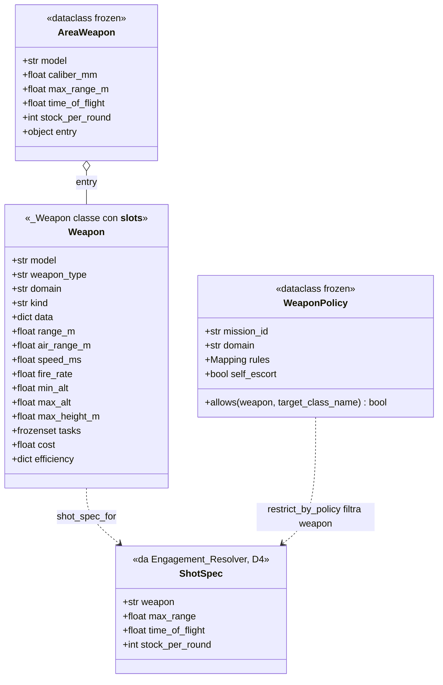

Note a D71: i campi di `Weapon` sono gli `__slots__` di `_Weapon` (`:358`); `efficiency` è una `@property` (`:379`) che restituisce il sotto-dizionario `data['efficiency']` o `{}`. Nel diagramma il nome privato compare senza il trattino basso
iniziale (`Weapon` = `_Weapon`, `:355`) per non dipendere da come il renderer tratta i nomi che cominciano con `_`; lo stereotipo porta il nome vero. `ShotSpec` è del risolutore (D4 mostra tutti i suoi nove campi; qui sono quattro,
quelli che questo modulo legge o imposta). `AreaWeapon.entry` è il record `_Weapon` scelto (campo con `repr=False`, `compare=False`, `:1010`), che `area_fire_pk` usa per leggere le righe d'efficacia del template. `WeaponPolicy.rules` diventa un
`MappingProxyType` in `__post_init__` (`:897`). Rimando a **D47** (i tipi nuovi della F7 e chi li consuma), che resta.

### Le funzioni per ruolo (D72)

*Diagramma D72 — i gruppi di funzioni di `Fire_Control`, le chiamate fra gruppi e i moduli esterni da cui prendono tipi o dati (livello L2, verificato a f009eb43).*

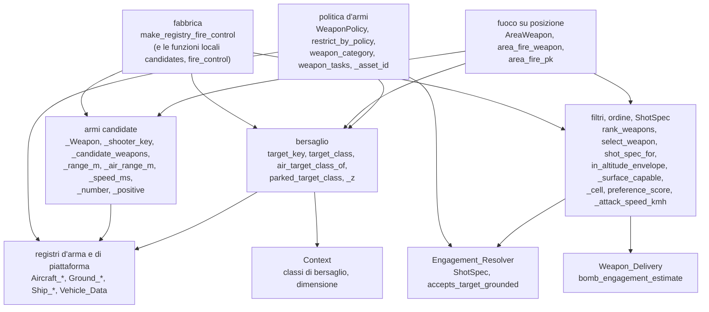

Lettura: `SCE --> ER` perché `shot_spec_for` costruisce una `ShotSpec`; `SCE --> WD` perché `shot_spec_for` chiama `bomb_engagement_estimate` per le bombe contro la superficie (`:761`); `POL --> ER` perché `restrict_by_policy`
chiama `ER.accepts_target_grounded` (`:971`); `BER --> REG` perché `air_target_class_of` legge `Aircraft_Data._registry`. Chi chiama il modulo, nel core: `Session_Simulator` → `restrict_by_policy` (`:2277`) e `weapon_category`
(`_winchester_weapons`, `:1780`, `:1787`); `Mission_Adapter` → `WeaponPolicy` (`weapon_policies`, `:1918`); `Area_Fire` → `area_fire_weapon` (`plan_shot`, `:213`) e `area_fire_pk` (`resolve_area_fire`, `:285`). **Nessun chiamante nel core**
per `make_registry_fire_control` (la fire control è un argomento di `run_session`: la costruisce il chiamante) e per `select_weapon` (solo test). Rimando a **D10** (la selezione come flowchart di regola) e a **D58** (import).

### La sequenza della fire control dai registri (D73)

*Diagramma D73 — la callable `fire_control` di `make_registry_fire_control` per una coppia (tiratore, bersaglio): dalle armi candidate alla tupla ordinata di `ShotSpec` (livello L3, verificato a f009eb43).*

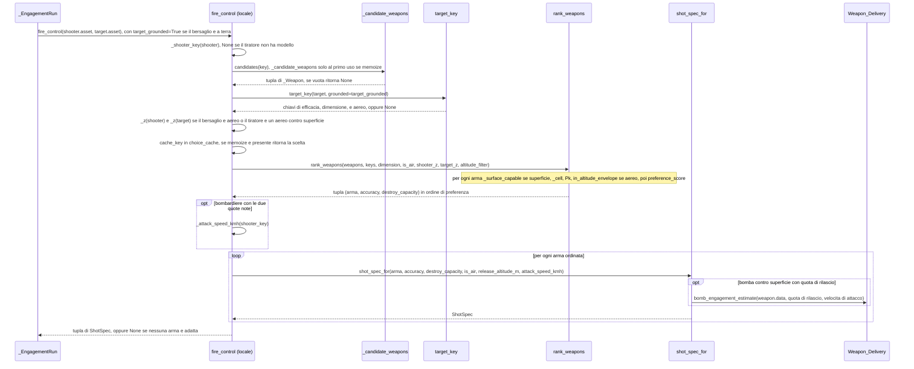

Righe: `fire_control` locale `:838`; `_shooter_key` `:839`; `candidates` `:829` (cache `candidates_cache`); `target_key` `:849`; quote `:858-859` (solo se `is_air or bomber`, `bomber = not is_air and shooter_key[0] == 'Aircraft'`);
cache `:862-863`; `rank_weapons` `:865`; `_attack_speed_kmh` `:867` (solo se `release_altitude` è noto); `shot_spec_for` per ogni scelta `:868`; salvataggio in cache `:872`. Dentro `rank_weapons` (`:698`): `_surface_capable` solo per bersagli non
aerei, `_cell` per la riga di efficacia, scarto se Pk ≤ 0, `in_altitude_envelope` solo per bersagli aerei con `altitude_filter`, ordine per `preference_score` (col costo solo se **tutte** le armi adatte lo hanno, `use_cost`), poi Pk, nome del modello,
tipo d'arma. La risposta è la stessa per la stessa chiave `(shooter_key, keys, dimension, is_air, shooter_z, target_z)`: la memoizzazione non cambia il risultato (docstring). Il risolutore sceglie poi la prima opzione con scorta: v. **D13** e **D83**.

### La sequenza dell'involucro di politica (D74)

*Diagramma D74 — `restrict_by_policy`: dalla costruzione della politica in `run_session` alla chiamata dentro il risolutore (livello L3, verificato a f009eb43).*

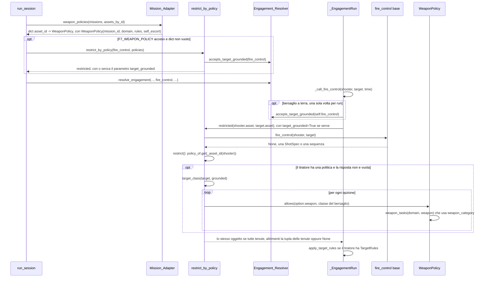

Righe: `if F7_WEAPON_POLICY` `Logic/Session_Simulator.py:2273` (interruttore definito a `:894`, acceso), `weapon_policies` `:2274`, `restrict_by_policy` `:2277`; `accepts_target_grounded` in `restrict_by_policy` `:971`; `restricted` `:972`/`:978`;
`restrict` `:949` (politica cercata con `_asset_id` `:950`; `target_class` `:963`; `allows` `:964`); `_call_fire_control` `Logic/Engagement_Resolver.py:2691` (`accepts_target_grounded` `:2708`, una volta per run, memoizzato in
`fire_control_knows_grounded`; v. D43). Un tiratore **senza** politica, o una risposta `None`, riceve lo stesso oggetto della base (`restrict`, `:952-953`). Rimando a **D46** (la regola di `allows`), **D48** (il cablaggio F7a in `run_session`) e **D43** (le regole di bersaglio applicate dopo).

### La sequenza dell'arma per il fuoco su posizione (D75)

*Diagramma D75 — `area_fire_weapon` e `area_fire_pk`, chiamate da `Area_Fire.plan_shot` e `Area_Fire.resolve_area_fire` (livello L3, verificato a f009eb43).*

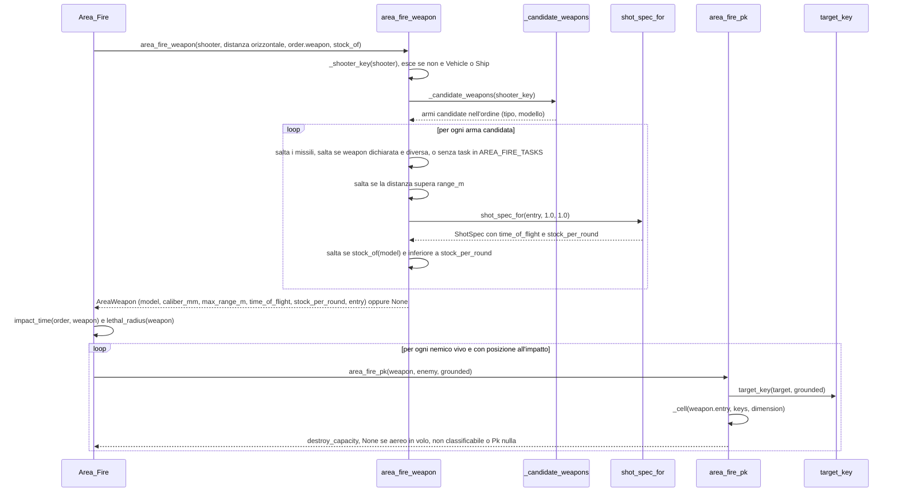

Righe: `area_fire_weapon` `:1013` (`_shooter_key` `:1025`, `_candidate_weapons` `:1030`, `shot_spec_for(entry, 1.0, 1.0)` `:1043`, `AreaWeapon(...)` `:1052`); `area_fire_pk` `:1058` (`target_key` `:1062`, `_cell` `:1072`); chiamanti in
`Logic/Area_Fire.py`: `plan_shot` `:202` (chiama `FC.area_fire_weapon` `:213`), `resolve_area_fire` `:259` (`plan_shot`), `:272-273` (`impact_time`, `lethal_radius`), `:285` (`FC.area_fire_pk`). In sessione `plan_shot` è chiamata **due volte** per ordine:
senza `stock_of` per stimare l'istante d'impatto a monte (`Logic/Session_Simulator.py:2500`, v. D65), con `stock_of` al momento del tiro (`resolve_area_fire`). Questo diagramma mostra le sole parti di `Fire_Control`; la regola di tiro con le estrazioni è **D49** e la coda di sessione è **D50**.

### Tabella completa dei simboli di `Logic/Fire_Control`

Colonne «Tipo», «Simbolo», «Firma» e «Riga» da `inventario.py --tabella Logic/Fire_Control` (34 righe, nell'ordine del file); «Gruppo» come D72; «Chiamata da»: chiamanti dentro il modulo e nel core (`SS` = `Session_Simulator`, `MA` = `Mission_Adapter`, `AF` = `Area_Fire`); le funzioni locali di `make_registry_fire_control` e `restrict_by_policy` sono attribuite alla funzione che le contiene.

| Gruppo | Tipo | Simbolo | Firma | Riga | Che cosa fa | Chiamata da |
|---|---|---|---|---|---|---|
| armi candidate | classe | `_Weapon` | `_Weapon`; campi: __slots__ | `:355` | Arma candidata: dati del registro normalizzati in unità SI (`__slots__`, non dataclass). | `_candidate_weapons` |
| armi candidate | metodo | `_Weapon.__init__` | `__init__(self, model, weapon_type, domain, data)` | `:361` | Normalizza il record di registro in unità SI: `kind`, `range_m`, `air_range_m`, `speed_ms`, `fire_rate`, quote, `tasks`, `cost`. | `_candidate_weapons` (costruttore `_Weapon`) |
| armi candidate | metodo | `_Weapon.efficiency` | `efficiency(self)` | `:380` | Proprietà: la tabella `efficiency` del record (`{}` se assente). | `_cell` (lettura dell'attributo) |
| politica d'armi | classe | `WeaponPolicy` | `WeaponPolicy`; campi: mission_id, domain, rules, self_escort | `:882` | Politica d'armi di UN asset di missione (v. «Politica d'armi per tipo di missione»). | `MA:weapon_policies` |
| politica d'armi | metodo | `WeaponPolicy.__post_init__` | `__post_init__(self)` | `:897` | Rende `rules` un mapping immutabile (`MappingProxyType`). | implicito alla costruzione della dataclass |
| politica d'armi | metodo | `WeaponPolicy.allows` | `allows(self, weapon, target_class_name)` | `:900` | L'arma `weapon` (modello) è ammessa contro la classe `target_class_name`? | `restrict_by_policy` (funzione `restrict`) |
| fuoco su posizione | classe | `AreaWeapon` | `AreaWeapon`; campi: model, caliber_mm, max_range_m, time_of_flight, stock_per_round, entry | `:993` | Arma scelta per il fuoco su posizione (F7b), con i campi che servono a `Logic/Area_Fire`. | `area_fire_weapon` (costruttore); letta da `AF:lethal_radius`, `AF:impact_time` |
| politica d'armi | funzione | `weapon_category` | `weapon_category(domain, model)` | `:317` | Categoria d'arma del registro del dominio (es. `MISSILES_AAM`) che contiene il modello, o None. | `weapon_tasks`, `SS:_winchester_weapons` |
| politica d'armi | funzione | `weapon_tasks` | `weapon_tasks(domain, model)` | `:338` | Task del modello nel registro del dominio (`frozenset`), None se il modello non è a registro. | `WeaponPolicy.allows` |
| armi candidate | funzione | `_number` | `_number(value)` | `:385` | Il valore come float se è un numero (non bool), altrimenti None. | `_Weapon.__init__`, `_cell`, `_positive`, `_range_m` |
| armi candidate | funzione | `_positive` | `_positive(value)` | `:391` | Il valore se è un numero > 0, altrimenti None. | `_Weapon.__init__`, `_air_range_m`, `_attack_speed_kmh`, `_speed_ms`, `area_fire_weapon` |
| armi candidate | funzione | `_range_m` | `_range_m(domain, data)` | `:396` | Portata massima [m]: Ground in metri (dict direct/indirect o numero), Ship e Air in km. | `_Weapon.__init__` |
| armi candidate | funzione | `_air_range_m` | `_air_range_m(domain, data, range_m)` | `:412` | Portata [m] contro bersagli aerei: per Ground il tiro diretto se dichiarato, altrimenti `range_m`. | `_Weapon.__init__` |
| armi candidate | funzione | `_speed_ms` | `_speed_ms(domain, weapon_type, data)` | `:427` | Velocità dell'arma/proietto [m/s], nelle unità di ogni registro (v. commenti costanti). | `_Weapon.__init__` |
| armi candidate | funzione | `_shooter_key` | `_shooter_key(shooter)` | `:446` | (classe, modello, loadout) del tiratore, o None se non ha un modello. | `area_fire_weapon`, `make_registry_fire_control` |
| armi candidate | funzione | `_candidate_weapons` | `_candidate_weapons(shooter_key)` | `:458` | Armi candidate di un tiratore, in ordine deterministico (tipo, modello). | `area_fire_weapon`, `make_registry_fire_control` |
| bersaglio | funzione | `air_target_class_of` | `air_target_class_of(target)` | `:526` | Classe di bersaglio aereo (`Context.AIR_TARGET_CLASSES`) di un `Aircraft` in volo. | `target_key` |
| bersaglio | funzione | `parked_target_class` | `parked_target_class(target)` | `:542` | Classe d'efficacia (di superficie) di un aereo a terra (F4c, v. «Aerei a terra»). | `target_key` |
| bersaglio | funzione | `target_key` | `target_key(target, grounded)` | `:555` | (chiavi di efficacia in ordine di ricerca, dimensione, è aereo) del bersaglio. | `area_fire_pk`, `make_registry_fire_control` |
| bersaglio | funzione | `target_class` | `target_class(target, grounded)` | `:593` | Classe del bersaglio per la politica d'armi (F7a, `Context.TARGET_CLASSES`). | `restrict_by_policy` |
| bersaglio | funzione | `_z` | `_z(asset)` | `:616` | Quota `position.z` dell'asset, None se non leggibile. | `make_registry_fire_control` |
| filtri, ordine, ShotSpec | funzione | `in_altitude_envelope` | `in_altitude_envelope(weapon, shooter_z, target_z)` | `:628` | True se il bersaglio aereo è nell'inviluppo di quota dell'arma (v. «Quota»). | `rank_weapons` |
| filtri, ordine, ShotSpec | funzione | `_surface_capable` | `_surface_capable(weapon)` | `:659` | Un'arma spara a superficie se ha almeno un task non puramente antiaereo (o nessun task). | `rank_weapons` |
| filtri, ordine, ShotSpec | funzione | `_cell` | `_cell(weapon, keys, dimension)` | `:664` | (accuracy, destroy_capacity) grezzi della prima chiave presente nel template. | `area_fire_pk`, `rank_weapons` |
| filtri, ordine, ShotSpec | funzione | `preference_score` | `preference_score(pk, cost, use_cost)` | `:686` | Punteggio di preferenza di un'arma (decisione A5, v. `WEAPON_COST_EXPONENT`). | `rank_weapons` |
| filtri, ordine, ShotSpec | funzione | `rank_weapons` | `rank_weapons(weapons, keys, dimension, is_air, shooter_z, target_z, altitude_filter)` | `:698` | Tutte le armi adatte, in ordine di preferenza: tuple (arma, accuracy, destroy_capacity). | `make_registry_fire_control`, `select_weapon` |
| filtri, ordine, ShotSpec | funzione | `select_weapon` | `select_weapon(weapons, keys, dimension, is_air, shooter_z, target_z, altitude_filter)` | `:737` | L'arma preferita fra quelle adatte (la prima di `rank_weapons`), o None. | nessun chiamante nel core (solo test) |
| filtri, ordine, ShotSpec | funzione | `shot_spec_for` | `shot_spec_for(weapon, accuracy, destroy_capacity, is_air, release_altitude_m, attack_speed_kmh)` | `:745` | `ShotSpec` della scelta, con i campi derivati del docstring del modulo. | `area_fire_weapon`, `make_registry_fire_control` |
| filtri, ordine, ShotSpec | funzione | `_attack_speed_kmh` | `_attack_speed_kmh(shooter_key)` | `:793` | Velocità `attack` [km/h] del loadout assegnato a un aereo, None se non disponibile. | `make_registry_fire_control` |
| fabbrica | funzione | `make_registry_fire_control` | `make_registry_fire_control(altitude_filter, memoize)` | `:806` | Fabbrica della fire control `(shooter, target, target_grounded)`: tupla ordinata di `ShotSpec` o None; cache opzionali. | nessun chiamante nel core: la fire control è un argomento di `run_session` |
| politica d'armi | funzione | `restrict_by_policy` | `restrict_by_policy(fire_control, policy_of)` | `:926` | Involucro puro: `fire_control` con le opzioni ristrette dalla politica d'armi del tiratore (F7a). | `SS:run_session` |
| fuoco su posizione | funzione | `area_fire_weapon` | `area_fire_weapon(shooter, distance_m, weapon, stock_of)` | `:1013` | L'arma con cui `shooter` spara una posizione a `distance_m` [m] in orizzontale (F7b), o None. | `AF:plan_shot` |
| fuoco su posizione | funzione | `area_fire_pk` | `area_fire_pk(weapon, target, grounded)` | `:1058` | `destroy_capacity` della riga del template per la classe del bersaglio, None se non classificabile, Pk nulla o aereo in volo. | `AF:resolve_area_fire` |
| politica d'armi | funzione | `_asset_id` | `_asset_id(asset)` | `:1080` | Id di dominio di un asset (`id`, poi `name`), copia del criterio di `ER._domain_id`. | `restrict_by_policy` |

## 10A.4 L2 e L3 — `Logic/Engagement_Resolver` (3872 righe, 127 simboli)

Lo strato 2 risponde a **come finisce** un ingaggio: `resolve_engagement` (`:3619`) consuma le `ContactWindow` dello scheduler e restituisce un `EngagementResult` **senza mutare nessun asset**; `apply_engagement_result` (`:3794`) è il passo separato
che applica danni e consumi agli asset veri. Il modulo contiene **16 classi** (11 `dataclass(frozen=True)` di scambio, `_Shadow` con `__slots__`, tre `dataclass` interne `_Candidate`, `_ForceState`, `_PendingGroup`, e `_EngagementRun`),
**87 metodi** (72 di `_EngagementRun`) e **24 funzioni** di primo livello: 16 + 87 + 24 = 127 simboli, tutti nella tabella di fondo.

Costanti del modulo (non sono nella tabella dell'inventario): parametri della legge di rilevamento `PD_AT_ACQUISITION_RANGE` `:454` e `PD_RANGE_EXPONENT` `:459`; fattori ambientali `NIGHT_DETECTION_FACTOR` `:472`, `ADVERSE_WEATHER_DETECTION_FACTOR` `:473`;
nebbia di guerra `UNSEEN_DETECTION_FACTOR` `:487`, `RECON_EFFICIENCY_FOG_RELIEF` `:488`; soglie `OPERATIVE_HEALTH_FLOOR` `:492`, `FRACTION_EPS` `:496`, `BREAKPOINT_U_EPS` `:500`, `STATIONARY_EPS` `:501`, `ATTACK_POINT_TOLERANCE_M` `:525`;
esiti di forza `HELD`/`DISENGAGED`/`DESTROYED` `:504-506`; motivi `TRIGGER_*` `:510-512` e `ACTIVITY_*` `:518-521`; livelli di ROE `ROE_*` `:529-534`; i cinque tipi di evento della coda `_LAUNCH` 0, `_IMPACT` 1, `_RESOLVE` 2, `_DECIDE` 3, `_WAKE` 4 (`:536-544`, in questo ordine
a parità d'istante). **Stime dichiarate dal codice** (commento «STIMA DICHIARATA»): `PD_AT_ACQUISITION_RANGE`, `NIGHT_DETECTION_FACTOR`, `ADVERSE_WEATHER_DETECTION_FACTOR`, `UNSEEN_DETECTION_FACTOR`, `RECON_EFFICIENCY_FOG_RELIEF`; `PD_RANGE_EXPONENT` ha la forma dall'equazione radar
(commento sopra `:459`) ma la curva è una semplificazione monotona. Questo capitolo non le ricalibra.

I **tipi di scambio** (livello L2) hanno già due diagrammi che restano: **D4** (`ShotSpec`, `Detection`, `Salvo`, `SalvoResolution`, `ForceOutcome`, `AmmunitionEvent`, `InterceptionEvent`, `EngagementResult`, `ActivityEnd`, `ActivityCriteria`, capitolo 4 §4.13) e
**D47** (`TargetRules`, `WeaponPolicy`, `AreaWeapon`). Qui si aggiungono i **tipi interni** della run, che nessun diagramma mostrava (D76), le funzioni di modulo per ruolo (D77, D78) e i 72 metodi della run per ruolo (D79, D80).

### I tipi interni della run (D76)

*Diagramma D76 — i tipi interni di `Engagement_Resolver` e i campi principali della run; i nomi privati compaiono senza il trattino basso iniziale (livello L2, verificato a f009eb43).*

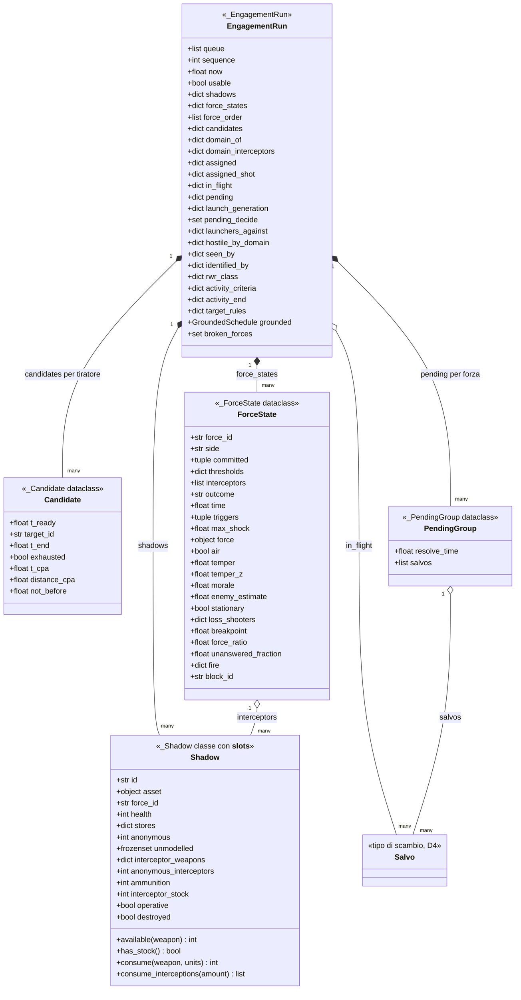

Note a D76: `Shadow.ammunition`, `interceptor_stock`, `operative` e `destroyed` sono `@property` (`:1441`, `:1458`, `:1476`, `:1480`); `Shadow` espone `id` e `health` perché `Damage_Model.build_damage_event` la tratta come un asset (duck typing), e la sua contabilità delle scorte
è quella di `Asset/Weapon_Stores` (`WS`), la stessa dell'asset reale: per questo `apply_engagement_result` ritrova sull'asset i consumi che l'ombra ha concesso. `Candidate.exhausted` e `not_before` sono i due campi che `_schedule_next` modifica (candidato esaurito, o rimandato all'ingresso in portata,
D11). `ForceState.interceptors` è la lista `[(Shadow, canali)]` costruita da `_interceptors_of`; `EngagementRun.domain_interceptors` raccoglie quelle di tutte le forze di un dominio di coordinamento (D32, D33). La coda `queue` contiene tuple `(time, kind, key, sequence, payload)`
(`_push` `:2111`); `sequence` rompe i pareggi. **Omessi** dal diagramma (esistono in `__init__`, `:1645-1769`): le cache `zone_cache`, `may_intercept_cache`, `in_time_cache`, `range_cache`, `air_range_cache`, `class_weights`, `surface_weights`, `profiles`; `legs`, `contacts`, `initial_health`, `destroyed_at`, `woken_by_destruction`,
`attack_pass`, `fire_control_knows_grounded`; le callable iniettate (`rng`, `breakpoint_rng`, `morale_for`, `enemy_estimate_for`, `reaction_profile_for`, `detection_factor`); le liste di esito (`detections`, `salvos`, `resolutions`, `damage_events`, `ammunition_events`, `interception_events`, `activity_ends`).

### Le funzioni di modulo per ruolo (D77)

*Diagramma D77 — i gruppi di funzioni e di tipi di modulo di `Engagement_Resolver` e chi li chiama (livello L2, verificato a f009eb43).*

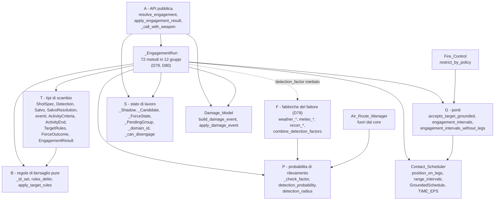

Lettura: `RUN --> T` raccoglie le costruzioni di `Detection`, `Salvo`, `SalvoResolution`, `AmmunitionEvent`, `InterceptionEvent`, `ActivityEnd`, `ForceOutcome`, `EngagementResult`; `T --> B` è il solo legame fra tipi e funzioni pure (`TargetRules.__post_init__` chiama `_id_set`, `:836`);
`F --> P` è `_check_factor`; la freccia tratteggiata `RUN -.-> F` non è una chiamata alle fabbriche (nessuna funzione di `RUN` le chiama) ma alla callable che esse **restituiscono** e che il chiamante passa come `detection_factor`. `FCM --> G`: `Fire_Control` (`restrict_by_policy`, `:971`) chiama
`accepts_target_grounded`. `ARP --> P`: `Air_Route_Manager` importa localmente `detection_probability` (`Logic/Air_Route_Manager.py:1095`), un modulo **fuori dal core**: la legge di Pd del risolutore è riusata dal pianificatore di rotta come metrica (decisione D-5 citata nel suo docstring).

### Le fabbriche del fattore di rilevamento (D78)

*Diagramma D78 — le funzioni che costruiscono la callable `detection_factor(observer, target) -> float` e da quali dati dipendono (livello L2, verificato a f009eb43).*

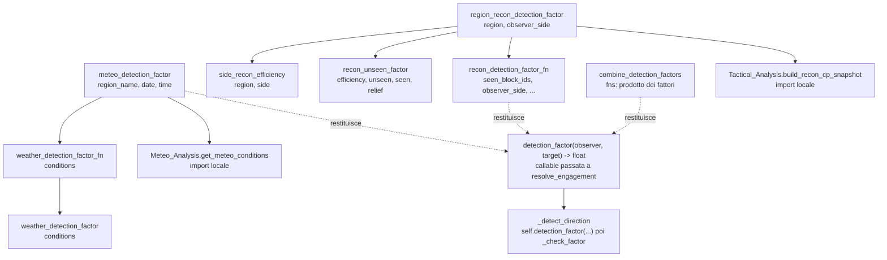

Lettura: ogni fabbrica **restituisce** una callable con la firma `(observer, target) -> float`; `combine_detection_factors` ne fa il prodotto (ogni componente è riportato in [0, 1], `:1249`). `weather_detection_factor` (`:1105`) dà `NIGHT_DETECTION_FACTOR` per la notte e
`ADVERSE_WEATHER_DETECTION_FACTOR` per il meteo avverso, moltiplicati; `recon_detection_factor_fn` (`:1209`) dà `seen_factor` se il blocco del bersaglio è nell'istantanea di ricognizione dell'osservatore o è dello stesso lato, `unseen_factor` altrimenti, e 1.0 per un osservatore
dell'altro lato. Import locali: `Meteo_Analysis` `:1179`, `Region.BlockCategory` `:1337`, `Tactical_Analysis` e `enemySide` `:1384-1385`. **Nessuna di queste fabbriche ha un chiamante nel core**: `run_session` non le chiama (nessuna occorrenza in `Session_Simulator.py`), le usa chi prepara la sessione
(test e scenari: `Test/Test_Session_Scenarios.py:1334` usa `ER.region_recon_detection_factor`). Il docstring di `region_recon_detection_factor` (`:1359`) dichiara che l'istantanea è presa **una volta, prima della sessione**, e che `Block.get_recognition_report` estrae con il modulo `random` di Python
(`Utility.calcProbability`) *fuori* dal percorso del motore: non l'ho verificato in `Block`, lo riporto come dichiarazione del codice. Regola e formula: **D12** (capitolo 4 §4.18), che resta.

### I metodi di `_EngagementRun` per ruolo (D79, D80)

I 72 metodi della run (più la classe, `:1642`) sono divisi in 12 gruppi di ruolo, con il codice `R1`-`R12` usato anche nella tabella di fondo. Conteggi: R1 costruzione 8; R2 rilevamento 6; R3 coda ed esito 5; R4 scelta del tiro 8; R5 dottrina di tiro 6;
R6 lanciatori L2/L3 4; R7 regole di bersaglio F7a 11; R8 lancio e impatto 2; R9 intercettazione 7; R10 risoluzione della salva 1; R11 disingaggio e rottura 10; R12 fine di attività 4 (totale 72). Le frecce sono chiamate a nome di metodo (`self._x(...)`) fra gruppi;
i gruppi che accodano un evento chiamano tutti `_push` (R3): quegli archi non sono disegnati. Il raggruppamento è mio (i metodi non sono raggruppati nel codice), ma segue le intestazioni di sezione del file («fase 1: rilevamento», «coda eventi», «fase 2: scelta del bersaglio e lancio»,
«dottrina di tiro», «fase 3: impatto, saturazione, danno», «fase 4: disingaggio», «soglia di rottura stocastica»).

*Diagramma D79 — `_EngagementRun` 1/2: costruzione, rilevamento, ciclo principale, scelta del tiro, dottrina di tiro, prelazione ai lanciatori, lancio e impatto (livello L2, verificato a f009eb43).*

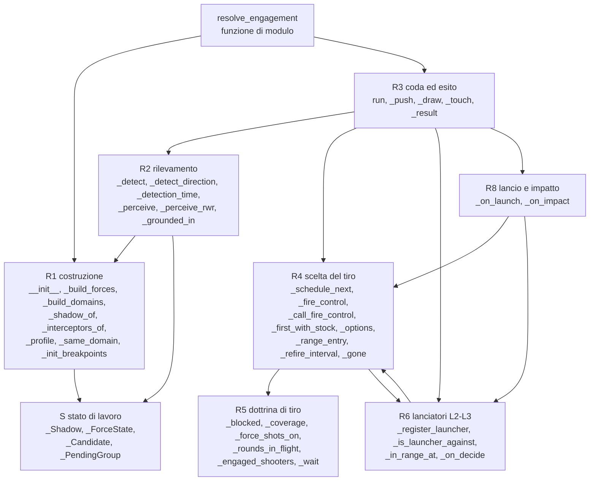

Lettura: `R3 --> R4` è la prima `_schedule_next` per ogni tiratore in `run` (`:3566-3567`); `R3 --> R6` è `_on_decide` (evento `_DECIDE`); `R6 --> R4` è doppia: `_on_decide` richiama `_schedule_next`, `_in_range_at` richiama `_fire_control`, `_first_with_stock` e `_range_entry` per sapere se
un lanciatore è ingaggiabile; `R8 --> R4` è `_on_launch` che richiama `_schedule_next` (`:2919`, `:2930`, `:2955`) e `_gone` (`:2913`). `R2 --> R1` è `_profile` (il tempo di reazione del tiratore). Le sequenze interne a questi gruppi sono D81-D84; i diagrammi di regola sono D5 (coda), D25 (prelazione), D26 (dottrina di tiro).

*Diagramma D80 — `_EngagementRun` 2/2: risoluzione della salva, intercettazione, disingaggio, fine di attività e regole di bersaglio F7a (livello L2, verificato a f009eb43).*

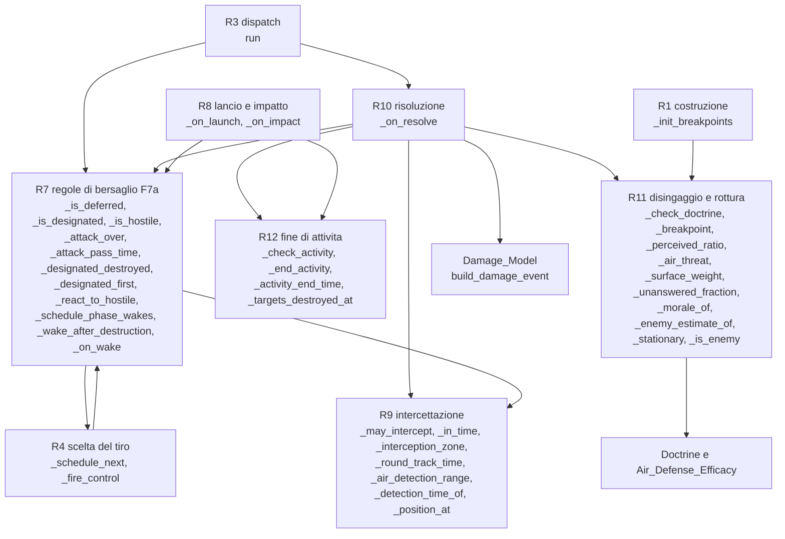

Lettura: `R10 --> R9` sono `_may_intercept` (regola L1) e `_in_time` (regola R-INT) chiamate per ogni coppia (salva, intercettore); `R10 --> R11` è `_check_doctrine`, che chiama `_breakpoint` → `_perceived_ratio` e `_unanswered_fraction`; `R10 --> R7` è
`_wake_after_destruction` (solo con `target_rules`); `R10 --> R12` è `_check_activity` (solo con `activity_criteria`); `R7 --> R9` è `_position_at` usato da `_is_designated`; `R1 --> R11` sono le chiamate di `_init_breakpoints` a `_morale_of`, `_enemy_estimate_of`, `_stationary`
(il gruppo R1 contiene `_init_breakpoints` per costruzione, ma la sua logica è del gruppo R11). `R4 --> R7` e `R7 --> R4`: `_schedule_next` e `_fire_control` consultano `_is_deferred`, `_is_designated`, `_is_hostile`, `_attack_over`; `_on_wake` richiama `_schedule_next`.
Rimando a **D22** (soglia di rottura B(t)), **D23** (peso di un nemico percepito), **D24** (allocazione delle intercettazioni), **D27** (regola R-INT), **D37** (fine di attività), **D43-D45** (regole di bersaglio di missione).

### La sequenza di `resolve_engagement` (D81)

*Diagramma D81 — `resolve_engagement`: validazione degli argomenti, costruzione della run e ciclo principale; le sequenze interne a ogni gestore di evento sono D82-D85 (livello L3, verificato a f009eb43).*

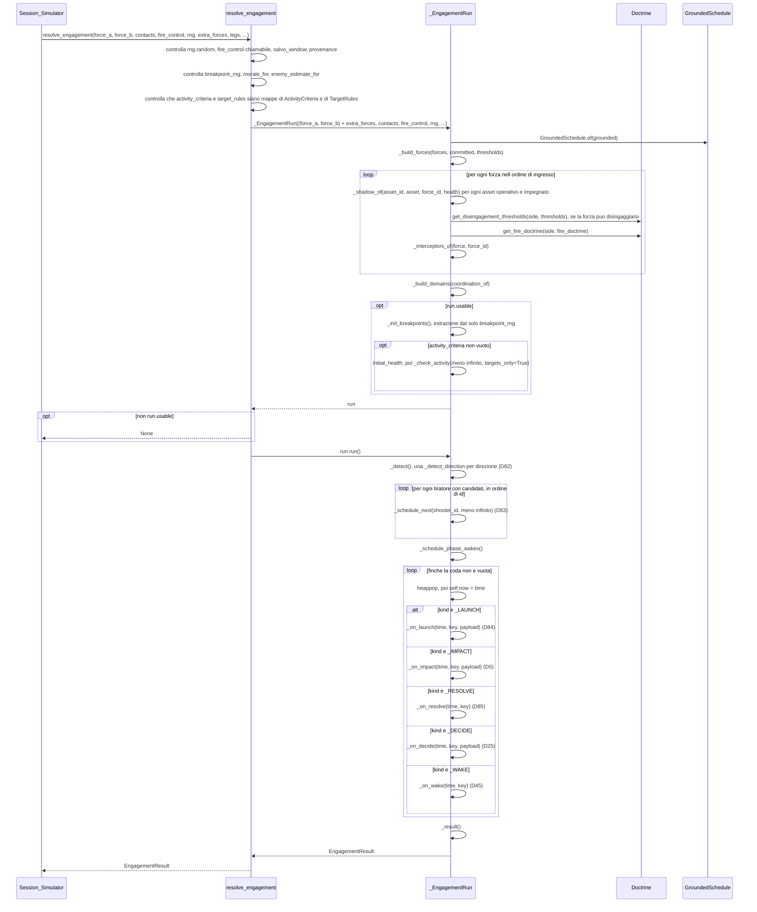

Lettura: le validazioni sono tutte in testa e prima di costruire la run (`:3728-3766`); sollevano `TypeError`/`ValueError` e non toccano nessuna forza. La run si costruisce in `:3768-3774` e il suo `__init__` (`:1645`) fa, in questo ordine: copia dei parametri
e creazione degli stati vuoti (`:1650-1750`), `GroundedSchedule.of(grounded)` (`:1669`), `_build_forces` (`:1752`), `_build_domains` (`:1753`); solo se la run è risolvibile, `_init_breakpoints` (`:1756`) e, con criteri di fine attività, `initial_health` e `_check_activity(float('-inf'), targets_only=True)`
(`:1758-1767`). `_build_forces` (`:1771`) scorre le forze nell'ordine dato e gli asset **ordinati per id** (`:1786`); salta l'asset senza id di dominio (`:1789`), non incluso in `committed` (`:1793`), senza salute intera leggibile (`:1799-1803`), non operativo (`:1805-1811`);
crea l'ombra (`:1813`) e lo stato di forza con `thresholds=None` per blocchi non militari (`_can_disengage`, `:1818`) e per forze di soli aerei sempre a terra (`:1823`), altrimenti con la dottrina del lato (`:1830`); chiama `_interceptors_of` (`:1841`) dopo aver creato le ombre **di quella forza**.
Restituisce `False` (e `resolve_engagement` `None`, `:3776-3777`) se meno di due forze hanno asset impegnabili (`:1850-1853`); con 3 o più forze una forza vuota resta nell'esito con `committed=0` (`:1858-1860`). Due forze con lo stesso id o un asset in due forze sono `ValueError` (`:1776`, `:1797`);
una mappa `coordination_of` mal formata o un dominio a cavallo di due lati lo sono in `_build_domains` (`:1875`, `:1890`).

Il ciclo principale è `run` (`:3563-3586`): `_detect`, poi una `_schedule_next` per ogni tiratore **in ordine di id** (`:3566-3567`), poi `_schedule_phase_wakes`, poi lo svuotamento della coda con il dispatch per tipo (`:3575-3584`). L'ordine degli eventi a pari istante è quello dei tipi
(`_LAUNCH` 0 < `_IMPACT` 1 < `_RESOLVE` 2 < `_DECIDE` 3 < `_WAKE` 4, `:536-544`), poi la chiave, poi `sequence`. **Ordine delle estrazioni** (fatto che il codice rende verificabile): il `breakpoint_rng` è consultato una volta per forza **in costruzione** (`:3384`), prima di tutto il resto; l'`rng` di sessione
è consultato solo da `_draw` (`:2115`), cioè una volta per direzione in `_detect_direction` (`:2001`) e una volta per ogni colpo non fermato su un bersaglio non ancora distrutto in `_on_resolve` (`:3254`). Rimando a **D5** (la coda nella sua forma generale), **D25** (prelazione), **D45** (`_WAKE`).

### La sequenza di `_detect_direction` (D82)

*Diagramma D82 — `_detect_direction`: una estrazione di rilevamento per direzione di una finestra di contatto, fino al candidato e alla percezione (livello L3, verificato a f009eb43).*

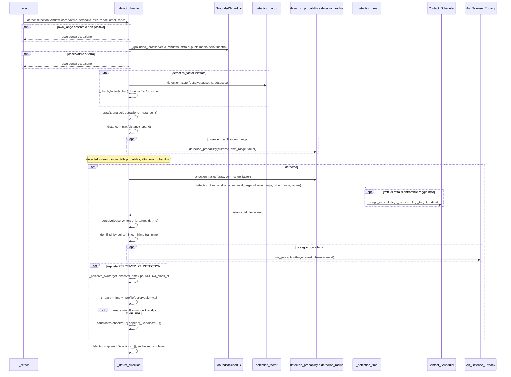

Lettura: `_detect` (`:1965`) ordina le finestre per `(t_start, asset_a_id, asset_b_id, t_end)` (`:1966`), scarta quelle con un asset non impegnato o con i due asset della stessa forza (`:1970-1979`) e per ognuna chiama `_detect_direction` **due volte**: prima A osserva B con `range_a`, poi B osserva A con `range_b`
(`:1983-1984`). Le uscite senza estrazione sono solo due (`:1988-1994`): portata assente o non positiva, e osservatore a terra (sensori spenti); ogni altro caso consuma **esattamente una estrazione**, anche quando la distanza minima supera la portata (la probabilità è allora 0.0, `:2003`). La stessa
estrazione decide se e quando: `detection_radius` ne ricava il raggio (`:2008`) e `_detection_time` (`:2081`) il primo istante in cui la distanza scende sotto quel raggio, con `Contact_Scheduler.range_intervals` se ci sono i tratti di rotta di entrambi (`:2094-2095`), altrimenti l'istante geometrico di
ingresso in portata o `t_cpa` (`:2101-2107`). Il candidato nasce solo se il tiratore è pronto dentro la finestra (`:2021-2026`); il `Detection` è registrato sempre (`:2028`). L'RWR del bersaglio è consultato solo se il bersaglio non è a terra (`:2017`, valutazione in corto circuito con `ADE.rwr_perception`, `:2018`).
La formula della Pd e la regola del dominio di coordinamento sono in **D12** e **D23**; la percezione che ne deriva è usata da `_perceived_ratio` (D22).

### La sequenza di `_schedule_next` (D83)

*Diagramma D83 — `_schedule_next`: l'ordine delle chiamate con cui un tiratore sceglie bersaglio, arma e istante del prossimo lancio (livello L3, verificato a f009eb43).*

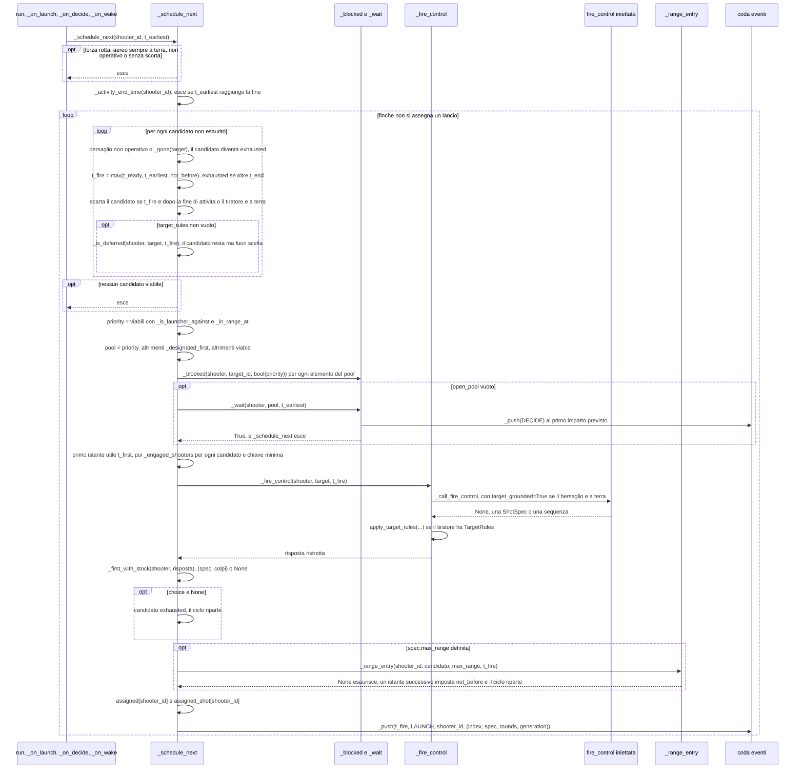

Lettura: i controlli iniziali sono `:2296-2307`; il ciclo `while True` (`:2312`) si ripete finché una scelta non è accodata o non resta nulla (`return` a `:2353`, `:2371`, `:2419`); ricomincia (`continue`) quando un candidato viene esaurito o rimandato (`:2395`, `:2410`, `:2414`). **Valutazione pigra** (`:2359-2367`): `_designated_first` è chiamata
solo se `priority` è vuota (`priority or self._designated_first(...) or viable`); `_in_range_at` (`:2723`) è chiamata solo per i candidati che sono già lanciatori contro la forza (corto circuito di `and`, `:2360-2361`) e a sua volta passa da `_fire_control`, `_first_with_stock` e `_range_entry` **senza** modificare il candidato. `_blocked` (`:2460`)
usa `_rounds_in_flight` per il tetto «due missili, poi guarda» e `_coverage` (che itera `_force_shots_on`) per la saturazione; i lanciatori prioritari sono esenti dalla saturazione, non dal tetto (`:2470`). Se `_wait` ritorna `False` (nessun impatto da attendere) il pool **resta quello non filtrato** e il tiratore procede (`:2369-2373`). Il filtro
«primo istante utile» (`:2376-2381`) non vale per i lanciatori prioritari (`not priority`). `_fire_control` (`:2676`) applica `apply_target_rules` solo se il tiratore ha regole (`:2681-2689`); `_call_fire_control` (`:2691`) passa `target_grounded=True` solo se il bersaglio è a terra all'istante `time` e la fire control lo accetta (`accepts_target_grounded`, `:2708`,
una volta per run). Il payload accodato `(index, spec, rounds, generation)` (`:2418`) è congelato: `_on_launch` non richiama la fire control (D84). Rimando alle regole: **D11** (`not_before`), **D13** (opzioni con scorta), **D25** (prelazione), **D26** (dottrina di tiro), **D43** e **D44** (regole di bersaglio).

### La sequenza di `_on_launch` (D84)

*Diagramma D84 — `_on_launch`: dal lancio programmato alla salva in volo, con le uscite anticipate, i consumi e le reazioni al lancio (livello L3, verificato a f009eb43).*

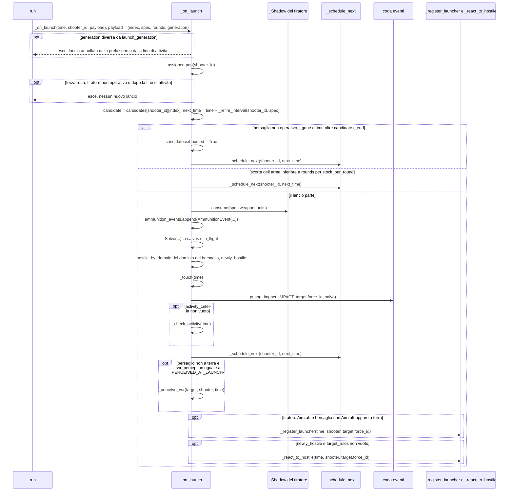

Lettura: nel codice i tre rami della `alt` sono `return` successivi (`:2909-2931`); la `alt` li mostra come alternative per leggibilità. Le uscite senza alcun effetto sono quattro, nell'ordine `:2882` (generazione), `:2893` (forza rotta), `:2898` (non operativo), `:2904` (fine di attività); `assigned.pop` (`:2889`) precede le ultime tre, quindi un lancio
che esce lì non copre più nulla. `_refire_interval` (`:2911`) è calcolato **prima** dei controlli sul bersaglio e sulla scorta, perché serve ai due rami che riprogrammano. `units = rounds * spec.stock_per_round` (`:2922`); il controllo `stock < units` (`:2925`) difende l'invariante «la scorta non va mai sotto zero» quando le
intercettazioni, fra scheduling e lancio, hanno consumato la stessa voce. Il lancio avvenuto ordina: consumo, `AmmunitionEvent`, `Salvo`, `in_flight`, ostile del dominio, `_touch`, evento `_IMPACT`, eventuale `_check_activity` (winchester), **poi** il nuovo `_schedule_next` del tiratore (`:2955`) e **solo dopo** le reazioni
(RWR `:2959-2961`, `_register_launcher` `:2965-2967`, `_react_to_hostile` `:2969-2970`): il tiratore decide il proprio prossimo lancio senza ancora conoscere la reazione che il suo lancio provoca sugli altri (una reazione al lancio che lo riguarda arriva come `_DECIDE`, D25). L'evento `_IMPACT` produce il gruppo da risolvere in `_on_impact`
(`:2974`), che accoda il `_RESOLVE` (D5, D85). Rimando a **D37** (fine di attività) e **D45** (`return_fire` e `_WAKE`).

### La sequenza di `_on_resolve` (D85)

*Diagramma D85 — `_on_resolve`: la risoluzione di un evento-salva contro una forza, in tre blocchi (intercettazione, danno per colpo, dottrina) (livello L3, verificato a f009eb43).*

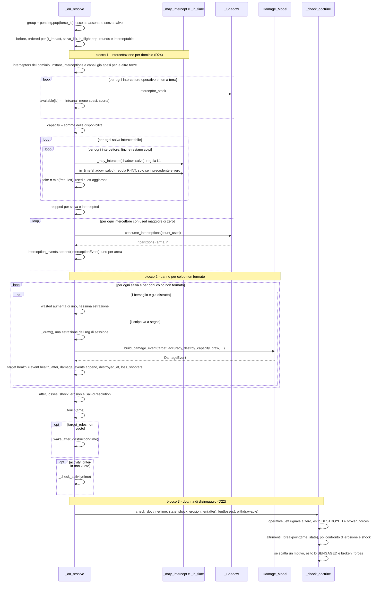

Lettura: **Blocco 1** (`:3157-3239`). I canali sono per evento-salva e per dominio: quelli già spesi dalle *altre* forze dello stesso dominio nello stesso istante si sottraggono (`:3161-3170`), le disponibilità si calcolano solo per intercettori operativi e non a terra (`:3186-3189`). Le salve si scorrono nell'ordine `(t_impact, salvo_id)`
e gli intercettori nell'ordine della regola F (`:3195-3215`); `_in_time` è chiamata solo se `_may_intercept` è vera (corto circuito di `or`, `:3207`). Né `_may_intercept` né `_in_time` fanno estrazioni (docstring di `_in_time`, `:3115`): il flusso dell'`rng` non cambia. Le intercettazioni consumano la scorta
dell'intercettore **prima** del danno (`:3236`), e generano un `InterceptionEvent` per arma (`:3237-3239`). **Blocco 2** (`:3241-3264`): per ogni colpo non fermato su un bersaglio già distrutto si conta `wasted` senza estrarre (payload congelato); altrimenti `_draw()` è valutata come argomento di `build_damage_event`
(`:3253-3255`), quindi **una estrazione per colpo che arriva su un bersaglio vivo**, nell'ordine salve, colpi. Se il colpo mette fuori combattimento un asset operativo, `loss_shooters` ricorda chi (`:3262-3264`; serve a `_unanswered_fraction`). **Blocco 3** (`:3266-3301`): `shock = perdite / impegnati`, `erosion = (impegnati - operativi dopo) / impegnati`
(`:3267-3269`); `_check_doctrine` (`:3305`) riceve le frazioni dell'intera forza, oppure, se alcuni impegnati sono aerei a terra, quelle calcolate sui soli combattenti e `withdrawable=bool(fighting_after)` (`:3286-3301`). Dentro `_check_doctrine`: l'annientamento prevale su un disingaggio già deciso (`:3321-3329`);
senza dottrina (`thresholds` `None`), con esito già deciso o senza possibilità di ritirarsi non c'è altro (`:3331-3332`); altrimenti `_breakpoint` (`:3516`, che chiama `_perceived_ratio` e `_unanswered_fraction`) dà B(t) e si confrontano erosione e shock (`:3334-3349`). Rimando a **D5** (la coda), **D22** (soglia di rottura), **D24** (allocazione delle intercettazioni),
**D27** (regola R-INT) e **D33** (difesa di dominio).

### La sequenza di `apply_engagement_result` (D86)

*Diagramma D86 — `apply_engagement_result`: dall'`EngagementResult` agli asset reali, con danni prima e consumi poi (livello L3, verificato a f009eb43).*

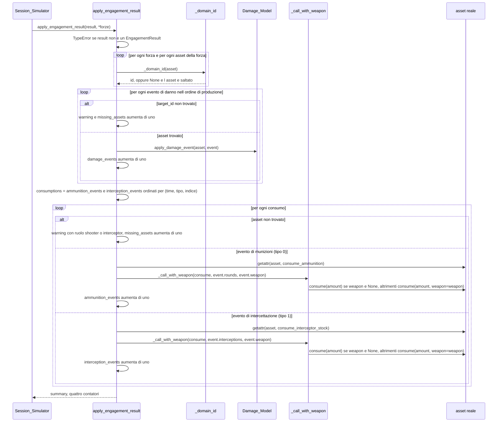

Lettura: `apply_engagement_result` (`:3794`) è il solo punto in cui l'esito tocca gli asset veri; in sessione la chiama `engage` dopo ogni `resolve_engagement` (`Logic/Session_Simulator.py:2790`, con `*component`) e `fire_area` dopo ogni fuoco su posizione (`:2486`, con `*blocks.values()`: D50). L'indice degli asset è costruito
con `_domain_id` su tutte le forze passate (`:3814-3821`). I **danni** si applicano per primi e nell'ordine in cui la run li ha prodotti (`:3825-3834`), perché i `health_before`/`health_after` sono concatenati. I **consumi** si ordinano per `(time, tipo, indice)` (`:3843-3845`): a parità d'istante i lanci (tipo 0) precedono le intercettazioni (tipo 1),
come nella coda (`_LAUNCH` < `_RESOLVE`), per lasciare sull'asset lo stato che l'ombra ha descritto (commento a `:3836-3842`). `_call_with_weapon` (`:3782`) esiste per gli asset duck-typed con la firma precedente al 2026-09-26: senza arma si chiama `consume(amount)`, con arma `consume(amount, weapon=weapon)`.
**Fatto da non fraintendere**: i contatori `ammunition_events` e `interception_events` del riepilogo aumentano anche se l'asset non ha un `consume_ammunition`/`consume_interceptor_stock` chiamabile (`:3859-3862`, `:3867-3870`): contano gli eventi elaborati, non i consumi effettivamente eseguiti. Un asset non trovato non è un errore:
è un warning e `missing_assets` (`:3828-3831`, `:3850-3854`). Rimando a **D9** (applicazione dell'esito) e **D13** (scorta per arma).

### Che cosa il core importa da `Engagement_Resolver`, e chi (D87)

*Diagramma D87 — i nomi di `Engagement_Resolver` usati dal resto del core e i moduli che li usano; l'arco è «usa il nome» (livello L2, verificato a f009eb43).*

```mermaid
flowchart LR
    SS["Session_Simulator"]
    MA["Mission_Adapter"]
    AF["Area_Fire"]
    FCO["Fire_Control"]
    ST["Session_Types"]
    ARM["Air_Route_Manager<br/>fuori dal core"]

    API["funzioni<br/>resolve_engagement<br/>apply_engagement_result<br/>accepts_target_grounded<br/>detection_probability"]
    TIP["tipi<br/>EngagementResult, ForceOutcome<br/>AmmunitionEvent, InterceptionEvent<br/>ActivityCriteria, TargetRules, ShotSpec"]
    COS["costanti<br/>ACTIVITY_TARGET_DESTROYED, DISENGAGED<br/>ROE_WEAPON_FREE, ROE_PRIORITY_DESIGNATED"]

    SS -->|"chiama"| API
    SS -->|"costruisce e legge"| TIP
    SS -->|"confronta"| COS
    MA -->|"costruisce TargetRules"| TIP
    MA -->|"confronta"| COS
    AF -->|"costruisce un EngagementResult"| TIP
    FCO -->|"chiama"| API
    FCO -->|"costruisce ShotSpec"| TIP
    ST -->|"importa quattro tipi"| TIP
    ARM -->|"import locale"| API
```

Lettura: i cinque moduli del core che importano il risolutore sono `Session_Simulator` (`:771`), `Mission_Adapter` (`:332`), `Area_Fire` (`:77`), `Fire_Control` (`:206-207`) e `Command/Session_Types` (`:63-68`); `Air_Route_Manager` (`:1095`) è **fuori dal core**. Nessun altro modulo del core lo importa (`grep` sui sorgenti non di test: gli altri, come `Fuel_Model`, `Contact_Scheduler`, `Damage_Model`, `Session_Rng`, `Mission_Types`, lo nominano al più in commenti e docstring). Dettaglio per modulo: `Session_Simulator` chiama `ER.resolve_engagement` (`:2765`) e `ER.apply_engagement_result` (`:2486`, `:2790`), costruisce `ER.ActivityCriteria` (`:1867`, `:2722`, `:2738`), annota con `ER.EngagementResult`
(`:1327`, `:1344`, `:2408`, `:2411`), confronta con `ER.DISENGAGED` (`:2551`, `:2807`) e `ER.ACTIVITY_TARGET_DESTROYED` (`:1903`); `Mission_Adapter` costruisce `ER.TargetRules` (`:1995`) e confronta con `ER.ROE_WEAPON_FREE`/`ER.ROE_PRIORITY_DESIGNATED` (`:1985`, `:1998`); `Area_Fire.resolve_area_fire` costruisce **a mano** un `ER.AmmunitionEvent` e un `ER.EngagementResult` (`:311`, `:314`) senza passare dal risolutore,
così che `apply_engagement_result` e il resto della sessione trattino il fuoco su posizione come un ingaggio (D50); `Fire_Control` costruisce `ShotSpec` (`:786`) e chiama `ER.accepts_target_grounded` (`:971`); `Session_Types` importa `AmmunitionEvent`, `EngagementResult`, `ForceOutcome`, `InterceptionEvent` per aggregarli in `SessionOutcome`. `Fire_Control`, `Area_Fire` e `Session_Simulator` ripetono in locale il criterio di `_domain_id`
(`_asset_id` in `Fire_Control.py:1080` e `Area_Fire.py:318`, `_domain_id` in `Session_Simulator.py:974`) invece di importarlo: i loro docstring dichiarano «stesso criterio», non è verificato qui che il corpo sia identico. Per il grafo completo degli import del core v. **D58** e **D59**.

### Tabella completa dei simboli di `Logic/Engagement_Resolver`

Colonne «Tipo», «Simbolo», «Firma» e «Riga» da `inventario.py --tabella Logic/Engagement_Resolver` (127 righe, nell'ordine dello strumento: prima classi e metodi, poi le funzioni di primo livello, ciascuna sezione in ordine di riga); «Gruppo»: per le funzioni e i tipi di modulo il codice di D77 (**A** API pubblica, **T** tipi di scambio, **B** regole di bersaglio pure, **P** probabilità di rilevamento,
**F** fabbriche del fattore, **G** ponti, **S** stato di lavoro), per i metodi di `_EngagementRun` il codice **R1-R12** di D79/D80 (la classe stessa è «run»); «Chiamata da»: chiamanti dentro il modulo (estrazione `ast` dei nomi chiamati, verificata caso per caso; i metodi della run sono indicati col solo nome) e nel core (`SS` = `Session_Simulator`, `MA` = `Mission_Adapter`, `AF` = `Area_Fire`, `FCO` = `Fire_Control`, `ST` = `Session_Types`, `ARM` = `Air_Route_Manager`, fuori dal core); «implicito» = chiamato dal costruttore o da una proprietà, non da una chiamata esplicita.

| Gruppo | Tipo | Simbolo | Firma | Riga | Che cosa fa | Chiamata da |
|---|---|---|---|---|---|---|
| T | classe | `ShotSpec` | `ShotSpec`; campi: accuracy, destroy_capacity, rounds, weapon, time_of_flight, interceptable, cycle_time, max_range, stock_per_round | `:550` | Che cosa spara un tiratore contro un bersaglio (accuracy e destroy_capacity, colpi, arma, volo, portata, unità di scorta per colpo): è la risposta della fire control. | `FCO:shot_spec_for` (costruttore); letta da `_first_with_stock`, `_options`, `_refire_interval` |
| T | metodo | `ShotSpec.__post_init__` | `__post_init__(self)` | `:582` | Valida i campi (tipi e intervalli) e solleva `TypeError`/`ValueError`. | implicito alla costruzione |
| T | classe | `Detection` | `Detection`; campi: observer_id, target_id, sensor_range, distance_cpa, probability, draw, detected, time | `:615` | Esito di un'estrazione di rilevamento (una per finestra e direzione). | `_detect_direction` (costruttore) |
| T | classe | `Salvo` | `Salvo`; campi: salvo_id, t_launch, t_impact, shooter_id, target_id, target_force_id, rounds, spec | `:632` | Una salva lanciata, a payload congelato. | `_on_launch` (costruttore) |
| T | classe | `SalvoResolution` | `SalvoResolution`; campi: time, force_id, salvo_ids, rounds, interceptable_rounds, capacity, intercepted, wasted, losses, shock, erosion | `:654` | Un evento-salva risolto contro una forza: unità di saturazione e di shock. | `_on_resolve` (costruttore) |
| T | classe | `AmmunitionEvent` | `AmmunitionEvent`; campi: time, asset_id, rounds, weapon | `:684` | Consumo esplicito di munizioni offensive (unità di scorta). | `_on_launch`, `AF:resolve_area_fire` (costruttore); `ST` (import) |
| T | classe | `InterceptionEvent` | `InterceptionEvent`; campi: time, asset_id, interceptions, force_id, salvo_ids, weapon | `:708` | Intercettazioni effettuate da un intercettore, uno per arma. | `_on_resolve` (costruttore); `ST` (import) |
| T | classe | `ActivityCriteria` | `ActivityCriteria`; campi: winchester_weapons, damage_threshold, target_ids, destroyed_targets, until, reference_health | `:742` | Criteri di fine di attività di un asset, nella forma del risolutore (F6-B1). | `SS:_activity_criteria` (costruttore); letta da `_check_activity`, `_targets_destroyed_at`, `_activity_end_time` |
| T | classe | `ActivityEnd` | `ActivityEnd`; campi: time, asset_id, reason | `:780` | Fine di attività scattata nella run. | `_end_activity` (costruttore) |
| T | classe | `TargetRules` | `TargetRules`; campi: roe, designated_ids, designated_area, designated_weapons, air_self_defence, known_hostile_ids, attack_point, known_destroyed_ids | `:803` | Regole di bersaglio di un asset tiratore (F7a). | `MA:target_rules` (costruttore, `:1995`); lette da `_is_deferred`, `_fire_control` e altri metodi del gruppo R7 |
| T | metodo | `TargetRules.__post_init__` | `__post_init__(self)` | `:836` | Valida `roe`, normalizza gli insiemi di id e verifica `attack_point` e `designated_area`. | implicito alla costruzione |
| T | classe | `ForceOutcome` | `ForceOutcome`; campi: force_id, side, outcome, time, triggers, committed, lost, erosion, max_shock, temper, breakpoint, morale, force_ratio, unanswered_fraction, block_id | `:928` | Esito di una forza: HELD, DISENGAGED o DESTROYED, con i motivi e le grandezze di dottrina. | `_result` (costruttore); `ST` (import) |
| T | classe | `EngagementResult` | `EngagementResult`; campi: t_start, t_end, forces, detections, salvos, resolutions, damage_events, ammunition_events, interception_events, activity_ends | `:967` | Esito completo e immutabile di un ingaggio. | `_result` (costruttore); `AF:resolve_area_fire` (costruttore); `SS` (tipo e lettura); `ST` (import) |
| T | metodo | `EngagementResult.outcome_of` | `outcome_of(self, force_id)` | `:986` | L'esito della forza `force_id`, `None` se non partecipa. | nessun chiamante nel core (solo test) |
| T | metodo | `EngagementResult.ammunition_consumed` | `ammunition_consumed(self)` | `:994` | Unità di scorta spese offensivamente per asset (solo le salve). | nessun chiamante nel core su `EngagementResult` (solo test); `Readiness.py:191` chiama il metodo omonimo di `SessionOutcome` |
| T | metodo | `EngagementResult.ammunition_consumed_by_weapon` | `ammunition_consumed_by_weapon(self)` | `:1009` | Come `ammunition_consumed`, ripartito per arma: `{asset: {arma: unità}}`. | nessun chiamante nel core su `EngagementResult` (solo test); esiste un metodo omonimo in `SessionOutcome` (`Session_Types.py:494`) |
| T | metodo | `EngagementResult.interceptions_consumed` | `interceptions_consumed(self)` | `:1019` | Intercettazioni effettuate per asset. | nessun chiamante nel core su `EngagementResult` (solo test); `Readiness.py:192` chiama il metodo omonimo di `SessionOutcome` |
| S | classe | `_Shadow` | `_Shadow`; campi: __slots__ | `:1409` | Copia di lavoro di un asset impegnato: salute e scorte evolvono qui, non sull'asset. | `_shadow_of` (costruttore) |
| S | metodo | `_Shadow.__init__` | `__init__(self, asset_id, asset, force_id, health, ammunition, interceptor_stock, stores, unmodelled, interceptor_weapons)` | `:1427` | Copia le scorte per arma (o i pool anonimi) e prepara la vista degli intercettori. | `_shadow_of` |
| S | metodo | `_Shadow.ammunition` | `ammunition(self)` | `:1442` | Proprietà: scorta totale (vista, come `Mobile.ammunition`). | implicito (proprietà) |
| S | metodo | `_Shadow.available` | `available(self, weapon)` | `:1446` | Unità spendibili da `weapon`, `None` = nessun vincolo. | `_first_with_stock`, `_on_launch` |
| S | metodo | `_Shadow.has_stock` | `has_stock(self)` | `:1450` | Esiste almeno un'arma con scorta (le armi non modellate non hanno vincolo). | `_schedule_next` |
| S | metodo | `_Shadow.consume` | `consume(self, weapon, units)` | `:1453` | Consuma `units` di scorta dalla voce dell'arma (o dall'aggregato) e ritorna il consumato. | `_on_launch` |
| S | metodo | `_Shadow.interceptor_stock` | `interceptor_stock(self)` | `:1459` | Proprietà: scorta di intercettori (vista sulle voci AD o pool anonimo). | `_on_resolve` (proprietà) |
| S | metodo | `_Shadow.consume_interceptions` | `consume_interceptions(self, amount)` | `:1462` | Consuma `amount` intercettazioni e ritorna la ripartizione `[(arma, n)]`. | `_on_resolve` |
| S | metodo | `_Shadow.operative` | `operative(self)` | `:1477` | Proprietà: la salute supera `OPERATIVE_HEALTH_FLOOR`. | molti metodi della run (`_build_forces`, `_schedule_next`, `_on_launch`, `_on_resolve`, `_result`, ...) |
| S | metodo | `_Shadow.destroyed` | `destroyed(self)` | `:1481` | Proprietà: la salute è sotto la soglia di distruzione di `Damage_Model`. | `_on_resolve`, `_check_activity`, `_designated_destroyed` |
| S | classe | `_Candidate` | `_Candidate`; campi: t_ready, target_id, t_end, exhausted, t_cpa, distance_cpa, not_before | `:1486` | Un bersaglio rilevato da un tiratore, ingaggiabile in `[t_ready, t_end]`. | `_detect_direction` (costruttore); modificata da `_schedule_next`, `_on_launch` |
| S | classe | `_ForceState` | `_ForceState`; campi: force_id, side, committed, thresholds, interceptors, outcome, time, triggers, max_shock, force, air, temper, temper_z, morale, enemy_estimate, stationary, loss_shooters, breakpoint, force_ratio, unanswered_fraction, fire, block_id | `:1503` | Stato di una forza nella run: impegnati, dottrina, esito e grandezze della soglia di rottura. | `_build_forces` (costruttore) |
| S | classe | `_PendingGroup` | `_PendingGroup`; campi: resolve_time, salvos | `:1532` | Salve che atterrano su una forza entro la finestra di salva, da risolvere insieme. | `_on_impact` (costruttore) |
| run | classe | `_EngagementRun` | `_EngagementRun`; campi: - | `:1642` | Stato e coda eventi di un ingaggio a due o più forze. | `resolve_engagement` (costruttore) |
| R1 | metodo | `_EngagementRun.__init__` | `__init__(self, forces, contacts, fire_control, rng, legs, committed, thresholds, reaction_profile_for, detection_factor, salvo_window, provenance, breakpoint_rng, morale_for, enemy_estimate_for, fire_doctrine, rwr_catalogue, coordination_of, grounded, activity_criteria, target_rules)` | `:1645` | Crea gli stati vuoti, costruisce forze e domini, inizializza le soglie di rottura e la fine di attività (D81). | `resolve_engagement` (costruttore) |
| R1 | metodo | `_EngagementRun._build_forces` | `_build_forces(self, forces, committed, thresholds)` | `:1771` | Ombre e `_ForceState` di ogni forza; `False` se meno di due forze hanno asset impegnabili. | `__init__` |
| R1 | metodo | `_EngagementRun._build_domains` | `_build_domains(self, coordination_of)` | `:1862` | Dominio di coordinamento di ogni forza e intercettori per dominio, in ordine della regola F. | `__init__` |
| R1 | metodo | `_EngagementRun._same_domain` | `_same_domain(self, force_a, force_b)` | `:1903` | Le due forze sono nello stesso dominio di coordinamento? | `_engaged_shooters`, `_force_shots_on`, `_register_launcher` |
| R1 | metodo | `_EngagementRun._shadow_of` | `_shadow_of(asset_id, asset, force_id, health)` | `:1907` | Metodo statico: stato ombra dalle scorte dell'asset, con letture difensive. | `_build_forces` |
| R1 | metodo | `_EngagementRun._interceptors_of` | `_interceptors_of(self, force, force_id)` | `:1934` | Lista `[(ombra, canali)]` degli intercettori della forza, esclusi gli aerei sempre a terra. | `_build_forces` |
| R1 | metodo | `_EngagementRun._profile` | `_profile(self, shooter_id)` | `:1957` | Profilo di reazione del tiratore, memoizzato. | `_detect_direction`, `_in_time`, `_react_to_hostile`, `_refire_interval`, `_register_launcher` |
| R2 | metodo | `_EngagementRun._detect` | `_detect(self)` | `:1965` | Una `_detect_direction` per direzione di ogni finestra, in ordine canonico. | `run` |
| R2 | metodo | `_EngagementRun._detect_direction` | `_detect_direction(self, window, observer, target, own_range, other_range)` | `:1986` | Una estrazione di rilevamento e, se rileva, percezione e candidato (D82). | `_detect` |
| R2 | metodo | `_EngagementRun._perceive` | `_perceive(self, force_id, asset_id, time)` | `:2033` | Il dominio della forza percepisce l'asset nemico dall'istante `time`. | `_detect_direction`, `_perceive_rwr` |
| R2 | metodo | `_EngagementRun._perceive_rwr` | `_perceive_rwr(self, aircraft, emitter, time)` | `:2039` | Percezione dell'emettitore da parte dell'RWR dell'aereo, con la classe dell'emettitore (R-CLS). | `_detect_direction`, `_on_launch` |
| R11 | metodo | `_EngagementRun._air_threat` | `_air_threat(self, state, shadow, time, n_aircraft)` | `:2048` | Peso di un nemico percepito da una forza aerea (R-CLS). | `_perceived_ratio` |
| R2 | metodo | `_EngagementRun._detection_time` | `_detection_time(self, window, observer_id, target_id, own_range, other_range, radius)` | `:2081` | Istante del rilevamento dentro la finestra. | `_detect_direction` |
| R3 | metodo | `_EngagementRun._push` | `_push(self, time, kind, key, payload)` | `:2111` | Accoda un evento `(time, kind, key, sequence, payload)`. | `_on_impact`, `_on_launch`, `_react_to_hostile`, `_register_launcher`, `_schedule_next`, `_schedule_phase_wakes`, `_wait`, `_wake_after_destruction` |
| R3 | metodo | `_EngagementRun._draw` | `_draw(self)` | `:2115` | Una estrazione dell'`rng` di sessione, validata in `[0, 1)`. | `_detect_direction`, `_on_resolve` |
| R3 | metodo | `_EngagementRun._touch` | `_touch(self, time)` | `:2123` | Aggiorna `t_end` al massimo istante visto. | `_on_launch`, `_on_resolve` |
| R12 | metodo | `_EngagementRun._activity_end_time` | `_activity_end_time(self, asset_id)` | `:2128` | Istante dal quale l'asset non lancia più, `None` se nessuno. | `_on_launch`, `_schedule_next` |
| R12 | metodo | `_EngagementRun._targets_destroyed_at` | `_targets_destroyed_at(self, criteria)` | `:2142` | Istante in cui tutti i bersagli del criterio sono distrutti, `None` se qualcuno no. | `_check_activity` |
| R12 | metodo | `_EngagementRun._check_activity` | `_check_activity(self, time, targets_only)` | `:2158` | Verifica i criteri di fine di attività (danno, winchester, bersagli distrutti) e registra quelli scattati. | `__init__`, `_on_launch`, `_on_resolve` |
| R12 | metodo | `_EngagementRun._end_activity` | `_end_activity(self, time, asset_id, reason)` | `:2194` | Registra la fine di attività e annulla il lancio programmato se è già in vigore. | `_check_activity` |
| R5 | metodo | `_EngagementRun._engaged_shooters` | `_engaged_shooters(self, target_id, force_id, exclude)` | `:2209` | Quanti altri tiratori del dominio sono impegnati ora su `target_id`. | `_schedule_next` |
| R4 | metodo | `_EngagementRun._schedule_next` | `_schedule_next(self, shooter_id, t_earliest)` | `:2230` | Decide il prossimo lancio del tiratore e lo accoda con payload congelato (D83). | `run`, `_on_decide`, `_on_launch`, `_on_wake` |
| R5 | metodo | `_EngagementRun._force_shots_on` | `_force_shots_on(self, target_id, force_id)` | `:2423` | Generatore delle salve del dominio dirette a `target_id`: in volo o schedulate. | `_coverage`, `_wait` |
| R5 | metodo | `_EngagementRun._coverage` | `_coverage(self, target_id, force_id)` | `:2443` | Probabilità che le salve già dirette dal dominio distruggano il bersaglio. | `_blocked` |
| R5 | metodo | `_EngagementRun._rounds_in_flight` | `_rounds_in_flight(self, shooter_id, target_id)` | `:2456` | Colpi in volo del tiratore contro il bersaglio. | `_blocked` |
| R5 | metodo | `_EngagementRun._blocked` | `_blocked(self, shooter, target_id, exempt_from_saturation)` | `:2460` | Il tiratore non deve aggiungere salve (tetto o saturazione). | `_schedule_next` |
| R5 | metodo | `_EngagementRun._wait` | `_wait(self, shooter, pool, t_earliest)` | `:2475` | Tutti i bersagli bloccati: ridecisione al primo impatto previsto. | `_schedule_next` |
| R4 | metodo | `_EngagementRun._gone` | `_gone(self, target)` | `:2497` | Il bersaglio non è raggiungibile perché la sua forza ha rotto il contatto (salvo aerei a terra). | `_on_launch`, `_schedule_next` |
| R2 | metodo | `_EngagementRun._grounded_in` | `_grounded_in(self, asset_id, window)` | `:2506` | L'asset è a terra nella finestra (stato al punto medio). | `_detect_direction` |
| R7 | metodo | `_EngagementRun._is_designated` | `_is_designated(self, rules, target, time)` | `:2515` | Il bersaglio è designato dalla missione del tiratore a `time` (id o area). | `_designated_first`, `_fire_control`, `_is_deferred` |
| R7 | metodo | `_EngagementRun._is_hostile` | `_is_hostile(self, shooter, target_id)` | `:2532` | Il bersaglio ha già lanciato contro il dominio del tiratore (`return_fire`). | `_fire_control`, `_is_deferred` |
| R7 | metodo | `_EngagementRun._attack_pass_time` | `_attack_pass_time(self, shooter_id, rules)` | `:2538` | Istante in cui il tiratore ha raggiunto e superato il punto ATTACK, `None`; memoizzato. | `_attack_over`, `_schedule_phase_wakes` |
| R7 | metodo | `_EngagementRun._designated_destroyed` | `_designated_destroyed(self, rules)` | `:2565` | Tutti i bersagli designati per id sono distrutti. | `_attack_over`, `_wake_after_destruction` |
| R7 | metodo | `_EngagementRun._attack_over` | `_attack_over(self, shooter_id, rules, time)` | `:2578` | Fine dell'attacco di `priority_designated` a `time`. | `_fire_control`, `_is_deferred` |
| R7 | metodo | `_EngagementRun._is_deferred` | `_is_deferred(self, shooter, target, time)` | `:2587` | La regola di bersaglio esclude il bersaglio ora per una ragione che dipende dal tempo. | `_schedule_next` |
| R7 | metodo | `_EngagementRun._designated_first` | `_designated_first(self, shooter, viable)` | `:2602` | I candidati designati e a portata, solo con ROE `priority_designated`. | `_schedule_next` |
| R7 | metodo | `_EngagementRun._react_to_hostile` | `_react_to_hostile(self, time, launcher, target_force_id)` | `:2616` | Riesamina dopo il `refire_interval` i tiratori `return_fire` del dominio che hanno il nuovo ostile fra i candidati. | `_on_launch` |
| R7 | metodo | `_EngagementRun._schedule_phase_wakes` | `_schedule_phase_wakes(self)` | `:2640` | Risveglio dei tiratori `priority_designated` al passaggio sul punto ATTACK. | `run` |
| R7 | metodo | `_EngagementRun._wake_after_destruction` | `_wake_after_destruction(self, time)` | `:2654` | Dopo una risoluzione, risveglia una volta i tiratori il cui designato è distrutto. | `_on_resolve` |
| R7 | metodo | `_EngagementRun._on_wake` | `_on_wake(self, time, shooter_id)` | `:2665` | Riesame di un tiratore dopo un cambio di fase o un nuovo ostile. | `run` |
| R4 | metodo | `_EngagementRun._fire_control` | `_fire_control(self, shooter, target, time)` | `:2676` | La fire control sulla coppia, ristretta dalle regole di bersaglio del tiratore. | `_in_range_at`, `_schedule_next` |
| R4 | metodo | `_EngagementRun._call_fire_control` | `_call_fire_control(self, shooter, target, time)` | `:2691` | Chiama la fire control iniettata, con `target_grounded` per un aereo a terra (F4c). | `_fire_control` |
| R6 | metodo | `_EngagementRun._is_launcher_against` | `_is_launcher_against(self, asset_id, force_id)` | `:2719` | L'asset ha lanciato armi aria-superficie contro il dominio della forza (L2). | `_register_launcher`, `_schedule_next` |
| R6 | metodo | `_EngagementRun._in_range_at` | `_in_range_at(self, shooter, index, candidate, t_fire)` | `:2723` | Il candidato è ingaggiabile (arma con scorta, entro portata) a `t_fire`, senza effetti sul candidato. | `_designated_first`, `_register_launcher`, `_schedule_next` |
| R6 | metodo | `_EngagementRun._register_launcher` | `_register_launcher(self, time, launcher, target_force_id)` | `:2743` | Primo lancio aria-superficie di un aereo contro una forza: i difensori ridecidono dopo il `refire_interval` (L3). | `_on_launch` |
| R6 | metodo | `_EngagementRun._on_decide` | `_on_decide(self, time, shooter_id, generation)` | `:2795` | Fine della valutazione dopo una prelazione: nuova decisione con lo stato attuale. | `run` |
| R4 | metodo | `_EngagementRun._options` | `_options(result)` | `:2804` | Metodo statico: le opzioni di una risposta della fire control (`None`, una `ShotSpec` o una sequenza). | `_first_with_stock`, `apply_target_rules` |
| R4 | metodo | `_EngagementRun._first_with_stock` | `_first_with_stock(self, shooter, result)` | `:2822` | `(ShotSpec, colpi)` della prima opzione con scorta per almeno un colpo, o `None`. | `_in_range_at`, `_schedule_next` |
| R4 | metodo | `_EngagementRun._range_entry` | `_range_entry(self, shooter_id, candidate, max_range, t_from)` | `:2841` | Primo istante con il bersaglio entro la portata, o `None`; memoizzato. | `_in_range_at`, `_schedule_next` |
| R4 | metodo | `_EngagementRun._refire_interval` | `_refire_interval(self, shooter_id, spec)` | `:2876` | Intervallo fra due salve: `cycle_time` della `ShotSpec` o `refire_interval` del profilo. | `_on_launch` |
| R8 | metodo | `_EngagementRun._on_launch` | `_on_launch(self, time, shooter_id, payload)` | `:2879` | Esegue un lancio programmato: consumo, `Salvo`, evento d'impatto, reazioni (D84). | `run` |
| R8 | metodo | `_EngagementRun._on_impact` | `_on_impact(self, time, force_id, salvo)` | `:2974` | Raggruppa le salve che atterrano sulla forza entro la finestra e accoda la risoluzione. | `run` |
| R9 | metodo | `_EngagementRun._position_at` | `_position_at(self, shadow, t)` | `:2984` | Posizione `(x, y, z)` a `t`, dai tratti di rotta o dalla posizione dell'asset; `None` se ignota. | `_is_designated`, `_may_intercept`, `_round_track_time` |
| R9 | metodo | `_EngagementRun._interception_zone` | `_interception_zone(self, shadow)` | `:2999` | Zona d'intercettazione V_I come (raggio, quota base, quota tetto) relativi; memoizzata. | `_may_intercept` |
| R9 | metodo | `_EngagementRun._may_intercept` | `_may_intercept(self, shadow, salvo)` | `:3019` | Regola L1: il punto di lancio della salva è fuori dal V_I dell'intercettore. | `_on_resolve` |
| R9 | metodo | `_EngagementRun._detection_time_of` | `_detection_time_of(self, observer_id, target_id)` | `:3044` | Istante in cui l'osservatore ha rilevato il bersaglio, `None` se mai. | `_in_time` |
| R9 | metodo | `_EngagementRun._air_detection_range` | `_air_detection_range(self, shadow)` | `:3052` | Raggio di rilevamento aereo dell'intercettore [m]; memoizzato. | `_round_track_time` |
| R9 | metodo | `_EngagementRun._round_track_time` | `_round_track_time(self, shadow, salvo)` | `:3069` | Istante in cui l'intercettore scopre dalla geometria un colpo di cui non ha visto il lancio. | `_in_time` |
| R9 | metodo | `_EngagementRun._in_time` | `_in_time(self, shadow, salvo)` | `:3107` | Regola R-INT: l'intercettore ha traccia e tempo di reagire prima dell'impatto. | `_on_resolve` |
| R10 | metodo | `_EngagementRun._on_resolve` | `_on_resolve(self, time, force_id)` | `:3133` | Risolve un evento-salva: intercettazione, danno per colpo, dottrina (D85). | `run` |
| R11 | metodo | `_EngagementRun._check_doctrine` | `_check_doctrine(self, time, state, shock, erosion, operative_left, salvo_losses, withdrawable)` | `:3305` | Confronta le perdite con la dottrina del lato per la forza intera. | `_on_resolve` |
| R1 | metodo | `_EngagementRun._init_breakpoints` | `_init_breakpoints(self)` | `:3356` | Tempra, morale, stima a priori e postura di ogni forza con dottrina. | `__init__` |
| R11 | metodo | `_EngagementRun._morale_of` | `_morale_of(self, state)` | `:3393` | Morale della forza in `[0, 1]`, `None` se ignoto o fuori intervallo. | `_init_breakpoints` |
| R11 | metodo | `_EngagementRun._enemy_estimate_of` | `_enemy_estimate_of(self, state)` | `:3409` | Stima a priori della forza nemica, `None` se ignota o non valida. | `_init_breakpoints` |
| R11 | metodo | `_EngagementRun._stationary` | `_stationary(self, state)` | `:3425` | `True` se tutti gli asset con tratti sono fermi, `None` se nessuno ne ha. | `_init_breakpoints` |
| R11 | metodo | `_EngagementRun._is_enemy` | `_is_enemy(self, state, shadow)` | `:3443` | L'ombra è un nemico della forza (lato diverso o lato ignoto). | `_perceived_ratio` |
| R11 | metodo | `_EngagementRun._perceived_ratio` | `_perceived_ratio(self, time, state)` | `:3451` | Rapporto di forze percepito rho, `None` se non definito. | `_breakpoint` |
| R11 | metodo | `_EngagementRun._surface_weight` | `_surface_weight(self, shadow)` | `:3496` | Peso di minaccia di un asset di superficie, memoizzato. | `_perceived_ratio` |
| R11 | metodo | `_EngagementRun._unanswered_fraction` | `_unanswered_fraction(self, state)` | `:3505` | Quota delle perdite causate da tiratori non rilevati dal dominio. | `_breakpoint` |
| R11 | metodo | `_EngagementRun._breakpoint` | `_breakpoint(self, time, state)` | `:3516` | Soglia di rottura B(t) = logistica della mediana modulata, con la tempra della forza. | `_check_doctrine` |
| R3 | metodo | `_EngagementRun.run` | `run(self)` | `:3563` | Ciclo principale: rilevamento, prime decisioni, svuotamento della coda con dispatch per tipo. | `resolve_engagement` |
| R3 | metodo | `_EngagementRun._result` | `_result(self)` | `:3588` | Costruisce `ForceOutcome` ed `EngagementResult` dalle liste di esito. | `run` |
| B | funzione | `_id_set` | `_id_set(label, value)` | `:788` | `frozenset` di id (stringhe non vuote) da un iterabile. | `TargetRules.__post_init__` |
| B | funzione | `rules_defer` | `rules_defer(rules, designated, hostile, air_target, after_attack)` | `:872` | Funzione pura: la regola esclude il bersaglio per una ragione che dipende dal tempo. | `_is_deferred`, `apply_target_rules` |
| B | funzione | `apply_target_rules` | `apply_target_rules(rules, result, designated, hostile, air_target, after_attack)` | `:885` | Funzione pura: la risposta della fire control ristretta dalle regole di un tiratore. | `_fire_control` |
| P | funzione | `_check_factor` | `_check_factor(factor)` | `:1031` | Valida un fattore di rilevamento in `[0, 1]`. | `_detect_direction`, `detection_probability`, `detection_radius`, `recon_detection_factor_fn`, `recon_unseen_factor` |
| P | funzione | `detection_probability` | `detection_probability(distance, sensor_range, factor)` | `:1041` | Pd di un sensore contro un bersaglio a `distance`: legge di quarta potenza, stima dichiarata. | `_detect_direction`; `ARM` (import locale, `Air_Route_Manager.py:1095`) |
| P | funzione | `detection_radius` | `detection_radius(draw, sensor_range, factor)` | `:1071` | Inversa di `detection_probability`: raggio al quale l'estrazione produce il rilevamento. | `_detect_direction` |
| F | funzione | `weather_detection_factor` | `weather_detection_factor(conditions)` | `:1105` | Fattore di degradazione della Pd da notte e meteo avverso. | `weather_detection_factor_fn` |
| F | funzione | `weather_detection_factor_fn` | `weather_detection_factor_fn(conditions)` | `:1155` | La callable `(observer, target) -> float` per le condizioni meteo date. | `meteo_detection_factor` |
| F | funzione | `meteo_detection_factor` | `meteo_detection_factor(region_name, date, time)` | `:1172` | Come la precedente, leggendo le condizioni da `Meteo_Analysis`. | nessun chiamante nel core (v. D78) |
| F | funzione | `_block_attribute` | `_block_attribute(asset, name)` | `:1196` | `asset.block.<name>`, `None` se l'asset non ha blocco o il blocco non ha l'attributo. | `recon_detection_factor_fn` (funzione interna `detection_factor`, `:1238`, `:1241`, `:1244`) |
| F | funzione | `_check_side` | `_check_side(side)` | `:1202` | Valida un lato fra `Blue`, `Red`, `Neutral`. | `recon_detection_factor_fn`, `region_recon_detection_factor` |
| F | funzione | `recon_detection_factor_fn` | `recon_detection_factor_fn(seen_block_ids, observer_side, unseen_factor, seen_factor)` | `:1209` | La callable della nebbia di guerra di un lato, dall'istantanea dei blocchi visti. | `region_recon_detection_factor` |
| F | funzione | `combine_detection_factors` | `combine_detection_factors(*fns)` | `:1249` | Una sola callable dal prodotto di più fattori. | nessun chiamante nel core (v. D78) |
| F | funzione | `recon_unseen_factor` | `recon_unseen_factor(recon_efficiency, unseen_factor, seen_factor, relief)` | `:1286` | Fattore dei bersagli non visti, modulato dall'efficienza di ricognizione. | `region_recon_detection_factor` |
| F | funzione | `side_recon_efficiency` | `side_recon_efficiency(region, side)` | `:1318` | Efficienza di ricognizione di un lato in una regione: il massimo fra le sue `Military`. | `region_recon_detection_factor` |
| F | funzione | `region_recon_detection_factor` | `region_recon_detection_factor(region, observer_side, unseen_factor, seen_factor, relief)` | `:1359` | `recon_detection_factor_fn` per un lato, dall'istantanea di ricognizione della regione. | nessun chiamante nel core (v. D78) |
| S | funzione | `_domain_id` | `_domain_id(obj)` | `:1537` | Identificativo di dominio di un asset o di una forza (`id`, poi `name`). | `_build_forces`, `_interceptors_of`, `apply_engagement_result` |
| S | funzione | `_can_disengage` | `_can_disengage(force)` | `:1548` | La forza ha diritto a una politica di disingaggio (`Military` sì, `Block` non militare no). | `_build_forces` |
| G | funzione | `accepts_target_grounded` | `accepts_target_grounded(fire_control)` | `:1575` | La fire control accetta la keyword `target_grounded` (o `**kwargs`), per introspezione della firma. | `_call_fire_control`; `FCO:restrict_by_policy` |
| G | funzione | `engagement_intervals` | `engagement_intervals(legs_shooter, legs_target, max_range)` | `:1611` | Intervalli in cui il bersaglio è nella sfera di raggio `max_range` (delega a `range_intervals`). | `_range_entry` (via `self.engagement_intervals`, assegnato in `__init__`) |
| G | funzione | `engagement_intervals_without_legs` | `engagement_intervals_without_legs(t_cpa, distance_cpa, t_end, max_range)` | `:1621` | Ripiego senza tratti di rotta: dal solo CPA. | `_range_entry` |
| A | funzione | `resolve_engagement` | `resolve_engagement(force_a, force_b, contacts, fire_control, rng, extra_forces, legs, committed, thresholds, reaction_profile_for, detection_factor, salvo_window, provenance, breakpoint_rng, morale_for, enemy_estimate_for, fire_doctrine, rwr_catalogue, coordination_of, grounded, activity_criteria, target_rules)` | `:3619` | Risolve un ingaggio fra due o più forze in un'unica timeline, senza mutare asset (D81). | `SS:run_session` (funzione interna `engage`, `:2765`) |
| A | funzione | `_call_with_weapon` | `_call_with_weapon(consume, amount, weapon)` | `:3782` | `consume(amount, weapon=weapon)`, o la chiamata storica `consume(amount)` senza arma. | `apply_engagement_result` |
| A | funzione | `apply_engagement_result` | `apply_engagement_result(result, *forces)` | `:3794` | Applica danni e consumi di un esito agli asset reali e ritorna un riepilogo (D86). | `SS:run_session` (funzioni interne `engage` `:2790`, `fire_area` `:2486`) |

### Limiti e domande

- **Tre accessori di `EngagementResult` duplicati in `SessionOutcome`** *(esito 2026-10-30: lasciati, nessuna azione)*. `ammunition_consumed`, `ammunition_consumed_by_weapon` e `interceptions_consumed` hanno lo stesso corpo in `EngagementResult` (`Engagement_Resolver.py:994`, `:1009`, `:1019`) e in `SessionOutcome` (`Command/Session_Types.py:478`, `:494`, `:509`); nel core si usano
  solo quelli di `SessionOutcome` (`Logic/Readiness.py:191-192`), quelli di `EngagementResult` hanno chiamanti solo nei test. Non è un errore di comportamento, ma due punti da tenere allineati. Non verificato se sia voluto.
- **Contatori di `apply_engagement_result`** *(esito 2026-10-30: docstring corretta in `191b7d37`, il codice non cambia)*. I contatori `ammunition_events` e `interception_events` del riepilogo contano gli eventi elaborati anche se l'asset non ha il metodo di consumo chiamabile (`:3859-3862`, `:3867-3870`); chi legge il riepilogo come «consumi eseguiti» sbaglia. Riportato come fatto del codice, non come difetto.
- **`_domain_id` ripetuto.** Almeno tre moduli del core ripetono il criterio di `_domain_id` invece di importarlo (D87); i docstring dichiarano l'equivalenza, il corpo non è stato confrontato riga per riga.
- **Ordine dei simboli nella tabella.** Lo strumento stampa prima classi e metodi, poi le funzioni di primo livello: l'ordine di lettura del file (ad esempio `_id_set` `:788` prima di `TargetRules`) non coincide con quello della tabella.

**Righe dopo `191b7d37`.** I `:riga` di questa parte sono quelli di `f009eb43`. Il commit `191b7d37` (solo docstring, commenti, un import e un parametro inutilizzati) sposta in avanti di 3-4 righe i simboli che stanno dopo il punto toccato in `Fuel_Model.py` (da `:933`), `Engagement_Resolver.py` (da `:3807`), `Damage_Model.py` (da `:162`) e `Mission_Types.py` (da `:1004`); in `Session_Validator.py` le righe non cambiano.
