# Capitolo 10, parte B — Atlante dei diagrammi: missione, carburante e fuoco su posizione

Questo file è la **parte B** del capitolo 10 (l'atlante dei diagrammi). Il pilota, con la scala dei livelli L0-L4, le convenzioni e i diagrammi D57-D66, è in
[`11_Atlante_Diagrammi.md`](11_Atlante_Diagrammi.md); la parte A (D67-D87: `Contact_Scheduler`, `Fire_Control`, `Engagement_Resolver`) è in
[`11a_Atlante_Risolutore.md`](11a_Atlante_Risolutore.md). Qui non si ripete la scala: si **estende** il livello L2 (tipi e API pubblica, con la tabella completa dei simboli) e il livello L3 (sequenze di chiamata)
a tre moduli che nel pilota erano «parziali»: `Command/Mission_Types`, `Logic/Fuel_Model` e `Logic/Area_Fire`. I diagrammi nuovi sono **D90-D109** (l'intervallo assegnato a questa parte; D88 e D89 non sono usati in questo file).
I diagrammi D1-D87 non sono toccati: dove una regola ha già il suo diagramma (livello L4) il nuovo diagramma rimanda a quello e non lo duplica.

**Come leggere.** I riferimenti sono `percorso:riga`, **relativi a `Code/Dynamic_War_Manager/Source/`**, come nel resto del manuale; una riga senza percorso (`:1379`) è del modulo di cui si sta parlando.
Nei diagrammi di sequenza `X->>X` è la chiamata a una funzione privata dello stesso modulo; nei diagrammi di funzioni per ruolo (flowchart) una freccia `A --> B` significa «le funzioni di `A`
**chiamano** funzioni di `B`» (non «i dati vanno da `A` a `B`»). Le didascalie hanno la forma `*Diagramma Dnn — ... (livello Lx, verificato a f009eb43).*`.
Nei messaggi delle sequenze la lettera «è» è scritta «e» e gli apostrofi sono omessi: è una cautela di sintassi, non un refuso.

**Come sono stati verificati.** Codice a `f009eb43` (ultimo commit che tocca il codice sotto `Code/`; `git diff f009eb43 HEAD -- Code/` mostra solo `Test/baseline/scenario_baseline.json`, nessun sorgente cambia;
i tre moduli di questa parte non cambiano dal commit `b19ab151`). Elenchi di classi, campi, metodi e funzioni con `_strumenti/inventario.py --tabella` (estrazione con `ast`, sola lettura);
chiamanti **dentro il modulo** e **nel core** con una seconda estrazione `ast` dei nomi usati (scritta per questo capitolo, non è nello strumento: legge i soli sorgenti sotto `Source/`, esclusi i test);
ordine delle chiamate nelle sequenze **letto nel codice, riga per riga**, perché l'estrazione non dice in quale ramo si chiama. Nessun test eseguito: nessun codice è stato toccato.
Una precisazione sui conteggi: «simboli» sono le righe dati della tabella di `inventario.py` (classi, metodi e funzioni di primo livello; le costanti di modulo e le funzioni locali non ci sono e sono citate a parte nel testo).

## 10B.1 I diagrammi di questa parte

| Dnn | Livello | Tipo | Titolo | Modulo | Sezione | Si collega a |
|---|---|---|---|---|---|---|
| D90 | L2 | `classDiagram` | Le tredici enumerazioni della Missione con tutti i membri | `Mission_Types` | 10B.2 | D16, D17, D18 |
| D91 | L2 | `classDiagram` | Gli elementi della Missione con tutti i membri (`Target`, `StartCondition`, `MissionAction`, `MissionWaypoint`, `MissionAsset`) | `Mission_Types` | 10B.2 | D16, D47 |
| D92 | L2 | `classDiagram` | La Missione e l'Operazione con tutti i membri (`Mission`, `MissionRules`, `EndCriteria`, `Operation`) | `Mission_Types` | 10B.2 | D16, D18 |
| D93 | L2 | `classDiagram` | Gli esiti con tutti i membri (`AssetMissionOutcome`, `MissionOutcome`, `OperationOutcome`) | `Mission_Types` | 10B.2 | D17, D51 |
| D94 | L2 | `flowchart TD` | Le funzioni di `Mission_Types` per ruolo e le dipendenze fra i gruppi | `Mission_Types` | 10B.2 | D58, D59 |
| D95 | L3 | `sequenceDiagram` | `Mission.__post_init__`: l'ordine delle validazioni alla costruzione | `Mission_Types` | 10B.2 | D16, D29 |
| D96 | L3 | `sequenceDiagram` | Dalla costruzione della Missione alla porta di sessione: `SessionOrder`, `_check_missions`, `validate_session` | `Mission_Types` | 10B.2 | D2, D52, D64 |
| D97 | L3 | `sequenceDiagram` | Dagli esiti per asset all'esito di sessione: `_mission_outcome`, `operation_outcome`, `assemble_session_outcome` | `Mission_Types` | 10B.2 | D19, D41, D66 |

| D98 | L2 | `classDiagram` | I tipi di `Fuel_Model` con tutti i membri, compresi `_Step` e `_Segment` | `Fuel_Model` | 10B.3 | D39 |
| D99 | L2 | `flowchart TD` | Le funzioni di `Fuel_Model` per ruolo e le dipendenze fra i gruppi | `Fuel_Model` | 10B.3 | D38, D58 |
| D100 | L3 | `sequenceDiagram` | Il consumo di un tratto: `build_leg_fuel_event`, `build_fuel_event`, `apply_fuel_event` | `Fuel_Model` | 10B.3 | D40, D66 |
| D101 | L3 | `sequenceDiagram` | Esaurimento e residuo analitico: `fuel_exhaustion` e `fuel_at` | `Fuel_Model` | 10B.3 | D40, D42 |
| D102 | L3 | `sequenceDiagram` | La riserva di disimpegno e il consumo in ingaggio: `build_engagement_fuel_event` | `Fuel_Model` | 10B.3 | D40, D66 |
| D103 | L3 | `sequenceDiagram` | Il punto di bingo: `bingo_point` nelle regole F6-B2bis e F6-B2 | `Fuel_Model` | 10B.3 | D38, D42 |
| D104 | L3 | `sequenceDiagram` | L'albero di decisione al bingo: l'ordine delle chiamate di `bingo_decision` | `Fuel_Model` | 10B.3 | D38, D40 |
| D105 | L2 | `flowchart LR` | Che cosa il core importa da `Fuel_Model`, e chi | `Fuel_Model` | 10B.3 | D58, D59 |
| D106 | L2 | `classDiagram` | `FireOrder` e `_Hit` con tutti i membri e i tipi esterni | `Area_Fire` | 10B.4 | D47, D71 |
| D107 | L2 | `flowchart TD` | Le funzioni di `Area_Fire` per ruolo e le dipendenze | `Area_Fire` | 10B.4 | D58, D59 |
| D108 | L3 | `sequenceDiagram` | Gli ordini di fuoco: `fire_orders`, `plan_shot` senza scorta, `impact_time` | `Area_Fire` | 10B.4 | D50, D75 |
| D109 | L3 | `sequenceDiagram` | `resolve_area_fire`: ordine delle chiamate e delle estrazioni | `Area_Fire` | 10B.4 | D49, D50, D75 |

Conteggio: **L2** = D90, D91, D92, D93, D94, D98, D99, D105, D106, D107 (10); **L3** = D95, D96, D97, D100, D101, D102, D103, D104, D108, D109 (10); totale **20** (D90-D109, senza buchi né duplicati).

Per modulo: `Mission_Types` D90-D97 (8: 5 L2, 3 L3); `Fuel_Model` D98-D105 (8: 3 L2, 5 L3); `Area_Fire` D106-D109 (4: 2 L2, 2 L3). I simboli sono in totale 64 + 58 + 11 = **133**, tutti nelle tabelle di fine sezione.

Diagrammi già esistenti, **non duplicati**: per la Missione D16 e D17 (i tipi in ingresso e in uscita, che D91-D93 estendono con tutti i membri), D18 (i due assi), D19 (la regola d'esito), D29 (le fasi); per il carburante D38 (l'albero di decisione al bingo),
D39 (cinque tipi), D40 (ciclo episodio, ri-pianificazione, carburante), D41 (ciclo di vita dell'aereo), D42 (composizione dei tratti), D66 (passo finale del carburante); per il fuoco su posizione D47 (tipi della F7), D49 (la regola), D50 (la coda di sessione), D75 (l'arma, dentro `Fire_Control`).
I nuovi D95-D97, D100-D104, D108-D109 mostrano **dentro** o **fra** queste scatole l'ordine delle chiamate; non ripetono mai i rami di una regola già disegnata.

## 10B.2 L2 e L3 — `Command/Mission_Types` (1387 righe, 64 simboli)

Il modulo è il **vocabolario di dominio della Missione**: solo tipi immutabili e validazione strutturale, nessun calcolo (docstring del modulo, «Cosa NON c'è»). È una foglia dei moduli del core (non importa nessun modulo di
`Logic`: lo dichiara il docstring `:53-55` e lo conferma D58; importa `Attack_Types.AttackProfile`, `Context` per `MILITARY_FORCES`, `MISSION_TYPES`, `Mission_Category`, `mission_category_of`, `DataType.Route` e `DataType.Waypoint`, `:67-76`).
Contiene **13 enumerazioni** (`:91-199`), **12 dataclass** `frozen=True` (`Target` `:455`, `StartCondition` `:568`, `MissionAction` `:609`, `MissionWaypoint` `:667`, `MissionAsset` `:725`, `EndCriteria` `:795`,
`MissionRules` `:876`, `Mission` `:923`, `Operation` `:1193`, `AssetMissionOutcome` `:1239`, `MissionOutcome` `:1286`, `OperationOutcome` `:1355`), **12 funzioni di primo livello private** (undici validatori di campo e `_domain_id`) e due pubbliche
(`route_waypoints` `:433`, `check_mission_assets` `:1160`), 25 metodi (64 = 13 + 12 + 14 + 25). Nessun campo è modificabile dopo la costruzione: la validazione normalizza con `object.__setattr__` dentro `__post_init__`.

**Elenchi chiusi e costanti** (non sono nell'inventario perché non sono simboli di classe o funzione; sono quelli che le validazioni consultano): `MISSION_ASSET_ROLES` `:240` (ruoli per dominio: aria `lead/element_lead/wingman`,
terra `lead/main/rear`, mare `lead/main/screen`), `AIR_ROE` `:247`, `SURFACE_ROE` `:249`, `ROE_BY_DOMAIN` `:250`, `ALARM_STATES` `:255`, `THREAT_REACTIONS` `:258`, `EMCON_STATES` `:262`, `FORMATIONS` `:266`, `DEFAULT_RULES` `:275`,
`START_MODES` `:286`, `DEFAULT_START_MODE` `:291`, `ROUTE_TYPES_BY_DOMAIN` `:296`, `TARGET_KINDS_BY_CATEGORY` `:301`, `ALTITUDE_REFERENCES` `:309`, `WAIT_MODES` `:310`, `FIRE_AT_POINT_ACTION` `:315`; privati: `_TIME_EPS` `:86`
(copia di `Contact_Scheduler.TIME_EPS`, ripetuta per non importare `Logic`), `_ALL_ASSET_ROLES` `:721`, `_RULE_FIELDS` `:872`; l'alias `MissionCategory` `:82`. Il docstring (`:29-33`) dichiara **di prima stesura (stime di progetto, non dati tarati)**
`EMCON_STATES` e `THREAT_REACTIONS`, e di prima stesura anche `FORMATIONS` (commento `:264-265`): questo capitolo non li ricalibra.

### Le enumerazioni (D90)

*Diagramma D90 — le tredici enumerazioni di `Mission_Types` con i loro membri (livello L2, verificato a f009eb43).*

```mermaid
classDiagram
    class TargetKind {
        <<enumeration>>
        ASSET
        GROUP
        POINT
        AREA
        ZONE
        NONE
    }
    class TargetProvenance {
        <<enumeration>>
        OBSERVED
        ESTIMATED
    }
    class WaypointRole {
        <<enumeration>>
        DEPARTURE
        JOIN
        NAV
        IP
        ATTACK
        EGRESS
        SPLIT
        LAND
        STATION
        ASSEMBLY
        OBJECTIVE
        HOLD
    }
    class ActionKind {
        <<enumeration>>
        TASK
        RULE
        COMMAND
        WAIT
    }
    class StartConditionKind {
        <<enumeration>>
        ON_ARRIVAL
        AT_TIME
        AFTER_DURATION
    }
    class StartMode {
        <<enumeration>>
        RUNWAY
        PARKING_COLD
        PARKING_HOT
        AIR
        GROUND
    }
    class Activation {
        <<enumeration>>
        AT_SESSION_START
        AT_TIME
        ON_EVENT
    }
    class OutcomeRule {
        <<enumeration>>
        MAIN_MISSION
        ALL
        ANY
    }
    class MissionStatus {
        <<enumeration>>
        COMPLETED
        ABORTED
        FAILED
        DESTROYED
        IN_PROGRESS
    }
    class OperationStatus {
        <<enumeration>>
        SUCCEEDED
        FAILED
        IN_PROGRESS
    }
    class AbortReason {
        <<enumeration>>
        THREAT
        DAMAGE
        FUEL
        BINGO
        DISENGAGED
        AMMUNITION
        SUPPORT_MISSING
    }
    class AssetState {
        <<enumeration>>
        OPERATIONAL
        DAMAGED
        DESTROYED
    }
    class AssetEndReason {
        <<enumeration>>
        ROUTE_COMPLETED
        MAX_DURATION
        BINGO
        DISENGAGED
        WINCHESTER
        DAMAGE
        THREAT
        TARGET_DESTROYED
        MISSION_ABORTED
        DESTROYED
        SESSION_END
        FUEL_EXHAUSTED
    }
```

Lettura: le enumerazioni si dividono in **sette dell'ordine** (`TargetKind` `:91`, `TargetProvenance` `:101`, `WaypointRole` `:107`, `ActionKind` `:123`, `StartConditionKind` `:131`, `StartMode` `:138`, `Activation` `:147`),
**una dell'Operazione** (`OutcomeRule` `:154`, in ingresso ma usata per calcolare l'esito) e **cinque dell'esito**
(`MissionStatus` `:161`, `OperationStatus` `:171`, `AbortReason` `:179`, `AssetState` `:192`, `AssetEndReason` `:199`). Ogni valore stringa è il nome del membro in minuscolo
(`'on_arrival'`, `'fuel_exhausted'`, ...), e `_coerce_enum` (`:377`) accetta sia il membro sia il valore stringa. Differenze fra i membri che il codice rende importanti: `AbortReason` ha **sette** membri ma il motore ne produce
cinque (`_ABORT_REASON_OF`, `Logic/Session_Simulator.py:1685`: `FUEL`, `BINGO`, `DISENGAGED`, `AMMUNITION`, `DAMAGE`); `THREAT` e `SUPPORT_MISSING` non compaiono in nessun costruttore di `Logic/` (`grep` su `Logic/*.py`). `AssetEndReason` ha dodici membri; il docstring
(`:200-210`) dichiara che `THREAT` e `MISSION_ABORTED` «non sono ancora prodotti», e la stessa ricerca lo conferma. `Activation.ON_EVENT` è «solo dichiarabile» (commento `:151`), e `Mission_Adapter.mission_start` lo rifiuta (`Logic/Mission_Adapter.py:679`).
Rimando a **D18** (i due assi postura/tipo di missione), a **D16** e **D17** (i tipi in ingresso e in uscita, che questa sezione estende con tutti i membri).

### Gli elementi della Missione (D91)

*Diagramma D91 — `Target`, `StartCondition`, `MissionAction`, `MissionWaypoint` e `MissionAsset` con tutti i membri; i membri delle enumerazioni sono in D90 (livello L2, verificato a f009eb43).*

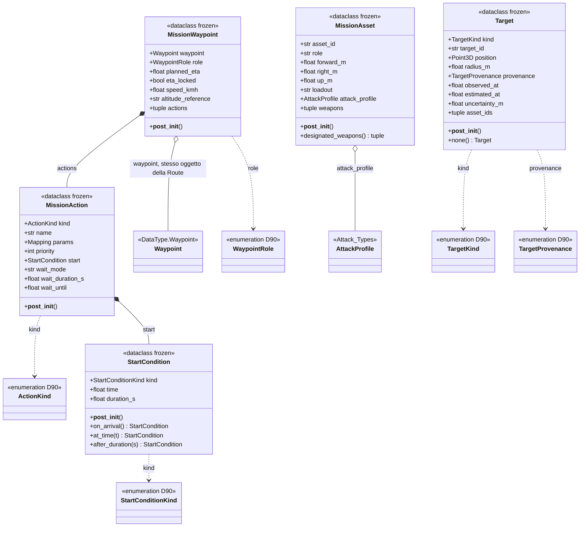

Note a D91: `Target.none`, `StartCondition.on_arrival/at_time/after_duration` sono `@classmethod` (`:559`, `:595`, `:599`, `:603`); `MissionAsset.designated_weapons` è una `@property` (`:782`), si legge come attributo. Il diagramma non ha un
marcatore per questo. `MissionAction.params` diventa un `MappingProxyType` in `__post_init__` (`:642`) e il campo ha `hash=False` (`:624`: la dataclass resta hashabile anche con un mapping). Tutti i valori sono **di dominio**: secondi dall'inizio sessione, metri,
km/h, id stringa (docstring `:24-27`). Le regole di coerenza di `Target` (forma × provenienza) sono nel docstring `:458-472` e in `Target.__post_init__` `:489-557`: `NONE` non porta nulla; `ASSET`/`GROUP` richiedono `target_id`, nessun raggio e provenienza `OBSERVED`;
`POINT` richiede la posizione; `AREA` e `ZONE` anche `radius_m > 0`; `asset_ids` solo per `GROUP` (`:513`). `StartCondition` richiede esattamente la coppia (tempo, durata) attesa per il suo genere (`:587-593`: `AT_TIME` il solo tempo, `AFTER_DURATION` la sola durata).
`MissionAction` di genere `WAIT` richiede `wait_mode` in `WAIT_MODES` e **esattamente uno** fra `wait_duration_s` e `wait_until` (`:653-660`); per gli altri generi quei tre campi sono vietati (`:662`). `MissionWaypoint` controlla anche che le azioni non abbiano un
`wait_until` o un `start.time` anteriori alla ETA pianificata del punto (`:708-716`). Rimando a **D16** (il modello dei tipi della Missione, che resta) e a **D47** (`Target.asset_ids` e `MissionAsset.weapons` letti dal risolutore).

### La Missione, le regole, i criteri di fine e l'Operazione (D92)

*Diagramma D92 — `Mission`, `MissionRules`, `EndCriteria` e `Operation` con tutti i membri e i loro legami con gli elementi di D91 (livello L2, verificato a f009eb43).*

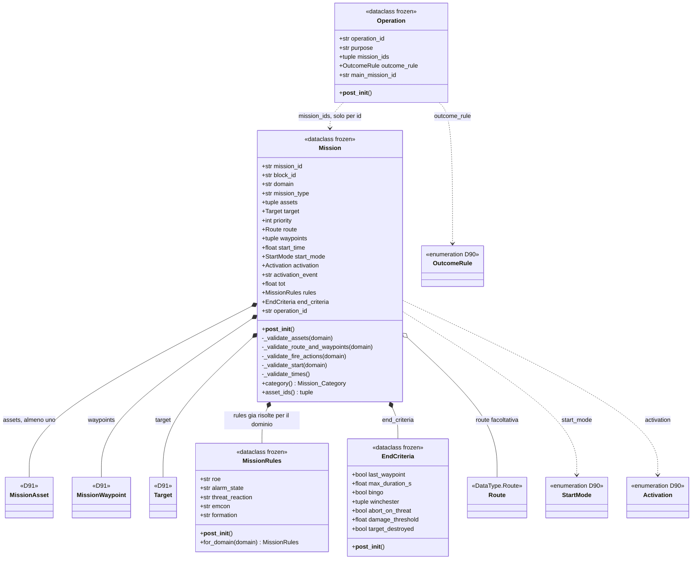

Note a D92: `Mission.category` e `Mission.asset_ids` sono `@property` (`:1148`, `:1155`). `Mission.rules` conserva sempre le regole **già risolte** per il dominio: `__post_init__` sostituisce `None` con `MissionRules()` e poi con `rules.for_domain(domain)` (`:994-999`),
che riempie i default di `DEFAULT_RULES` e verifica l'ammissibilità per dominio (`alarm_state` non per l'aria, `threat_reaction` solo per l'aria, `:906-910`). `Operation` riferisce le missioni **per id**, non per oggetto; il legame con l'oggetto `Mission` è controllato dalla porta
(`SessionOrder._validate_operations`, `Command/Session_Types.py:344`, v. D96). `Operation` con regola `MAIN_MISSION` richiede `main_mission_id` fra `mission_ids` (`:1227`), con le altre regole lo vieta (`:1232`). Rimando a **D16**, che resta,
e a **D18**.

**Campi validati ma non letti dal core.** Una scoperta di questo capitolo, verificata con `grep` sui sorgenti sotto `Source/` (esclusi `Test/` e il modulo stesso): nessun codice del core legge `MissionWaypoint.altitude_reference`, `Mission.activation_event`, `MissionRules.alarm_state`,
`threat_reaction`, `emcon` e `formation`. Il docstring di `EndCriteria` (`:835-836`) dichiara già che `abort_on_threat` e `last_waypoint` **non sono letti**, e il modulo `Session_Simulator` lo ripete (`Logic/Session_Simulator.py:213`). Anche `Mission.priority` e `MissionAction.priority`
sono validati (`:988`, `:643`) ma nessuno li usa fuori dal modulo. Non è un difetto: il modulo dichiara di essere un vocabolario, e questi sono campi che un esecutore diverso (l'adapter di un simulatore) può leggere. Va però detto al lettore: **un valore diverso
da quello di default in questi campi non cambia l'esito della simulazione**. Il solo campo di `MissionRules` che il core legge è `roe` (`Logic/Mission_Adapter.py:1983`, `target_rules`).
Un caso vicino ma diverso: `EndCriteria.target_destroyed` è accettato dalla `Mission` con un bersaglio `POINT` o `AREA` (il costruttore vieta solo `NONE` e `ZONE`, `:1004`), ma la sessione non sa rappresentare un bersaglio che non è un asset e **lo ignora con un warning**
(`Logic/Session_Simulator.py:1743-1746`, decisione 12 della F7a, anche per la missione di fuoco su posizione): la validazione strutturale e il motore non sono allineati su questo punto, per scelta dichiarata.

### Gli esiti (D93)

*Diagramma D93 — `AssetMissionOutcome`, `MissionOutcome` e `OperationOutcome` con tutti i membri (livello L2, verificato a f009eb43).*

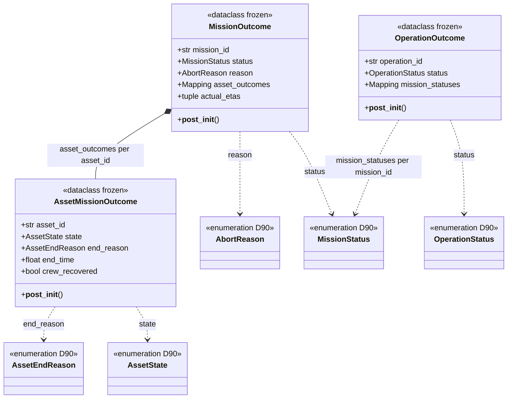

Note a D93: le coerenze imposte in `__post_init__` sono quattro e sono l'unica «logica» del gruppo. (1) `MissionOutcome`: `reason` obbligatorio **se e solo se** lo stato è `ABORTED` (`:1313`). (2) `MissionOutcome`: lo stato è `DESTROYED` se e solo se **tutti** gli esiti per asset
(se presenti) sono `DESTROYED` (`:1335-1340`). (3) `AssetMissionOutcome`: `end_reason` `DESTROYED` richiede stato `DESTROYED`, e stato `DESTROYED` ammette solo `end_reason` `DESTROYED` o `FUEL_EXHAUSTED` (`:1270-1275`); la seconda eccezione è l'aereo perso a secco
in volo senza base raggiungibile. (4) `crew_recovered` ammesso solo con stato `DESTROYED` (`:1280`). `actual_etas` deve essere non decrescente fra i punti raggiunti, `None` per un punto non raggiunto (`:1346-1349`). Un'asimmetria da notare:
`OperationOutcome.__post_init__` **non controlla** la coerenza fra `status` e `mission_statuses` (la regola è applicata altrove, in `Command/Session_Types.operation_outcome`, v. D97): la dataclass si limita a normalizzare e a rifiutare un mapping vuoto (`:1384`).
L'ordine delle chiavi di `mission_statuses` è quello di id (`:1387`), per la serializzazione deterministica. Rimando a **D17** (che resta) e a **D51** per la parte di campagna.

### Le funzioni per ruolo (D94)

*Diagramma D94 — i gruppi di funzioni di `Mission_Types`, le costanti che consultano e i consumatori nel core (livello L2, verificato a f009eb43).*

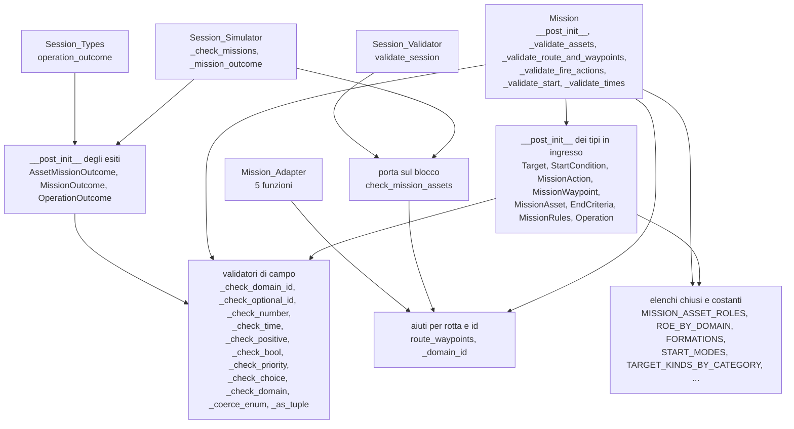

Lettura: `MI --> PI` perché `Mission.__post_init__` costruisce `MissionRules()` (`:994`) e `for_domain` ne costruisce un'altra (`:916`); `PI --> K` perché i `__post_init__` consultano gli elenchi (`WAIT_MODES` `:654`, `ALTITUDE_REFERENCES` `:700`, `_ALL_ASSET_ROLES` `:757`,
`AIR_ROE`, `ALARM_STATES`, ... in `MissionRules` `:895-900`); `MI --> H` perché `_validate_route_and_waypoints` chiama `route_waypoints` (`:1046`); `G --> H` perché `check_mission_assets` usa `_domain_id` (`:1174`, `:1180`). `Mission_Adapter` chiama `route_waypoints` in
`_rebuild_route`, `asset_route`, `attack_point`, `mission_holds` e `mission_start` (`Logic/Mission_Adapter.py:608`, `:651`, `:1960`, `:820`, `:713`). `Session_Simulator._mission_outcome` costruisce `AssetMissionOutcome` e `MissionOutcome`
(`Logic/Session_Simulator.py:2089-2157`); `Session_Types.operation_outcome` costruisce `OperationOutcome` (`Command/Session_Types.py:570`). **Nessun codice sotto `Source/`, fuori dai test, costruisce `Mission`, `Target`, `MissionWaypoint`, `MissionAsset`, `EndCriteria`,
`MissionRules` o `Operation`**: li costruisce chi dà l'ordine (un pianificatore, un adapter di simulatore, un test); il core li riceve già validati. Rimando a **D58** (import fra i moduli) e a **D59** (chi importa `Mission_Types`).

### La sequenza di `Mission.__post_init__` (D95)

*Diagramma D95 — `Mission(...)`: l'ordine delle validazioni, dall'identità alla risoluzione delle regole (livello L3, verificato a f009eb43).*

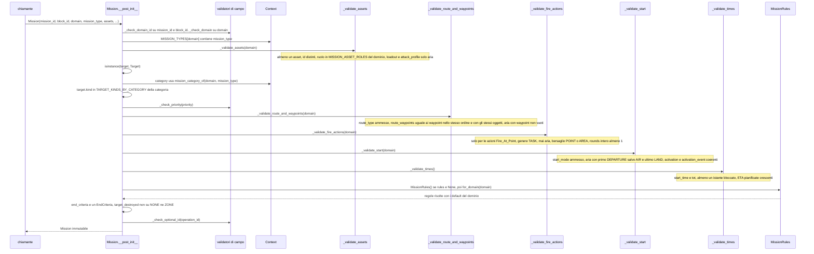

Righe: `_check_domain_id` `:969-970`; `_check_domain` `:971`; `mission_type` `:973`; `_validate_assets` `:977` (definita `:1012`); `isinstance(target)` `:979`; `self.category` `:982` (`:1149`); controllo della forma `:984`; `_check_priority` `:988`;
`_validate_route_and_waypoints` `:989` (`:1034`); `_validate_fire_actions` `:990` (`:1057`); `_validate_start` `:991` (`:1083`); `_validate_times` `:992` (`:1112`); regole `:994-999`; `end_criteria` `:1001-1006`; `operation_id` `:1008`.
**L'ordine non è arbitrario.** `_validate_start` legge `self.waypoints[0]` e `self.waypoints[-1]` per l'aria (`:1094`, `:1098`): è sicuro solo perché `_validate_route_and_waypoints` ha già rifiutato un'aerea senza waypoint (`:1054`). `_validate_fire_actions` legge
`self.target.kind` (`:1073`): viene dopo il controllo di tipo su `target` (`:979`). `_validate_times` legge `self.activation`, che `_validate_start` ha appena normalizzato (`:1102-1103`). Il primo errore interrompe: **una Missione con due difetti segnala solo quello
trovato per primo**, non l'elenco completo (ogni controllo solleva `TypeError` o `ValueError`). Le violazioni raccolte in elenco sono invece quelle di `validate_session` (D96), che lavora su ordini già costruiti. Rimando a **D16** e a **D29** (fase F1 del piano della Missione).

### La sequenza dalla costruzione alla porta (D96)

*Diagramma D96 — dalla costruzione degli elementi alla `Mission`, all'ordine `SessionOrder` e ai due controlli sul blocco (livello L3, verificato a f009eb43).*

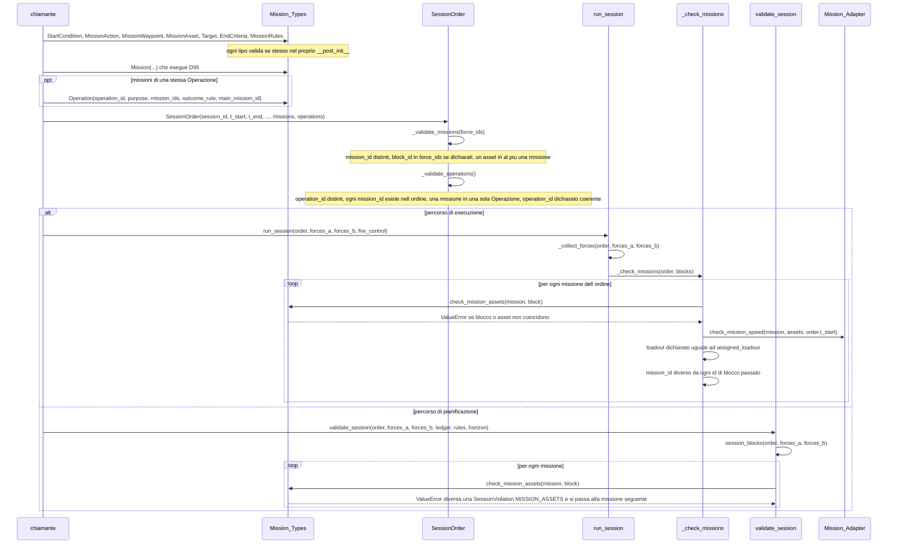

Righe: `SessionOrder.__post_init__` `Command/Session_Types.py:267` (`_validate_missions` `:316`, definita `:319`; `_validate_operations` `:317`, definita `:344`); `run_session` → `_collect_forces` e `_check_missions` `Logic/Session_Simulator.py:2234-2235`
(`_check_missions` definita `:1931`: `check_mission_assets` `:1942`, `MA.check_mission_speed` `:1944`, controllo del loadout `:1946-1953`, id missione contro id blocchi `:1955`); `validate_session` `Logic/Session_Validator.py:36`
(`SS.session_blocks` `:102`, `check_mission_assets` `:131`). Una differenza che il codice mostra: **i due controlli non sono uguali**. `_check_missions` solleva `ValueError` al primo errore e fa anche il controllo di velocità, del loadout e dell'id; `validate_session` raccoglie la violazione
`MISSION_ASSETS` (passo a, `:120`) e passa alla missione seguente, e nei passi successivi dello stesso ciclo verifica asset distrutti e prontezza (b, `:140`), partenza e rotta (c, `:162`), fine oltre la sessione (d, `:176`), velocità (e, `:187`),
carburante e bingo alla partenza (f, `:197`). `check_mission_assets` stessa è breve (`:1160-1187`): tipo `Mission`, id del blocco con il criterio `_domain_id`
(`id` poi `name`, `:419-430`), asset della missione dentro `block.assets`; separata dal costruttore perché la `Mission` porta solo id e il blocco è un oggetto del modello (docstring `:1163-1165`). Rimando a **D2** (l'ordine di sessione), **D52** (i controlli di `validate_session`) e **D64** (`run_session` 1/3).

### La sequenza degli esiti (D97)

*Diagramma D97 — da `_mission_outcome` agli esiti per asset, all'esito della missione, all'Operazione e alla `SessionOutcome` (livello L3, verificato a f009eb43).*

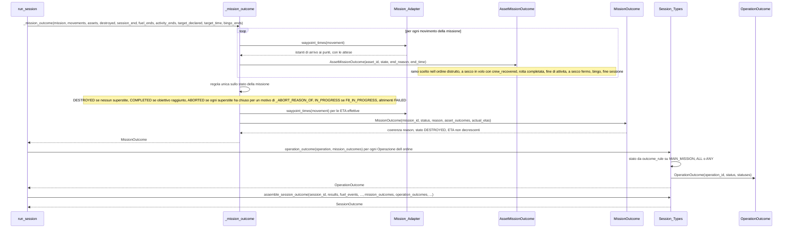

Righe: `_mission_outcome` chiamata per ogni missione dell'ordine `Logic/Session_Simulator.py:3098` (definita `:2049`); `MA.waypoint_times` `:2067` e `:2148`; `AssetMissionOutcome(...)` nei sette rami `:2089`, `:2093`, `:2102`, `:2104`, `:2112`, `:2116`, `:2118`; regola unica `:2125-2146`
(`_ABORT_REASON_OF` `:1685`, interruttori `F6_END_CRITERIA` e `F8_IN_PROGRESS`); `MissionOutcome(...)` `:2157`; `operation_outcome(...)` `:3154` (definita `Command/Session_Types.py:528`; `MAIN_MISSION` `:544`, `ALL` `:554`, il ramo finale è `ANY`); `assemble_session_outcome(...)` `:3158`
(definita `Command/Session_Types.py:582`). Il diagramma mostra solo i **tipi di `Mission_Types`**; la regola di esito con i suoi rami è già un diagramma di regola, **D19** (e D41 per il ciclo di vita dell'aereo): qui non si ripete. Un fatto che si legge nel codice: la regola dello stato
della missione vive in `Session_Simulator`, quella dell'Operazione in `Session_Types`, e il modulo `Mission_Types` contiene **solo le coerenze dei dati**, non le regole d'esito. Rimando a **D66** (`run_session` 3/3, dove `assemble_session_outcome` chiude la sessione).

### Tabella completa dei simboli di `Command/Mission_Types`

Le colonne «Tipo», «Simbolo», «Firma» e «Riga» sono l'uscita di `inventario.py --tabella Command/Mission_Types` (64 righe, nell'ordine dell'uscita); «Gruppo» è il ruolo di D94 e delle sezioni sopra; «Che cosa fa» è una sintesi dai docstring;
«Chiamata da» elenca i chiamanti **dentro il modulo** e **nel core** (`SS` = `Session_Simulator`, `SV` = `Session_Validator`, `MA` = `Mission_Adapter`, `ST` = `Session_Types`, `AF` = `Area_Fire`, `ER` = `Engagement_Resolver`),
ricavati con l'estrazione `ast`: i test non sono contati. Per le dataclass e le enumerazioni «costruita da» e «letta da» sono distinti; un metodo `__post_init__` è chiamato implicitamente da `dataclass` alla costruzione.

| Gruppo | Tipo | Simbolo | Firma | Riga | Che cosa fa | Chiamata da |
|---|---|---|---|---|---|---|
| enumerazioni | classe | `TargetKind` | `TargetKind(Enum)`; campi: ASSET, GROUP, POINT, AREA, ZONE, NONE | `:91` | Forma del bersaglio (N3.d). | letta da `Target`, `Mission.__post_init__`, `_validate_fire_actions`, `SS:_mission_target_ids`, `MA:designated_targets` |
| enumerazioni | classe | `TargetProvenance` | `TargetProvenance(Enum)`; campi: OBSERVED, ESTIMATED | `:101` | Conoscenza su cui si basa il bersaglio (N3.e). | letta da `Target`, `AF:dispersion_radius`, `MA:designated_targets` |
| enumerazioni | classe | `WaypointRole` | `WaypointRole(Enum)`; campi: DEPARTURE, JOIN, NAV, IP, ATTACK, EGRESS, SPLIT, LAND, STATION, ASSEMBLY, OBJECTIVE, HOLD | `:107` | Ruolo del punto nella missione (N2.a). | letta da `MissionWaypoint`, `Mission._validate_start`, `MA:attack_point`, `MA:is_loop_mission`, `MA:lands_on_air_base` |
| enumerazioni | classe | `ActionKind` | `ActionKind(Enum)`; campi: TASK, RULE, COMMAND, WAIT | `:123` | Genere di un'azione su un waypoint (N2.a). | letta da `MissionAction`, `_validate_fire_actions`, `AF:fire_orders`, `MA:_wait_actions`, `SS:run_session` |
| enumerazioni | classe | `StartConditionKind` | `StartConditionKind(Enum)`; campi: ON_ARRIVAL, AT_TIME, AFTER_DURATION | `:131` | Condizioni d'avvio pre-calcolabili (N2.d). | letta da `StartCondition`, `AF:fire_orders`, `MA:_relative_wait`, `MA:_wait_end` |
| enumerazioni | classe | `StartMode` | `StartMode(Enum)`; campi: RUNWAY, PARKING_COLD, PARKING_HOT, AIR, GROUND | `:138` | Modo di partenza della missione (pista, parcheggio, in volo, da fermo). | letta da `START_MODES`, `DEFAULT_START_MODE`, `Mission._validate_start`, `MA:_presence`, `MA:bingo_return_rule`, `MA:is_loop_mission` |
| enumerazioni | classe | `Activation` | `Activation(Enum)`; campi: AT_SESSION_START, AT_TIME, ON_EVENT | `:147` | Quando la missione diventa attiva nella sessione; `ON_EVENT` è solo dichiarabile. | letta da `Mission._validate_start`, `Mission._validate_times`, `MA:mission_start` |
| enumerazioni | classe | `OutcomeRule` | `OutcomeRule(Enum)`; campi: MAIN_MISSION, ALL, ANY | `:154` | Regola d'esito di un'Operazione (D2.e). | letta da `Operation`, `ST:operation_outcome` |
| enumerazioni | classe | `MissionStatus` | `MissionStatus(Enum)`; campi: COMPLETED, ABORTED, FAILED, DESTROYED, IN_PROGRESS | `:161` | Esito di una missione (D2.d); `IN_PROGRESS` dalla F8. | letta da `MissionOutcome`, `OperationOutcome`, `ST:operation_outcome`, `SS:_mission_outcome` |
| enumerazioni | classe | `OperationStatus` | `OperationStatus(Enum)`; campi: SUCCEEDED, FAILED, IN_PROGRESS | `:171` | Esito di un'Operazione (F8). | letta da `OperationOutcome`, `ST:operation_outcome` |
| enumerazioni | classe | `AbortReason` | `AbortReason(Enum)`; campi: THREAT, DAMAGE, FUEL, BINGO, DISENGAGED, AMMUNITION, SUPPORT_MISSING | `:179` | Motivo di aborto di una missione (D2.d). | letta da `MissionOutcome`, `SS:_ABORT_REASON_OF` (`:1685`) |
| enumerazioni | classe | `AssetState` | `AssetState(Enum)`; campi: OPERATIONAL, DAMAGED, DESTROYED | `:192` | Stato di un asset a fine missione (D2.d). | letta da `AssetMissionOutcome`, `MissionOutcome`, `SS:_mission_outcome` |
| enumerazioni | classe | `AssetEndReason` | `AssetEndReason(Enum)`; campi: ROUTE_COMPLETED, MAX_DURATION, BINGO, DISENGAGED, WINCHESTER, DAMAGE, THREAT, TARGET_DESTROYED, MISSION_ABORTED, DESTROYED, SESSION_END, FUEL_EXHAUSTED | `:199` | Motivo della fine (di missione o di attività) di un asset. | letta da `AssetMissionOutcome`, `SS` (`ActivityPlan`, `BingoEnd`, `_activity_ends`, `_activity_plans`, `_mission_outcome`, `run_session`) |
| elementi | classe | `Target` | `Target`; campi: kind, target_id, position, radius_m, provenance, observed_at, estimated_at, uncertainty_m, asset_ids | `:455` | Bersaglio della missione: forma e provenienza dell'informazione. | costruita dal chiamante; letta da `Mission`, `AF:dispersion_radius`, `MA:designated_targets`, `SS:_mission_target_ids` |
| elementi | metodo | `Target.__post_init__` | `__post_init__(self)` | `:489` | Normalizza gli enum, controlla tipi e coerenza forma × provenienza × campi. | implicito alla costruzione |
| elementi | metodo | `Target.none` | `none(cls)` | `:560` | `@classmethod`: il bersaglio vuoto (`NONE`). | nessun chiamante nel core (il default di `Mission.target` usa `Target()`) |
| elementi | classe | `StartCondition` | `StartCondition`; campi: kind, time, duration_s | `:568` | Condizione d'avvio di un'azione, solo pre-calcolabile. | costruita dal chiamante e dai suoi tre metodi di classe; letta da `MissionAction`, `AF:fire_orders`, `MA:_relative_wait`, `MA:_wait_end` |
| elementi | metodo | `StartCondition.__post_init__` | `__post_init__(self)` | `:579` | Verifica che (tempo, durata) siano esattamente la coppia attesa per il genere. | implicito alla costruzione |
| elementi | metodo | `StartCondition.on_arrival` | `on_arrival(cls)` | `:596` | `@classmethod`: l'avvio all'arrivo al waypoint (default). | nessun chiamante nel core |
| elementi | metodo | `StartCondition.at_time` | `at_time(cls, t)` | `:600` | `@classmethod`: avvio all'istante `t` dall'inizio sessione. | nessun chiamante nel core |
| elementi | metodo | `StartCondition.after_duration` | `after_duration(cls, s)` | `:604` | `@classmethod`: avvio `s` secondi dopo l'arrivo. | nessun chiamante nel core |
| elementi | classe | `MissionAction` | `MissionAction`; campi: kind, name, params, priority, start, wait_mode, wait_duration_s, wait_until | `:609` | Azione su un waypoint: compito, regola, comando o attesa. | costruita dal chiamante; letta da `MissionWaypoint`, `AF:fire_orders`, `MA:_wait_actions`, `MA:_relative_wait`, `MA:_wait_end` |
| elementi | metodo | `MissionAction.__post_init__` | `__post_init__(self)` | `:631` | Normalizza `params` in `MappingProxyType`, controlla priorità, `start` e i tre campi di attesa. | implicito alla costruzione |
| elementi | classe | `MissionWaypoint` | `MissionWaypoint`; campi: waypoint, role, planned_eta, eta_locked, speed_kmh, altitude_reference, actions | `:667` | Un punto della rotta di missione: contiene il `DataType.Waypoint` geometrico (stesso oggetto). | costruita dal chiamante; letta da `Mission`, `MA` (`_route_from_waypoints`, `mission_start`, `mission_holds`, `attack_point`, ...), `AF:fire_orders` |
| elementi | metodo | `MissionWaypoint.__post_init__` | `__post_init__(self)` | `:687` | Controlla tipo del waypoint, ETA, `eta_locked` (richiede `planned_eta`), velocità, riferimento di quota e coerenza delle azioni con la ETA. | implicito alla costruzione |
| elementi | classe | `MissionAsset` | `MissionAsset`; campi: asset_id, role, forward_m, right_m, up_m, loadout, attack_profile, weapons | `:725` | Un asset nella missione: ruolo, offset di formazione, loadout, profilo d'attacco, armi designate. | costruita dal chiamante; letta da `Mission`, `MA:asset_route`, `MA:attack_point`, `SS:_check_missions` |
| elementi | metodo | `MissionAsset.__post_init__` | `__post_init__(self)` | `:754` | Controlla id, ruolo (esistente in qualche dominio), offset numerici, tipo del profilo, armi distinte e `attack_profile.weapon` fra le `weapons`. | implicito alla costruzione |
| elementi | metodo | `MissionAsset.designated_weapons` | `designated_weapons(self)` | `:783` | Proprietà: `weapons`, altrimenti l'arma del profilo, altrimenti nessuna (F7a). | lettura dell'attributo in `ER:TargetRules`, `ER:TargetRules.__post_init__`, `ER:apply_target_rules`, `MA:target_rules` |
| criteri e regole | classe | `EndCriteria` | `EndCriteria`; campi: last_waypoint, max_duration_s, bingo, winchester, abort_on_threat, damage_threshold, target_destroyed | `:795` | Criteri di fine missione dichiarati (pre-calcolabili e di stato). | costruita dal chiamante; letta da `Mission`, `MA` (`:1134`, `:1351`, `:1479`), `SS` (`:1806`, `:2310`, `:2619`) |
| criteri e regole | metodo | `EndCriteria.__post_init__` | `__post_init__(self)` | `:846` | Controlla i booleani, durata, categorie `winchester` distinte, soglia di danno in (0, 1] e che esista almeno una fine geometrica o temporale. | implicito alla costruzione |
| criteri e regole | classe | `MissionRules` | `MissionRules`; campi: roe, alarm_state, threat_reaction, emcon, formation | `:876` | Direttive di missione, valori di dominio; `None` = default del dominio. | costruita dal chiamante e da `Mission.__post_init__` e `MissionRules.for_domain`; letta da `MA:target_rules` (solo `roe`) |
| criteri e regole | metodo | `MissionRules.__post_init__` | `__post_init__(self)` | `:894` | Verifica che ogni valore esista in qualche dominio. | implicito alla costruzione |
| criteri e regole | metodo | `MissionRules.for_domain` | `for_domain(self, domain)` | `:902` | Regole risolte per il dominio: verifica l'ammissibilità e riempie i default. | `Mission.__post_init__` |
| missione | classe | `Mission` | `Mission`; campi: mission_id, block_id, domain, mission_type, assets, target, priority, route, waypoints, start_time, start_mode, activation, activation_event, tot, rules, end_criteria, operation_id | `:923` | La Missione: asset di un solo blocco, un bersaglio, una rotta di riferimento. | costruita dal chiamante; usata come tipo (annotazione di parametro) e letta da `ST:SessionOrder` (`_validate_missions`, `mission`), `AF:fire_orders`, `MA` (26 funzioni e 3 metodi di `MissionForce`, fra cui `mission_movements`, `mission_start`, `weapon_policies`), `SS`, `SV` |
| missione | metodo | `Mission.__post_init__` | `__post_init__(self)` | `:968` | Esegue le validazioni nell'ordine di D95 e risolve le regole per il dominio. | implicito alla costruzione |
| missione | metodo | `Mission._validate_assets` | `_validate_assets(self, domain)` | `:1012` | Almeno un asset, id distinti, ruolo del dominio, loadout e profilo solo aria. | `Mission.__post_init__` |
| missione | metodo | `Mission._validate_route_and_waypoints` | `_validate_route_and_waypoints(self, domain)` | `:1034` | `route_type` ammesso, waypoint uguali (stessi oggetti, stesso ordine) a quelli della rotta, aria con waypoint non vuoti. | `Mission.__post_init__` |
| missione | metodo | `Mission._validate_fire_actions` | `_validate_fire_actions(self, domain)` | `:1057` | Per le azioni `Fire_At_Point`: genere `TASK`, mai aria, bersaglio `POINT` o `AREA`, `rounds` intero ≥ 1, `weapon` facoltativa. | `Mission.__post_init__` |
| missione | metodo | `Mission._validate_start` | `_validate_start(self, domain)` | `:1083` | Modo di partenza ammesso, aria con primo `DEPARTURE` (salvo `AIR`) e ultimo `LAND`, coerenza di `activation` e `activation_event`. | `Mission.__post_init__` |
| missione | metodo | `Mission._validate_times` | `_validate_times(self)` | `:1112` | `start_time` e `tot` ≥ 0, almeno un istante bloccato, ETA pianificate crescenti e non anteriori a `start_time`. | `Mission.__post_init__` |
| missione | metodo | `Mission.category` | `category(self)` | `:1149` | Proprietà: la `Mission_Category` dal tipo di missione (`mission_category_of`). | lettura in `Mission.__post_init__`, `MA:is_transfer_mission` |
| missione | metodo | `Mission.asset_ids` | `asset_ids(self)` | `:1156` | Proprietà: gli id degli asset della missione, nell'ordine. | lettura in `check_mission_assets`, `ST:SessionOrder`, `MA` (`MissionForce`, `designated_targets`, `check_mission_speed`), `SS` (`_activity_plans`, `_mission_target_ids`, `_restrict_to_asset_ids`), `SV:validate_session`, `Readiness:_mission_assets` |
| porta | funzione | `check_mission_assets` | `check_mission_assets(mission, block)` | `:1160` | Verifica che il blocco sia quello della missione e che ogni suo asset gli appartenga. | `SS:_check_missions`, `SV:validate_session` |
| operazione | classe | `Operation` | `Operation`; campi: operation_id, purpose, mission_ids, outcome_rule, main_mission_id | `:1193` | Operazione: missioni (anche di blocchi diversi) per uno stesso scopo, con una regola d'esito. | costruita dal chiamante; letta da `ST:SessionOrder`, `ST:operation_outcome`, `MA:coordination_domains` |
| operazione | metodo | `Operation.__post_init__` | `__post_init__(self)` | `:1208` | Controlla id, `mission_ids` non vuoto e distinti, regola e coerenza di `main_mission_id`. | implicito alla costruzione |
| esiti | classe | `AssetMissionOutcome` | `AssetMissionOutcome`; campi: asset_id, state, end_reason, end_time, crew_recovered | `:1239` | Esito di un asset nella missione. | costruita da `SS:_mission_outcome` (sette rami); letta da `MissionOutcome` |
| esiti | metodo | `AssetMissionOutcome.__post_init__` | `__post_init__(self)` | `:1262` | Normalizza gli enum e impone le coerenze (3) e (4) di D93. | implicito alla costruzione |
| esiti | classe | `MissionOutcome` | `MissionOutcome`; campi: mission_id, status, reason, asset_outcomes, actual_etas | `:1286` | Esito di una missione, con le ETA effettive. | costruita da `SS:_mission_outcome`; letta da `ST` (`SessionOutcome`, `_check_mission_outcomes`, `assemble_session_outcome`, `operation_outcome`) |
| esiti | metodo | `MissionOutcome.__post_init__` | `__post_init__(self)` | `:1306` | Impone le coerenze (1) e (2) di D93, rende immutabile `asset_outcomes`, controlla `actual_etas`. | implicito alla costruzione |
| esiti | classe | `OperationOutcome` | `OperationOutcome`; campi: operation_id, status, mission_statuses | `:1355` | Esito di un'Operazione, aggregato dalla regola dichiarata. | costruita da `ST:operation_outcome`; letta da `ST` (`SessionOutcome`, `_check_operation_outcomes`, `assemble_session_outcome`) |
| esiti | metodo | `OperationOutcome.__post_init__` | `__post_init__(self)` | `:1369` | Normalizza lo stato, rifiuta un mapping vuoto e ordina `mission_statuses` per id. | implicito alla costruzione |
| validatori | funzione | `_check_domain_id` | `_check_domain_id(label, value)` | `:320` | Stringa non vuota (id di dominio), altrimenti `TypeError`. | `__post_init__` di `Target`, `MissionAction`, `MissionAsset`, `EndCriteria`, `Mission`, `Operation`, `AssetMissionOutcome`, `MissionOutcome`, `OperationOutcome` (id, nome azione, chiavi di mapping, elementi di tuple); `_check_optional_id` |
| validatori | funzione | `_check_optional_id` | `_check_optional_id(label, value)` | `:327` | Come `_check_domain_id`, ma `None` ammesso. | `Mission.__post_init__`, `_validate_fire_actions`, `_validate_start`, `MissionAsset`, `Operation`, `Target` |
| validatori | funzione | `_check_number` | `_check_number(label, value)` | `:331` | Numero finito (bool escluso) come `float`. | `_check_time`, `_check_positive`, `MissionAsset.__post_init__` |
| validatori | funzione | `_check_time` | `_check_time(label, value, allow_negative)` | `:338` | Istante in secondi, `None` ammesso; negativo solo se consentito. | `Target`, `StartCondition`, `MissionAction`, `MissionWaypoint`, `Mission._validate_times`, `AssetMissionOutcome`, `MissionOutcome` |
| validatori | funzione | `_check_positive` | `_check_positive(label, value, allow_zero)` | `:351` | Numero > 0 (o ≥ 0 se `allow_zero`), `None` ammesso. | `Target`, `StartCondition`, `MissionAction`, `MissionWaypoint`, `EndCriteria` |
| validatori | funzione | `_check_bool` | `_check_bool(label, value)` | `:363` | Un `bool` vero, non un intero. | `MissionWaypoint`, `EndCriteria`, `AssetMissionOutcome` |
| validatori | funzione | `_check_priority` | `_check_priority(label, value)` | `:370` | Intero ≥ 0 (bool escluso), 0 = massima. | `Mission.__post_init__`, `MissionAction.__post_init__` |
| validatori | funzione | `_coerce_enum` | `_coerce_enum(label, enum_cls, value)` | `:377` | Accetta il membro o il suo valore stringa, altrimenti `ValueError` con l'elenco dei valori. | `Target`, `StartCondition`, `MissionAction`, `MissionWaypoint`, `Mission._validate_start`, `Operation`, `AssetMissionOutcome`, `MissionOutcome`, `OperationOutcome` |
| validatori | funzione | `_check_choice` | `_check_choice(label, value, choices)` | `:389` | Valore in un elenco chiuso, `None` ammesso. | `MissionAction`, `MissionRules.__post_init__`, `MissionRules.for_domain`, `MissionWaypoint` |
| validatori | funzione | `_check_domain` | `_check_domain(value)` | `:399` | Dominio in `Context.MILITARY_FORCES` (`ground`, `air`, `sea`). | `Mission.__post_init__`, `MissionRules.for_domain` |
| validatori | funzione | `_as_tuple` | `_as_tuple(label, value, item_type)` | `:406` | Iterabile (non stringa) di elementi del tipo dato, come tupla. | `Target`, `MissionWaypoint`, `MissionAsset`, `EndCriteria`, `Mission._validate_assets`, `Mission._validate_route_and_waypoints`, `Operation` |
| aiuti | funzione | `_domain_id` | `_domain_id(obj)` | `:419` | Id di dominio di un blocco o asset (`id`, poi `name`): copia del criterio di `Engagement_Resolver` e `Session_Simulator`, ripetuta per non importare `Logic`. | `check_mission_assets` |
| aiuti | funzione | `route_waypoints` | `route_waypoints(route)` | `:433` | I waypoint di una `DataType.Route` nell'ordine di percorrenza (l'ordine di inserimento di `route.edges`). | `Mission._validate_route_and_waypoints`; `MA` (`_rebuild_route`, `asset_route`, `attack_point`, `mission_holds`, `mission_start`) |

## 10B.3 L2 e L3 — `Logic/Fuel_Model` (1576 righe, 58 simboli)

`Fuel_Model` è lo **strato 3 del carburante**: calcola quanto un tratto di rotta consuma, dove e quando il carburante finisce, dove un aereo deve invertire la rotta (**bingo**) e quanto consuma un ingaggio. È puro e privo di RNG
(docstring `:17-25`, «nessuna estrazione casuale»); non muta l'asset se non in `apply_fuel_event` (`:291`), la sola funzione che chiama `Mobile.consume_fuel`. Legge l'asset **per attributo** (`fuel`, `fuel_for_distance`, `speed`,
`emergency_fuel_flow`, `fuel_capacity_kg`) e i tratti di `Contact_Scheduler.Leg` per attributo (`t_start`, `t_end`, `p_start`, `p_end`, commento `:313-315`): non importa né l'asset né lo scheduler. L'unico import del core è `Damage_Model as DM`
(`:139`, per `DM.DERIVED` e `DM.PROVENANCES`). Il modulo ha **7 classi**, tutte `dataclass(frozen=True)` (le cinque pubbliche `FuelEvent` `:165`, `FuelExhaustion` `:207`, `ReturnRule` `:612`, `BingoPoint` `:639`, `BingoDecision` `:1255`, e due private `_Step` `:721`,
`_Segment` `:1357`), 4 metodi (`ReturnRule.__post_init__` e le tre proprietà di `BingoDecision`) e **47 funzioni** di primo livello, più una funzione locale, `reachable` dentro `bingo_decision` (`:1547`), che non è nell'inventario.

**Costanti del modulo** (non sono nell'inventario). Tolleranze: `_FUEL_EPS` `:147` (copia di `Mobile.FUEL_EPS`), `_LENGTH_EPS` `:150`, `_SECONDS_PER_HOUR` `:1041`. Regimi e provenienze: `HOLD_REGIME` `:154` (`'nominal'`, la crociera nelle soste),
`ENGAGEMENT_REGIME` `:1110` (etichetta, non una chiave di `Mobile.FUEL_REGIMES`), `RESERVE_FROM_MILITARY_FLOW` `:1038`, `RESERVE_FROM_MAX_REGIME` `:1039`, `RETURN_DIRECT` `:606`, `RETURN_REVERSE` `:607`, `RETURN_FORWARD` `:608`, `RETURN_ALONG` `:1251`.
Azioni al bingo: `BINGO_CONTINUE`, `BINGO_DEPARTURE`, `BINGO_ALTERNATE`, `BINGO_NEAREST`, `BINGO_UNREACHABLE`, `BINGO_NO_BASE`, `BINGO_EXIT` (`:1242-1248`). **Stime dichiarate dal codice** (i commenti sopra le costanti le chiamano stima, non dato tarato):
`GLIDE_RATIO` `:161` (10:1, rapporto di planata unico per tutti gli aerei), `BINGO_RESERVE` `:597` (0,10 del carico pieno, solo per la regola F6-B2), `BINGO_RETURN_FACTOR` `:603` (1,2, decisione dell'utente del 2026-10-15),
`DISENGAGE_TIME` `:1035` (300 s, stima dell'utente), `ALTERNATE_BASE_MAX_OFFSET` `:1239` (3000 m, stima dell'utente). Inoltre l'**unità** del consumo militare del registro (`emergency.consume`, kg/h) è «dedotta, non documentata» (commento `:1021-1026`)
e per i caccia con postbruciatore sottostima il consumo a postbruciatore pieno di circa 1/6. Questo capitolo non ricalibra nulla: riporta le stime come sono.

### I tipi (D98)

*Diagramma D98 — i tipi di `Fuel_Model` con tutti i membri, compresi i due privati `_Step` e `_Segment` (livello L2, verificato a f009eb43).*

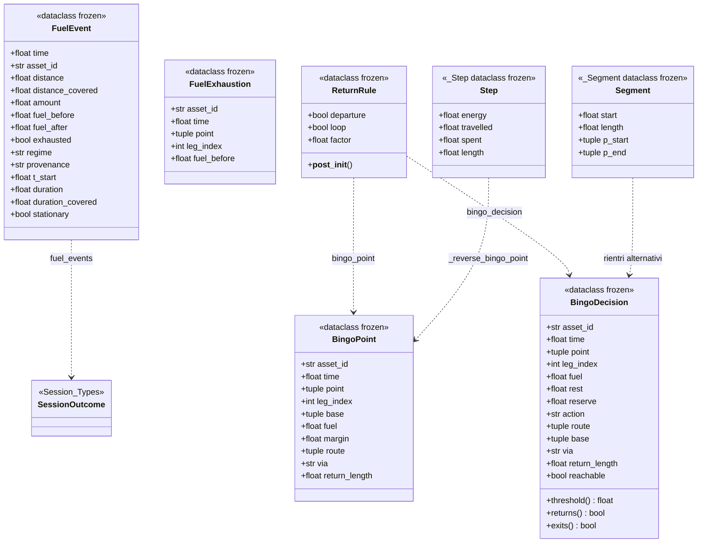

Note a D98: nel diagramma `Step` e `Segment` sono `_Step` e `_Segment` senza il trattino basso iniziale (stessa cautela di D71); `threshold`, `returns` ed `exits` sono `@property` (`:1289`, `:1294`, `:1300`), si leggono come attributi.
**Le unità.** Il carburante è una **frazione del carico pieno** (`Mobile.fuel`, `FuelEvent.amount`, `fuel_before`, `fuel_after`, `BingoDecision.fuel/rest/reserve`), le distanze sono metri, gli istanti secondi assoluti dall'inizio sessione; `_Step` lavora in
**metri di crociera** (docstring `:722`; `energy` è il carburante diviso il consumo per metro alla crociera, `:749`). I due valori di `FuelEvent` che mutano di significato secondo il tipo di tratto sono `distance` (la lunghezza richiesta; **0 per un tratto fermo** e per l'evento d'ingaggio)
e `t_start` (`None` per l'evento per distanza di `build_fuel_event`, forma precedente della F5, `:182-183`). `FuelEvent.regime` vale `'nominal'` di default, un regime di `Mobile.FUEL_REGIMES` per il movimento o `ENGAGEMENT_REGIME` (`'engagement'`) per l'evento d'ingaggio.
`BingoPoint.margin` è **negativo** quando c'è il bingo (`:650`) e per la regola F6-B2bis è il **minimo** lungo i tratti del residuo meno il fabbisogno (non il valore a fine tratti). `BingoDecision.base` è l'ultimo punto di `route` ma per `BINGO_EXIT` è il punto di comparsa, dove l'aereo
**esce di scena senza atterrare** (`:1269-1270`). `ReturnRule.__post_init__` rifiuta un `factor` minore di 1 o non numerico (`:631`) e un anello senza partenza da una base (`:634`). Rimando a **D39** (che disegna i cinque tipi pubblici e resta) e a **D38** (l'albero di decisione).

### Le funzioni per ruolo (D99)

*Diagramma D99 — i gruppi di funzioni di `Fuel_Model` e le chiamate fra gruppi; «asset» è l'oggetto letto per attributo (livello L2, verificato a f009eb43).*

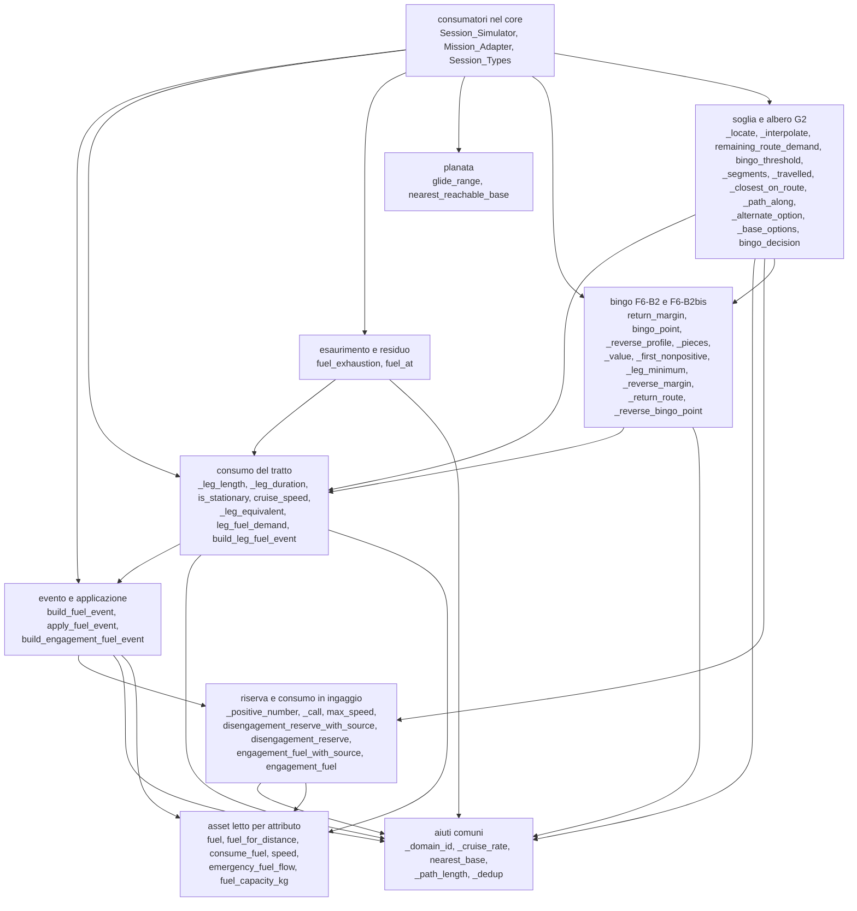

Lettura: le frecce sono chiamate a nome di funzione fra gruppi (estrazione `ast`). `LEG --> EV` perché `build_leg_fuel_event` chiama `build_fuel_event` (`:401`); `EV --> RI` perché `build_engagement_fuel_event` chiama `engagement_fuel` (`:1178`); `AL --> BR` perché `_base_options` e `bingo_decision`
riusano `_return_route` (`:1466`, `:1565`) per costruire la spezzata del rientro; `AL --> RI` perché `bingo_decision` e `bingo_threshold` usano `disengagement_reserve`. Le due ricerche di una base non sono la stessa: `nearest_base` (`:671`) misura una distanza **3D** da un punto d'atterraggio a quota 0
e serve al bingo; `nearest_reachable_base` (`:530`) misura una distanza **orizzontale** contro il raggio di planata `quota × GLIDE_RATIO` e serve all'aereo già a secco. `glide_range` non ha altro chiamante che `nearest_reachable_base`. Il bersaglio di `EXT --> ...` è la tabella a fine sezione (colonna «Chiamata da»)
e D105. Rimando a **D58** (import fra i moduli) e a **D38** (l'albero di `bingo_decision`).

### Il consumo di un tratto (D100)

*Diagramma D100 — dal tratto al `FuelEvent` applicato: `build_leg_fuel_event`, `build_fuel_event` e `apply_fuel_event` (livello L3, verificato a f009eb43).*

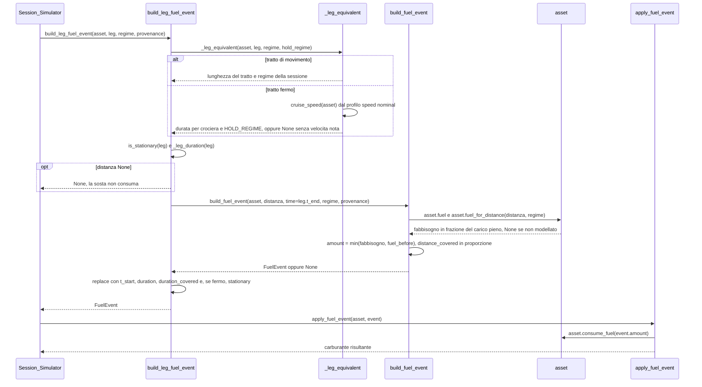

Righe: `build_leg_fuel_event` `:380`; `_leg_equivalent` `:392` (definita `:346`: ramo di movimento `:350-351`, ramo fermo `:353-358`, `cruise_speed` `:330`); `is_stationary` e `_leg_duration` `:393-394`; uscita senza distanza `:396-399`;
`build_fuel_event` `:401` (definita `:235`: controlli di `provenance` e `time` `:248-252`, `_domain_id` `:254`, lettura di `fuel` e `fuel_for_distance` `:260-267`, `amount` `:274`, `distance_covered` `:280-283`, `FuelEvent` `:285`); `replace` `:406-412`;
`apply_fuel_event` `:291` (`consume_fuel` `:308`, `Asset/Mobile.py:1211`). Dettagli che il codice rende importanti: `build_leg_fuel_event` usa come istante dell'evento **la fine del tratto** (`time=float(leg.t_end)`, `:401`); `duration_covered` è `duration × fraction` con `fraction = distance_covered / distance` (`:406`),
cioè il consumo è **uniforme lungo il tratto**. Nel chiamante, `Session_Simulator._build_leg_fuel` ritenta con la crociera se `build_leg_fuel_event` torna `None` per un regime non modellato e il tratto non è fermo (`Logic/Session_Simulator.py:1383-1388`);
il ciclo che applica gli eventi in ordine di coda è nel passo finale del carburante, **D66** (`Logic/Session_Simulator.py:3037` per ogni tratto, `:3066` per l'evento unico a fine movimento). `apply_fuel_event` non è idempotente (docstring `:291-297`): «applicarlo due volte consuma due volte».

### Esaurimento e residuo analitico (D101)

*Diagramma D101 — `fuel_exhaustion` e `fuel_at`: l'esaurimento a monte e il residuo a un istante qualunque (livello L3, verificato a f009eb43).*

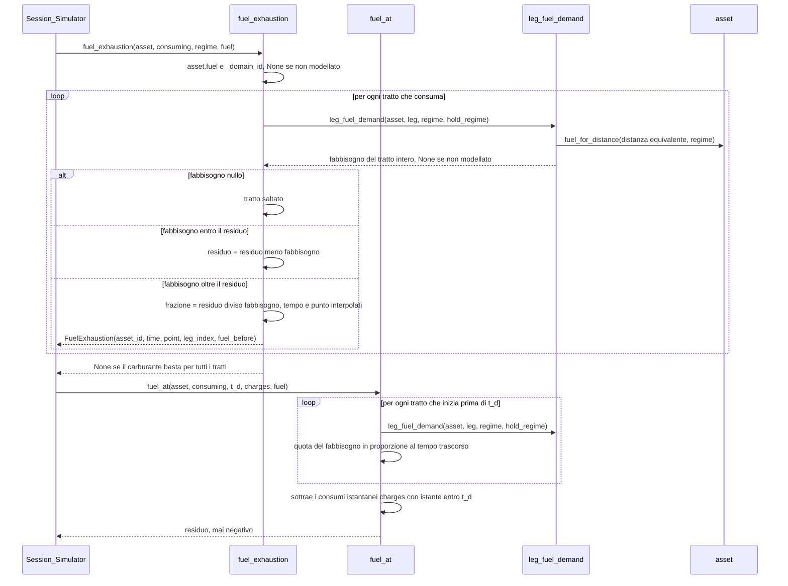

Righe: `fuel_exhaustion` `:415` (`asset.fuel` e `_domain_id` `:435-439`, ciclo `:444`, `leg_fuel_demand` `:445`, `None` `:447`, tratto saltato `:450`, sottrazione `:453-455`, frazione `:457`, tempo e punto `:458-459`, `FuelExhaustion` `:460`); `fuel_at` `:465`
(`asset.fuel` `:492`, ciclo `:500` con `break` quando il tratto inizia a `t_d` o dopo `:501`, `leg_fuel_demand` `:504`, quota `:510`, `charges` `:513-515`, ritorno `:517`). Le due funzioni **ripetono la stessa aritmetica** dell'orchestratore (un `FuelEvent` per tratto e un evento istantaneo per ingaggio, ciascuno limitato
al disponibile): le sottrazioni limitate a zero danno lo stesso residuo finale in qualunque ordine (docstring `:476-480`), e per questo `fuel_at` può calcolare un residuo senza mutare l'asset. Dal G4b la sessione le chiama in cascata dopo un episodio: `fuel_at` per il residuo a `t_d`, poi `fuel_exhaustion(..., fuel=residuo)`
sui tratti da quell'istante (`Logic/Session_Simulator.py:2587` e `:1434`; il ciclo è **D40**). Nota: `fuel_exhaustion` ritorna `None` anche quando **un solo tratto** ha fabbisogno `None` (`:447`); il caso «carburante modellato ma autonomia ignota per un regime» spegne quindi l'intero controllo, non solo quel tratto.

### La riserva di disimpegno e il consumo in ingaggio (D102)

*Diagramma D102 — `build_engagement_fuel_event` e la riserva `disengagement_reserve_with_source`, con le due fonti e il ripiego (livello L3, verificato a f009eb43).*

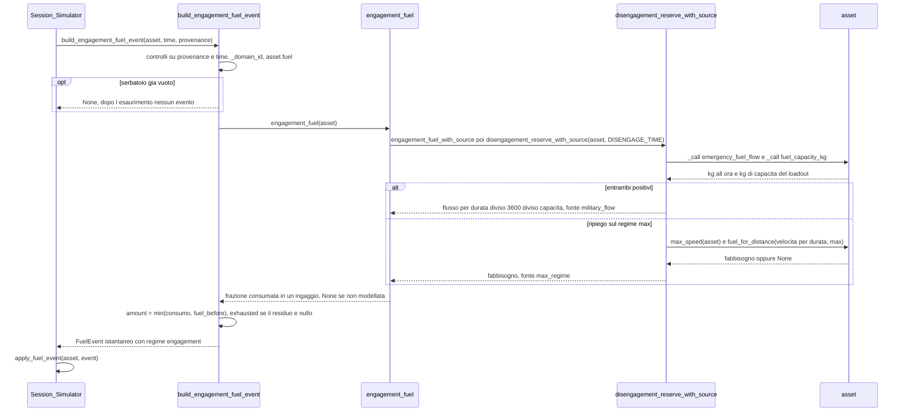

Righe: `build_engagement_fuel_event` `:1139` (controlli `:1154-1160`, `fuel` `:1166`, serbatoio vuoto `:1174`, `engagement_fuel` `:1178`, `amount` `:1184`, `FuelEvent` `:1190`); `engagement_fuel` `:1132` → `engagement_fuel_with_source` `:1113` → `disengagement_reserve_with_source` `:1063`
(`_call` `:1070-1071`, ramo del flusso militare `:1073-1074`, ripiego `:1076-1085`, `None` `:1088`). **Una sola quantità, tre nomi.** Il commento `:1099-1104` e il docstring `:1116-1118` dicono che il consumo per ingaggio (G3) è **la stessa** quantità della riserva di disimpegno (G1) «per costruzione», e il
docstring dichiara una regola futura **non implementata** (regime `emergency` per `min(DISENGAGE_TIME, durata ammessa)`, poi `combat`) perché il campo `time` del registro non è affidabile (`:1121-1127`). La stessa funzione è la **soglia** del validatore `Mission_Adapter.check_mission_fuel`
(`Logic/Mission_Adapter.py:1489`, `disengagement_reserve_with_source`) e il costo dell'ingaggio nella sessione (`Logic/Session_Simulator.py:2975`, `:2537`). Un accoppiamento fra moduli che il codice rende visibile: la finestra di raggruppamento degli episodi d'ingaggio in sessione è
`EPISODE_GAP = FM.DISENGAGE_TIME` (`Logic/Session_Simulator.py:914`), cioè **cambiare `DISENGAGE_TIME` cambia anche come la sessione raggruppa gli ingaggi**, non solo la riserva.

### Il punto di bingo (D103)

*Diagramma D103 — `bingo_point`: la regola F6-B2bis (rotta a ritroso) e la regola F6-B2 (rientro rettilineo), a partire dal margine (livello L3, verificato a f009eb43).*

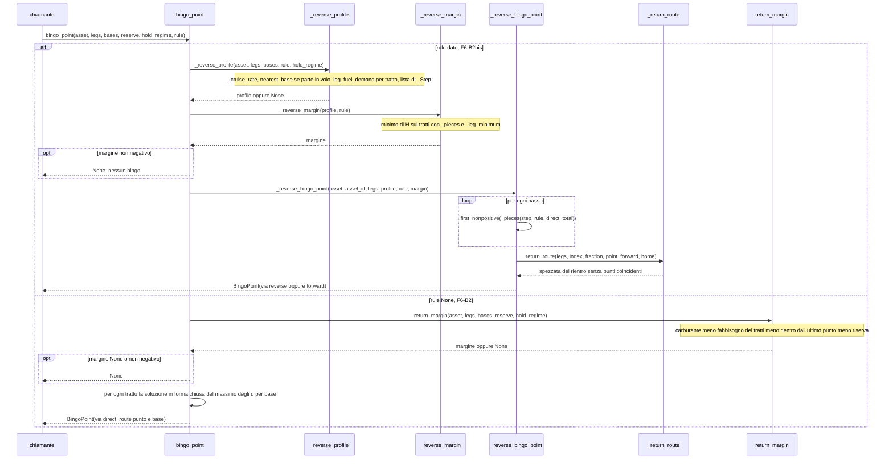

Righe: `bingo_point` `:917`; ramo con regola `:938-945` (`_reverse_profile` `:939`, definita `:729`; `_reverse_margin` `:944`, definita `:815`; soglia `margin >= -_FUEL_EPS` `:945`; `_reverse_bingo_point` `:945`, definita `:845`: ciclo `:850-855`,
`forward` `:867`, `_return_route` `:868`, `BingoPoint` `:870`); ramo senza regola `:947-1010` (`return_margin` `:947`, definita `:877`; uscita `:949-950`; ciclo sui tratti `:957-998`; `nearest_base` `:1007`; `BingoPoint` `:1008`). Fatti da sapere: (1) il bingo **esiste se e solo se il margine è negativo**, e `bingo_point` ritorna `None`
anche se il controllo non è possibile (carburante non modellato, nessun tratto, partenza in volo senza basi, `:941-942`); il chiamante non distingue «nessun bingo» da «non controllabile». (2) Sull'anello, il rientro in avanti è scelto solo se **strettamente** più breve del ritroso (`(total - travelled) < travelled + direct`, `:867`,
parità: ritroso). (3) La regola F6-B2 non usa `ReturnRule`; è raggiunta solo con l'interruttore `F6_BINGO_REVERSE_ROUTE` spento (docstring `:51-73`). I due chiamanti sono `Session_Simulator._bingo_end` (`Logic/Session_Simulator.py:1578`) e `Mission_Adapter.check_mission_bingo`
(`Logic/Mission_Adapter.py:1371`, `return_margin`, e `:1380`, `bingo_point`), che usano la stessa regola per costruzione (commento `:549-551`). Le formule sono nel commento di sezione `:547-590`, qui non ripetute. Rimando ai diagrammi di regola del bingo G0-G5 nel capitolo 5 (**D38**) e a **D42**
(come i tratti dell'asset si compongono prima dello scheduler).

### L'albero di decisione al bingo (D104)

*Diagramma D104 — `bingo_decision`: l'ordine delle chiamate dalla soglia alla decisione, senza ripetere i rami di D38 (livello L3, verificato a f009eb43).*

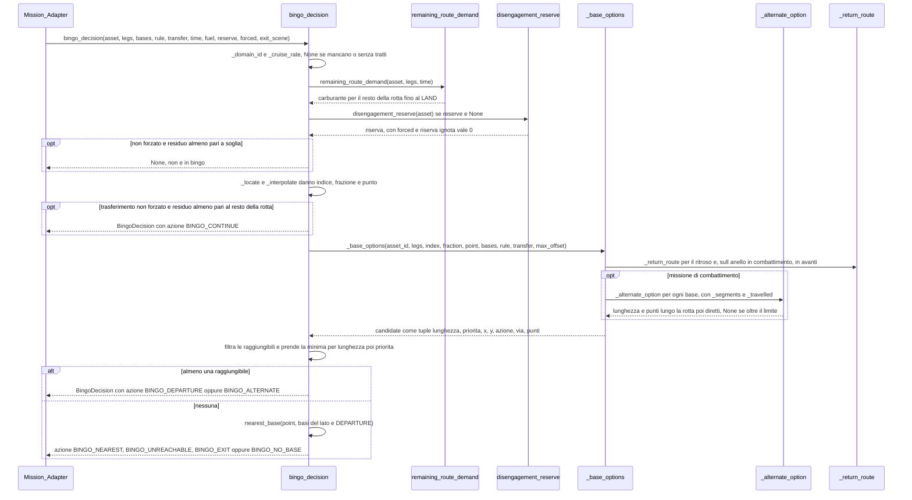

Righe: `bingo_decision` `:1484` (`_domain_id` e `_cruise_rate` `:1521-1522`; `remaining_route_demand` `:1529`, definita `:1322`; `disengagement_reserve` `:1530`; riserva zero se forzato `:1532-1533`; uscita sotto soglia `:1535-1536`; `_locate` e `_interpolate` `:1538-1539`;
`CONTINUE` `:1542-1543`; `_base_options` `:1550`, definita `:1450`, con `_return_route` `:1466` e, se non trasferimento, `_segments` `:1471`, `_travelled` `:1472`, `_alternate_option` `:1475`, definita `:1419` con `_closest_on_route` `:1424` e `_path_along` `:1441`;
filtro con la funzione locale `reachable` `:1547-1551`; scelta `min(options, key=option[:4])` `:1554`; passi 3 e 4 `:1558-1576`). Il chiamante è `Mission_Adapter.mission_bingo_decision` (`Logic/Mission_Adapter.py:1302`), che passa `bingo_return_rule(mission)` e `transfer=False if forced else is_transfer_mission(mission)` (`:1303`);
la sessione lo usa all'inizio dei tratti e, dal G4b, dopo ogni episodio (con `forced` per il rientro dopo il disingaggio): v. **D40**. L'albero come regola (rami, esiti, parità) è **D38** (capitolo 5): non si ripete qui. **Nota di lettura sul codice**: la funzione `_base_options` riceve `asset_id` (`:1450`) ma nel corpo non lo usa; è un parametro
inerte, senza conseguenze sul comportamento (non lo correggo, lo riporto).

### Che cosa il core importa da `Fuel_Model`, e chi (D105)

*Diagramma D105 — i simboli di `Fuel_Model` usati dal core e i moduli che li usano (livello L2, verificato a f009eb43).*

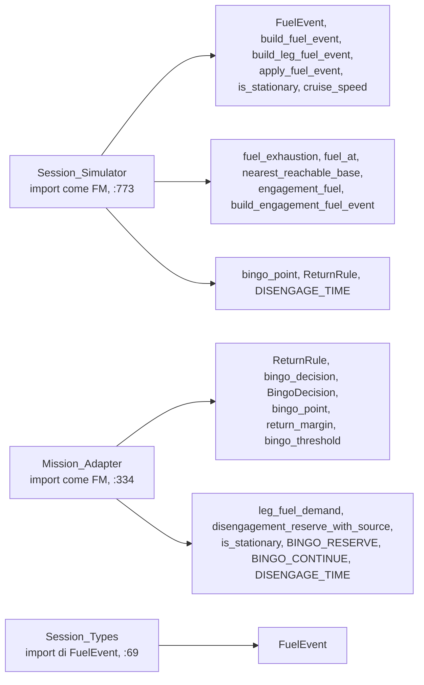

Lettura: `Fuel_Model` ha **tre importatori** nel core (D58 mostra gli archi); il primo e il secondo usano l'intera API per ruoli diversi. `Session_Simulator` costruisce e applica gli eventi, tronca all'esaurimento e al bingo e contabilizza gli ingaggi; `Mission_Adapter` usa il modulo per i **validatori di pianificazione**
(`check_mission_bingo`, `check_mission_fuel`) e per la decisione al bingo; `Session_Types` importa solo il tipo `FuelEvent` per `SessionOutcome.fuel_events` (`Command/Session_Types.py:441`). Simboli **senza nessun chiamante nel core fuori dal modulo**: `FuelExhaustion` e `BingoPoint` come tipi (arrivano come valore di ritorno), `glide_range`
(usato solo da `nearest_reachable_base`), `nearest_base`, `disengagement_reserve` e `remaining_route_demand` fuori dal modulo (li usano `bingo_threshold` e `bingo_decision`), `max_speed`, `engagement_fuel_with_source`. **Falsi positivi dell'estrazione**: la ricerca per nome trova `max_speed` e `threshold` anche in altri moduli
(`Ground_Route_Manager`, `Doctrine`, `Engagement_Resolver`, ...), che sono omonimi non legati a questo modulo; nella tabella sono stati scartati controllando il codice.

### Tabella completa dei simboli di `Logic/Fuel_Model`

Le colonne «Tipo», «Simbolo», «Firma» e «Riga» sono l'uscita di `inventario.py --tabella Logic/Fuel_Model` (58 righe, nell'ordine dell'uscita); «Gruppo» è il ruolo di D99; «Chiamata da» elenca i chiamanti **dentro il modulo** e **nel core**
(`SS` = `Session_Simulator`, `MA` = `Mission_Adapter`, `ST` = `Session_Types`); la funzione locale `reachable` è attribuita a `bingo_decision`.

| Gruppo | Tipo | Simbolo | Firma | Riga | Che cosa fa | Chiamata da |
|---|---|---|---|---|---|---|
| tipi | classe | `FuelEvent` | `FuelEvent`; campi: time, asset_id, distance, distance_covered, amount, fuel_before, fuel_after, exhausted, regime, provenance, t_start, duration, duration_covered, stationary | `:165` | Consumo di un asset su una tratta: l'atomo del `SessionOutcome`. | costruita da `build_fuel_event`, `build_leg_fuel_event` (via `replace`), `build_engagement_fuel_event`; `ST:SessionOutcome`, `ST:assemble_session_outcome`, `SS:run_session` |
| tipi | classe | `FuelExhaustion` | `FuelExhaustion`; campi: asset_id, time, point, leg_index, fuel_before | `:207` | Istante e punto in cui il carburante finisce lungo i tratti (F6-A). | costruita da `fuel_exhaustion`; letta da `SS:_fuel_end` |
| bingo | classe | `ReturnRule` | `ReturnRule`; campi: departure, loop, factor | `:612` | Regola di rientro al bingo lungo la rotta a ritroso (F6-B2bis). | costruita da `MA:bingo_return_rule`; letta da `_pieces`, `_reverse_profile`, `_reverse_margin`, `_reverse_bingo_point`, `return_margin`, `bingo_point`, `SS:_bingo_end` |
| bingo | metodo | `ReturnRule.__post_init__` | `__post_init__(self)` | `:630` | Rifiuta `factor` minore di 1 e un anello senza partenza da una base. | implicito alla costruzione |
| tipi | classe | `BingoPoint` | `BingoPoint`; campi: asset_id, time, point, leg_index, base, fuel, margin, route, via, return_length | `:639` | Istante e punto del bingo, con la spezzata del rientro (`route`). | costruita da `bingo_point` e `_reverse_bingo_point`; restituita a `SS:_bingo_end` e `MA:check_mission_bingo` |
| bingo | classe | `_Step` | `_Step`; campi: energy, travelled, spent, length | `:721` | Un tratto nel profilo della regola F6-B2bis, in metri di crociera. | `_reverse_profile` (costruttore), `_pieces` (lettura) |
| tipi | classe | `BingoDecision` | `BingoDecision`; campi: asset_id, time, point, leg_index, fuel, rest, reserve, action, route, base, via, return_length, reachable | `:1255` | Decisione al bingo in un punto della rotta (G2). | costruita da `bingo_decision`; restituita a `MA:mission_bingo_decision`; letta da `MA:_check_reserve_bingo`, `SS:_decision_end`, `SS:run_session` (sezione di ri-pianificazione) |
| tipi | metodo | `BingoDecision.threshold` | `threshold(self)` | `:1290` | Proprietà: soglia di bingo, `rest + reserve`. | lettura dell'attributo in `MA:_check_reserve_bingo`, `SS:_decision_end`, `SS:run_session` |
| tipi | metodo | `BingoDecision.returns` | `returns(self)` | `:1295` | Proprietà: l'aereo lascia la rotta (ogni azione tranne `CONTINUE` e `NO_BASE`). | lettura dell'attributo in `SS:_decision_end`, `SS:run_session` |
| tipi | metodo | `BingoDecision.exits` | `exits(self)` | `:1301` | Proprietà: l'aereo esce di scena invece di atterrare (`EXIT`, G4b). | `SS:_return_end` la legge con `getattr(found, 'exits', False)` (`:1567`) per riempire `BingoEnd.exits`, che poi leggono `SS` (`_grounded_after_bingo`, `_legs_after_bingo`, `_postures_after_bingo`, `run_session`); `BingoPoint` non ha `exits` e vale `False` |
| soglia e albero | classe | `_Segment` | `_Segment`; campi: start, length, p_start, p_end | `:1357` | Un tratto di movimento della rotta programmata con l'ascissa curvilinea del suo inizio. | `_segments` (costruttore), `_closest_on_route`, `_path_along`, `_alternate_option` (lettura) |
| aiuti comuni | funzione | `_domain_id` | `_domain_id(asset)` | `:224` | Id di dominio (`id`, poi `name`): stesso criterio di `Engagement_Resolver._domain_id`. | `build_fuel_event`, `apply_fuel_event`, `build_leg_fuel_event`, `fuel_exhaustion`, `bingo_point`, `disengagement_reserve_with_source`, `build_engagement_fuel_event`, `bingo_decision` |
| evento | funzione | `build_fuel_event` | `build_fuel_event(asset, distance, time, regime, provenance)` | `:235` | `FuelEvent` per percorrere `distance` metri, limitato al disponibile, senza applicarlo. | `build_leg_fuel_event`; `SS:_build_fuel` |
| evento | funzione | `apply_fuel_event` | `apply_fuel_event(asset, event)` | `:291` | Applica l'evento con `consume_fuel` e ritorna il carburante risultante. | `SS:run_session` (ciclo del passo finale e funzione locale `charge`) |
| consumo del tratto | funzione | `_leg_length` | `_leg_length(leg)` | `:317` | Lunghezza 3D del tratto. | `_leg_equivalent`, `_reverse_profile`, `_segments`, `_travelled`, `bingo_point`, `is_stationary` |
| consumo del tratto | funzione | `_leg_duration` | `_leg_duration(leg)` | `:321` | Durata del tratto, mai negativa. | `_leg_equivalent`, `_locate`, `_reverse_bingo_point`, `bingo_point`, `build_leg_fuel_event`, `fuel_at`, `fuel_exhaustion` |
| consumo del tratto | funzione | `is_stationary` | `is_stationary(leg)` | `:325` | Il tratto è fermo (attesa, orbita, sosta): lunghezza nulla entro `_LENGTH_EPS`. | `_leg_equivalent`, `_return_route`, `_reverse_profile`, `_segments`, `_travelled`, `bingo_point`, `build_leg_fuel_event`; `SS` (`_build_leg_fuel`, `_consuming_legs`, `_moving_speed`), `MA:airborne_legs` |
| consumo del tratto | funzione | `cruise_speed` | `cruise_speed(asset)` | `:330` | Velocità di crociera [m/s]: il regime `nominal` di `asset.speed`, None se assente. | `_leg_equivalent`; `SS` (`_exhaustion_end`, `_return_end`) |
| consumo del tratto | funzione | `_leg_equivalent` | `_leg_equivalent(asset, leg, regime, hold_regime)` | `:346` | (metri da consumare, regime): la lunghezza per il movimento, durata × crociera per una sosta. | `build_leg_fuel_event`, `leg_fuel_demand` |
| consumo del tratto | funzione | `leg_fuel_demand` | `leg_fuel_demand(asset, leg, regime, hold_regime)` | `:361` | Fabbisogno del tratto intero, non limitato al disponibile; 0 per una sosta senza crociera nota. | `_reverse_profile`, `bingo_point`, `fuel_at`, `fuel_exhaustion`, `remaining_route_demand`, `return_margin`; `MA:route_fuel_demand` |
| consumo del tratto | funzione | `build_leg_fuel_event` | `build_leg_fuel_event(asset, leg, regime, provenance, hold_regime)` | `:380` | `FuelEvent` per UN tratto, con `t_start`, `duration`, `duration_covered`, `stationary`. | `SS:_build_leg_fuel` |
| esaurimento e residuo | funzione | `fuel_exhaustion` | `fuel_exhaustion(asset, legs, regime, hold_regime, fuel)` | `:415` | Istante e punto in cui il carburante finisce lungo i tratti, calcolati a monte. | `SS:_fuel_end` |
| esaurimento e residuo | funzione | `fuel_at` | `fuel_at(asset, legs, time, charges, fuel, regime, hold_regime)` | `:465` | Residuo all'istante `time`, calcolato analiticamente (G4b). | `SS:run_session` (ri-pianificazione dopo l'episodio) |
| planata | funzione | `glide_range` | `glide_range(altitude, ratio)` | `:522` | Distanza orizzontale percorribile in planata dalla quota data (0 a terra). | `nearest_reachable_base` |
| planata | funzione | `nearest_reachable_base` | `nearest_reachable_base(point, bases, ratio)` | `:530` | La base più vicina in orizzontale entro il raggio di planata; parità: (x, y) minore. | `SS:_exhaustion_end` |
| aiuti comuni | funzione | `nearest_base` | `nearest_base(point, bases)` | `:671` | (distanza 3D, punto d'atterraggio a quota 0) della base più vicina; parità: (x, y) minore. | `_base_options`, `_reverse_profile`, `bingo_decision`, `bingo_point`, `return_margin` |
| aiuti comuni | funzione | `_cruise_rate` | `_cruise_rate(asset)` | `:688` | Consumo per metro alla crociera (lineare nella distanza), None se non modellato. | `_reverse_profile`, `bingo_decision`, `bingo_point`, `return_margin` |
| aiuti comuni | funzione | `_path_length` | `_path_length(points)` | `:701` | Lunghezza di una spezzata. | `_alternate_option`, `_base_options`, `_reverse_bingo_point`, `bingo_decision` |
| aiuti comuni | funzione | `_dedup` | `_dedup(points)` | `:705` | Spezzata senza punti consecutivi coincidenti (entro `_LENGTH_EPS`). | `_alternate_option`, `_return_route`, `bingo_decision` |
| bingo | funzione | `_reverse_profile` | `_reverse_profile(asset, legs, bases, rule, hold_regime)` | `:729` | (consumo per metro, D0, base, passi, S) della regola F6-B2bis, None se il controllo non è possibile. | `bingo_point`, `return_margin` |
| bingo | funzione | `_pieces` | `_pieces(step, rule, direct, total)` | `:766` | H nel tratto come massimo di funzioni lineari (ritroso e, sull'anello, resto della rotta). | `_reverse_bingo_point`, `_reverse_margin` |
| bingo | funzione | `_value` | `_value(pieces, u)` | `:778` | Valore di H alla frazione `u`. | `_leg_minimum` |
| bingo | funzione | `_first_nonpositive` | `_first_nonpositive(pieces)` | `:782` | La minima `u` in [0, 1] in cui H è non positivo, None se nessuna. | `_reverse_bingo_point` |
| bingo | funzione | `_leg_minimum` | `_leg_minimum(pieces)` | `:799` | Minimo di H nel tratto: agli estremi o dove ritroso e resto della rotta si equivalgono. | `_reverse_margin` |
| bingo | funzione | `_reverse_margin` | `_reverse_margin(profile, rule)` | `:815` | Margine della regola F6-B2bis: il minimo di H sui tratti, in frazione del carico pieno. | `bingo_point`, `return_margin` |
| bingo | funzione | `_return_route` | `_return_route(legs, index, fraction, point, forward, home)` | `:820` | I punti del rientro dal punto di bingo: a ritroso o in avanti (anello), senza le soste. | `_base_options`, `_reverse_bingo_point`, `bingo_decision` |
| bingo | funzione | `_reverse_bingo_point` | `_reverse_bingo_point(asset, asset_id, legs, profile, rule, margin)` | `:845` | Il `BingoPoint` della regola F6-B2bis. | `bingo_point` |
| bingo | funzione | `return_margin` | `return_margin(asset, legs, bases, reserve, hold_regime, rule)` | `:877` | Margine [frazione del carico pieno] del rientro al bingo; ≥ 0 = nessun bingo. | `bingo_point`; `MA:check_mission_bingo` |
| bingo | funzione | `bingo_point` | `bingo_point(asset, legs, bases, reserve, hold_regime, rule)` | `:917` | Il primo istante in cui il residuo basta appena per rientrare, calcolato a monte. | `SS:_bingo_end`, `MA:check_mission_bingo` |
| riserva e ingaggio | funzione | `_positive_number` | `_positive_number(value)` | `:1044` | Il valore se è un numero positivo (bool escluso), altrimenti None. | `disengagement_reserve_with_source`, `max_speed` |
| riserva e ingaggio | funzione | `_call` | `_call(asset, name)` | `:1051` | Chiama il metodo senza argomenti se esiste, altrimenti None. | `disengagement_reserve_with_source` |
| riserva e ingaggio | funzione | `max_speed` | `max_speed(asset)` | `:1056` | Velocità massima [m/s]: il regime `max` di `asset.speed`. | `disengagement_reserve_with_source` |
| riserva e ingaggio | funzione | `disengagement_reserve_with_source` | `disengagement_reserve_with_source(asset, duration)` | `:1063` | (riserva di disimpegno, provenienza): flusso militare, ripiego sul regime `max`, altrimenti None. | `disengagement_reserve`, `engagement_fuel_with_source`; `MA:check_mission_fuel` |
| riserva e ingaggio | funzione | `disengagement_reserve` | `disengagement_reserve(asset, duration)` | `:1091` | La sola riserva (senza provenienza). | `bingo_decision`, `bingo_threshold` |
| riserva e ingaggio | funzione | `engagement_fuel_with_source` | `engagement_fuel_with_source(asset)` | `:1113` | (consumo di UN ingaggio, provenienza): oggi coincide con la riserva di disimpegno. | `engagement_fuel` |
| riserva e ingaggio | funzione | `engagement_fuel` | `engagement_fuel(asset)` | `:1132` | Il solo consumo per ingaggio. | `build_engagement_fuel_event`; `SS:run_session` (ri-pianificazione) |
| evento | funzione | `build_engagement_fuel_event` | `build_engagement_fuel_event(asset, time, provenance)` | `:1139` | `FuelEvent` istantaneo per un ingaggio, limitato al disponibile. | `SS:run_session` (funzione locale `charge`) |
| soglia e albero | funzione | `_locate` | `_locate(legs, time)` | `:1306` | (indice del tratto, frazione) dell'istante lungo i tratti. | `bingo_decision`, `remaining_route_demand` |
| soglia e albero | funzione | `_interpolate` | `_interpolate(leg, fraction)` | `:1318` | Punto interpolato del tratto alla frazione data. | `bingo_decision` |
| soglia e albero | funzione | `remaining_route_demand` | `remaining_route_demand(asset, legs, time, hold_regime)` | `:1322` | Carburante per il resto della rotta da `time` alla fine dei tratti. | `bingo_decision`, `bingo_threshold` |
| soglia e albero | funzione | `bingo_threshold` | `bingo_threshold(asset, legs, time, reserve)` | `:1345` | Soglia di bingo: resto della rotta più riserva di disimpegno. | `MA:_check_reserve_bingo` |
| soglia e albero | funzione | `_segments` | `_segments(legs)` | `:1365` | La rotta programmata come spezzata dei soli tratti di movimento. | `_base_options` |
| soglia e albero | funzione | `_travelled` | `_travelled(legs, index, fraction)` | `:1381` | Metri di movimento dall'inizio dei tratti al punto dato. | `_base_options` |
| soglia e albero | funzione | `_closest_on_route` | `_closest_on_route(segments, base)` | `:1387` | I punti della rotta più vicini in orizzontale alla base, uno per tratto. | `_alternate_option` |
| soglia e albero | funzione | `_path_along` | `_path_along(segments, point, s_from, s_to, target)` | `:1404` | I punti lungo la rotta programmata fra due ascisse, in avanti o a ritroso. | `_alternate_option` |
| soglia e albero | funzione | `_alternate_option` | `_alternate_option(segments, point, travelled, base, max_offset)` | `:1419` | (lunghezza, punti) del rientro a una base alternativa, None se oltre `max_offset`. | `_base_options` |
| soglia e albero | funzione | `_base_options` | `_base_options(asset_id, legs, index, fraction, point, bases, rule, transfer, max_offset)` | `:1450` | Le candidate di rientro: base di partenza e, in combattimento, le basi alternative. | `bingo_decision` |
| soglia e albero | funzione | `bingo_decision` | `bingo_decision(asset, legs, bases, rule, transfer, time, fuel, reserve, max_offset, forced, exit_scene)` | `:1484` | Soglia e albero di decisione al bingo in un punto qualunque della rotta (G2, G4b). | `MA:mission_bingo_decision` |

## 10B.4 L2 e L3 — `Logic/Area_Fire` (326 righe, 11 simboli)

`Area_Fire` è il **fuoco su posizione** della F7b: un'artiglieria (di terra o di mare) che spara su «il punto dove i blu erano», la posizione **stimata** del bersaglio POINT o AREA. Non passa dal risolutore d'ingaggio: è un evento di sessione separato,
senza rilevamento né finestra di contatto, «solo geometria e estrazioni» (docstring `:4-7`). Il modulo ha **2 classi** (`FireOrder` `dataclass(frozen=True)` `:107`; `_Hit` con `__slots__` `:221`), 1 metodo (`_Hit.__init__`) e **8 funzioni**; nessun'altra funzione locale.
Importa `Mission_Types` (`FIRE_AT_POINT_ACTION`, `ActionKind`, `Mission`, `StartConditionKind`, `TargetProvenance`, `:69-75`), `Damage_Model as DM`, `Engagement_Resolver as ER`, `Fire_Control as FC` e `Mission_Adapter as MA` (`:76-79`). Costanti: `AREA_FIRE_MIN_DISPERSION_M` `:91` (50 m),
`AREA_FIRE_LETHAL_RADIUS_PER_MM` `:95` (0,25 m/mm), `AREA_FIRE_LETHAL_RADIUS_M` `:98` (25 m, ripiego senza calibro), `_TIME_EPS` `:101`. **Tutte e tre le costanti numeriche sono stime dichiarate** («STIMA, non un dato», commenti `:88-98` e docstring `:42-45`, decisione 15 del 2026-10-20):
questo capitolo non le ricalibra. Il solo consumatore nel core è `Session_Simulator` (import `:768`), che usa sei simboli: `FireOrder`, `fire_orders`, `plan_shot`, `impact_time`, `area_fire_event_id`, `resolve_area_fire` (righe `:2437`-`:2507`).
`dispersion_radius`, `lethal_radius` e `_asset_id` non hanno chiamanti fuori dal modulo.

### I tipi (D106)

*Diagramma D106 — `FireOrder` e `_Hit` con tutti i membri e i tipi esterni che il modulo produce o consuma (livello L2, verificato a f009eb43).*

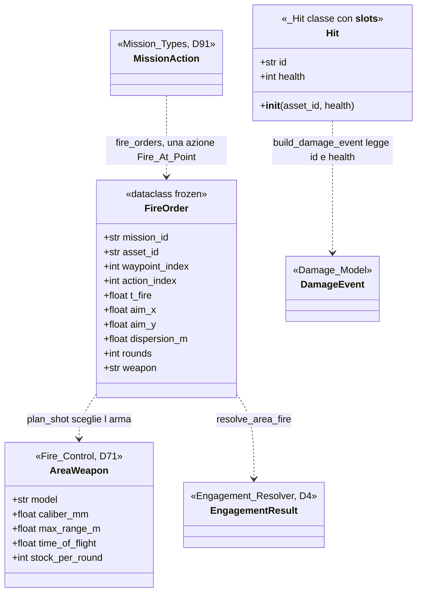

Note a D106: `_Hit` compare come `Hit` (stessa cautela di D71). `FireOrder.weapon` è il modello dichiarato in `params['weapon']`, `None` = scelta automatica (`:117`). `AreaWeapon` ha anche il campo `entry` (il record `_Weapon` scelto), che `Area_Fire` non legge, e `max_range_m`, che il modulo non legge (il controllo di portata è in `Fire_Control`, D75): nel diagramma
sono mostrati i campi dichiarati salvo `entry`; quelli letti da `Area_Fire` sono `model`, `caliber_mm`, `time_of_flight` e `stock_per_round`. `_Hit` è la «copia di lavoro» di un nemico: ha solo `id` e `health` perché `Damage_Model.build_damage_event` legge un asset per attributo (duck typing, docstring `:221-223`), e la salute evolve colpo dopo colpo
senza toccare l'asset vero (`:308`). `FireOrder` non ha un `__post_init__`: non è validato; la validazione strutturale dell'azione è nella `Mission` (D95, `_validate_fire_actions`). Rimando a **D47** (i tipi della F7: `AreaWeapon`), a **D71** e a **D91**.

### Le funzioni per ruolo (D107)

*Diagramma D107 — i gruppi di funzioni di `Area_Fire`, le dipendenze verso altri moduli e il consumatore (livello L2, verificato a f009eb43).*

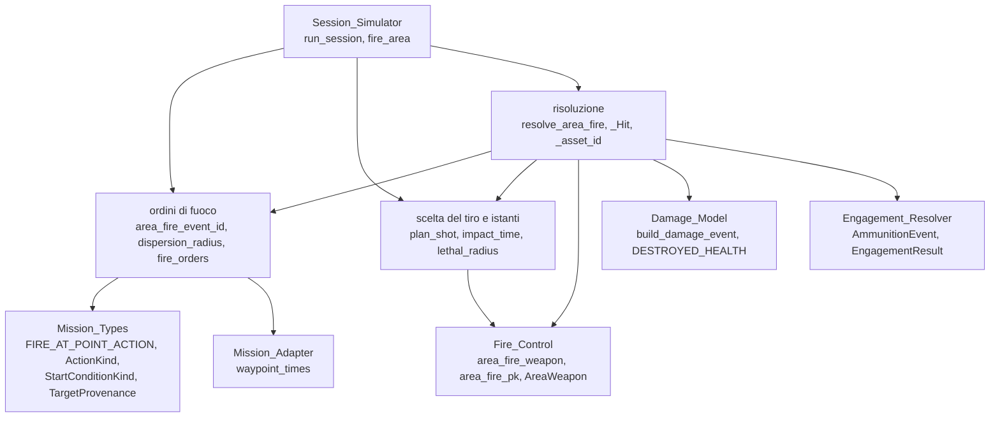

Lettura: `RIS --> ORD` perché `resolve_area_fire` usa `area_fire_event_id` per il log (`:254`, `:263`); `RIS --> SCE` perché chiama `plan_shot`, `impact_time` e `lethal_radius` (`:259`, `:272`, `:273`); `SCE --> FC` perché `plan_shot` chiama `FC.area_fire_weapon` (`:213`); `RIS --> FC` per `FC.area_fire_pk` (`:285`).
Il core vede il modulo come un blocco a tre ruoli: la sessione **pianifica** (`ORD`, `SCE`) e poi **risolve** (`RIS`). Rimando a **D58** e **D59** (import fra i moduli: `Area_Fire` importa cinque moduli del core e nessuno importa `Area_Fire` tranne `Session_Simulator`), a **D49** (la regola di tiro come flowchart) e a **D50** (il fuoco su posizione nella coda di sessione).

### La sequenza degli ordini di fuoco (D108)

*Diagramma D108 — la pianificazione: `fire_orders`, `plan_shot` senza scorta e `impact_time`, come li chiama `run_session` (livello L3, verificato a f009eb43).*

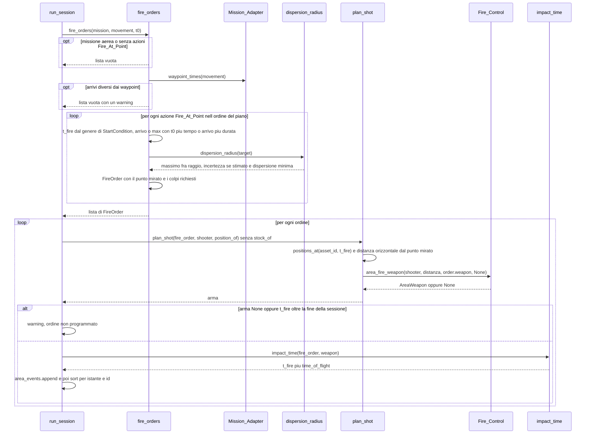

Righe: interruttore `F7_AREA_FIRE` `Logic/Session_Simulator.py:2494`; `fire_orders` chiamata `:2499` (definita `Logic/Area_Fire.py:144`: uscita aerea `:150`, raccolta delle azioni `:153-155`, uscita senza azioni `:157`, `MA.waypoint_times` `:160`, uscita per arrivi incoerenti `:162-166`, `t_fire` per genere `:175-180`,
`FireOrder(...)` `:182-186`); `dispersion_radius` `:185` (definita `:136`); `plan_shot` `:2500` (definita `:202`: `positions_at` `:207`, distanza `:212`, `FC.area_fire_weapon` `:213`); avviso e salto `:2502-2505`; `impact_time` `:2507` (definita `:216`); ordinamento `:2510`. L'ordine di `area_events` è per (istante d'impatto, `event_id`):
**è parte del determinismo** (stesso input, stesso ordine di risoluzione). Due fatti che il codice mostra: (1) l'arma è scelta **qui senza la scorta** (`stock_of` assente), perché a questo punto serve solo l'istante d'impatto `t_fire + time_of_flight`; la scorta è riletta al momento del tiro (D109). Quindi un ordine può essere programmato e poi
non sparare, se la scorta è finita nel frattempo. (2) `fire_orders` usa `time` di `StartCondition` come istante assoluto `t0 + time` solo per `AT_TIME` (`:176`); per `AFTER_DURATION` `t_fire = arrivo + duration_s` (`:178`) e per `ON_ARRIVAL` l'arrivo (`:180`). La validazione che `target.position` esista per l'azione è nella `Mission` (D95), non qui.

### La sequenza di `resolve_area_fire` (D109)

*Diagramma D109 — `resolve_area_fire`: l'ordine delle chiamate e delle estrazioni dell'RNG di sessione, con le deleghe a `Fire_Control`, `Damage_Model` e `Engagement_Resolver` (livello L3, verificato a f009eb43).*

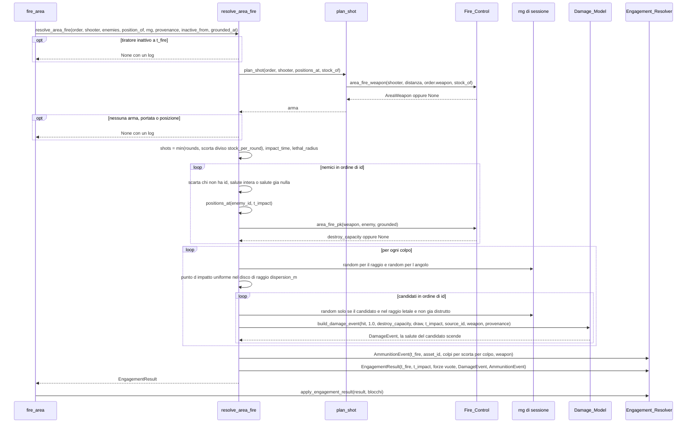

Righe: `fire_area` `Logic/Session_Simulator.py:2467` (chiama `AF.resolve_area_fire` `:2474` con l'RNG `order.rng(mission_id=..., event_id=..., counter=0)` `:2475`; dopo il ritorno `results.append` `:2482`, `resolved.append` `:2483`, `ER.apply_engagement_result` `:2486`); in `Area_Fire`: controllo di inattività `:252-255`;
`stock_of` dal tiratore `:257-258`; `plan_shot` `:259`; uscita senza arma `:261-264`; `stock` e `shots` `:266-267`; `impact_time` `:272`; `lethal_radius` `:273`; ciclo sui nemici in ordine di id `:276-291` (`positions_at` `:284`, `FC.area_fire_pk` `:285`); ciclo dei colpi `:295-309` (due `rng.random()` `:296`,
disco `:297-300`, `DM.build_damage_event` con una terza estrazione `:306`, aggiornamento di `hit.health` `:308`); `AmmunitionEvent` `:311`; `EngagementResult` `:314`. **L'ordine delle estrazioni è il contratto** (docstring `:51-52`): per ogni colpo due estrazioni (raggio, angolo) e poi **una per ogni candidato nel raggio letale e non ancora distrutto**, nell'ordine
di id dei candidati, anche se il colpo non lo distrugge. Il risultato è un `EngagementResult` con `forces=()`, quindi non entra nelle forze d'ingaggio (niente tempra, disingaggio o shock sul colpito). Non muta gli asset: li muta la sessione con `apply_engagement_result`. La logica come regola (condizioni, rami, esito) è già **D49**;
il fuoco nella coda di sessione è **D50**; le parti interne di `Fire_Control` sono **D75**. Altre osservazioni sul codice: (1) il controllo `shots < 1` (`:269`) non può scattare con un'arma scelta da `plan_shot` con `stock_of` dato, perché `area_fire_weapon` esclude le armi con scorta inferiore a `stock_per_round` (D75): è una difesa, non un ramo raggiungibile.
(2) `DM.build_damage_event` è tipato `Optional[DamageEvent]` (ritorna `None` per un asset senza salute leggibile) ma qui `event.health_after` non è protetto da un controllo (`:308`): è sicuro perché `_Hit.health` è un `int` già verificato (`:280`), quindi l'evento non è mai `None`. (3) La scorta consumata è `shots × stock_per_round` anche se nessun colpo ha toccato nessuno.

### Tabella completa dei simboli di `Logic/Area_Fire`

Le colonne «Tipo», «Simbolo», «Firma» e «Riga» sono l'uscita di `inventario.py --tabella Logic/Area_Fire` (11 righe, nell'ordine dell'uscita); «Gruppo» è il ruolo di D107; «Chiamata da» elenca i chiamanti **dentro il modulo** e **nel core** (`SS` = `Session_Simulator`).

| Gruppo | Tipo | Simbolo | Firma | Riga | Che cosa fa | Chiamata da |
|---|---|---|---|---|---|---|
| ordini di fuoco | classe | `FireOrder` | `FireOrder`; campi: mission_id, asset_id, waypoint_index, action_index, t_fire, aim_x, aim_y, dispersion_m, rounds, weapon | `:107` | Un'azione di fuoco su posizione di UN asset, nella forma del motore. | costruita da `fire_orders`; letta da `area_fire_event_id`, `impact_time`, `plan_shot`, `resolve_area_fire`; `SS:run_session` e `SS:fire_area` (annotazione e lettura) |
| risoluzione | classe | `_Hit` | `_Hit`; campi: __slots__ | `:221` | Copia di lavoro di un nemico: `id` e `health` che evolvono colpo dopo colpo. | `resolve_area_fire` |
| risoluzione | metodo | `_Hit.__init__` | `__init__(self, asset_id, health)` | `:226` | Imposta `id` e `health`. | `resolve_area_fire` (costruttore `_Hit`) |
| ordini di fuoco | funzione | `area_fire_event_id` | `area_fire_event_id(order)` | `:131` | Il `event_id` dell'RNG e dell'evento: `area_fire\|mission\|asset\|wp\|action`. | `resolve_area_fire` (per i log); `SS:run_session`, `SS:fire_area` |
| ordini di fuoco | funzione | `dispersion_radius` | `dispersion_radius(target)` | `:136` | Raggio di dispersione: massimo fra `radius_m`, `uncertainty_m` (se `ESTIMATED`) e `AREA_FIRE_MIN_DISPERSION_M`. | `fire_orders` |
| ordini di fuoco | funzione | `fire_orders` | `fire_orders(mission, movement, t0)` | `:144` | Gli ordini di fuoco dell'asset di `movement`, nell'ordine del piano dei punti; lista vuota se la missione è aerea o senza azioni. | `SS:run_session` |
| scelta del tiro | funzione | `lethal_radius` | `lethal_radius(weapon)` | `:193` | Raggio letale: `AREA_FIRE_LETHAL_RADIUS_PER_MM × calibro`, ripiego `AREA_FIRE_LETHAL_RADIUS_M`. | `resolve_area_fire` |
| scelta del tiro | funzione | `plan_shot` | `plan_shot(order, shooter, positions_at, stock_of)` | `:202` | L'arma del tiro (`area_fire_weapon`) dalla posizione del tiratore a `t_fire`, None se manca posizione, arma, portata o scorta. | `resolve_area_fire`; `SS:run_session` (senza scorta) |
| scelta del tiro | funzione | `impact_time` | `impact_time(order, weapon)` | `:216` | Istante d'impatto: `t_fire + time_of_flight`. | `resolve_area_fire`; `SS:run_session` |
| risoluzione | funzione | `resolve_area_fire` | `resolve_area_fire(order, shooter, enemies, positions_at, rng, provenance, inactive_from, grounded_at)` | `:231` | Risolve un ordine di fuoco: `EngagementResult` senza forze, oppure None se non c'è tiro. Non muta gli asset. | `SS:fire_area` (funzione locale di `run_session`) |
| risoluzione | funzione | `_asset_id` | `_asset_id(asset)` | `:318` | Id di dominio (`id`, poi `name`): stesso criterio di `Engagement_Resolver._domain_id`. | `resolve_area_fire` |
