# Capitolo 10, parte C — Atlante dei diagrammi: porte d'ingresso e uscita, campagna e mappa dei dati

Questo file è la **parte C** del capitolo 10 (l'atlante dei diagrammi). Il pilota, con la scala dei livelli L0-L4, le convenzioni e i diagrammi D57-D66, è in
[`11_Atlante_Diagrammi.md`](11_Atlante_Diagrammi.md); la parte A (D67-D87: `Contact_Scheduler`, `Fire_Control`, `Engagement_Resolver`) è in
[`11a_Atlante_Risolutore.md`](11a_Atlante_Risolutore.md); la parte B (D90-D109: `Mission_Types`, `Fuel_Model`, `Area_Fire`) è in
[`11b_Atlante_Missione_Carburante.md`](11b_Atlante_Missione_Carburante.md). Qui non si ripete la scala: si **estende** il livello L2 (tipi e API pubblica, con la tabella completa dei simboli)
e il livello L3 (sequenze di chiamata) ai sette moduli che chiudono il perimetro del core: le due **porte** (`Command/Session_Types`), il **registro di campagna** (`Command/Campaign_Types`),
il ciclo di campagna (`Logic/Session_Validator`, `Logic/Session_Campaign`, `Logic/Readiness`), il **danno** (`Logic/Damage_Model`) e l'**RNG di sessione** (`Utility/Session_Rng`).
In fondo, una **mappa dei dati** trasversale: il percorso delle strutture fra i moduli. I diagrammi nuovi sono **D110-D129** (l'intervallo assegnato a questa parte).
I diagrammi D1-D109 non sono toccati: dove una regola ha già il suo diagramma (livello L4, o un L3 delle parti precedenti) il nuovo diagramma rimanda a quello e non lo duplica.

**Come leggere.** I riferimenti sono `percorso:riga`, **relativi a `Code/Dynamic_War_Manager/Source/`**, come nel resto del manuale; una riga senza percorso (`:2475`) è del modulo di cui si sta parlando.
Nei diagrammi di sequenza `X->>X` è la chiamata a una funzione privata dello stesso modulo. Nei diagrammi di funzioni per ruolo (`flowchart`, D112, D119) una freccia `A --> B` significa
«le funzioni di `A` **chiamano** funzioni di `B`»; nei diagrammi di import (D58-D60) significa «`A` importa `B`»; **nei diagrammi di flusso dei dati (D124, D127-D129) la freccia `A --> B` significa
«i dati vanno da `A` a `B`»** e in D126 «lo stream va da `A` a `B`»: la lettura è dichiarata nella legenda di ciascuno. Le didascalie hanno la forma `*Diagramma Dnn — ... (livello Lx, verificato a f009eb43).*`.
Nei messaggi delle sequenze la lettera «è» è scritta «e» e gli apostrofi sono omessi: è una cautela di sintassi, non un refuso.

**Come sono stati verificati.** Codice a `f009eb43` (ultimo commit che tocca i sorgenti sotto `Code/`; `git diff f009eb43 HEAD -- Code/` mostra solo `Test/baseline/scenario_baseline.json`, nessun sorgente cambia). Elenchi di classi,
campi, metodi e funzioni con `_strumenti/inventario.py --tabella` (estrazione con `ast`, sola lettura); chiamanti **dentro il modulo** e **nel core** con ricerche per nome sui sorgenti sotto `Source/`, **esclusi i test**
(i chiamanti che esistono solo nei test sono dichiarati come tali: «nessun chiamante nel core»); la mappa dei dati con `inventario.py --chiamate Logic/Session_Simulator run_session` e `grep`. Ordine delle chiamate nelle sequenze
**letto nel codice, riga per riga**, perché l'estrazione non dice in quale ramo si chiama. Nessun test eseguito: nessun codice è stato toccato. Sui conteggi: «simboli» sono le righe dati della tabella di `inventario.py`
(classi, metodi e funzioni di primo livello; le costanti di modulo e le funzioni locali non ci sono e sono citate a parte nel testo). Abbreviazioni nelle colonne «Chiamata da»: `SS` = `Session_Simulator`, `SV` = `Session_Validator`,
`SC` = `Session_Campaign`, `RD` = `Readiness`, `MA` = `Mission_Adapter`, `ER` = `Engagement_Resolver`, `AF` = `Area_Fire`, `FM` = `Fuel_Model`, `ST` = `Session_Types`, `CT` = `Campaign_Types`, `DM` = `Damage_Model`.

## 10C.1 I diagrammi di questa parte

| Dnn | Livello | Tipo | Titolo | Modulo | Sezione | Si collega a |
|---|---|---|---|---|---|---|
| D110 | L2 | `classDiagram` | `SessionOrder` con tutti i membri e i tipi da cui dipende | `Session_Types` | 10C.2 | D2, D16, D96 |
| D111 | L2 | `classDiagram` | `SessionOutcome` con tutti i membri e i tipi degli eventi che contiene | `Session_Types` | 10C.2 | D2, D17, D39 |
| D112 | L2 | `flowchart TD` | Le funzioni di `Session_Types` per ruolo e le chiamate fra i gruppi | `Session_Types` | 10C.2 | D58, D59 |
| D113 | L3 | `sequenceDiagram` | `assemble_session_outcome`: controlli, raggruppamento, costruzione e `SessionOutcome.__post_init__` | `Session_Types` | 10C.2 | D66, D97 |
| D114 | L2 | `classDiagram` | `ViolationCode`, `SessionRules`, `SessionViolation` e `SessionValidationError` con tutti i membri | `Campaign_Types` | 10C.3 | D51 |
| D115 | L2 | `classDiagram` | `SessionRecord`, `ReadyRecord` e `CampaignLedger` con tutti i membri | `Campaign_Types` | 10C.3 | D51, D53 |
| D116 | L3 | `sequenceDiagram` | La vita del registro: costruzione, `with_session`, `with_readiness` e andata e ritorno su `Campaign_State` | `Campaign_Types` | 10C.3 | D54, D121 |
| D117 | L3 | `sequenceDiagram` | `check_session` e `validate_session`: l'ordine delle chiamate verso registro, simulatore e adapter | `Session_Validator` | 10C.4 | D52, D96 |
| D118 | L3 | `sequenceDiagram` | `apply_final_positions`: dalle posizioni dell'esito alla posizione degli asset | `Session_Campaign` | 10C.5 | D54, D56 |
| D119 | L2 | `flowchart TD` | Le funzioni di `Readiness` per ruolo, le dipendenze e il solo chiamante | `Readiness` | 10C.6 | D58, D60 |
| D120 | L3 | `sequenceDiagram` | `record_session` e `readiness_after_session`: dal registro vecchio al registro nuovo | `Readiness` | 10C.6 | D53, D54 |
| D121 | L3 | `sequenceDiagram` | Il difetto 26: il record di un asset assente attraverso `apply_campaign_processes` e `readiness_after_session` | `Readiness` | 10C.6 | D53, D56 |
| D122 | L2 | `classDiagram` | `DamageEvent`, le funzioni e le costanti di `Damage_Model` e i tipi che lo usano | `Damage_Model` | 10C.7 | D7, D58 |
| D123 | L3 | `sequenceDiagram` | `build_damage_event`: controlli, esito e delta di salute dentro il modulo | `Damage_Model` | 10C.7 | D85, D109 |
| D124 | L2 | `flowchart LR` | Il percorso di un `DamageEvent`: dove nasce, dove è applicato, chi lo legge (frecce = dati) | `Damage_Model` | 10C.7 | D85, D86 |
| D125 | L3 | `sequenceDiagram` | Dalla chiave all'istanza: `SessionOrder.rng`, `session_rng`, `session_seed` | `Session_Rng` | 10C.8 | D109, D126 |
| D126 | L2 | `flowchart LR` | Chi apre quale stream: le chiavi di `engage` e `fire_area` e i consumatori (frecce = stream) | `Session_Rng` | 10C.8 | D81, D109 |
| D127 | L1 | `flowchart LR` | Mappa dei dati: il percorso in una sessione, dagli argomenti di `run_session` al `SessionOutcome` (frecce = dati) | trasversale | 10C.9 | D8, D58, D59 |
| D128 | L2 | `flowchart LR` | Mappa dei dati: le versioni del `CampaignLedger` e i dati in un passo di `run_campaign_session` (frecce = dati) | trasversale | 10C.9 | D54, D60 |
| D129 | L2 | `flowchart LR` | Mappa dei dati: i campi del `SessionOutcome`, chi li produce e chi li legge (frecce = dati) | trasversale | 10C.9 | D2, D111 |

Conteggio: **L1** = D127 (1); **L2** = D110, D111, D112, D114, D115, D119, D122, D124, D126, D128, D129 (11); **L3** = D113, D116, D117, D118, D120, D121, D123, D125 (8); totale **20** (D110-D129, senza buchi né duplicati).

Per modulo: `Session_Types` D110-D113 (4: 3 L2, 1 L3); `Campaign_Types` D114-D116 (3: 2 L2, 1 L3); `Session_Validator` D117 (1 L3); `Session_Campaign` D118 (1 L3); `Readiness` D119-D121 (3: 1 L2, 2 L3); `Damage_Model` D122-D124 (3: 2 L2, 1 L3);
`Session_Rng` D125-D126 (2: 1 L2, 1 L3); mappa dei dati D127-D129 (3: 1 L1, 2 L2). I simboli sono in totale 29 + 24 + 4 + 4 + 14 + 8 + 3 = **86**, tutti nelle tabelle di fine sezione.

Diagrammi già esistenti, **non duplicati**: per le porte D2 (i tipi di dominio), D16 e D17 (la Missione e i suoi esiti), D96-D97 (11b: dalla costruzione dell'ordine alla porta e dagli esiti all'esito di sessione), D66 (l'assemblaggio in `run_session`); per il registro D51 (i sette tipi e come si legano);
per la validazione D52 (i controlli di `validate_session`) e D96 (confronto con `_check_missions`); per la prontezza D53 (la regola per un asset), D54 (un passo del ciclo di campagna) e D55-D56 (gli scenari S30-CAMPAIGN e S30-ABSENT); per il danno D5 e D85-D86 (la risoluzione dei colpi e l'applicazione, 11a), D7 (gli stati della salute) e D109 (il fuoco su posizione);
per il flusso dei dati dentro `run_session` D8 e D64-D66. I nuovi D113, D116-D118, D120-D121, D123 e D125 mostrano **dentro** o **fra** queste scatole l'ordine delle chiamate; non ripetono mai i rami di una regola già disegnata.

## 10C.2 L2 e L3 — `Command/Session_Types` (712 righe, 29 simboli)

Il modulo è il **contratto delle due porte di sessione**: `SessionOrder` (core → sessione, `:223`) e `SessionOutcome` (sessione → core, `:400`), più la regola d'esito dell'Operazione (`operation_outcome` `:528`) e l'assemblatore puro
`assemble_session_outcome` (`:582`). Il docstring (`:1-43`) dichiara tre vincoli: nessun identificativo del simulatore (solo id di dominio, secondi assoluti, metri); i tipi atomici **non** sono duplicati ma importati
(`Mission`, `MissionOutcome`, `MissionStatus`, `Operation`, `OperationOutcome`, `OperationStatus`, `OutcomeRule` da `Mission_Types` `:52-60`; `TIME_EPS` da `Contact_Scheduler` `:61`; `DamageEvent` `:62`; `AmmunitionEvent`, `EngagementResult`, `ForceOutcome`,
`InterceptionEvent` `:63-68`; `FuelEvent` `:69`; il modulo `Session_Rng` `:70`); nessuna scrittura in `Campaign_State` e nessuna applicazione agli asset («`assemble_session_outcome` è una funzione pura»).
Contiene **2 classi** `dataclass(frozen=True)`, 6 metodi di `SessionOrder`, 8 di `SessionOutcome` (una proprietà, `force_outcomes` `:458`) e **13 funzioni** di primo livello (due pubbliche, `operation_outcome` e `assemble_session_outcome`, e undici private),
cioè 29 simboli. **Nessuna costante di calcolo**: l'unico simbolo di modulo che non è una funzione è il `logger` (`:74`). `import random` (`:47`) serve **solo** all'annotazione di ritorno `-> random.Random` (`:388`): il modulo non estrae mai numeri
casuali, e l'unica sorgente di casualità resta `Session_Rng` (D125).

### Le due porte (D110, D111)

*Diagramma D110 — `SessionOrder` con tutti i membri e i tipi da cui dipende (livello L2, verificato a f009eb43).*

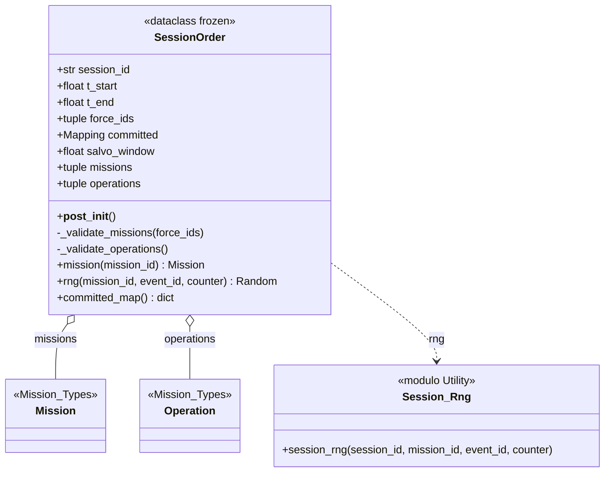

Lettura: i **valori predefiniti** (non mostrati nel diagramma) sono `t_start = 0.0`, `t_end = None` (sessione aperta: la durata la decide l'esecutore), `force_ids = ()`, `committed = None`, `salvo_window = 0.0`, `missions = ()`, `operations = ()` (`:258-265`);
`session_id` è l'unico campo obbligatorio. `committed` ha `hash=False` (`:262`) perché diventa un `MappingProxyType`. **Ordine delle validazioni** di `__post_init__` (`:267-317`), letto riga per riga: (1) `session_id` non vuoto `:268`; (2) `t_start` numero (non `None`, `:270-273`),
`t_end` numero o `None` `:275`, `t_end` non prima di `t_start` meno `TIME_EPS` `:276`, e **riscrittura come float** con `object.__setattr__` `:277-278`; (3) `force_ids` come tupla di id non vuoti e **distinti** `:280-288`; (4) `committed`, se dato: mapping `:291`,
chiave non vuota e, se `force_ids` non è vuoto, **elencata in `force_ids`** `:298-301`, valore non `str` `:303`, asset non vuoti `:306`, normalizzato a `MappingProxyType` **senza riordinare le chiavi** `:309`; (5) `salvo_window` numero non negativo, `bool` escluso `:311-315`;
(6) `_validate_missions(force_ids)` `:316`; (7) `_validate_operations()` `:317`. Le due validazioni di insieme non sono ripetute qui: **D96** (11b) mostra cosa verificano (`mission_id` distinti, `block_id` in `force_ids`, un asset in al più una missione; `operation_id` distinti,
ogni `mission_id` esiste nell'ordine, una missione in una sola Operazione, `operation_id` dichiarato coerente). `rng` è una **delega sottile**: `Session_Rng.session_rng(self.session_id, mission_id, event_id, counter)` (`:390`), v. 10C.8. `committed_map` restituisce un `dict` ordinario
o `None` (`:394`), pronto per `resolve_engagement(committed=...)`. `mission(mission_id)` è una ricerca lineare con `KeyError` (`:380-386`) e **non ha chiamanti nel core** (solo test). Rimando a **D2** (capitolo 2) per l'insieme delle due porte e a **D16** per i tipi della Missione.

*Diagramma D111 — `SessionOutcome` con tutti i membri e i tipi degli eventi che contiene (livello L2, verificato a f009eb43).*

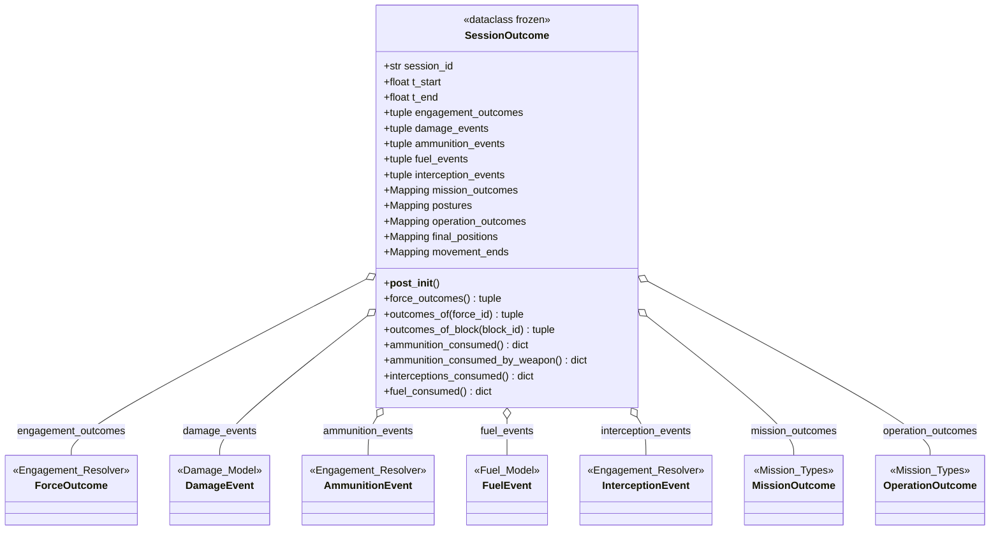

Lettura: i campi sono nell'ordine del codice (`:435-447`; `fuel_events` precede `interception_events`). Solo `session_id`, `t_start` e `t_end` sono obbligatori; gli altri hanno default vuoto e i cinque mapping `hash=False`. **Che cosa valida `__post_init__`** (`:449-456`):
`session_id` non vuoto, l'intervallo (`_check_interval` su `_check_time` dei due estremi, **senza riscrivere i valori**, a differenza di `SessionOrder` `:277-278`: un `t_start` intero resta intero) e le cinque mappe, ciascuna resa immutabile con `MappingProxyType` (D112).
**Non** valida il tipo degli elementi delle sei tuple di eventi (`engagement_outcomes`, `damage_events`, `ammunition_events`, `fuel_events`, `interception_events`): quel controllo è in `assemble_session_outcome` (D113) per gli `EngagementResult` e i `FuelEvent`; un `SessionOutcome` costruito a mano non è controllato.
Le cinque mappe, secondo le funzioni `_check_*`: `mission_outcomes` chiave = `mission_id` dell'esito `:122`, **ordine di inserimento conservato** (`MappingProxyType(normalized)` `:128`); `postures` ordinata per id `:140` (valore = id non vuoto `:138`); `operation_outcomes` ordinata per id `:164`;
`final_positions` ordinata per id, tre float finiti `:189-194`; `movement_ends` ordinata per id, numero non `None` `:207-212`. I sette lettori sono funzioni pure di aggregazione: `force_outcomes` appiattisce gli esiti nell'ordine degli ingaggi `:461`; `outcomes_of` e `outcomes_of_block` filtrano per `force_id` o `block_id`
(con l'eccezione della vista residua, `block_id` `None` e `force_id` uguale all'id del blocco, `:475-476`); `ammunition_consumed`, `ammunition_consumed_by_weapon`, `interceptions_consumed` e `fuel_consumed` sommano per `asset_id` (`:487-525`). **Nel core** si usano solo tre lettori, tutti da `Readiness`
(`ammunition_consumed` `:191`, `interceptions_consumed` `:192`, `fuel_consumed` `:193`); `force_outcomes`, `outcomes_of`, `outcomes_of_block` e `ammunition_consumed_by_weapon` non hanno chiamanti nel core (i docstring di `Session_Simulator` li citano, `:153`, `:314`). Rimando a **D2** e a **D17**.

### Le funzioni per ruolo (D112)

*Diagramma D112 — i gruppi di funzioni di `Session_Types` e le chiamate fra gruppi (livello L2, verificato a f009eb43).*

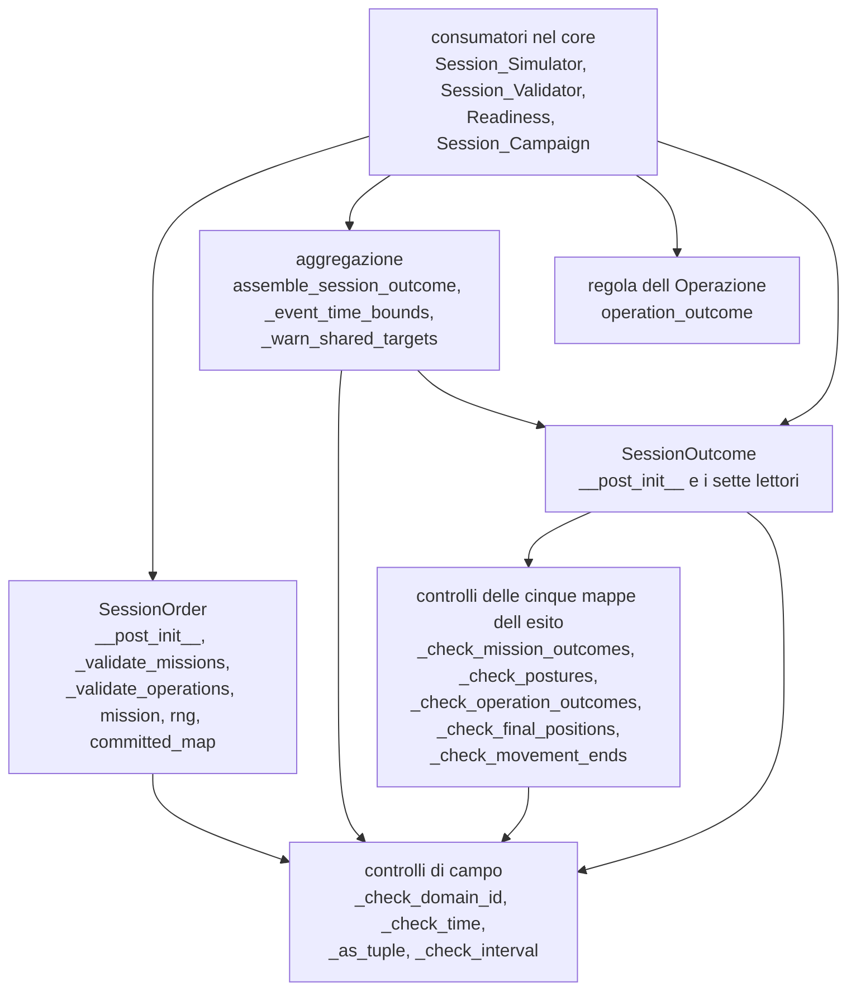

Lettura: le frecce sono chiamate (estrazione `ast`, riscontrata sul testo). `ORD --> CAMPO` perché `__post_init__` usa `_check_domain_id`, `_check_time`, `_check_interval` e `_validate_*` usa `_as_tuple` (`:320`, `:345`); `MAPPE --> CAMPO` perché ogni controllo di mappa chiama `_check_domain_id`
e, per posizioni e fine movimento, `_check_time` (`:187`, `:210`); `AGG --> OUT` perché `assemble_session_outcome` costruisce il `SessionOutcome` (`:687`). `operation_outcome` non chiama nessuna funzione del modulo: costruisce un `OperationOutcome` di `Mission_Types` (`:570`). Il gruppo `EXT` è la colonna
«Chiamata da» della tabella di fine sezione. Rimando a **D58** e a **D59** per gli import.

### L'assemblaggio dell'esito (D113)

*Diagramma D113 — `assemble_session_outcome`: l'ordine dei controlli, del raggruppamento e della costruzione, fino a `SessionOutcome.__post_init__` (livello L3, verificato a f009eb43).*

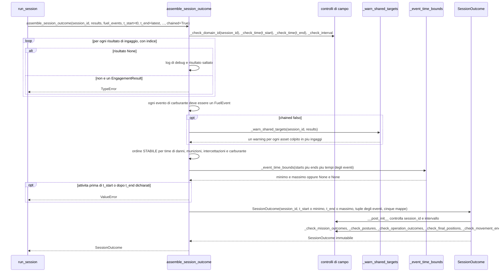

Righe: `assemble_session_outcome` `:582` (controlli iniziali `:642-645`; ciclo sui risultati `:649-659`, con il log `:651` e il `TypeError` `:656`; controllo dei `FuelEvent` `:663-665`; `_warn_shared_targets` `:667-668`, definita `:702`; ordinamenti `:670-674`; `starts`, `ends` e `event_times` `:676-678`;
`_event_time_bounds` `:679`, definita `:573`; controlli sull'intervallo dichiarato `:681-685`; costruzione `:687-699`). `SessionOutcome.__post_init__` `:449-456`. Il chiamante è `run_session` (`Logic/Session_Simulator.py:3158`) che passa `t_start=t0`, `t_end=latest`, `chained=True`: i due estremi sono **sempre dichiarati**, quindi il ricavo dal minimo e dal massimo degli eventi
serve solo a chi chiama `assemble_session_outcome` da altrove (test). `latest` è il massimo fra la fine nominale e i tempi dei danni, delle munizioni e dei `t_end` dei risultati (`:3075-3087`): se un impatto cade dopo la fine nominale, `t_end` dell'esito si estende (log `:3089-3091`). **Fatti che il codice rende importanti.**
(1) L'ordine degli eventi è il contratto: ordinamento **stabile** per `time` sulla concatenazione degli eventi nell'ordine degli ingaggi (docstring `:623-627`), quindi dentro un ingaggio l'ordine della coda del risolutore è preservato e a parità di istante fra ingaggi vale l'ordine degli ingaggi. (2) `mission_outcomes`, `postures`,
`operation_outcomes`, `final_positions` e `movement_ends` sono riportati **tali e quali** (`None` diventa `{}`, `:695-699`): l'assemblatore non li ricalcola; li ricalcola `run_session` (D66). (3) Con `chained=False` il warning `_warn_shared_targets` segnala un asset colpito in due ingaggi diversi (`:707-712`), perché i loro `health_before/after`
non sarebbero concatenabili; `run_session` passa `chained=True` perché applica ogni esito prima di risolvere il successivo (commento `:3156-3157`). (4) `fuel_events` entra nell'intervallo `[t_start, t_end]` ma **non** in `latest` (`:3075-3087` guarda solo danni, munizioni e `t_end` dei risultati): un evento di carburante oltre `latest` farebbe sollevare `ValueError`
(`:684-685`); i tratti di movimento sono costruiti fino a `session_end` (`MA.movement_legs(movement, t0, session_end)` `:2293`), che non supera `latest`, quindi nel flusso normale non accade, ma la garanzia sta in un altro modulo e non ho verificato i tratti prodotti dalla ri-pianificazione. Rimando a **D66** (`run_session` 3/3, dove l'assemblaggio chiude la sessione), a **D97** (11b, la regola d'esito dell'Operazione e della Missione) e a **D17**.

### Tabella completa dei simboli di `Command/Session_Types`

Le colonne «Tipo», «Simbolo», «Firma» e «Riga» sono l'uscita di `inventario.py --tabella Command/Session_Types` (31 righe con l'intestazione, 29 simboli, nell'ordine dell'uscita); «Gruppo» è il ruolo di D112; «Chiamata da» elenca i chiamanti **dentro il modulo** e **nel core**
(`SS` = `Session_Simulator`, `SV` = `Session_Validator`, `SC` = `Session_Campaign`, `RD` = `Readiness`). `SS:engage` e `SS:fire_area` sono funzioni locali di `run_session`.

| Gruppo | Tipo | Simbolo | Firma | Riga | Che cosa fa | Chiamata da |
|---|---|---|---|---|---|---|
| ordine | classe | `SessionOrder` | `SessionOrder`; campi: session_id, t_start, t_end, force_ids, committed, salvo_window, missions, operations | `:223` | Porta d'ingresso: che cosa una sessione deve simulare. | costruita solo da test e scenari (nessun chiamante di produzione); letta da `SS:run_session`, `SS:_session_horizon`, `SS:_collect_forces`, `SS:session_blocks`, `SS:_activity_plans`, `SS:_check_missions`, `SS:_engagement_forces`, `SS:_engagement_committed`, `SV:validate_session`, `SV:check_session`, `RD:_mission_assets`, `RD:readiness_after_session`, `RD:record_session`, `SC:run_campaign_session` |
| ordine | metodo | `SessionOrder.__post_init__` | `__post_init__(self)` | `:267` | Valida e normalizza i campi (D110). | implicito alla costruzione |
| ordine | metodo | `SessionOrder._validate_missions` | `_validate_missions(self, force_ids)` | `:319` | Missioni: tipo, `mission_id` distinti, `block_id` in `force_ids`, un asset in al più una missione. | `SessionOrder.__post_init__` `:316` |
| ordine | metodo | `SessionOrder._validate_operations` | `_validate_operations(self)` | `:344` | Operazioni: `operation_id` distinti, missioni esistenti, una missione in una sola Operazione, `operation_id` coerente. | `SessionOrder.__post_init__` `:317` |
| ordine | metodo | `SessionOrder.mission` | `mission(self, mission_id)` | `:380` | La missione dell'ordine con quell'id (`KeyError` se assente). | nessun chiamante nel core (solo test) |
| ordine | metodo | `SessionOrder.rng` | `rng(self, mission_id, event_id, counter)` | `:388` | Il `random.Random` della sessione per la chiave data: delega a `Session_Rng.session_rng`. | `SS:fire_area` (`:2475`), `SS:engage` (`:2766`, `:2774`) |
| ordine | metodo | `SessionOrder.committed_map` | `committed_map(self)` | `:392` | `committed` come `dict` ordinario, o `None`. | `SS:_engagement_committed` (`:2010`) |
| esito | classe | `SessionOutcome` | `SessionOutcome`; campi: session_id, t_start, t_end, engagement_outcomes, damage_events, ammunition_events, fuel_events, interception_events, mission_outcomes, postures, operation_outcomes, final_positions, movement_ends | `:400` | Porta d'uscita: tutto ciò che è successo in una sessione, immutabile. | costruita da `assemble_session_outcome` (`:687`); restituita da `SS:run_session`; letta da `RD:readiness_after_session`, `RD:_asset_outcomes`, `RD:_last_damage_times`, `RD:record_session`, `SC:apply_final_positions`, `SC:run_campaign_session` |
| esito | metodo | `SessionOutcome.__post_init__` | `__post_init__(self)` | `:449` | Valida id e intervallo e congela le cinque mappe (D111). | implicito alla costruzione |
| esito | metodo | `SessionOutcome.force_outcomes` | `force_outcomes(self)` | `:459` | Proprietà: tutti gli esiti di forza, appiattiti nell'ordine degli ingaggi. | `SessionOutcome.outcomes_of`, `SessionOutcome.outcomes_of_block`; nessun chiamante nel core |
| esito | metodo | `SessionOutcome.outcomes_of` | `outcomes_of(self, force_id)` | `:463` | Gli esiti della forza, uno per ingaggio. | nessun chiamante nel core (citata nel docstring di `SS`, `:314`) |
| esito | metodo | `SessionOutcome.outcomes_of_block` | `outcomes_of_block(self, block_id)` | `:467` | Gli esiti delle forze d'ingaggio di un blocco (le missioni più la vista residua). | nessun chiamante nel core (citata nel docstring di `SS`, `:153`) |
| esito | metodo | `SessionOutcome.ammunition_consumed` | `ammunition_consumed(self)` | `:478` | Unità di scorta spese in salve, per asset, nell'intera sessione. | `RD:readiness_after_session` (`:191`) |
| esito | metodo | `SessionOutcome.ammunition_consumed_by_weapon` | `ammunition_consumed_by_weapon(self)` | `:494` | Come la precedente, ripartita per arma (`None` = pool anonimo). | nessun chiamante nel core |
| esito | metodo | `SessionOutcome.interceptions_consumed` | `interceptions_consumed(self)` | `:509` | Intercettazioni effettuate per asset. | `RD:readiness_after_session` (`:192`) |
| esito | metodo | `SessionOutcome.fuel_consumed` | `fuel_consumed(self)` | `:518` | Carburante consumato per asset [frazione del carico pieno]. | `RD:readiness_after_session` (`:193`) |
| controlli | funzione | `_check_domain_id` | `_check_domain_id(label, value)` | `:77` | Id di dominio: stringa non vuota, altrimenti `TypeError`. | `_check_mission_outcomes`, `_check_postures`, `_check_operation_outcomes`, `_check_final_positions`, `_check_movement_ends`, `SessionOrder.__post_init__`, `SessionOutcome.__post_init__`, `assemble_session_outcome` |
| controlli | funzione | `_check_time` | `_check_time(label, value)` | `:84` | Secondi come `float` o `None`; `bool` e non numeri rifiutati. | `_check_final_positions`, `_check_movement_ends`, `SessionOrder.__post_init__`, `SessionOutcome.__post_init__`, `assemble_session_outcome` |
| controlli | funzione | `_as_tuple` | `_as_tuple(label, value, item_type)` | `:94` | Iterabile (non `str`) di elementi di un tipo, come tupla. | `SessionOrder._validate_missions`, `SessionOrder._validate_operations` |
| mappe dell'esito | funzione | `_check_mission_outcomes` | `_check_mission_outcomes(value)` | `:107` | `{mission_id: MissionOutcome}` immutabile, chiave uguale al `mission_id` dell'esito. | `SessionOutcome.__post_init__` |
| mappe dell'esito | funzione | `_check_postures` | `_check_postures(value)` | `:131` | `{asset_id: postura}` immutabile e ordinata per id. | `SessionOutcome.__post_init__` |
| mappe dell'esito | funzione | `_check_operation_outcomes` | `_check_operation_outcomes(value)` | `:143` | `{operation_id: OperationOutcome}` immutabile e ordinata per id. | `SessionOutcome.__post_init__` |
| mappe dell'esito | funzione | `_check_final_positions` | `_check_final_positions(value)` | `:167` | `{asset_id: (x, y, z)}` immutabile e ordinata per id, tre float finiti. | `SessionOutcome.__post_init__` |
| mappe dell'esito | funzione | `_check_movement_ends` | `_check_movement_ends(value)` | `:197` | `{asset_id: istante}` immutabile e ordinata per id. | `SessionOutcome.__post_init__` |
| controlli | funzione | `_check_interval` | `_check_interval(t_start, t_end)` | `:215` | `t_end` non prima di `t_start` entro `TIME_EPS`. | `SessionOrder.__post_init__`, `SessionOutcome.__post_init__`, `assemble_session_outcome` |
| regola Operazione | funzione | `operation_outcome` | `operation_outcome(operation, mission_outcomes)` | `:528` | Esito dell'Operazione dalla regola dichiarata (`MAIN_MISSION`, `ALL`, `ANY`); `ValueError` se manca l'esito di una missione. | `SS:run_session` (`:3154`) |
| aggregazione | funzione | `_event_time_bounds` | `_event_time_bounds(times)` | `:573` | (minimo, massimo) di una sequenza di istanti, `(None, None)` se vuota. | `assemble_session_outcome` (`:679`) |
| aggregazione | funzione | `assemble_session_outcome` | `assemble_session_outcome(session_id, engagement_results, fuel_events, t_start, t_end, mission_outcomes, postures, operation_outcomes, final_positions, movement_ends, chained)` | `:582` | Aggrega gli esiti in un `SessionOutcome`; funzione pura. | `SS:run_session` (`:3158`) |
| aggregazione | funzione | `_warn_shared_targets` | `_warn_shared_targets(session_id, results)` | `:702` | Warning per gli asset colpiti in più ingaggi della stessa sessione. | `assemble_session_outcome` (`:668`) |

## 10C.3 L2 e L3 — `Command/Campaign_Types` (405 righe, 24 simboli)

Il modulo è il **vocabolario di dominio della campagna** (F8): le regole della finestra di sessione, il resoconto del validatore e il **registro immutabile** delle sessioni passate e della prontezza degli asset. È una foglia: solo libreria standard
e il logger (`:24-34`), «nessun import da `Logic`, `Context`, `Asset`» (docstring `:5-6`; D58 e D60 lo confermano: nessuna dipendenza nel core). Per questo la tolleranza sugli istanti è **ripetuta** (`_TIME_EPS = 1e-9`, `:38`, «stessa grandezza di `Contact_Scheduler.TIME_EPS`») invece di importata.
**Costanti** (`:40-43`): `DEFAULT_SESSION_DURATION_S = 7_200.0` e `MAX_SESSION_DURATION_S = 14_400.0` (2 h e 4 h); il commento le dichiara «D4.b, decisione dell'utente (valori deliberati, NON stime)», quindi non sono stime del codice ma decisioni di progetto.
Il modulo ha **7 classi** (l'enumerazione `ViolationCode` con 11 membri `:48-59`, cinque `dataclass(frozen=True)` e l'eccezione `SessionValidationError`), **16 metodi** e **1 funzione** di primo livello (`_check_readiness_map` `:260`): 24 simboli. **D51** (capitolo 2) disegna i sette tipi e come si legano e resta; qui sono divisi in due diagrammi con tutti i membri.

### Regole, violazioni ed errore (D114)

*Diagramma D114 — `ViolationCode`, `SessionRules`, `SessionViolation` e `SessionValidationError` con tutti i membri (livello L2, verificato a f009eb43).*

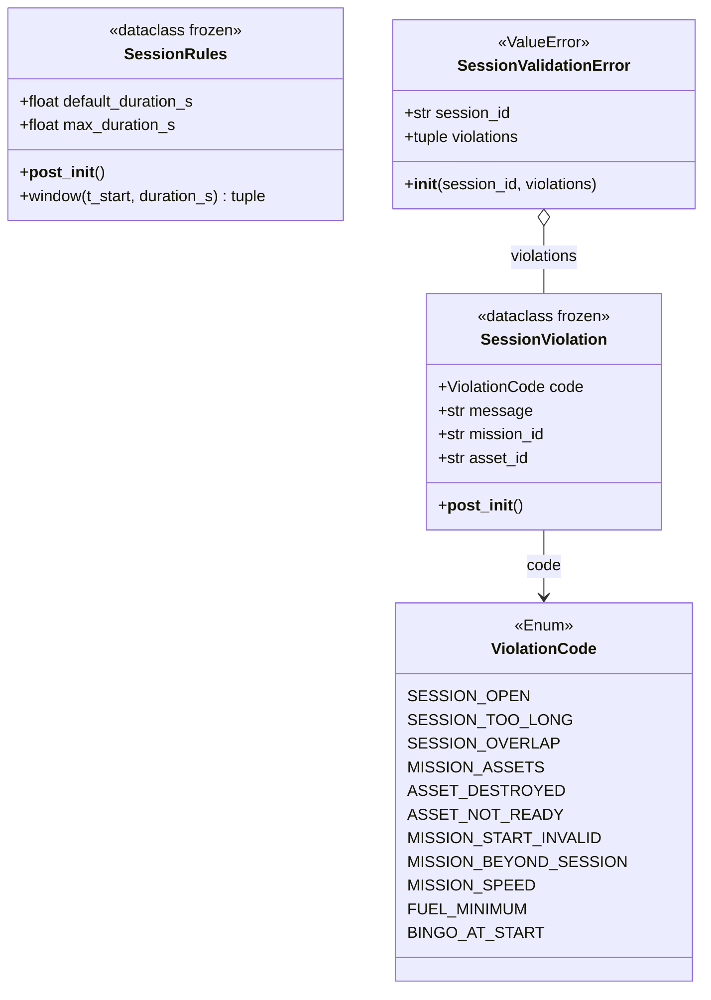

Lettura: `SessionRules.__post_init__` (`:76-89`) controlla per ciascuno dei due campi che sia un numero (non `bool`, `:79`) e positivo (`:81`), li riscrive come float (`:84-85`) e rifiuta un default maggiore del massimo oltre `_TIME_EPS` (`:87`). `window(t_start, duration_s)` (`:91-120`) è l'unico punto che costruisce una finestra:
`t_start` numerico `:105`; `duration_s = None` vale il default `:108-109`; durata non positiva `:115`, o oltre il massimo più `_TIME_EPS` `:117`, è `ValueError`; il risultato è `(t_start, t_start + durata)` `:120`. **`window` non ha chiamanti nel core**: la citano il messaggio di `SESSION_OPEN` del validatore (`Logic/Session_Validator.py:76`) e i test/lo scenario S30.
`SessionViolation.__post_init__` (`:138-146`) esige un `ViolationCode`, un messaggio non vuoto e, se dati, `mission_id` e `asset_id` stringhe non vuote. `SessionValidationError.__init__` (`:157-177`) esige `session_id` stringa non vuota e `violations` **tupla** di `SessionViolation` (`:158-161`),
costruisce un messaggio di una riga di testata e una riga per violazione, nella forma `[codice] (mission 'M', asset 'A') messaggio` (`:163-173`), e **imposta `session_id` e `violations` come attributi** (`:176-177`): per questo l'estrazione `ast` riporta «campi: -» ma l'eccezione ne ha due. Nel core questi quattro tipi li usa solo `Session_Validator`, che costruisce le violazioni e l'errore (D117).

### Il registro di campagna (D115)

*Diagramma D115 — `SessionRecord`, `ReadyRecord` e `CampaignLedger` con tutti i membri (livello L2, verificato a f009eb43).*

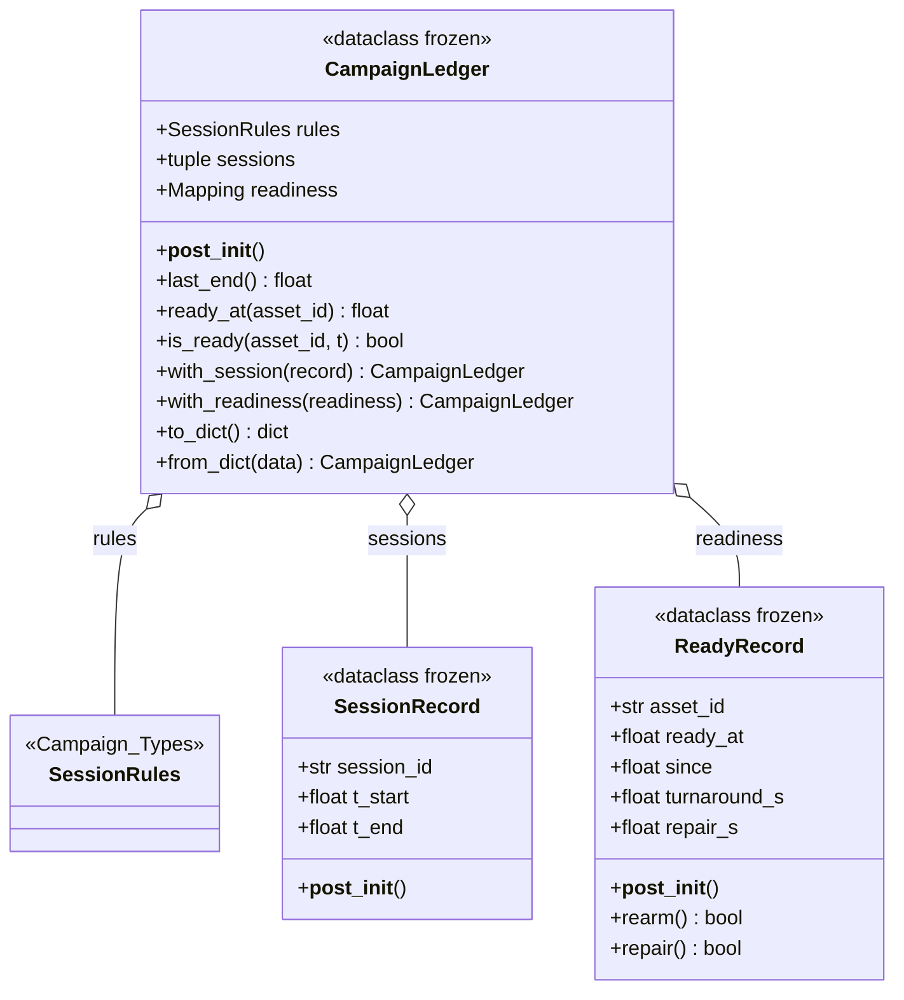

Lettura: `last_end`, `rearm` e `repair` sono `@property` (`:249`, `:254`, `:309`); `from_dict` è un `@classmethod` (`:374`). **Invarianti di `ReadyRecord`** (`:224-247`): `asset_id` stringa non vuota (`ValueError`, `:225`); i quattro numeri non `bool`, riscritti come float (`:228-232`);
`turnaround_s >= 0` e `repair_s >= 0` (`:234-237`); **`turnaround_s + repair_s > 0`** (`:239`): un record senza alcun processo non esiste; `ready_at >= since + turnaround_s + repair_s - _TIME_EPS` (`:243-247`). `rearm` è `turnaround_s > 0` e `repair` è `repair_s > 0` (`:252`, `:257`); il registro non porta un campo «provenienza»
del tempo di turnaround (v. «Limiti e domande»). **Invarianti di `SessionRecord`** (`:193-204`): id non vuoto, `t_start` e `t_end` numeri riscritti come float, `t_end >= t_start - _TIME_EPS`. **Invarianti di `CampaignLedger`** (`:289-307`): `rules` è una `SessionRules` `:290`;
ogni elemento di `sessions` è un `SessionRecord` `:294-297`; ogni sessione inizia **non prima** della fine della precedente (contigue ammesse, `:299-304`); `readiness` passa da `_check_readiness_map` (`:260-273`): mapping `str → ReadyRecord`, chiave uguale a `record.asset_id`, risultato `MappingProxyType` **ordinato per id**.
Il registro **non controlla** l'unicità dei `session_id` (nessun controllo nel codice). `is_ready(asset_id, t)` è «nessun record, oppure `ready_at <= t + _TIME_EPS`» (`:322`): un asset senza record è pronto. `ready_at(asset_id)` restituisce il valore o `None` (`:314-317`) ed **è senza chiamanti nel core**: il validatore legge `record.ready_at` direttamente
(`Logic/Session_Validator.py:150-151`). Rimando a **D51** per come i tipi si legano e a **D53** per la regola che produce i `ReadyRecord`.

### La vita del registro (D116)

*Diagramma D116 — costruzione, `with_session`, `with_readiness`, interrogazione e andata e ritorno su `Campaign_State` (livello L3, verificato a f009eb43).*

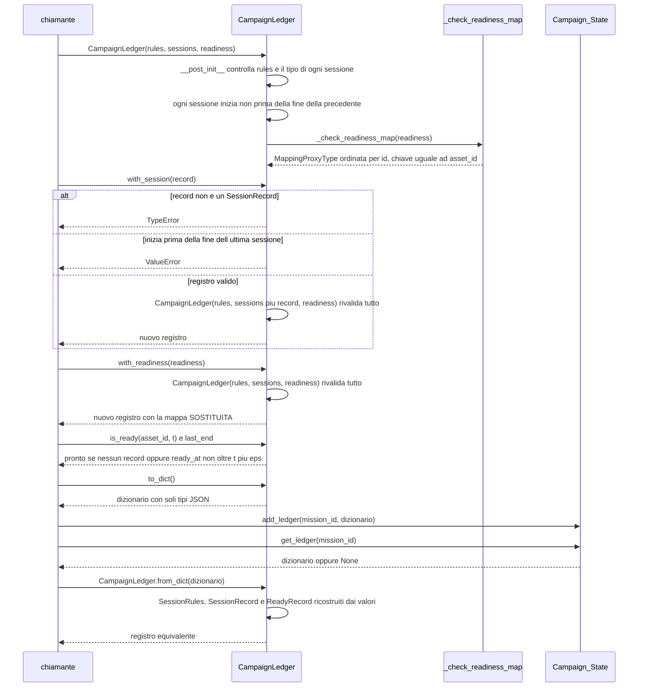

Righe: costruzione `:277-307`; `with_session` `:324-339` (tipo `:330`, sovrapposizione `:333`, nuovo registro `:337-339`); `with_readiness` `:341-345`; `is_ready` `:319-322`; `to_dict` `:347-372`; `from_dict` `:374-406` (regole `:380-384` con i default `DEFAULT_SESSION_DURATION_S` e `MAX_SESSION_DURATION_S` se mancano, sessioni `:386-393`, prontezza `:395-404`).
`Context/Campaign_State.add_ledger` (`Context/Campaign_State.py:245`) e `get_ledger` (`:260`) sono i soli punti di salvataggio: il suo docstring dice «Nessun import di `Command`: il chiamante converte con `CampaignLedger.from_dict`» (`:248-250`). Il core **non** chiama né `to_dict` né `from_dict` (nessun chiamante fuori dai test e dall'uso dichiarato in `Campaign_State`), e `Campaign_State` non è importato dal core (D57). **Fatti che il codice rende importanti.**
(1) Ogni `with_*` costruisce un registro **nuovo** e ne riesegue l'intera validazione (sessioni e mappa di prontezza): l'immutabilità si paga con una rivalidazione lineare a ogni passo. (2) `with_readiness` **sostituisce** la mappa, non la fonde (docstring `:342`); chi la chiama deve passare la mappa intera: è la ragione per cui il difetto 26 si correggeva alla radice in `readiness_after_session`
(D121). (3) `to_dict` scrive le chiavi nell'ordine dei dati (la mappa `readiness` è già ordinata per id da `_check_readiness_map`); l'andata e ritorno `from_dict(to_dict(x))` è dichiarata «inversa esatta» (docstring `:376`). Rimando a **D60** (import del ciclo di campagna) e a **D128** (le versioni del registro nel ciclo).

### Tabella completa dei simboli di `Command/Campaign_Types`

Le colonne «Tipo», «Simbolo», «Firma» e «Riga» sono l'uscita di `inventario.py --tabella Command/Campaign_Types` (26 righe con l'intestazione, 24 simboli, nell'ordine dell'uscita); «Gruppo» è il ruolo (regole e violazioni = D114, registro = D115). Correzione a mano di un limite dell'estrazione:
`SessionValidationError` ha due attributi (`session_id`, `violations`) impostati in `__init__` (`:176-177`), l'estrazione riporta «campi: -».

| Gruppo | Tipo | Simbolo | Firma | Riga | Che cosa fa | Chiamata da |
|---|---|---|---|---|---|---|
| regole e violazioni | classe | `ViolationCode` | `ViolationCode(Enum)`; membri: SESSION_OPEN, SESSION_TOO_LONG, SESSION_OVERLAP, MISSION_ASSETS, ASSET_DESTROYED, ASSET_NOT_READY, MISSION_START_INVALID, MISSION_BEYOND_SESSION, MISSION_SPEED, FUEL_MINIMUM, BINGO_AT_START | `:48` | I codici delle violazioni del validatore (F8). | usata da `SV:validate_session` (un codice per violazione, `:74`-`:215`); letta da `SessionValidationError.__init__` (`:170`) |
| regole e violazioni | classe | `SessionRules` | `SessionRules`; campi: default_duration_s, max_duration_s | `:66` | Durata di default e massima di una sessione (valori deliberati dall'utente). | `SV:validate_session` (parametro e ripiego `SessionRules()` `:62-65`, `rules.max_duration_s` `:83`); `CampaignLedger.rules` (valore predefinito) |
| regole e violazioni | metodo | `SessionRules.__post_init__` | `__post_init__(self)` | `:76` | Valida i due campi e il loro ordine. | implicito alla costruzione |
| regole e violazioni | metodo | `SessionRules.window` | `window(self, t_start, duration_s)` | `:91` | La finestra `(t_start, t_start + durata)`; durata `None` = default. | nessun chiamante nel core (solo test e scenario S30) |
| regole e violazioni | classe | `SessionViolation` | `SessionViolation`; campi: code, message, mission_id, asset_id | `:124` | Una violazione del validatore. | costruita da `SV:validate_session` (dodici punti, `:73`-`:214`); letta da `SessionValidationError.__init__` |
| regole e violazioni | metodo | `SessionViolation.__post_init__` | `__post_init__(self)` | `:138` | Valida codice, messaggio e id facoltativi. | implicito alla costruzione |
| regole e violazioni | classe | `SessionValidationError` | `SessionValidationError(ValueError)`; attributi (da `__init__`): session_id, violations | `:149` | Errore con la tupla delle violazioni e l'id di sessione. | sollevata da `SV:check_session` (`:244`) |
| regole e violazioni | metodo | `SessionValidationError.__init__` | `__init__(self, session_id, violations)` | `:157` | Valida gli argomenti e compone il messaggio. | `SV:check_session` (costruttore) |
| registro | classe | `SessionRecord` | `SessionRecord`; campi: session_id, t_start, t_end | `:181` | Una sessione conclusa: id, inizio, fine effettiva. | costruita da `RD:record_session` (`:269`); contenuta in `CampaignLedger.sessions` |
| registro | metodo | `SessionRecord.__post_init__` | `__post_init__(self)` | `:193` | Valida id, numeri e ordine degli estremi. | implicito alla costruzione |
| registro | classe | `ReadyRecord` | `ReadyRecord`; campi: asset_id, ready_at, since, turnaround_s, repair_s | `:208` | Prontezza di un asset: da quando è pronto e quali processi (turnaround, riparazione) la determinano. | costruita da `RD:readiness_after_session` (`:217`, `:257`); letta da `SV:validate_session` (`:150-151`), `SV:_process_label`, `RD:apply_campaign_processes` |
| registro | metodo | `ReadyRecord.__post_init__` | `__post_init__(self)` | `:224` | Valida i quattro numeri e le loro relazioni (D115). | implicito alla costruzione |
| registro | metodo | `ReadyRecord.rearm` | `rearm(self)` | `:250` | Proprietà: il record include riarmo e rifornimento (`turnaround_s > 0`). | `SV:_process_label` (`:263`, `:267`), `RD:apply_campaign_processes` (`:330`) |
| registro | metodo | `ReadyRecord.repair` | `repair(self)` | `:255` | Proprietà: il record include la riparazione (`repair_s > 0`). | `SV:_process_label` (`:263`, `:265`), `RD:apply_campaign_processes` (`:327`) |
| registro | classe | `CampaignLedger` | `CampaignLedger`; campi: rules, sessions, readiness | `:277` | Registro immutabile: regole, sessioni passate, prontezza degli asset. | passato e restituito da `RD:apply_campaign_processes`, `RD:record_session`, `RD:ready_assets`, `SV:validate_session`, `SV:check_session`, `SC:run_campaign_session` |
| registro | metodo | `CampaignLedger.__post_init__` | `__post_init__(self)` | `:289` | Valida regole, sessioni (tipo e disgiunzione) e mappa di prontezza. | implicito alla costruzione |
| registro | metodo | `CampaignLedger.last_end` | `last_end(self)` | `:310` | Proprietà: fine effettiva dell'ultima sessione, `None` se nessuna. | `SV:validate_session` (`:92`) |
| registro | metodo | `CampaignLedger.ready_at` | `ready_at(self, asset_id)` | `:314` | L'istante di prontezza di un asset, `None` senza record. | nessun chiamante nel core |
| registro | metodo | `CampaignLedger.is_ready` | `is_ready(self, asset_id, t)` | `:319` | L'asset è pronto a `t`: nessun record o `ready_at <= t + eps`. | `SV:validate_session` (`:149`), `RD:ready_assets` (`:346`) |
| registro | metodo | `CampaignLedger.with_session` | `with_session(self, record)` | `:324` | Registro con una sessione in coda; rifiuta una sovrapposizione. | `RD:record_session` (`:269`) |
| registro | metodo | `CampaignLedger.with_readiness` | `with_readiness(self, readiness)` | `:341` | Registro con la mappa di prontezza SOSTITUITA. | `RD:apply_campaign_processes` (`:335`), `RD:record_session` (`:270`) |
| registro | metodo | `CampaignLedger.to_dict` | `to_dict(self)` | `:347` | Rappresentazione con soli tipi JSON. | nessun chiamante nel core (protocollo di `Campaign_State.add_ledger`, `Context/Campaign_State.py:246`) |
| registro | metodo | `CampaignLedger.from_dict` | `from_dict(cls, data)` | `:375` | Metodo di classe: ricostruisce un registro dal dizionario di `to_dict`. | nessun chiamante nel core (protocollo di `Campaign_State.add_ledger`, `:250`) |
| registro | funzione | `_check_readiness_map` | `_check_readiness_map(value)` | `:260` | Valida e congela la mappa di prontezza: chiave = `asset_id`, ordinata per id. | `CampaignLedger.__post_init__` (`:307`) |

## 10C.4 L2 e L3 — `Logic/Session_Validator` (268 righe, 4 simboli)

Il validatore è una **funzione pura fuori da `run_session`** (docstring `:1-9`): l'esecutore esegue, il pianificatore valida; nessuna mutazione degli asset, nessuna estrazione casuale. Importa `Campaign_Types` (`:15-21`), `Mission_Types` (`Mission` e `check_mission_assets`, `:22`), `Session_Types.SessionOrder` (`:23`),
`Contact_Scheduler` come `CS`, `Mission_Adapter` come `MA` e `Session_Simulator` come `SS` (`:24-26`): nessun ciclo, perché nessuno di loro importa questo modulo (D60). L'unica costante è `_TIME_EPS = CS.TIME_EPS` (`:33`), importata e non ripetuta. Ha **4 funzioni**:
due pubbliche (`validate_session` `:36`, `check_session` `:231`) e due aiuti (`_domain_id` `:249`, `_process_label` `:259`), quindi un solo diagramma L3. I **controlli come regole** (finestra, disgiunzione, passi a-f per missione, con i codici di `ViolationCode`) sono già **D52** (capitolo 6 §6.25): non si ripetono; D96 (11b) mostra la differenza
fra questi controlli e quelli di `_check_missions` in `run_session`. Quello che manca, ed è D117, è **chi viene chiamato e in quale ordine**.

*Diagramma D117 — `check_session` e `validate_session`: l'ordine delle chiamate verso `Campaign_Types`, `Session_Simulator`, `Mission_Types` e `Mission_Adapter` (livello L3, verificato a f009eb43).*

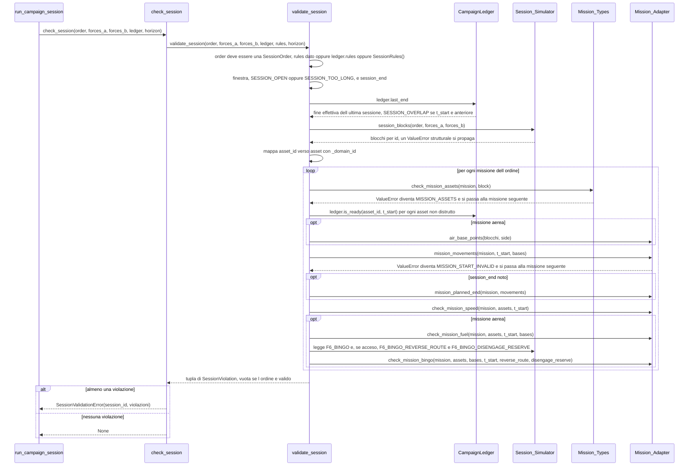

Righe: `check_session` `:231` → `validate_session` `:241`; controllo del tipo `:59-60`; risoluzione di `rules` `:62-65`; finestra `:69-89` (`session_end = t_start + horizon` se `t_end` è `None` e c'è `horizon`, altrimenti `None`, `:79`); `ledger.last_end` `:92`; `SS.session_blocks` `:102`; mappa degli asset `:108-113`;
ciclo per missione `:116`; `check_mission_assets` `:131`; asset distrutti e prontezza `:141-160`; basi `:164`; `MA.mission_movements` `:167`; `MA.mission_planned_end` `:178`; `MA.check_mission_speed` `:189`; `MA.check_mission_fuel` `:200`; `SS.F6_BINGO` `:208`, `MA.check_mission_bingo` `:210-212`; ritorno `:228`; errore `:244`.
**Fatti che il codice rende importanti.** (1) Il validatore **non muta** nulla ma **legge** tre interruttori di `Session_Simulator` come attributi del modulo (`SS.F6_BINGO`, `SS.F6_BINGO_REVERSE_ROUTE`, `SS.F6_BINGO_DISENGAGE_RESERVE`), così il bingo a priori segue sempre la regola dell'esecutore (D52, capitolo 6). (2) Dentro una missione due uscite interrompono l'esame
(`continue` a `:128`, `:138`, `:174`: blocco assente, asset non del blocco, partenza non valida); tutto il resto si somma. (3) La prontezza si controlla **all'inizio della sessione** (`order.t_start`), non alla partenza della missione (`:149`). (4) Il controllo `ledger.is_ready(...)` è il ramo `elif` del controllo `is_destroyed`: un asset distrutto non è controllato sulla prontezza (`:143-149`).
(5) **Due rami che non possono scattare** (dichiarati come tali, non corretti): nel messaggio di `ASSET_NOT_READY` il caso «no readiness record» (`:157-158`) è raggiungibile solo se `ledger.is_ready` dà «non pronto» **senza** un record, ma `is_ready` dà «pronto» quando il record manca (`Command/Campaign_Types.py:322`); e `_process_label` ha i rami `'no record'` e `'unknown process'` (`:261-262`, `:269`) che non
scattano, perché un `ReadyRecord` esiste solo con `turnaround_s + repair_s > 0` (`Command/Campaign_Types.py:239`) e quindi almeno una fra `repair` e `rearm` è vera. Sono difese, come il `try ... except ValueError: raise` di `:101-105`, che non cambia nulla. (6) `Mission` (`:22`) e `Mapping` (`:13`) sono importati e non usati. Rimando a **D52** (le regole), **D96** (confronto con `_check_missions`) e **D54** (dove `check_session` si inserisce nel ciclo).

### Tabella completa dei simboli di `Logic/Session_Validator`

Le colonne «Tipo», «Simbolo», «Firma» e «Riga» sono l'uscita di `inventario.py --tabella Logic/Session_Validator` (6 righe con l'intestazione, 4 simboli); «Gruppo» è il ruolo.

| Gruppo | Tipo | Simbolo | Firma | Riga | Che cosa fa | Chiamata da |
|---|---|---|---|---|---|---|
| validazione | funzione | `validate_session` | `validate_session(order, forces_a, forces_b, ledger, rules, horizon)` | `:36` | Tupla di `SessionViolation` (finestra, disgiunzione, missioni), vuota se l'ordine è valido. Pura. | `check_session` (`:241`); nessun altro chiamante nel core (test; il docstring cita il pianificatore aereo come chiamante previsto, `:7`) |
| validazione | funzione | `check_session` | `check_session(order, forces_a, forces_b, ledger, rules, horizon)` | `:231` | Come `validate_session`, ma solleva `SessionValidationError` se c'è almeno una violazione. | `SC:run_campaign_session` (`:143`) |
| aiuti | funzione | `_domain_id` | `_domain_id(obj)` | `:249` | Id di dominio (`id`, poi `name`, non vuoto), `None` altrimenti. | `validate_session` (`:111`) |
| aiuti | funzione | `_process_label` | `_process_label(record)` | `:259` | Etichetta del processo di un record: `turnaround`, `repair`, `turnaround+repair`. | `validate_session` (`:152`) |

## 10C.5 L2 e L3 — `Logic/Session_Campaign` (154 righe, 4 simboli)

È il **conduttore minimo** del ciclo di campagna (F8): non è il `Theater_Session_Manager` e non decide quali missioni dare (docstring `:9-13`). Importa `Campaign_Types.CampaignLedger`, `Session_Types` (`SessionOrder`, `SessionOutcome`), `Mission_Adapter` come `MA`, `Readiness`, `Session_Simulator` come `SS`, `Session_Validator`
(`:19-28`) e, **unico fra i sette moduli di questa parte**, `sympy.Point3D` (`:19`) per assegnare la posizione agli asset. Ha **4 funzioni**: `run_campaign_session` (`:109`), `apply_final_positions` (`:62`), `_assets_of` (`:43`) e `_domain_id` (`:34`). Il ciclo dei cinque passi è già **D54** (capitolo 6 §6.27) e le versioni del registro
che lo attraversano sono in **D128**; qui si aggiunge il solo flusso che D54 riassume in un messaggio, `apply_final_positions`. `run_session` si chiama come **attributo del modulo** (`SS.run_session`, `:147`), mai importata per nome, perché `Scenario_Baseline` la intercetta così (docstring `:10-12`). **Nessun chiamante di produzione**: solo test e scenario S30.

*Diagramma D118 — `apply_final_positions`: dalle posizioni dell'esito alla posizione degli asset (livello L3, verificato a f009eb43).*

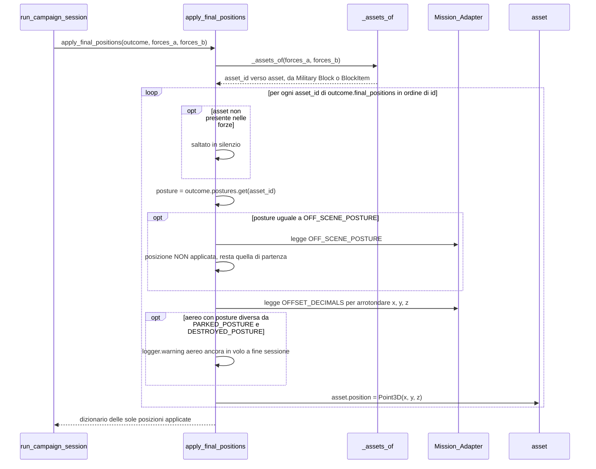

Righe: `_assets_of` `:77` (definita `:43-59`: per ogni lato `getattr(item, 'block', item)` e gli asset di `block.assets`, id con `_domain_id`; un id duplicato **sovrascrive** il precedente, senza errore); ciclo ordinato per id `:80`; asset assente `:84-85`; postura `:87`; `OFF_SCENE_POSTURE` `:89-90`; arrotondamento `:92-94`; test dell'aereo `:96-101` (`validate_class(asset, 'Aircraft')`);
assegnazione `:103`; dizionario restituito `:104-106`. L'ordine che il codice impone: prima l'esclusione dell'`off_scene`, poi l'arrotondamento, poi l'avviso per l'aereo ancora in volo, poi l'assegnazione; la posizione è assegnata **anche** a un asset distrutto (la postura `destroyed` non la esclude, solo `off_scene` lo fa). Il docstring dice che le coordinate sono
arrotondate «al rumore della rotazione» (`OFFSET_DECIMALS`, 6, `Mission_Adapter.py:349`). Le costanti di postura sono di `Mission_Adapter` (`PARKED_POSTURE` `:370`, `OFF_SCENE_POSTURE` `:376`, `DESTROYED_POSTURE` `:381`). **Differenza con `run_session`**: `_assets_of` non controlla che le forze siano distinte, né che stiano in `order.force_ids` (lo fa `_collect_forces`, `Logic/Session_Simulator.py:1054`), perché
quando `apply_final_positions` gira la sessione è già passata da `run_session` e dal validatore. Un fatto di ordine in `run_campaign_session`: l'insieme `assets` è calcolato **una volta** (`:137`) e usato per `apply_campaign_processes` (`:140`) e per `record_session` (`:154`); il registro, invece, è un valore diverso a ogni passo (D128). Rimando a **D54** (il ciclo), **D56** (il difetto 26 nello scenario S30-ABSENT) e a **D60** (gli import).

### Tabella completa dei simboli di `Logic/Session_Campaign`

Le colonne «Tipo», «Simbolo», «Firma» e «Riga» sono l'uscita di `inventario.py --tabella Logic/Session_Campaign` (6 righe con l'intestazione, 4 simboli); «Gruppo» è il ruolo.

| Gruppo | Tipo | Simbolo | Firma | Riga | Che cosa fa | Chiamata da |
|---|---|---|---|---|---|---|
| aiuti | funzione | `_domain_id` | `_domain_id(obj)` | `:34` | Id di dominio (`id`, poi `name`, non vuoto), `None` altrimenti. | `_assets_of` (`:55`) |
| aiuti | funzione | `_assets_of` | `_assets_of(forces_a, forces_b)` | `:43` | `{asset_id: asset}` di tutti gli asset delle forze. | `apply_final_positions` (`:77`), `run_campaign_session` (`:137`) |
| posizione | funzione | `apply_final_positions` | `apply_final_positions(outcome, forces_a, forces_b)` | `:62` | Applica `outcome.final_positions` agli asset; non applica la posizione di un asset `off_scene`. Restituisce le posizioni applicate. | `run_campaign_session` (`:151`, con `apply_positions`) |
| ciclo | funzione | `run_campaign_session` | `run_campaign_session(ledger, order, forces_a, forces_b, fire_control, apply_positions, **run_kwargs)` | `:109` | Una sessione nel ciclo di campagna: processi, validazione, esecuzione, posizioni, registrazione (D54). | nessun chiamante di produzione (test e scenario S30) |

## 10C.6 L2 e L3 — `Logic/Readiness` (356 righe, 14 simboli)

Il modulo calcola **quando un asset torna pronto** dopo una sessione e **applica i processi conclusi** fra una sessione e l'altra. Non ha classi: **14 funzioni** di primo livello. Dichiara (`:3-5`) di essere puro «salvo `apply_campaign_processes`» (che muta gli asset), senza estrazioni casuali e con le iterazioni sempre in ordine di id (`sorted(assets)` `:195`, `sorted(remaining)` `:308`,
`sorted(assets)` `:342`). Importa `Campaign_Types` (`CampaignLedger`, `ReadyRecord`, `SessionRecord`, `:30-34`), `Session_Types` (`SessionOrder`, `SessionOutcome`, `:35`), cinque tabelle di `Context.Context` (`:36-42`) e `Utility.validate_class` (`:44`); `Aircraft_Data` è importato **dentro** `turnaround_class` (`:91`, per evitare cicli). L'unica costante è `_TIME_EPS = 1e-9` (`:50`,
ripetuta da `Campaign_Types`). **I tempi sono stime**: le cinque tabelle (`Context/Context.py:1018-1040`) sono, per dichiarazione del commento di sezione (`:1013-1017`), «ordini di grandezza di operazioni reali, **non dati tarati**»; dove la ricerca F8-R non ha trovato una fonte il valore resta «STIMA DI PROGETTO» (per esempio 8 h per il bombardiere pesante, 2 h per la ricognizione,
1,5 h per l'elicottero, 6 h a terra) o «STIMA INFORMATA» (48 h in mare); il turnaround di un aereo di classe ignota è un ripiego di 3 h (`AIR_TURNAROUND_DEFAULT_S`, `:1029`). Questo capitolo non ricalibra nulla. Il **solo chiamante nel core** è `Session_Campaign` (`:140`, `:154`). La **regola** per un asset è **D53**, il suo testo è nel capitolo 6 §6.26: qui non si ripete.

### Le funzioni per ruolo (D119)

*Diagramma D119 — i gruppi di funzioni di `Readiness`, le dipendenze verso i tipi e le tabelle e il solo chiamante nel core (livello L2, verificato a f009eb43).*

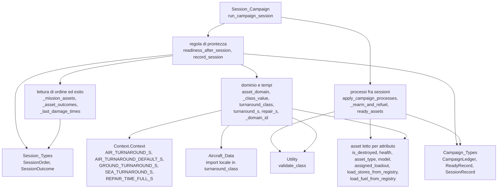

Lettura: le frecce sono chiamate o letture di nome (estrazione `ast`, riscontrata sul testo). `REG --> DOM` perché `readiness_after_session` chiama `turnaround_s` (`:222`) e `repair_s` (`:215`, `:223`); `DOM --> UTL` perché `asset_domain` e `turnaround_class` usano `validate_class` (`:56`, `:59`, `:78`); `PRO --> UTL`
perché `_rearm_and_refuel` lo usa per distinguere l'aereo (`:280`). Il gruppo `PRO` legge l'asset per attributo (`is_destroyed` `:323`, `health` assegnata a `100` `:328`, `assigned_loadout` `:281-283`, `load_stores_from_registry` e `load_fuel_from_registry` `:286-292`): non importa nessun modulo `Asset` (l'unico import è quello locale di `Aircraft_Data`).
`ready_assets` (`:338`) è l'unica funzione pubblica **senza chiamanti nel core**: la usano i test e lo scenario S30 (`Test_Session_Scenarios_S30.py:376`), come funzione che «il pianificatore può impiegare» (docstring `:339-340`). `_domain_id` (`:351`) serve **solo** al messaggio di avviso di `turnaround_s` (`:112`). Rimando a **D58** e **D60** per gli import.

### Dal registro al nuovo registro (D120)

*Diagramma D120 — `record_session` e `readiness_after_session`: l'ordine delle chiamate dal registro vecchio al registro nuovo (livello L3, verificato a f009eb43).*

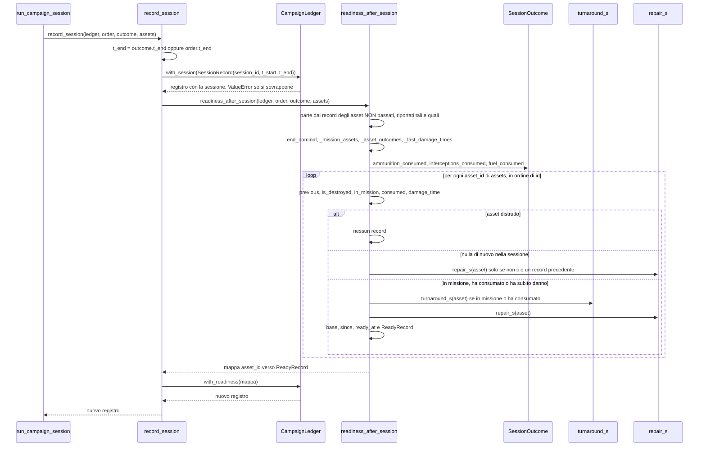

Righe: `record_session` `:262` (`t_end` `:267`; la catena `ledger.with_session(SessionRecord(...)).with_readiness(readiness_after_session(...))` `:268-270`); `readiness_after_session` `:172` (record degli assenti `:182-184`; `end_nominal` `:186`; letture `:187-189`; consumi `:191-193`; ciclo `:195`; `previous` `:197`; distrutto `:200`; «nulla di nuovo» `:211`;
turnaround `:222`; riparazione `:223`; inizio `:232-240`; `since` `:243-244`; `ready_at` `:252-254`; record `:257`). **L'ordine di valutazione della catena conta**, ed è quello di Python: prima si costruisce il `SessionRecord` e si chiama `with_session`, poi si chiama `readiness_after_session`, poi `with_readiness`. Se la nuova sessione si sovrappone all'ultima (o `t_end` è `None` dopo entrambi i ripieghi: il
`SessionRecord` rifiuta un `t_end` non numerico), l'eccezione scatta **prima** che la prontezza sia calcolata. `readiness_after_session` riceve il registro **originale**, non quello con la sessione in più: la mappa di prontezza è la stessa. Per ogni asset la sequenza dei rami è D53; qui si aggiunge che `turnaround_s` si chiama solo per chi è in missione o ha consumato (`:222`) e `repair_s` al più una volta per asset (nel ramo «nulla di nuovo» solo senza record precedente).
**La provenienza del turnaround va persa**: `turnaround_s` restituisce `(secondi, provenienza)` ma `readiness_after_session` tiene solo `[0]` (`:222`) e `ReadyRecord` non ha un campo per la provenienza; il ripiego «classe aerea ignota» lascia traccia soltanto in un `logger.warning` (`:112-113`). Rimando a **D53**, **D54** e a **D115**.

### Il record di un asset assente (D121)

*Diagramma D121 — il difetto 26: come il record di un asset non passato a una sessione resta nel registro, attraverso `apply_campaign_processes` e `readiness_after_session` (livello L3, verificato a f009eb43).*

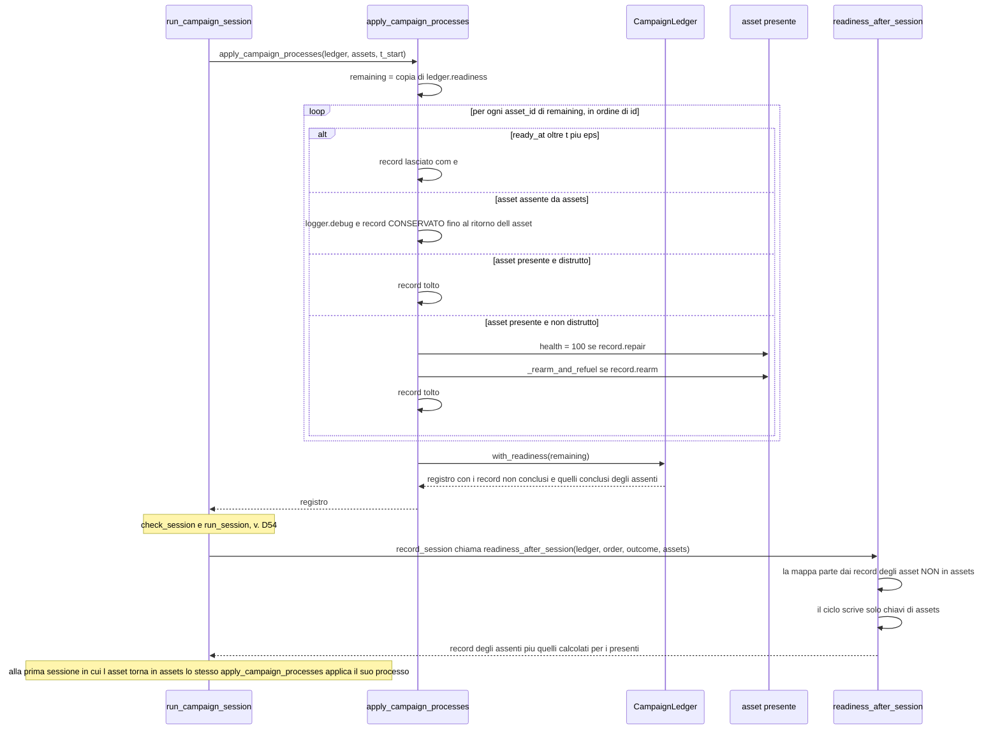

Righe: `apply_campaign_processes` `:295` (`remaining` `:306`; ciclo `:308`; `ready_at > t + _TIME_EPS` `:311`; asset assente `:314-321`; distrutto `:323-325`; riparazione `:327-328`; riarmo `:330-331`; `del remaining[asset_id]` `:333`; `with_readiness` `:335`); `_rearm_and_refuel` `:273`; `readiness_after_session` `:182-184` e `:195`.
Le due metà del difetto 26 sono nel codice: **(a)** `apply_campaign_processes` non applica nulla e non toglie il record di un asset assente (`continue` a `:321`, con un `logger.debug` al posto del warning di prima); **(b)** `readiness_after_session` parte da una mappa che contiene già i record degli asset non passati (`:182-184`), perché `with_readiness` **sostituisce** l'intera mappa (v. D116) e il ciclo
seguente scrive solo le chiavi di `assets` (commento `:180-181`). Il caso **simmetrico** non è simmetrico: un asset presente e distrutto vede il record **tolto** in (a) (`:323-325`) e **non riscritto** in (b) (`continue` a `:201`), cioè perde sempre il proprio record; un asset distrutto e assente lo conserva, perché il motore non lo vede. Lo stato di un asset assente (salute, carburante) resta quello vecchio finché non torna (docstring `:303-304`),
anche se il registro lo dà già pronto. Due conseguenze descritte dal docstring e dal capitolo 6 §6.26 e **non** corrette: un id che non ricompare lascia il proprio record per sempre, e il meccanismo dipende dall'identità degli id di dominio fra sessioni. Lo scenario che prova tutto questo è S30-ABSENT (**D56**, capitolo 8 §8.12); la regola per gli asset passati è **D53**.

### Tabella completa dei simboli di `Logic/Readiness`

Le colonne «Tipo», «Simbolo», «Firma» e «Riga» sono l'uscita di `inventario.py --tabella Logic/Readiness` (16 righe con l'intestazione, 14 simboli, nell'ordine dell'uscita); «Gruppo» è il ruolo di D119 (`SC` = `Session_Campaign`).

| Gruppo | Tipo | Simbolo | Firma | Riga | Che cosa fa | Chiamata da |
|---|---|---|---|---|---|---|
| dominio e tempi | funzione | `asset_domain` | `asset_domain(asset)` | `:53` | `'air'` (Aircraft), `'sea'` (Ship), altrimenti `'ground'`. | `turnaround_s` (`:105`), `repair_s` (`:139`) |
| dominio e tempi | funzione | `_class_value` | `_class_value(value)` | `:65` | Valore stringa di una classe aerea (enumerazione o stringa), altrimenti `None`. | `turnaround_class` (`:81`, `:96`) |
| dominio e tempi | funzione | `turnaround_class` | `turnaround_class(asset)` | `:73` | Classe aerea per il turnaround: `asset_type` se è una chiave di `AIR_TURNAROUND_S`, altrimenti la prima categoria di `Aircraft_Data` per il modello, altrimenti `None`. | `turnaround_s` (`:108`) |
| dominio e tempi | funzione | `turnaround_s` | `turnaround_s(asset)` | `:101` | `(secondi, provenienza)`: tabella per classe, per terra o per mare; ripiego a 3 h con un warning. Tempi: stime (`Context.py:1018-1031`). | `readiness_after_session` (`:222`) |
| dominio e tempi | funzione | `repair_s` | `repair_s(asset)` | `:122` | Tempo di riparazione dal danno attuale: `None` se distrutto o salute non leggibile, 0 se intatto, altrimenti lineare nel danno (stima, `Context.py:1034-1038`). | `readiness_after_session` (`:215`, `:223`) |
| lettura di ordine ed esito | funzione | `_mission_assets` | `_mission_assets(order)` | `:142` | `{asset_id: mission_id}` degli asset impegnati in una missione dell'ordine. | `readiness_after_session` (`:187`) |
| lettura di ordine ed esito | funzione | `_asset_outcomes` | `_asset_outcomes(outcome)` | `:151` | `{asset_id: AssetMissionOutcome}` ricavato da `outcome.mission_outcomes`. | `readiness_after_session` (`:188`) |
| lettura di ordine ed esito | funzione | `_last_damage_times` | `_last_damage_times(outcome)` | `:160` | `{asset_id: istante}` dell'ultimo `DamageEvent` con quell'asset come bersaglio. | `readiness_after_session` (`:189`) |
| regola di prontezza | funzione | `readiness_after_session` | `readiness_after_session(ledger, order, outcome, assets)` | `:172` | La nuova mappa di prontezza: record degli assenti riportati, regola per i passati (D53). | `record_session` (`:270`) |
| regola di prontezza | funzione | `record_session` | `record_session(ledger, order, outcome, assets)` | `:262` | Registro con la sessione conclusa (`with_session`) e la nuova prontezza (`with_readiness`). | `SC:run_campaign_session` (`:154`) |
| processi fra sessioni | funzione | `_rearm_and_refuel` | `_rearm_and_refuel(asset)` | `:273` | Riarmo e rifornimento a fine turnaround, senza logistica: aereo con loadout lo riassegna a sé stesso; veicolo o nave ricaricano da registro. | `apply_campaign_processes` (`:331`) |
| processi fra sessioni | funzione | `apply_campaign_processes` | `apply_campaign_processes(ledger, assets, t)` | `:295` | Applica i processi conclusi entro `t` agli asset presenti; conserva i record degli assenti. Idempotente. Muta gli asset. | `SC:run_campaign_session` (`:140`) |
| processi fra sessioni | funzione | `ready_assets` | `ready_assets(ledger, assets, t)` | `:338` | Gli id ordinati degli asset non distrutti e pronti a `t`. | nessun chiamante nel core (test e scenario S30) |
| dominio e tempi | funzione | `_domain_id` | `_domain_id(obj)` | `:351` | Id di dominio (`id`, poi `name`, non vuoto), `None` altrimenti. | `turnaround_s` (`:112`, solo nel messaggio di avviso) |

## 10C.7 L2 e L3 — `Logic/Damage_Model` (288 righe, 8 simboli)

`Damage_Model` è il **contratto del danno per singolo asset** (docstring `:1-62`): trasforma un colpo risolto in un `DamageEvent` e un `DamageEvent` in un calo di salute, **senza estrazioni casuali** (il numero `draw` lo riceve dal chiamante, che lo estrae dall'RNG di sessione). Il modulo è una foglia del core: importa solo `DataType.State` (`HEALTH_LEVEL`, `StateCategory`, `:67`) e il logger
(D58). Ha **1 classe** (`DamageEvent` `:103`, `dataclass(frozen=True)`) e **7 funzioni** di primo livello. **Costanti** (`:75-99`): `HEALTH_MAX = 100`, `HEALTH_MIN = 0`, `DESTROYED_HEALTH`, `MIN_EFFECTIVE_HIT_DAMAGE = 1`, gli esiti `MISS`/`DAMAGE`/`KILL` con `HIT_OUTCOMES`, le provenienze `MEASURED`/`DERIVED`/`ESTIMATED` con `PROVENANCES`.
`DESTROYED_HEALTH` è **derivata**, non duplicata: `int(round(HEALTH_MAX * HEALTH_LEVEL[StateCategory.DESTROYED.value]))` (`:80`), cioè 15 (la soglia `0.15` è in `DataType/State.py:35`). `MIN_EFFECTIVE_HIT_DAMAGE` è dichiarata «convenzione dichiarata, non un parametro di taratura» (commento `:82-85`). Il docstring dichiara che «nessuna costante nuova viene introdotta»
(`:23-24`): le probabilità vengono dai registri d'arma. Resta una **scelta di modello**, non un dato tarato, che la stessa `destroy_capacity` misuri sia la probabilità di uccidere sia l'entità del danno non letale (`:31-33`). Il flusso del danno **dentro la risoluzione** è già in **D85** (`_on_resolve`, parte A) e **D86** (`apply_engagement_result`); la macchina a stati della salute è **D7**; qui si aggiungono i tipi, l'ordine delle chiamate dentro il modulo e il percorso di un `DamageEvent`.

### I tipi e l'API del modulo (D122)

*Diagramma D122 — `DamageEvent`, le funzioni e le costanti del modulo, e i tipi che lo usano (livello L2, verificato a f009eb43).*

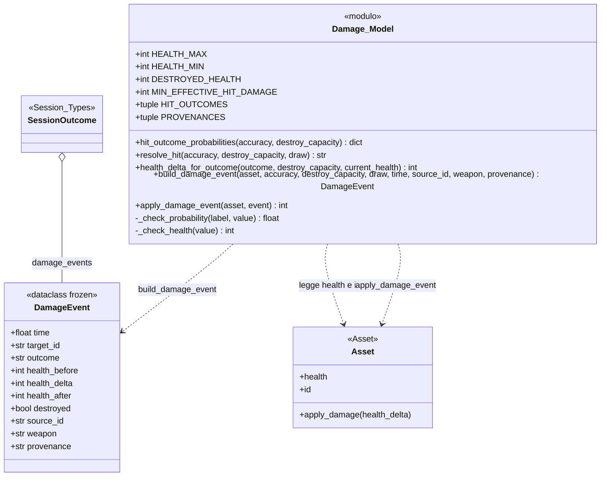

Lettura: l'ordine dei campi è quello del codice (`:120-129`: i primi sette sono obbligatori; `source_id`, `weapon` e `provenance` hanno default `None`, `None` e `DERIVED`). `DamageEvent` è immutabile «di proposito»: un evento già prodotto non si riscrive ma si sostituisce (docstring `:106-108`). **Il modulo non importa `Asset`**: legge l'oggetto per attributo
(`health` `:225`, `id` `:228`, `:237`, `apply_damage` `:262`), così lo stesso `build_damage_event` accetta un asset reale o una copia di lavoro con `id` e `health`: lo stato ombra `_Shadow` del risolutore (`Logic/Engagement_Resolver.py:1407`, il cui docstring dichiara il «duck typing», `:1410-1411`) e la copia `_Hit` del fuoco su posizione (`Logic/Area_Fire.py:221`, con `__slots__ = ('id', 'health')`).
`Asset.apply_damage(health_delta)` (`Asset/Asset.py:212`) è «l'unico punto in cui la salute cala per effetto del combattimento» (docstring `:214-215`); satura a 0 (`max(0, current + health_delta)`, `:248`), rifiuta un delta positivo (`:239-240`) e restituisce `None` se lo stato non è leggibile (`:244-246`). La soglia `Destroyed` è applicata da `State.update()` chiamata dal setter della salute (docstring `:221-223`).
Rimando a **D7** (stati della salute) e a **D58** (il modulo è una foglia).

### La costruzione di un evento (D123)

*Diagramma D123 — `build_damage_event`: l'ordine dei controlli, dell'esito e del delta, dentro `Damage_Model` (livello L3, verificato a f009eb43).*

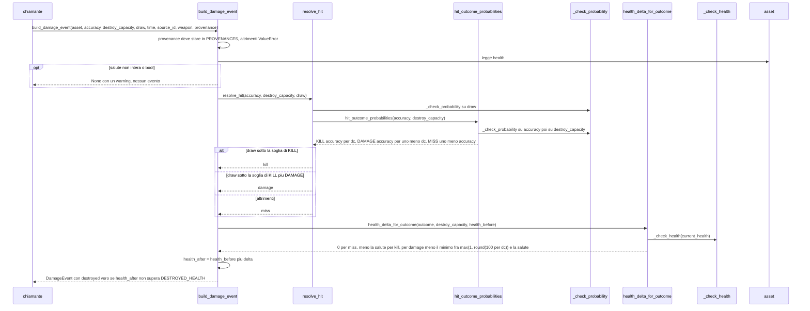

Righe: `build_damage_event` `:203` (provenienza `:222-223`; salute `:225-229`; `resolve_hit` `:231`; `health_delta_for_outcome` `:232`; `health_after` `:233`; `DamageEvent` `:235-246`); `resolve_hit` `:155` (`_check_probability(draw)` `:167`; probabilità `:168`; soglie `:170`, `:173`; MISS `:176`); `hit_outcome_probabilities` `:132` (`:146-152`);
`health_delta_for_outcome` `:179` (esito valido `:186-187`; `_check_health` `:189`; MISS `:191-192`; KILL `:194-195`; DAMAGE `:197-200`). **Fatti che il codice rende importanti.** (1) **L'ordine delle soglie è il contratto** (docstring `:52-53`, `:159`): KILL, poi DAMAGE, poi MISS; cambiarlo cambierebbe l'esito a parità di seed. (2) Un asset senza salute leggibile **non solleva**: `None`
più un warning (`:227-229`); i chiamanti (`_on_resolve`, `resolve_area_fire`) usano il risultato senza controllare `None` (`Engagement_Resolver.py:3256`, `Area_Fire.py:308`): è sicuro perché `_Shadow.health` e `_Hit.health` sono interi già verificati. (3) Un KILL porta la salute a **0** (`-current_health` `:195`) e un DAMAGE può lasciarla fra 1 e 15, e in quel caso `destroyed` è comunque vero (`:242`): il «relitto» del docstring (punto 5, `:40-47`).
(4) L'errore di validazione ha un ordine: prima `draw`, poi `accuracy` e `destroy_capacity`; il controllo `_check_probability` accetta `0 <= v <= 1`, quindi `draw = 1.0` supera il controllo ma darebbe MISS anche con `accuracy = 1.0` (`1.0 < 1.0` è falso): non è raggiungibile con `random.Random.random()`, che sta in `[0, 1)`; il risolutore ribadisce l'intervallo in `_draw` (`Engagement_Resolver.py:2115-2121`), il fuoco su posizione no. (5) `round` è quello di Python (arrotonda al pari sui `.5` esatti di un `float`): vale per `int(round(HEALTH_MAX * destroy_capacity))` (`:198`).
(6) Il modulo **non muta** l'asset: la «separazione del calcolo dall'applicazione» (docstring `:213-216`) lascia al chiamante di aggiornare la copia di lavoro (`target.health = event.health_after`). Rimando a **D85** (il ciclo di risoluzione che lo chiama) e a **D109** (11a, `resolve_area_fire`).

### Il percorso di un `DamageEvent` (D124)

*Diagramma D124 — dove nasce un `DamageEvent`, dove viene applicato e chi lo legge; la freccia `A --> B` significa «il dato va da A a B» (livello L2, verificato a f009eb43).*

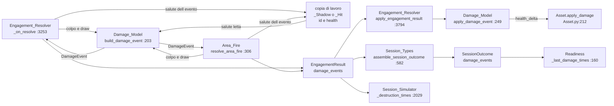

Lettura: **legenda: la freccia significa che il dato va da A a B**. L'evento è costruito su una **copia di lavoro** (`_Shadow` nel risolutore, `_Hit` nel fuoco su posizione), che il chiamante aggiorna con `event.health_after` (`Engagement_Resolver.py:3256`, `Area_Fire.py:308`); lo stesso evento è accodato (`:3257`, `events.append` `Area_Fire.py:309`) e finisce in
`EngagementResult.damage_events` (`Engagement_Resolver.py:3613`, `Area_Fire.py:314`). **L'asset reale non cambia ancora**: lo cambia `apply_engagement_result`, che `run_session` chiama subito dopo ogni risoluzione (`Session_Simulator.py:2790` per l'ingaggio, `:2486` per il fuoco su posizione), applicando i `DamageEvent` nell'ordine di produzione (`Engagement_Resolver.py:3825-3834`); `apply_damage_event` ritorna
`None` con un warning se l'asset non ha `apply_damage` (`Damage_Model.py:262-266`), e se `health_delta == 0` ritorna la salute senza chiamare l'asset (`:259-260`). Il risultato dell'ingaggio entra poi in `assemble_session_outcome` (D113), che ordina i `DamageEvent` per tempo, e `SessionOutcome.damage_events` è letta dalla prontezza per l'istante dell'ultimo danno (`Readiness.py:163-168`). `_destruction_times` (`Session_Simulator.py:2029`) legge invece
i `DamageEvent` **dei risultati**, non dell'esito, per l'istante di distruzione di ogni asset (`:2038-2040`). Un aereo perso per carburante è portato a salute 0 con `Asset.apply_damage` **senza** un `DamageEvent` (`Session_Simulator.py:3110-3120`, commento `:3106-3109`): è una modifica della salute fuori da questo percorso; un'altra, in senso opposto, è la riparazione di `apply_campaign_processes` (`asset.health = 100`, `Readiness.py:328`). Non ho cercato altre scritture della salute nel core. Rimando a **D85**, **D86**, **D109** e a **D129** (i campi di `SessionOutcome`).

### Tabella completa dei simboli di `Logic/Damage_Model`

Le colonne «Tipo», «Simbolo», «Firma» e «Riga» sono l'uscita di `inventario.py --tabella Logic/Damage_Model` (10 righe con l'intestazione, 8 simboli); «Gruppo» è il ruolo.

| Gruppo | Tipo | Simbolo | Firma | Riga | Che cosa fa | Chiamata da |
|---|---|---|---|---|---|---|
| tipo | classe | `DamageEvent` | `DamageEvent`; campi: time, target_id, outcome, health_before, health_delta, health_after, destroyed, source_id, weapon, provenance | `:103` | Un colpo risolto contro un asset: atomo del `SessionOutcome`. | costruita da `build_damage_event` (`:235`); contenuta in `ER:EngagementResult.damage_events` (`:981`), `ER:_EngagementRun` (`:1748`), `ST:SessionOutcome.damage_events` (`:439`); letta da `ER:apply_engagement_result` (`:3825-3834`), `SS:_destruction_times` (`:2038`), `RD:_last_damage_times` (`:163-168`), `ST:assemble_session_outcome`, `ST:_warn_shared_targets` |
| esito del colpo | funzione | `hit_outcome_probabilities` | `hit_outcome_probabilities(accuracy, destroy_capacity)` | `:132` | Le probabilità dei tre esiti: KILL = Ph × Pk, DAMAGE = Ph × (1 − Pk), MISS = 1 − Ph. | `resolve_hit` (`:168`); nessun altro chiamante nel core |
| esito del colpo | funzione | `resolve_hit` | `resolve_hit(accuracy, destroy_capacity, draw)` | `:155` | L'esito di un colpo dato `draw`; ordine delle soglie KILL, DAMAGE, MISS. | `build_damage_event` (`:231`) |
| esito del colpo | funzione | `health_delta_for_outcome` | `health_delta_for_outcome(outcome, destroy_capacity, current_health)` | `:179` | La variazione di salute (≤ 0): 0, tutta la salute, o `round(100·dc)` con minimo 1 e tetto alla salute residua. | `build_damage_event` (`:232`) |
| evento | funzione | `build_damage_event` | `build_damage_event(asset, accuracy, destroy_capacity, draw, time, source_id, weapon, provenance)` | `:203` | Risolve un colpo e ne descrive l'esito **senza applicarlo**; `None` se la salute non è leggibile. | `ER:_EngagementRun._on_resolve` (`:3253`), `AF:resolve_area_fire` (`:306`) |
| evento | funzione | `apply_damage_event` | `apply_damage_event(asset, event)` | `:249` | Applica l'evento all'asset con `apply_damage`; non idempotente (due volte = due colpi). | `ER:apply_engagement_result` (`:3833`) |
| controlli | funzione | `_check_probability` | `_check_probability(label, value)` | `:271` | Numero in [0, 1] (bool escluso), come `float`. | `hit_outcome_probabilities` (`:146`, `:147`), `resolve_hit` (`:167`), `health_delta_for_outcome` (`:197`) |
| controlli | funzione | `_check_health` | `_check_health(value)` | `:281` | Salute intera in [0, 100]. | `health_delta_for_outcome` (`:189`) |

## 10C.8 L2 e L3 — `Utility/Session_Rng` (113 righe, 3 simboli)

È **l'unica sorgente di casualità del motore** (docstring `:1-36`): fissa *come* si ottiene il seed di ogni stream, non quando né quante volte si estrae. Non importa nessun modulo del progetto (solo `hashlib`, `json`, `random`, `typing`, `:38-41`; D58). Ha **3 funzioni** e **tre costanti**: `SEED_BITS = 64` (`:46`), `SEED_SCHEME = 'warfare-model/session-rng/v1'` (`:51`) e l'alias di tipo
`DomainKey = Union[str, int]` (`:53`). `SEED_SCHEME` entra nell'hash, così un cambio futuro della codifica produce seed diversi «in modo dichiarato» (commento `:48-50`). Il contratto (`:14-30`): il seed è funzione pura della chiave `(session_id, mission_id, event_id, counter)`; non si usa `hash()` (randomizzato per processo) ma SHA-256 su una codifica canonica;
ogni valore di `counter` apre uno stream diverso; mai `random` di modulo. Il modulo non assegna gli id né incrementa i contatori: lo fa l'orchestratore (`:32-34`). Rimando a **D60**/**D58** per gli import e al capitolo 7 §7.1 per la descrizione del contratto.

### Dalla chiave allo stream (D125)

*Diagramma D125 — `SessionOrder.rng` → `session_rng` → `session_seed`: dalla chiave di dominio all'istanza di `random.Random` (livello L3, verificato a f009eb43).*

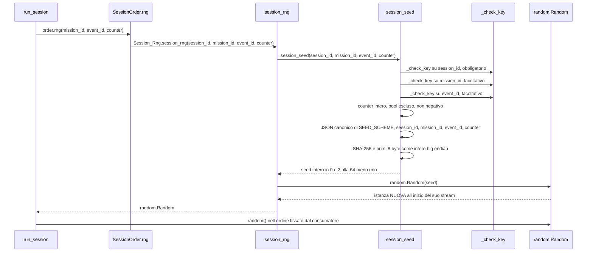

Righe: `SessionOrder.rng` `Command/Session_Types.py:388-390`; `session_rng` `:105-113`; `session_seed` `:70-102` (controlli `:88-90`, contatore `:92-96`, JSON canonico `:98-99`, digest `:100`, risultato `:102`); `_check_key` `:56-67` (`None` ammesso solo se facoltativo `:57-60`; `bool` e tipi diversi da `str`/`int` rifiutati `:62-64`; stringa vuota `:66-67`).
**Fatti che il codice rende importanti.** (1) La chiave distingue i tipi: il JSON conserva `"1"` e `1`, `None` e `"None"` (docstring `:18-20`); un `mission_id` `None` apre uno stream diverso da qualunque id valorizzato (`:76-77`). (2) Ogni chiamata a `session_rng` restituisce un'istanza **nuova** posizionata all'inizio dello stream: due chiamate con la stessa chiave producono la stessa sequenza e consumare l'una non avanza l'altra (`:108-112`); chi chiede due volte la stessa chiave
rilegge gli stessi numeri. (3) `session_seed` non ha chiamanti nel core fuori da `session_rng`, e `session_rng` ne ha uno solo, `SessionOrder.rng` (`Command/Session_Types.py:390`): il core non costruisce mai un `random.Random` diretto. (4) Una chiave `int` è ammessa e si distingue dalla stessa cifra come stringa (`DomainKey`); il core passa sempre stringhe. (5) L'alias `Union[str, int]` e il test `isinstance(value, bool)` sono l'unica tipizzazione: nessun controllo di lunghezza massima.

### Chi apre quale stream (D126)

*Diagramma D126 — le chiavi con cui `run_session` apre gli stream e i consumatori che estraggono; la freccia `A --> B` significa «lo stream va da A a B» (livello L2, verificato a f009eb43).*

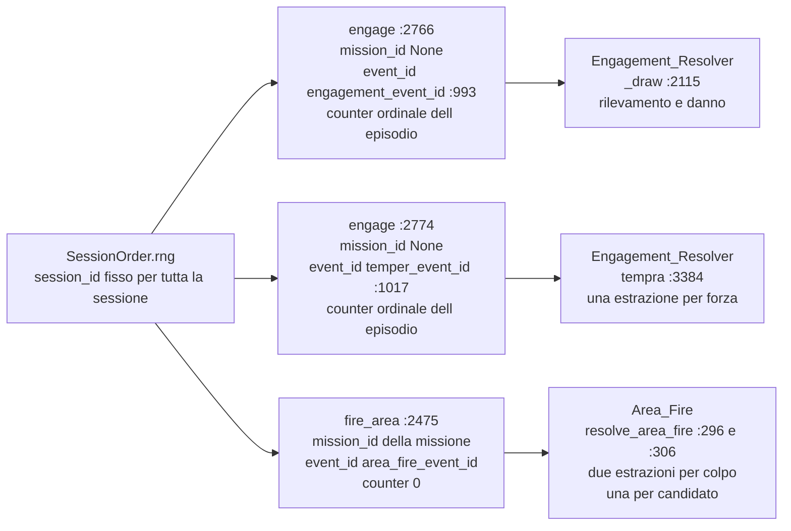

Lettura: **legenda: la freccia significa che lo stream va da A a B**. Sono i soli tre punti in cui il core apre uno stream, tutti in `Logic/Session_Simulator.py`: `engage` per l'ingaggio (`order.rng(mission_id=None, event_id=event_id, counter=counter)` `:2766`) e per la tempra (`breakpoint_rng=order.rng(mission_id=None, event_id=temper_event_id(*force_ids), counter=counter)` `:2774-2776`),
`fire_area` per il fuoco su posizione (`order.rng(mission_id=fire_order.mission_id, event_id=event_id, counter=0)` `:2475`). **I due `event_id` dell'ingaggio** sono funzioni pure dell'**insieme** degli id di forza: `engagement_event_id` (`:993-1014`) e `temper_event_id` (`:1017-1027`) producono un JSON `['engagement', id, ...]` o `['temper', id, ...]` con gli id **ordinati**, così l'ordine con cui le forze arrivano a `run_session` non cambia lo stream;
i tag sono `ENGAGEMENT_EVENT_TAG = 'engagement'` (`:790`) e `TEMPER_EVENT_TAG = 'temper'` (`:793`). Il `counter` è l'**ordinale degli episodi** con lo stesso insieme di forze: `counter = ordinals.get(event_id, 0)` e poi `ordinals[event_id] = counter + 1` (`:2706-2707`, `ordinals` dichiarato a `:2421`), così ogni episodio dello stesso insieme ha uno stream nuovo, e lo stesso `counter` serve ai due flussi
(ingaggio e tempra). L'`event_id` del fuoco su posizione è invece una **stringa con barre verticali** (`area_fire|<missione>|<asset>|<wp>|<azione>`, `Logic/Area_Fire.py:131-133`), non un JSON; è il primo uso dello slot `mission_id` (docstring `Area_Fire.py:49-50`). **Perché due flussi per l'ingaggio**: la tempra si estrae «dal flusso separato» perché le estrazioni di rilevamento e danno di `rng` restino quelle di prima
(`Engagement_Resolver.py:84-87`); senza `breakpoint_rng` la tempra non si estrae (`:3383`). Le estrazioni del fuoco su posizione sono contate in D109 (11b): due per colpo (raggio e angolo) e una per candidato nel raggio letale e non distrutto. **Nessun altro modulo del core estrae**: `Contact_Scheduler`, `Fuel_Model`, `Damage_Model`, `Readiness` e il ciclo di campagna non toccano mai l'RNG (ricerca di `.random()` e `random.` nei moduli del core).

### Tabella completa dei simboli di `Utility/Session_Rng`

Le colonne «Tipo», «Simbolo», «Firma» e «Riga» sono l'uscita di `inventario.py --tabella Utility/Session_Rng` (5 righe con l'intestazione, 3 simboli); «Gruppo» è il ruolo.

| Gruppo | Tipo | Simbolo | Firma | Riga | Che cosa fa | Chiamata da |
|---|---|---|---|---|---|---|
| controlli | funzione | `_check_key` | `_check_key(label, value, optional)` | `:56` | Valida una componente della chiave: `str` non vuota o `int` (bool escluso); `None` solo se facoltativa. | `session_seed` (`:88`, `:89`, `:90`) |
| seed | funzione | `session_seed` | `session_seed(session_id, mission_id, event_id, counter)` | `:70` | Seed intero deterministico per la chiave: SHA-256 di una codifica JSON canonica con la versione dello schema. | `session_rng` (`:113`); nessun altro chiamante nel core |
| stream | funzione | `session_rng` | `session_rng(session_id, mission_id, event_id, counter)` | `:105` | Un `random.Random` nuovo seedato da `session_seed`. | `ST:SessionOrder.rng` (`Command/Session_Types.py:390`) |

## 10C.9 La mappa dei dati — dalle porte d'ingresso alle porte d'uscita (D127-D129)

I diagrammi D58-D60 dicono **chi importa chi**; questa sezione dice **dove vanno i dati**. Non descrive moduli nuovi: segue le strutture dell'ordine, delle forze e del registro attraverso i moduli del core, fino all'esito e al nuovo registro. **Legenda comune a D127, D128 e D129: la freccia `A --> B` significa «i dati vanno da A a B»**
(non «A importa B», non «A chiama B»); l'etichetta della freccia dice *quali* dati. I diagrammi sono tre perché uno solo avrebbe più di trenta nodi: D127 è la sessione (L1), D128 il ciclo di campagna (L2), D129 il contenuto dell'esito campo per campo (L2). I tipi che attraversano solo la sessione sono già disegnati altrove e qui si rimanda:
la Missione e l'Operazione a D16 e D91-D92 (11b); le viste di missione `MissionForce` a D30; i tratti, i contatti e le finestre a D67 (11a); il risolutore e i suoi eventi a D76 e D85 (11a); il carburante a D98 e D100-D102 (11b); il fuoco su posizione a D106-D109. Il flusso **dentro** `run_session` è D8 (capitolo 6) e D64-D66.

### La sessione (D127)

*Diagramma D127 — il percorso dei dati in una sessione, dagli argomenti di `run_session` al `SessionOutcome`; la freccia `A --> B` significa «i dati vanno da A a B» (livello L1, verificato a f009eb43).*

```mermaid
flowchart LR
    ORD["SessionOrder<br/>missions, operations, t_start, t_end,<br/>force_ids, committed, salvo_window, session_id"]
    FRC["forces_a, forces_b<br/>Block e Asset, argomenti"]
    ARG["fire_control, horizon, thresholds,<br/>morale_for, fire_doctrine, provenance, ...<br/>argomenti di run_session"]
    MAD["Mission_Adapter<br/>AssetMovement, tratti Leg, MissionForce"]
    SCH["Contact_Scheduler<br/>ContactWindow"]
    RES["Engagement_Resolver<br/>EngagementResult"]
    AFR["Area_Fire<br/>FireOrder, EngagementResult"]
    DMG["Damage_Model<br/>DamageEvent"]
    FUE["Fuel_Model<br/>FuelEvent"]
    RNG["Session_Rng<br/>random.Random"]
    RUN["Session_Simulator.run_session<br/>MissionOutcome, postures,<br/>final_positions, movement_ends"]
    OPR["Session_Types.operation_outcome<br/>OperationOutcome"]
    ASM["Session_Types.assemble_session_outcome"]
    OUT["SessionOutcome"]
    AST["stato degli asset<br/>salute, scorte, carburante"]

    ORD -->|"missions"| MAD
    FRC -->|"blocchi, basi aeree"| MAD
    FRC -->|"blocchi"| SCH
    MAD -->|"tratti Leg"| SCH
    MAD -->|"AssetMovement"| AFR
    MAD -->|"tratti Leg"| FUE
    MAD -->|"MissionForce, una per missione"| RES
    ORD -->|"session_id, event_id, counter"| RNG
    RNG -->|"stream di estrazioni"| RES
    RNG -->|"stream di estrazioni"| AFR
    ARG -->|"fire_control, soglie, dottrina"| RES
    SCH -->|"ContactWindow"| RES
    RES -->|"colpo e draw"| DMG
    AFR -->|"colpo e draw"| DMG
    DMG -->|"DamageEvent"| RES
    DMG -->|"DamageEvent"| AFR
    RES -->|"EngagementResult"| RUN
    AFR -->|"EngagementResult"| RUN
    FUE -->|"FuelEvent"| RUN
    RUN -->|"apply_engagement_result, apply_fuel_event"| AST
    RUN -->|"MissionOutcome"| OPR
    OPR -->|"OperationOutcome"| ASM
    RUN -->|"risultati, eventi, mappe"| ASM
    ASM --> OUT
```

Lettura: ogni arco è verificato su una chiamata o su un passaggio di argomento in `run_session`. `ORD → MAD` è `MA.mission_movements(mission, t0, basi)` (`Logic/Session_Simulator.py:2243`) e `MA.session_movements(order.missions, t0)` (`:2255`); `FRC → MAD` perché le basi aeree si ricavano dai blocchi (`MA.air_base_points(blocks.values(), side)` `:2240`);
`MAD → SCH` è `MA.movement_legs` (`:2293`) i cui tratti entrano in `CS.schedule_contacts` (`:2385`); `MAD → AFR` è `AF.fire_orders(mission, movement, t0)` (`:2499`); `MAD → FUE` perché `FM.build_leg_fuel_event` legge i tratti (`:1383`); `MAD → RES` è la forza d'ingaggio di ogni missione, `MA.MissionForce.of_mission` dentro `_engagement_forces` (`:2236`, definita `:1960`; `:1987`, vista residua `:1989`; D30, D31); `RNG → RES` e `RNG → AFR` sono D126; `SCH → RES` passa dai gruppi di `_group_windows` (`:2388`) a `ER.resolve_engagement`
(`:2765`); `RES → DMG → RES` è `DM.build_damage_event` chiamata dal risolutore (D85) e `DMG → AFR` quella del fuoco su posizione (D109); `RUN → AST` è l'applicazione immediata degli esiti (`ER.apply_engagement_result` `:2486`, `:2790`; `FM.apply_fuel_event` `:2978`, `:3037`, `:3066`); `RUN → OPR → ASM → OUT` chiude con `operation_outcome` (`:3154`) e
`assemble_session_outcome` (`:3158`). **Che cosa il diagramma mostra e il D58 no**: le due porte del core (`ORD` e `OUT`) sono collegate **solo** attraverso `run_session`; nessuna struttura di campagna (`CampaignLedger`, `ReadyRecord`, `SessionViolation`) compare perché **`run_session` non legge mai il registro** (capitolo 6 §6.26): la prontezza è un dato di campagna, non di sessione. Le forze `FRC` sono argomenti, non import
(D57); `AST` è l'unico stato che la sessione muta. Rimando a **D8** (stesso percorso, con le funzioni di `Session_Simulator`), **D2** (le due porte) e **D66** (il passo finale).

### Il ciclo di campagna (D128)

*Diagramma D128 — le versioni del `CampaignLedger` e i dati che passano in un passo di `run_campaign_session`; la freccia `A --> B` significa «i dati vanno da A a B» (livello L2, verificato a f009eb43).*

```mermaid
flowchart LR
    L0["CampaignLedger L0<br/>passato dal chiamante"]
    ORD["SessionOrder<br/>t_start, t_end, missions"]
    AP["Readiness.apply_campaign_processes<br/>Session_Campaign.py:140"]
    L1["CampaignLedger L1<br/>senza i processi conclusi<br/>con i record degli assenti"]
    CHK["Session_Validator.check_session<br/>:143"]
    VIO["SessionValidationError<br/>tupla di SessionViolation"]
    RUN["Session_Simulator.run_session<br/>:147"]
    OUT["SessionOutcome"]
    POS["apply_final_positions<br/>:151"]
    REC["Readiness.record_session<br/>:154"]
    L2["CampaignLedger L2<br/>piu SessionRecord<br/>piu nuova prontezza"]
    AST["asset<br/>salute, scorte, carburante, posizione"]
    CST["Campaign_State.add_ledger<br/>a cura del chiamante"]

    L0 --> AP
    ORD -->|"t_start"| AP
    AP -->|"salute 100, riarmo, rifornimento"| AST
    AP --> L1
    L1 -->|"rules, sessions, readiness"| CHK
    ORD -->|"missions, t_start, t_end"| CHK
    CHK -->|"violazioni: l esecuzione si ferma"| VIO
    CHK -->|"nessuna violazione"| RUN
    ORD --> RUN
    RUN --> OUT
    OUT -->|"final_positions, postures"| POS
    POS -->|"asset.position"| AST
    OUT -->|"eventi, mission_outcomes, movement_ends, t_end"| REC
    L1 --> REC
    ORD -->|"session_id, t_start, missions"| REC
    AST -->|"is_destroyed, health"| REC
    REC --> L2
    L2 -.->|"to_dict"| CST
```

Lettura: è lo stesso ciclo di **D54** guardato dalle **strutture**. (1) Nel codice `ledger` è **riassegnata** al passo 1 (`ledger = Readiness.apply_campaign_processes(...)`, `Logic/Session_Campaign.py:140`): da lì in poi `check_session` (`:143`) e `record_session` (`:154`) lavorano sul registro **L1**, non su quello passato dal chiamante, che resta intatto (è immutabile, `Command/Campaign_Types.py:277`).
(2) Il passo 1 **muta gli asset** anche se il passo 2 poi rifiuta l'ordine: i processi sono già applicati, riapplicarli è idempotente (docstring `:117-119`). (3) `record_session` legge **sia l'esito sia lo stato attuale degli asset** (`is_destroyed` e `health`, `Readiness.py:200`, `:126-130`): la prontezza dipende da cosa è successo e da cosa resta; il registro L2 contiene `ReadyRecord` nuovi per gli asset passati e quelli vecchi per gli assenti (D121).
(4) L'arco tratteggiato `L2 → CST` non è nel core: `Context/Campaign_State` non importa nulla dal core e il suo docstring dice che il chiamante converte (`Command/Campaign_Types.py:347`, `Context/Campaign_State.py:248-250`); il core **non chiama** né `to_dict` né `from_dict`. (5) `run_session` riceve `ORD` e `RUN`, **non** `L1`: la sessione non legge il registro. (6) Se `check_session` solleva `SessionValidationError`, `run_session` non è chiamata, `record_session` non è chiamata e il chiamante conserva il registro L0
(il ramo `VIO`). Rimando a **D54**, **D116** (la vita del registro) e **D121** (il record di un asset assente).

### I campi dell'esito (D129)

*Diagramma D129 — i campi del `SessionOutcome`: chi li produce in `run_session` e chi li legge nel core; la freccia `A --> B` significa «i dati vanno da A a B» (livello L2, verificato a f009eb43).*

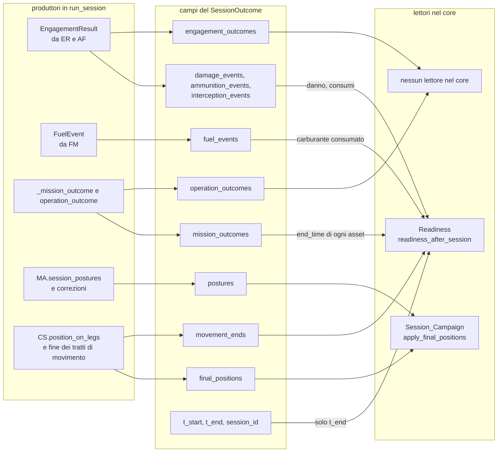

Lettura: il diagramma riassume la ricerca dei lettori del `SessionOutcome` nel core (`grep` di `outcome.` in `Readiness`, `Session_Campaign`, `Session_Validator`): `Readiness` legge `damage_events` (`Readiness.py:163`, per l'istante dell'ultimo danno), i tre consumi tramite i lettori `ammunition_consumed`, `interceptions_consumed` e `fuel_consumed` (`:191-193`), `mission_outcomes` (`:152-155`, per l'`end_time` di ogni asset `:236`), `movement_ends` (`:233`) e `t_end` (`:186`, `:265-267`);
`Session_Campaign` legge `final_positions` (`:80-81`) e `postures` (`:87`). **Nessun lettore nel core** per `engagement_outcomes` e `operation_outcomes`, né per `t_start` e `session_id` dell'esito (la prontezza usa quelli dell'**ordine**, `Readiness.py:269`): sono dati per il chiamante, per il C2 che non c'è ancora e per i test. I produttori sono `Session_Simulator.py:3098` (`_mission_outcome`), `:3123-3139` (`postures`),
`:3144-3151` (`final_positions`), `:3153` (`movement_ends`), `:3154` (`operation_outcomes`) e `results`/`fuel_events` (`:2408`, `:2965`). `F3` (`engagement_outcomes`) è prodotto da `assemble_session_outcome` come `tuple(r.forces for r in results)` (`Command/Session_Types.py:690`). La tabella che segue dà, per le strutture che attraversano i moduli, **chi le produce e chi le consuma** con `file:riga`. Rimando a **D111** (i campi con tutti i membri) e a **D113** (l'assemblaggio).

### Struttura → prodotta da → consumata da

Costruita con `inventario.py --chiamate Logic/Session_Simulator run_session` (ordine e righe delle chiamate nell'orchestratore) e con `grep` sui sorgenti sotto `Source/` esclusi i test. Righe relative a `Source/`; sigle: `ST` = `Command/Session_Types.py`, `CT` = `Command/Campaign_Types.py`, `MT` = `Command/Mission_Types.py`, `MA` = `Logic/Mission_Adapter.py`, `SS` = `Logic/Session_Simulator.py`,
`CS` = `Logic/Contact_Scheduler.py`, `ER` = `Logic/Engagement_Resolver.py`, `AF` = `Logic/Area_Fire.py`, `FM` = `Logic/Fuel_Model.py`, `DM` = `Logic/Damage_Model.py`, `SV` = `Logic/Session_Validator.py`, `SC` = `Logic/Session_Campaign.py`, `RD` = `Logic/Readiness.py`. «Nessuna produzione/consumo nel core» significa che l'estrazione per nome non trova chiamanti fuori dai test.

| Struttura | Definita | Prodotta da | Consumata da |
|---|---|---|---|
| `SessionOrder` | `ST:223` | chiamanti esterni al core: test e scenari (per esempio `Test/Scenario_Fixtures.py:906`); nessun costruttore di produzione nel core | `SS:run_session` (`:2163`; legge `t_start` `:2231`, `operations` `:2237`, `missions` `:2255`, `salvo_window` `:2772`, `session_id` `:3158`), `SV:validate_session` (`:59`), `RD:_mission_assets` (`:142`), `RD:readiness_after_session` (`:186`), `RD:record_session` (`:269`), `SC:run_campaign_session` (`:140`, `:143`, `:147`) |
| `Mission`, `Operation` | `MT:923`, `MT:1193` | chi costruisce l'ordine (test, scenari, pianificatori); l'insieme è validato da `SessionOrder._validate_missions` (`ST:319`) e `_validate_operations` (`ST:344`) | `MA.mission_movements` (`:939`), `MA.session_movements` (`:1071`), `MA.weapon_policies` (`:1918`), `MA.target_rules` (`:1970`), `MA.coordination_domains` (`:1751`), `AF.fire_orders` (`:144`), `SS._check_missions` (`:1931`), `SV:validate_session` (`:116`), `RD:_mission_assets` (`:145`) |
| `forces_a`, `forces_b` (`Military`, `Block`, `BlockItem`) | argomenti (nessun tipo del core) | il chiamante | `SS._collect_forces` (`:1054`), `SV` tramite `SS.session_blocks` (`:102`), `SC._assets_of` (`:43`), `CS.schedule_contacts` (`SS:2385`) |
| `AssetMovement` | `MA:418` | `MA.mission_movements` (`:939`; chiamata `SS:2243`, `SV:167`) | `MA.movement_legs` (`:1002`; `SS:2293`), `AF.fire_orders` (`:144`; `SS:2499`), `MA.mission_planned_end` (`:1116`; `SS:2250`, `SV:178`), `SS._mission_outcome` (`:2049`; `SS:3098`) |
| `Leg` | `CS:122` | `MA.movement_legs` (`:1002`; `SS:2293`), `CS.static_legs` (`SS:2404`) | `CS.schedule_contacts` (`:1379`), `FM.build_leg_fuel_event` (`FM:380`; `SS:1383`), `CS.position_on_legs` (`:508`; `SS:3148`) |
| `ContactWindow` | `CS:197` | `CS.schedule_contacts` (`SS:2385`) | `SS._group_windows` (`:1124`; `SS:2388`), poi `ER.resolve_engagement` (`ER:3619`; `SS:2765`) |
| `random.Random` | libreria standard | `SessionOrder.rng` (`ST:388`) → `Session_Rng.session_rng` (`:105`); chiamate `SS:2475`, `SS:2766`, `SS:2774` | `ER._draw` (`ER:2115`), tempra (`ER:3384`), `AF.resolve_area_fire` (`AF:296`, `AF:306`) |
| `FireOrder` | `AF:107` | `AF.fire_orders` (`AF:144`; `SS:2499`) | `AF.plan_shot` (`AF:202`; `SS:2500`), `AF.impact_time` (`AF:216`; `SS:2507`), `AF.resolve_area_fire` (`AF:231`; `SS:2474`) |
| `EngagementResult` | `ER:967` | `ER.resolve_engagement` (`ER:3619`; costruzione `ER:3607`), `AF.resolve_area_fire` (`AF:314`) | `ER.apply_engagement_result` (`ER:3794`; `SS:2486`, `SS:2790`), `ST.assemble_session_outcome` (`ST:582`; `SS:3158`), `SS._destruction_times` (`SS:2029`; `SS:3093`) |
| `DamageEvent` | `DM:103` | `DM.build_damage_event` (`DM:203`; chiamate `ER:3253`, `AF:306`) | `ER.apply_engagement_result` (`ER:3825-3834`), `SS._destruction_times` (`SS:2038`), `ST.assemble_session_outcome` (`ST:671`), `RD._last_damage_times` (`RD:163`); v. D124 |
| `AmmunitionEvent`, `InterceptionEvent` | `ER:684`, `ER:708` | `ER` (`ER:2934`, `ER:3237`), `AF.resolve_area_fire` (`AF:311`, solo `AmmunitionEvent`) | `ER.apply_engagement_result` (`ER:3836-3870`), `ST.ammunition_consumed` (`ST:478`) e `interceptions_consumed` (`ST:509`) letti da `RD:191-192` |
| `ForceOutcome` | `ER:928` | `ER` (`ER:3597`) | `ST.SessionOutcome.engagement_outcomes` (`ST:438`); nessun lettore nel core |
| `FuelEvent` | `FM:165` | `FM.build_fuel_event` (`FM:235`; `SS:1369`, `SS:1374`), `FM.build_leg_fuel_event` (`FM:380`; `SS:1383`, `SS:1388`), `FM.build_engagement_fuel_event` (`FM:1139`; `SS:2975`) | `FM.apply_fuel_event` (`FM:291`; `SS:2978`, `SS:3037`, `SS:3066`), `ST.assemble_session_outcome` (`SS:3158`), `ST.fuel_consumed` (`ST:518`) letto da `RD:193` |
| `MissionOutcome`, `AssetMissionOutcome` | `MT:1286`, `MT:1239` | `SS._mission_outcome` (`SS:2049`; `SS:3098`) | `ST.operation_outcome` (`ST:528`; `SS:3154`), `ST.assemble_session_outcome`, `RD._asset_outcomes` (`RD:151`) |
| `OperationOutcome` | `MT:1355` | `ST.operation_outcome` (`ST:528`; `SS:3154`) | `ST.assemble_session_outcome`; nessun lettore nel core |
| `postures` | `ST:444` | `MA.session_postures` (`MA:1619`; `SS:3123`), `SS._postures_after_bingo` (`SS:3124`), `SS._postures_after_fuel` (`SS:3127`), correzione `destroyed` (`SS:3132-3139`) | `SC.apply_final_positions` (`SC:87`) |
| `final_positions` | `ST:446` | `SS.run_session`, con `CS.position_on_legs` (`SS:3144-3151`) | `SC.apply_final_positions` (`SC:80-81`) |
| `movement_ends` | `ST:447` | `SS.run_session` (`SS:3153`) | `RD.readiness_after_session` (`RD:233`) |
| `SessionOutcome` | `ST:400` | `ST.assemble_session_outcome` (`ST:687`; `SS:3158`) | `RD` (`RD:151`, `:160`, `:172`, `:262`), `SC` (`SC:62`, `SC:109`) |
| `SessionViolation`, `SessionValidationError` | `CT:124`, `CT:149` | `SV.validate_session` (dodici punti `SV:73-214`), `SV.check_session` (`SV:244`) | `SV.check_session` (`SV:241-244`); nessun chiamante nel core intercetta l'errore (`SC:run_campaign_session` lo lascia propagare, docstring `SC:134-135`) |
| `CampaignLedger` | `CT:277` | il chiamante (L0); `RD.apply_campaign_processes` (`RD:335`, L1); `RD.record_session` (`RD:268-270`, L2) | `SV` (`SV:37`, `:63`, `:92`, `:149`), `RD`, `SC`; salvato da chi chiama con `to_dict` (`CT:347`), fuori dal core |
| `ReadyRecord` | `CT:208` | `RD.readiness_after_session` (`RD:217`, `RD:257`) | `SV.validate_session` (`SV:150-152`), `SV._process_label` (`SV:263-267`), `RD.apply_campaign_processes` (`RD:311`, `:327`, `:330`), `CampaignLedger.is_ready` (`CT:319`) |
| `SessionRecord` | `CT:181` | `RD.record_session` (`RD:269`) | `CampaignLedger.last_end` (`CT:310`) letto da `SV:92` |
| `SessionRules` | `CT:66` | valore predefinito di `CampaignLedger.rules` (`CT:285`), `SV` (`SV:63`) | `SV.validate_session` (`SV:83`); `window` senza chiamanti nel core |
| `asset.position` (`Point3D`) | `Asset` | `SC.apply_final_positions` (`SC:103`) | `SS` tramite `CS.static_legs` (`SS:2404`, `SS:2693`), `CS` (`CS:1578`), `MA.air_base_points` (`MA:896`); la sessione successiva |

Un fatto di insieme che la tabella rende visibile: **le tre strutture che attraversano più di due moduli** sono `EngagementResult` (risolutore e fuoco su posizione → applicazione, assemblaggio e distruzioni), `FuelEvent` (tre costruttori → applicazione, assemblaggio e prontezza) e `SessionOutcome` (un solo costruttore → prontezza e posizione). Quelle trattate in 10A e 10B hanno il proprio diagramma:
`EngagementResult` D76-D86, `FuelEvent` D98-D102, `FireOrder` D106-D109, `Mission`/`Operation`/`MissionOutcome` D90-D97.

## 10C.10 Limiti e domande

- **API pubblica senza chiamanti nel core.** `SessionOrder.mission`; `SessionOutcome.force_outcomes`, `outcomes_of`, `outcomes_of_block`, `ammunition_consumed_by_weapon`; `SessionRules.window`; `CampaignLedger.ready_at`, `to_dict`, `from_dict`; `Readiness.ready_assets`. Hanno chiamanti solo nei test o nello scenario S30, o sono il protocollo dichiarato per `Campaign_State.add_ledger`
  (`to_dict`, `from_dict`). Non è un difetto: sono API pensate per il pianificatore/C2 e per la persistenza, che non ci sono ancora. Il codice non dice quali saranno usate; non verificato se qualcuna sia superflua.
- **Campi dell'esito senza lettori nel core.** `engagement_outcomes`, `operation_outcomes`, e `t_start` e `session_id` dell'esito non sono letti da nessun modulo del core (D129). Anche questo è coerente con «il C2 non c'è ancora», non un errore.
- **Rami del validatore che non possono scattare.** Il messaggio «no readiness record» di `ASSET_NOT_READY` (`Session_Validator.py:157-158`), i rami `'no record'` e `'unknown process'` di `_process_label` (`:261-262`, `:269`) e il `try ... except ValueError: raise` di `:101-105` sono difese morte (D117); `Mission` e `Mapping` sono importati e non usati (`:13`, `:22`). Nessun effetto sul comportamento; non corretti.
- **La provenienza del turnaround non entra nel registro.** `turnaround_s` restituisce `(secondi, provenienza)` ma `readiness_after_session` tiene solo i secondi (`Readiness.py:222`) e `ReadyRecord` non ha un campo per la provenienza: dal registro non si distingue un turnaround di classe da uno di ripiego (`'default'`, 3 h, stima). I tempi stessi sono stime dichiarate in `Context/Context.py:1013-1038`.
- **`SessionOutcome.__post_init__` normalizza meno di `SessionOrder`.** Non riscrive `t_start` e `t_end` come float (`Session_Types.py:451`, a differenza di `:277-278`); congela `mission_outcomes` nell'ordine di inserimento ma ordina per id le altre quattro mappe (`:128` contro `:140`, `:164`, `:194`, `:212`); non controlla il tipo degli elementi delle tuple di eventi (lo fa `assemble_session_outcome` per `EngagementResult` e `FuelEvent`).
  Non è un errore finché si costruisce l'esito con `assemble_session_outcome`; l'unico costruttore nel core lo fa.
- **`CampaignLedger` non controlla l'unicità di `session_id`.** Controlla solo che le sessioni siano disgiunte e in ordine (`Campaign_Types.py:299-304`). Con un `session_id` ripetuto in un'altra sessione non solleva nulla; non verificato se sia voluto.
- **`assemble_session_outcome` e `fuel_events`.** L'intervallo `[t_start, t_end]` è controllato anche contro i `FuelEvent` (`Session_Types.py:678-685`) ma `t_end = latest` di `run_session` è calcolato senza di essi (`Session_Simulator.py:3075-3087`): la compatibilità dipende dal fatto che i tratti di movimento arrivino al più a `session_end` (D113). Non ho verificato i tratti prodotti dalla ri-pianificazione.
- **Copie di codice da tenere allineate.** `_domain_id` è ripetuta con lo stesso corpo in `Session_Validator.py:249`, `Session_Campaign.py:34` e `Readiness.py:351` (corpi confrontati riga per riga); la tolleranza `_TIME_EPS = 1e-9` è ripetuta in `Campaign_Types.py:38` e `Readiness.py:50`, mentre `Session_Validator.py:33` importa `Contact_Scheduler.TIME_EPS` (`:92`). Oggi i valori coincidono; il legame è un commento, non un import. Si aggiunge alle altre copie già segnalate in 10A.
- **Il controllo `draw`.** `_check_probability` accetta `0 <= v <= 1`, mentre il docstring di `resolve_hit` dice «numero in [0, 1)» (`Damage_Model.py:162` e `:275`): `draw = 1.0` supera il controllo e dà MISS anche con `accuracy = 1.0`. Non è raggiungibile con `random.Random.random()`; il risolutore ripete il controllo dell'intervallo semiaperto in `_draw`.
- **Chiamanti «previsti» del validatore.** Il docstring di `Session_Validator` cita il pianificatore aereo come chiamante previsto (`:7`); nel codice sotto `Source/` non c'è nessuna chiamata a `validate_session` o `check_session` oltre a `run_campaign_session`. `Mission_Adapter` parla di «pianificatore (il futuro C2)» (`Mission_Adapter.py:236`). Non verificato di quale pianificatore si tratti.
- **Stato delle stime.** In questi moduli le sole costanti stimate sono i tempi di turnaround e riparazione di `Context/Context.py` (usati da `Readiness`); `DEFAULT_SESSION_DURATION_S` e `MAX_SESSION_DURATION_S` sono decisioni dell'utente dichiarate come tali (`Campaign_Types.py:40-41`); `MIN_EFFECTIVE_HIT_DAMAGE` è una convenzione dichiarata (`Damage_Model.py:82-85`); `SEED_BITS` e `SEED_SCHEME` sono scelte di progetto di `Session_Rng`. Nessuna è stata ricalibrata.
