# Guida concettuale al motore DES

> **Data**: 2026-11-20.
> **Scritta sul repository al commit `3116813d`** (branch `analysis/dce-dcs-persistence`). Il manuale tecnico è letto
> all'ultimo commit che lo tocca, `78ebf15b`; il manuale descrive il codice del motore a `a99bb3d4` e test e scenari a
> `ff84e2a4`. Dopo di allora nel codice sono cambiati commenti e testi di documentazione (`34c4cefd` nel motore, `8fa92710`
> in un test) ed è stato aggiunto un interruttore per la ricalibrazione della probabilità di scoperta al bordo della
> portata (`598af98e`, spento), poi acceso il 2026-11-20 (`fd2af921`). La fotografia di non regressione installata è quella del 2026-11-19 (`fdb78b86`, 1219 esecuzioni).
> <!-- PD-STATO -->
> **Stato della probabilità di scoperta al bordo della portata.** Dal 2026-11-20 è acceso l'interruttore della
> ricalibrazione: la probabilità al bordo è 0,2 (stima senza fonte, decisione dell'utente) invece di 0,5; manuale e
> fotografia installata descrivono ancora lo stato con 0,5 fino alla prossima fotografia (la installa solo l'utente). La
> modifica che accende l'interruttore è nel branch `analysis/dce-dcs-persistence` (commit `fd2af921`, non ancora pushato); la
> legge di prima si ottiene spegnendo l'interruttore.
> <!-- /PD-STATO -->
> **Nessuna suite e nessun confronto sono stati rieseguiti per questa guida** (i soli numeri di esecuzioni citati vengono
> dal confronto del 2026-11-20 sul commit `fd2af921`). Il motore cambia spesso: ciò che la guida
> dice vale a questa data.

## Come leggere questa guida

**A chi è rivolta.** A un responsabile di progetto che non programma. Alla fine della lettura dovrebbe sapere: che cosa il
motore risponde e che cosa no; come è fatto, a grandi blocchi; perché è fatto così; quanto fidarsi dei suoi risultati e dove
stanno i numeri stimati; dove cercare il dettaglio nel manuale tecnico.

**Che cosa non c'è.** Nessun nome di file, funzione, classe o variabile del codice: la guida descrive le idee. Chi vuole
scendere di livello trova in ogni sezione il rimando al capitolo e al paragrafo del manuale (per esempio «Manuale cap. 6 §6.2»).
Le sigle che il progetto usa per le sue regole e le sue fasi di lavoro compaiono **solo** nella tabella di corrispondenza
della sezione 14, perché il manuale le usa come titoli. Le decisioni ancora aperte e le tarature da fare **non** sono in questa
guida: invecchiano in pochi giorni e stanno in un **documento di stato separato**.

**Come è fatta ogni sezione.** Un testo principale; poi tre riquadri fissi: **«Dalla letteratura»** (le idee prese da fonti
esterne, con la citazione), **«Scelta del progetto»** (ciò che il progetto ha deciso da sé), **«Limiti e incertezze»** (che
cosa il motore non fa o non sa, con l'etichetta di affidabilità), e infine **«Nel manuale»** (dove sta il dettaglio).

**Le formule.** Le poche formule del motore sono parte del testo, non un approfondimento facoltativo: ognuna è spiegata a
parole e accompagnata da un esempio con numeri. **Tutti i numeri degli esempi sono ILLUSTRATIVI**: servono a capire il
meccanismo, non sono dati del motore né dei registri, salvo dove è detto che sono valori del codice o dei registri.

**Figure e tabelle.** Le figure (diagrammi) sono numerate «Fig. 1», «Fig. 2», …, le tabelle principali «Tab. 1», «Tab. 2», …,
in ordine di apparizione. La didascalia indica il diagramma tecnico del manuale da cui la figura deriva (D1-D134; sezione 14).

**Le etichette di affidabilità**, usate in tutta la guida:

| Etichetta | Significato |
|---|---|
| **[V]** | verificato leggendo il codice: nel manuale (alla data indicata lì) oppure, dove scritto «[V, 2026-11-20]», dall'autore di questa guida, sul codice o sui file di dati |
| **[S]** | **stima**: un numero o una forma scelti come punto di partenza plausibile, non tarati su dati; il codice li dichiara come tali |
| **[D]** | **decisione dell'utente**: una scelta, non una stima, ma nemmeno un dato misurato |
| **[S/D]** | **stima scelta dall'utente**: un valore non tarato che il codice dichiara «stima dell'utente» o «decisione dell'utente, stima» |
| **[NV]** | **non verificato**: oppure un numero dichiarato da un rapporto e non rieseguito, oppure una misura di una prova temporanea non ripetibile dalla suite |

**Le citazioni.** «[B 1.2]» rimanda alla voce 1.2 della bibliografia (sezione 16; la versione completa, con gli indirizzi web
di controllo, è il file `Guida_Concettuale_DES_Bibliografia.md`). «Verificata» vuol dire che l'opera esiste con quei dati;
**non** vuol dire che qualcuno ne abbia letto il contenuto: dove la bibliografia lo dichiara, la guida lo ripete («contenuto
non letto»). Dove la bibliografia non copre un argomento c'è un segnaposto `[FONTE: ...]`: va letto come «affermazione del
progetto, oggi senza una fonte esterna verificata».

---

## Riassunto iniziale

**Che cosa fa.** Una campagna di Warfare-Model procede per **sessioni**: intervalli di tempo di gioco, di default due ore.
Alcune sessioni sono giocate da una persona in **DCS**, il simulatore di volo da combattimento con cui il progetto si
interfaccia; le altre sono **sessioni virtuali**, da risolvere senza giocatore. Il **motore DES** (simulazione a eventi
discreti) calcola come va a finire una sessione virtuale, **unità per unità**: chi incontra chi, chi vede chi, chi spara, che
cosa colpisce, quanto carburante e quante munizioni restano, come finisce ogni missione. Riceve un **ordine di sessione**
(forze, missioni, durata) e restituisce un **esito di sessione**. Non sceglie le missioni, non pianifica la campagna, non
gestisce la logistica delle basi, non conosce il terreno e oggi non ha un chiamante «vero»: lo usano solo i test e gli scenari
(sezione 1).

**Come lo fa.** Non fa avanzare un orologio a scatti: **salta da un fatto al successivo** (un incontro, un lancio, un impatto) e
calcola **con la geometria** l'istante in cui due unità si avvicinano abbastanza da interagire. Per questo ore di combattimento
costano un tempo di calcolo breve (sezione 2). È organizzato in **quattro strati**: il contratto (che cosa entra ed esce),
**quando** (i contatti: sola geometria, nessuna estrazione casuale), **come finisce** (lo scontro, dove avviene quasi tutta la
casualità), **applicazione** (danni e consumi su ogni singola unità); un **orchestratore** li mette in fila, raggruppa i
contatti in **episodi** e dopo ogni episodio può far rientrare gli aerei (sezione 3). Tutto parte dalle **missioni**: rotta,
orari, attese, bersaglio, regole di fuoco, armi consentite, criteri di fine; la missione è anche l'unità che combatte e si
ritira (sezione 4).

**Le regole centrali.** Il rilevamento usa una **legge di probabilità di scoperta** che vale 1 a distanza zero e una
**costante al bordo della portata** del sensore; in mezzo la probabilità **mancata** (1 − Pd) cresce con la **quarta potenza**
del rapporto fra distanza e portata, e subito fuori dalla portata la probabilità è zero.
<!-- PD-STATO -->
Dal 2026-11-20 è acceso l'interruttore della ricalibrazione: la probabilità al bordo è 0,2 (stima senza fonte, decisione
dell'utente) invece di 0,5; manuale e fotografia installata descrivono ancora lo stato con 0,5 fino alla prossima fotografia.
<!-- /PD-STATO -->
Una sola estrazione casuale decide **se e a che distanza** avviene la scoperta, una volta per ogni passaggio del bersaglio nel
volume del sensore; se il bersaglio vi resta meno del tempo di rivisita del sensore, la probabilità si riduce in proporzione
(sezione 5). Lo scontro è una catena: ritardo di reazione del sistema, scelta dell'arma dai registri, **saturazione delle
difese** (i colpi che arrivano insieme sono confrontati con la capacità di intercettazione, e il surplus passa), danno **colpo
per colpo**, **soglia di rottura** casuale che può far ritirare una forza intera. Il **fuoco su posizione** (artiglieria e navi
su un punto stimato) è un caso a parte, risolto fuori dallo scontro con un flusso casuale separato della stessa sorgente di
sessione (sezione 6). Il carburante vincola il movimento e gli aerei rientrano al **bingo** secondo un albero di regole
(sezione 7). Fra una sessione e l'altra un ciclo di campagna, esterno al motore, applica riarmo, rifornimento e riparazione
**all'inizio della prima sessione** che comincia dopo la scadenza dei loro tempi (stimati), e porta avanti danni, scorte,
carburante e posizioni; **il rilevamento non passa** da una sessione all'altra (sezione 8). Due **pianificatori**, fuori dal
motore e oggi chiamati solo da test e da uno strumento di visualizzazione, scelgono le rotte aeree rispetto ai volumi di
scoperta e di intercettazione e il profilo d'attacco con cui sganciare una bomba (sezione 9).

**Riproducibilità.** Tutte le estrazioni casuali vengono da una sorgente di sessione, divisa in flussi separati, con semi
calcolati in modo identico su ogni macchina: a parità di dati e di codice il motore produce **la stessa storia**. Una singola
esecuzione resta però un campione: per conoscere la variabilità servono **repliche** con semi diversi (sezione 10).

**Verifica, non validazione.** Il motore è controllato da alcune migliaia di test, da una batteria di scenari e da una
**fotografia di non regressione** che registra l'esito di **1219 esecuzioni** (installata il 2026-11-19; prima erano 1103):
ogni modifica che cambia ciò che la fotografia registra è vista e va spiegata. La fotografia però **non** registra i
rilevamenti in 1103 delle 1219 esecuzioni, né gli esiti di missione e di operazione, né le posizioni finali: questi li
controllano solo i test. Tutto ciò prova che il motore fa ciò che il progetto dice (**verifica**); **non** prova che i suoi
numeri corrispondano alla realtà: **nessuna validazione su dati reali o storici è stata fatta** (sezione 11).

**Quanto fidarsi.** La **struttura** (eventi, geometria, catena dello scontro, riproducibilità) è verificata sul codice; i
**numeri** che la alimentano sono in buona parte **stime dichiarate** (probabilità al bordo della portata, soglia di rottura,
scomposizione dei tempi di reazione, tempi di rivisita dei sensori, consumi d'emergenza, tempi di ripristino e di riparazione,
...) o dati di registro di qualità variabile. Il motore oggi serve a **confronti relativi fra alternative, con repliche**, non a
previsioni assolute (sezione 12). Prende dalla letteratura **meccanismi** (eventi discreti, saturazione per salva, dipendenza
del segnale radar dalla distanza, flussi casuali indipendenti); la teoria della ricerca è solo un riferimento **qualitativo**
per la regola della permanenza, che è una scelta del progetto [S]. Non usa coefficienti di logoramento aggregato: **non è un
modello alla Lanchester** (sezione 13). Le sezioni 14-16 sono la guida al manuale (con la tabella delle sigle di progetto), il
glossario e la bibliografia.

**Il rapporto con DCS** (formulazione proposta, da confermare): il contratto di ingresso e di uscita è lo stesso per una sessione
sintetica e per una giocata in DCS; il DES risolve solo le sintetiche; oggi non esistono un adattatore DCS né un chiamante di
produzione del ciclo di campagna.

---

## 1. A che cosa serve e a che cosa NON serve il motore

### 1.1 Il problema

Una campagna di Warfare-Model è una successione di **sessioni**: intervalli di tempo di gioco (di default due ore, al massimo
quattro, per decisione dell'utente [D]) in cui le forze dei due schieramenti eseguono le loro missioni. Alcune sessioni sono
**giocate**: una persona vola in **DCS** (un simulatore di volo da combattimento commerciale, esterno al progetto, con cui il
progetto si interfaccia) e il simulatore produce l'esito. Molte altre non hanno un giocatore e vanno comunque risolte, perché
la campagna deve andare avanti: sono le **sessioni virtuali** (o sintetiche). Il motore DES esiste per queste. Il progetto gli
chiede di coprire ore di tempo di gioco in un tempo di calcolo «fino a minuti» per sessione, un vincolo dichiarato dall'utente
e **non misurato** sul caso grande [NV].

### 1.2 Che cosa entra e che cosa esce

Il motore riceve un **ordine di sessione** e restituisce un **esito di sessione**. Sono le due «porte» del motore, e tutto ciò
che passa per esse è espresso in **termini di dominio**: identificativi del progetto, secondi dall'inizio della sessione, metri,
frazioni, mai concetti di un simulatore [V].

L'ordine di sessione contiene:

- un **identificativo della sessione**, che è anche la radice di tutta la casualità della sessione (sezione 10);
- l'**inizio** e la **fine** della sessione;
- le **forze** coinvolte (i blocchi del progetto: una squadriglia, un reparto corazzato, una batteria, un gruppo navale) ed
  eventualmente quali unità di un blocco sono davvero impegnate;
- una **finestra di raggruppamento delle salve** (quanti secondi separano due impatti perché contino come la stessa salva; di
  default zero);
- le **missioni** e le **operazioni** (sezione 4): sono **l'unica via** con cui un'unità riceve una rotta, una partenza e una
  velocità. Un'unità senza missione resta ferma, in una postura di attesa [V].

L'esito di sessione contiene, per ogni scontro e per ogni unità, che cosa è successo: gli esiti delle forze in ogni scontro
(tenuta, ritirata, distruzione), gli **eventi di danno** colpo per colpo, gli **eventi di munizioni** (colpi offensivi) e di
**intercettazione** (colpi difensivi), gli **eventi di carburante**, l'**esito di ogni missione**, la **postura** di ogni unità a
fine sessione, l'**esito di ogni operazione**, la **posizione finale** e l'istante in cui ogni unità in missione ha smesso di
muoversi [V].

Un punto da sapere: il motore **non** è un calcolatore «a parte». Le unità che riceve sono gli oggetti del modello della
campagna, e il motore **applica davvero** a esse danni, consumi di munizioni e carburante; l'esito è il resoconto di ciò che è
stato applicato [V]. Le posizioni finali e la prontezza, invece, le applica il ciclo di campagna (sezione 8).

### 1.3 Indifferente al simulatore

Il nucleo del progetto deve restare **indifferente al simulatore**: la verifica dichiarata è che, togliendo l'adattatore verso
DCS, la campagna deve continuare a girare con sole sessioni sintetiche. Per il motore questo significa che le porte trasportano
solo valori di dominio e che nessun pezzo del motore dipende da file o concetti di DCS [V].

**Rapporto con le sessioni giocate** (*formulazione proposta, da confermare dall'utente*): il contratto di ingresso e di uscita
è lo stesso per una sessione sintetica e per una giocata in DCS; il DES risolve solo le sintetiche; oggi non esistono un
adattatore DCS né un chiamante di produzione del ciclo di campagna. Il codice lo dice in due punti: le porte sono quelle a cui
deve conformarsi «qualunque esecutore di sessione: il risolutore sintetico oggi, un adattatore DCS domani», e un adattatore
DCS «sostituirebbe il solo passo» di esecuzione nel ciclo di campagna [V, 2026-11-20]. Che cosa farebbe l'adattatore, nel
dettaglio, non è scritto da nessuna parte: è un'intenzione di progetto.

### 1.4 Che cosa il motore NON fa

- **Non decide le missioni** né quando lanciarle: è il compito del livello di comando e controllo della campagna, che **non è
  stato costruito** [V].
- **Non controlla l'ordine** che riceve: la verifica (durata della sessione, unità pronte, missioni dentro la sessione,
  carburante sufficiente) è di un validatore del ciclo di campagna, fuori dal motore. Chi chiama il motore direttamente può
  fargli eseguire anche un ordine che il validatore rifiuterebbe [V].
- **Non rifornisce né ripara** durante la sessione; riarmo, rifornimento e riparazione avvengono fra le sessioni (sezione 8), e
  **non consumano risorse delle basi**: la logistica delle basi non è modellata, per decisione dell'utente [D].
- **Non conosce il terreno**: niente mappe, valli o rilievi; nel motore non c'è nemmeno l'**orizzonte radar** (il limite di
  visibilità dovuto alla curvatura terrestre), che c'è invece nel pianificatore di rotta (sezione 9) [V].
- **Non inventa movimenti**: le unità si muovono solo lungo le rotte delle loro missioni; le uniche deviazioni sono i rientri
  degli aerei decisi dalle regole sul carburante e dopo una ritirata (sezioni 3 e 7) [V].
- **Non ha giocatori** né componenti di intelligenza artificiale generativa [V].
- **Non disegna**: produce numeri ed eventi, non immagini. Non è un simulatore 3D e non sostituisce DCS.
- **Non è un modello alla Lanchester**: non usa equazioni di logoramento di forze aggregate; i colpi sono singoli e le perdite
  sono per unità (sezioni 6 e 13). Il modello aggregato «a rapporto di forze» che il progetto aveva prima esiste ancora, ma il
  motore non lo chiama: il manuale lo dichiara un ripiego, mai il risolutore principale [V, 2026-11-20: nessun pezzo del motore
  lo invoca].

### 1.5 Chi lo usa oggi

**Solo i test e gli scenari** [V, 2026-11-20]. Il motore è chiamato da un **conduttore di campagna** minimo (sezione 8), e il
conduttore è chiamato soltanto dai test e da uno scenario di campagna; nessun altro modulo del progetto lo usa. È quindi un
motore **completo nei suoi meccanismi** ma **non ancora inserito** in una catena di produzione.

*Fig. 1 — Il motore nel suo contesto. Deriva dai diagrammi tecnici D57 (contesto del nucleo, livello L0) e D1 (blocco del
ciclo di campagna). Le frecce tratteggiate sono parti previste ma non esistenti.*

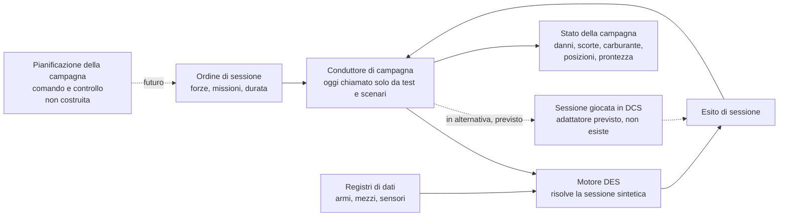

> **Dalla letteratura.** La letteratura di analisi della difesa distingue i modelli per **livello di aggregazione** (dal
> singolo ingaggio fino al teatro) e discute come collegare modelli a risoluzioni diverse: per un'introduzione, Davis
> [B 7.1] e [B 7.2]; per un modello di campagna costruito a eventi, Hillestad e Moore [B 7.5] (pagina RAND letta per titolo e
> sintesi). Per la classificazione dei modelli di difesa per livello («ingaggio, missione, campagna, teatro») la bibliografia
> indica le stesse opere, [B 7.5] e [B 7.1]-[B 7.2] (giudizio di pertinenza su titolo e sintesi). In questa scala il motore sta
> fra **ingaggio** e **missione**, dentro un ciclo di **campagna**. Sugli scopi della simulazione militare e sulla differenza fra
> gioco e analisi: Perla [B 3.2] e Sabin [B 3.1]; sull'uso della simulazione per **capire** più che per **predire**, e sulla
> semplicità deliberata dei modelli: Sabin [B 3.1] (opere verificate; il giudizio di pertinenza della bibliografia si basa su
> schede e sommari, non sulla lettura). Su quando un modello di combattimento **non può** essere validato per la previsione:
> Hodges e Dewar [B 6.4] (sintesi della pagina RAND).
>
> **Scelta del progetto.** Un motore a sé per le sessioni virtuali, con un contratto di ingresso e di uscita fisso e
> indifferente al simulatore; perdite per singola unità; nessun legame con un modello aggregato [D, vincoli dell'utente].
>
> **Limiti e incertezze.** Nessun chiamante di produzione del ciclo di campagna [V]; nessun adattatore DCS [V]; il tempo di
> calcolo «fino a minuti» non è misurato, e lo scenario di scala del progetto verifica solo che una sessione con 40 blocchi e
> 240 unità finisca entro un limite di tempo [NV per il caso grande]; il limite di 10.000 unità è un **tetto teorico** dichiarato
> dall'utente, non un caso provato [D]. **Uso dei risultati**: oggi il motore serve a **confronti relativi** fra alternative,
> con **repliche** su semi diversi; **non** c'è validazione su dati reali o storici (sezioni 11-12).
>
> **Nel manuale.** Cap. 1 §1.1-§1.4; cap. 6 §6.1 e §6.7 («Cosa non fa»); cap. 10 §10.3 (diagramma D57); cap. 9 §9.1 «Limiti
> della campagna»; cap. 8 §8.3 (indifferenza al simulatore come test di contratto).

---

## 2. L'idea di base: simulare per eventi, non per passi di tempo

### 2.1 Due modi di far avanzare il tempo

Ci sono due modi di far procedere una simulazione nel tempo.

- **A passi fissi** («tick»): un **cronometro** avanza di un intervallo costante (un secondo, un millisecondo) e a ogni scatto si
  aggiorna tutto: posizioni, sensori, armi. Se in quell'intervallo non succede niente, il lavoro è stato fatto lo stesso.
- **A eventi discreti** (DES): un'**agenda** elenca in ordine di tempo i fatti che cambieranno lo stato (un lancio fra 26
  secondi, un impatto fra 55, la fine di un movimento fra 40 minuti). Il simulatore prende il fatto più vicino, **salta**
  direttamente a quell'istante, lo esegue, aggiunge all'agenda i fatti che ne derivano e ricomincia. **Fra due eventi non si
  calcola nulla.**

Il motore è del secondo tipo, **in secondi assoluti dall'inizio della sessione, senza alcun passo di tempo globale** [V]. Le
agende sono due: una per la sessione intera (gli scontri, i fuochi su posizione, le fini dei movimenti) e una dentro ogni
scontro (lanci, impatti, decisioni). Il «micro-passo fine dentro uno scontro» di cui parlava una prima stesura del manuale **non
esiste** nel codice [V].

### 2.2 Perché non i passi fissi

La prima proposta del progetto era a passi fissi di circa un millesimo di secondo, dimensionati sul missile più veloce
(un missile ipersonico a Mach 27 percorre 10 metri in circa 1,08 ms). Il conto, fatto nel documento di analisi del progetto, è
questo: due ore di sessione con il tetto teorico di 10.000 unità fanno circa **6,7·10¹⁰ aggiornamenti**; anche al costo di un
ciclo vuoto del linguaggio usato servirebbero **più di tre ore**, e al costo misurato di un motore ad agenti paragonabile
**circa 74 giorni**; con un controllo delle distanze fra tutte le unità a ogni passo si arriverebbe ad **anni**. L'aritmetica è
stata ricontrollata nel manuale [V]; i costi unitari sono misure citate dal documento di analisi, **non misurate su questo
progetto** [NV].

### 2.3 Perché non la sola probabilità

La seconda proposta risolveva l'esito di uno scontro direttamente con la probabilità, senza simulare il tempo. La direzione era
giusta ma mancava un pezzo: **non diceva se e quando due forze si incontrano**. Il motore colma questo buco con la geometria,
non con un cronometro [V].

### 2.4 Quando due unità si incontrano: la geometria dei contatti

Ogni rotta è una **spezzata**: una serie di tratti rettilinei, ciascuno percorso a velocità costante. Su un tratto in cui
entrambe le unità vanno dritte a velocità costante, l'istante in cui sono **più vicine** (il «punto di massimo
avvicinamento») si ricava con una formula, senza provare istante per istante:

> **t\* = − (Δr · Δv) / |Δv|²**
>
> dove **Δr** è la posizione della seconda unità vista dalla prima all'inizio del tratto, **Δv** è la velocità della seconda
> rispetto alla prima, «·» è il prodotto scalare (quanto due direzioni vanno nello stesso verso) e |Δv|² il quadrato della
> velocità relativa. A parole: *quanto tempo serve perché lo spostamento relativo annulli la distanza lungo la direzione in cui
> ci si avvicina*.

Per sapere non solo quanto ci si avvicina ma **da quando a quando** si è a portata, il motore risolve l'equazione «distanza al
tempo s = portata R», cioè |Δr + Δv·s|² = R²: un'equazione di secondo grado che dà l'istante di **ingresso** e quello di
**uscita**. Il calcolo si ripete su ogni pezzo di tempo in cui le due velocità restano costanti, e i risultati si uniscono [V].

**Esempio ILLUSTRATIVO.** Un aereo A parte dall'origine verso est a 250 m/s; un aereo B parte 60 km a est e 10 km a nord e
vola verso ovest a 250 m/s. Allora Δr = (60 000; 10 000) m e Δv = (−500; 0) m/s. Il prodotto Δr·Δv vale −30 000 000 e |Δv|²
vale 250 000: **t\* = 120 s**, e in quel momento la distanza è di **10 km** (la sola separazione nord-sud). Se il sensore di A
ha una portata di 20 km, l'equazione (60 000 − 500·s)² + 10 000² = 20 000² dà s ≈ **85 s** e s ≈ **155 s**: B è a portata per
circa 69 secondi. Tre numeri risolvono una domanda che a passi di un millisecondo avrebbe chiesto 155 000 controlli.

### 2.5 Ciò che resta dei passi fissi: i ritardi di reazione

Della proposta a passi fissi il motore conserva un'idea: la reazione di un sistema d'arma si scompone in **quattro fasi** —
rilevare, valutare, comandare, attuare. Lo schema ricorda il ciclo decisionale che in letteratura si chiama **OODA** (dalle
iniziali inglesi di *observe, orient, decide, act*: osservare, orientarsi, decidere, agire); è un'analogia, le fasi del motore
non coincidono con quelle. Nel motore queste fasi **non contano scatti**: sommate, danno un **ritardo** che programma un evento
futuro («questo sistema lancerà fra 26 secondi») [V]. È ciò che decide **chi spara per primo**, cioè l'iniziativa. I **totali**
«dal rilevamento al lancio» provengono da fonti tecniche citate dal documento di analisi; la **scomposizione** nelle quattro fasi
è una stima [S] (dettaglio nella sezione 6).

Anche il **rilevamento** segue la stessa logica: **una sola estrazione casuale** stabilisce a quale distanza il sensore scoprirà
il bersaglio, e da quella distanza la geometria ricava l'istante, senza campionare la finestra nel tempo [V] (sezione 5).

### 2.6 L'ordine degli eventi simultanei

Quando due eventi cadono nello stesso istante, l'ordine non è lasciato al caso né all'ordine in cui il programma li ha
incontrati: a parità di tempo vengono prima gli **scontri**, poi i **fuochi su posizione**, poi le **fini di movimento**, e a
parità di tipo decide un identificativo stabile [V]. Questo ordine **fa parte del contratto** di riproducibilità (sezione 10):
cambiarlo cambierebbe le storie.

*Fig. 2 — Passi fissi contro eventi (numeri ILLUSTRATIVI, dall'esempio di §2.4). Nessun diagramma tecnico corrispondente.*

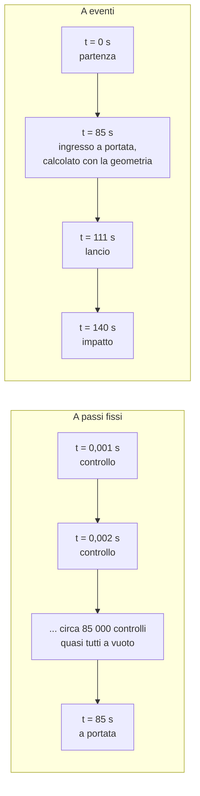

*Fig. 3 — Dal ritardo di reazione all'evento futuro (numeri ILLUSTRATIVI). Deriva da D5 (sequenza della coda degli eventi
dentro uno scontro).*

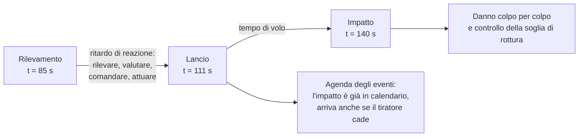

> **Dalla letteratura.** L'avanzamento «al prossimo evento» con una lista ordinata di eventi futuri è il fondamento della
> simulazione a eventi discreti nei manuali di riferimento: Banks e altri [B 1.2], Law [B 1.3]; per un lettore non tecnico,
> Robinson [B 1.1]; per una trattazione formale, Zeigler e altri [B 1.4] (opere verificate; il capitolo specifico sul
> confronto con il passo fisso non è stato controllato). Sull'effetto del meccanismo di avanzamento del tempo nelle
> simulazioni di combattimento: Al Rowaei, Buss e Lieberman [B 1.5] (citazione verificata, **contenuto non letto**). Il ciclo
> decisionale in quattro fasi e i tempi di reazione dei sistemi d'arma: `[FONTE: ciclo OODA e tempi di reazione]`. Il calcolo
> del punto di massimo avvicinamento fra mobili: `[FONTE: cinematica del moto relativo / anticollisione]`. L'affermazione,
> ripresa dal documento di analisi, che i simulatori militari a livello di singola entità siano a eventi e quelli a passo fisso
> siano aggregati: `[FONTE: documentazione dei simulatori militari]` — **nessuna fonte primaria trovata** dalla bibliografia.
>
> **Scelta del progetto.** Simulazione a eventi in secondi assoluti, contatti calcolati con la geometria, ritardi di reazione
> come parametri per tipo di sistema, ordine fisso degli eventi simultanei [V].
>
> **Limiti e incertezze.** Il moto è **rettilineo a velocità costante a tratti**: qualunque manovra fuori dalla rotta assegnata
> non esiste [V]. «Calcolato in modo analitico» significa esatto **rispetto a questo modello di moto**, non esatto rispetto alla
> realtà. Il risparmio di calcolo non è misurato sul caso grande [NV]. La scomposizione dei ritardi in quattro fasi è una stima
> [S]. La ricerca del «micro-passo» nel codice è stata fatta per parole chiave, non rileggendo ogni ciclo del risolutore [V per
> la struttura a eventi, NV per una lettura completa].
>
> **Nel manuale.** Cap. 1 §1.1 (il problema e la scelta, con i numeri), §1.5; cap. 3 §3.1-§3.2 (i tre meccanismi geometrici);
> cap. 6 §6.2 (coda degli eventi di sessione); cap. 7 §7.3 (tempi di reazione e loro statuto).

---

## 3. Come è fatto: i quattro strati e il percorso di una sessione

### 3.1 Quattro domande, quattro strati

Il motore è diviso in **quattro strati**, ciascuno responsabile di una sola domanda [V]:

| Strato | Domanda | Come risponde |
|---|---|---|
| **0 — Contratto** | Che cosa entra e che cosa esce? | Ordine ed esito di sessione con soli valori di dominio, più la **sorgente di casualità** della sessione |
| **1 — Contatti** | **Quando** due unità possono interagire? | Solo geometria: rotte, volumi, punto di massimo avvicinamento. **Nessuna estrazione casuale** |
| **2 — Scontro** | **Come finisce** un incontro? | Rilevamento, ritardo di reazione, scelta dell'arma, salve e saturazione delle difese, danno per colpo, ritirata. Qui avviene **quasi tutta la casualità**; l'altro punto con estrazioni casuali è il fuoco su posizione (sezione 6.9), che non passa da questo strato |
| **3 — Applicazione** | Che cosa resta di ogni unità? | Danni, munizioni e carburante applicati a **ogni singola unità**, mai «la forza ha perso il 20%» |

La separazione ha uno scopo pratico: lo strato 1 si può controllare con la sola trigonometria, lo strato 2 ha bisogno della
casualità; tenerli distinti permette di verificare ciascuno con gli strumenti adatti [V].

### 3.2 L'orchestratore

Sopra gli strati c'è un **orchestratore**: il coordinatore della sessione. **Non fa calcoli di fisica o di combattimento
propri** — ogni numero viene da uno degli strati — ma decide **quando** chiamarli e **con quali dati** [V]. Non è un comandante:
non prende decisioni tattiche, applica regole. Le sue funzioni principali:

- ricavare dalle missioni rotta, partenza, velocità, attese e presenza di ogni unità (sezione 4);
- costruire le **forze dello scontro** (una per missione) e i gruppi di missioni che collaborano (sezione 4);
- raggruppare i contatti in **episodi** e risolverli in ordine di tempo;
- dopo ogni episodio, **ripianificare gli aerei** che devono rientrare e ricalcolarne i contatti;
- alla fine, fare il **conto del carburante** e compilare l'esito.

### 3.3 Il percorso di una sessione

Una sessione percorre questi passi, nell'ordine [V]:

1. **Lettura e controllo delle missioni**: ogni missione appartiene a un blocco presente, le sue unità sono di quel blocco, nessun
   tratto supera la velocità massima del mezzo più lento, il carico dichiarato di ogni aereo è quello che l'aereo ha davvero.
   Un errore qui ferma la sessione.
2. **Movimenti**: per ogni unità la rotta (quella della missione più la posizione in formazione), l'istante di partenza, la
   velocità, le attese, la presenza prima della partenza e dopo l'arrivo.
3. **Forze dello scontro**: una per missione; le unità di un blocco senza missione formano una forza «residua» con l'identità
   del blocco. Si stabiliscono i **domini di coordinamento** e il programma degli aerei che stanno a terra.
4. **Carburante a monte**: per ogni aereo si calcolano in anticipo l'eventuale rientro al bingo già alla partenza e
   l'eventuale esaurimento, e si accorciano i tratti di conseguenza (sezione 7).
5. **Contatti**: lo strato 1 calcola le **finestre di contatto** fra le coppie di unità nemiche.
6. **Episodi**: le finestre sono raggruppate in episodi e risolti in ordine di tempo dallo strato 2. **Subito dopo ciascuno**
   l'esito è applicato alle unità, gli aerei interessati sono ripianificati e i loro contatti ricalcolati. I **fuochi su
   posizione** (artiglieria o navi che sparano su una posizione stimata, sezione 6.9) sono risolti fra un episodio e l'altro,
   all'istante del loro impatto.
7. **Conto del carburante**: alla fine, sui tratti ormai definitivi.
8. **Esiti**: esito di ogni missione, postura di ogni unità, posizioni finali, esiti delle operazioni; tutto confluisce
   nell'esito di sessione.

Il carburante si può contare alla fine perché **lo scontro non lo legge** (il risolutore non guarda il serbatoio) e il calcolo
del carburante non legge danni né munizioni [V]. Deve essere contato alla fine, perché solo dopo l'ultimo episodio si conoscono
i tratti definitivi di ogni aereo.

### 3.4 Tre tipi di evento di sessione

L'agenda della sessione contiene tre tipi di evento [V]:

| Evento | Quanti | Quando | Che cosa fa |
|---|---|---|---|
| **Scontro** | uno per episodio | all'inizio della prima finestra dell'episodio | una risoluzione dello strato 2, applicata subito |
| **Fuoco su posizione** | uno per ordine di tiro di una missione terrestre o navale | all'istante d'impatto | colpi su una posizione stimata, applicati subito; **non** è uno scontro |
| **Fine di movimento** | uno per unità in movimento | alla fine del suo movimento nella sessione | produce e applica i consumi di carburante, tratto per tratto |

### 3.5 Gli episodi

Un **episodio** è un gruppo di finestre di contatto risolte insieme perché legate fra loro: appartengono a coppie di forze che
**condividono una forza** (o forze dello stesso dominio di coordinamento) **e** si sovrappongono nel tempo o distano **al più 5
minuti** [V]. I cinque minuti non sono un numero a sé: sono lo stesso tempo che il modello del carburante attribuisce a un
disimpegno (lo sganciarsi di un aereo da un'intercettazione, sezione 7.3), e ritrovare il contatto entro quel tempo è
considerato lo stesso combattimento [S/D: il codice lo dichiara stima e decisione dell'utente, non tarato].

**Esempio ILLUSTRATIVO.** Un aereo X incontra la forza A dal minuto 0 all'8, la forza B dal minuto 11 al 15, la forza C dal
minuto 90 al 96. I primi due contatti distano 3 minuti e condividono X: sono **un episodio**. Il terzo è lontano: è un **secondo
episodio**. Fra i due, l'orchestratore applica l'esito del primo e decide se X deve rientrare (per carburante o perché la sua
missione si è ritirata). Se rientra, i suoi contatti sono ricalcolati e l'incontro con C può non avvenire più.

Tre regole accompagnano gli episodi [V]:

- **Applicazione immediata**: danni e munizioni di un episodio sono applicati prima di risolvere il successivo, così ogni episodio
  parte dallo stato già consumato.
- **Forza occupata**: una forza è impegnata dal primo istante del suo episodio fino alla fine del suo esito (salve in volo
  comprese); un suo contatto che comincerebbe prima è spostato in avanti.
- **Ripianificazione solo per gli aerei**: le forze terrestri e navali che si ritirano **restano sulla loro rotta**, passive (non
  sparano più ma possono essere colpite). La decisione di ripianificare si prende **alla fine** dell'episodio, non durante.

### 3.6 Lo stato ombra

Durante uno scontro lo strato 2 **non tocca le unità reali**: lavora su una **copia di lavoro** della loro salute e delle loro
scorte (lo «stato ombra») e restituisce un elenco di eventi; l'applicazione alle unità reali è un passo separato, fatto
dall'orchestratore subito dopo [V]. Lo stato ombra non è una seconda verità: è la bozza che diventa reale alla fine
dell'episodio. Una conseguenza visibile: una salva **già partita** arriva comunque, anche se il tiratore viene distrutto subito
dopo il lancio (il carico «congelato») [V].

### 3.7 Come il motore regge molte unità: la potatura per blocchi

Calcolare il punto di massimo avvicinamento per **tutte** le coppie di unità crescerebbe con il quadrato del loro numero. Per
questo lo strato 1, prima di guardare le coppie di unità, scarta le coppie di **blocchi** che non possono in nessun caso
incontrarsi nella sessione [V]:

> due blocchi si scartano se la loro distanza supera **(v_max,A + v_max,B) × durata + portata_A + portata_B** (più un margine
> facoltativo).
>
> A parole: *anche se i due blocchi corressero l'uno verso l'altro alla massima velocità per tutta la sessione, e ciascuno
> vedesse fino alla sua portata massima, non arriverebbero a toccarsi*.

**Esempio ILLUSTRATIVO.** Due blocchi corazzati con velocità massima di 20 m/s e sensori da 10 km, sessione di due ore:
(20 + 20) × 7 200 s + 10 km + 10 km = 288 km + 20 km = **308 km**. Se distano più di 308 km, nessuna loro coppia di unità viene
esaminata.

Il manuale chiama il criterio **conservativo**: preferisce esaminare coppie inutili piuttosto che perderne una possibile; un
blocco di cui non si conosce la posizione **non** è mai scartato, e per i mezzi terrestri si usa anche la velocità fuori strada
[V]. Il guadagno reale di questa potatura su scala grande **non è misurato** [NV].

### 3.8 I vincoli che il progetto non negozia

L'utente ha fissato quattro vincoli, che si ritrovano nel codice come regole [V, salvo dove detto]:

1. **10.000 unità come tetto teorico**, non come caso tipico [D]; la potatura per blocchi esiste per renderlo trattabile.
2. **Riproducibilità dal seme**, con l'**ordine degli eventi** come parte del contratto (sezione 10).
3. **Perdite e danni per singola unità**, mai aggregati.
4. **Tempo di calcolo fino a minuti per sessione**: dichiarato, **non misurato** [NV].

### 3.9 Il ciclo di campagna non è un quinto strato

Attorno al motore c'è un **ciclo di campagna**: un validatore che controlla l'ordine, un calcolo della **prontezza** delle unità
(quando tornano disponibili dopo ripristino e riparazione), un conduttore che esegue una sessione alla volta e ne applica le
posizioni finali. Questo ciclo **chiama** il motore, ma il motore **non lo conosce**: non è un quinto strato [V]. È descritto
nella sezione 8.

*Fig. 4 — I quattro strati (solo frecce di dati). Deriva da D1 (architettura; D1 mescola frecce di dati e di dipendenza: qui
solo dati) e da D127 (mappa dei dati di una sessione). Il fuoco su posizione è aggiunto per mostrare il secondo punto con
estrazioni casuali.*

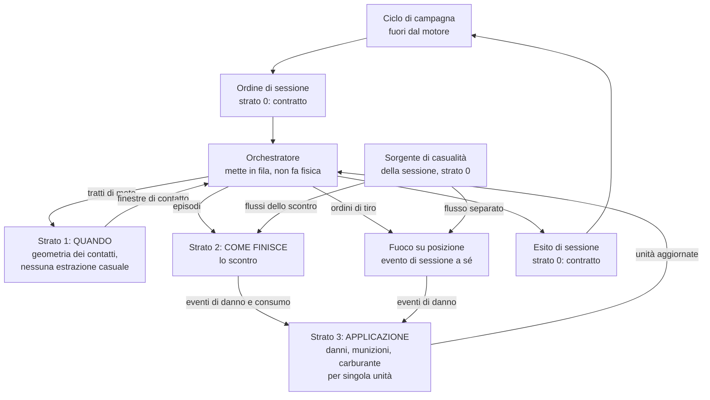

*Fig. 5 — Il percorso di una sessione. Deriva da D8 (flusso dei dati), D9 (coda degli eventi), D40 (episodio e
ripianificazione) e D64-D66 (sequenza completa, livello L3).*

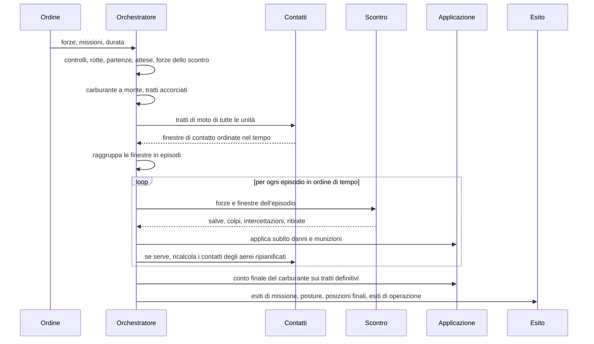

*Fig. 6 — Episodi (tempi ILLUSTRATIVI, dall'esempio di §3.5). Deriva da D40.*

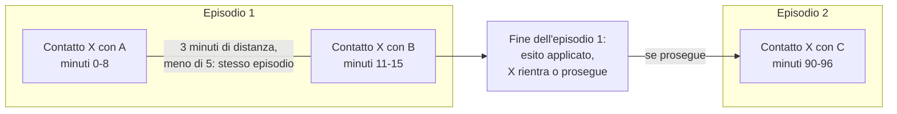

> **Dalla letteratura.** L'idea di separare livelli di dettaglio diversi e di collegarli in modo controllato è il tema della
> modellazione a risoluzione variabile e multi-risoluzione: Davis [B 7.1], [B 7.2], Davis e Hillestad [B 7.3] (verificati;
> per [B 7.1] e [B 7.2] letta la sintesi RAND). Un manuale sui principi di ingegneria dei modelli di combattimento e della
> simulazione distribuita: Tolk [B 7.8] (**contenuto non letto**). Architetture a strati che separano la pianificazione dei
> contatti dalla risoluzione dello scontro nei simulatori militari: `[FONTE: architetture dei simulatori a livello di entità]`.
>
> **Scelta del progetto.** Quattro strati con una domanda ciascuno; orchestratore senza fisica propria; episodi legati dal
> tempo di disimpegno; applicazione immediata dopo ogni episodio; ripianificazione dei soli aerei; carburante contato alla fine
> [V; il legame episodio-disimpegno è una decisione dell'utente].
>
> **Limiti e incertezze.** Ripianificazione **solo degli aerei**: le forze terrestri e navali che si ritirano restano passive
> sulla rotta [V]. Decisione di rientro **alla fine** dell'episodio, non a metà [V]. Forza «occupata» per forza intera, non per
> singola unità [V]. Guadagno della potatura per blocchi non misurato [NV]. I 5 minuti che legano un episodio sono una stima
> legata per costruzione al tempo di disimpegno [S/D]. Una precisazione sulla casualità: oltre allo strato 2 estrae numeri
> casuali anche il **fuoco su posizione**, con un flusso separato della stessa sorgente di sessione (sezione 10) [V]; lo strato
> 1 non ne estrae mai.
>
> **Nel manuale.** Cap. 1 §1.2-§1.3 (diagramma D1); cap. 2 §2.1-§2.4 (le porte); cap. 3 §3.1-§3.2 (potatura per blocchi);
> cap. 4 §4.8-§4.10 (scontri a più forze, carico congelato, stato ombra); cap. 6 §6.1-§6.3, §6.8-§6.9 (diagrammi D8, D9),
> §6.20 (episodi e ripianificazione, D40); cap. 10 §10.4-§10.6 (D64-D66), atlante 10C §10C.9 (D127).

---

## 4. Che cosa entra: missioni, operazioni, regole d'ingaggio

### 4.1 Operazione, missione, unità

La missione è l'**ordine** che il motore esegue. Le parole del progetto sono tre [V]:

- **Missione**: le azioni (attacco, trasporto, posizionamento, supporto) svolte da unità di **un solo blocco**, con un bersaglio
  (o nessuno), una rotta di riferimento e delle direttive. Un blocco può avere **più missioni** nella stessa sessione; un'unità
  sta in **al più una** missione per sessione.
- **Operazione**: un raggruppamento **facoltativo** di missioni, anche di blocchi diversi, per uno stesso scopo, con una
  **regola d'esito** (riuscita se riescono tutte, se ne riesce almeno una, o se riesce la missione principale). Un'operazione
  **vale per una sessione**: non è un'operazione militare su più giorni; gli ordini «permanenti» su più sessioni sarebbero del
  livello di comando e controllo, che non esiste [V].
- **Unità** (nel manuale: *asset*): un aereo, un mezzo, una nave, un sito.

### 4.2 Che cosa c'è in una missione

Una missione dichiara [V]:

- il **dominio** (aria, terra, mare) e il **tipo di missione** (per esempio, in aria: caccia, intercettazione, supporto ravvicinato,
  attacco, soppressione delle difese, pattugliamento, scorta, ricognizione, rifornimento in volo; a terra: attacco, difesa,
  movimento, fuoco di supporto, rifornimento; in mare: attacco, pattugliamento, scorta, bombardamento costiero, trasporto);
- le **unità**, ciascuna con il proprio **posto nella formazione** (avanti, a destra, in alto rispetto alla direzione di marcia) e,
  per gli aerei, il proprio **carico** d'armi;
- il **bersaglio**, con una **forma** (un'unità, un gruppo, un punto, un'area, una zona, nessuno) e una **provenienza**:
  *osservato* (si sa quale unità è) oppure *stimato* (si conosce una posizione con un'incertezza);
- la **rotta di riferimento** e i suoi **punti**, ciascuno con un ruolo (partenza, navigazione, punto iniziale d'attacco, attacco,
  uscita, atterraggio, stazione, attesa, ...), eventuali **orari bloccati** e **azioni** (per esempio un'attesa);
- gli **orari**: partenza, oppure **orario sul bersaglio** (TOT, *time on target*), oppure un orario bloccato su un punto: almeno
  uno deve esserci;
- le **regole**: regole di fuoco, stato di allerta, reazione alla minaccia, emissioni radio e radar, formazione;
- i **criteri di fine**: ultimo punto raggiunto, durata massima, carburante di rientro (bingo), munizioni finite, soglia di danno,
  bersaglio distrutto, rinuncia davanti a una minaccia.

Una missione aerea che non parte già in volo deve cominciare con un punto di partenza e finire con un atterraggio [V].

### 4.3 Che cosa il motore ricava da una missione

- **La rotta di ogni unità** è la rotta di riferimento spostata del posto in formazione. Alle virate la formazione **ruota con la
  rotta**: lo spostamento laterale si applica lungo la bisettrice dell'angolo, così che i tratti di ogni unità restino paralleli a
  quelli di riferimento; per virate molto strette il fattore di correzione è limitato a 2 [S: limite di progetto] [V].
- **Una missione si muove insieme, alla velocità del mezzo più lento.** Se un tratto pianificato supera la velocità massima del
  mezzo più lento della missione, la sessione è rifiutata. Chi vuole velocità diverse fa missioni diverse, eventualmente
  riunite in un'operazione [D, verificato nel codice].
- **La partenza** si ricava, in ordine di precedenza, dall'orario di partenza, dal primo orario bloccato su un punto, o
  dall'**orario sul bersaglio**, contando all'indietro la percorrenza e le attese. **L'orario sul bersaglio è di ogni missione**,
  non comune all'operazione: due missioni coordinate dichiarano ciascuna il proprio (per esempio una spazzata di caccia che
  precede di qualche minuto i bombardieri) [D].
- **Le attese** (tenere la posizione o orbitare in un punto, per una durata o fino a un orario) sono tratti **fermi** nel punto,
  uguali per tutta la formazione. L'**orbita** non ha un circuito: l'aereo è considerato fermo nel punto, con un errore di
  posizione pari al raggio del circuito reale [V, approssimazione dichiarata].
- **La presenza fuori dalla rotta**: le unità terrestri e navali sono presenti e ferme nella posizione di partenza prima di
  partire e in quella finale dopo l'arrivo, quindi possono essere scoperte e colpite; gli aerei che partono da terra sono **a
  terra** fino al decollo; dopo l'ultimo punto un aereo è a terra solo se atterra su una **base vera** del proprio schieramento
  (entro 3 km da un'installazione della base [S]), altrimenti **esce di scena** [V].

### 4.4 La missione è anche l'unità che combatte

Nello scontro ogni **missione** è una **forza** a sé: ha la propria «tempra», la propria percezione del rapporto di forze, la
propria soglia di rottura, e si ritira **da sola** [V] (sezione 6.7). Due missioni dello stesso blocco possono quindi finire in
modo diverso: una si ritira, l'altra continua a combattere. Una missione di un solo aereo è **distrutta** alla prima perdita [V].

Le missioni però non combattono isolate: le missioni **dello stesso blocco** o **della stessa operazione**, se sono dello stesso
schieramento, formano un **dominio di coordinamento** [D, regola dell'utente]. Dentro il dominio si condividono, **all'istante e
senza perdite**, la ripartizione del fuoco e la saturazione (una missione non spara a un bersaglio già condannato dalle salve di
un'altra), i rilevamenti e la difesa dai missili. Restano **per missione** la tempra, la soglia di rottura, la ritirata e
l'esito. Soprattutto: **nessun «cueing»** (il passaggio della traccia di un bersaglio da chi lo vede a un tiratore che non lo
vede) — un tiratore spara solo a ciò che ha scoperto **lui**; un rilevamento condiviso fa sapere che il nemico c'è (e conta nel
rapporto di forze percepito) ma **non** lo rende un bersaglio per chi non lo vede [V].

Il dominio di coordinamento **non è una catena di comando**: comando e controllo, collegamenti dati e voce non sono modellati.

### 4.5 Postura e tipo di missione: due cose diverse

Il progetto distingue due assi [D]:

- il **tipo di missione** (che cosa la missione deve fare);
- la **postura tattica** (l'atteggiamento di un'unità terrestre o navale: attacco, difesa, mantenimento, ritirata), che nasce
  dalla valutazione tattica del progetto, fuori dal motore.

Una tabella collega i due assi (per ogni tipo di missione terrestre o navale: posture ammesse e postura di riferimento). Nel
motore questa tabella serve **solo a dare l'etichetta di postura** a fine sessione alle unità terrestri e navali ancora in
movimento o in missione sul posto [V, 2026-11-20]; non cambia né il tiro né il rilevamento.

Le unità **senza missione** hanno una **postura continua**: gli aerei sono **a terra** (bersagli di superficie passivi, senza
sensori); le unità terrestri e navali sono in postura di **difesa**, che però è **solo dichiarata**: non cambia il tiro né il
rilevamento [V].

### 4.6 Regole d'ingaggio di missione

La missione decide anche **contro chi** si spara e **con quale arma** [V]:

- **Bersaglio designato**: le unità nemiche indicate dal bersaglio della missione, oppure, per un punto, un'area o una zona, le
  unità nemiche che stanno dentro l'area all'istante del tiro. Il raggio efficace di un bersaglio «punto» senza raggio dichiarato
  è **500 m** [S], aumentato dell'incertezza se la posizione è stimata.
- **Regole di fuoco** (ROE, *rules of engagement*). Per le missioni aeree sono cinque: **fuoco libero**; **priorità al
  designato** (in avvicinamento non si spara alle occasioni di superficie, dopo l'attacco sì, con precedenza al designato se è
  visto e a portata); **solo il designato** (salvo l'autodifesa contro aerei per le missioni aria-suolo); **solo in risposta** (si
  spara a chi ha già sparato contro il proprio dominio); **divieto di fuoco** (le intercettazioni difensive restano). Per le
  missioni terrestri e navali le regole sono tre: fuoco libero, solo in risposta, divieto di fuoco.
- **Armi designate**: contro il designato si usano **solo** quelle, senza ripiego; contro gli altri bersagli quelle armi sono
  **riservate**.
- **Politica d'armi per tipo di missione** (solo aerei): una tabella dice, per ogni tipo di missione aerea e per ogni classe di
  bersaglio (aereo in volo, difesa aerea, nave, altra superficie), quali armi sono ammesse. È una **scelta di progetto confermata
  dall'utente riga per riga** [D], non un dato tratto dalla letteratura. Per terra e mare non c'è vincolo d'arma.

### 4.7 Come finisce una missione

L'esito di ogni missione segue **una regola unica**, con questa precedenza [V]:

**distrutta** (tutte le unità perse) **>** **completata** (obiettivo raggiunto) **>** **abortita**, con il motivo **>** **in
corso** **>** **fallita**.

- **Completata**: se la missione dichiara «bersaglio distrutto» (e il bersaglio è un'unità o un gruppo), i bersagli sono tutti
  distrutti; altrimenti un'unità ha raggiunto l'ultimo punto, oppure è scaduta la durata prevista.
- **Abortita**: **ogni** unità superstite ha chiuso per carburante, rientro al bingo, ritirata, munizioni finite o danno; il
  motivo è quello dell'ultima a chiudere. Un gregario senza munizioni con il capo ancora in missione **non** fa abortire la
  missione.
- **In corso**: alla fine della sessione almeno un'unità superstite è ancora in rotta o sul posto [D: introdotto per decisione
  dell'utente].
- **Fallita**: fine senza obiettivo e senza motivo di rinuncia (per esempio rotta completata ma bersaglio designato non
  distrutto).

**Esempio ILLUSTRATIVO.** Una missione d'attacco di quattro aerei dichiara «bersaglio distrutto». Un aereo è abbattuto, due
rientrano al bingo, il quarto arriva all'ultimo punto ma il bersaglio sopravvive: la missione non è distrutta (tre superstiti),
non è completata (bersaglio vivo), non è abortita (il quarto non ha chiuso per un motivo di rinuncia) e non è in corso (ha finito
la rotta): è **fallita**. Se invece il quarto fosse rientrato anche lui, la missione sarebbe **abortita** con il motivo
dell'ultimo a rientrare.

### 4.8 Che cosa il motore NON legge di una missione

Scrivere una regola nella missione **non garantisce** che il motore la applichi.

*Tab. 1 — Che cosa il motore legge di una missione. Nessun diagramma tecnico; dal cap. 9 §9.1 «Limiti della Missione».*

| Il motore **legge** | Il motore **non legge** (validato e trasportato, senza effetto) |
|---|---|
| rotta, punti, velocità, posto in formazione | i **ruoli** delle unità (capo, gregario, ...), salvo la posizione in formazione |
| orari, attese, orario sul bersaglio | **stato di allerta**, **emissioni** (EMCON, il controllo delle emissioni radio e radar), **reazione alla minaccia**, **formazione** |
| bersaglio, regole di fuoco, armi designate, carico | il criterio «rinuncia davanti a una minaccia» |
| tipo di missione (politica d'armi aerea, albero del bingo, postura finale) | il criterio «ultimo punto»: la rotta completata è sempre una fine |
| appartenenza a un'operazione (dominio di coordinamento, esito d'operazione) | l'**attivazione su evento**: si può dichiarare, ma è rifiutata all'esecuzione |
| criteri di fine: munizioni, danno, bersaglio distrutto, durata, bingo | — |

*Fig. 7 — Operazione, missione, unità. Deriva da D16 (modello dei tipi della Missione).*

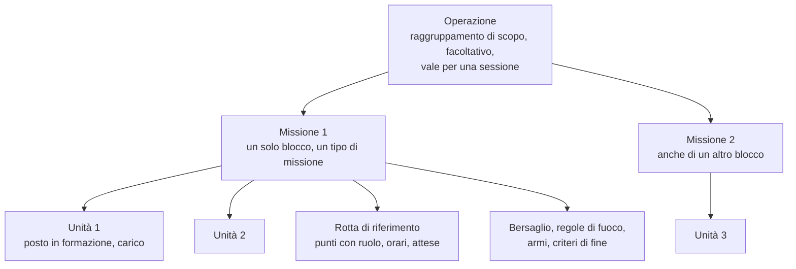

*Fig. 8 — I due assi: tipo di missione e postura. Deriva da D18 (per la politica d'armi, da Manuale cap. 4 §4.33).*

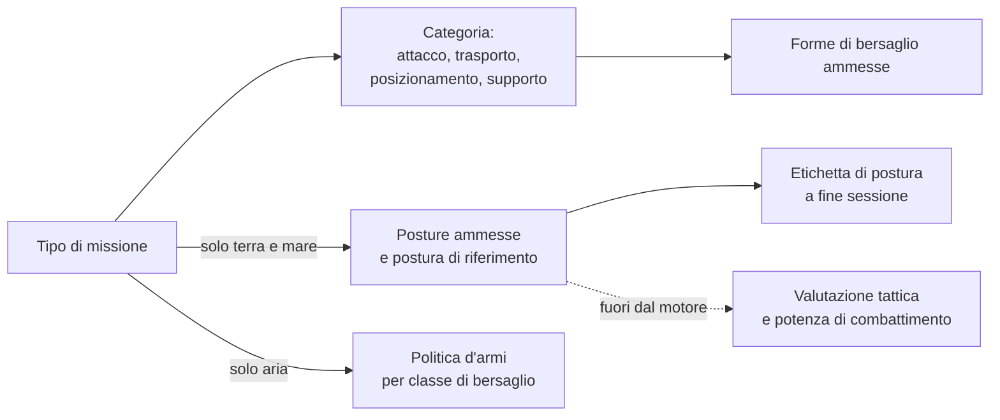

*Fig. 9 — Che cosa condivide un dominio di coordinamento. Deriva da D32.*

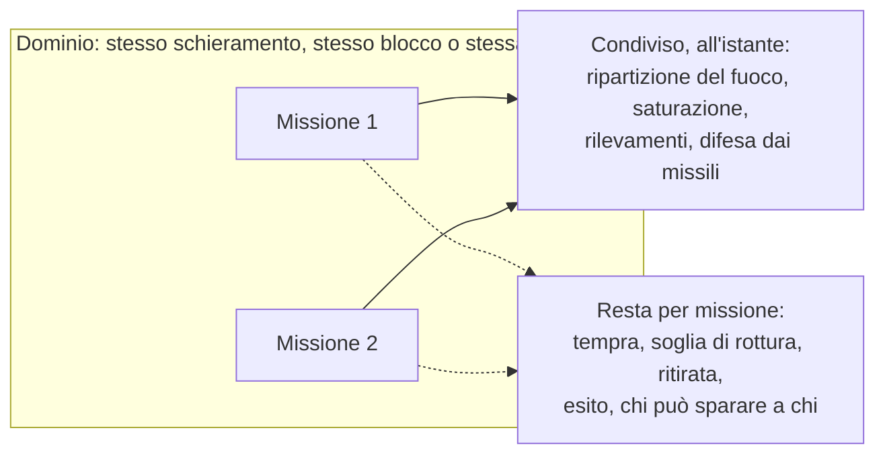

*Fig. 10 — La regola dell'esito di missione. Deriva da D19.*

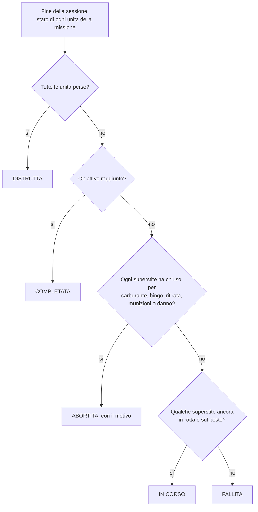

> **Dalla letteratura.** Struttura degli ordini e delle missioni aeree e terrestri, tipi di missione, regole d'ingaggio, orario
> sul bersaglio: `[FONTE: dottrina pubblica NATO/USA sulla struttura delle missioni e sulle ROE]` (non coperta dalla
> bibliografia). Il problema generale di «quale arma contro quale bersaglio» (l'assegnazione ottima delle armi ai bersagli), che
> il motore **non** risolve in modo ottimo: Manne [B 9.1] e Ahuja e altri [B 9.2] (citazioni verificate, **contenuto non
> letto**).
>
> **Scelta del progetto.** La missione come unità dell'ordine e dello scontro; la regola del mezzo più lento; l'orario sul
> bersaglio per missione; il dominio di coordinamento per blocco e operazione; la politica d'armi per tipo di missione; la regola
> unica dell'esito di missione: sono tutte **decisioni dell'utente** [D], verificate nel codice [V]. La politica d'armi in
> particolare **non viene dalla letteratura**.
>
> **Limiti e incertezze.**
> - Politica d'armi solo per le missioni **aeree**; terra e mare senza vincoli d'arma [V]. Un'arma sempre esclusa dalla politica
>   non si esaurisce mai, quindi non fa scattare «munizioni finite» [V].
> - **Nessun cueing**: la designazione non dà rilevamento [V]. Condivisione nel dominio **istantanea e senza perdite**
>   (approssimazione dichiarata) [V]. La priorità al designato è solo locale, per tiratore [V].
> - La designazione per area è valutata alla **prima** decisione su una coppia: un bersaglio che entra nell'area dopo resta
>   escluso [V]. Con la regola «priorità al designato», un aereo che non raggiunge mai il punto d'attacco resta in avvicinamento
>   per sempre [V].
> - Raggio efficace di un bersaglio punto **500 m** [S]; area di una base 3 km [S]; limite del fattore di formazione alle virate
>   [S]; elenchi di stati EMCON e di reazioni alla minaccia di prima stesura [S].
> - Una missione di un solo aereo è distrutta alla prima perdita [V]. La postura «difesa» delle unità senza missione è solo
>   dichiarata [V]. L'orbita non ha circuito [V].
> - Una missione deve stare dentro la sessione: lo controlla il **validatore**; chi chiama il motore direttamente può violarlo, e
>   il motore taglia la rotta alla fine della sessione con un avviso [V].
> - Nel manuale due frasi non sono allineate con il codice attuale: il cap. 2 §2.7 (e il cap. 9 §9.1) dice che la tabella fra
>   tipo di missione e postura non è letta da nessun modulo, mentre il motore la usa per l'etichetta di postura finale
>   [V, 2026-11-20]; il cap. 6 §6.16 e una voce del cap. 9 §9.1 (limiti della missione come unità di scontro) dicono che nessuno
>   calcola l'esito di un'operazione, mentre dal 2026-10-22 il motore lo calcola (cap. 2 §2.4, cap. 6 §6.24) [V, 2026-11-20].
>
> **Nel manuale.** Cap. 2 §2.6-§2.8 (tipi della missione, tassonomia, che cosa fa la porta; D16, D17, D18); cap. 4 §4.27-§4.33
> (missione come forza, dominio, aerei a terra, fine di attività, regole di bersaglio, politica d'armi; D32); cap. 6
> §6.10-§6.16, §6.18, §6.22 (dalla missione ai movimenti, esito di missione con D19, regole d'ingaggio in sessione); cap. 9
> §9.1 «Limiti della Missione», limiti del dominio di coordinamento e della missione come unità di scontro, «Regole
> d'ingaggio di missione».

---

## 5. Incontrarsi e vedersi: contatti e rilevamento

### 5.1 Due domande diverse

Prima che due unità possano combattere servono due cose distinte.

- La prima è **geometrica**: in quali intervalli di tempo sono abbastanza vicine perché l'una possa vedere l'altra? Risponde lo
  strato 1, con la geometria dei contatti delle sezioni 2.4 e 3.7, **senza alcuna estrazione casuale** [V].
- La seconda è **probabilistica**: dentro quegli intervalli, l'una vede davvero l'altra, e da quale istante? Risponde lo strato 2,
  con una legge di probabilità e **una estrazione casuale per ogni occasione di scoperta** [V].

Solo dopo la scoperta comincia lo scontro (sezione 6). E **scoprire non basta per colpire**: servono un'arma a portata, regole
che consentano il tiro e il tempo di reagire (§5.8).

### 5.2 Sensori, portate, volumi

Ogni unità può avere fino a tre sensori: un **radar**, un sensore **ottico** (televisivo o infrarosso) e, per due soli
semoventi contraerei che nei registri non hanno altri sensori, la **vista** (l'osservazione a occhio nudo dell'equipaggio,
trattata come un sensore) [V]. Per ciascun sensore i registri danno portate distinte secondo il **dominio del bersaglio**
(aria, terra, mare) e secondo il **tipo**: portata di scoperta (detta anche di acquisizione), di inseguimento, d'ingaggio. Il
motore usa, di default, la **portata di scoperta**; di un'unità con più sensori prende la **maggiore** fra quelle utilizzabili
contro quel tipo di bersaglio, non la somma, perché i sensori guardano lo stesso bersaglio [V].

Il **volume di scoperta** di un'unità è quindi una **sfera** centrata su di essa, con raggio pari a quella portata. È una
semplificazione forte, e dichiarata [V]:

- **niente terreno** e **niente orizzonte radar** (il limite di visibilità dovuto alla curvatura terrestre): nel motore un
  **radar di scoperta a lungo raggio** (in sigla EWR, dall'inglese *early warning radar*) vede alla portata piena, fino a
  centinaia di chilometri, anche un aereo che vola radente. L'orizzonte c'è invece nel pianificatore di rotta (sezione 9): è
  un'**incoerenza dichiarata** fra i due;
- **niente settori**: ogni sensore guarda in tutte le direzioni, anche quelli che nella realtà coprono solo un arco;
- un aereo **a terra** non osserva (sensori spenti) ed è scoperto come un bersaglio di superficie (sezione 4.3).

Una lacuna dei dati pesa sugli scontri fra forze di terra: secondo il manuale i registri di carri, corazzati, artiglieria e navi
non dichiarano sensori contro bersagli di superficie, per cui due forze terrestri, senza un'aggiunta esplicita del chiamante,
non si vedono mai [V; dichiarato dal manuale, non ricontrollato record per record per questa guida].

### 5.3 La finestra di contatto

Per ogni coppia di unità nemiche lo strato 1 calcola le **finestre di contatto**: gli intervalli in cui la distanza fra le due è
sotto la **maggiore** delle loro due portate di scoperta [V]. Il calcolo è quello della sezione 2.4: su ogni pezzo di tempo in
cui le due velocità restano costanti si risolve |Δr + Δv·s|² = R² e gli intervalli che ne escono si uniscono; prima ancora, la
potatura per blocchi (sezione 3.7) scarta le coppie di blocchi che non possono incontrarsi.

Dentro una finestra il motore distingue due momenti [V]:

- l'ingresso nella portata **maggiore**: da lì soltanto chi vede più lontano può scoprire l'altro. È il **primo a scoprire**, e
  di solito ha l'iniziativa;
- l'ingresso nella portata **minore**: da lì entrambi possono scoprirsi (**scoperta reciproca**). Se uno dei due non ha alcuna
  portata contro l'altro, la scoperta è possibile solo da una parte.

Le finestre sono calcolate **per coppia di unità**, non per forza: sono le stesse comunque l'orchestratore raggruppi poi le unità
in forze e domini (sezione 4.4) [V]. Escono in un **ordine fisso** (inizio, poi identificativi), che fa parte del contratto di
riproducibilità (sezione 10) [V].

**Esempio ILLUSTRATIVO** (la geometria della sezione 2.4). A ha un radar da **40 km**, B uno da **20 km**; B passa a 10 km da A,
con la velocità relativa di 500 m/s dell'esempio. La finestra va dall'ingresso di B nei 40 km (circa 43 s) all'uscita (circa
197 s). Il tratto reciproco è quello sotto i 20 km, da 85 a 155 s. Per i primi 42 secondi della finestra solo A può scoprire B.

*Fig. 11 — Una finestra di contatto, dall'ingresso all'uscita (numeri ILLUSTRATIVI, dall'esempio). Deriva da D70
(portate, intervalli di portata maggiore e minore, massimo avvicinamento) e D3 (tipi di dominio dello strato 1).*


### 5.4 La legge di probabilità di scoperta

Dentro una finestra, la probabilità che un sensore scopra il bersaglio dipende dalla **distanza**:

> **Pd(d) = f · [ 1 − (1 − p) · (d / R)⁴ ]**  se d ≤ R
>
> **Pd(d) = 0**  se d > R
>
> dove **d** è la distanza, **R** la portata di scoperta del sensore, **p** la probabilità **al bordo della portata** (una
> costante stimata, uguale per tutti i sensori: vedi sotto) ed **f** un fattore fra 0 e 1 che riduce la probabilità per
> l'ambiente, la ricognizione e la permanenza (1 = nessuna riduzione).

A parole [V, 2026-11-20]: a distanza zero la probabilità vale f (cioè 1 senza riduzioni); al bordo della portata vale f·p; in
mezzo, la **mancanza** di probabilità (1 − Pd) cresce con la **quarta potenza** del rapporto d/R. La quarta potenza è un'idea
presa dall'**equazione radar**, per cui il segnale di ritorno cala come 1/d⁴; le curve reali che legano la probabilità di
scoperta al rapporto segnale/rumore (le curve di Swerling) hanno però una forma a «S», e questa legge ne è una
**semplificazione monotona** scelta dal progetto [S]. La stessa legge vale per ogni sensore, radar, ottico o vista [V].

*Tab. 2 — Valori della legge per R = 20 km, con le due costanti al bordo p = 0,5 e p = 0,2 (formula del codice, numeri
calcolati per questa guida; ILLUSTRATIVO). Nessun diagramma tecnico corrispondente.*

| Distanza d | 0 | 5 km | 10 km | 15 km | 18 km | 20 km | 20,1 km |
|---|---|---|---|---|---|---|---|
| Pd con p = 0,5, senza riduzioni (f = 1) | 1,00 | 0,998 | 0,969 | 0,842 | 0,672 | **0,50** | **0** |
| Pd con p = 0,5, di notte (f = 0,7) | 0,70 | 0,699 | 0,678 | 0,589 | 0,470 | 0,35 | 0 |
| Pd con p = 0,2, senza riduzioni (f = 1) | 1,00 | 0,997 | 0,950 | 0,747 | 0,475 | **0,20** | **0** |

Due cose si leggono nella tabella.

- **Il salto al bordo.** Appena oltre la portata la probabilità passa di colpo da f·p a zero (senza riduzioni, da 0,5 o da 0,2
  secondo la costante). La legge non si annulla da sola: è **tagliata** alla portata del registro [V, 2026-11-20].
- **Che cosa significa Pd(d).** Poiché nel motore una sola estrazione decide se e quando avviene la scoperta (§5.5), Pd(d) non
  è la probabilità di un singolo giro d'antenna: è la probabilità di **aver già scoperto** il bersaglio quando, avvicinandosi,
  la distanza scende a d (lettura dell'autore di questa guida, ricavata dal codice).

**Il valore al bordo, p.** È una **stima dichiarata** nel codice, senza fonte [S]. Il valore storico 0,5 è presentato dal
commento del codice come «la più prudente» delle due convenzioni con cui si dichiara la portata di un radar (probabilità 0,5
oppure 0,9 a quella distanza), ma **nessuna fonte di quella convenzione è stata trovata** dalla bibliografia [NV]: va letta come
una scelta non verificata, non come una proprietà della legge. L'utente ha giudicato 0,5 alto (si attende valori fra 0,1 e
0,3) e ha deciso il valore ricalibrato 0,2, il centro di quell'intervallo, anch'esso una stima senza fonte [S/D]. Quale dei due
valori è in vigore lo decide un interruttore [V, 2026-11-20].
<!-- PD-STATO -->
Dal 2026-11-20 è acceso l'interruttore della ricalibrazione: la probabilità al bordo è 0,2 (stima senza fonte, decisione
dell'utente) invece di 0,5; manuale e fotografia installata descrivono ancora lo stato con 0,5 fino alla prossima fotografia.
Con 0,2 il salto al bordo è più piccolo: la formula, se non fosse tagliata, si annullerebbe a circa 1,06 R invece che a circa
1,19 R [V, 2026-11-20, commento del codice]. La stessa costante entra anche nelle misure del pianificatore di rotta (§9.2).
<!-- /PD-STATO -->

**Il fattore f.** Tre fattori, che si moltiplicano [V]:

- **ambiente**: notte 0,7, meteo avverso 0,8, entrambi 0,56 [S]. Il fattore è **unico** per tutti i sensori, perché la finestra
  non porta l'informazione su quale sensore l'ha prodotta: un radar subisce la stessa riduzione notturna di un ottico, e la vista
  di notte risulta con ogni probabilità sovrastimata [V];
- **ricognizione** («nebbia di guerra»): se il blocco del bersaglio non compare nella ricognizione del lato che osserva, la
  probabilità si dimezza; un'efficienza di ricognizione e fra 0 e 1 ne recupera una parte, con il fattore **0,5 + 0,5 · 0,5 · e**
  (al più 0,75) [S]. Il manuale la definisce «debole» (scatta solo in casi strutturali) e segnala un difetto noto, non corretto,
  nel filtro dei blocchi su cui si basa [V];
- **permanenza**: §5.7.

I primi due sono **pronti ma non collegati di default**: agiscono solo se chi chiama il motore li fornisce, e oggi lo fanno
soltanto alcuni test e scenari [V, 2026-11-20]. In una sessione senza questi ingressi, f vale 1 salvo la permanenza.

### 5.5 Una sola estrazione decide se e quando

Il motore non controlla la scoperta istante per istante. Estrae **un numero casuale u** fra 0 e 1 e ne ricava il **raggio** a
cui la scoperta avverrà, invertendo la legge [V, 2026-11-20]:

> se **u ≥ f**: nessuna scoperta, nemmeno a distanza zero
>
> se **u < f · p**: scoperta **sul bordo**, r = R
>
> altrimenti: **r = R · [ (1 − u/f) / (1 − p) ]^(1/4)**

Il bersaglio è scoperto se r è almeno pari alla distanza minima raggiunta (che equivale a u < Pd(d_min)); l'**istante** della
scoperta è il primo in cui la distanza scende sotto r, e lo calcola la geometria, come per la finestra [V]. Una conseguenza
diretta: senza riduzioni (f = 1) una frazione p delle estrazioni (quelle sotto f·p) produce la scoperta **esattamente al
bordo** della portata, se il bersaglio entra nel volume: la metà con p = 0,5, un quinto con p = 0,2 [V, 2026-11-20].

**Esempio ILLUSTRATIVO** (B vola verso A come nella sezione 2.4; il radar di A ha R = 20 km; il massimo avvicinamento è 10 km;
f = 1; le due colonne mostrano le due costanti al bordo):

| Estrazione u | Con p = 0,5: raggio e esito | Con p = 0,2: raggio e esito |
|---|---|---|
| 0,30 | 20 km (sotto 0,5: bordo); scoperto a 85 s, all'ingresso nella portata | circa 19,3 km; scoperto a circa 87 s |
| 0,80 | circa 15,9 km; scoperto a circa 95 s | circa 14,1 km; scoperto a circa 100 s |
| 0,98 | circa 8,9 km; **mai scoperto**: B non scende sotto 10 km (Pd(10 km) = 0,969, quindi circa il 3% delle estrazioni dà questo esito) | circa 8,0 km; **mai scoperto** (Pd(10 km) = 0,95: circa il 5% delle estrazioni) |

Il vantaggio è triplice: nessun campionamento nel tempo, un risultato **esatto rispetto al modello di moto**, e una storia
riproducibile a parità di seme.

### 5.6 Un'occasione per ogni passaggio

La finestra di contatto è costruita sulla portata **maggiore** delle due unità. Chi ha la portata **minore** (tipicamente un
sistema contraereo contro un aereo con un radar a lungo raggio) può allora vedere il bersaglio **entrare nel proprio volume,
uscirne e rientrare** dentro la stessa finestra. Per decisione dell'utente [D], ogni **passaggio** del bersaglio nel volume di
scoperta **proprio** dell'osservatore è un'**occasione distinta**, con [V]:

- la **propria estrazione**: la prima dal flusso casuale dello scontro, nella stessa posizione di prima; le successive da un
  **flusso separato**, così che introdurre la regola non abbia spostato le altre estrazioni (sezione 10);
- la **propria distanza minima** e la **propria permanenza** (§5.7), **mai la somma** delle permanenze di più passaggi;
- un **limite al tiro**: il bersaglio scoperto in un passaggio resta un **candidato al tiro** (un bersaglio su cui l'osservatore
  può decidere di lanciare) solo **fino alla fine di quel passaggio**. All'uscita dal volume la traccia è persa: niente salve
  **nuove**, mentre quelle già lanciate arrivano comunque (il carico congelato della sezione 3.6). Al rientro serve una scoperta
  nuova.

Due passaggi separati da un'uscita **non più lunga del tempo di rivisita** del sensore (§5.7) contano come uno solo: si assume
che una perdita di segnale così breve non interrompa la traccia. L'unione avviene solo se il sensore dichiara un tempo di
rivisita [V].

Più passaggi nascono solo da **rotte con virate**: un tratto rettilineo attraversa al più una volta un volume a forma di sfera.
Nelle esecuzioni della fotografia di non regressione non ci sono casi a più passaggi (conteggio di una prova del progetto [NV]);
la regola è coperta da test dedicati e da uno scenario apposito [V].

**Esempio ILLUSTRATIVO.** Un aereo attraversa due volte il volume di un sito, e in ciascun passaggio la probabilità di scoperta è
0,4. La probabilità di essere scoperto **almeno una volta** è 1 − 0,6 · 0,6 = **0,64**. Il pianificatore di rotta, per la stessa
rotta, riporta come misura **0,4**, il peggiore dei due attraversamenti, non la combinazione (sezione 9) [V].

### 5.7 La permanenza nel volume

Un radar che ruota illumina un punto dello spazio una volta per giro: offre al bersaglio **un'occasione di scoperta ogni tempo di
rivisita** (per un'antenna che fa n giri al minuto, 60/n secondi). Se il bersaglio resta nel volume **meno** di un tempo di
rivisita, può non essere mai illuminato. Il motore ne tiene conto con un **fattore di permanenza** g, che fa parte del fattore f
della §5.4 [V]:

> **g = min(1, T_perm / T_riv)**    **Pd = g · Pd(d_min)**
>
> dove **T_perm** è la permanenza del bersaglio nel passaggio e **T_riv** il tempo di rivisita del sensore.

La giustificazione è geometrica: se la fase dell'antenna al momento dell'ingresso è casuale e uniforme, la probabilità che almeno
un passaggio del fascio cada dentro una permanenza più breve del giro è proprio T_perm / T_riv. La **forma** è una scelta di
progetto [S]; l'ipotesi di fase casuale e uniforme **non è verificata su dati** [NV]. La legge è **probabilistica, non una
soglia**: con g minore di 1 la scoperta resta possibile, con probabilità ridotta. Per permanenze pari o superiori al tempo di
rivisita, g vale 1 e la legge torna quella della sola distanza [V].

*Tab. 3 — Fattore di permanenza per un sensore con tempo di rivisita di 3 s (ILLUSTRATIVO). Deriva dalla legge di D131/D133.*

| Permanenza nel passaggio | 0,5 s | 1,5 s | 3 s | 10 s |
|---|---|---|---|---|
| g | 0,17 | 0,50 | 1 | 1 |
| Pd se la legge della distanza dà 0,8 | 0,13 | 0,40 | 0,80 | 0,80 |

**Che cosa conta come permanenza** [V]: quella del **passaggio** a cui l'estrazione appartiene; per due passaggi uniti, l'**arco
intero**, uscita compresa (due passaggi da 1 s separati da 1 s fanno 3 s, non 2). La permanenza **non** è tagliata all'inizio
della finestra (spezzare una finestra al decollo o all'atterraggio non deve ridurre la probabilità per un artificio di calcolo),
ma è tagliata alla **fine della sessione**.

**I dati** [V]. Il tempo di rivisita è un valore **fisso per sensore**, riferito alla sola funzione di ricerca, senza dipendenza
dalla distanza, dal modo o dal carico del radar (rinvio dichiarato). Lo dichiarano **53 modelli**, con valori da **1 s a 60 s**
[V, 2026-11-20: conteggio sui registri]. Il manuale dichiara che, dei 43 aggiunti per ultimi, **24 sono stime** [S]; per la vista e
i sensori ottici dei sistemi contraerei (sei modelli) vale 3,2 s, il valore centrale di una banda ricavata da uno studio
sull'osservazione a occhio nudo citato dal progetto («Poe 1974»), che la bibliografia **non ha individuato** (non cercato a
fondo): è un'**approssimazione**, perché l'occhio non ha un giro d'antenna [S]. Gli aerei diversi dai radar volanti di scoperta
(AWACS) non hanno il valore, per decisione dell'utente [D]. La regola è **accesa di default dal 2026-11-18**, per decisione
dell'utente [D]; spegnendola si torna alla legge della sola distanza.

**Dove si vede.** Con i tempi di rivisita reali, una permanenza breve **non cambia mai una salva**: un tiratore lancia solo se
scoperta più ritardo di reazione cadono dentro il passaggio, quindi servirebbe una reazione più breve del tempo di rivisita, e nei
registri la reazione di ogni tiratore è più lunga del suo (con un'eccezione, che nel caso esaminato è comunque fuori dalla portata
della sua arma) [V]. La legge si vede quindi solo sulle **scoperte**, che la fotografia registra unicamente per una **serie
dedicata di 116 esecuzioni** [V, 2026-11-20: voce delle scoperte contata sul file della fotografia]. Accendere la regola **non ha
cambiato** nessuna delle 1103 esecuzioni preesistenti; questo dice che la regola non le altera, **non** che sia stata messa alla
prova da esse [V per la lettura, NV per i numeri del confronto].

**Fra una sessione e l'altra la permanenza non si somma.** La regola vale **dentro una sessione** [V]:

- un passaggio **a cavallo di due sessioni** dà **due estrazioni indipendenti**, ciascuna con la propria permanenza tagliata;
- il **rilevamento non passa** da una sessione alla successiva: ogni sessione rifà le sue estrazioni, anche se il contatto era
  appena avvenuto (sezione 8).

**Esempio ILLUSTRATIVO.** Tempo di rivisita 3 s, legge della distanza 0,5. Un passaggio di 6 s in una sola sessione: una
estrazione con g = 1, probabilità **0,50**. Lo stesso passaggio spezzato a metà fra due sessioni: due estrazioni con g = 1,
probabilità di almeno una scoperta 1 − 0,5 · 0,5 = **0,75**. Un passaggio di 3 s spezzato a metà: due estrazioni con g = 0,5,
probabilità 1 − 0,75 · 0,75 = **0,44**, contro 0,50 in una sessione sola. Le prove fatte dal progetto il 2026-11-19, con script
temporanei non ripetibili dalla suite, hanno dato numeri dello stesso tipo (6,4 s: 0,51 contro 0,76; 3,2 s: 0,50 contro 0,44)
[NV]. Per un **aereo** il caso non si presenta se l'ordine è valido, perché una missione aerea deve finire dentro la sessione
(sezione 8); per terra e mare sì [V].

### 5.8 Scoprire non è colpire

Una scoperta crea un **candidato al tiro** solo per l'osservatore che l'ha fatta, e solo dopo il suo **ritardo di reazione**; il
tiro richiede poi un'arma con portata sufficiente e regole che lo consentano (sezione 6) [V]. Tre conseguenze pratiche:

- **i radar di scoperta a lungo raggio** scoprono e non sparano mai; alimentano la percezione condivisa del loro dominio di
  coordinamento (che conta nel rapporto di forze percepito, §6.7) ma non passano la traccia a nessun tiratore: **nessuna rete di
  sensori** e nessun «cueing» (sezione 4.4) [V];
- **la vista** dei due semoventi contraerei che non hanno radar arriva a 6 km [S], ma i loro cannoni sparano più vicino e più in
  basso: vedono aerei che non possono colpire [V];
- **il ricevitore d'allarme radar** (RWR, *radar warning receiver*) di un aereo, se riconosce la categoria del radar che lo
  illumina, fa sapere alla sua forza **chi** la sta ingaggiando da quell'istante; un aereo senza RWR **non percepisce mai** i
  sistemi contraerei, perché i registri degli aerei non hanno sensori verso terra [V].

*Fig. 12 — Dalla finestra alla scoperta. Deriva da D131 e D133 (un'estrazione per passaggio, con la permanenza) e D12
(composizione del fattore di riduzione).*

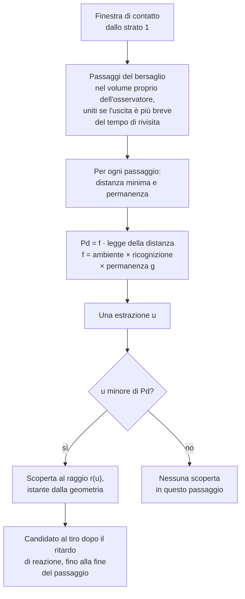

> **Dalla letteratura.** La dipendenza del segnale radar dalla distanza con la quarta potenza viene dall'equazione radar, trattata
> nei testi di base: Skolnik [B 5.4] (testo standard; l'elenco dei capitoli iniziali, riportato da una ricerca web, comprende
> l'equazione radar; **contenuto non letto**). Le curve di probabilità di scoperta per bersagli che fluttuano e la teoria
> statistica della scoperta radar: Swerling e Marcum [B 5.8] (citazioni verificate, **contenuto non letto**). La distinzione fra
> probabilità di scoperta **per singola scansione** e probabilità **cumulativa** lungo una traiettoria, che questa sezione usa per
> leggere la legge, compare come argomento separato in Mahafza [B 5.5] (sommario letto), in DiFranco e Rubin [B 5.6] (verificato
> il titolo del capitolo sulla probabilità cumulativa; **contenuto non letto**) e, proprio per un bersaglio che si avvicina a un
> radar a scansione uniforme, in Mallett e Brennan [B 5.7] (titolo verificato, **contenuto non letto**). La teoria della ricerca,
> che descrive la scoperta come una successione di «sguardi», è per il progetto solo un riferimento **qualitativo**: il manuale
> la indica come base di una possibile legge cumulativa futura per la vista, mentre la regola della permanenza oggi in uso è una
> scelta di progetto [S]; le opere: Koopman [B 5.1], [B 5.2], Washburn [B 5.3], Washburn e Kress [B 4.4] (opere verificate;
> contenuto non letto). La convenzione della portata dichiarata a probabilità 0,5 o 0,9: `[FONTE: convenzioni sulla portata
> dichiarata di un radar]`, **nessuna fonte trovata**. Il tempo di scansione dell'osservatore a occhio nudo: `[FONTE: scoperta
> visiva da terra, «Poe 1974»]`, **non individuata**.
>
> **Scelta del progetto.** Volume sferico senza terreno; una costante al bordo della portata, uguale per tutti i sensori (valore
> e stato in §5.4); legge alla quarta potenza; una sola estrazione per occasione di scoperta [S per i numeri e la forma, V per il
> meccanismo]. Una occasione per passaggio, mai la somma delle permanenze, fine del tiro all'uscita dal volume [D]. Legge della
> permanenza nella forma min(1, T_perm/T_riv) [S], con un valore fisso per sensore [D]; lasciare la permanenza non additiva fra
> sessioni e dichiararlo, senza una memoria fra sessioni [D].
>
> **Limiti e incertezze.**
> - Nessun orizzonte radar, nessun terreno, nessun settore di copertura nel motore [V]; il costo di calcolo delle finestre con
>   i radar a lunghissima portata non è misurato [NV].
> - Costante al bordo della portata: stima senza fonte, una sola per tutti i sensori [S, valore ricalibrato S/D]; salto al bordo
>   da f·p a zero [V]; forma alla quarta potenza: semplificazione [S].
> - Fattore ambientale unico per ogni sensore: vista di notte sovrastimata [V]; ambiente e ricognizione non collegati di default
>   [V, 2026-11-20]; nebbia di guerra «debole» e con un difetto noto [V].
> - Tempi di rivisita: valore fisso per sensore, molti stimati [S]; ipotesi di fase casuale non verificata [NV]; vista e ottico
>   approssimati [S].
> - Permanenza non additiva fra sessioni e rilevamento che non passa da una sessione all'altra: la probabilità di scoperta nel
>   tempo dipende dalla durata e dalla cadenza delle sessioni [V; numeri delle prove NV].
> - Mancano sensori contro bersagli di superficie in molti registri [V, dichiarato dal manuale].
> - Le scoperte sono registrate dalla fotografia solo per la serie dedicata; altrove un cambio della legge che non tocca il tiro
>   resta invisibile al confronto [V].
>
> **Nel manuale.** Cap. 3 §3.1-§3.8 (finestre di contatto, sensori, aerei a terra; D3, D70); cap. 4 §4.2 (legge di Pd), §4.18
> (nebbia di guerra, D12), §4.35 (un'estrazione per passaggio, D131, D133), §4.36 (permanenza); cap. 7 §7.4 (ambiente), §7.12
> (dati dei sensori); cap. 8 §8.13-§8.14 (scenari dei sensori e della permanenza); cap. 9 §9.1 «La Pd non distingue radar da
> ottico», «Fog-of-war reale», «Rilevamento per passaggio nella portata propria», «Permanenza nel volume», «Limiti dei sensori EWR
> e visivo», «Pd sul bordo della portata». <!-- PD-STATO -->Quest'ultima voce descrive ancora lo stato con 0,5, e la
> ricalibrazione della costante al bordo non è ancora descritta nel manuale (tabella delle sigle, §14.3.2).<!-- /PD-STATO -->

---

## 6. Lo scontro: reazione, scelta dell'arma, salva, difese, danno, rottura

### 6.1 La catena

Uno scontro (un episodio, sezione 3.5) è risolto dallo strato 2 come una **catena** di passi, sulla sua agenda interna [V]:

1. **scoperta** (sezione 5): ogni osservatore ottiene i suoi candidati al tiro;
2. **ritardo di reazione**: il primo lancio non può avvenire prima di scoperta + reazione;
3. **scelta del bersaglio e dell'arma**, secondo regole di ripartizione del fuoco, regole d'ingaggio della missione, dottrina
   contro lo spreco e scorte;
4. **controllo di portata**: si lancia solo quando il bersaglio è entro la portata dell'arma;
5. **lancio**: bersaglio, arma e numero di colpi sono fissati (carico congelato, sezione 3.6);
6. **impatto**: i colpi che arrivano **insieme** su una forza formano un **evento-salva**;
7. **difese**: i colpi intercettabili sono confrontati con la **capacità di intercettazione**; il surplus passa;
8. **danno colpo per colpo** su ogni unità colpita;
9. **soglia di rottura**: la forza colpita confronta le perdite con la propria soglia e può ritirarsi.

Dopo il primo lancio, un tiratore che ha ancora il bersaglio in traccia ripete il tiro a intervalli regolari (§6.2), finché ha
scorte, bersagli e tempo.

*Fig. 13 — La catena dello scontro. Deriva da D5 (sequenza della coda degli eventi dentro uno scontro) e dal cap. 4 §4.1.*

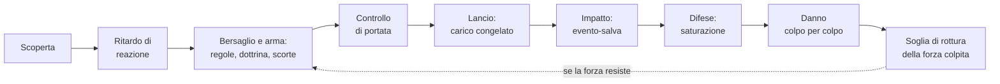

### 6.2 Il ritardo di reazione e l'iniziativa

Dal momento della scoperta al **primo lancio** passa il **ritardo di reazione** del sistema, somma delle quattro fasi della
sezione 2.5 (rilevare, valutare, comandare, attuare) [V]. Le salve successive contro un bersaglio già in traccia sono separate da
un **intervallo di ripetizione del tiro** più breve, perché non serve scoprire di nuovo: la somma delle sole tre fasi valutare,
comandare, attuare, salvo armi con una cadenza propria [V].

> **istante del primo lancio ≥ istante della scoperta + ritardo di reazione**
>
> e il lancio è possibile solo se questo istante cade **prima della fine** del candidato al tiro (fine della finestra o del
> passaggio, §5.6).

I **totali** «dalla scoperta al lancio» sono ripresi dal documento di analisi del progetto, che li attribuisce a fonti tecniche
non riverificate [NV per le fonti]: circa 26 s per un sistema missilistico a corto raggio di vecchia generazione, circa 28 s per
uno a lungo raggio con posto comando, 5-8 s per un sistema moderno da fermo, 1-2 s per la reazione di un pilota, circa 31 s per un
equipaggio di carro per bersaglio; dove la fonte dà un intervallo si usa il punto medio [V]. La **scomposizione** nelle quattro
fasi è una stima [S]. Navi e sistemi senza profilo ricevono il profilo **più lento** (31 s), di proposito: la mancanza di un dato
non deve regalare l'iniziativa [V]. Un fattore per il livello di addestramento è previsto ma vale 1 per tutti [V].

**Esempio ILLUSTRATIVO** (i numeri della sezione 2.5). Un sistema contraereo scopre un aereo a t = 85 s; la sua reazione è di
26 s, quindi il primo lancio è possibile a 111 s; con 29 s di volo il missile arriva a 140 s. Se l'aereo aveva scoperto il sito a
70 s e ha un'arma già a portata, con 1,5 s di reazione può lanciare a 71,5 s: **chi scopre prima e reagisce più in fretta ha
l'iniziativa**.

### 6.3 Contro chi sparare

Fra i suoi candidati, ogni tiratore sceglie il bersaglio con regole **locali e deterministiche**, applicate sull'intero dominio di
coordinamento (sezione 4.4) [V]:

- **ripartizione a turno**: i bersagli sono ripartiti a rotazione fra i tiratori del dominio; non c'è un'assegnazione ottima delle
  armi ai bersagli, né un peso per il valore del bersaglio;
- **precedenza a chi attacca la propria forza**: un aereo che ha lanciato un'arma aria-superficie contro la forza (o il dominio)
  del tiratore, se il tiratore lo ha già scoperto e lo ha a portata, diventa un bersaglio **prioritario**. I tiratori che avevano
  in programma un lancio su un bersaglio non prioritario vi **rinunciano** e decidono di nuovo dopo il loro intervallo di
  ripetizione del tiro (il tempo di valutare e assegnare) [V];
- **regole della missione**: bersaglio designato, regole di fuoco e armi designate (sezione 4.6);
- **dottrina contro lo spreco**, due regole di lato [V]:

> **bersaglio saturato** se  **1 − Π (1 − Pk)^colpi ≥ 0,9**
>
> cioè se la probabilità che le salve già dirette contro di esso dalla forza lo distruggano raggiunge 0,9 (Pk = probabilità di
> distruzione per colpo, §6.4); allora nessun tiratore della forza gli aggiunge salve. Inoltre un tiratore non lancia su un
> bersaglio verso cui ha già **2 colpi in volo** («due colpi, poi guarda»).

**Esempio ILLUSTRATIVO.** Pk per colpo 0,6. Un colpo in volo: 0,6; due: 1 − 0,4² = 0,84; tre: 1 − 0,4³ = 0,936, oltre 0,9: il
bersaglio è saturato e la forza smette di aggiungere salve. Le intercettazioni possibili **non** sono contate nella stima, che
quindi è favorevole a chi spara [V]. I valori 0,9 e 2 sono **stime dichiarate** nel codice, scelte dall'utente [S/D;
V, 2026-11-20 sul commento del codice]. I bersagli prioritari sono esenti dalla saturazione, non dal tetto dei colpi in volo [V].

Un tiratore i cui bersagli sono tutti bloccati aspetta il primo impatto previsto e decide di nuovo [V].

### 6.4 Con quale arma

La scelta dell'arma non è dentro il motore: è una funzione **fornita dal chiamante**. Il progetto ne ha una che legge i
**registri d'arma**; alcuni scenari ne usano invece una **tabella di prova** semplificata, senza portate né fasce di quota [V].
Quella dei registri funziona così [V]:

1. le **armi candidate** del tiratore: quelle del suo registro; per un aereo, quelle del **carico assegnato** più il **cannone di
   bordo**, se il carico gli assegna colpi;
2. un **filtro di adeguatezza**: contro un aereo solo armi antiaeree, e con la quota del bersaglio entro la fascia dell'arma
   (letta sulla posizione di partenza delle unità); contro un bersaglio di superficie mai armi solo antiaeree;
3. per ogni arma, dalla riga del registro che corrisponde al tipo e alla taglia del bersaglio, la **probabilità di colpire** (Ph)
   e la **probabilità di distruggere dato il colpo** (Pk|h); il loro prodotto è la **Pk** (probabilità di distruzione per colpo),
   che deve essere maggiore di zero;
4. un **ordine di preferenza**:

> **punteggio = Pk / costo^0,5**
>
> se **tutte** le armi adatte hanno un costo nel registro; altrimenti si ordina per sola Pk. A parità decide un ordine fisso.

A parole: un'arma che costa **quattro volte** tanto deve avere una Pk **doppia** per essere preferita. L'esponente 0,5 è una
**stima** a metà fra «solo efficacia» (esponente 0) e «solo economia» (esponente 1) [S]; l'utente ha confermato il **principio**
del compromesso fra efficacia e costo, non il valore [D per il principio; V, 2026-11-20 sul commento del codice e sul manuale].
Oggi hanno un costo tutte le armi degli aerei e un solo modello terrestre; per veicoli e navi conta quindi la sola Pk [V].

**Esempio ILLUSTRATIVO.** Un missile con Pk 0,8 e costo 100: punteggio 0,8/10 = 0,08. Una bomba con Pk 0,4 e costo 4: 0,4/2 =
0,20. Si preferisce la bomba; il missile resta come seconda scelta quando la bomba è finita.

Il motore spara con la **prima arma della lista che ha ancora scorta**, e **solo dopo** controlla la portata: il lancio parte
quando la distanza in tre dimensioni scende sotto la portata dell'arma; se non ci scende mai nel tempo del candidato, il
candidato si esaurisce, **anche se un'altra arma della lista potrebbe ingaggiare** (limite dichiarato) [V]. Altri due punti:

- il **tempo di volo** di un missile non dipende dalla distanza vera di tiro: è la metà della portata massima divisa per la
  velocità dell'arma [S]; per le bombe, gittata e tempo di caduta vengono dalla balistica descritta nella sezione 9, calcolata
  alla quota del tiratore sopra il bersaglio [V, 2026-11-20];
- per le missioni aeree, la **politica d'armi** per tipo di missione restringe ancora la lista (sezione 4.6) [V].

### 6.5 Salva e saturazione delle difese

I colpi che arrivano su una forza **nello stesso istante** formano un **evento-salva**; con la finestra di raggruppamento di
default (zero secondi) contano come salva solo gli impatti simultanei [V]. Per ogni evento-salva il motore calcola la **capacità di
intercettazione** del dominio di coordinamento della forza colpita. Un **canale** (nel manuale «canale d'ingaggio») è la capacità
di un intercettore di ingaggiare un bersaglio alla volta: ogni sistema ne ha un numero, letto dai registri o, se manca, un valore
di ripiego [V]:

> **C = Σ_i min(canali liberi_i, scorta di intercettori_i)**
>
> sommata sugli intercettori operativi del dominio; un canale già usato nello stesso istante per un'altra forza del dominio non
> è libero.

Poi scorre le salve, nell'ordine d'impatto, e per ognuna gli intercettori nell'ordine fissato (prima quelli a soli cannoni, poi
gli altri; dentro un'unità prima i cannoni, poi i missili). Un intercettore ferma colpi di quella salva solo se [V]:

1. il colpo è **intercettabile**: missili e bombe guidate sì, proiettili d'artiglieria e di carro no;
2. ha un'arma dichiarata **antimissile** (oggi 6 armi terrestri e 12 navali) e canali e scorta ancora liberi;
3. il **punto di lancio** della salva è **fuori** dal suo volume d'intercettazione: i colpi lanciati da dentro non si intercettano
   mai (il lanciatore è un bersaglio, non si inseguono i suoi colpi);
4. ha una **traccia del colpo e il tempo di reagire**: se aveva scoperto il lanciatore nel passaggio che contiene il lancio, gli
   basta l'intervallo di ripetizione del tiro a partire dal lancio; altrimenti scopre il colpo quando entra nella sua portata di
   scoperta e gli serve l'intero ritardo di reazione. In entrambi i casi deve fare in tempo prima dell'impatto.

**Ogni canale disponibile ferma un colpo con certezza**: non c'è una probabilità d'intercettazione [V, 2026-11-20]. È
un'ipotesi favorevole alla difesa, dichiarata nel codice e nel manuale come stima di partenza, come altre due del meccanismo (il
tempo di volo dell'intercettore e la sezione radar del colpo sono trascurati) [V]. Un cannone consuma 100 colpi per ogni
intercettazione [S]. I colpi non fermati **passano tutti** al danno. Se nessun intercettore è escluso dalle condizioni 3 e 4, i
colpi fermati sono **min(colpi intercettabili, C)**; altrimenti meno [V].

**Esempio ILLUSTRATIVO.** Otto missili arrivano insieme su una forza. Nel suo dominio ci sono due intercettori: A con 3 canali e
10 missili (disponibili 3), B con 4 canali ma un solo missile rimasto (disponibile 1): **C = 4**. Se tutte le condizioni sono
soddisfatte, 4 missili sono fermati e **4 passano**, ciascuno risolto con un'estrazione (§6.6). Se invece tutti gli otto fossero
partiti da dentro il volume d'intercettazione di A, A non potrebbe fermarne nessuno: ne fermerebbe uno soltanto B, e ne
passerebbero 7.

Due regole facoltative esistono nel codice e sono **spente** di default, senza alcun chiamante che le accenda: una che limita
quali munizioni una difesa considera bersagli secondo la classe e la taglia del colpo, e una che aggiunge la **fascia di quota**
al volume d'ingaggio delle armi, valutata nel tempo [V].

*Fig. 14 — Saturazione delle difese (numeri ILLUSTRATIVI, dall'esempio). Deriva da D24 (allocazione per salva) e D33
(difesa per dominio e canali condivisi).*

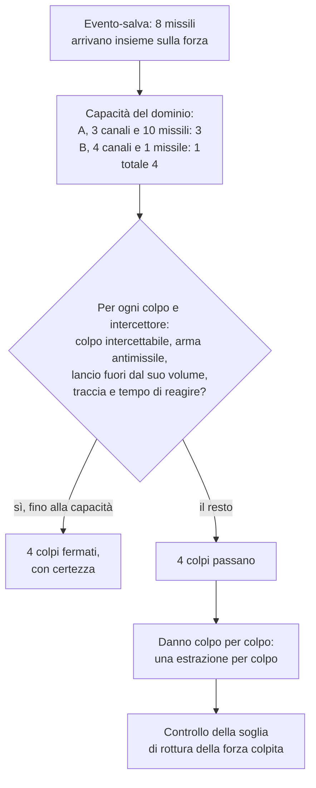

### 6.6 Il danno, colpo per colpo

Ogni colpo che passa è risolto con **una estrazione** u, con tre esiti che si escludono [V, 2026-11-20]:

| Esito | Probabilità | Effetto sulla salute (da 0 a 100) |
|---|---|---|
| **distrutto** | Ph · Pk\|h | salute a 0 |
| **danneggiato** | Ph · (1 − Pk\|h) | perde round(100 · Pk\|h) punti, almeno 1 |
| **mancato** | 1 − Ph | nessuno |

La stessa Pk\|h misura sia la probabilità di distruggere sia l'entità del danno non letale: servono circa 1/Pk\|h colpi a segno
non letali per mettere fuori uso un bersaglio. L'**accumulo** del danno è quindi una conseguenza, non un parametro [V]. L'ordine
delle soglie (prima distrutto, poi danneggiato, poi mancato) fa parte del contratto di riproducibilità [V].

**Gli stati di salute** [V]: sopra 80 l'unità è integra; da 51 a 80 danneggiata ma ancora **operativa**; da 16 a 50 **fuori
combattimento** (non spara più, ma è ancora un bersaglio: il «mission kill»); a 15 o meno **distrutta**: il residuo è il
**relitto**. Un colpo che arriva su un'unità già distrutta è **sprecato** e non consuma estrazioni [V].

**Esempio ILLUSTRATIVO.** Ph = 0,7, Pk\|h = 0,3. Per colpo: distrutto 0,21, danneggiato 0,49 (meno 30 punti), mancato 0,30.
Da salute 100, un colpo che danneggia porta a 70 (ancora operativa), un secondo a 40 (fuori combattimento).

Manca la **penetrazione della corazza**: i registri non hanno il dato, e la Pk\|h per tipo e taglia del bersaglio è l'unico
discriminante [V]. La Pk non dipende dalla posizione del bersaglio nell'**inviluppo** dell'arma (l'insieme delle distanze e
delle quote da cui l'arma può colpire) [V].

*Fig. 15 — Gli stati di salute di un'unità. Deriva da D7.*

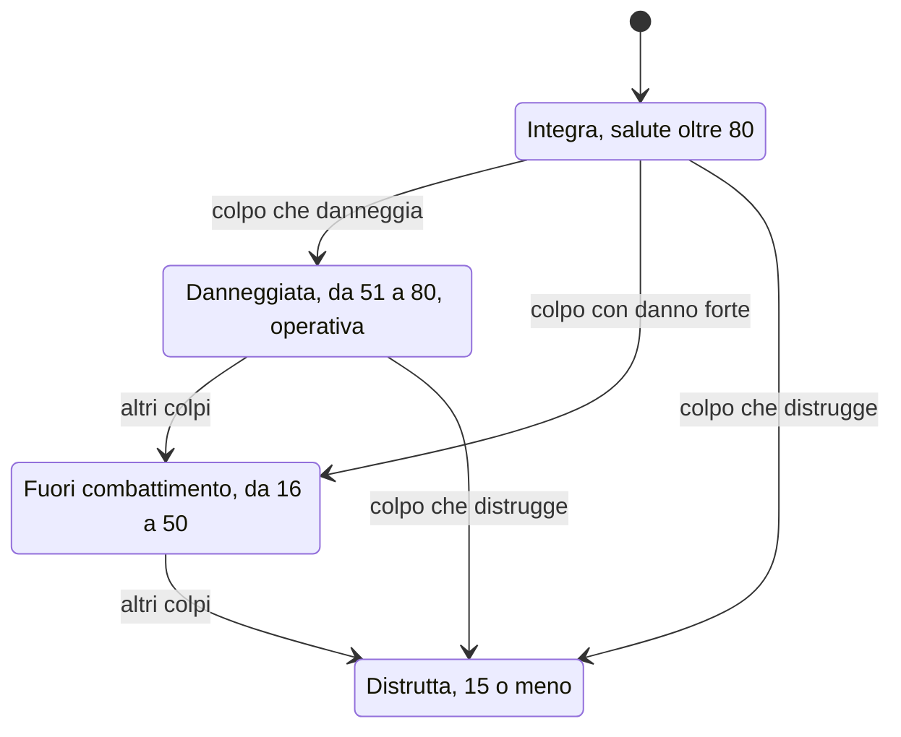

### 6.7 La soglia di rottura

Dopo **ogni** evento-salva la forza colpita (una missione, sezione 4.4) confronta le proprie perdite con la propria **soglia di
rottura** B [V, 2026-11-20]. Le perdite si misurano in due modi, entrambi come frazione delle unità **impegnate all'inizio
dell'episodio**:

> **erosione E** = unità non più operative / unità impegnate   (cumulata nell'episodio)
>
> **shock S** = unità perse **in questa salva** / unità impegnate

La forza **rompe il contatto** (si ritira) se

> **E ≥ B**   oppure   **(perse nella salva ≥ 2  e  S ≥ (0,20 / 0,30) · B)**

e risulta **distrutta** se non le resta nessuna unità operativa: la distruzione prevale anche su una ritirata già decisa, se salve
già in volo finiscono la forza [V].

**La soglia non è un numero fisso.** È estratta e modulata, forza per forza e episodio per episodio [V, 2026-11-20]:

> **B = 1 / (1 + e^−( ln(μ / (1 − μ)) + 0,5 · z ))**
>
> **μ = 0,30 · M · R · U · P**, ricondotta fra 0,05 e 0,95
>
> - **z** viene dalla **tempra** della forza: un numero casuale estratto **una volta per forza e per episodio**, da un flusso
>   separato (sezione 10), trasformato in uno scarto normale (z = 0 è la tempra media);
> - **M** è il **morale**: previsto, ma oggi nessuno lo fornisce, quindi vale 1;
> - **R** è il **rapporto di forze percepito**: forza propria su forza nemica **scoperta** dal dominio di coordinamento, elevato
>   a 0,5 e ricondotto fra 0,6 e 1,5 (per una forza aerea la minaccia nemica è pesata con l'efficacia attesa dei sistemi
>   contraerei scoperti);
> - **U** è il **fuoco senza risposta**: 1 − 0,3 × la quota di perdite causate da tiratori che il dominio non aveva scoperto;
> - **P** vale 1,2 se la forza è rimasta **ferma** per tutto lo scontro (difesa da posizione), altrimenti 1.

A parole: 0,30 non è la soglia, è la sua **mediana** (il 30% di perdite); 0,20 non è una seconda soglia, ma fissa il
**rapporto** fra la soglia dello shock e quella dell'erosione; la tempra **non è** la soglia, ma una delle cose da cui dipende,
insieme a fattori calcolati durante lo scontro. Una forza ferma, superiore per forze percepite o «fortunata» nella tempra
resiste più a lungo; una forza che subisce perdite da tiratori che non vede si rompe prima. La curva a «S» della formula (una
sigmoide) mantiene la soglia fra 0 e 1. «Postura» qui significa **soltanto** che la forza è rimasta ferma, non l'etichetta di
postura della sezione 4.5 [V, 2026-11-20].

**Esempio ILLUSTRATIVO** (forza di 5 carri, morale e fuoco senza risposta neutri, forza in movimento, R = 1):

| Tempra | z | Soglia B | Un carro perso per salva, in salve diverse | Due carri persi nella stessa salva |
|---|---|---|---|---|
| media | 0 | 0,30 | si ritira dopo la **seconda** perdita (E = 0,4) | si ritira (erosione e shock) |
| alta | circa +1 | circa 0,41 | resiste anche con 2 perdite (E = 0,4); si ritira alla terza | si ritira **per shock** (S = 0,4 contro 0,28) |
| bassa | circa −1 | circa 0,21 | si ritira dopo la **seconda** perdita | si ritira |

Con R = 2 (forza propria doppia di quella nemica scoperta), μ sale a 0,30 · √2 ≈ 0,42 [ILLUSTRATIVO]. La soglia casuale nasce da
un difetto osservato con le soglie fisse: con una perdita minima di 1/5, cinque carri si ritiravano per un solo carro perso quasi
sempre (7 repliche su 8 nella prova del progetto [NV]).

**Chi può ritirarsi** [V]. Solo le forze **militari**; un blocco logistico o civile combatte fino alla fine. Una forza fatta
solo di aerei a terra non si ritira. La ritirata è della **forza intera**: una parte non può cedere mentre l'altra resiste, e non
c'è contagio fra forze dello stesso lato. Una forza in ritirata non riceve più lanci nuovi, non può più essere scelta come
bersaglio (è «andata via»), e le salve già partite arrivano comunque. Dopo l'episodio, gli **aerei** di una missione in ritirata
rientrano (sezione 7); le forze **terrestri e navali** restano sulla loro rotta, passive (sezione 3.5).

**Lo stato dei numeri.** Tutti i coefficienti (0,30, 0,20, 0,5, 0,3, 0,5 con i limiti 0,6-1,5, 1,2, le 2 perdite minime) sono
**stime di partenza dichiarate, non tarate**, uguali per i tre lati [S]. Per il 30% il codice richiama «una regola empirica diffusa
nella letteratura militare», **senza citarla**; per lo 0,20 dichiara **nessuna fonte** (è scelto solo perché sia minore di 0,30)
[S, V 2026-11-20 sul commento del codice]. Il codice prevede una ritaratura con un processo interno del progetto che **non risulta
fatta** [NV]. Le perdite di un episodio precedente **non** entrano nell'erosione del successivo, che ha anche una tempra nuova [V].

*Fig. 16 — Gli stati di una forza durante uno scontro. Deriva da D6.*

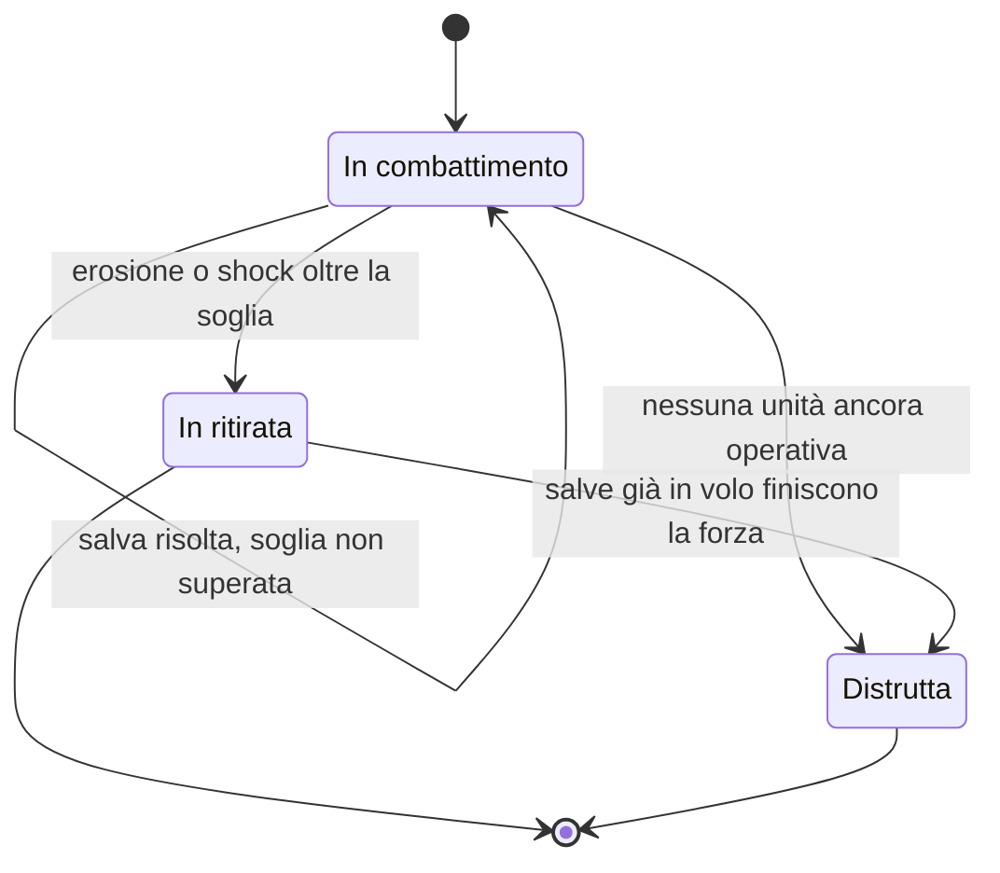

*Fig. 17 — Da che cosa dipende la soglia di rottura. Deriva da D22.*

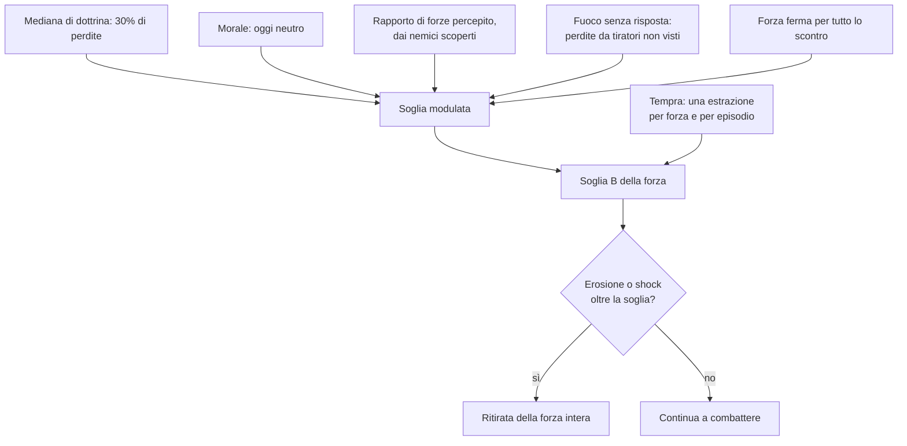

### 6.8 Scontri con più forze

Quando una forza è in contatto con più forze nemiche in finestre vicine, tutte entrano nello **stesso episodio** e sono risolte
in **una sola** agenda condivisa: la salute e le scorte di quella forza evolvono in un'unica storia, consumata da tutti i fronti
nell'ordine esatto degli eventi. Risolvere i fronti separatamente farebbe dipendere l'esito dall'ordine in cui il programma li
esamina [V]. Due missioni dello stesso dominio sono due forze: quando una si ritira, l'altra **continua** a combattere; il dominio
condivide fuoco e percezione, **non** il destino della ritirata (sezione 4.4) [V].

### 6.9 Il fuoco su posizione

Il fuoco su posizione è il **caso a parte** dello scontro: artiglieria o navi sparano su un **punto stimato** («dove il nemico
era»), senza averlo scoperto. Non passa dallo strato 2: è un evento di sessione a sé, risolto all'istante dell'impatto (sezione
3.4) [V, 2026-11-20].

- **Chi e quando.** Una missione di terra o di mare con un bersaglio punto o area e un **ordine di tiro** su un suo punto di rotta;
  l'istante di tiro è l'arrivo a quel punto, con la condizione d'avvio dichiarata. Gli aerei non sparano così, e i missili sono
  esclusi.
- **Con che cosa.** L'arma dichiarata nell'ordine, oppure la prima arma d'artiglieria, di fuoco navale o d'attacco a terra che
  ha scorta e portata; il punto mirato deve essere entro la portata.
- **Dove cadono i colpi.** Il punto mirato è la posizione **stimata** del bersaglio. Ogni colpo cade in un punto casuale,
  uniforme in un **disco di dispersione** di raggio R = max(raggio dichiarato, incertezza della stima, 50 m) [S per i 50 m].
- **Che effetto hanno.** Ogni nemico non distrutto che, all'impatto, si trova entro il **raggio letale** dal punto di caduta
  riceve un'estrazione con la sola Pk\|h dell'arma contro di lui (dentro il raggio il colpo è considerato a segno). Raggio letale =
  **0,25 m per millimetro di calibro** (un calibro da 152 mm dà 38 m), oppure 25 m se il calibro manca [S].
- **Che cosa non fa.** Niente intercettazione, niente fuoco amico (colpisce solo i nemici), niente aerei in volo, e **nessun
  effetto sulla soglia di rottura** del lato colpito [V].
- **Casualità.** Per ogni colpo, due estrazioni per il punto di caduta e una per ogni nemico raggiunto, in quest'ordine, da un
  **flusso separato della stessa sorgente di sessione**, uno per ogni ordine di tiro (sezione 10): è l'unico punto, fuori dallo
  strato 2, in cui il motore estrae numeri casuali [V, 2026-11-20].

**Esempio ILLUSTRATIVO.** Dieci colpi da 152 mm su un punto stimato con incertezza 100 m; il bersaglio è davvero lì; Pk\|h = 0,5.
La probabilità che un colpo cada entro 38 m dal bersaglio è (38/100)² ≈ 0,14; per colpo il bersaglio è distrutto o danneggiato
con probabilità circa 0,07; su dieci colpi, almeno un effetto con probabilità circa 0,53. Se il bersaglio si è spostato di 150 m,
nessun colpo può raggiungerlo (100 m di dispersione più 38 m di raggio letale fanno 138 m).

*Fig. 18 — Il fuoco su posizione. Deriva da D49 (dalla condizione di tiro alle estrazioni) e D50 (l'evento nella coda di
sessione).*

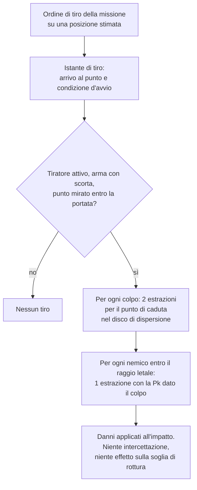

> **Dalla letteratura.** Il confronto fra i colpi di una salva e la capacità difensiva di chi la riceve è il meccanismo del
> modello a salve di Hughes [B 4.2] (citazione verificata, **contenuto non letto**); Lucas e McGunnigle [B 4.5] (titolo, sommario
> e bibliografia letti) discutono perché un modello a salve semplice e trasparente possa essere preferibile a uno complesso;
> estensioni sulla dimensione delle salve e sul fuoco d'area: Armstrong [B 4.6] (**contenuto non letto**). Il motore prende di
> Hughes **il meccanismo** (saturazione per evento-salva, surplus che passa), **non** le equazioni aggregate. Le equazioni di
> logoramento di Lanchester [B 4.1] e i modelli di attrito trattati da Washburn e Kress [B 4.4] sono ciò che il motore **non** usa:
> qui i colpi sono singoli e le perdite per unità. La scomposizione della probabilità di distruzione in Ph e Pk\|h:
> `[FONTE: scomposizione Ph × Pk]`. La dottrina «due colpi, poi guarda» e la prevenzione dello spreco: `[FONTE: dottrina di
> tiro «due colpi, poi guarda»]`. I tempi di reazione dei sistemi d'arma: `[FONTE: ciclo OODA e tempi di reazione]`. La soglia
> del 30% di perdite: `[FONTE: soglie di rottura del 30%]`; per dati quantitativi storici sul combattimento in generale, come
> indicazione di lettura, Dupuy [B 8.1] e Lawrence [B 8.2] (**contenuto non letto**: non è verificato che trattino le soglie di
> rottura). L'assegnazione ottima delle armi ai bersagli, che il motore **non** fa: Manne [B 9.1] e Ahuja e altri [B 9.2]
> (citazioni verificate, **contenuto non letto**).
>
> **Scelta del progetto.** Catena a eventi con ritardi di reazione per tipo di sistema; ripartizione del fuoco locale e a turno;
> precedenza a chi attacca la propria forza, dottrina contro lo spreco con soglia 0,9 e tetto di 2 colpi in volo (decisioni
> dell'utente con valori stimati [S/D]); preferenza d'arma Pk/costo^0,5 [S; principio D]; intercettazione per evento-salva con
> le quattro condizioni [D]; danno a tre esiti senza costanti nuove [V]; soglia di rottura casuale e modulata, per forza intera
> [D] con coefficienti stimati [S]; fuoco su posizione come evento separato, con dispersione uniforme e letalità a soglia [D],
> con costanti stimate [S].
>
> **Limiti e incertezze.**
> - Coefficienti della soglia di rottura, del ritardo di reazione (scomposizione), della preferenza d'arma, della dottrina di tiro
>   e del fuoco su posizione: **stime non tarate** [S]; uguali per i tre lati [V].
> - Morale e stima a priori del nemico non alimentati da nessun chiamante: oggi neutri [V].
> - Intercettazione certa per canale, tempo di volo dell'intercettore e sezione radar del colpo trascurati: ipotesi favorevoli
>   alla difesa [V]; nessun collegamento di comando fra batterie [V].
> - Prima arma con scorta, poi la portata: un candidato può esaurirsi anche se un'altra arma potrebbe sparare [V]; tempo di volo
>   dei missili a metà portata, non sulla distanza vera [S]; Pk indipendente dalla posizione nell'inviluppo [V].
> - Ripartizione del fuoco locale, non ottima [V]; finestra di raggruppamento delle salve a zero secondi [S].
> - Ritirata solo della forza intera, nessun contagio [V]; nessuna penetrazione di corazza [V].
> - Parte degli scenari usa una tabella d'armi di prova senza portate: lì i tiri non hanno vincolo di distanza [V].
> - Due regole facoltative spente e senza chiamanti (classe dei colpi intercettabili, fascia di quota del volume d'ingaggio) [V].
>
> **Nel manuale.** Cap. 4 §4.1 (la catena), §4.3-§4.10 (reazione, arma, salva, danno, ritirata, più forze, carico congelato, stato
> ombra; D5, D6), §4.16-§4.17 (arma dai registri e portata), §4.19-§4.20 (scorte, bombe), §4.21-§4.26 (soglia di rottura, D22;
> efficacia contraerea; RWR; difesa dai missili, D24; dottrina di tiro; traccia e tempo di reazione), §4.29 (difesa per dominio,
> D33), §4.34 (arma del fuoco su posizione); cap. 5 §5.1, §5.4 (danno e stati di salute, D7); cap. 6 §6.23 (fuoco su posizione, D49,
> D50); cap. 7 §7.2-§7.3 (dottrina e profili di reazione), §7.5 (capacità di intercettazione); cap. 9 §9.1 «Altri limiti
> dichiarati, minori», «Limiti introdotti o resi evidenti dalle estensioni del 2026-09-28/30», «Bersagli intercettabili dalle
> difese aeree», «Quota nel volume d'ingaggio», «Fuoco su posizione».

---

## 7. Tempo, carburante, munizioni e stato delle unità in una sessione

### 7.1 La vita di un'unità nella sessione

Le unità di superficie sono presenti per tutta la sessione: ferme nel punto di partenza prima di muovere, sulla rotta, ferme
nell'ultimo punto dopo l'arrivo (sezione 4.3). La vita di un **aereo** ha più stati, tutti calcolati in anticipo o al termine di
un episodio, mai durante uno scontro [V].

*Fig. 19 — La vita di un aereo di missione in una sessione. Deriva da D41.*

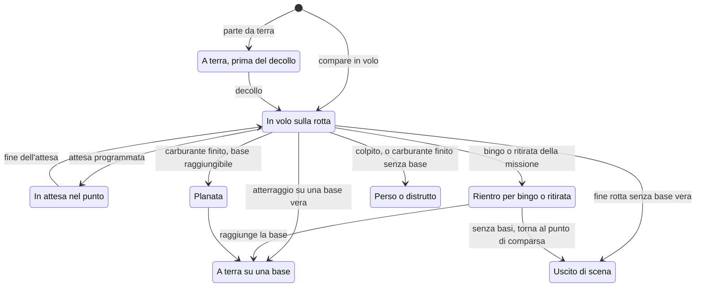

### 7.2 Il carburante vincola il movimento

Il carburante è una **frazione del pieno**, da 0 a 1 [V]. Il motore lo tratta così [V]:

- **consumo per tratto**: ogni tratto di movimento consuma in proporzione alla distanza, alla velocità di **crociera**; ogni
  **sosta** (attesa, orbita, unità ferma a motore acceso) consuma nel tempo **come se fosse in crociera**: per gli aerei in
  attesa è una sovrastima, perché il dato di consumo in attesa non c'è nei registri [V, ipotesi dichiarata];
- **esaurimento calcolato prima**: poiché il consumo dipende solo dai tratti e dal carburante di partenza, il punto in cui il
  carburante finisce si calcola **prima** dei contatti, e oltre quel punto la rotta non esiste;
- **che cosa succede a secco**:
  - un'unità di **terra o di mare** si **ferma** nel punto, resta presente e bersaglio, non è distrutta;
  - un **aereo in volo** **plana** verso la base amica più vicina se è entro **quota × 10** (rapporto di planata 10, ordine di
    grandezza indicato dall'utente [S/D]: un caccia a 3000 m arriva a 30 km), poi resta a terra su quella base;
  - altrimenti è **perso**: la sua salute va a zero senza un evento di danno (non è un colpo), con l'equipaggio considerato
    recuperato.

**Il consumo in combattimento.** Lo scontro **non legge** il carburante (sezione 3.3). Per gli aerei il combattimento costa però
carburante con una regola **a scatto**: a ogni episodio a cui un aereo in volo **partecipa** (lancia, è bersaglio di una salva, o
intercetta), nell'istante della sua prima partecipazione consuma il carburante di **5 minuti alla massima spinta militare**, la
stessa quantità della riserva di disimpegno (§7.3) [V]. La **massima spinta militare** è la spinta massima del motore **senza
postbruciatore**; il **postbruciatore** è il sistema che brucia altro carburante nello scarico per aumentare la spinta, con
consumi molto più alti. La sola scoperta reciproca, senza salve, non costa nulla. Terra e mare non hanno questo consumo [V].

Il **conto** dei consumi si fa alla **fine** della sessione, tratto per tratto (sezione 3.3); le decisioni intermedie (bingo dopo
un episodio) usano un **residuo calcolato** con la stessa aritmetica [V].

### 7.3 Il bingo: quando un aereo deve rientrare

Il **bingo** è il livello di carburante sotto il quale un aereo deve interrompere la missione e tornare. Il modello attuale, deciso
dall'utente, usa tre grandezze [D, verificate nel codice]:

> **riserva di disimpegno = consumo alla massima spinta militare [kg/h] × 300 s / 3600 / capacità del carico [kg]**
>
> **minimo di pianificazione**: carburante caricato **>** rotta intera + riserva   (lo controlla il validatore, sezione 8)
>
> **soglia di bingo in volo**: residuo **<** resto della rotta fino all'atterraggio + riserva

I 300 s sono il tempo per **disimpegnarsi** da un'intercettazione e tornare in rotta: il codice e il manuale li dichiarano
«stima dell'utente», non un dato tarato [S/D, V 2026-11-20]. Il bingo si valuta **alla partenza** e **alla fine di ogni
episodio** [V]. Con il solo consumo di movimento residuo e resto della rotta calano insieme, quindi la soglia o scatta subito o
mai: è il **consumo in combattimento** che la fa scattare a metà missione.

**Esempio ILLUSTRATIVO.** Un aereo consuma 4500 kg/h alla massima spinta militare e porta 3200 kg: la riserva vale
4500 × 300/3600 = 375 kg, cioè circa 0,12 del pieno. Prima di un episodio ha 0,42 di carburante e il resto della rotta ne chiede
0,20: soglia 0,32, nessun bingo. L'episodio gli costa altri 0,12: residuo 0,30, sotto la soglia di 0,32: **bingo** alla fine
dell'episodio.

**L'albero di decisione** dipende dal tipo di missione [V]:

- **missioni di trasferimento**: se il residuo basta comunque a finire la rotta (senza la riserva), l'aereo **prosegue**
  consumando la riserva;
- **tutte le altre**: l'aereo **interrompe** sempre. Rientra alla **base di partenza**, ripercorrendo la rotta a ritroso, oppure a
  una **base amica alternativa** entro 3 km dalla rotta programmata [S/D], scegliendo il percorso **più breve** che il residuo
  consente; se nessuna è raggiungibile, va verso la base più vicina in linea retta; se non ce n'è nessuna, vola finché ha
  carburante (§7.2);
- **un aereo comparso in volo senza alcuna base** del suo lato, che dopo un episodio deve rientrare, torna a ritroso fino al
  **punto di comparsa** ed **esce di scena**: non è una perdita.

Una seconda causa di rientro è la **ritirata**: se la forza di un aereo si è ritirata in un episodio, l'aereo rientra con le
regole delle missioni di combattimento **qualunque sia il suo carburante**; se entrambe le cause valgono, vince il bingo [V].
Dal bingo in poi l'aereo **non lancia più salve offensive**, ma resta bersaglio e intercettore [V]. Terra e mare non hanno bingo
[V].

**Lo stato dei dati.** Il consumo «di emergenza» dei registri ha un'**unità non documentata**, dedotta come kg/h; per i caccia con
postbruciatore sottostima di circa sei volte il consumo a postbruciatore pieno. Per questo l'utente ha **definito** la riserva come
«5 minuti alla massima spinta militare» invece che al postbruciatore [D]; sul campione di otto aerei esaminato dal progetto la
riserva va dal 5,2% al 21,4% del pieno [V]. Una regola per gli aerei storici con un'emergenza più breve di 5 minuti è indicata
dall'utente ma **non implementata** [V].

*Fig. 20 — La decisione al bingo, semplificata. Deriva da D38.*

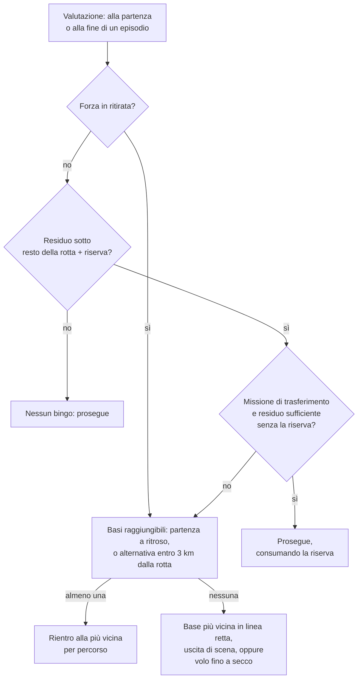

### 7.4 Le munizioni

La scorta è tenuta **per modello d'arma**: ogni arma paga solo con la propria voce [V]. Alcuni punti:

- un missile antiaereo usato **per intercettare** e uno sparato **offensivamente** scalano **la stessa voce**: sono lo stesso
  oggetto [V];
- le armi che i registri contano come impianti e non come colpi (mitragliatrici, cannoni a tiro rapido di difesa ravvicinata)
  **non si esauriscono** nel tiro offensivo; come intercettori le difese ravvicinate navali hanno una scorta propria, e ogni
  intercettazione con un cannone consuma 100 colpi [S] [V];
- il **cannone di bordo** di un aereo è un'arma candidata come le altre, se il carico gli assegna colpi (sezione 6.4) [V];
- **nessun rifornimento** durante la sessione: riarmo e rifornimento avvengono fra le sessioni (sezione 8) [V].

### 7.5 La fine di attività

I **criteri di fine** dichiarati dalla missione (sezione 4.2) chiudono l'**attività** di un'unità senza cambiarne la rotta [V]:

- **munizioni finite**: tutte le voci delle categorie d'arma indicate sono a zero;
- **soglia di danno**: la salute persa, rispetto a quella **a inizio sessione**, supera la soglia (così il danno di episodi diversi
  si somma);
- **bersaglio distrutto**: tutti i bersagli designati (un'unità o un gruppo) sono distrutti, ovunque e comunque;
- **durata massima**: contata dalla partenza della missione.

Dall'istante della fine l'unità **non lancia più salve offensive** e prosegue **passiva** sulla rotta, restando presente,
bersaglio e intercettore. Nessuno di questi criteri fa rientrare un aereo: il rientro è solo del bingo e della ritirata (§7.3);
un aereo danneggiato oltre la soglia resta passivo sulla rotta [V]. L'unità che chiude per uno di questi motivi entra nella regola
dell'esito di missione della sezione 4.7.

### 7.6 Quando si applica che cosa

*Fig. 21 — Quando si applicano danni, munizioni, carburante e posizioni. Deriva da D9 (coda degli eventi di sessione) e D40
(episodio, contabilità del carburante, ripianificazione).*

```mermaid
flowchart LR
    E1["Episodio 1"] --> A1["Subito: danni<br/>e munizioni applicati"]
    A1 --> R1["Bingo, ritirata, secco:<br/>aerei ripianificati,<br/>contatti ricalcolati"]
    R1 --> E2["Episodio 2<br/>dallo stato già consumato"]
    E2 --> A2["Subito: danni<br/>e munizioni"]
    A2 --> FIN["Fine sessione: conto<br/>del carburante tratto per tratto"]
    FIN --> OUT["Esito di sessione"]
    OUT --> CAM["Ciclo di campagna:<br/>posizioni e prontezza"]
```

Lo stato di ogni unità a fine sessione è quindi: salute, scorte per arma, carburante, una **postura** finale (per esempio in
missione, a terra su una base, uscito di scena, distrutto) e l'esito della sua missione (sezione 4.7) [V].

> **Dalla letteratura.** Pianificazione del carburante, riserve minime e livello di bingo nelle operazioni aeree:
> `[FONTE: pianificazione del carburante e riserve minime nelle operazioni aeree]`, non coperta dalla bibliografia. L'albero di
> decisione, la riserva di disimpegno, il consumo in combattimento a scatto e l'uscita di scena sono **scelte del progetto**.
>
> **Scelta del progetto.** Carburante come vincolo calcolato in anticipo; soste alla crociera; planata con rapporto 10; bingo con
> riserva di 5 minuti alla massima spinta militare, valutato alla partenza e dopo ogni episodio; albero per tipo di missione con
> basi alternative entro 3 km; rientro forzato dopo la ritirata; consumo in combattimento uguale alla riserva; criteri di fine che
> rendono passivi senza cambiare la rotta [D, verificati nel codice; i valori sono stime S o S/D].
>
> **Limiti e incertezze.**
> - Dati di consumo di emergenza non tarati, unità dedotta [S]; 300 s, 3 km, rapporto di planata 10: stime dell'utente [S/D].
> - Soste e attese consumano come la crociera: sovrastima [V]; consumo in combattimento a scatto, non distribuito nel tempo [V].
> - Decisione di rientro solo alla fine dell'episodio; durante lo scontro un aereo a secco continua a volare e combattere [V].
> - Nessuna salva offensiva dopo il bingo, nessun rientro per danno, nessun bingo per terra e mare [V].
> - Il rientro a ritroso ripassa sulle minacce dell'andata [V]; l'idoneità della base per tipo d'aereo non è modellata [V].
> - Regola per gli aerei storici con emergenza breve non implementata [V].
> - La formazione si può dividere: le decisioni sul carburante sono per aereo, la ritirata per forza [V].
>
> **Nel manuale.** Cap. 4 §4.19 (scorta per arma), §4.31 (fine di attività); cap. 5 §5.2 (carburante e bingo: riserva, soglia,
> albero, consumo in ingaggio, uscita di scena; D38, D39); cap. 6 §6.5, §6.15-§6.20 (presenza, attese, carburante per tratto,
> fine di attività, bingo in sessione, episodi e ripianificazione; D40, D41, D42); cap. 7 §7.6 (munizioni e carburante sulle
> unità); cap. 9 §9.1, la voce sui limiti introdotti dalle fasi del carburante e del bingo (il titolo usa le sigle di progetto:
> tabella della sezione 14). L'atlante del carburante è il cap. 10B.

---

## 8. Dalla sessione alla campagna

### 8.1 Il ciclo di campagna

Fra una sessione e l'altra il motore non fa nulla: lo fa un **conduttore di campagna**, esterno al motore e oggi chiamato solo da
test e da uno scenario (sezione 1.5) [V]. Per ogni sessione esegue cinque passi, in quest'ordine [V, 2026-11-20]:

1. **processi fra sessioni**: applica alle unità i riarmi, i rifornimenti e le riparazioni che si sono conclusi **entro l'inizio**
   della sessione;
2. **validazione** dell'ordine di sessione; se l'ordine non è valido si ferma qui e il motore non viene chiamato;
3. **esecuzione** della sessione con il motore DES (il passo che un futuro adattatore DCS sostituirebbe, sezione 1.3);
4. **posizioni finali**: applica alle unità la posizione in cui il motore dice che si trovano a fine sessione;
5. **registro di campagna**: registra la sessione e calcola, per ogni unità, **quando tornerà pronta**.

*Fig. 22 — Un passo del ciclo di campagna. Deriva da D54 e D128.*

```mermaid
sequenceDiagram
    participant C as Conduttore
    participant P as Prontezza
    participant V as Validatore
    participant M as Motore DES
    C->>P: processi conclusi entro l'inizio della sessione
    P-->>C: unità riparate, riarmate, rifornite
    C->>V: ordine di sessione e registro
    alt ordine non valido
        V-->>C: elenco delle violazioni, il motore non è chiamato
    else ordine valido
        C->>M: esegui la sessione
        M-->>C: esito, con posizioni finali e fine dei movimenti
        C->>C: applica le posizioni finali
        C->>P: registra la sessione, calcola la nuova prontezza
    end
```

### 8.2 Il validatore

Il validatore raccoglie **tutte** le violazioni, non solo la prima [V]. Controlla:

- la **sessione**: deve avere una fine (niente sessioni aperte), durare al più **4 ore** (2 ore di default) [D], e non cominciare
  prima della fine **effettiva** della precedente, salve in volo comprese;
- per ogni **missione**: che il suo blocco sia fra le forze e le sue unità appartengano a quel blocco; che nessuna unità sia
  **distrutta** o **non ancora pronta** all'inizio della sessione; che partenza e orari siano coerenti; che la **fine pianificata**
  non superi la fine della sessione; che nessun tratto superi la velocità del mezzo più lento (sezione 4.3);
- per le sole missioni **aeree**: il **minimo di pianificazione** e l'assenza di un bingo già alla partenza (sezione 7.3).

Il validatore è **fuori** dal motore: chi chiama il motore direttamente può fargli eseguire anche un ordine che il validatore
rifiuterebbe, ed è ciò che fanno, di proposito, alcuni test e scenari [V]. Il motore stesso, per esempio, non rifiuta un ordine per
carburante: se lo facesse, il bingo in volo non si potrebbe mai osservare [V].

### 8.3 La prontezza

Dopo una sessione un'unità che ha volato, sparato, consumato o subito danni ha bisogno di tempo per tornare impiegabile. Il
registro di campagna, **immutabile**, tiene per ogni unità l'istante in cui sarà pronta [V, 2026-11-20]:

> **pronta da = max( inizio + tempo di ripristino + tempo di riparazione ,  pronta da del processo precedente )**
>
> **inizio** = il più tardo fra la fine del movimento (o l'atterraggio) e l'ultimo danno subito
>
> **tempo di riparazione = riparazione completa del dominio × (100 − salute) / 100**   (lineare nel danno)

Il **tempo di ripristino** (in inglese *turnaround*: riarmo, rifornimento, controlli) vale solo per chi è stato in missione o ha
consumato qualcosa; la riparazione solo per chi è danneggiato. Un'unità **distrutta** (salute 15 o meno) non ha prontezza e non
è mai riparata [V, 2026-11-20].

*Tab. 4 — Tempi di ripristino e di riparazione del codice (stime o ordini di grandezza; dettaglio delle fonti nel manuale).*

| Unità | Tempo di ripristino | Natura |
|---|---|---|
| caccia, cacciabombardieri, aerei d'attacco, trasporti, classe ignota | 3 h | caccia: una sola fonte verificata sulla pagina originale; gli altri per analogia o stima |
| bombardieri / bombardieri pesanti | 4,5 h / 8 h | fonte riportata e non riverificata / stima di progetto [S] |
| radar volanti (AWACS) / ricognitori / elicotteri | 12 h / 2 h / 1,5 h | confidenza bassa / stima [S] / stima [S] |
| reparti terrestri / navi | 6 h / 48 h | stima di progetto [S] / stima senza fonte numerica [S] |
| **riparazione completa**: aria / terra / mare | 24 h / 24 h / 72 h | ordini di grandezza; per le navi riparazione temporanea in porto |

**Esempio ILLUSTRATIVO** (con i tempi del codice, che sono stime). Un caccia è colpito a 1,2 h dall'inizio della sessione e scende
a salute 70; atterra a 1,5 h. Inizio = 1,5 h; ripristino 3 h; riparazione 24 h × 0,30 = 7,2 h: **pronto da 11,7 h**. Una sessione
che comincia a 8 h non può impiegarlo (il validatore lo rifiuta); in una che comincia a 12 h il conduttore, al passo 1, lo riporta a
salute 100, lo riarma e lo rifornisce. Se invece fosse stato colpito di nuovo sul parcheggio a 1,8 h, l'inizio sarebbe 1,8 h e la
prontezza 12,0 h.

Tre regole che contano [V]:

- **i processi si applicano all'inizio della sessione successiva**, non all'istante in cui l'unità è pronta: fino ad allora l'unità
  conserva salute, scorte e carburante della sessione precedente;
- **la riparazione è a gradino**: la salute torna a 100 solo alla fine, e un'unità parzialmente riparata non è impiegabile;
- **niente logistica delle basi**: riarmo, rifornimento e riparazione **non consumano** risorse delle basi e non dipendono da
  esse, per decisione dell'utente [D]. Un aereo senza carico assegnato non viene riarmato né rifornito («non modellato»).
  Un'unità assente da una sessione conserva il suo processo, che le si applica quando torna.

### 8.4 La posizione persistente

Il motore calcola dove si trova ogni unità alla **fine nominale** della sessione, seguendo i tratti definitivi (dopo bingo,
esaurimento e ripianificazioni), ma **non** sposta le unità: lo fa il conduttore, al passo 4 [V]. Eccezioni [V]:

- un aereo **uscito di scena** mantiene la posizione di partenza: si considera rientrato a una base fuori scena, che il motore non
  conosce;
- un aereo **ancora in volo** a fine sessione (possibile solo se l'ordine non è passato dal validatore) riceve comunque la
  posizione, con un avviso: fuori dalla sessione non c'è movimento;
- un'unità distrutta resta dove è caduta.

Chi chiama il motore **direttamente**, senza conduttore, vede le unità ripartire ogni volta dalle posizioni iniziali [V].

### 8.5 Che cosa passa da una sessione all'altra

*Tab. 5 — Che cosa sopravvive fra due sessioni. Nessun diagramma tecnico; dal cap. 6 §6.24-§6.27 e dal cap. 9 §9.1.*

| Passa | Non passa |
|---|---|
| **salute** delle unità (danni), fino alla riparazione [V] | i **rilevamenti**: ogni sessione rifà le sue estrazioni, anche per un contatto appena avvenuto [V; verificato dal progetto con prove temporanee] |
| **scorte per arma** e **carburante**, fino al riarmo e al rifornimento [V] | la **tempra**, la **soglia di rottura** e il **rapporto di forze percepito**: sono di ogni episodio [V] |
| **posizione**, se si usa il conduttore [V] | la **ritirata** e la passività di una forza: valgono nella sessione in cui sono avvenute [V, 2026-11-20] |
| **prontezza** (registro di campagna) [V] | le **operazioni**: valgono per una sessione [V]; il **morale** non è alimentato da nessuno [V] |
| — | se la stima del nemico o la ricognizione di una sessione **usino** i rilevamenti della precedente: **non verificato** [NV] |

**Due effetti di cadenza** [V]. Primo: la probabilità di scoprire un bersaglio **nel tempo** dipende dalla durata delle sessioni e
dalla loro cadenza. Un osservatore e un bersaglio **entrambi fermi** hanno una permanenza pari all'intera sessione, quindi **una
sola estrazione per sessione**: con sessioni più corte e più numerose le occasioni di scoperta aumentano. Secondo: un passaggio
spezzato da due sessioni dà due estrazioni (sezione 5.7). Inoltre le sessioni della **stessa unità** non sono contigue: il tempo di
ripristino la rende di nuovo disponibile solo ore dopo [V].

### 8.6 L'esito delle operazioni

A fine sessione il motore calcola anche l'**esito di ogni operazione** (sezione 4.1), aggregando gli esiti delle sue missioni con
la regola dichiarata (riuscita se riescono tutte, se ne riesce almeno una, o se riesce la principale); un'operazione può risultare
a sua volta «in corso» quando l'esito dipende da missioni ancora in corso [V, 2026-11-20]. Posizioni finali, fine dei movimenti,
stato «in corso» ed esiti delle operazioni **non** sono registrati dalla fotografia di non regressione: li controllano i test [V].

> **Dalla letteratura.** Un modello di campagna a eventi che concatena combattimento e tempo di teatro: Hillestad e Moore [B 7.5]
> (pagina RAND letta per titolo e sintesi); per il collegamento fra livelli diversi di dettaglio: Davis [B 7.1], [B 7.2]. Tempi
> di ripristino e di riparazione di aerei, navi e reparti: `[FONTE: tempi di ripristino e di riparazione]`, non coperta dalla
> bibliografia; le fonti che il progetto ha raccolto sono descritte nel manuale, con **una sola** verificata sulla pagina
> originale.
>
> **Scelta del progetto.** Validatore separato dal motore; registro di prontezza immutabile, non uno stato delle unità; tempi per
> classe e per dominio; riparazione lineare e a gradino; processi applicati all'inizio della sessione successiva; posizione
> persistita dal conduttore; nessuna logistica delle basi; durata di 2 ore di default e 4 al massimo [D].
>
> **Limiti e incertezze.**
> - **Nessun chiamante di produzione** del ciclo di campagna: si vede solo in test e in uno scenario [V].
> - Tempi di ripristino e di riparazione: ordini di grandezza e stime, uno per classe, uguali per chi ha volato 10 minuti o 2 ore
>   [S].
> - Nessuna logistica delle basi [D]; riparazione a gradino [V]; processi applicati in ritardo, all'inizio della sessione
>   successiva [V].
> - Il rilevamento non passa fra sessioni e la permanenza non si somma: effetti di cadenza [V]; uso dei rilevamenti precedenti da
>   parte della stima del nemico o della ricognizione non verificato [NV].
> - Un identificativo che non ricompare lascia il suo processo nel registro per sempre [V].
>
> **Nel manuale.** Cap. 2 §2.10 (tipi della campagna); cap. 6 §6.24-§6.27 (esito per la campagna, validatore D52, prontezza D53,
> conduttore D54); cap. 7 §7.13 (tempi e loro fonti); cap. 8 §8.12 (scenario di campagna); cap. 9 §9.1 «Limiti della campagna» e,
> per la permanenza fra sessioni, «Permanenza nel volume»; atlante 10C (D128).

---

## 9. Attorno al motore: i pianificatori di rotta e d'attacco

### 9.1 Che cosa sono e chi li chiama

Il progetto ha due **pianificatori** che stanno **fuori** dai quattro strati: uno sceglie la **rotta** di un aereo rispetto alle
minacce contraeree, l'altro il **profilo d'attacco** con cui sganciare una bomba. Sono **euristiche deterministiche**: nessuna
estrazione casuale, nessuna garanzia di ottimo [V].

**Chi li chiama oggi** [V, 2026-11-20, ricerca nel codice]: il pianificatore d'attacco è chiamato **solo dai test**; il
pianificatore di rotta è chiamato dal pianificatore d'attacco (per le tratte dalla base al bersaglio e ritorno) e da uno strumento
di visualizzazione. **Né il motore né il ciclo di campagna li chiamano**: le missioni arrivano al motore con la rotta già scritta,
da chi prepara l'ordine. Il loro posto naturale è il livello che dovrà **costruire** le missioni (comando e controllo, sezione
1.4), che non esiste.

**Che cosa condividono con il motore** [V, 2026-11-20]:

- la **stessa legge di probabilità di scoperta**, con la stessa costante al bordo della portata e la permanenza, nelle misure di
  esposizione delle rotte (§9.2);
- la **stessa balistica delle bombe**: il motore, quando un aereo sgancia una bomba, ne ricava gittata e tempo di caduta con la
  stessa funzione fisica del pianificatore d'attacco, alla quota corrente del tiratore («una fisica, due usi»);
- se una missione assegna a un aereo un **profilo d'attacco**, il motore ne legge **l'arma**, che diventa l'arma designata
  (sezione 4.6). **Non** ne legge la distanza di sgancio né il tempo di caduta calcolati dal pianificatore: li ricalcola.

### 9.2 Il pianificatore di rotta

**Due volumi per ogni sito contraereo** [V]. Il **volume d'intercettazione** è la portata dell'**arma**: un cilindro con raggio
orizzontale e fascia di quota. Il **volume di scoperta** è la portata del **sensore**, quasi sempre maggiore: per esempio un
sistema che scopre a 75 km e intercetta a 24 km. Aggirare l'arma **non** è aggirare il sensore. Il volume di scoperta è un
cilindro costruito **alla quota della rotta**, con raggio

> **raggio = min( portata di scoperta, orizzonte radar )**
>
> **orizzonte = √(2·k·R_T·h_antenna) + √(2·k·R_T·h_bersaglio)**
>
> con R_T raggio terrestre (6371 km), **k = 4/3** per il radar (la rifrazione dell'atmosfera standard allunga la vista) e **k = 1**
> per ottico e vista [S]; altezze d'antenna stimate per classe: 5 m un veicolo, 20 m un radar di scoperta, 30 m una nave [S],
> salvo i pochi registri che la dichiarano.

**Esempio ILLUSTRATIVO** (formula del codice). Un radar su un veicolo (antenna a 5 m): un aereo a 100 m di quota è visibile fino a
circa 9,2 + 41,2 = **50 km**; a 30 m, fino a circa **32 km**, anche se la portata del registro è di 75 km. **Nel motore questo
taglio non c'è** (sezione 5.2).

**Tre modi di trattare una minaccia** [V]:

| Modo | Che cosa fa |
|---|---|
| **aggirare** | evita i volumi d'intercettazione (il comportamento storico) |
| **attraversare senza essere intercettati** | entra nei volumi d'intercettazione, ma per una **corda di sicurezza** limitata |
| **aggirare la scoperta** | evita i volumi di scoperta, e attraversa con la corda di sicurezza ogni volume d'intercettazione toccato comunque |

**La corda di sicurezza** [V, 2026-11-20]. Il caso peggiore per chi attraversa: l'aereo entra nel volume e punta dritto sul sito a
velocità v_a; il sito, già pronto, lancia dopo il tempo minimo di tiro t_f; l'intercettore vola dritto a velocità v_i. Detti
k = v_a / v_i, x₀ = R − v_a·t_f (distanza orizzontale dell'aereo al lancio) e h la quota relativa, la distanza ℓ percorsa
dall'intercettore fino all'incontro risolve

> **(1 − k²)·ℓ² + 2·k·x₀·ℓ − (x₀² + h²) = 0**
>
> e la corda massima è **L = v_a · (t_f + ℓ/v_i − t_uscita)**, dove t_uscita è il tempo che serve all'aereo per invertire e uscire;
> senza soluzione positiva (l'intercettore non raggiunge l'aereo) qualunque corda è sicura.

**Esempio ILLUSTRATIVO.** R = 20 km, v_a = 250 m/s, v_i = 800 m/s, t_f = 10 s, h = 1000 m, t_uscita = 10 s. Allora k = 0,3125,
x₀ = 17,5 km, ℓ ≈ 13,4 km, incontro a circa 26,7 s dall'ingresso: la corda di sicurezza è 250 × (26,7 − 10) ≈ **4,2 km**.
L'ipotesi che il sito sia già pronto all'ingresso è sfavorevole all'attaccante; il codice segnala che a bassa quota, con
l'orizzonte, non è sempre vera (passo successivo non implementato) [V].

**Come sceglie fra i percorsi.** Per ogni percorso calcola il **pericolo** d'intercettazione e alcune **misure di scoperta**: il
tempo passato nei volumi di scoperta, l'istante della prima scoperta, il **preavviso** (arrivo meno prima scoperta) e la **massima
probabilità di scoperta**, calcolata con la **stessa legge** del motore e, con la regola accesa, con la stessa permanenza [V].
<!-- PD-STATO -->
La costante al bordo della portata è la stessa del motore: dal 2026-11-20, con l'interruttore della ricalibrazione acceso, 0,2
invece di 0,5 anche in questa misura [V, 2026-11-20, commento del codice].
<!-- /PD-STATO -->
Nel modo «aggirare la scoperta» sceglie il percorso con **meno tempo sotto i sensori**, poi meno pericolo, poi il più corto;
negli altri modi, meno pericolo e poi il più corto [V, 2026-11-20]. La probabilità di scoperta **non entra nella scelta**: è una
misura, non un vincolo; e per più attraversamenti è il **peggiore** di essi, non la probabilità di essere scoperti almeno una
volta che il motore darebbe (sezione 5.6) [V].

*Fig. 23 — Volumi e modi del pianificatore di rotta. Deriva da D14.*

```mermaid
flowchart TD
    SITO["Sito contraereo"] --> VI["Volume d'intercettazione:<br/>portata e quote dell'arma"]
    SITO --> VS["Volume di scoperta:<br/>portata del sensore,<br/>tagliata dall'orizzonte,<br/>alla quota della rotta"]
    VI --> M1["Aggirare l'arma"]
    VI --> M2["Attraversare con<br/>la corda di sicurezza"]
    VS --> M3["Aggirare la scoperta"]
    M3 -->|"volumi d'arma toccati comunque"| M2
    M1 --> MIS["Misure del percorso:<br/>pericolo, tempo sotto i sensori,<br/>preavviso, probabilità massima"]
    M2 --> MIS
    M3 --> MIS
```

### 9.3 Il pianificatore d'attacco

Decide **da che quota, a che velocità, con quale profilo** (volo livellato, picchiata, cabrata, cioè sgancio in salita) **e da
quale direzione** un aereo sgancia una bomba su un bersaglio, cercando di esporsi il meno possibile ai sistemi contraerei. Lavora
su due livelli [V].

**Livello 1, la fisica del rilascio.** Moto parabolico nel vuoto, poi un correttivo per la resistenza [V, 2026-11-20]:

> **t_caduta = ( v_z + √(v_z² + 2·g·h) ) / g**    **gittata = v · cos(beccheggio) · t_caduta**
>
> dove v è la velocità, v_z = v · sin(beccheggio) la sua componente verticale (negativa in picchiata), h la quota sopra il
> bersaglio e g = 9,81 m/s². Poi i **fattori di resistenza** per classe di bomba [S]: bassa resistenza, gittata −10% e caduta
> +5%; frenata (code a ombrello, paracadute), gittata circa −50% e caduta circa +30%.

Le bombe plananti guidate usano invece un rapporto di planata, e i contenitori di submunizioni plananti la distanza di sgancio
dichiarata dal registro [V]. Se quota o velocità sono fuori dalla **finestra di rilascio** dell'arma, vengono portate al valore
ammesso più vicino, come fa l'intelligenza artificiale di DCS, invece di rinunciare al tiro [V].

**Esempio ILLUSTRATIVO.** Sgancio livellato a 1000 m sopra il bersaglio a 200 m/s: nel vuoto la bomba cade in circa 14,3 s e
percorre circa 2,86 km; con il fattore di bassa resistenza circa 2,57 km in circa 15,0 s, cioè una distanza obliqua dal bersaglio
di circa 2,76 km. È questa distanza che il motore usa come «portata» della bomba (sezione 6.4).

**Livello 2, la ricerca su griglia** [V]. Il pianificatore prova:

- **quote**: 6 quote sulla fascia ammessa (l'**inviluppo** d'attacco dell'aereo, cioè le quote e le velocità a cui può
  attaccare, intersecato con la finestra dell'arma), più i bordi dei volumi d'intercettazione che vi cadono;
- **profili**: quelli ammessi dall'arma, con picchiate a 15°, 30°, 45° e 60° e cabrata a 30° [S];
- **direzioni**: 12, una ogni 30°;
- per ogni combinazione, il tratto dal **punto iniziale d'attacco** (10 km prima dello sgancio [S]) allo sgancio e all'uscita, a
  quota e velocità **costanti**.

Per ogni volume d'intercettazione toccato calcola l'**esposizione effettiva**: il sito può lanciare solo dopo aver **visto**
l'aereo con il **proprio** sensore e dopo il suo tempo di tiro [V, 2026-11-20]:

> **t_lancio = max( ingresso nel volume d'arma , primo contatto con il volume di scoperta + tempo di acquisizione ) + tempo minimo di tiro**
>
> **esposizione effettiva = max(0, uscita dal volume d'arma − t_lancio)**
>
> Se il volume di scoperta dello stesso sito non viene mai toccato, l'esposizione effettiva è zero; se il sito non ha un volume di
> scoperta associato, si assume che abbia già l'aereo in traccia.

Sceglie la combinazione con la **minima esposizione pesata** (somma delle esposizioni effettive per il pericolo di ogni sito), poi
la **quota più bassa** (sgancio più preciso), poi la direzione più vicina a quella della base, poi un ordine fisso [V]. **Le minacce
non rendono mai un profilo impossibile** (decisione dell'utente) [D]: decidono solo quale scegliere fra quelli fattibili. Se il
chiamante indica una base, il pianificatore aggiunge le tratte di andata e ritorno con il pianificatore di rotta.

**Esempio ILLUSTRATIVO** (secondi dall'inizio del tratto d'attacco). L'aereo entra nel volume d'arma a 40 s e ne esce a 100 s; tocca
il volume di scoperta a 10 s; tempo di acquisizione 8 s, tempo minimo di tiro 5 s. t_lancio = max(40, 10 + 8) + 5 = 45 s:
esposizione effettiva **55 s**. Se a quota più bassa l'orizzonte nasconde l'aereo fino a 38 s: t_lancio = max(40, 46) + 5 = 51 s,
esposizione **49 s**. Se l'aereo non entra mai nel volume di scoperta: **0**.

*Fig. 24 — L'esposizione effettiva a un sito (numeri ILLUSTRATIVI, dall'esempio). Deriva dalla regola del cap. 7 §7.9.*

```mermaid
flowchart TD
    VS["Primo contatto con il<br/>volume di scoperta: 10 s"] --> ACQ["Più il tempo di<br/>acquisizione: 18 s"]
    VI["Ingresso nel<br/>volume d'arma: 40 s"] --> MAX["Il più tardo dei due: 40 s"]
    ACQ --> MAX
    MAX --> LAN["Più il tempo minimo<br/>di tiro: lancio a 45 s"]
    USC["Uscita dal<br/>volume d'arma: 100 s"] --> ESP["Esposizione effettiva:<br/>100 − 45 = 55 s"]
    LAN --> ESP
```

**Il risultato** è un **profilo d'attacco**: arma, quota e velocità di sgancio, profilo, direzione d'ingresso, distanza obliqua di
sgancio, tempo di caduta e le esposizioni a ogni sito [V]. Il progetto lo pensa letto da **due esecutori** nello stesso modo: il
motore DES e un futuro adattatore DCS, che ne trarrebbe quota, direzione, arma e numero di passaggi per i compiti d'attacco del
simulatore. **Oggi il motore ne legge solo l'arma** (§9.1).

*Fig. 25 — Dal pianificatore d'attacco agli esecutori. Deriva da D15, corretto sul codice per la parte del motore (le
frecce tratteggiate sono letture previste ma oggi non fatte).*

```mermaid
flowchart TD
    PA["Pianificatore d'attacco:<br/>griglia di quote, profili,<br/>direzioni; esposizione effettiva"] --> PR["Profilo d'attacco"]
    FIS["Fisica del rilascio<br/>livello 1"] --> PA
    PR -->|"arma, come arma designata"| DES["Motore DES"]
    FIS -->|"gittata e caduta alla<br/>quota corrente del tiratore"| DES
    PR -.->|"distanza e tempo di sgancio:<br/>non letti dal motore"| DES
    PR -.->|"quota, direzione, arma:<br/>adattatore previsto, non esiste"| DCS["Sessione in DCS"]
```

> **Dalla letteratura.** Pianificazione di rotte in presenza di minacce: `[FONTE: pianificazione di rotte militari in presenza di
> minacce]`, non coperta dalla bibliografia. L'orizzonte radar con il raggio terrestre equivalente di 4/3 è un argomento dei testi
> radar: Skolnik [B 5.4] e Mahafza [B 5.5] (opere verificate; **il contenuto specifico non è verificato**). La caduta di un grave
> nel vuoto è fisica elementare; i profili di sgancio e i fattori di resistenza delle bombe: `[FONTE: balistica delle bombe e
> profili di sgancio]`, non coperta.
>
> **Scelta del progetto.** Due volumi distinti per sito, legati dallo stesso identificativo del sito; volume di scoperta a una sola
> quota, tagliato dall'orizzonte; tre modi di trattare le minacce; corda di sicurezza nel caso radiale; misure di scoperta con la
> legge del motore; griglia di ricerca con esposizione effettiva e scelta per esposizione pesata, poi quota; minacce che non
> rendono mai impossibile un profilo [D]; fattori di resistenza, angoli, distanza del punto iniziale e altezze d'antenna stimati [S].
>
> **Limiti e incertezze.**
> - **Nessun chiamante di produzione**: il pianificatore d'attacco è usato solo dai test, quello di rotta dal primo e da uno
>   strumento di visualizzazione [V, 2026-11-20].
> - Volume di scoperta a una sola quota: niente cambi di quota per aggirarlo [V]; niente reti di sensori [V]; l'attraversamento a
>   corda limitata del **solo** volume di scoperta non è fatto [V]; il sito è supposto pronto all'ingresso nel volume d'arma [V].
> - Pianificatore e motore non usano la stessa geometria: cilindro a una quota con orizzonte contro sfera senza orizzonte; possono
>   scegliere sensori diversi; la probabilità di scoperta del percorso è il caso peggiore, non quella cumulata [V].
> - Il tratto d'attacco valutato è a quota costante: la picchiata o la cabrata entrano solo nella balistica, non nell'esposizione
>   [V]; terreno non modellato [V]; solo armi a caduta [V]; fattori di resistenza stimati [S]; la sfera di portata delle bombe nel
>   motore non ha una distanza minima [V].
> - Il motore non legge distanza e tempo di sgancio del profilo d'attacco: li ricalcola alla quota corrente del tiratore [V,
>   2026-11-20].
>
> **Nel manuale.** Cap. 7 §7.8 (pianificatore di rotta: volumi, orizzonte, modi, misure, permanenza; D14), §7.9 (pianificatore
> d'attacco: fisica, griglia, esposizione effettiva, profilo; D15); cap. 4 §4.20 (le bombe nel motore); cap. 9 §9.1 «Limiti del
> pianificatore di rotta e del pianificatore d'attacco». Attenzione: il cap. 7 §7.9 e il diagramma D15 dicono che il motore legge
> distanza e tempo di sgancio del profilo; il codice attuale non lo fa (vedi §9.1 di questa guida).

---

## 10. Casualità e riproducibilità

### 10.1 Dove entra il caso

Lo stesso incontro, ripetuto, può finire in modi diversi: un radar scopre l'aereo a 40 km oppure a 25, un missile colpisce
oppure no. Il motore rappresenta questa incertezza con **estrazioni casuali**, ma solo in pochi punti, tutti nello scontro e
nel fuoco su posizione [V]:

- **la scoperta**: un'estrazione per ogni coppia osservatore-bersaglio, per ogni direzione e per ogni passaggio del
  bersaglio nel volume del sensore, decide se e a che distanza avviene (sezione 5);
- **il colpo**: un'estrazione per ogni colpo che arriva al bersaglio senza essere intercettato decide fra tre esiti — bersaglio
  distrutto, danneggiato, mancato (sezione 6) [V, 2026-11-20];
- **la tempra**: all'inizio di ogni episodio ogni forza riceve una propria estrazione, che sposta la sua soglia di rottura sopra
  o sotto il valore centrale; la soglia dipende anche da fattori calcolati durante lo scontro (sezione 6.7) [V, 2026-11-20];
- **il fuoco su posizione**: per ogni colpo, il punto d'impatto e l'effetto sulle unità nemiche vicine (sezione 6.9). Non passa
  dallo strato 2, ma estrae dalla **stessa sorgente di sessione**, con un flusso separato (§10.3) [V, 2026-11-20].

Tutto il resto è **deterministico**: la geometria dei contatti, l'ordine degli eventi, i ritardi di reazione, la saturazione
delle difese, le regole d'ingaggio, il carburante [V]. Lo strato dei contatti non estrae mai numeri casuali (sezione 3).

### 10.2 Numeri «casuali» che si possono ripetere

I numeri casuali di un calcolatore sono **pseudo-casuali**: una formula produce una sequenza che ha l'aspetto del caso, ma
che è interamente determinata dal punto di partenza, il **seme**. Stesso seme, stessa sequenza. Il motore usa il generatore
standard del linguaggio Python (l'algoritmo detto Mersenne Twister [B 2.6]) e lo fa partire, ogni volta, da un seme
calcolato in modo fisso [V, 2026-11-20].

Il seme non è scelto a mano: è una **funzione della chiave** di ciò che si sta estraendo. La chiave ha quattro parti, tutte
in termini di dominio: l'identificativo della sessione, quello della missione (quando l'estrazione appartiene a una sola
missione), quello dell'evento, un contatore. La regola è [V, 2026-11-20]:

> **seme = primi 64 bit di SHA-256( versione dello schema, sessione, missione, evento, contatore )**
>
> SHA-256 è un'**impronta crittografica**: trasforma un testo in un numero lunghissimo, sempre lo stesso per lo stesso testo e
> completamente diverso se il testo cambia anche di una lettera. La chiave viene prima scritta in una forma canonica (un testo
> in cui il numero 1 e la scritta «1» restano diversi), poi ridotta a impronta; dell'impronta si tengono i primi 64 bit. A
> parole: *il seme dipende solo da che cosa si sta estraendo, non da quando, da dove o su quale macchina gira il programma*.

La scelta di un'impronta crittografica ha un motivo preciso: la funzione di «hash» interna di Python, applicata ai testi, cambia a
ogni avvio del programma, quindi darebbe semi diversi da un'esecuzione all'altra; l'impronta SHA-256 no [V]. La **versione dello
schema** entra nel calcolo: se un giorno si cambierà il modo di scrivere la chiave, i semi cambieranno in modo dichiarato e non di
nascosto [V].

**Esempio ILLUSTRATIVO** (chiave inventata; i numeri sono stati calcolati per questa guida rifacendo il calcolo del seme
fuori dal motore e servono solo a mostrare il meccanismo). Sessione «S-12», episodio fra le missioni «M-Blu-1» e «M-Rossa-2»,
primo episodio fra loro (contatore 0): le prime tre estrazioni del flusso dello scontro valgono 0,202 - 0,325 - 0,437.
Rieseguendo la sessione si ottengono di nuovo 0,202 - 0,325 - 0,437. Un secondo episodio fra le stesse due missioni (contatore
1) parte invece da 0,800 - 0,988 - 0,684; la stessa chiave in una sessione «S-13» da 0,949 - 0,358 - 0,635.

### 10.3 Un flusso per ogni uso

Il motore non usa un unico generatore per tutta la sessione: dalla sorgente di sessione apre un **flusso** (una sequenza
indipendente, con un proprio seme) per ciascun uso [V, 2026-11-20]:

| Flusso | Quanti | Chiave | Che cosa estrae |
|---|---|---|---|
| **dello scontro** | uno per episodio | sessione, insieme delle forze dell'episodio, numero d'ordine dell'episodio | la prima scoperta di ogni coppia e direzione, poi un'estrazione per colpo |
| **della tempra** | uno per episodio | come sopra, con un'etichetta diversa | la tempra di ogni forza, da cui dipende la sua soglia di rottura |
| **dei passaggi** | uno per episodio | come sopra, con un'altra etichetta | le scoperte dal secondo passaggio in poi |
| **del fuoco su posizione** | uno per ordine di tiro | sessione, missione del tiratore, ordine di tiro | punto d'impatto ed effetto di ogni colpo |

Due dettagli contano. Il primo: l'insieme delle forze entra nella chiave **ordinato alfabeticamente**, quindi il seme non
dipende dall'ordine in cui le forze sono state passate al motore [V]. Il secondo: separare i flussi rende ogni regola
**indipendente dalle altre** nel consumo dei numeri. Quando è stata introdotta la tempra (settembre 2026), le sue estrazioni
sono andate in un flusso nuovo: per costruzione, le scoperte e i colpi di ogni scontro continuano a ricevere gli stessi numeri
che ricevevano prima, e una differenza di esito si può attribuire alla regola nuova e non a un «effetto domino» sui numeri [V].
Lo stesso vale per il flusso dei passaggi, aggiunto a novembre.

### 10.4 Il seme non basta: conta l'ordine

Dentro un flusso, ogni estrazione prende il numero successivo. Se due estrazioni si scambiano di posto, si scambiano anche
i numeri, e la storia cambia. Per questo **l'ordine delle estrazioni fa parte del contratto** del motore [V]:

- nello scontro, prima tutte le estrazioni di scoperta, nell'ordine fisso delle finestre di contatto (per istante d'inizio e
  identificativi) e, per ognuna, prima una direzione poi l'altra; poi un'estrazione per colpo, nell'ordine degli eventi;
- gli eventi simultanei hanno un ordine fisso (sezione 2.6): scontri, poi fuochi su posizione, poi fine dei movimenti; dentro
  lo scontro, a parità d'istante, prima i lanci e poi gli impatti, così che tutti i lanci di un istante «vedano» lo stato prima
  dei danni;
- per il fuoco su posizione, per ogni colpo due estrazioni per il punto d'impatto e poi una per ogni nemico raggiunto, in
  ordine di identificativo.

**Esempio ILLUSTRATIVO.** Due colpi, A e B, arrivano nello stesso scontro; le due estrazioni successive del flusso valgono
0,12 e 0,71. Il colpo A ha probabilità 0,30 di distruggere il bersaglio. Se A viene risolto per primo riceve 0,12: bersaglio
distrutto. Se l'ordine si invertisse, A riceverebbe 0,71: colpo senza effetto. Stesso seme, storia diversa: per questo
salvare il seme non basta, e l'ordine è fissato una volta per tutte.

Una **precondizione** completa il quadro: gli identificativi delle forze e delle unità devono essere **stabili** fra le
esecuzioni, perché entrano nella chiave e nell'ordine [V]. Il progetto ha dovuto correggerlo: alcuni oggetti del modello
ricevevano un suffisso casuale nel nome alla creazione; oggi chi costruisce le forze può e deve passare identificativi
espliciti, e i test lo controllano [V].

*Fig. 26 — Dalla chiave al flusso. Deriva da D125 (dalla chiave all'istanza del generatore).*

```mermaid
flowchart LR
    K["Chiave di dominio<br/>sessione, missione,<br/>evento, contatore"]
    C["Forma canonica<br/>testo con i tipi conservati"]
    H["Impronta SHA-256"]
    S["Seme<br/>primi 64 bit"]
    G["Generatore nuovo<br/>all'inizio del flusso"]
    E["Estrazioni<br/>nell'ordine del contratto"]
    K --> C --> H --> S --> G --> E
```

*Fig. 27 — I quattro flussi di una sessione, tutti dalla stessa sorgente. Deriva da D126 (chi apre quale flusso).*

```mermaid
flowchart LR
    O["Sorgente di sessione:<br/>identificativo della sessione"]
    F1["Flusso dello scontro<br/>uno per episodio"]
    F2["Flusso della tempra<br/>uno per episodio"]
    F3["Flusso dei passaggi<br/>uno per episodio"]
    F4["Flusso del fuoco su posizione<br/>uno per ordine di tiro"]
    U1["prima scoperta di ogni direzione,<br/>un'estrazione per colpo"]
    U2["tempra di ogni forza,<br/>che sposta la sua soglia di rottura"]
    U3["scoperte dal secondo<br/>passaggio in poi"]
    U4["punto d'impatto<br/>ed effetto di ogni colpo"]
    O --> F1 --> U1
    O --> F2 --> U2
    O --> F3 --> U3
    O --> F4 --> U4
```

### 10.5 Riproducibile non vuol dire prevedibile, né giusto

Il risultato di tutto questo è che **a parità di ordine di sessione, di dati e di codice il motore produce la stessa storia**,
campo per campo; un test lo verifica costruendo due volte la stessa sessione e confrontando esito e stato delle unità, e
controlla anche il contrario: con un identificativo di sessione diverso gli eventi cambiano, mentre restano uguali le forze
che si incontrano, che dipendono solo dalla geometria [V, 2026-11-20].

Tre conseguenze vanno tenute presenti.

1. **«Deterministico» non vuol dire «senza caso».** Il caso c'è; è solo ripetibile.
2. **Una singola esecuzione è un campione, non «il risultato».** Per sapere che cosa ci si deve aspettare servono
   **repliche**: la stessa sessione con identificativi diversi, quindi semi diversi. Gli scenari di prova del progetto ne
   usano fino a 20 per variante [V]. Con N repliche la media di una grandezza ha un'incertezza che si stima con l'**errore
   standard**:

   > **errore standard = s / √N**
   >
   > dove **s** è la deviazione standard osservata fra le repliche. A parole: *quanto potrebbe spostarsi la media se si
   > rifacessero le stesse N repliche con altri semi*.

   **Esempio ILLUSTRATIVO.** Venti repliche di un attacco danno in media 3,1 aerei persi, con deviazione standard 1,2: l'errore
   standard è 1,2 / √20 ≈ 0,27. Un'alternativa provata allo stesso modo, con la stessa dispersione, ha anch'essa un errore di
   0,27, e la loro **differenza** ha un errore di circa √(0,27² + 0,27²) ≈ 0,38. Se l'alternativa dà 3,2, la differenza (0,1) è
   molto minore di 0,38: non distinguibile. Se dà 1,8, la differenza (1,3) vale più di tre volte 0,38: difficilmente è
   fortuna. Uno scenario del progetto usa proprio una soglia di tre errori standard per dire che una differenza è reale [V].
3. **Un esito diverso dopo una modifica del codice non è un errore di riproducibilità.** La riproducibilità vale a parità di
   codice e di dati: ogni cambio di regola o di registro cambia legittimamente le storie, ed è proprio ciò che la fotografia di
   non regressione rende visibile (sezione 11).

### 10.6 Confronti a parità di caso

C'è un vantaggio pratico. Se due alternative (per esempio due rotte) vengono provate con **gli stessi identificativi di
sessione**, partono dagli stessi numeri casuali: la differenza fra i loro esiti dipende di più dalla differenza fra le
alternative e meno dalla fortuna. Gli scenari del progetto lavorano così: le varianti di uno stesso seme condividono
l'identificativo di sessione [V]. L'allineamento però non è perfetto: se una modifica cambia il numero di estrazioni dentro
un flusso (per esempio una scoperta che ora avviene e prima no, che genera un lancio in più), i numeri successivi di quel
flusso slittano; i flussi separati limitano lo slittamento ai soli usi toccati [V per il meccanismo]. **Quanto** questo
riduca la variabilità dei confronti non è stato misurato [NV].

> **Dalla letteratura.** Generatori pseudo-casuali, semi e analisi delle repliche sono temi standard dei manuali di
> simulazione: Law [B 1.3] e Banks e altri [B 1.2] (opere verificate; i capitoli specifici non sono stati controllati). L'idea
> di **flussi e sotto-flussi** indipendenti e riproducibili per gli esperimenti di simulazione è formalizzata da L'Ecuyer e
> altri [B 2.1]; i generatori «a contatore», che danno un flusso per chiave senza stato condiviso, da Salmon e altri [B 2.7]: lo
> schema del motore (un seme per chiave) è vicino a quest'ultima idea, **valutazione di questa guida**, non dichiarata dal
> progetto. L'algoritmo del generatore: Matsumoto e Nishimura [B 2.6]. L'uso degli stessi numeri casuali per confrontare
> alternative («numeri casuali comuni») e le condizioni in cui riduce la varianza della differenza: Glasserman e Yao [B 2.5]
> (citazione verificata, **contenuto non letto**). Perché una simulazione stocastica non equivale a una simulazione «al valore
> medio» (con soglie, l'esito medio non è l'esito della situazione media): `[FONTE: simulazione stocastica contro simulazione
> al valore medio]`, da cercare nei manuali [B 1.2]-[B 1.3].
>
> **Scelta del progetto.** Una sola sorgente di casualità per sessione, mai il generatore globale del linguaggio; seme da
> impronta crittografica della chiave; un flusso per uso; ordine delle estrazioni e degli eventi simultanei come parte del
> contratto [D, vincolo dell'utente «riproducibilità dal seme»; V nel codice]. Nei moduli del motore non c'è alcuna estrazione
> dal generatore globale [V, 2026-11-20, ricerca nei moduli dello scontro, dei contatti, dell'orchestratore, del fuoco su
> posizione, del danno e del carburante].
>
> **Limiti e incertezze.**
> - Riproducibile **a parità di codice e di dati**: un cambio di regola o di registro cambia le storie [V].
> - Gli identificativi devono essere stabili: chi costruisce le forze senza identificativi espliciti perde la riproducibilità
>   [V].
> - Il generatore e l'impronta sono stabili fra macchine e versioni del linguaggio secondo la documentazione del codice [V];
>   che le stesse fotografie diano «identiche» sulle macchine di lavoro del progetto è dichiarato dai rapporti, non
>   rieseguito qui [NV].
> - Flussi «indipendenti» significa **separati** (semi diversi). L'indipendenza statistica fra sequenze dello stesso
>   generatore avviate da semi diversi non è dimostrata dal progetto: è la pratica comune, non una garanzia formale come nei
>   flussi di [B 2.1] [NV, osservazione di questa guida].
> - **Quante repliche servono** per una stima affidabile nell'uso di campagna non è discusso nel manuale [NV].
> - Seme a 64 bit: secondo il commento del codice una collisione fra due chiavi diventa probabile solo verso i quattro
>   miliardi di chiavi [V per il commento].
>
> **Nel manuale.** Cap. 1 §1.3 (vincolo 2), §1.5; cap. 7 §7.1 (la sorgente di casualità); cap. 6 §6.4 (i tre flussi per
> episodio e il quarto del fuoco su posizione), §6.2 (ordine degli eventi di sessione); cap. 4 §4.11 (ordine delle estrazioni),
> §4.21 (tempra); cap. 8 §8.2 (test di determinismo); atlante 10C §10C.8 (diagrammi D125-D126).

---

## 11. Come si verifica il motore e che cosa significa

### 11.1 Verifica e validazione: due domande diverse

La letteratura sui modelli di simulazione distingue tre domande [B 6.2]:

- **verifica**: il modello è costruito bene, cioè fa ciò che i suoi autori hanno deciso che faccia?
- **validazione**: è il modello giusto, cioè i suoi risultati corrispondono al fenomeno reale, per l'uso previsto?
- **accreditamento**: è adatto a **questo** uso? È un giudizio di chi decide, non un calcolo.

Tutto ciò che il progetto ha costruito per controllare il motore risponde alla **prima** domanda. **Nessuna validazione su dati
reali o storici è stata fatta** [V per l'assenza nel manuale; D: l'utente ha confermato la formulazione]. Il resto di questa
sezione spiega gli strumenti di verifica, che cosa provano e che cosa no.

### 11.2 Gli strumenti

**I test automatici.** Ogni regola ha test che la controllano da sola: una formula su casi noti, un caso limite, un errore
atteso. Insieme formano la **suite**, che l'ultimo commit di codice del branch (2026-11-19) dichiara di **4973 test, tutti
superati** [NV: numero dichiarato, non rieseguito]. Fra i test ce ne sono due famiglie di particolare interesse per un
responsabile:

- il **test di determinismo**: la stessa sessione costruita due volte dà esiti e stato delle unità identici, e una sessione
  con altro identificativo dà eventi diversi ma le stesse forze in contatto (sezione 10) [V, 2026-11-20];
- il **test di contratto dell'indifferenza al simulatore**: controlla che le porte del motore trasportino solo valori di
  dominio, che nessun nome di campo contenga termini del simulatore, che nessun modulo del motore importi componenti di DCS, e
  che una catena di tre sessioni consecutive costruite solo in Python giri da capo a fondo passando lo stato solo attraverso
  le unità [V]. Poiché l'adattatore DCS non esiste, non si può fare la prova «togliendolo»: questo test ne è l'equivalente
  verificabile (sezione 1.3).

**Gli scenari.** Una batteria di scenari, numerati da 1 a 36 e in parte divisi in varianti, mette insieme forze, missioni e
registri veri o dichiarati di prova e controlla **comportamenti attesi** [V]:

- i primi cinque riprendono **le composizioni di forza** (non i numeri) da documenti sui modelli di Lanchester raccolti dal
  progetto; i successivi coprono domini e meccanismi mancanti (navale, bersagli non militari, scala, nebbia di guerra, soglia
  di ritirata, confine fra sessioni, nodi di comando, basi, reti di trasporto); da lì in poi ogni regola nuova ha il suo
  scenario;
- gli scenari controllano **proprietà qualitative o strutturali** — chi perde di più, che cosa accade prima, che una variante
  ha meno scoperte dell'altra — e **mai un numero di taratura** [V];
- molti scenari usano, al posto della scelta dell'arma dai registri, una **tabella di tiro di prova** con valori «di ordine di
  grandezza plausibile ma non calibrati e non presi da una fonte», dichiarati come tali [V];
- le repliche (fino a 20 semi per variante) servono a rendere le proprietà controllabili statisticamente [V].

**La fotografia di non regressione.** È lo strumento più caratteristico. Uno strumento apposito esegue tutti gli scenari e
registra, per ogni esecuzione, un riassunto esatto dell'esito: intervallo della sessione, esiti delle forze in ogni scontro,
stato finale di ogni unità (salute, munizioni per arma, carburante), munizioni consumate, intercettazioni, eventi di
carburante, conteggi e liste complete degli eventi [V]. I numeri con la virgola sono arrotondati a 6 decimali e le voci
ordinate, così che **due catture dello stesso codice sono identiche byte per byte** [V, 2026-11-20]. L'arrotondamento serve
al confronto, non dice nulla sulla precisione fisica dei numeri.

La fotografia installata oggi registra **1219 esecuzioni** [V, 2026-11-20: contate sul file]. È stata installata il
2026-11-19, su richiesta dell'utente, dopo la lettura delle 116 esecuzioni nuove di una serie di scenari sulla permanenza
breve nel volume dei sensori; fino al giorno prima era di 1103. Il confronto fatto subito dopo l'installazione ha dato **1219
esecuzioni identiche**, e lo stesso esito è dichiarato dopo l'ultimo cambio di codice del branch, con l'interruttore della
ricalibrazione ancora spento [NV: dichiarato, non rieseguito].
<!-- PD-STATO -->
Dal 2026-11-20 è acceso l'interruttore della ricalibrazione: la probabilità al bordo è 0,2 (stima senza fonte, decisione
dell'utente) invece di 0,5; manuale e fotografia installata descrivono ancora lo stato con 0,5 fino alla prossima fotografia.
Con l'interruttore acceso il confronto con la fotografia installata non dà più tutte esecuzioni identiche: il confronto
eseguito dal progetto il 2026-11-20 sul codice con l'interruttore acceso ha dato 716 esecuzioni cambiate e 503 identiche su
1219, nessuna nuova e nessuna mancante [V: confronto rieseguito il 2026-11-20 con lo strumento del progetto]. Delle 1219,
36 restano identiche per costruzione: i test di orchestrazione e uno scenario di sosta fissano l'interruttore spento. Una prova
precedente, del 2026-11-19, fatta con l'interruttore acceso anche in quei test, aveva contato 752 cambiate e 84 con l'esito di
una forza cambiato [NV: numeri di un rapporto della prova, non rieseguiti; il numero di esiti di forza cambiati sul codice
definitivo non è stato estratto].
<!-- /PD-STATO -->

**Il processo.** Ogni modifica del motore segue la stessa procedura [V]: la fotografia viene ricontrollata identica sul codice
di partenza; si modifica il codice; si confronta; ogni esecuzione risulta **identica**, **cambiata**, **nuova** (uno scenario
aggiunto) o **mancante** (uno scenario tolto); le differenze vengono **attribuite alla loro causa**, anche con catture di
controllo in cui una sola causa per volta è attiva; le spiegazioni sono scritte in un documento delle differenze; solo dopo,
e **solo su decisione dell'utente**, si installa una fotografia nuova. Nessun agente di sviluppo la installa da sé.

**Gli interruttori.** Ogni regola nuova del motore entra dietro un **interruttore** il cui stato di default riproduce il
comportamento precedente [V]. Serve a due cose: separare l'effetto della regola da quello di ogni altra modifica, e tenere
un'alternativa pronta. Il principio ha **eccezioni dichiarate**, che il responsabile deve conoscere [V]:

- alcune regole sono state **accese di default** per decisione dell'utente dopo la verifica (la riduzione della scoperta per
  permanenza breve nel volume, il 2026-11-18; lo stato di missione «in corso»): da quel momento il default **non** riproduce più
  il comportamento precedente in assoluto, lo riproduce solo sulle esecuzioni fotografate;
<!-- PD-STATO -->
- la ricalibrazione della probabilità di scoperta al bordo della portata, introdotta spenta il 2026-11-19, è accesa dal
  2026-11-20 per decisione dell'utente (valore 0,2 invece di 0,5); spegnendola si torna alla legge di prima;
<!-- /PD-STATO -->
- una regola (una scoperta per ogni passaggio nel volume) è stata resa permanente e il suo interruttore **eliminato**;
- due regole sono costruite e provate ma **spente di default** (quali armi le difese aeree possono intercettare; la quota nel
  volume d'ingaggio): con questi interruttori spenti, quelle regole **non** agiscono nelle sessioni.

*Fig. 28 — Gli strumenti di verifica. Nessun diagramma tecnico corrispondente.*

```mermaid
flowchart TD
    M["Modifica del codice"]
    T["Test automatici<br/>una regola alla volta"]
    DC["Test di determinismo<br/>e di contratto"]
    SC["Scenari<br/>proprietà qualitative fra varianti"]
    FO["Fotografia di non regressione<br/>1219 esecuzioni registrate"]
    U["Utente<br/>legge le cambiate,<br/>decide se installare"]
    NO["Assente:<br/>confronto con dati reali o storici"]
    M --> T
    M --> DC
    M --> SC
    M --> FO
    FO --> U
    U -.-> NO
```

*Fig. 29 — Il processo di non regressione. Dal cap. 8 §8.7; nessun diagramma tecnico corrispondente.*

```mermaid
flowchart LR
    A["Fotografia ricontrollata<br/>sul codice di partenza"]
    B["Modifica"]
    C["Cattura e confronto"]
    D["Identiche:<br/>nessuna esecuzione toccata"]
    E["Cambiate, nuove,<br/>mancanti"]
    F["Attribuzione delle cause<br/>una causa per volta"]
    G["Documento<br/>delle differenze"]
    H["L'utente decide<br/>se installare"]
    A --> B --> C
    C --> D
    C --> E --> F --> G --> H
```

### 11.3 Che cosa questi strumenti NON dimostrano

- **La fotografia garantisce che il comportamento non cambi per caso, non che sia giusto.** È la storia prodotta dal codice a
  una certa data, non un insieme di risultati «veri» attesi. «1219 identiche» dopo una modifica vuol dire che la modifica non
  tocca quelle esecuzioni; non che la modifica sia corretta, né che le esecuzioni lo fossero [V].
- **«Tutti i test passano» non vuol dire «il modello rappresenta bene la realtà».** I test controllano che il codice faccia ciò
  che il progetto ha deciso; se una decisione o una stima è sbagliata, i test passano lo stesso.
- **La fotografia non vede tutto.** Non registra [V]:
  - i **rilevamenti** (chi ha scoperto chi, a che distanza, con quale probabilità) per **1103 delle 1219 esecuzioni**: li registra
    solo per le 116 della serie sulla permanenza breve [V, 2026-11-20]. Una modifica della legge di scoperta che non cambia
    nessun tiro resta invisibile nelle altre;
  - lo **stato di ogni missione** (completata, abortita, in corso...), le **posizioni finali**, gli istanti di fine movimento e
    gli **esiti delle operazioni**: li controllano solo i test.
- **Copertura parziale.** Diversi sensori con dati reali (alcuni sistemi antiaerei, gli altri radar di scoperta a lungo raggio,
  le altre navi, due velivoli radar) non compaiono in nessuna esecuzione fotografata con il loro tempo di rivisita e sono
  provati solo da test sui dati; il caso con più passaggi nel volume è provato da pochi scenari dedicati; lo scenario di scala
  ha 40 blocchi e 240 unità, non 10.000 [V].
- **Numeri dichiarati.** I conteggi della suite e gli esiti dei confronti riportati qui e nel manuale vengono dai rapporti e
  dai messaggi di commit; non sono stati rieseguiti per questa guida [NV].

> **Dalla letteratura.** La distinzione fra verifica, validazione e accreditamento, e l'accreditamento come giudizio di
> gestione sull'idoneità a un uso specifico: Youngblood e altri [B 6.2] (articolo **letto**). Rassegne dei metodi: Sargent
> [B 6.1], Balci [B 6.3]; schema di VV&A (verifica, validazione e accreditamento) per le simulazioni militari: Davis [B 6.5];
> lo standard di documentazione del Dipartimento della Difesa USA: MIL-STD-3022 [B 6.6]. Quando un modello di combattimento
> **non può** essere validato per la previsione (deve essere osservabile, strutturalmente stabile, con dati adeguati): Hodges
> e Dewar [B 6.4] (sintesi della pagina RAND). Tentativi di confrontare modelli di logoramento con battaglie storiche, utili a
> capire perché la validazione è difficile: Bracken, Fricker, Lucas e Turkes [B 4.7]; Dupuy [B 8.1]; Lawrence [B 8.2]
> (citazioni verificate, **contenuto non letto**). La tecnica di confrontare l'uscita di un programma con una «fotografia»
> approvata in precedenza: `[FONTE: confronto con una fotografia approvata, «golden master»]` — non coperta dalla bibliografia.
>
> **Scelta del progetto.** Tre livelli (test, scenari, fotografia); scenari che controllano proprietà qualitative e mai
> numeri di taratura; installazione della fotografia riservata all'utente; un interruttore per ogni regola nuova, con le
> eccezioni dichiarate sopra [D, verificato nel codice e nel manuale].
>
> **Limiti e incertezze.** Nessuna validazione su dati reali o storici [V per l'assenza]. Fotografia cieca ai rilevamenti in
> 1103 esecuzioni su 1219 e agli esiti di missione, operazione e posizione [V]. Tabelle di tiro di prova non calibrate in
> molti scenari [V]. Default non più equivalente al comportamento precedente per le regole accese dall'utente [V]. Conteggi
> di suite e confronto dichiarati, non rieseguiti [NV].
>
> **Nel manuale.** Cap. 8 §8.1 (fabbrica di scenari, tabella di tiro di prova), §8.2 (determinismo), §8.3 (contratto),
> §8.4 (la batteria di scenari), §8.7 (lo strumento di non regressione e la storia della fotografia), §8.14 (scenari delle
> regole del 2026-11, serie sulla permanenza breve); cap. 6 §6.21 (interruttori e default); cap. 9 §9.1 («Permanenza nel
> volume», limite della fotografia; «Limiti della campagna»).

---

## 12. Quanto fidarsi dei risultati

### 12.1 La risposta breve

La **struttura** del motore — eventi, geometria dei contatti, catena dello scontro, applicazione per singola unità,
riproducibilità — è verificata sul codice [V]. I **numeri** che la alimentano sono in buona parte **stime dichiarate** o dati
di registro di qualità variabile, e **nessuna taratura su dati reali** è stata fatta. Per questo il motore, oggi, serve a
**confronti relativi fra alternative, con repliche**, e non a previsioni assolute; nessuna validazione su dati reali o storici
è stata fatta [D: formulazione confermata dall'utente].

### 12.2 Tre famiglie di incertezza

1. **La forma del modello**: ciò che il motore non rappresenta affatto (il terreno, l'orizzonte radar, il comando e controllo,
   la manovra libera, la logistica delle basi). Nessun valore dei parametri la compensa.
2. **I parametri stimati** [S]: numeri scelti come punto di partenza plausibile, dichiarati come stime nel codice, non tarati.
3. **I dati dei registri**: portate dei sensori, probabilità di colpo, velocità, consumi. Alcuni hanno fonti buone, altri fonti
   contraddittorie o deboli; dove il progetto lo sa, lo scrive nel commento del dato [V].

Un avvertimento sulle etichette: «stima» non vuol dire «inventata a caso» (ha una provenienza scritta), ma nemmeno «misurata».
«Spenta» per una regola non vuol dire «rotta»: vuol dire che non agisce di default.

### 12.3 Area per area

*Tab. 6 — Affidabilità per area. Dal cap. 9 §9.1 e §9.4; etichette secondo la convenzione della guida.*

| Area | Che cosa è solido | Che cosa è stimato, debole o assente |
|---|---|---|
| **Tempo ed eventi** | salto da evento a evento, ordine degli eventi simultanei [V] | tempo di calcolo sul caso grande non misurato [NV] |
| **Contatti** | istanti d'incontro calcolati con la geometria, esatti rispetto al moto a tratti rettilinei [V] | nessuna manovra fuori rotta; nessun terreno né orizzonte radar [V]; guadagno della potatura per blocchi non misurato [NV] |
| **Scoperta** | una legge unica, con una forma che dipende dalla distanza; un'estrazione per passaggio [V] | costante al bordo della portata stimata senza fonte [S]; valore in vigore <!-- PD-STATO -->0,2 dal 2026-11-20 (prima 0,5), decisione dell'utente [S/D]<!-- /PD-STATO -->; forma della legge [S]; fattori di notte e maltempo uguali per radar e ottico [S]; tempi di rivisita in parte stimati [S]; portate di alcuni radar e della vista deboli o contraddittorie [S] |
| **Reazione e scelta dell'arma** | ritardo come evento futuro; prima arma con scorta in un ordine di preferenza [V] | totali «dal rilevamento al lancio» da fonti citate dal documento di analisi [NV]; scomposizione in quattro fasi [S]; esponente del costo 0,5 [S; l'utente ha confermato solo il principio del compromesso]; efficacia dell'arma non modulata dalla posizione nell'inviluppo [V] |
| **Salva e difese** | saturazione: colpi contro capacità di intercettazione [V] | finestra di raggruppamento delle salve 0 s di default [S]; intercettazione certa per canale e scoperta dei colpi in arrivo con semplificazioni dichiarate favorevoli alla difesa [S]; regole su quali armi si possono intercettare costruite ma spente [V] |
| **Danno** | un'estrazione per colpo, perdite per singola unità [V] | probabilità di colpo e di distruzione lette dai registri, di qualità variabile [V per la lettura, non per i valori] |
| **Rottura e ritirata** | meccanismo per forza intera, soglia casuale per forza [V] | mediana della soglia 0,30 come ordine di grandezza («regola empirica» non citata); rapporto 0,20/0,30 fra soglia dello shock e soglia dell'erosione, dispersione della tempra e pesi senza fonte [S]; morale e stima del nemico **mai alimentati** da un chiamante: fattore di morale sempre neutro [V] |
| **Fuoco su posizione** | evento separato, flusso casuale separato della stessa sorgente di sessione [V] | dispersione minima 50 m, raggio letale 0,25 m per mm di calibro, ripiego 25 m [S]; niente intercettazione né fuoco amico [V] |
| **Carburante e rientro** | consumo per tratto, albero di rientro [V] | dati di consumo d'emergenza del registro non tarati (sottostima dichiarata di circa sei volte a postbruciatore pieno) [S]; tempo di disimpegno 5 minuti [S/D]; planata 10 a 1 [S/D]; base alternativa entro 3 km [S/D]; area di una base 3 km [S] |
| **Campagna** | riarmo, rifornimento, riparazione fra sessioni; danni e scorte che passano da una sessione all'altra [V] | tempi di ripristino e di riparazione: una sola fonte verificata sulla pagina originale, il resto riportato o stimato, il navale (48 h) stima senza fonte numerica [S]; nessuna logistica delle basi [D]; il rilevamento non passa da una sessione all'altra [V]; nessun chiamante di produzione [V] |
| **Pianificatori** | volumi di scoperta e d'intercettazione, orizzonte radar nel pianificatore [V] | pianificatore e motore usano volumi di forma diversa (cilindro contro sfera) e metriche di scoperta diverse [V]; la scelta della rotta non legge la probabilità di scoperta [V] |
| **Riproducibilità** | seme dalla chiave, flussi separati, test di determinismo [V] | numero di repliche necessario non discusso [NV] |

### 12.4 Le stime principali

*Tab. 7 — Mappa delle stime principali. Valori dal manuale e dal codice; tutti dichiarati come stime o decisioni nel codice.*

| Grandezza | Valore oggi | Stato | Che cosa tocca |
|---|---|---|---|
| Probabilità di scoperta al bordo della portata | <!-- PD-STATO -->0,2 dal 2026-11-20, con l'interruttore della ricalibrazione acceso (prima 0,5)<!-- /PD-STATO --> | [S/D]: stima senza fonte, decisione dell'utente; vale per ogni sensore | tutte le scoperte, quindi l'iniziativa e i tiri a valle; anche le misure del pianificatore di rotta |
| Forma della legge di scoperta (probabilità mancata che cresce con la quarta potenza della distanza) | — | [S] di forma: ispirata all'equazione radar, semplificazione monotona | come la scoperta cala con la distanza |
| Fattori di notte e maltempo | 0,7 e 0,8 | [S], unici per tutti i sensori | scoperte notturne, soprattutto della vista |
| Tempi di rivisita dei sensori | 53 modelli; 24 dei 43 aggiunti a novembre sono stime | [S] per le stime; vista e sensori ottici 3,2 s come approssimazione | riduzione della scoperta per passaggi brevi |
| Scomposizione del ritardo di reazione in quattro fasi | per tipo di sistema | [S] (i totali vengono da fonti citate [NV]) | chi spara per primo |
| Soglia di rottura | mediana 0,30; rapporto shock/erosione 0,20/0,30; dispersione della tempra 0,5; pesi dei fattori | [S] | quando una forza si ritira |
| Esponente del costo nella scelta dell'arma | 0,5 | [S]; l'utente ha confermato solo il principio del compromesso efficacia/costo [D] | quale arma si usa |
| Dottrina contro lo spreco di colpi | 0,9 e 2 colpi in volo | [S/D] | quanti colpi su un bersaglio già condannato |
| Tempo di disimpegno | 5 minuti | [S/D] | riserva di carburante, consumo in combattimento, raggruppamento in episodi |
| Fuoco su posizione | 50 m, 0,25 m/mm, 25 m | [S] | effetti dell'artiglieria e del fuoco navale su posizione |
| Raggio di un bersaglio «punto» | 500 m | [S] | chi è dentro il bersaglio designato |
| Consumo d'emergenza degli aerei | dati di registro | [S], sottostima dichiarata | riserva di rientro e consumo in combattimento |
| Tempi di ripristino e di riparazione | per classe | una fonte verificata, il resto [S] | quando un'unità torna disponibile |
| Durata della sessione | 2 h di default, 4 h al massimo | [D] | anche la scoperta, quando un passaggio è tagliato dalla fine della sessione |

**La probabilità al bordo della portata** merita una riga in più, perché tocca tutto. Il valore storico 0,5 è una stima che il
codice dichiarava «da ricalibrare»; il commento la lega a una convenzione per cui la portata di un sensore si dichiara a una
certa probabilità di scoperta (0,5 o 0,9), ma **la bibliografia non ha trovato una fonte per quella convenzione** [S; V,
2026-11-20 per il commento]. L'utente l'ha giudicata alta e ha deciso il valore ricalibrato 0,2, anch'esso senza fonte [S/D].
<!-- PD-STATO -->
Dal 2026-11-20 è acceso l'interruttore della ricalibrazione: la probabilità al bordo è 0,2 (stima senza fonte, decisione
dell'utente) invece di 0,5; manuale e fotografia installata descrivono ancora lo stato con 0,5 fino alla prossima fotografia.
La guida descrive come stato corrente quello con 0,2; per i confronti con esecuzioni passate, fotografate con 0,5, conta che le
storie cambiano (sezione 11.2).
<!-- /PD-STATO -->

### 12.5 Dove il manuale indica il verso di una distorsione

In alcuni punti il manuale non dice solo «stimato», ma anche **in quale direzione** il motore probabilmente sbaglia. È
un'informazione utile, perché dice quali confronti sono più esposti [V, tutte dichiarate nel cap. 9]:

- la scoperta dei colpi in arrivo da parte delle difese (tempo di volo dell'intercettore trascurato, sezione radar del colpo
  non modellata, traiettoria rettilinea) e la stima di copertura della dottrina di tiro sono semplificazioni **favorevoli alla
  difesa**;
- senza orizzonte radar, un radar vede un aereo **radente** fino alla sua portata piena: la scoperta dei voli bassi è
  **sovrastimata**, e per i radar di scoperta a lungo raggio, di grande portata, il caso è più forte;
- la vista di notte subisce lo stesso fattore del radar: la sua scoperta notturna è **sovrastimata**;
- i consumi d'emergenza del registro **sottostimano** il consumo a postbruciatore pieno; il consumo durante le attese è
  **sovrastimato** (è pari alla crociera);
- chi osserva un sistema antiaereo lo considera sempre **carico**, anche dopo che ha sparato tutto (decisione dell'utente
  [D]): la minaccia percepita è **sovrastimata** dopo i primi tiri;
- un bersaglio il cui passaggio nel volume di un sensore è spezzato fra due sessioni consecutive (possibile per unità
  terrestri e navali; per gli aerei la missione deve stare dentro la sessione) riceve **due estrazioni** invece di una: la
  probabilità di essere scoperti dipende anche da come la campagna è divisa in sessioni (verificato con prove temporanee,
  numeri non ripetibili dalla suite [NV]).

### 12.6 Che cosa il modello non rappresenta

*Fig. 30 — Che cosa il motore non rappresenta. Dal cap. 9 §9.1; nessun diagramma tecnico corrispondente.*

```mermaid
flowchart LR
    C["Il motore oggi<br/>non rappresenta"]
    T["Terreno e<br/>orizzonte radar"]
    K["Comando e controllo,<br/>collegamenti, assegnazione<br/>di bersagli fra sensori e tiratori"]
    MA["Manovra fuori<br/>dalla rotta assegnata"]
    L["Logistica delle basi"]
    R["Sezione radar del bersaglio,<br/>settori di copertura dei sensori"]
    MO["Morale reale:<br/>fattore sempre neutro"]
    DC["Danno collaterale"]
    ME["Memoria del rilevamento<br/>fra una sessione e l'altra"]
    C --> T
    C --> K
    C --> MA
    C --> L
    C --> R
    C --> MO
    C --> DC
    C --> ME
```

### 12.7 Punti non verificati

- Il **tempo di calcolo** sul caso grande e il **guadagno della potatura** per blocchi non sono misurati [NV].
- Quanto la regola sulla permanenza nel volume cambi le **metriche di scoperta del pianificatore** non è misurato [NV].
- Se la stima del nemico o la ricognizione della campagna si alimentino dai rilevamenti della sessione precedente non è
  verificato [NV].
- Il costo di calcolo delle finestre di contatto dei radar di grande portata non è misurato [NV].
- Il collegamento fra la ricognizione della campagna e la probabilità di scoperta esiste, ma il manuale lo dichiara «debole»
  (copre meno casi di quanto il nome suggerisca) e segnala un difetto a monte, non corretto [V per la dichiarazione].
- Il manuale tiene un elenco delle incoerenze trovate fra documenti di progetto e codice. Le voci più recenti sono state
  chiuse il 2026-11-19, salvo la descrizione incompleta di un componente interno nel commento del codice; le voci più
  vecchie che il manuale dà come aperte (stato del 2026-11-05, non ricontrollate dopo) riguardano testi di progetto, regole
  scritte nel codice in forma diversa da quella delle proposte, o ingressi non collegati (morale e stima del nemico, catalogo
  dei ricevitori d'allarme radar). La guida descrive il comportamento del codice, non quello dei documenti [V].

### 12.8 Che cosa il motore NON dice

- **Non** dice quanto vale una campagna né chi la vince: risolve una sessione alla volta, e il ciclo di campagna che le concatena
  non ha ancora un chiamante di produzione.
- **Non** dà perdite assolute affidabili: un «3,1 aerei persi in media» dipende dalle stime della Tab. 7.
- **Non** dice nulla su terreno, guerra di comando e controllo, logistica delle basi o fattori umani oltre a quanto descritto.
- **Non** dice se una regola corrisponde alla dottrina reale: molte regole sono decisioni dell'utente, verificate nel codice
  ma non confrontate con la realtà.
- **Non** dà un intervallo di confidenza da solo: lo si ottiene con le repliche (sezione 10).

### 12.9 Come usarlo oggi

L'uso sostenibile è quello già praticato dagli scenari: **confronti relativi fra alternative, con repliche**. In concreto:
stessa situazione, due alternative (due rotte, due composizioni di forza, una regola accesa o spenta), molti identificativi di
sessione, confronto delle **distribuzioni** e non di un'esecuzione singola, con l'errore standard (sezione 10) [D: formulazione
confermata dall'utente].

Due cautele, che sono **indicazioni di metodo di questa guida** e non procedure del progetto [NV]:

- un confronto relativo è robusto solo se le stime incerte pesano **allo stesso modo** sulle due alternative. Se un'alternativa
  dipende molto dalla scoperta al bordo della portata (per esempio una rotta che sfiora i volumi dei sensori) e l'altra no, la
  stima incerta entra nella differenza;
- conviene chiedersi se la conclusione resiste a una variazione ragionevole delle stime che toccano le alternative; gli
  interruttori e le bande d'incertezza dichiarate nel codice sono il punto da cui partire.

Le decisioni ancora aperte e le tarature da fare non sono elencate qui: invecchiano in pochi giorni e stanno in un
**documento di stato separato**.

> **Dalla letteratura.** «Tutti i modelli sono sbagliati, ma alcuni sono utili»: Box [B 6.7] (fonte della massima secondo la
> bibliografia di Lucas e McGunnigle; il passo non è stato verificato). Perché un modello semplice e trasparente può valere più di
> uno complesso, proprio per le equazioni a salve: Lucas e McGunnigle [B 4.5] (abstract e bibliografia **letti**). Quando un
> modello di combattimento non può essere validato per predire: Hodges e Dewar [B 6.4] (sintesi della pagina RAND). Sull'uso
> della simulazione per capire più che per predire: Sabin [B 3.1] (opera verificata, pertinenza giudicata su schede e sommari);
> sull'analisi esplorativa: Davis [B 7.1] (sintesi RAND). Che cosa i modelli militari possono e non possono dire: Hughes (a
> cura di) [B 3.3], capitolo introduttivo (**contenuto non letto**; ISBN della 3ª edizione non verificato). Sulla convenzione
> della portata dichiarata a una data probabilità di scoperta: `[FONTE: convenzioni sulla portata dichiarata di un radar]`,
> **nessuna fonte trovata** dalla bibliografia.
>
> **Scelta del progetto.** Dichiarare ogni stima come tale nel codice e nel manuale; tenere le regole nuove dietro interruttori;
> non tarare con numeri di fonti non validate; usare il motore per confronti relativi con repliche [D].
>
> **Limiti e incertezze.** È la sezione stessa. In sintesi: struttura [V], numeri in buona parte [S], nessuna validazione,
> nessuna taratura, alcuni punti [NV]. Le direzioni delle distorsioni di §12.5 sono quelle **dichiarate** dal manuale, non
> misurate.
>
> **Nel manuale.** Cap. 9 §9.1 (tutte le sottosezioni: in particolare «Permanenza nel volume», «Pd sul bordo della portata»,
> «Taglio di sessione e sessioni concatenate», «Limiti dei sensori EWR e visivo», i limiti del carburante e del rientro, «Fuoco
> su posizione», «Limiti della campagna»), §9.3 (punti di estensione), §9.4 (stato del motore), §9.6 (incoerenze fra documenti
> e codice); cap. 7 §7.3 (statuto dei numeri dei ritardi di reazione), §7.13 (tempi di campagna); cap. 4 §4.2 (legge di
> scoperta), §4.21 (soglia di rottura), §4.36 (permanenza).

---

## 13. Da dove vengono le idee

### 13.1 Letteratura, analisi, decisioni, stime

Il motore ha quattro origini, e conviene tenerle separate riga per riga, perché hanno pesi diversi: la **letteratura** fornisce
meccanismi e forme; il **documento di analisi del progetto** ha fatto le scelte di architettura; l'**utente** ha deciso molte
regole; le **stime** riempiono i numeri che nessuno ha misurato. Il motore prende dalla letteratura **meccanismi**, non
coefficienti di logoramento aggregato.

*Tab. 8 — Idea per idea: da dove viene. «Contenuto non letto» = opera verificata nei dati bibliografici, non nel testo.*

| Idea | Origine | Che cosa viene davvero dalla fonte | Citazione |
|---|---|---|---|
| Simulazione a eventi discreti, agenda degli eventi futuri | letteratura + documento di analisi | il meccanismo generale | [B 1.1]-[B 1.4]; [B 1.5] (contenuto non letto) |
| Istanti d'incontro dal punto di massimo avvicinamento | geometria del moto relativo; scelta del progetto | la formula | `[FONTE: cinematica del moto relativo / anticollisione]` |
| Ritardo di reazione in quattro fasi | documento di analisi | i totali da fonti tecniche citate; la scomposizione è una stima [S] | `[FONTE: ciclo OODA e tempi di reazione]` |
| Probabilità mancata di scoperta che cresce con la quarta potenza della distanza | letteratura (forma) + stima (valori) | la dipendenza dalla distanza dell'equazione radar; la curva reale è a «S», qui semplificata | [B 5.4] (contenuto non letto), [B 5.8] (contenuto non letto) |
| Probabilità al bordo della portata (<!-- PD-STATO -->0,2 dal 2026-11-20, prima 0,5<!-- /PD-STATO -->) | stima [S]; il valore ricalibrato è una decisione dell'utente [S/D] | nessuna fonte trovata per la convenzione | `[FONTE: convenzioni sulla portata dichiarata di un radar]` |
| Scoperta per passaggio; probabilità cumulativa | scelta del progetto; la letteratura distingue scoperta per scansione e cumulativa | il concetto | [B 5.5] (sommario letto), [B 5.6] (contenuto non letto), [B 5.7] (contenuto non letto) |
| Riduzione per permanenza breve nel volume | scelta del progetto con giustificazione geometrica [S] | la teoria della ricerca come riferimento **qualitativo** | [B 5.1]-[B 5.3] (contenuto non letto) |
| Tempo di rivisita 3,2 s della vista e dei sensori ottici | stima [S] dal valore centrale di una banda attribuita a una fonte del 1974 | — | `[FONTE: scoperta visiva da terra, «Poe 1974»]`, nessuna fonte individuata dalla bibliografia |
| Saturazione delle difese per salva | letteratura (meccanismo) | l'idea di confrontare i colpi in arrivo con la capacità di intercettazione; il motore **non** usa le equazioni aggregate del modello a salve | [B 4.2] (contenuto non letto); [B 4.5] |
| Danno colpo per colpo (probabilità di colpo per probabilità di distruzione) | lettura dei campi dei registri; scelta del progetto | la scomposizione, comune nei modelli d'ingaggio | `[FONTE: scomposizione Ph × Pk]` |
| Soglia di rottura casuale | idea di soglie di rottura come distribuzione; valori stimati [S] | l'ordine di grandezza del 30% è detto «regola empirica diffusa» dal codice, senza fonte verificata | `[FONTE: soglie di rottura del 30%]` |
| Dottrina contro lo spreco di colpi | decisioni dell'utente con valori stimati (0,9 e 2) [S/D] | — | `[FONTE: dottrina di tiro «due colpi, poi guarda»]` |
| Scelta dell'arma per ordine di preferenza | scelta del progetto; **non** un'assegnazione ottima | il problema generale è noto in letteratura | [B 9.1], [B 9.2] (contenuto non letto) |
| Fuoco su posizione | scelta del progetto con costanti stimate [S] | esiste letteratura sul fuoco d'area nel modello a salve, **non usata** | [B 4.6] (contenuto non letto) |
| Rientro al bingo, uscita di scena, politica d'armi, durata della sessione | decisioni dell'utente [D] | — | `[FONTE: pianificazione del carburante e riserve minime nelle operazioni aeree]` per il bingo; nessuna per il resto |
| Tempi di ripristino e di riparazione | ricerca web del progetto, una fonte verificata; il resto stime | — | `[FONTE: tempi di ripristino e di riparazione]`; le fonti del progetto sono nel manuale |
| Riproducibilità con flussi separati | letteratura (principio) + scelta del progetto (schema) | l'idea di flussi indipendenti | [B 2.1], [B 2.7] |
| Livelli di risoluzione, motore di sessione dentro un ciclo di campagna | letteratura (inquadramento) | la classificazione dei modelli per risoluzione | [B 7.1]-[B 7.5] |
| Verifica e non regressione | letteratura (verifica, validazione e accreditamento) + scelta del progetto (fotografia) | le definizioni | [B 6.1]-[B 6.6]; `[FONTE: confronto con una fotografia approvata, «golden master»]` |
| Equazioni di Lanchester | **non usate** come modello | — | [B 4.1], [B 4.4], [B 4.7] (vedi §13.2) |

### 13.2 Il motore non è un modello alla Lanchester

Le **equazioni di Lanchester** (1916) descrivono il logoramento di due forze **aggregate** in modo continuo: ogni forza perde
unità a un ritmo proporzionale alla consistenza dell'altra. Nella forma detta «quadratica»:

> **dA/dt = − β · B          dB/dt = − α · A**
>
> dove **A** e **B** sono le consistenze delle due forze e **α**, **β** le loro efficacie per unità. A parole: *ogni istante,
> ciascuna forza perde tanto quanto l'altra è grande e capace*. Una conseguenza nota è che, con efficacie uguali, la quantità
> A² − B² resta costante nel tempo.

**Esempio ILLUSTRATIVO.** A = 100, B = 50, α = β: alla fine B è annientata e ad A restano √(100² − 50²) = √7500 ≈ 87 unità. Il
calcolo non dice **chi** spara, **quando**, **a che distanza**, **con quale arma**, né se le difese saturano: dice solo come
scendono due numeri.

Il motore fa l'opposto [V]:

- le perdite sono **per singola unità**, colpo per colpo, mai «la forza ha perso il 20%»;
- il tempo è fatto di **eventi** (scoperte, lanci, impatti), non di ritmi continui;
- conta **chi spara per primo** (ritardi di reazione) e **dove** (geometria dei contatti);
- le difese **saturano**: oltre una certa capacità i colpi passano.

Dove compare Lanchester nel progetto, allora? In tre punti, tutti marginali [V]:

1. i primi cinque scenari di prova riprendono **le composizioni di forza** da documenti sui modelli di Lanchester raccolti dal
   progetto, **senza i loro numeri**: solo la domanda («il supporto aereo sposta l'esito?»);
2. il progetto conserva un vecchio calcolo aggregato «a rapporto di forze», che il motore **non chiama**: il manuale lo
   dichiara un ripiego, mai il risolutore principale (sezione 1.4);
3. se quel calcolo verrà riscritto, i suoi coefficienti dovranno venire solo da una taratura interna (il motore dettagliato
   fatto girare offline), **mai** da tabelle scritte a mano né da coefficienti dei documenti esterni raccolti dal progetto
   [V per la dichiarazione nel codice e nel manuale].

Per chi vuole capire perché i coefficienti aggregati sono delicati: il tentativo di adattare le equazioni di
Lanchester a battaglie storiche (le Ardenne, Kursk) è oggetto di una letteratura specifica [B 4.7], che il progetto non ha
letto ma che mostra quanto la stima di quei coefficienti sia difficile.

*Fig. 31 — Le origini del motore. Nessun diagramma tecnico corrispondente.*

```mermaid
flowchart LR
    LET["Letteratura<br/>meccanismi e forme"]
    ANA["Documento di analisi<br/>del progetto"]
    UT["Decisioni dell'utente"]
    ST["Stime dichiarate"]
    REG["Registri di dati<br/>qualità variabile"]
    MOT["Motore DES"]
    LAN["Equazioni di Lanchester"]
    LET --> MOT
    ANA --> MOT
    UT --> MOT
    ST --> MOT
    REG --> MOT
    LAN -.->|"non usate come modello;<br/>solo composizioni di scenario"| MOT
```

> **Dalla letteratura.** Fonte primaria delle leggi di logoramento: Lanchester [B 4.1] (testo integrale disponibile; il passo
> esatto non è stato localizzato). Un manuale moderno che tratta insieme logoramento e ricerca: Washburn e Kress [B 4.4]
> (capitoli «Attrition Models» e «Search» verificati nel registro; contenuto non letto). Adattamenti a battaglie storiche:
> [B 4.7]. Fonte primaria del modello a salve: Hughes [B 4.2] (citazione verificata, contenuto non letto); perché un modello
> semplice può bastare: Lucas e McGunnigle [B 4.5]. Le pagine del wiki del progetto su Hughes e su Lanchester **non** sono
> citate: derivano da conversazioni con assistenti AI e non sono letteratura.
>
> **Scelta del progetto.** Perdite per singola unità, eventi, geometria, saturazione per salva; nessun coefficiente di
> logoramento aggregato; il vecchio modello aggregato tenuto come ripiego non usato [D, vincoli dell'utente; V nel codice].
>
> **Limiti e incertezze.** Molte righe della Tab. 8 hanno l'origine «stima» o «decisione dell'utente»: il fatto che un
> meccanismo venga dalla letteratura **non** rende tarati i numeri che lo alimentano. Diversi segnaposto `[FONTE: ...]` restano
> senza una fonte verificata. La bibliografia è verificata nei dati (autori, titoli, anni), **non** nel contenuto, salvo le
> poche opere indicate come lette.
>
> **Nel manuale.** Cap. 1 §1.1 (perché non i passi fissi e non la sola probabilità), §1.3 (vincolo delle perdite per singola
> unità, ripiego aggregato), §1.5 (le due decisioni di modello: salva e casualità di sessione); cap. 4 §4.2 (legge di
> scoperta), §4.5 (saturazione), §4.21 (soglia di rottura); cap. 7 §7.2 (dottrina), §7.3 (ritardi di reazione); cap. 8 §8.4
> (origine degli scenari); cap. 9 §9.1 «Altri limiti dichiarati, minori» (ripiego aggregato).

---

## 14. Come leggere il manuale

### 14.1 Com'è fatto il manuale

Il **manuale tecnico** del motore è il documento di riferimento per chi vuole scendere sotto il livello di questa guida: ogni
affermazione sul codice vi è riportata con il punto preciso in cui è stata letta. È diviso in dieci capitoli, più un documento
indice che li elenca, raccoglie le note di aggiornamento e contiene l'elenco completo dei diagrammi.

| Capitolo | Titolo | Che cosa ci si trova |
|---|---|---|
| 1 | Scopo e motivazioni | perché un motore a eventi e non a passi fissi; i quattro strati; i vincoli che il progetto non negozia; le due decisioni di modello (salve e casualità di sessione) |
| 2 | Lo strato 0: il contratto delle porte | ordine ed esito di sessione; la missione e l'operazione; i tipi di missione e le posture; i tipi della campagna |
| 3 | Lo strato 1: lo scheduler dei contatti | rotte e volumi, punto di massimo avvicinamento, potatura per blocchi, finestre di contatto, aerei a terra |
| 4 | Lo strato 2: il risolutore d'ingaggio | il capitolo più lungo: rilevamento, reazione, scelta dell'arma, salve, difese, danno, soglia di rottura, regole di missione, permanenza, passaggi, quota |
| 5 | Lo strato 3: applicazione dello stato | danno per singola unità; carburante, planata, bingo |
| 6 | L'orchestratore | episodi, agenda della sessione, flussi casuali, dalla missione ai movimenti, esito di missione, interruttori, fuoco su posizione, ciclo di campagna |
| 7 | Moduli di supporto trasversali | sorgente di casualità, dottrina, profili di reazione, dati dei registri, pianificatori di rotta e d'attacco, tempi di ripristino e di riparazione |
| 8 | Validazione | determinismo, test di contratto, scenari, fotografia di non regressione e sua storia |
| 9 | Limiti noti, punti di estensione e divergenze | limiti dichiarati (§9.1), divergenze con il wiki (§9.2), punti di estensione (§9.3), stato del motore (§9.4), piano della Missione (§9.5), incoerenze fra documenti e codice (§9.6) |
| 10 | Atlante dei diagrammi | i diagrammi ordinati per livello di dettaglio; tre parti aggiuntive, 10A (contatti, scelta dell'arma, risolutore), 10B (missione, carburante, fuoco su posizione), 10C (porte, campagna, danno, casualità, mappe dei dati) |

Nota: il capitolo 8 del manuale si intitola «Validazione», ma nel senso della sezione 11 di questa guida descrive strumenti di
**verifica**.

**Tre avvertenze pratiche** [V, controllate sull'indice del manuale]:

- **La numerazione dei file è sfasata di uno**: il documento del capitolo N ha nel nome il numero N+1 (il capitolo 1 è il
  documento che comincia con «02», l'atlante, capitolo 10, quello che comincia con «11», con le parti 10A-10C in «11a»-«11c»).
- **In testa a ogni capitolo ci sono note datate**: dicono a quale commit il capitolo è stato verificato e che cosa è cambiato
  da allora. Un'affermazione del manuale vale alla data della sua nota, non a quella del documento indice. Il manuale usa
  l'espressione «STIMA DICHIARATA» per i numeri che questa guida marca [S].
- **I diagrammi del manuale si chiamano D1-D134** (D88 e D89 non sono usati); le figure di questa guida si chiamano «Fig. n» e
  le tabelle «Tab. n», e la didascalia indica da quale diagramma D derivano. La guida non usa la lettera G per le sue figure
  perché G1-G5 è una sigla di progetto (i passi del modello di bingo, tabella 14.3.1).

**I livelli dei diagrammi.** L'atlante assegna ogni diagramma a uno di cinque livelli, dal più generale al più fine. Questa
guida sta **sopra** i primi due.

*Fig. 32 — La scala dei livelli dei diagrammi del manuale. Deriva dalla tabella del cap. 10 §10.1.*

```mermaid
flowchart TD
    G["Guida concettuale<br/>idee, nessun nome di codice"]
    L0["L0 Contesto<br/>dove sta il motore rispetto<br/>a campagna, registri, simulatore"]
    L1["L1 Architettura<br/>moduli, strati, dipendenze"]
    L2["L2 Moduli<br/>tipi e funzioni di un modulo"]
    L3["L3 Interazione<br/>chi chiama chi, in che ordine"]
    L4["L4 Algoritmo<br/>come funziona una regola"]
    G --> L0 --> L1 --> L2 --> L3 --> L4
```

### 14.2 Dove cercare che cosa

*Tab. 9 — Dalla domanda del lettore al manuale. Una riga per argomento; la colonna «Guida» indica dove l'idea è spiegata qui.*

| Domanda | Guida | Manuale |
|---|---|---|
| Che cosa risponde il motore e che cosa no? Chi lo usa? | §1 | cap. 1 §1.1-§1.4; cap. 6 §6.7; cap. 10 §10.3 (D57) |
| Perché a eventi e non a passi fissi? Con quali numeri? | §2 | cap. 1 §1.1, §1.5; cap. 3 §3.2 |
| Quali sono i blocchi del motore e in che ordine lavorano? | §3 | cap. 1 §1.2-§1.3 (D1); cap. 6 §6.1-§6.3, §6.8-§6.9 (D8, D9), §6.20 (D40); cap. 10 §10.4-§10.6; atlante 10C §10C.9 |
| Che cosa entra ed esce dal motore? | §1.2, §3 | cap. 2 §2.1-§2.5 (D2) |
| Che cos'è una missione, un'operazione, un dominio di coordinamento? | §4 | cap. 2 §2.6-§2.8 (D16-D18); cap. 4 §4.27-§4.30 (D32); cap. 6 §6.10-§6.16 |
| Contro chi e con quale arma spara una missione? | §4.6 | cap. 4 §4.32-§4.33; cap. 6 §6.22 |
| Come finisce una missione? | §4.7 | cap. 6 §6.11 (D19), §6.18; cap. 4 §4.31 |
| Quando due unità si incontrano? | §2.4, §5.3 | cap. 3 §3.1-§3.9 (D3); atlante 10A §10A.2 (D70) |
| Quando e a che distanza un sensore scopre un bersaglio? | §5.4-§5.7 | cap. 4 §4.2, §4.18 (D12), §4.35 (D131), §4.36; cap. 7 §7.4, §7.12 |
| Che cosa decide chi spara per primo? | §2.5, §6.2 | cap. 4 §4.3; cap. 7 §7.3 |
| Come si sceglie il bersaglio e l'arma? | §6.3-§6.4 | cap. 4 §4.4, §4.16-§4.17 (D10, D11), §4.25 (D26); cap. 7 §7.2, §7.7 |
| Come funzionano salve, difese e saturazione? | §6.5 | cap. 4 §4.5, §4.24 (D24), §4.26 (D27), §4.29 (D33); cap. 7 §7.5 |
| Come si calcola il danno? | §6.6 | cap. 4 §4.6; cap. 5 §5.1, §5.4 (D7) |
| Quando una forza si ritira? | §6.7 | cap. 4 §4.7, §4.21 (D22), §4.22; cap. 7 §7.2 |
| Che cos'è il fuoco su posizione? | §6.9 | cap. 4 §4.34; cap. 6 §6.23 (D49, D50) |
| Come si gestiscono carburante, bingo, rientri? | §7.2-§7.3 | cap. 5 §5.2 (D38, D39); cap. 6 §6.17-§6.20 (D40-D42); atlante 10B §10B.3 |
| Che cosa passa da una sessione all'altra? Quando un'unità torna pronta? | §8 | cap. 2 §2.10; cap. 6 §6.24-§6.27 (D52-D54); cap. 7 §7.13 |
| Come sono scelte le rotte e i profili d'attacco? | §9 | cap. 7 §7.8 (D14), §7.9 (D15); cap. 4 §4.20 |
| Da dove viene la casualità e perché i risultati si ripetono? | §10 | cap. 7 §7.1; cap. 6 §6.4; cap. 4 §4.11; atlante 10C §10C.8 (D125, D126) |
| Come si controlla il motore? Che cos'è la fotografia? | §11 | cap. 8 (§8.2, §8.3, §8.4, §8.7, §8.14) |
| Quali regole sono accese o spente? | §11.2 | cap. 6 §6.21 |
| Quanto fidarsi dei numeri? Dove stanno le stime? | §12 | cap. 9 §9.1, §9.4; cap. 7 §7.2-§7.3, §7.13 |
| Dove il manuale e i documenti di progetto non coincidono? | §12.7 | cap. 9 §9.2, §9.6 |
| Dove si aggancerebbero sviluppi futuri? | — | cap. 9 §9.3 |
| Quali fasi di lavoro sono state fatte? | §14.3 | cap. 9 §9.5 (D29) |

### 14.3 Tabella di corrispondenza delle sigle di progetto

Il manuale usa molte sigle nei titoli dei paragrafi: sono i nomi che il progetto ha dato alle sue **fasi di lavoro**, alle sue
**decisioni** e alle sue **regole**. Una sigla **non è un concetto del motore**: è un'etichetta d'archivio, che dice da quale
decisione o da quale fase viene un pezzo. Qui sotto ogni sigla è spiegata in italiano piano, con la sezione della guida dove
l'idea è spiegata e il punto del manuale dove la sigla compare. Il significato è stato controllato sul manuale [V, 2026-11-20];
dove il manuale **non** spiega una sigla, è scritto.

#### 14.3.1 Il piano della Missione (fasi F0-F9 e passi G1-G5)

Il piano di lavoro che ha portato la missione dentro il motore è diviso in **fasi** F0-F9; il modello del bingo è stato rifatto
in cinque **passi** G1-G5. Fonte: la tabella di stato del cap. 9 §9.5 e il diagramma D29.

| Sigla | Che cosa indica | Guida | Manuale |
|---|---|---|---|
| F0 | la fotografia di non regressione degli scenari | §11.2 | cap. 8 §8.7; cap. 9 §9.5 |
| F1 | i tipi della missione (missione, operazione, bersaglio, punti di rotta, esiti) | §4.1-§4.2 | cap. 2 §2.6 |
| F2 | l'elenco dei tipi di missione e la tabella che li lega alle posture | §4.2, §4.5 | cap. 2 §2.7 |
| F3 | la missione passa dalla porta di sessione; il motore ne ricava rotte, partenze e velocità; prima forma dell'esito di missione; scenari riscritti con le missioni | §4.3 | cap. 2 §2.2-§2.3; cap. 6 §6.10-§6.11; cap. 8 §8.1 |
| F4a (anche «regola A») | una missione si muove alla velocità del mezzo più lento | §4.3 | cap. 6 §6.10; cap. 8 §8.1 |
| F4b | la missione è la forza che combatte; l'esito di un blocco è l'insieme degli esiti delle sue missioni | §4.4 | cap. 4 §4.27; cap. 6 §6.12 |
| F4b+ | il dominio di coordinamento (fuoco e percezione condivisi) | §4.4 | cap. 4 §4.28; cap. 6 §6.13 |
| F4b++ | la difesa dalle salve calcolata sull'intero dominio | §6.5 | cap. 4 §4.29 |
| F4c | la postura continua delle unità senza missione (aerei a terra, superficie in difesa) | §4.5 | cap. 4 §4.30; cap. 6 §6.14 |
| F5-A | gli aerei a terra nel tempo (fino al decollo, dopo l'atterraggio) | §4.3, §7.1 | cap. 3 §3.7; cap. 4 §4.30 |
| F5-B | la presenza fuori dalla rotta e la postura nell'esito | §4.3 | cap. 6 §6.15 |
| F5-C | attese, orari bloccati, orario sul bersaglio per missione | §4.3 | cap. 6 §6.16 |
| F6-A | carburante per tratto, esaurimento, planata | §7.2 | cap. 5 §5.2; cap. 6 §6.17 |
| F6-B1 | criteri di fine attività ed esito di missione a regola unica | §4.7, §7.5 | cap. 4 §4.31; cap. 6 §6.11, §6.18 |
| F6-B2, F6-B2bis | le prime due forme del bingo (rientro rettilineo, poi a ritroso), **superate** dal passo G2 | §7.3 (solo il modello attuale) | cap. 5 §5.2.5; cap. 6 §6.19 |
| F6-B3 | una questione su uno scenario di planata, chiusa senza modifiche | — | cap. 9 §9.5 |
| G1 | la riserva di disimpegno (5 minuti alla massima spinta militare) e il minimo di pianificazione | §7.3 | cap. 5 §5.2.6 |
| G2 | la soglia di bingo in volo e l'albero di decisione con le basi alternative | §7.3 | cap. 5 §5.2.7; cap. 6 §6.19 |
| G3 | il consumo di carburante in combattimento | §7.2 | cap. 5 §5.2.8; cap. 6 §6.20 |
| G4a | gli episodi | §3.5 | cap. 6 §6.20; cap. 3 §3.8 |
| G4b | la ripianificazione dopo l'episodio, il rientro dopo la ritirata, l'uscita di scena | §3.5, §7.3 | cap. 5 §5.2.9; cap. 6 §6.20 |
| G5 | la riorganizzazione degli scenari del bingo e lo scenario del doppio ingaggio | §11.2 | cap. 8 §8.10 |
| F7a | le regole d'ingaggio di missione; nel manuale lo «strato T» (bersaglio designato, regole di fuoco, armi designate) e lo «strato W» (politica d'armi per tipo di missione) | §4.6 | cap. 4 §4.32-§4.33; cap. 6 §6.22 |
| F7b | il fuoco su posizione | §6.9 | cap. 4 §4.34; cap. 6 §6.23 |
| F8a | i tipi della campagna e il validatore di sessione | §8.2 | cap. 2 §2.10; cap. 6 §6.25 |
| F8b | l'esito per la campagna: stato «in corso», esito delle operazioni, posizioni finali | §4.7, §8.4, §8.6 | cap. 2 §2.3-§2.6; cap. 6 §6.24 |
| F8c | la prontezza, il conduttore di campagna, la posizione persistente | §8.1, §8.3-§8.4 | cap. 6 §6.26-§6.27; cap. 7 §7.13 |
| F8-R | la ricerca dei tempi di ripristino e di riparazione e la loro applicazione | §8.3 | cap. 7 §7.13 |
| F8d | la logistica delle basi: **non fatta**, per decisione dell'utente | §8.3 («niente logistica delle basi») | cap. 9 §9.1, §9.5 |
| F9 | la documentazione del piano (il manuale stesso) | — | cap. 9 §9.5 |
| difetto 26 | un difetto corretto fuori dal piano: le unità assenti da una sessione perdevano il loro processo di prontezza | §8.3 | cap. 6 §6.26; cap. 8 §8.12 |
| E4 | l'avviso per una missione che finisce oltre la fine della sessione (prima il taglio era silenzioso) | §4.8 (limiti) | cap. 6 §6.1, §6.8 (D8), §6.25; cap. 9 §9.5 |

#### 14.3.2 Le regole del rilevamento e delle difese aggiunte a novembre 2026

Queste attività **non** sono fasi del piano della Missione: il cap. 9 §9.5 lo dice espressamente.

| Sigla | Che cosa indica | Guida | Manuale |
|---|---|---|---|
| D-1 … D-8 | le decisioni della proposta sui **volumi di rilevamento e d'intercettazione** del pianificatore di rotta (per esempio D-3 e D-5 per le misure di scoperta del percorso, D-6 per il tempo di acquisizione, D-7 per le reti di sensori, lasciate fuori, D-8 con «B3» per l'esposizione effettiva) | §9.2-§9.3 | cap. 7 §7.8-§7.9 |
| D-4, D-4b, D-4c | D-4: la decisione, a lungo sospesa, sui sensori mancanti; D-4b: i radar di scoperta a lungo raggio nei registri (otto mobili e sette siti fissi, questi ultimi nel «blocco C»); D-4c: la vista come sensore di ripiego dei due semoventi contraerei | §5.2, §5.8 | cap. 3 §3.5; cap. 7 §7.12; cap. 8 §8.13; cap. 9 §9.1 «Limiti dei sensori EWR e visivo» |
| D-5 | nasce come la decisione numero 5 della serie D-1 … D-8 (nella sua «opzione 2»); nei titoli del manuale dal 2026-11 indica **la regola della permanenza nel volume** (riduzione della scoperta quando il bersaglio resta meno del tempo di rivisita) | §5.7 | cap. 4 §4.36; cap. 7 §7.8; cap. 8 §8.14; cap. 9 §9.1 «Permanenza nel volume» |
| DW-1 … DW-9, DW9-1 … DW9-10 | le decisioni dell'utente sulla regola della permanenza; **DW-9** è l'estensione dei tempi di rivisita a 53 modelli di sensore (le DW9-n ne sono le sotto-decisioni) | §5.7 | cap. 4 §4.36; cap. 9 §9.1 |
| FP, FP-1 … FP-10 | la regola **«una scoperta per ogni passaggio nella portata propria»**; FP-10 è l'unione dei passaggi separati da un'uscita più breve del tempo di rivisita; FP-3 (a) la fine del tiro all'uscita dal volume; FP-5 (d) il legame fra intercettazione e passaggio. Il manuale non scioglie la sigla | §5.6 | cap. 4 §4.35, §4.26; cap. 8 §8.14; cap. 9 §9.1 |
| BI, BI-1 … BI-12, R-BI | la regola facoltativa, **spenta**, su **quali munizioni una difesa aerea considera bersagli** (per classe e taglia del colpo). Il manuale non scioglie la sigla | §6.5 | cap. 4 §4.24 «Regola BI» (D130); cap. 8 §8.14; cap. 9 §9.1 |
| VA, VA-1 … VA-8 | la regola facoltativa, **spenta**, che aggiunge la **fascia di quota** al volume d'ingaggio delle armi, valutata nel tempo. Il manuale non scioglie la sigla | §6.5 | cap. 4 §4.37 (D132); cap. 3 §3.2; cap. 8 §8.14; cap. 9 §9.1 |
| PB, PB-1 … PB-6 | la **ricalibrazione della probabilità di scoperta al bordo della portata** («Pd al bordo», secondo il documento di proposta); valore ricalibrato 0,2 (decisione PB-2). <!-- PD-STATO -->L'interruttore è acceso dal 2026-11-20 per decisione dell'utente (commit `fd2af921`, non ancora pushato).<!-- /PD-STATO --> **Non compare nel manuale** alla data di questa guida | §5.4, §11.2, §12.4 | — (documento di proposta separato) |

#### 14.3.3 Le regole del risolutore del settembre 2026

| Sigla | Che cosa indica | Guida | Manuale |
|---|---|---|---|
| P1, R2 | le due decisioni sulla **soglia di disimpegno** dello scontro: ritirata della forza intera, misurata con erosione e shock. Sono decisioni registrate nel wiki di progetto; il manuale le cita per sigla | §6.7 | cap. 4 §4.7; cap. 7 §7.2; cap. 9 §9.2 |
| R4 (prima e seconda parte) | prima parte: il **carico congelato** (una salva partita non cambia più); seconda parte: la ripianificazione **dentro** lo scontro, rimandata e oggi fatta solo a livello di sessione, per gli aerei | §3.5-§3.6 | cap. 4 §4.9; cap. 9 §9.2 |
| P3 | la regola degli scenari: si prendono composizione delle forze e domanda, mai numeri attesi | §11.2 | cap. 8 §8.4; cap. 9 §9.2 |
| D1-D9, D4a-D4e | le decisioni della proposta sulla **soglia di rottura casuale** (D4a-D4e per l'efficacia contraerea e i pesi di minaccia). **Non sono** i diagrammi D1-D9, né le divergenze D1-D2 del cap. 9 §9.2 | §6.7 | cap. 4 §4.21-§4.22 |
| E(N) | l'**efficacia difensiva antiaerea**: il numero atteso di aerei abbattuti da un sistema contraereo, usato per pesare la minaccia percepita | §6.7 (rapporto di forze percepito) | cap. 4 §4.22; cap. 7 §7.11 |
| R-CLS | la minaccia riconosciuta dal ricevitore d'allarme radar **solo per classe** pesa con il valore della classe | §5.8 | cap. 4 §4.23 |
| A6 con le regole D, F, L1, L2, L3 | la **difesa dai missili**: D = capacità antimissile dichiarata per arma; F = ordine di consumo (prima gli intercettori a soli cannoni); L1 = i colpi lanciati da dentro il volume dell'intercettore non si intercettano; L2 = priorità a chi attacca la propria forza; L3 = rinuncia e nuova decisione dopo il tempo di assegnazione. **La sigla A6 non è spiegata nel manuale** | §6.3, §6.5 | cap. 4 §4.24 (D24, D25); cap. 7 §7.5 |
| O1-O6 | le decisioni sulla **dottrina contro lo spreco** di colpi (bersaglio saturato, due colpi in volo); O3 è la soglia 0,9 | §6.3 | cap. 4 §4.25 (D26); cap. 7 §7.2 |
| R-INT | la regola per cui un intercettore deve avere **la traccia del colpo e il tempo di reagire** | §6.5 (condizione 4) | cap. 4 §4.26 (D27, D134) |
| A1/A3, A2, A5 | A1/A3: la **scorta per modello d'arma**; A2: il **cannone di bordo** come arma candidata; A5: il compromesso fra efficacia e costo nella scelta dell'arma | §7.4, §6.4 | cap. 4 §4.19, §4.16bis, §4.16; cap. 7 §7.6 |
| B1-B6 | le decisioni sul **pianificatore d'attacco** (B2: «una fisica, due esecutori»; B3 con D-8: l'esposizione effettiva; B6: gittata e caduta delle bombe nel motore) | §9.1, §9.3 | cap. 7 §7.9; cap. 4 §4.20 |
| RIV, VAL, COM, ATT | le quattro fasi del ritardo di reazione: rilevazione, valutazione, comando, attuazione | §2.5, §6.2 | cap. 1 §1.1; cap. 7 §7.3 |
| «Strategia 1», «Strategia 2» | le due proposte iniziali scartate: a passi fissi e a sola probabilità | §2.2-§2.3 | cap. 1 §1.1 |

#### 14.3.4 Scenari, prove, numerazioni del manuale

| Sigla | Che cosa indica | Guida | Manuale |
|---|---|---|---|
| S1 … S36 (con varianti, es. S19AD, S21R, S30-CAMPAIGN, S30-ABSENT, S31-VISUAL, S32-DWELL, S33-PASSES, S34-BAND, S35-ADTGT, S36-GRAZE/-CUT/-PASSES/-FAMILIES/-BAND) | gli **scenari** della batteria: S1-S5 riprendono composizioni da documenti su Lanchester; S6-S18 coprono domini e meccanismi; da S19 in poi ogni regola nuova ha il suo scenario (S32-S36 sono quelli delle regole del 2026-11) | §11.2 | cap. 8 §8.4 (tabella), §8.9-§8.14 |
| S-1 … S-5, P-0, E-4 (con il trattino) | **sonde**: prove temporanee fatte durante la scrittura di una proposta, non ripetibili dalla suite. **Non** sono scenari: «S-4» non è «S4». (Il documento di proposta della Pd al bordo numera le sue sonde Q-1, Q-2, …: fuori dal manuale) | §5.7, §12.5 ([NV]) | cap. 4 §4.35-§4.36; cap. 9 §9.1 |
| L0 … L4 | i **livelli** dei diagrammi (Fig. 32) | §14.1 | cap. 10 §10.1 |
| D1 … D134 | i **diagrammi** del manuale (D88 e D89 non usati) | didascalie delle figure | documento indice del manuale, «Elenco dei diagrammi»; cap. 10 §10.2 |
| 10A, 10B, 10C | le tre parti aggiuntive dell'atlante | §14.1 | cap. 10 §10.2bis |
| «voci» 1-33 | le incoerenze fra documenti di progetto e codice, ciascuna con il suo stato | §12.7 | cap. 9 §9.6 |
| «Fase 1» … «Fase 7» (scritte per esteso) | le sette fasi **originali** di costruzione del motore (settembre 2026). La «Fase 7» **non** è la fase F7 del piano della Missione | — | documento indice del manuale; cap. 8 §8.5 |
| «decisione 15», «decisioni 17-27», Q1 … Q6, D1.c, D3.b, D5.a, N1 … N3, I1 | codici di decisione dei documenti di proposta e del piano della Missione, citati dal manuale per rintracciare la scelta; il manuale **non** li spiega uno per uno | — | cap. 4 §4.24, §4.26; cap. 6 §6.10, §6.23; cap. 9 §9.1, §9.5 |

### 14.4 Avvertenze sulle sigle

- **Omonimie.** «D1» può essere un diagramma, una decisione sulla soglia di rottura o una divergenza del cap. 9 §9.2; la serie
  «D1-D6» indica anche le decisioni sui dati delle munizioni intercettabili (cap. 4 §4.24); «D-5» (con il trattino) è un'altra
  cosa ancora. «G1» è un passo del bingo; le figure di questa guida si chiamano «Fig. n» proprio per non creare una seconda
  omonimia. «S4» è uno scenario, «S-4» una sonda. «F7» è una fase del piano, «Fase 7» una fase della costruzione originale del
  motore. Nel dubbio conta il contesto del paragrafo.
- **Sigle non sciolte.** Il manuale non spiega le lettere di BI, VA, FP e A6: le usa come nomi. Per BI, VA e FP la tabella dà il
  contenuto della regola, che è ciò che serve; per A6 non è nota nemmeno l'origine della sigla.
- **Una sigla non è una garanzia.** Che una regola abbia un nome non dice se è accesa: lo stato degli interruttori è nel cap. 6
  §6.21 (sezione 11.2 di questa guida).

---

## 15. Glossario

Termini usati nel testo della guida, in ordine alfabetico, con la sezione dove sono spiegati. Le definizioni riassumono il
testo delle sezioni; in caso di dubbio prevale la sezione citata. Le sigle di progetto sono nella sezione 14, non qui.

**A**

- **Abortita** (missione) — esito di una missione in cui **ogni** unità superstite ha chiuso per carburante, bingo, ritirata,
  munizioni finite o danno; porta il motivo dell'ultima a chiudere. → §4.7
- **Accreditamento** — il giudizio, di chi decide, che un modello è adatto a **un uso specifico**; non è un calcolo. → §11.1
- **Adattatore DCS** — il pezzo, previsto e **non esistente**, che farebbe eseguire una sessione in DCS al posto del motore,
  con lo stesso contratto di ingresso e uscita. → §1.3, §8.1
- **Agenda (degli eventi)** — l'elenco ordinato nel tempo dei fatti futuri; il motore ne ha una per la sessione e una per ogni
  scontro. → §2.1
- **Aggirare / attraversare / aggirare la scoperta** — i tre modi del pianificatore di rotta di trattare una minaccia: evitare i
  volumi d'intercettazione, entrarci per una corda di sicurezza limitata, evitare i volumi di scoperta. → §9.2
- **Applicazione immediata** — danni e munizioni di un episodio sono applicati alle unità prima di risolvere il successivo. → §3.5
- **Arma antimissile** — un'arma che il registro dichiara capace di intercettare munizioni in volo. → §6.5
- **Arma candidata** — un'arma che il tiratore potrebbe usare: quelle del suo registro o, per un aereo, del carico assegnato più
  il cannone di bordo. → §6.4
- **Armi designate** — le armi che una missione stabilisce di usare contro il suo bersaglio designato, senza ripiego; contro gli
  altri bersagli sono riservate. → §4.6
- **Asset** — nel manuale, la singola unità (aereo, mezzo, nave, sito); la guida dice «unità». → §4.1
- **Attesa** — un tratto in cui l'unità resta ferma in un punto, per una durata o fino a un orario; l'**orbita** è un'attesa senza
  circuito. → §4.3
- **AWACS** — aereo radar di scoperta («radar volante»); fra gli aerei, solo questi hanno un tempo di rivisita. → §5.7, §8.3

**B**

- **Base alternativa** — una base amica, diversa da quella di partenza, entro 3 km dalla rotta programmata [S/D], che un aereo
  al bingo può raggiungere. → §7.3
- **Base vera** — un'installazione del proprio schieramento (entro 3 km [S]) dove un aereo, finita la rotta, resta a terra
  invece di uscire di scena. → §4.3
- **Bersaglio designato** — le unità nemiche indicate dalla missione, o quelle dentro l'area o la zona del bersaglio all'istante
  del tiro. → §4.6
- **Bersaglio osservato / stimato** — la provenienza del bersaglio di una missione: un'unità nota, oppure una posizione con
  un'incertezza. → §4.2
- **Bersaglio prioritario** — un aereo che ha lanciato contro la forza del tiratore e che il tiratore vede e ha a portata: passa
  davanti agli altri. → §6.3
- **Bersaglio saturato** — un bersaglio contro cui le salve già dirette dalla forza hanno almeno 0,9 di probabilità di
  distruggerlo; non riceve salve nuove. → §6.3
- **Bingo** — il livello di carburante sotto il quale un aereo deve interrompere la missione e tornare. → §7.3
- **Blocco** — un raggruppamento di unità del progetto (una squadriglia, un reparto corazzato, una batteria, un gruppo navale).
  → §1.2
- **Bordo della portata** — la distanza pari alla portata di scoperta: lì la probabilità di scoperta vale una costante stimata
  (<!-- PD-STATO -->0,2 dal 2026-11-20 con l'interruttore della ricalibrazione acceso, prima 0,5<!-- /PD-STATO -->) e appena
  oltre vale zero. → §5.4

**C**

- **Canale** (d'ingaggio) — la capacità di un intercettore di ingaggiare un bersaglio alla volta; nel motore **ogni canale
  libero ferma un colpo per salva**, con certezza. → §6.5
- **Candidato al tiro** — un bersaglio scoperto su cui l'osservatore può decidere di lanciare, dal termine del suo ritardo di
  reazione fino alla fine del passaggio. → §5.6, §5.8
- **Capacità di intercettazione** — la somma, sugli intercettori operativi del dominio, del minimo fra canali liberi e scorta
  di intercettori. → §6.5
- **Carico** — le armi assegnate a un aereo dalla missione. → §4.2
- **Carico congelato** — bersaglio, arma e numero di colpi di una salva sono fissati al lancio: la salva arriva anche se il
  tiratore è distrutto dopo. → §3.6
- **Cattura** — un'esecuzione dello strumento che fa girare tutti gli scenari e ne registra il riassunto; la fotografia è una
  cattura installata come riferimento. → §11.2
- **Chiave** — la descrizione, in termini di dominio, di ciò che si sta estraendo (sessione, missione, evento, contatore): da essa
  si ricava il seme. → §10.2
- **Ciclo di campagna** — ciò che, fuori dal motore, prepara e chiude ogni sessione: processi fra sessioni, validazione,
  esecuzione, posizioni finali, registro. → §3.9, §8.1
- **Ciclo OODA** — dalle iniziali inglesi di *observe, orient, decide, act* (osservare, orientarsi, decidere, agire): il ciclo
  decisionale a cui la guida accosta, per analogia, le quattro fasi del ritardo di reazione; nessuna fonte nella bibliografia.
  → §2.5
- **Colpo intercettabile** — un colpo che una difesa può fermare: missili e bombe guidate sì, proiettili d'artiglieria e di carro
  no. → §6.5
- **Colpo sprecato** — un colpo che arriva su un'unità già distrutta; non consuma estrazioni. → §6.6
- **Completata** (missione) — esito di una missione che ha raggiunto l'obiettivo. → §4.7
- **Conduttore di campagna** — il pezzo che esegue una sessione alla volta nel ciclo di campagna; oggi lo chiamano solo test e uno
  scenario. → §1.5, §8.1
- **Consumo in combattimento** — il carburante di 5 minuti alla massima spinta militare che un aereo paga, una volta per episodio,
  quando partecipa a uno scontro. → §7.2
- **Corda di sicurezza** — la lunghezza massima del tratto che un aereo può percorrere dentro un volume d'intercettazione senza
  poter essere raggiunto dall'intercettore, nel caso peggiore. → §9.2
- **Criteri di fine** — le condizioni dichiarate dalla missione che chiudono l'attività di un'unità (munizioni finite, danno,
  bersaglio distrutto, durata, bingo). → §4.2, §7.5
- **Cueing** — il passaggio della traccia di un bersaglio da un sensore a un tiratore che non lo vede: nel motore **non** esiste.
  → §4.4, §5.8
- **Curve di Swerling** — le curve della letteratura radar che legano la probabilità di scoperta al rapporto segnale/rumore,
  con forma a «S»; la legge del motore ne è una semplificazione. → §5.4

**D**

- **Danneggiata** — stato di salute da 51 a 80: l'unità è ancora operativa. → §6.6
- **DCS** — un simulatore di volo da combattimento commerciale, esterno al progetto, con cui il progetto si interfaccia: vi si
  giocano le sessioni con un giocatore. → §1.1
- **DES** (simulazione a eventi discreti) — simulazione che salta da un fatto al successivo invece di avanzare a scatti
  regolari. → §2.1
- **Deterministico** — che, a parità di ingresso, produce sempre la stessa storia; nel motore il caso c'è, ma è ripetibile. → §10.5
- **Deviazione standard** — la misura della dispersione di una grandezza fra le repliche. → §10.5
- **Disco di dispersione** — il cerchio in cui cadono, in modo uniforme, i colpi del fuoco su posizione. → §6.9
- **Disimpegno** — lo sganciarsi di un aereo da un'intercettazione per tornare in rotta (300 s [S/D]); dà la misura della
  riserva di disimpegno e dell'intervallo che lega gli episodi. Da non confondere con la **ritirata** di una forza, che il
  manuale chiama «disingaggio». → §3.5, §7.3
- **Distanza obliqua** — la distanza in linea retta fra l'aereo al momento dello sgancio e il bersaglio; il motore la usa come
  «portata» di una bomba. → §9.3
- **Distrutta** (unità) — salute 15 o meno; il residuo è il relitto. (Missione) — tutte le unità perse. → §6.6, §4.7
- **Documento delle differenze** — il documento in cui ogni esecuzione cambiata della fotografia è spiegata con la sua causa.
  → §11.2
- **Documento di stato separato** — il documento, fuori da questa guida, che elenca decisioni aperte e tarature da fare. → §12.9
- **Dominio** (di una missione) — aria, terra o mare. → §4.2
- **Dominio di coordinamento** — l'insieme delle missioni di uno schieramento dello stesso blocco o della stessa operazione:
  condividono all'istante fuoco, saturazione, rilevamenti e difesa dai missili; non la ritirata. → §4.4
- **Dottrina contro lo spreco** — le due regole che limitano i colpi su uno stesso bersaglio: bersaglio saturato e al più 2 colpi
  in volo («due colpi, poi guarda»). → §6.3

**E**

- **Efficienza di ricognizione** — un valore fra 0 e 1 che recupera parte della riduzione di scoperta per i blocchi non
  ricogniti. → §5.4
- **Emissioni** (EMCON) — le regole di una missione sull'uso di radio e radar; il motore **non** le legge. → §4.8
- **Episodio** — un gruppo di finestre di contatto legate fra loro (forze in comune e distanza nel tempo al più 5 minuti),
  risolte insieme. → §3.5
- **Equazione radar** — la relazione dei testi radar per cui il segnale di ritorno cala come la quarta potenza della distanza;
  ispira la forma della legge di scoperta. → §5.4
- **Equazioni di Lanchester** — equazioni del 1916 sul logoramento continuo di due forze aggregate; il motore **non** le usa.
  → §13.2
- **Erosione** — la frazione delle unità impegnate a inizio episodio che non sono più operative, cumulata nell'episodio. → §6.7
- **Errore standard** — l'incertezza della media di N repliche: deviazione standard divisa per la radice di N. → §10.5
- **Esecuzione identica / cambiata / nuova / mancante** — i quattro esiti del confronto fra una cattura e la fotografia. → §11.2
- **Esito di sessione** — ciò che il motore restituisce: esiti degli scontri, eventi colpo per colpo, esiti di missione e
  operazione, posture, posizioni finali. → §1.2
- **Esposizione effettiva** — nel pianificatore d'attacco, il tempo che un aereo passa in un volume d'arma **dopo** che il sito
  può lanciare (ha visto l'aereo e ha avuto il tempo di tiro); l'**esposizione pesata** la somma sui siti, pesata col pericolo.
  → §9.3
- **Estrazione casuale** — un numero casuale preso da un flusso della sorgente di sessione per decidere un evento incerto. → §10.1
- **Evento-salva** — l'insieme dei colpi che arrivano nello stesso istante su una forza; è l'unità su cui si confrontano colpi
  e capacità di intercettazione. → §6.5
- **EWR** — vedi «Radar di scoperta a lungo raggio».

**F**

- **Fallita** (missione) — fine senza obiettivo e senza un motivo di rinuncia. → §4.7
- **Fascia di quota** — l'intervallo di quote in cui un'arma può colpire. → §6.4, §6.5
- **Fattore di permanenza** (g) — la riduzione della probabilità di scoperta quando il bersaglio resta nel volume meno del tempo
  di rivisita: g = min(1, permanenza / tempo di rivisita). → §5.7
- **Fattore di riduzione** (f) — il prodotto dei fattori fra 0 e 1 che riducono la probabilità di scoperta: ambiente, ricognizione,
  permanenza. → §5.4
- **Filtro di adeguatezza** — la scelta delle armi adatte al bersaglio (antiaeree contro aerei, entro la fascia di quota; mai solo
  antiaeree contro la superficie). → §6.4
- **Fine di attività** — l'istante dal quale un'unità che ha soddisfatto un criterio di fine non lancia più salve offensive e
  prosegue passiva sulla rotta. → §7.5
- **Fine di movimento** — l'evento di sessione che chiude il movimento di un'unità e produce i suoi consumi. → §3.4
- **Fine nominale** — l'istante di fine della sessione a cui il motore calcola le posizioni finali. → §8.4
- **Finestra di contatto** — un intervallo di tempo in cui due unità nemiche sono entro la maggiore delle loro portate di
  scoperta. → §3.3, §5.3
- **Finestra di raggruppamento delle salve** — quanti secondi possono separare due impatti perché contino come la stessa salva (di
  default zero). → §1.2, §6.5
- **Finestra di rilascio** — le quote e velocità entro cui un'arma a caduta può essere sganciata. → §9.3
- **Flusso** — una sequenza di numeri casuali con un proprio seme, aperta dalla sorgente di sessione per un solo uso (scontro,
  tempra, passaggi, fuoco su posizione). → §10.3
- **Forza dello scontro** — l'unità che combatte e si ritira: una per missione, più una forza «residua» per le unità di un blocco
  senza missione. → §3.3, §4.4
- **Forza occupata** — una forza impegnata in un episodio, dal suo inizio fino alla fine dell'esito; un suo contatto che
  comincerebbe prima è spostato in avanti. → §3.5
- **Fotografia di non regressione** — il riassunto esatto dell'esito di tutte le esecuzioni degli scenari, registrato in un dato
  momento (oggi 1219 esecuzioni) e usato per vedere ogni cambiamento di ciò che registra. → §11.2
- **Fuoco senza risposta** — la quota di perdite causate da tiratori che il dominio non aveva scoperto; abbassa la soglia di
  rottura. → §6.7
- **Fuoco su posizione** — tiro d'artiglieria o navale su una posizione stimata, senza scoperta; è un evento di sessione a sé,
  con un flusso casuale separato della stessa sorgente di sessione. → §3.4, §6.9, §10.3
- **Fuori combattimento** — stato di salute da 16 a 50: l'unità non spara più ma è ancora un bersaglio (il «mission kill»). → §6.6

**G**

- **Gittata** — la distanza orizzontale percorsa da una bomba dallo sgancio all'impatto. → §6.4, §9.3

**I**

- **Impronta crittografica** (SHA-256) — trasformazione di un testo in un numero lungo, sempre uguale per lo stesso testo e
  diversissimo per un testo appena diverso; dà il seme. → §10.2
- **In corso** (missione) — a fine sessione almeno un'unità superstite è ancora in rotta o sul posto [D]. → §4.7
- **Indifferente al simulatore** — il vincolo per cui il nucleo del progetto non dipende da DCS e la campagna può girare con sole
  sessioni sintetiche. → §1.3
- **Iniziativa** — il vantaggio di chi scopre prima e reagisce più in fretta: spara per primo. → §2.5, §6.2
- **Intercettore** — un'unità con un'arma antimissile che può fermare colpi in arrivo sul suo dominio. → §6.5
- **Interruttore** — una regola del motore che si può accendere o spegnere; di norma il default riproduce il comportamento
  precedente, con eccezioni dichiarate. → §11.2
- **Intervallo di ripetizione del tiro** — il tempo fra due salve successive contro un bersaglio già in traccia (le fasi di
  valutazione, comando e attuazione); serve anche all'intercettore che ha già in traccia il lanciatore. → §6.2, §6.5
- **Inviluppo** — l'insieme delle distanze e delle quote da cui un'arma può colpire; per l'attacco di un aereo, le quote e le
  velocità a cui può attaccare. → §6.6, §9.3

**L**

- **Legge di probabilità di scoperta** (Pd) — la probabilità di aver scoperto il bersaglio alla distanza d: 1 a distanza zero,
  una costante al bordo della portata (<!-- PD-STATO -->0,2 dal 2026-11-20, prima 0,5<!-- /PD-STATO -->), con la probabilità
  mancata che cresce con la quarta potenza di d/R; zero oltre la portata. → §5.4
- **Logistica delle basi** — rifornimento e riparazione che consumano risorse delle basi: **non modellata**, per decisione
  dell'utente. → §1.4, §8.3

**M**

- **Massima spinta militare** — la spinta massima del motore di un aereo senza postbruciatore; misura la riserva di disimpegno
  e il consumo in combattimento. → §7.2-§7.3
- **Mersenne Twister** — l'algoritmo del generatore di numeri pseudo-casuali standard del linguaggio Python, usato dal motore.
  → §10.2
- **Minimo di pianificazione** — il carburante caricato deve superare rotta intera più riserva; lo controlla il validatore. → §7.3
- **Mission kill** — vedi «fuori combattimento». → §6.6
- **Missione** — l'ordine che il motore esegue: azioni di unità di un solo blocco, con bersaglio, rotta, regole e criteri di fine;
  è anche la forza che combatte. → §4.1, §4.4
- **Missione di trasferimento** — tipo di missione per cui, al bingo, l'aereo prosegue se il residuo basta senza la riserva. → §7.3
- **Morale** — fattore previsto nella soglia di rottura; oggi nessuno lo fornisce e vale 1. → §6.7
- **Motore DES** — il risolutore delle sessioni virtuali descritto in questa guida. → Riassunto, §1

**N**

- **Nebbia di guerra** — nel motore, la riduzione della scoperta dei blocchi che il lato non ha ricognito; pronta ma non
  collegata di default, e giudicata «debole» dal manuale. → §5.4
- **Numeri casuali comuni** — l'uso degli stessi numeri casuali per confrontare alternative, così che la differenza dipenda meno
  dalla fortuna. → §10.6

**O**

- **Occasione di scoperta** — ogni possibilità indipendente di scoprire un bersaglio: una per passaggio, con la sua estrazione.
  → §5.6
- **Operazione** — raggruppamento facoltativo di missioni per uno stesso scopo, con una regola d'esito; vale per una sessione.
  → §4.1, §8.6
- **Orario sul bersaglio** (TOT) — l'istante in cui una missione deve essere sul bersaglio; è di ogni missione. → §4.2-§4.3
- **Orchestratore** — il coordinatore della sessione: mette in fila gli strati, non fa calcoli propri. → §3.2
- **Ordine delle estrazioni** — la sequenza fissa in cui le estrazioni sono fatte; fa parte del contratto di riproducibilità.
  → §10.4
- **Ordine di sessione** — ciò che il motore riceve: identificativo, inizio e fine, forze, finestra delle salve, missioni e
  operazioni. → §1.2
- **Ordine di tiro** — la richiesta di fuoco su posizione legata a un punto della rotta di una missione di terra o di mare. → §6.9
- **Orizzonte radar** — il limite di visibilità dovuto alla curvatura terrestre; c'è nel pianificatore di rotta, **non** nel
  motore. → §1.4, §5.2, §9.2

**P**

- **Passaggio** — un ingresso del bersaglio nel volume di scoperta **proprio** dell'osservatore, fino all'uscita; due passaggi
  separati da un'uscita non più lunga del tempo di rivisita contano come uno. → §5.6
- **Passi fissi** («tick») — modo di simulare in cui un cronometro avanza a intervalli costanti; il motore **non** lo usa. → §2.1
- **Penetrazione della corazza** — non modellata: i registri non hanno il dato. → §6.6
- **Pericolo** — nel pianificatore di rotta, la misura dell'esposizione di un percorso ai volumi d'intercettazione. → §9.2
- **Permanenza** — il tempo che il bersaglio resta nel volume di un sensore durante un passaggio. → §5.7
- **Ph, Pk|h, Pk** — probabilità di colpire; probabilità di distruggere dato il colpo; il loro prodotto, probabilità di distruzione
  per colpo. Pk|h misura anche l'entità del danno non letale. → §6.4, §6.6
- **Pianificatori** — due programmi fuori dal motore che scelgono la rotta di un aereo e il profilo d'attacco di una bomba;
  euristiche deterministiche, oggi chiamate solo da test e da uno strumento. → §9.1
- **Planata** — il volo senza motore di un aereo a secco verso una base entro quota × 10 (rapporto di planata 10 [S/D]). → §7.2
- **Porte** — l'ingresso (ordine) e l'uscita (esito) del motore, espressi solo in termini di dominio. → §1.2
- **Portata** (di scoperta o acquisizione, d'inseguimento, d'ingaggio) — le distanze dichiarate dai registri per un sensore; il
  motore usa di default quella di scoperta, la maggiore fra i sensori utilizzabili. → §5.2
- **Posizione persistente** — la posizione di fine sessione applicata alle unità dal conduttore, da cui parte la sessione
  successiva. → §8.4
- **Postbruciatore** — il sistema di un motore a reazione che brucia altro carburante nello scarico per aumentare la spinta, con
  consumi molto più alti. → §7.2-§7.3
- **Posto in formazione** — la posizione di un'unità rispetto alla rotta di riferimento della missione (avanti, a destra, in
  alto); la rotta di ogni unità è quella di riferimento spostata di questo posto. → §4.2-§4.3
- **Postura** — l'atteggiamento tattico di un'unità terrestre o navale (attacco, difesa, mantenimento, ritirata) e, a fine
  sessione, l'etichetta dello stato di ogni unità; la **postura continua** è quella delle unità senza missione. Nella soglia di
  rottura «postura» vuol dire solo «forza rimasta ferma». → §4.5, §6.7, §7.6
- **Potatura per blocchi** — lo scarto, prima di guardare le coppie di unità, delle coppie di blocchi che non possono in nessun
  caso incontrarsi nella sessione; criterio conservativo. → §3.7
- **Preavviso** — nel pianificatore di rotta, l'arrivo al bersaglio meno l'istante della prima scoperta. → §9.2
- **Primo a scoprire** — chi ha la portata maggiore e può scoprire l'altro prima che la scoperta diventi reciproca. → §5.3
- **Processi fra sessioni** — riarmo, rifornimento, riparazione conclusi entro l'inizio di una sessione, applicati dal conduttore
  all'inizio di quella sessione. → §8.1, §8.3
- **Profilo d'attacco** — il risultato del pianificatore d'attacco: arma, quota e velocità, profilo di sgancio, direzione,
  distanza di sgancio, tempo di caduta, esposizioni. Il motore ne legge solo l'arma. → §9.1, §9.3
- **Profilo di sgancio** — il modo in cui un aereo sgancia una bomba: volo livellato, picchiata, cabrata (sgancio in salita).
  → §9.3
- **Prontezza** — l'istante da cui un'unità è di nuovo impiegabile dopo ripristino e riparazione. → §3.9, §8.3
- **Pseudo-casuale** — numero prodotto da una formula che sembra caso ma è determinato dal seme. → §10.2
- **Punteggio di preferenza d'arma** — Pk / costo^0,5 [S], se tutte le armi adatte hanno un costo; altrimenti si ordina per sola Pk.
  → §6.4
- **Punto di comparsa** — il punto in cui un aereo comparso in volo è entrato in scena; senza basi, vi torna ed esce di scena. → §7.3
- **Punto di massimo avvicinamento** — l'istante e la distanza in cui due unità in moto rettilineo sono più vicine, calcolati con
  una formula. → §2.4
- **Punto iniziale d'attacco** — il punto di rotta da cui comincia il tratto d'attacco (nel pianificatore, 10 km prima dello
  sgancio [S]). → §4.2, §9.3

**R**

- **Radar di scoperta a lungo raggio** (EWR, *early warning radar*) — radar che scopre a centinaia di chilometri e non spara mai;
  alimenta la percezione condivisa del suo dominio. → §5.2, §5.8
- **Raggio efficace** — il raggio di un bersaglio «punto» senza raggio dichiarato: 500 m [S], più l'incertezza se stimato. → §4.6
- **Raggio letale** — la distanza dal punto di caduta entro cui un colpo del fuoco su posizione può colpire: 0,25 m per millimetro
  di calibro [S]. → §6.9
- **Rapporto di forze percepito** — forza propria su forza nemica **scoperta** dal dominio, usato per modulare la soglia di
  rottura. → §6.7
- **Registri** — gli archivi di dati del progetto su armi, mezzi e sensori; la loro qualità è variabile. → §6.4, §12.2
- **Registro di campagna** — il registro immutabile che tiene, per ogni unità, le sessioni e l'istante in cui sarà pronta. → §8.1,
  §8.3
- **Regole di fuoco** (ROE) — fuoco libero, priorità al designato, solo il designato, solo in risposta, divieto di fuoco (tre di
  esse per terra e mare). → §4.6
- **Relitto** — ciò che resta di un'unità distrutta (salute 15 o meno). → §6.6
- **Replica** — la stessa sessione eseguita con un identificativo diverso, quindi con semi diversi, per conoscere la variabilità.
  → §10.5
- **Ricalibrazione della probabilità al bordo** — la sostituzione della costante al bordo della portata 0,5 con 0,2 (stima
  senza fonte, decisione dell'utente), governata da un interruttore. <!-- PD-STATO -->Acceso dal 2026-11-20; manuale e
  fotografia installata descrivono ancora lo stato con 0,5.<!-- /PD-STATO --> → §5.4, §11.2, §12.4
- **Riparazione a gradino** — la salute torna a 100 solo alla fine della riparazione; un'unità parzialmente riparata non è
  impiegabile. → §8.3
- **Ripartizione a turno** — la regola per cui i bersagli sono assegnati a rotazione fra i tiratori del dominio; non è
  un'assegnazione ottima. → §6.3
- **Ripianificazione** — il ricalcolo della rotta e dei contatti di un aereo che deve rientrare, alla fine di un episodio; solo per
  gli aerei. → §3.5, §7.3
- **Riserva di disimpegno** — il carburante di 5 minuti alla massima spinta militare, espresso come frazione del pieno [D per la
  regola; 300 s S/D]. → §7.3
- **Ritardo di reazione** — il tempo fra la scoperta e il primo lancio, somma di quattro fasi (rilevare, valutare, comandare,
  attuare). → §2.5, §6.2
- **Ritirata** (rompere il contatto) — la decisione di una forza intera di lasciare lo scontro quando erosione o shock superano la
  soglia di rottura. → §6.7
- **RWR** (ricevitore d'allarme radar) — l'apparato di un aereo che riconosce chi lo sta illuminando; senza di esso un aereo non
  percepisce i sistemi contraerei. → §5.8

**S**

- **Salva** — i colpi lanciati insieme da un tiratore contro un bersaglio; all'arrivo, i colpi simultanei su una forza formano un
  evento-salva. → §6.1, §6.5
- **Saturazione** (delle difese) — quando i colpi in arrivo insieme superano la capacità di intercettazione, il surplus passa. → §6.5
- **Scenario** — una situazione di prova (forze, missioni, registri) che controlla un comportamento atteso; ha varianti e
  repliche. → §11.2
- **Scoperta** — l'evento in cui un sensore rileva un bersaglio, decisa da una sola estrazione per occasione; è distinta dal tiro.
  La guida usa anche «rilevamento» come sinonimo. → §5.1-§5.5, §5.8
- **Scoperta reciproca** — il tratto della finestra in cui entrambe le unità sono entro la portata dell'altra. → §5.3
- **Seme** — il punto di partenza di una sequenza pseudo-casuale; nel motore è calcolato dalla chiave. → §10.2
- **Sensore ottico** — sensore televisivo o infrarosso; per i sistemi contraerei ha, come la vista, un tempo di rivisita stimato
  di 3,2 s. → §5.2, §5.7
- **Sessione** — un intervallo di tempo di gioco (2 ore di default, 4 al massimo [D]); **virtuale** o **sintetica** se risolta dal
  motore, **giocata** se in DCS. → §1.1
- **Shock** — la frazione delle unità impegnate persa **in una sola salva**. → §6.7
- **Sigmoide** — curva a forma di «S» che passa da 0 a 1; nella formula della soglia di rottura la mantiene fra 0 e 1. → §6.7
- **Soglia di bingo** (in volo) — si va al bingo quando il residuo scende sotto il resto della rotta più la riserva. → §7.3
- **Soglia di rottura** — il livello di perdite oltre il quale una forza si ritira; casuale e modulata per forza e per episodio,
  con mediana del 30% [S]. → §6.7
- **Sorgente di casualità** — l'unica origine dei numeri casuali della sessione, divisa in flussi separati. → §3.1, §10.2-§10.3
- **Sosta** — attesa, orbita o unità ferma a motore acceso; consuma come la crociera. → §7.2
- **Spenta** (regola) — non agisce di default; non vuol dire rotta. → §12.2
- **Stato ombra** — la copia di lavoro di salute e scorte su cui lavora lo scontro; diventa reale alla fine dell'episodio. → §3.6
- **Stima dichiarata** [S] — un numero o una forma scelti come punto di partenza plausibile, non tarati, dichiarati come tali nel
  codice e nel manuale; [S/D] se il valore è stato scelto dall'utente. → «Come leggere questa guida», §12.2
- **Strati** — le quattro parti del motore: contratto, contatti, scontro, applicazione. → §3.1
- **Suite** — l'insieme dei test automatici del progetto. → §11.2

**T**

- **Tabella di tiro di prova** — una scelta dell'arma semplificata, senza portate né quote, con valori non calibrati, usata in molti
  scenari. → §6.4, §11.2
- **Tempo di acquisizione** — nel pianificatore d'attacco, il tempo che un sito impiega dopo il primo contatto con il volume di
  scoperta. → §9.3
- **Tempo di riparazione** — riparazione completa del dominio per la frazione di salute persa; lineare nel danno. → §8.3
- **Tempo di ripristino** (turnaround) — il tempo di riarmo, rifornimento e controlli dopo una missione, per classe d'unità [S]. → §8.3
- **Tempo di rivisita** — il tempo fra due occasioni di scoperta di un sensore che scandisce (per un'antenna, il giro); valore fisso
  per sensore. → §5.7
- **Tempo di volo** — per un missile, metà della portata massima divisa per la velocità [S]; per una bomba, dalla balistica. → §6.4
- **Tempo minimo di tiro** — nei pianificatori, il tempo che un sito contraereo già pronto impiega a lanciare dopo aver visto
  l'aereo. → §9.2-§9.3
- **Tempra** — un numero casuale estratto per forza e per episodio che sposta la soglia di rottura sopra o sotto la mediana; non
  è la soglia. → §6.7
- **Termini di dominio** — identificativi, secondi, metri, frazioni: il linguaggio delle porte, mai concetti di un simulatore. → §1.2
- **Test di contratto** — il test che controlla che il motore resti indifferente al simulatore. → §11.2
- **Test di determinismo** — il test che costruisce due volte la stessa sessione e confronta gli esiti. → §11.2
- **Tratto** — un pezzo di rotta percorso in linea retta a velocità costante; una rotta è una **spezzata** di tratti. → §2.4

**U**

- **Uscita di scena** — la fine della presenza di un aereo che termina la rotta senza una base vera, o che senza basi torna al punto
  di comparsa: non è una perdita. → §4.3, §7.3

**V**

- **Validatore** — il controllo dell'ordine di sessione nel ciclo di campagna, fuori dal motore; raccoglie tutte le violazioni.
  → §1.4, §8.2
- **Validazione** — il controllo che i risultati del modello corrispondano alla realtà per l'uso previsto: **non è stata fatta**.
  → §11.1
- **Verifica** — il controllo che il modello faccia ciò che i suoi autori hanno deciso. → §11.1
- **Versione dello schema** — il numero che entra nel calcolo del seme, così che un cambio nel modo di scrivere la chiave cambi i
  semi in modo dichiarato. → §10.2
- **Vista** — l'osservazione a occhio nudo dell'equipaggio, trattata come sensore per due semoventi contraerei senza radar
  (6 km [S]; tempo di rivisita 3,2 s [S]). → §5.2, §5.7, §5.8
- **Volume di scoperta** — nel motore, la sfera con raggio pari alla portata di scoperta; nel pianificatore, un cilindro alla quota
  della rotta, tagliato dall'orizzonte. → §5.2, §9.2
- **Volume d'intercettazione** — la zona in cui un'arma può colpire (nel pianificatore, un cilindro con fascia di quota); i colpi
  lanciati da dentro non sono intercettati da quella difesa. → §6.5, §9.2

---

## 16. Bibliografia

### 16.1 Avvertenza e convenzioni

> **Bibliografia verificata il 2026-11-19, da ricontrollare dal responsabile.** «Verificata» significa che l'esistenza
> dell'opera e i dati di citazione sono stati riscontrati su almeno una fonte affidabile (registro DOI/Crossref, catalogo di
> biblioteca o di editore, pagina dell'ente che pubblica). **Non** significa che le opere siano state lette: i giudizi di
> pertinenza si basano su titolo, sommario o abstract consultati. Le opere di cui è stato letto qualcosa sono indicate.

Convenzioni: **Verifica** = dove sono stati riscontrati i dati; «Crossref» = registro dei DOI; «OL» = Open Library, catalogo
bibliotecario aperto; **★** = opera consigliata dalla bibliografia per il suo argomento; **Citata** = sezioni di questa guida che
la citano (con «tabella» per la Tab. 8 della sezione 13). La bibliografia completa riporta anche gli indirizzi web di controllo:
sono nel file `Guida_Concettuale_DES_Bibliografia.md`, qui omessi salvo dove sono l'unico identificativo. La numerazione
[B 9.n] è di questa guida: le due opere della sezione 16.10 nella bibliografia verificata sono senza numero.

### 16.2 Fondamenti della simulazione a eventi discreti

*Opera consigliata a un responsabile non tecnico: 1.1.*

- **[B 1.1] ★** Robinson, S., *Simulation: The Practice of Model Development and Use*, 2ª ed., Palgrave Macmillan / Red Globe
  Press, 2014, 392 pp. ISBN 978-1-137-32802-1. *Verifica*: OL; schede di libreria (indice a 13 capitoli). *Citata*: §2, §13.
- **[B 1.2]** Banks, J.; Carson, J. S., II; Nelson, B. L.; Nicol, D. M., *Discrete-Event System Simulation*, 5ª ed., Prentice
  Hall / Pearson, 2010. ISBN 978-0-13-606212-7. *Verifica*: OL; scheda Pearson. Capitolo sul confronto con il passo fisso **non
  controllato**. *Citata*: §2, §10, §13.
- **[B 1.3]** Law, A. M., *Simulation Modeling and Analysis*, 5ª ed., McGraw-Hill Education, 2015 (esiste la 6ª ed.,
  2023/2024). ISBN 978-0-07-340132-4. *Verifica*: OL; pagina dell'editore. *Citata*: §2, §10, §13.
- **[B 1.4]** Zeigler, B. P.; Praehofer, H.; Kim, T. G., *Theory of Modeling and Simulation*, 2ª ed., Academic Press, 2000,
  510 pp. ISBN 978-0-12-778455-7. *Verifica*: OL; recensione indicizzata da Crossref. *Citata*: §2, §13.
- **[B 1.5]** Al Rowaei, A. A.; Buss, A. H.; Lieberman, S., «The effects of time advance mechanism on simple agent behaviors in
  combat simulations», *Proceedings of the 2011 Winter Simulation Conference*, pp. 2426-2437. DOI 10.1109/WSC.2011.6147952.
  *Verifica*: Crossref. **Contenuto non letto.** *Citata*: §2, §13.

### 16.3 Numeri casuali, riproducibilità, flussi indipendenti, numeri casuali comuni

*Opera consigliata: 1.3 o 1.2 per il quadro; 2.1 per la sola idea di «flussi e sotto-flussi».*

- **[B 2.1] ★** L'Ecuyer, P.; Simard, R.; Chen, E. J.; Kelton, W. D., «An Object-Oriented Random-Number Package with Many Long
  Streams and Substreams», *Operations Research* 50(6), 2002, pp. 1073-1075. DOI 10.1287/opre.50.6.1073.358. *Verifica*: Crossref.
  *Citata*: §10, §13.
- **[B 2.2]** L'Ecuyer, P., «Random numbers for simulation», *Communications of the ACM* 33(10), 1990, pp. 85-97. DOI
  10.1145/84537.84555. *Verifica*: Crossref. Non letta. *Non citata.*
- **[B 2.3]** L'Ecuyer, P., «Good Parameters and Implementations for Combined Multiple Recursive Random Number Generators»,
  *Operations Research* 47(1), 1999, pp. 159-164. DOI 10.1287/opre.47.1.159. *Verifica*: Crossref. *Non citata.*
- **[B 2.4]** L'Ecuyer, P.; Munger, D.; Oreshkin, B.; Simard, R., «Random numbers for parallel computers: Requirements and
  methods, with emphasis on GPUs», *Mathematics and Computers in Simulation* 135, 2017, pp. 3-17. DOI
  10.1016/j.matcom.2016.05.005. *Verifica*: Crossref. *Non citata.*
- **[B 2.5]** Glasserman, P.; Yao, D. D., «Some Guidelines and Guarantees for Common Random Numbers», *Management Science*
  38(6), 1992, pp. 884-908. DOI 10.1287/mnsc.38.6.884. *Verifica*: Crossref. **Contenuto non letto.** *Citata*: §10.
- **[B 2.6]** Matsumoto, M.; Nishimura, T., «Mersenne twister: a 623-dimensionally equidistributed uniform pseudo-random number
  generator», *ACM Transactions on Modeling and Computer Simulation* 8(1), 1998, pp. 3-30. DOI 10.1145/272991.272995.
  *Verifica*: Crossref (il registro riporta il solo titolo breve; il sottotitolo **non** è riscontrato nel registro).
  *Citata*: §10.
- **[B 2.7]** Salmon, J. K.; Moraes, M. A.; Dror, R. O.; Shaw, D. E., «Parallel random numbers: as easy as 1, 2, 3»,
  *Proceedings of SC '11*, ACM, 2011, pp. 1-12. DOI 10.1145/2063384.2063405. *Verifica*: Crossref. *Citata*: §10, §13.

### 16.4 Wargaming e modellazione di campagne e di guerra

*Opera consigliata: 3.1.*

- **[B 3.1] ★** Sabin, P., *Simulating War: Studying Conflict through Simulation Games*, Continuum / Bloomsbury Academic, 2012,
  363 pp (brossura 2014). ISBN 978-1-4411-8558-7; 978-1-4725-3391-3. *Verifica*: OL; scheda di libreria. *Citata*: §1, §12.
- **[B 3.2]** Perla, P. P., *The Art of Wargaming: A Guide for Professionals and Hobbyists*, Naval Institute Press, 1990, 364 pp.
  ISBN 978-0-87021-050-1. *Verifica*: OL; cataloghi. *Citata*: §1.
- **[B 3.3]** Hughes, W. P., Jr. (a cura di), *Military Modeling for Decision Making*, 3ª ed., MORS, 1997. **ISBN non verificato
  per la 3ª edizione** (la 2ª ed., *Military Modeling*, 1989, ISBN 0-930473-01-9, è verificata su OL). *Verifica della 3ª ed.*:
  scheda del Naval War College Review (1999), presentazione su *Phalanx* (1997), bibliografia di [B 4.5]. *Citata*: §12.
- **[B 3.4]** Caffrey, M. B., Jr., *On Wargaming*, Newport Papers n. 43, U.S. Naval War College Press, 2019. ISBN non riportato.
  *Verifica*: pagina della collana (digital-commons.usnwc.edu/newport-papers/43/). *Non citata.*
- **[B 3.5]** Sabin, P., *Lost Battles: Reconstructing the Great Clashes of the Ancient World*, Hambledon Continuum, 2007 (data di
  catalogo gennaio 2008), 320 pp. ISBN 978-1-84725-187-9. *Verifica*: OL. *Non citata.*

### 16.5 Modelli di attrito: Lanchester e modello a salve di Hughes

*Opera consigliata: 4.5; per Lanchester, la fonte primaria 4.1 (testo integrale disponibile).*

- **[B 4.1]** Lanchester, F. W., *Aircraft in Warfare: The Dawn of the Fourth Arm*, Constable and Company, London, 1916.
  Nessun ISBN per l'edizione originale. *Verifica*: scansioni integrali su Internet Archive; record OL. Passo esatto **non
  localizzato**. *Citata*: §6, §13.
- **[B 4.2]** Hughes, W. P., Jr., «A salvo model of warships in missile combat used to evaluate their staying power», *Naval
  Research Logistics* 42(2), 1995, pp. 267-289. DOI 10.1002/1520-6750(199503)42:2<267::AID-NAV3220420209>3.0.CO;2-Y.
  *Verifica*: Crossref. **Contenuto non letto.** *Citata*: §6, §13.
- **[B 4.3]** Hughes, W. P., Jr.; Girrier, R. P., *Fleet Tactics and Naval Operations*, 3ª ed., Naval Institute Press, 2018,
  408 pp. ISBN 978-1-68247-337-5. *Verifica*: OL (edizioni precedenti 1986 e 1999/2000 verificate). **Non verificato** che
  contenga le equazioni a salve. *Non citata.*
- **[B 4.4]** Washburn, A.; Kress, M., *Combat Modeling*, Springer, 2009, 277 pp. ISBN 978-1-4419-0789-9; DOI
  10.1007/978-1-4419-0790-5. *Verifica*: Crossref (capitoli «Attrition Models» e «Search»); OL; pagina dell'autore.
  *Citata*: §5, §6, §13.
- **[B 4.5] ★** Lucas, T. W.; McGunnigle, J. E., «When is model complexity too much? Illustrating the benefits of simple models
  with Hughes' salvo equations», *Naval Research Logistics* 50(3), 2003, pp. 197-217. DOI 10.1002/nav.10062. *Verifica*:
  Crossref; copia aperta sul repository dell'NPS. **Letti titolo, abstract e riferimenti.** *Citata*: §6, §12, §13.
- **[B 4.6]** Armstrong, M. J., «Effective attacks in the salvo combat model: Salvo sizes and quantities of targets», *Naval
  Research Logistics* 54(1), 2007, pp. 66-77, DOI 10.1002/nav.20187; Armstrong, M. J., «The salvo combat model with area fire»,
  *Naval Research Logistics* 60(8), 2013, pp. 652-660, DOI 10.1002/nav.21559. *Verifica*: Crossref. **Contenuto non letto.**
  *Citata*: §6, §13.
- **[B 4.7]** Rassegna empirica su Lanchester e dati storici: Bracken, J., «Lanchester models of the Ardennes campaign», *Naval
  Research Logistics* 42(4), 1995, pp. 559-577; Fricker, R. D., Jr., «Attrition models of the Ardennes campaign», *Naval Research
  Logistics* 45(1), 1998, pp. 1-22; Lucas, T. W.; Turkes, T., «Fitting Lanchester equations to the battles of Kursk and
  Ardennes», *Naval Research Logistics* 51(1), 2004, pp. 95-116, DOI 10.1002/nav.10101; Helmbold, R. L., «Letter to the Editor —
  A Modification of Lanchester's Equations», *Operations Research* 13(5), 1965, pp. 857-859. *Verifica*: Crossref (tutti). Il
  legame di Helmbold con le «soglie di ritirata», attribuito dal wiki, **non** è riscontrato. **Contenuto non letto.** *Citata*:
  §11, §13 (Helmbold non è nominato nel testo).

### 16.6 Teoria della ricerca e del rilevamento

*Opera consigliata: 4.4 (capitolo «Search») per il quadro; 5.4 per il radar. Nessuna opera di questa sezione è priva di formule.*

- **[B 5.1]** Koopman, B. O., *Search and Screening: General Principles with Historical Applications*, Pergamon Press, 1980,
  369 pp (riedizione del rapporto del 1946). ISBN 978-0-08-023136-5. *Verifica*: OL. *Citata*: §5, §13.
- **[B 5.2]** Koopman, B. O., «The Theory of Search», tre parti, *Operations Research* 4(3) 1956, 4(5) 1956, 5(5) 1957. DOI
  10.1287/opre.4.3.324; 10.1287/opre.4.5.503; 10.1287/opre.5.5.613. *Verifica*: Crossref. *Citata*: §5, §13.
- **[B 5.3]** Washburn, A. R., *Search and Detection*, 4ª ed., INFORMS, 2002 (ISBN 978-1-877640-17-9); 5ª ed., CreateSpace, 2014
  (ISBN 978-1-5027-5799-9). *Verifica*: pagina dell'autore; OL. *Citata*: §5, §13.
- **[B 5.4]** Skolnik, M. I., *Introduction to Radar Systems*, 3ª ed., McGraw-Hill, 2001, 772 pp. ISBN 978-0-07-288138-7.
  *Verifica*: OL; scheda di biblioteca ed elenco dei capitoli iniziali (introduzione, equazione radar, rivelazione di segnali nel
  rumore) riportati dalla ricerca web; nessun sommario completo aperto. **Non verificato** che tratti la probabilità
  cumulativa. **Contenuto non letto.** *Citata*: §5, §9, §13.
- **[B 5.5]** Mahafza, B. R., *Radar Systems Analysis and Design Using MATLAB*, 2ª ed., Chapman & Hall/CRC, 2005, 638 pp. ISBN
  978-1-58488-532-0. *Verifica*: OL; **sommario aperto e letto** (sezioni sui casi di Swerling e sulla probabilità cumulativa).
  *Citata*: §5, §9, §13.
- **[B 5.6]** DiFranco, J. V.; Rubin, W. L., *Radar Detection*, SciTech Publishing, 2004 (prima ed. 1968), 300 pp. ISBN
  978-1-891121-36-4. *Verifica*: OL; Crossref per il titolo del capitolo 13 sulla probabilità cumulativa. **Contenuto non
  letto.** *Citata*: §5, §13.
- **[B 5.7]** Mallett, J. D.; Brennan, L. E., «Cumulative probability of detection for targets approaching a uniformly scanning
  search radar», *Proceedings of the IEEE* 51(4), 1963, pp. 596-601, DOI 10.1109/PROC.1963.2207 (correzione 1964, DOI
  10.1109/PROC.1964.3053). *Verifica*: Crossref. **Contenuto non letto.** *Citata*: §5, §13.
- **[B 5.8]** Swerling, P., «Probability of detection for fluctuating targets», *IRE Transactions on Information Theory* 6(2),
  1960, pp. 269-308, DOI 10.1109/TIT.1960.1057561; Marcum, J., «A statistical theory of target detection by pulsed radar», *IRE
  Transactions on Information Theory* 6(2), 1960, pp. 59-267, DOI 10.1109/TIT.1960.1057560. *Verifica*: Crossref. **Contenuto
  non letto.** *Citata*: §5, §13.

**Nota della bibliografia** (riportata): la letteratura distingue probabilità di scoperta per singola scansione e cumulativa
(sommari di 5.5, capitolo di 5.6, titolo di 5.7). La precisazione che nei casi di Swerling a fluttuazione correlata la cumulativa
non è un semplice prodotto è **conoscenza generale dell'agente che ha compilato la bibliografia, non riscontrata su un passo
letto**. Per la convenzione della «portata dichiarata a 0,5 o 0,9» **non è stata trovata una fonte**.

### 16.7 Verifica e validazione dei modelli di simulazione

*Opera consigliata: 6.2.*

- **[B 6.1]** Sargent, R. G., «Verification and validation of simulation models», *Journal of Simulation* 7(1), 2013, pp. 12-24.
  DOI 10.1057/jos.2012.20. *Verifica*: Crossref (versioni precedenti agli atti WSC). *Citata*: §11, §13.
- **[B 6.2] ★** Youngblood, S. M.; Pace, D. K.; Eirich, P. L.; Gregg, D. M.; Coolahan, J. E., «Simulation Verification,
  Validation, and Accreditation», *Johns Hopkins APL Technical Digest* 21(3), 2000, pp. 359-367. Nessun DOI. *Verifica*: PDF
  **aperto e letto**. *Citata*: §11, §13.
- **[B 6.3]** Balci, O., «Verification, validation and accreditation of simulation models», *Proceedings WSC '97*, 1997,
  pp. 135-141, DOI 10.1145/268437.268462; Balci, O., «Principles and techniques of simulation validation, verification, and
  testing», *Proceedings WSC '95*, 1995, pp. 147-154, DOI 10.1145/224401.224456. *Verifica*: Crossref. *Citata*: §11, §13.
- **[B 6.4]** Hodges, J. S.; Dewar, J. A., «Is It You or Your Model Talking? A Framework for Model Validation», RAND,
  R-4114-A/AF/OSD, 1992, 43 pp. *Verifica*: pagina RAND (rand.org/pubs/reports/R4114.html), con sintesi. *Citata*: §1, §11, §12,
  §13.
- **[B 6.5]** Davis, P. K., *Generalizing Concepts and Methods of Verification, Validation, and Accreditation (VV&A) for Military
  Simulations*, RAND, R-4249-ACQ, 1992, 61 pp. *Verifica*: pagina RAND (rand.org/pubs/reports/R4249.html). *Citata*: §11, §13.
- **[B 6.6]** *MIL-STD-3022 — Documentation of Verification, Validation, and Accreditation (VV&A) for Models and Simulations*,
  Department of Defense Standard Practice, 28 gennaio 2008, con Change 1 dell'aprile 2012. *Verifica*: everyspec.com. *Citata*: §11,
  §13.
- **[B 6.7]** Box, G. E. P., «Robustness in the Strategy of Scientific Model Building», in Launer, R. L.; Wilkinson, G. N. (a
  cura di), *Robustness in Statistics*, Academic Press, 1979, pp. 201-236. DOI 10.1016/B978-0-12-438150-6.50018-2. *Verifica*:
  Crossref; sede citata da [B 4.5] per la massima «tutti i modelli sono sbagliati, ma alcuni sono utili». L'articolo del 1976
  («Science and Statistics», DOI 10.1080/01621459.1976.10480949) è spesso citato per la stessa frase: passo **non verificato**.
  *Citata*: §12.

### 16.8 Modellazione a risoluzione variabile e comando e controllo a livelli

*Opera consigliata: 7.1.*

- **[B 7.1] ★** Davis, P. K., *Introduction to Multiresolution, Multiperspective Modeling (MRMPM) and Exploratory Analysis*,
  RAND, WR-224, 2005, 80 pp. *Verifica*: pagina RAND (rand.org/pubs/working_papers/WR224.html). *Citata*: §1, §3, §8, §12, §13.
- **[B 7.2]** Davis, P. K., *An Introduction to Variable-Resolution Modeling and Cross-Resolution Model Connection*, RAND,
  R-4252-DARPA, 1993, 66 pp. *Verifica*: pagina RAND (rand.org/pubs/reports/R4252.html). *Citata*: §1, §3, §8, §13.
- **[B 7.3]** Davis, P. K.; Hillestad, R., «Families of models that cross levels of resolution: issues for design, calibration and
  management», *Proceedings WSC '93*, 1993, pp. 1003-1012. DOI 10.1145/256563.256913. *Verifica*: Crossref. *Citata*: §3, §13.
- **[B 7.4]** Davis, P. K.; Bigelow, J. H., *Experiments in Multiresolution Modeling (MRM)*, RAND, MR-1004-DARPA, 1998, 86 pp.
  *Verifica*: pagina RAND (rand.org/pubs/monograph_reports/MR1004.html). *Citata*: solo nell'intervallo «[B 7.1]-[B 7.5]» della
  Tab. 8 della §13.
- **[B 7.5]** Hillestad, R.; Moore, L. R., *The Theater-Level Campaign Model: A Research Prototype for a New Generation of Combat
  Analysis Model*, RAND, MR-388-AF/A, **1996**, 201 pp. *Verifica*: pagina RAND (rand.org/pubs/monograph_reports/MR388.html). Il
  wiki del progetto riporta il 1994: discordanza. *Citata*: §1, §8, §13.
- **[B 7.6]** Comando e controllo nei modelli a livelli (RAND): Davis, P. K.; Howe, R., N-3232-OSD, 1990; Schwabe, W.; Wilson,
  B., N-3051-NA, 1990; Davis, P. K.; Bankes, S. C.; Kahan, J. P., R-3290-NA, 1986; Wilson, B.; Fox, D. B., *Ground Combat in the
  JICM*, MR-422-NA, 1995; Allen, P. D., *Situational Force Scoring*, N-3423-NA, 1992. *Verifica*: pagine RAND. *Non citata.*
- **[B 7.7]** Alberts, D. S., *Understanding Command and Control*, CCRP, US DoD, 2006, 222 pp. ISBN 978-1-893723-17-7.
  *Verifica*: OL; la coautorietà con R. E. Hayes **non è riscontrata**. *Non citata.*
- **[B 7.8]** Tolk, A. (a cura di), *Engineering Principles of Combat Modeling and Distributed Simulation*, Wiley, 2012, 888 pp.
  ISBN 978-0-470-87429-5; DOI 10.1002/9781118180310. *Verifica*: Crossref; OL. **Contenuto non letto.** *Citata*: §3.

### 16.9 Dati storici e metodi quantitativi sul combattimento

*Opera consigliata: 8.2; 8.1 come classico.*

- **[B 8.1]** Dupuy, T. N., *Numbers, Predictions and War*, Bobbs-Merrill, 1979, 244 pp (rist. Hero Books, 1985). ISBN
  978-0-672-52131-7; 978-0-915979-06-6. *Verifica*: OL. **Contenuto non letto.** *Citata*: §6, §11.
- **[B 8.2] ★** Lawrence, C. A., *War by Numbers: Understanding Conventional Combat*, Potomac Books, 2017, 390 pp. ISBN
  978-1-61234-886-5. *Verifica*: OL. **Contenuto non letto.** *Citata*: §6, §11.
- **[B 8.3]** Rimando della bibliografia ai lavori di [B 4.7] per le campagne storiche delle Ardenne e di Kursk. *Non è una voce
  a sé.*

### 16.10 Altre opere verificate, fuori dagli otto argomenti

*Opere e tabella riportate dalla bibliografia verificata («Altri segnaposto coperti da opere verificate»). Il numero [B 9.n] è
assegnato da questa guida.*

- **[B 9.1]** Manne, A. S., «A Target-Assignment Problem», *Operations Research* 6(3), 1958, pp. 346-351. DOI
  10.1287/opre.6.3.346. *Verifica*: Crossref. **Contenuto non letto.** *Citata*: §4, §6, §13.
- **[B 9.2]** Ahuja, R. K.; Kumar, A.; Jha, K. C.; Orlin, J. B., «Exact and Heuristic Algorithms for the Weapon-Target
  Assignment Problem», *Operations Research* 55(6), 2007, pp. 1136-1146. DOI 10.1287/opre.1070.0440. *Verifica*: Crossref.
  **Contenuto non letto.** *Citata*: §4, §6, §13.

| Segnaposto della scaletta | Opera verificata | Nota |
|---|---|---|
| assegnazione ottima delle armi ai bersagli | [B 9.1]; [B 9.2] | contenuto non letto |
| «tutti i modelli sono sbagliati» | [B 6.7]; [B 4.5] | — |
| livelli dei modelli di difesa | [B 7.5]; [B 7.1]-[B 7.2] | — |
| simulatori a livello di entità, aggregati a passo fisso | **nessuna fonte primaria trovata** | resta pendente |
| Ph/Pk, shoot-look-shoot, tempi di reazione dei sistemi contraerei, soglie di rottura del 30%, golden master, carburante di bingo, tempi di ripristino | **non cercati / non coperti** | fuori dagli otto argomenti richiesti |

### 16.11 Opere non verificate

*Tabella della bibliografia, riassunta. Nessuna di queste è una fonte della guida.*

| Opera | Motivo |
|---|---|
| Hughes (a cura di), *Military Modeling for Decision Making*, 3ª ed.: ISBN | esistenza riscontrata, ISBN no |
| Taylor, J. G., *Lanchester Models of Warfare*, 1983 | editori in contrasto, nessun ISBN |
| Istruzione DoD 5000.61 sulla VV&A | pagine ufficiali non apribili |
| Guida delle pratiche raccomandate VV&A del DoD | nessuna pagina ufficiale apribile |
| Hughes, «A salvo model…», in Bracken, Kress, Rosenthal (a cura di), *Warfare Modeling*, 1995 | libro non trovato nei cataloghi aperti |
| Skolnik [B 5.4]: contenuto sulla probabilità cumulativa e sui casi di Swerling | nessun indice completo aperto |
| «Poe 1974» (osservazione a occhio nudo, bande di scansione 1,75-6 s), citato dal manuale | non cercato a fondo, nessuna fonte individuata |
| convenzioni sulla portata dichiarata di un radar (0,5 o 0,9) | nessuna fonte specifica trovata |
| Peterson (attrito logaritmico), SINDy | non cercati |
| Pace e le linee guida VV&A del DoD in forma di libro | non cercati |
| Biddle, *Military Power*; Epstein, *The Calculus of Conventional War* | errori di accesso ai cataloghi; non inclusi |

**Già nel progetto.** La bibliografia confronta anche le opere citate dal wiki di progetto con le fonti verificate. Due cose
contano per questa guida: le pagine del wiki su Hughes e su Lanchester derivano da **conversazioni con assistenti AI** e **non**
sono citate come letteratura; l'anno di [B 7.5] è il 1996, non il 1994 riportato dal wiki.

**Limiti della ricerca** (riassunti): molte pagine di editori e cataloghi non erano apribili, quindi per i libri si è usato Open
Library; il contenuto non è stato letto salvo [B 6.2], [B 4.5] (titolo, abstract, bibliografia), il sommario di [B 5.5] e le
sintesi delle pagine RAND; nessun numero di capitolo o di pagina interna è citato; per Law e per Hughes e Girrier esistono
edizioni più recenti non esaminate.

### 16.12 Controllo incrociato fra testo e bibliografia

**Citazioni [B n.m] del testo che mancano in bibliografia: nessuna.** Tutte le citazioni numerate (compresi gli intervalli
«[B 1.1]-[B 1.4]», «[B 1.2]-[B 1.3]», «[B 5.1]-[B 5.3]», «[B 6.1]-[B 6.6]», «[B 7.1]-[B 7.2]», «[B 7.1]-[B 7.5]»)
corrispondono a una voce. Manne e Ahuja e altri, prima citati per nome, hanno ora i numeri [B 9.1] e [B 9.2]. «Poe 1974» (§5,
§13) resta fra le opere non verificate (16.11) ed è citato solo con il segnaposto.

**Voci della bibliografia non citate nel testo**: [B 2.2], [B 2.3], [B 2.4], [B 3.4], [B 3.5], [B 4.3], [B 7.6], [B 7.7]; [B 7.4]
compare solo dentro l'intervallo «[B 7.1]-[B 7.5]» della Tab. 8; Helmbold (in [B 4.7]) e il secondo articolo di Balci (in
[B 6.3]) non sono nominati.

**Segnaposto `[FONTE: ...]` del testo e loro stato nella bibliografia** (ogni argomento ha la stessa etichetta in tutte le
sezioni):

| Argomento del segnaposto | Dove | Stato nella bibliografia |
|---|---|---|
| classificazione dei modelli di difesa per livello | — | **chiuso**: in §1 sostituito dalle citazioni [B 7.5] e [B 7.1]-[B 7.2] |
| assegnazione ottima delle armi ai bersagli | — | **chiuso**: [B 9.1], [B 9.2] in §4, §6, §13 |
| ciclo OODA e tempi di reazione | §2, §6, §13 | non cercato |
| cinematica del moto relativo / anticollisione | §2, §13 | **assente** anche dall'elenco dei non cercati |
| documentazione dei simulatori militari; architetture dei simulatori a livello di entità | §2, §3 | nessuna fonte primaria trovata |
| dottrina pubblica NATO/USA sulla struttura delle missioni e sulle ROE | §4 | **assente** dalla bibliografia |
| convenzioni sulla portata dichiarata di un radar | §5, §12, §13 | nessuna fonte trovata |
| scoperta visiva da terra, «Poe 1974» | §5, §13 | non individuata |
| scomposizione Ph × Pk | §6, §13 | non cercata |
| dottrina di tiro «due colpi, poi guarda» | §6, §13 | non cercata (la bibliografia la chiama «shoot-look-shoot»; il commento del codice «shoot-shoot-look») |
| soglie di rottura del 30% | §6, §13 | non cercate |
| pianificazione del carburante e riserve minime nelle operazioni aeree | §7, §13 | non cercati |
| tempi di ripristino e di riparazione | §8, §13 | non cercati (le fonti del progetto sono descritte nel manuale) |
| pianificazione di rotte militari in presenza di minacce | §9 | **assente** dalla bibliografia |
| balistica delle bombe e profili di sgancio | §9 | **assente** dalla bibliografia |
| simulazione stocastica contro simulazione al valore medio | §10 | indicato da cercare in [B 1.2]-[B 1.3]; la bibliografia rimanda anche a [B 2.1]-[B 2.5] |
| confronto con una fotografia approvata, «golden master» | §11, §13 | non cercato |
