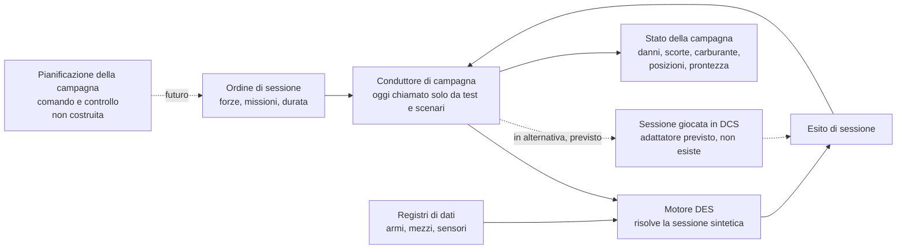
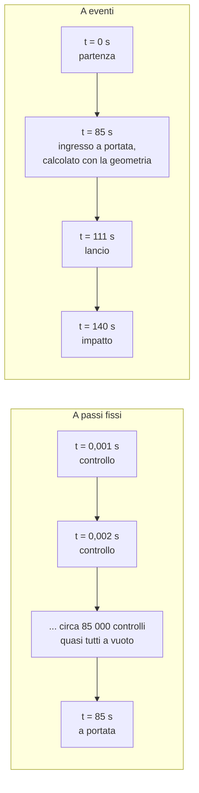
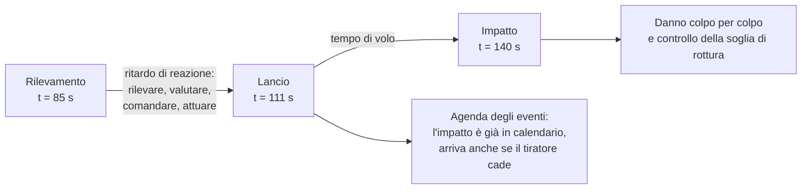
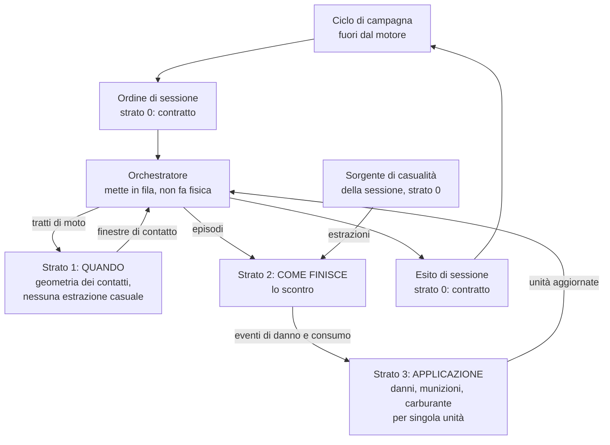
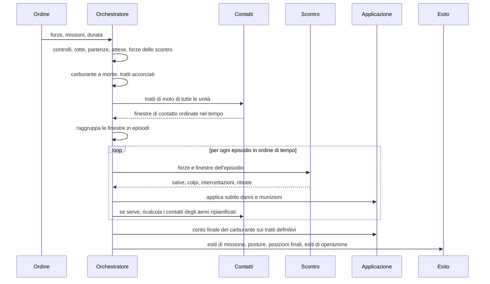
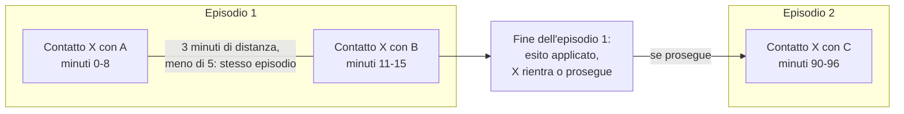
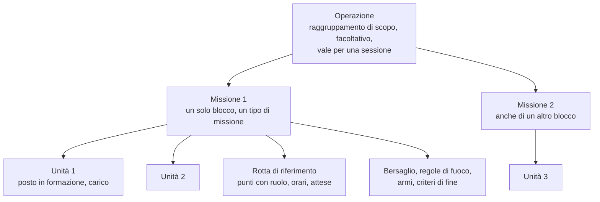
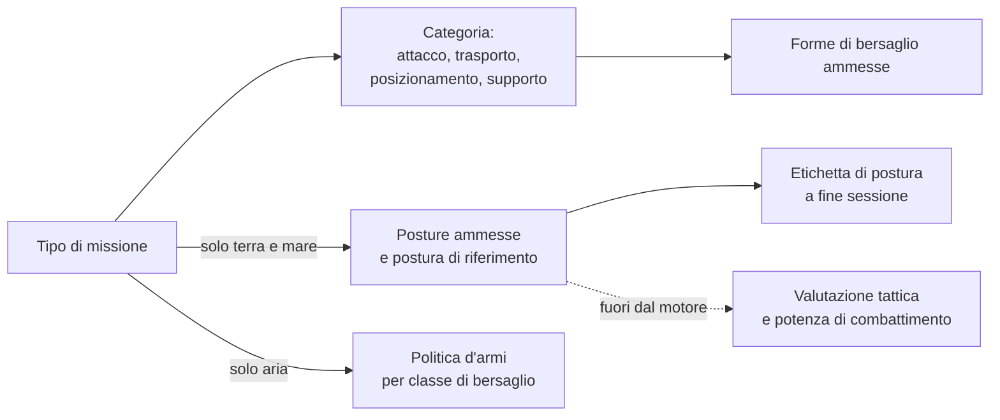
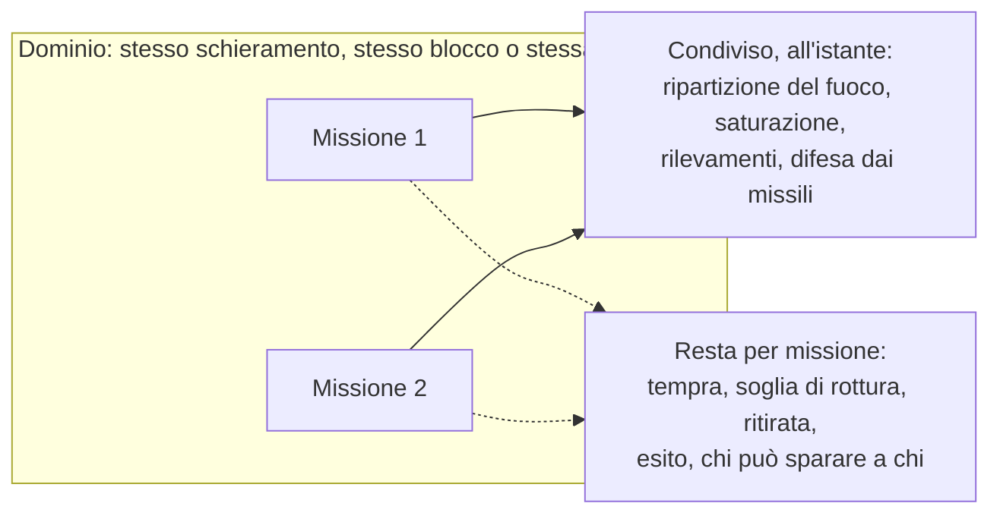
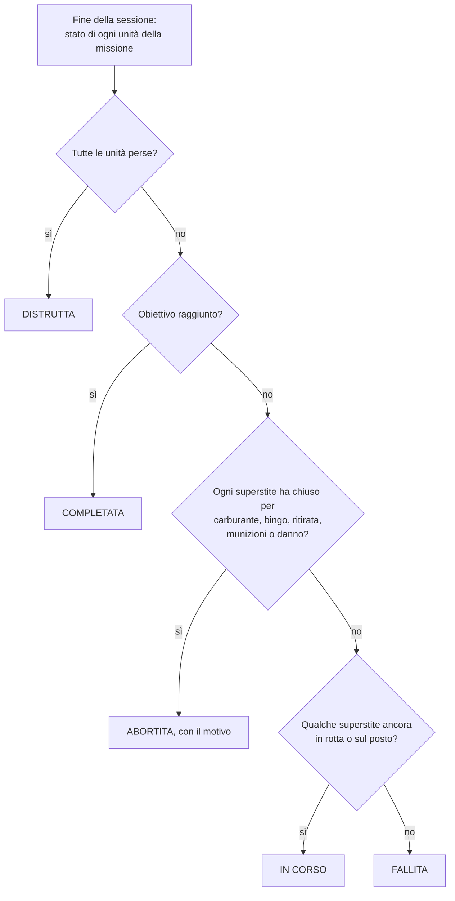

# Guida concettuale al motore DES — Parte A

*Intestazione, riassunto iniziale e sezioni 1-4. Bozza della fase B (stesura), da rivedere nella fase C (verifica).*

> **Data**: 2026-11-20.
> **Scritta sul repository al commit `3116813d`** (branch `analysis/dce-dcs-persistence`). L'ultimo commit che tocca il
> manuale è `78ebf15b`. Il manuale descrive il codice del motore a `a99bb3d4` e test e scenari a `ff84e2a4`; dopo di allora
> nel codice sono cambiati solo commenti e testi di documentazione (`34c4cefd` nel motore, `8fa92710` in un test) e un
> interruttore **nuovo, spento
> di default**, per una possibile ricalibrazione della probabilità di scoperta al bordo della portata (`598af98e`), che il
> manuale non descrive ancora. Con l'interruttore spento il comportamento è quello descritto qui (dichiarato dal commit; il
> confronto non è stato rieseguito per questa guida).
> **Il motore cambia spesso**: ciò che questa guida dice vale a questa data. Il file finale si chiamerà
> `Guida_Concettuale_DES.md`; questa parte A ne è la prima metà.

## Come leggere questa guida

**A chi è rivolta.** A un responsabile di progetto che non programma. Alla fine della lettura dovrebbe sapere: che cosa il
motore risponde e che cosa no; come è fatto, a grandi blocchi; perché è fatto così; quanto fidarsi dei suoi risultati e dove
stanno i numeri stimati; dove cercare il dettaglio nel manuale tecnico.

**Che cosa non c'è.** Nessun nome di file, funzione, classe o variabile del codice: la guida descrive le idee. Chi vuole
scendere di livello trova in ogni sezione il rimando al capitolo e al paragrafo del manuale (per esempio «Manuale cap. 6 §6.2»).
Le sigle che il progetto usa per le sue regole e le sue fasi di lavoro compaiono **solo** nella tabella di corrispondenza
della sezione 14, perché il manuale le usa come titoli. Le decisioni ancora aperte e le tarature da fare **non** sono in questa
guida: invecchiano in pochi giorni e stanno in un documento di stato separato.

**Come è fatta ogni sezione.** Un testo principale; poi tre riquadri fissi: **«Dalla letteratura»** (le idee prese da fonti
esterne, con la citazione), **«Scelta del progetto»** (ciò che il progetto ha deciso da sé), **«Limiti e incertezze»** (che
cosa il motore non fa o non sa, con l'etichetta di affidabilità), e infine **«Nel manuale»** (dove sta il dettaglio).

**Le formule.** Le poche formule del motore sono parte del testo, non un approfondimento facoltativo: ognuna è spiegata a
parole e accompagnata da un esempio con numeri. **Tutti i numeri degli esempi sono ILLUSTRATIVI**: servono a capire il
meccanismo, non sono dati del motore né dei registri.

**Le etichette di affidabilità**, usate in tutta la guida:

| Etichetta | Significato |
|---|---|
| **[V]** | verificato leggendo il codice: nel manuale (alla data indicata lì) oppure, dove scritto «[V, 2026-11-20]», dall'autore di questa guida |
| **[S]** | **stima**: un numero o una forma scelti come punto di partenza plausibile, non tarati su dati; il codice li dichiara come tali |
| **[D]** | **decisione dell'utente**: una scelta, non una stima, ma nemmeno un dato misurato |
| **[NV]** | **non verificato**: oppure un numero dichiarato da un rapporto e non rieseguito, oppure una misura di una prova temporanea non ripetibile dalla suite |

**Le citazioni.** «[B 1.2]» rimanda alla voce 1.2 della bibliografia verificata (sezione 16, oggi nel file
`Guida_Concettuale_DES_Bibliografia.md`). «Verificata» vuol dire che l'opera esiste con quei dati; **non** vuol dire che
qualcuno ne abbia letto il contenuto: dove la bibliografia lo dichiara, la guida lo ripete («contenuto non letto»). Dove la
bibliografia non copre un argomento c'è un segnaposto `[FONTE: ...]`: va letto come «affermazione del progetto, oggi senza una
fonte esterna verificata».

---

## Riassunto iniziale

*Questo riassunto copre tutta la guida, comprese le sezioni della parte B non ancora scritte; sarà rivisto a fine stesura.*

**Che cosa fa.** Una campagna di Warfare-Model procede per **sessioni** (turni di gioco). Alcune sessioni sono giocate da una
persona in DCS; le altre sono **sessioni virtuali**, da risolvere senza giocatore. Il **motore DES** (simulazione a eventi
discreti) calcola come va a finire una sessione virtuale, **unità per unità**: chi incontra chi, chi vede chi, chi spara, che
cosa colpisce, quanto carburante e quante munizioni restano, come finisce ogni missione. Riceve un **ordine di sessione**
(forze, missioni, durata) e restituisce un **esito di sessione**. Non sceglie le missioni, non pianifica la campagna, non
gestisce la logistica, non conosce il terreno e oggi non ha un chiamante «vero»: lo usano solo i test e gli scenari (sezione 1).

**Come lo fa.** Non fa avanzare un orologio a scatti: **salta da un fatto al successivo** (un incontro, un lancio, un impatto) e
calcola **con la geometria** l'istante in cui due unità si avvicinano abbastanza da interagire. Per questo ore di combattimento
costano un tempo di calcolo breve (sezione 2). È organizzato in **quattro strati**: il contratto (che cosa entra ed esce),
**quando** (i contatti), **come finisce** (lo scontro, l'unico punto con estrazioni casuali insieme al fuoco su posizione),
**applicazione** (danni e consumi su ogni singola unità); un **orchestratore** li mette in fila, raggruppa i contatti in
**episodi** e dopo ogni episodio può far rientrare gli aerei (sezione 3). Tutto parte dalle **missioni**: rotta, orari, attese,
bersaglio, regole di fuoco, armi consentite, criteri di fine; la missione è anche l'unità che combatte e si ritira (sezione 4).

**Le regole centrali.** Il rilevamento usa una **legge di probabilità di scoperta** che vale 1 a distanza zero, **0,5 al bordo
della portata** e cala con la quarta potenza della distanza; il valore 0,5 è una **stima**, giudicata alta dall'utente, e una sua
ricalibrazione è in valutazione. Una sola estrazione casuale decide **se e a che distanza** avviene la scoperta, una volta per
ogni passaggio del bersaglio nel volume del sensore; se il bersaglio vi resta meno del tempo di rivisita del sensore, la
probabilità si riduce in proporzione (sezione 5). Lo scontro è una catena: ritardo di reazione del sistema, scelta dell'arma dai
registri, **saturazione delle difese** (i colpi che arrivano insieme sono confrontati con la capacità di intercettazione, e il
surplus passa), danno **colpo per colpo**, **soglia di rottura** casuale che può far ritirare una forza intera (sezione 6). Il
carburante vincola il movimento e gli aerei rientrano al **bingo** secondo un albero di regole (sezione 7). Fra una sessione e
l'altra un ciclo di campagna, esterno al motore, applica riarmo, rifornimento e riparazione alla fine di tempi stimati e porta
avanti danni, scorte, carburante e posizioni; **il rilevamento non passa** da una sessione all'altra (sezione 8). Due
**pianificatori**, fuori dal motore, scelgono le rotte aeree rispetto ai volumi di scoperta e di intercettazione e il profilo
d'attacco con cui sganciare una bomba (sezione 9).

**Riproducibilità.** Tutte le estrazioni casuali vengono da una sorgente di sessione con un seme calcolato in modo identico su
ogni macchina: a parità di dati e di codice il motore produce **la stessa storia**. Una singola esecuzione resta però un
campione: per conoscere la variabilità servono **repliche** con semi diversi (sezione 10).

**Verifica, non validazione.** Il motore è controllato da alcune migliaia di test, da una batteria di scenari e da una
**fotografia di non regressione** che registra l'esito di **1219 esecuzioni** (installata il 2026-11-19; prima erano 1103): ogni
modifica che ne cambia una è vista e spiegata. Questo prova che il motore fa ciò che il progetto dice (**verifica**). **Non**
prova che i suoi numeri corrispondano alla realtà: **nessuna validazione su dati reali o storici è stata fatta** (sezione 11).

**Quanto fidarsi.** La **struttura** (eventi, geometria, catena dello scontro, riproducibilità) è verificata sul codice; i
**numeri** che la alimentano sono in buona parte **stime dichiarate** (probabilità al bordo della portata, soglia di rottura,
scomposizione dei tempi di reazione, tempi di rivisita dei sensori, consumi d'emergenza, tempi di riparazione, ...) o dati di
registro di qualità variabile. Il motore oggi serve a **confronti relativi fra alternative, con repliche**, non a previsioni
assolute (sezione 12). Prende dalla letteratura **meccanismi** (eventi discreti, saturazione per salva, dipendenza del segnale
radar dalla distanza, teoria della ricerca) e **non** coefficienti di logoramento aggregato: **non è un modello alla Lanchester**
(sezione 13).

**Il rapporto con DCS** (formulazione proposta, da confermare): il contratto di ingresso e di uscita è lo stesso per una sessione
sintetica e per una giocata in DCS; il DES risolve solo le sintetiche; oggi non esistono un adattatore DCS né un chiamante di
produzione del ciclo di campagna.

---

## 1. A che cosa serve e a che cosa NON serve il motore

### 1.1 Il problema

Una campagna di Warfare-Model è una successione di **sessioni**: intervalli di tempo di gioco (di default due ore, al massimo
quattro, per decisione dell'utente [D]) in cui le forze dei due schieramenti eseguono le loro missioni. Alcune sessioni sono
**giocate**: una persona vola in DCS e il simulatore produce l'esito. Molte altre non hanno un giocatore e vanno comunque
risolte, perché la campagna deve andare avanti: sono le **sessioni virtuali** (o sintetiche). Il motore DES esiste per queste.
Il progetto gli chiede di coprire ore di tempo di gioco in un tempo di calcolo «fino a minuti» per sessione, un vincolo
dichiarato dall'utente e **non misurato** sul caso grande [NV].

### 1.2 Che cosa entra e che cosa esce

Il motore riceve un **ordine di sessione** e restituisce un **esito di sessione**. Sono le due «porte» del motore, e tutto ciò
che passa per esse è espresso in **termini di dominio**: identificativi del progetto, secondi dall'inizio della sessione, metri,
frazioni, mai concetti di un simulatore [V].

L'ordine di sessione contiene:

- un **identificativo della sessione**, che è anche la radice di tutta la casualità della sessione (sezione 10);
- l'**inizio** e la **fine** della sessione;
- le **forze** coinvolte (i blocchi del progetto: una squadriglia, un reparto corazzato, una batteria, un gruppo navale) ed
  eventualmente quali unità di un blocco sono davvero impegnate;
- una **finestra di raggruppamento delle salve** (quanti secondi separano due impatti perché contino come la stessa salva; di
  default zero);
- le **missioni** e le **operazioni** (sezione 4): sono **l'unica via** con cui un'unità riceve una rotta, una partenza e una
  velocità. Un'unità senza missione resta ferma, in una postura di attesa [V].

L'esito di sessione contiene, per ogni scontro e per ogni unità, che cosa è successo: gli esiti delle forze in ogni scontro
(tenuta, ritirata, distruzione), gli **eventi di danno** colpo per colpo, gli **eventi di munizioni** (colpi offensivi) e di
**intercettazione** (colpi difensivi), gli **eventi di carburante**, l'**esito di ogni missione**, la **postura** di ogni unità a
fine sessione, l'**esito di ogni operazione**, la **posizione finale** e l'istante in cui ogni unità in missione ha smesso di
muoversi [V].

Un punto da sapere: il motore **non** è un calcolatore «a parte». Le unità che riceve sono gli oggetti del modello della
campagna, e il motore **applica davvero** a esse danni, consumi di munizioni e carburante; l'esito è il resoconto di ciò che è stato applicato
[V]. Le posizioni finali e la prontezza, invece, le applica il ciclo di campagna (sezione 8).

### 1.3 Indifferente al simulatore

Il nucleo del progetto deve restare **indifferente al simulatore**: la verifica dichiarata è che, togliendo l'adattatore verso
DCS, la campagna deve continuare a girare con sole sessioni sintetiche. Per il motore questo significa che le porte trasportano
solo valori di dominio e che nessun pezzo del motore dipende da file o concetti di DCS [V].

**Rapporto con le sessioni giocate** (*formulazione proposta, da confermare dall'utente*): il contratto di ingresso e di uscita
è lo stesso per una sessione sintetica e per una giocata in DCS; il DES risolve solo le sintetiche; oggi non esistono un
adattatore DCS né un chiamante di produzione del ciclo di campagna. Il codice lo dice in due punti: le porte sono quelle a cui
deve conformarsi «qualunque esecutore di sessione: il risolutore sintetico oggi, un adattatore DCS domani», e un adattatore
DCS «sostituirebbe il solo passo» di esecuzione nel ciclo di campagna [V, 2026-11-20]. Che cosa farebbe l'adattatore, nel
dettaglio, non è scritto da nessuna parte: è un'intenzione di progetto.

### 1.4 Che cosa il motore NON fa

- **Non decide le missioni** né quando lanciarle: è il compito del livello di comando e controllo della campagna, che **non è
  stato costruito** [V].
- **Non controlla l'ordine** che riceve: la verifica (durata della sessione, unità pronte, missioni dentro la sessione,
  carburante sufficiente) è di un validatore del ciclo di campagna, fuori dal motore. Chi chiama il motore direttamente può
  fargli eseguire anche un ordine che il validatore rifiuterebbe [V].
- **Non rifornisce né ripara** durante la sessione; riarmo, rifornimento e riparazione avvengono fra le sessioni (sezione 8), e
  **non consumano risorse delle basi**: la logistica non è modellata, per decisione dell'utente [D].
- **Non conosce il terreno**: niente mappe, valli o rilievi; nel motore non c'è nemmeno l'**orizzonte radar** (la curvatura
  terrestre), che c'è invece nel pianificatore di rotta (sezione 9) [V].
- **Non inventa movimenti**: le unità si muovono solo lungo le rotte delle loro missioni; le uniche deviazioni sono i rientri
  degli aerei decisi dalle regole sul carburante e dopo una ritirata (sezioni 3 e 7) [V].
- **Non ha giocatori** né componenti di intelligenza artificiale generativa [V].
- **Non disegna**: produce numeri ed eventi, non immagini. Non è un simulatore 3D e non sostituisce DCS.
- **Non è un modello alla Lanchester**: non usa equazioni di logoramento di forze aggregate; i colpi sono singoli e le perdite
  sono per unità (sezioni 6 e 13). Il modello aggregato «a rapporto di forze» che il progetto aveva prima esiste ancora, ma il
  motore non lo chiama: il manuale lo dichiara un ripiego, mai il risolutore principale [V, 2026-11-20: nessun pezzo del motore
  lo invoca].

### 1.5 Chi lo usa oggi

**Solo i test e gli scenari** [V, 2026-11-20]. Il motore è chiamato da un **conduttore di campagna** minimo (sezione 8), e il
conduttore è chiamato soltanto dai test e da uno scenario di campagna; nessun altro modulo del progetto lo usa. È quindi un
motore **completo nei suoi meccanismi** ma **non ancora inserito** in una catena di produzione.

*Diagramma G1 — Il motore nel suo contesto. Deriva dai diagrammi tecnici D57 (contesto del nucleo, livello L0) e D1 (blocco del
ciclo di campagna). Le frecce tratteggiate sono parti previste ma non esistenti.*

> **Dalla letteratura.** La letteratura di analisi della difesa distingue i modelli per **livello di aggregazione** (dal
> singolo ingaggio fino al teatro) e discute come collegare modelli a risoluzioni diverse: per un'introduzione, Davis
> [B 7.1] e [B 7.2]; per un modello di campagna costruito a eventi, Hillestad e Moore [B 7.5] (pagina RAND letta per titolo e
> sintesi). La classificazione «ingaggio, missione, campagna, teatro» come scala standard: `[FONTE: classificazione dei modelli
> di difesa per livello]`. In questa scala il motore sta fra **ingaggio** e **missione**, dentro un ciclo di **campagna**. Sugli
> scopi della simulazione militare e sulla differenza fra gioco e analisi: Perla [B 3.2] e Sabin [B 3.1]; sull'uso della
> simulazione per **capire** più che per **predire**, e sulla semplicità deliberata dei modelli: Sabin [B 3.1] (opere
> verificate; il giudizio di pertinenza della bibliografia si basa su schede e sommari, non sulla lettura). Su quando un modello di combattimento **non può** essere validato per la previsione: Hodges e Dewar
> [B 6.4] (sintesi della pagina RAND).
>
> **Scelta del progetto.** Un motore a sé per le sessioni virtuali, con un contratto di ingresso e di uscita fisso e
> indifferente al simulatore; perdite per singola unità; nessun legame con un modello aggregato [D, vincoli dell'utente].
>
> **Limiti e incertezze.** Nessun chiamante di produzione del ciclo di campagna [V]; nessun adattatore DCS [V]; il tempo di
> calcolo «fino a minuti» non è misurato, e lo scenario di scala del progetto verifica solo che una sessione con 40 blocchi e
> 240 unità finisca entro un limite di tempo [NV per il caso grande]; il limite di 10.000 unità è un **tetto teorico** dichiarato
> dall'utente, non un caso provato [D]. **Uso dei risultati**: oggi il motore serve a **confronti relativi** fra alternative,
> con **repliche** su semi diversi; **non** c'è validazione su dati reali o storici (sezioni 11-12).
>
> **Nel manuale.** Cap. 1 §1.1-§1.4; cap. 6 §6.1 e §6.7 («Cosa non fa»); cap. 10 §10.3 (diagramma D57); cap. 9 §9.1 «Limiti
> della campagna»; cap. 8 §8.3 (indifferenza al simulatore come test di contratto).

---

## 2. L'idea di base: simulare per eventi, non per passi di tempo

### 2.1 Due modi di far avanzare il tempo

Ci sono due modi di far procedere una simulazione nel tempo.

- **A passi fissi** («tick»): un **cronometro** avanza di un intervallo costante (un secondo, un millisecondo) e a ogni scatto si
  aggiorna tutto: posizioni, sensori, armi. Se in quell'intervallo non succede niente, il lavoro è stato fatto lo stesso.
- **A eventi discreti** (DES): un'**agenda** elenca in ordine di tempo i fatti che cambieranno lo stato (un lancio fra 26
  secondi, un impatto fra 55, la fine di un movimento fra 40 minuti). Il simulatore prende il fatto più vicino, **salta**
  direttamente a quell'istante, lo esegue, aggiunge all'agenda i fatti che ne derivano e ricomincia. **Fra due eventi non si
  calcola nulla.**

Il motore è del secondo tipo, **in secondi assoluti dall'inizio della sessione, senza alcun passo di tempo globale** [V]. Le
agende sono due: una per la sessione intera (gli scontri, i fuochi su posizione, le fini dei movimenti) e una dentro ogni
scontro (lanci, impatti, decisioni). Il «micro-passo fine dentro uno scontro» di cui parlava una prima stesura del manuale **non
esiste** nel codice [V].

### 2.2 Perché non i passi fissi

La prima proposta del progetto era a passi fissi di circa un millesimo di secondo, dimensionati sul missile più veloce
(un missile ipersonico a Mach 27 percorre 10 metri in circa 1,08 ms). Il conto, fatto nel documento di analisi del progetto, è
questo: due ore di sessione con il tetto teorico di 10.000 unità fanno circa **6,7·10¹⁰ aggiornamenti**; anche al costo di un
ciclo vuoto del linguaggio usato servirebbero **più di tre ore**, e al costo misurato di un motore ad agenti paragonabile
**circa 74 giorni**; con un controllo delle distanze fra tutte le unità a ogni passo si arriverebbe ad **anni**. L'aritmetica è
stata ricontrollata nel manuale [V]; i costi unitari sono misure citate dal documento di analisi, **non misurate su questo
progetto** [NV].

### 2.3 Perché non la sola probabilità

La seconda proposta risolveva l'esito di uno scontro direttamente con la probabilità, senza simulare il tempo. La direzione era
giusta ma mancava un pezzo: **non diceva se e quando due forze si incontrano**. Il motore colma questo buco con la geometria,
non con un cronometro [V].

### 2.4 Quando due unità si incontrano: la geometria dei contatti

Ogni rotta è una **spezzata**: una serie di tratti rettilinei, ciascuno percorso a velocità costante. Su un tratto in cui
entrambe le unità vanno dritte a velocità costante, l'istante in cui sono **più vicine** (il «punto di massimo
avvicinamento») si ricava con una formula, senza provare istante per istante:

> **t\* = − (Δr · Δv) / |Δv|²**
>
> dove **Δr** è la posizione della seconda unità vista dalla prima all'inizio del tratto, **Δv** è la velocità della seconda
> rispetto alla prima, «·» è il prodotto scalare (quanto due direzioni vanno nello stesso verso) e |Δv|² il quadrato della
> velocità relativa. A parole: *quanto tempo serve perché lo spostamento relativo annulli la distanza lungo la direzione in cui
> ci si avvicina*.

Per sapere non solo quanto ci si avvicina ma **da quando a quando** si è a portata, il motore risolve l'equazione «distanza al
tempo s = portata R», cioè |Δr + Δv·s|² = R²: un'equazione di secondo grado che dà l'istante di **ingresso** e quello di
**uscita**. Il calcolo si ripete su ogni pezzo di tempo in cui le due velocità restano costanti, e i risultati si uniscono [V].

**Esempio ILLUSTRATIVO.** Un aereo A parte dall'origine verso est a 250 m/s; un aereo B parte 60 km a est e 10 km a nord e
vola verso ovest a 250 m/s. Allora Δr = (60 000; 10 000) m e Δv = (−500; 0) m/s. Il prodotto Δr·Δv vale −30 000 000 e |Δv|²
vale 250 000: **t\* = 120 s**, e in quel momento la distanza è di **10 km** (la sola separazione nord-sud). Se il sensore di A
ha una portata di 20 km, l'equazione (60 000 − 500·s)² + 10 000² = 20 000² dà s ≈ **85 s** e s ≈ **155 s**: B è a portata per
circa 69 secondi. Tre numeri risolvono una domanda che a passi di un millisecondo avrebbe chiesto 155 000 controlli.

### 2.5 Ciò che resta dei passi fissi: i ritardi di reazione

Della proposta a passi fissi il motore conserva un'idea: la reazione di un sistema d'arma si scompone in **quattro fasi** —
rilevare, valutare, comandare, attuare — come nel ciclo decisionale che in letteratura si chiama OODA. Nel motore queste fasi
**non contano scatti**: sommate, danno un **ritardo** che programma un evento futuro («questo sistema lancerà fra 26 secondi»)
[V]. È ciò che decide **chi spara per primo**, cioè l'iniziativa. I **totali** «dal rilevamento al lancio» provengono da fonti
tecniche citate dal documento di analisi; la **scomposizione** nelle quattro fasi è una stima [S] (dettaglio nella sezione 6).

Anche il **rilevamento** segue la stessa logica: **una sola estrazione casuale** stabilisce a quale distanza il sensore scoprirà
il bersaglio, e da quella distanza la geometria ricava l'istante, senza campionare la finestra nel tempo [V] (sezione 5).

### 2.6 L'ordine degli eventi simultanei

Quando due eventi cadono nello stesso istante, l'ordine non è lasciato al caso né all'ordine in cui il programma li ha
incontrati: a parità di tempo vengono prima gli **scontri**, poi i **fuochi su posizione**, poi le **fini di movimento**, e a
parità di tipo decide un identificativo stabile [V]. Questo ordine **fa parte del contratto** di riproducibilità (sezione 10):
cambiarlo cambierebbe le storie.

*Diagramma G2 — Passi fissi contro eventi (numeri ILLUSTRATIVI, dall'esempio di §2.4). Nessun diagramma tecnico corrispondente.*

*Diagramma G3 — Dal ritardo di reazione all'evento futuro (numeri ILLUSTRATIVI). Deriva da D5 (sequenza della coda degli eventi
dentro uno scontro).*

> **Dalla letteratura.** L'avanzamento «al prossimo evento» con una lista ordinata di eventi futuri è il fondamento della
> simulazione a eventi discreti nei manuali di riferimento: Banks e altri [B 1.2], Law [B 1.3]; per un lettore non tecnico,
> Robinson [B 1.1]; per una trattazione formale, Zeigler e altri [B 1.4] (opere verificate; il capitolo specifico sul
> confronto con il passo fisso non è stato controllato). Sull'effetto del meccanismo di avanzamento del tempo nelle
> simulazioni di combattimento: Al Rowaei, Buss e Lieberman [B 1.5] (citazione verificata, **contenuto non letto**). Il ciclo
> decisionale in quattro fasi e i tempi di reazione dei sistemi d'arma: `[FONTE: ciclo OODA e tempi di reazione]`. Il calcolo
> del punto di massimo avvicinamento fra mobili: `[FONTE: cinematica del moto relativo / anticollisione]`. L'affermazione,
> ripresa dal documento di analisi, che i simulatori militari a livello di singola entità siano a eventi e quelli a passo fisso
> siano aggregati: `[FONTE: documentazione dei simulatori militari]` — **nessuna fonte primaria trovata** dalla bibliografia.
>
> **Scelta del progetto.** Simulazione a eventi in secondi assoluti, contatti calcolati con la geometria, ritardi di reazione
> come parametri per tipo di sistema, ordine fisso degli eventi simultanei [V].
>
> **Limiti e incertezze.** Il moto è **rettilineo a velocità costante a tratti**: qualunque manovra fuori dalla rotta assegnata
> non esiste [V]. «Calcolato in modo analitico» significa esatto **rispetto a questo modello di moto**, non esatto rispetto alla
> realtà. Il risparmio di calcolo non è misurato sul caso grande [NV]. La scomposizione dei ritardi in quattro fasi è una stima
> [S]. La ricerca del «micro-passo» nel codice è stata fatta per parole chiave, non rileggendo ogni ciclo del risolutore [V per
> la struttura a eventi, NV per una lettura completa].
>
> **Nel manuale.** Cap. 1 §1.1 (il problema e la scelta, con i numeri), §1.5; cap. 3 §3.1-§3.2 (i tre meccanismi geometrici);
> cap. 6 §6.2 (coda degli eventi di sessione); cap. 7 §7.3 (tempi di reazione e loro statuto).

---

## 3. Come è fatto: i quattro strati e il percorso di una sessione

### 3.1 Quattro domande, quattro strati

Il motore è diviso in **quattro strati**, ciascuno responsabile di una sola domanda [V]:

| Strato | Domanda | Come risponde |
|---|---|---|
| **0 — Contratto** | Che cosa entra e che cosa esce? | Ordine ed esito di sessione con soli valori di dominio, più la **sorgente di casualità** della sessione |
| **1 — Contatti** | **Quando** due unità possono interagire? | Solo geometria: rotte, volumi, punto di massimo avvicinamento. **Nessuna estrazione casuale** |
| **2 — Scontro** | **Come finisce** un incontro? | Rilevamento, ritardo di reazione, scelta dell'arma, salve e saturazione delle difese, danno per colpo, ritirata. È **il punto delle estrazioni casuali** (con il fuoco su posizione, un caso a parte) |
| **3 — Applicazione** | Che cosa resta di ogni unità? | Danni, munizioni e carburante applicati a **ogni singola unità**, mai «la forza ha perso il 20%» |

La separazione ha uno scopo pratico: lo strato 1 si può controllare con la sola trigonometria, lo strato 2 ha bisogno della
casualità; tenerli distinti permette di verificare ciascuno con gli strumenti adatti [V].

### 3.2 L'orchestratore

Sopra gli strati c'è un **orchestratore**: il coordinatore della sessione. **Non fa calcoli di fisica o di combattimento
propri** — ogni numero viene da uno degli strati — ma decide **quando** chiamarli e **con quali dati** [V]. Non è un comandante:
non prende decisioni tattiche, applica regole. Le sue funzioni principali:

- ricavare dalle missioni rotta, partenza, velocità, attese e presenza di ogni unità (sezione 4);
- costruire le **forze dello scontro** (una per missione) e i gruppi di missioni che collaborano (sezione 4);
- raggruppare i contatti in **episodi** e risolverli in ordine di tempo;
- dopo ogni episodio, **ripianificare gli aerei** che devono rientrare e ricalcolarne i contatti;
- alla fine, fare il **conto del carburante** e compilare l'esito.

### 3.3 Il percorso di una sessione

Una sessione percorre questi passi, nell'ordine [V]:

1. **Lettura e controllo delle missioni**: ogni missione appartiene a un blocco presente, le sue unità sono di quel blocco, nessun
   tratto supera la velocità massima del mezzo più lento, il carico dichiarato di ogni aereo è quello che l'aereo ha davvero.
   Un errore qui ferma la sessione.
2. **Movimenti**: per ogni unità la rotta (quella della missione più la posizione in formazione), l'istante di partenza, la
   velocità, le attese, la presenza prima della partenza e dopo l'arrivo.
3. **Forze dello scontro**: una per missione; le unità di un blocco senza missione formano una forza «residua» con l'identità
   del blocco. Si stabiliscono i **domini di coordinamento** e il programma degli aerei che stanno a terra.
4. **Carburante a monte**: per ogni aereo si calcolano in anticipo l'eventuale rientro al bingo già alla partenza e
   l'eventuale esaurimento, e si accorciano i tratti di conseguenza (sezione 7).
5. **Contatti**: lo strato 1 calcola le **finestre di contatto** fra le coppie di unità nemiche.
6. **Episodi**: le finestre sono raggruppate in episodi e risolti in ordine di tempo dallo strato 2. **Subito dopo ciascuno**
   l'esito è applicato alle unità, gli aerei interessati sono ripianificati e i loro contatti ricalcolati. I **fuochi su
   posizione** (artiglieria o navi che sparano su una posizione stimata, sezione 6) sono risolti fra un episodio e l'altro,
   all'istante del loro impatto.
7. **Conto del carburante**: alla fine, sui tratti ormai definitivi.
8. **Esiti**: esito di ogni missione, postura di ogni unità, posizioni finali, esiti delle operazioni; tutto confluisce
   nell'esito di sessione.

Il carburante si può contare alla fine perché **lo scontro non lo legge** (il risolutore non guarda il serbatoio) e il calcolo
del carburante non legge danni né munizioni [V]. Deve essere contato alla fine, perché solo dopo l'ultimo episodio si conoscono
i tratti definitivi di ogni aereo.

### 3.4 Tre tipi di evento di sessione

L'agenda della sessione contiene tre tipi di evento [V]:

| Evento | Quanti | Quando | Che cosa fa |
|---|---|---|---|
| **Scontro** | uno per episodio | all'inizio della prima finestra dell'episodio | una risoluzione dello strato 2, applicata subito |
| **Fuoco su posizione** | uno per ordine di tiro di una missione terrestre o navale | all'istante d'impatto | colpi su una posizione stimata, applicati subito; **non** è uno scontro |
| **Fine di movimento** | uno per unità in movimento | alla fine del suo movimento nella sessione | produce e applica i consumi di carburante, tratto per tratto |

### 3.5 Gli episodi

Un **episodio** è un gruppo di finestre di contatto risolte insieme perché legate fra loro: appartengono a coppie di forze che
**condividono una forza** (o forze dello stesso dominio di coordinamento) **e** si sovrappongono nel tempo o distano **al più 5
minuti** [V]. I cinque minuti non sono un numero a sé: sono lo stesso tempo che il modello del carburante attribuisce a un
disimpegno, e ritrovare il contatto entro quel tempo è considerato lo stesso combattimento [S/D: valore deciso dall'utente,
non tarato].

**Esempio ILLUSTRATIVO.** Un aereo X incontra la forza A dal minuto 0 all'8, la forza B dal minuto 11 al 15, la forza C dal
minuto 90 al 96. I primi due contatti distano 3 minuti e condividono X: sono **un episodio**. Il terzo è lontano: è un **secondo
episodio**. Fra i due, l'orchestratore applica l'esito del primo e decide se X deve rientrare (per carburante o perché la sua
missione si è ritirata). Se rientra, i suoi contatti sono ricalcolati e l'incontro con C può non avvenire più.

Tre regole accompagnano gli episodi [V]:

- **Applicazione immediata**: danni e munizioni di un episodio sono applicati prima di risolvere il successivo, così ogni episodio
  parte dallo stato già consumato.
- **Forza occupata**: una forza è impegnata dal primo istante del suo episodio fino alla fine del suo esito (salve in volo
  comprese); un suo contatto che comincerebbe prima è spostato in avanti.
- **Ripianificazione solo per gli aerei**: le forze terrestri e navali che si ritirano **restano sulla loro rotta**, passive (non
  sparano più ma possono essere colpite). La decisione di ripianificare si prende **alla fine** dell'episodio, non durante.

### 3.6 Lo stato ombra

Durante uno scontro lo strato 2 **non tocca le unità reali**: lavora su una **copia di lavoro** della loro salute e delle loro
scorte (lo «stato ombra») e restituisce un elenco di eventi; l'applicazione alle unità reali è un passo separato, fatto
dall'orchestratore subito dopo [V]. Lo stato ombra non è una seconda verità: è la bozza che diventa reale alla fine
dell'episodio. Una conseguenza visibile: una salva **già partita** arriva comunque, anche se il tiratore viene distrutto subito
dopo il lancio (il carico «congelato») [V].

### 3.7 Come il motore regge molte unità: la potatura per blocchi

Calcolare il punto di massimo avvicinamento per **tutte** le coppie di unità crescerebbe con il quadrato del loro numero. Per
questo lo strato 1, prima di guardare le coppie di unità, scarta le coppie di **blocchi** che non possono in nessun caso
incontrarsi nella sessione [V]:

> due blocchi si scartano se la loro distanza supera **(v_max,A + v_max,B) × durata + portata_A + portata_B** (più un margine
> facoltativo).
>
> A parole: *anche se i due blocchi corressero l'uno verso l'altro alla massima velocità per tutta la sessione, e ciascuno
> vedesse fino alla sua portata massima, non arriverebbero a toccarsi*.

**Esempio ILLUSTRATIVO.** Due blocchi corazzati con velocità massima di 20 m/s e sensori da 10 km, sessione di due ore:
(20 + 20) × 7 200 s + 10 km + 10 km = 288 km + 20 km = **308 km**. Se distano più di 308 km, nessuna loro coppia di unità viene
esaminata.

Il criterio è **prudente per costruzione** nel senso che preferisce esaminare coppie inutili piuttosto che perderne una
possibile: un blocco di cui non si conosce la posizione **non** è mai scartato, e per i mezzi terrestri si usa anche la velocità
fuori strada [V]. Il guadagno reale di questa potatura su scala grande **non è misurato** [NV].

### 3.8 I vincoli che il progetto non negozia

L'utente ha fissato quattro vincoli, che si ritrovano nel codice come regole [V, salvo dove detto]:

1. **10.000 unità come tetto teorico**, non come caso tipico [D]; la potatura per blocchi esiste per renderlo trattabile.
2. **Riproducibilità dal seme**, con l'**ordine degli eventi** come parte del contratto (sezione 10).
3. **Perdite e danni per singola unità**, mai aggregati.
4. **Tempo di calcolo fino a minuti per sessione**: dichiarato, **non misurato** [NV].

### 3.9 Il ciclo di campagna non è un quinto strato

Attorno al motore c'è un **ciclo di campagna**: un validatore che controlla l'ordine, un calcolo della **prontezza** delle unità
(quando tornano disponibili dopo riarmo e riparazione), un conduttore che esegue una sessione alla volta e ne applica le
posizioni finali. Questo ciclo **chiama** il motore, ma il motore **non lo conosce**: non è un quinto strato [V]. È descritto
nella sezione 8.

*Diagramma G4 — I quattro strati (solo frecce di dati). Deriva da D1 (architettura; D1 mescola frecce di dati e di dipendenza: qui
solo dati) e da D127 (mappa dei dati di una sessione).*

*Diagramma G5 — Il percorso di una sessione. Deriva da D8 (flusso dei dati), D9 (coda degli eventi), D40 (episodio e
ripianificazione) e D64-D66 (sequenza completa, livello L3).*

*Diagramma G6 — Episodi (tempi ILLUSTRATIVI, dall'esempio di §3.5). Deriva da D40.*

> **Dalla letteratura.** L'idea di separare livelli di dettaglio diversi e di collegarli in modo controllato è il tema della
> modellazione a risoluzione variabile e multi-risoluzione: Davis [B 7.1], [B 7.2], Davis e Hillestad [B 7.3] (verificati;
> per [B 7.1] e [B 7.2] letta la sintesi RAND). Un manuale sui principi di ingegneria dei modelli di combattimento e della
> simulazione distribuita: Tolk [B 7.8] (**contenuto non letto**). Architetture a strati che separano la pianificazione dei
> contatti dalla risoluzione dello scontro nei simulatori militari: `[FONTE: architetture dei simulatori a livello di entità]`.
>
> **Scelta del progetto.** Quattro strati con una domanda ciascuno; orchestratore senza fisica propria; episodi legati dal
> tempo di disimpegno; applicazione immediata dopo ogni episodio; ripianificazione dei soli aerei; carburante contato alla fine
> [V; il legame episodio-disimpegno è una decisione dell'utente].
>
> **Limiti e incertezze.** Ripianificazione **solo degli aerei**: le forze terrestri e navali che si ritirano restano passive
> sulla rotta [V]. Decisione di rientro **alla fine** dell'episodio, non a metà [V]. Forza «occupata» per forza intera, non per
> singola unità [V]. Guadagno della potatura per blocchi non misurato [NV]. I 5 minuti che legano un episodio sono una stima
> legata per costruzione al tempo di disimpegno [S/D]. Una precisazione sulla casualità: oltre allo strato 2 estrae numeri
> casuali anche il **fuoco su posizione**, con una sua sorgente separata [V]; lo strato 1 non ne estrae mai.
>
> **Nel manuale.** Cap. 1 §1.2-§1.3 (diagramma D1); cap. 2 §2.1-§2.4 (le porte); cap. 3 §3.1-§3.2 (potatura per blocchi);
> cap. 4 §4.8-§4.10 (scontri a più forze, carico congelato, stato ombra); cap. 6 §6.1-§6.3, §6.8-§6.9 (diagrammi D8, D9),
> §6.20 (episodi e ripianificazione, D40); cap. 10 §10.4-§10.6 (D64-D66), atlante 10C §10C.9 (D127).

---

## 4. Che cosa entra: missioni, operazioni, regole d'ingaggio

### 4.1 Operazione, missione, unità

La missione è l'**ordine** che il motore esegue. Le parole del progetto sono tre [V]:

- **Missione**: le azioni (attacco, trasporto, posizionamento, supporto) svolte da unità di **un solo blocco**, con un bersaglio
  (o nessuno), una rotta di riferimento e delle direttive. Un blocco può avere **più missioni** nella stessa sessione; un'unità
  sta in **al più una** missione per sessione.
- **Operazione**: un raggruppamento **facoltativo** di missioni, anche di blocchi diversi, per uno stesso scopo, con una
  **regola d'esito** (riuscita se riescono tutte, se ne riesce almeno una, o se riesce la missione principale). Un'operazione
  **vale per una sessione**: non è un'operazione militare su più giorni; gli ordini «permanenti» su più sessioni sarebbero del
  livello di comando e controllo, che non esiste [V].
- **Unità** (nel manuale: *asset*): un aereo, un mezzo, una nave, un sito.

### 4.2 Che cosa c'è in una missione

Una missione dichiara [V]:

- il **dominio** (aria, terra, mare) e il **tipo di missione** (per esempio, in aria: caccia, intercettazione, supporto ravvicinato,
  attacco, soppressione delle difese, pattugliamento, scorta, ricognizione, rifornimento in volo; a terra: attacco, difesa,
  movimento, fuoco di supporto, rifornimento; in mare: attacco, pattugliamento, scorta, bombardamento costiero, trasporto);
- le **unità**, ciascuna con il proprio **posto nella formazione** (avanti, a destra, in alto rispetto alla direzione di marcia) e,
  per gli aerei, il proprio **carico** d'armi;
- il **bersaglio**, con una **forma** (un'unità, un gruppo, un punto, un'area, una zona, nessuno) e una **provenienza**:
  *osservato* (si sa quale unità è) oppure *stimato* (si conosce una posizione con un'incertezza);
- la **rotta di riferimento** e i suoi **punti**, ciascuno con un ruolo (partenza, navigazione, punto iniziale d'attacco, attacco,
  uscita, atterraggio, stazione, attesa, ...), eventuali **orari bloccati** e **azioni** (per esempio un'attesa);
- gli **orari**: partenza, oppure **orario sul bersaglio** (TOT), oppure un orario bloccato su un punto: almeno uno deve esserci;
- le **regole**: regole di fuoco, stato di allerta, reazione alla minaccia, emissioni radio e radar, formazione;
- i **criteri di fine**: ultimo punto raggiunto, durata massima, carburante di rientro (bingo), munizioni finite, soglia di danno,
  bersaglio distrutto, rinuncia davanti a una minaccia.

Una missione aerea che non parte già in volo deve cominciare con un punto di partenza e finire con un atterraggio [V].

### 4.3 Che cosa il motore ricava da una missione

- **La rotta di ogni unità** è la rotta di riferimento spostata del posto in formazione. Alle virate la formazione **ruota con la
  rotta**: lo spostamento laterale si applica lungo la bisettrice dell'angolo, così che i tratti di ogni unità restino paralleli a
  quelli di riferimento; per virate molto strette il fattore di correzione è limitato a 2 [S: limite di progetto] [V].
- **Una missione si muove insieme, alla velocità del mezzo più lento.** Se un tratto pianificato supera la velocità massima del
  mezzo più lento della missione, la sessione è rifiutata. Chi vuole velocità diverse fa missioni diverse, eventualmente
  riunite in un'operazione [D, verificato nel codice].
- **La partenza** si ricava, in ordine di precedenza, dall'orario di partenza, dal primo orario bloccato su un punto, o
  dall'**orario sul bersaglio**, contando all'indietro la percorrenza e le attese. **L'orario sul bersaglio è di ogni missione**,
  non comune all'operazione: due missioni coordinate dichiarano ciascuna il proprio (per esempio una spazzata di caccia che
  precede di qualche minuto i bombardieri) [D].
- **Le attese** (tenere la posizione o orbitare in un punto, per una durata o fino a un orario) sono tratti **fermi** nel punto,
  uguali per tutta la formazione. L'**orbita** non ha un circuito: l'aereo è considerato fermo nel punto, con un errore di
  posizione pari al raggio del circuito reale [V, approssimazione dichiarata].
- **La presenza fuori dalla rotta**: le unità terrestri e navali sono presenti e ferme nella posizione di partenza prima di
  partire e in quella finale dopo l'arrivo, quindi possono essere scoperte e colpite; gli aerei che partono da terra sono **a
  terra** fino al decollo; dopo l'ultimo punto un aereo è a terra solo se atterra su una **base vera** del proprio schieramento
  (entro 3 km da un'installazione della base [S]), altrimenti **esce di scena** [V].

### 4.4 La missione è anche l'unità che combatte

Nello scontro ogni **missione** è una **forza** a sé: ha la propria «tempra», la propria percezione del rapporto di forze, la
propria soglia di rottura, e si ritira **da sola** [V]. Due missioni dello stesso blocco possono quindi finire in modo diverso:
una si ritira, l'altra continua a combattere. Una missione di un solo aereo è **distrutta** alla prima perdita [V].

Le missioni però non combattono isolate: le missioni **dello stesso blocco** o **della stessa operazione**, se sono dello stesso
schieramento, formano un **dominio di coordinamento** [D, regola dell'utente]. Dentro il dominio si condividono, **all'istante e
senza perdite**, la ripartizione del fuoco e la saturazione (una missione non spara a un bersaglio già condannato dalle salve di
un'altra), i rilevamenti e la difesa dai missili. Restano **per missione** la tempra, la soglia di rottura, la ritirata e
l'esito. Soprattutto: **nessun «cueing»** — un tiratore spara solo a ciò che ha scoperto **lui**; un rilevamento condiviso fa
sapere che il nemico c'è (e conta nel rapporto di forze percepito) ma **non** lo rende un bersaglio per chi non lo vede [V].

Il dominio di coordinamento **non è una catena di comando**: comando e controllo, collegamenti dati e voce non sono modellati.

### 4.5 Postura e tipo di missione: due cose diverse

Il progetto distingue due assi [D]:

- il **tipo di missione** (che cosa la missione deve fare);
- la **postura tattica** (l'atteggiamento di un'unità terrestre o navale: attacco, difesa, mantenimento, ritirata), che nasce
  dalla valutazione tattica del progetto, fuori dal motore.

Una tabella collega i due assi (per ogni tipo di missione terrestre o navale: posture ammesse e postura di riferimento). Nel
motore questa tabella serve **solo a dare l'etichetta di postura** a fine sessione alle unità terrestri e navali ancora in
movimento o in missione sul posto [V, 2026-11-20]; non cambia né il tiro né il rilevamento.

Le unità **senza missione** hanno una **postura continua**: gli aerei sono **a terra** (bersagli di superficie passivi, senza
sensori); le unità terrestri e navali sono in postura di **difesa**, che però è **solo dichiarata**: non cambia il tiro né il
rilevamento [V].

### 4.6 Regole d'ingaggio di missione

La missione decide anche **contro chi** si spara e **con quale arma** [V]:

- **Bersaglio designato**: le unità nemiche indicate dal bersaglio della missione, oppure, per un punto, un'area o una zona, le
  unità nemiche che stanno dentro l'area all'istante del tiro. Il raggio efficace di un bersaglio «punto» senza raggio dichiarato
  è **500 m** [S], aumentato dell'incertezza se la posizione è stimata.
- **Regole di fuoco** (ROE). Per le missioni aeree sono cinque: **fuoco libero**; **priorità al designato** (in avvicinamento non
  si spara alle occasioni di superficie, dopo l'attacco sì, con precedenza al designato se è visto e a portata); **solo il
  designato** (salvo l'autodifesa contro aerei per le missioni aria-suolo); **solo in risposta** (si spara a chi ha già sparato
  contro il proprio dominio); **divieto di fuoco** (le intercettazioni difensive restano). Per le missioni terrestri e navali le
  regole sono tre: fuoco libero, solo in risposta, divieto di fuoco.
- **Armi designate**: contro il designato si usano **solo** quelle, senza ripiego; contro gli altri bersagli quelle armi sono
  **riservate**.
- **Politica d'armi per tipo di missione** (solo aerei): una tabella dice, per ogni tipo di missione aerea e per ogni classe di
  bersaglio (aereo in volo, difesa aerea, nave, altra superficie), quali armi sono ammesse. È una **scelta di progetto confermata
  dall'utente riga per riga** [D], non un dato tratto dalla letteratura. Per terra e mare non c'è vincolo d'arma.

### 4.7 Come finisce una missione

L'esito di ogni missione segue **una regola unica**, con questa precedenza [V]:

**distrutta** (tutte le unità perse) **>** **completata** (obiettivo raggiunto) **>** **abortita**, con il motivo **>** **in
corso** **>** **fallita**.

- **Completata**: se la missione dichiara «bersaglio distrutto» (e il bersaglio è un'unità o un gruppo), i bersagli sono tutti
  distrutti; altrimenti un'unità ha raggiunto l'ultimo punto, oppure è scaduta la durata prevista.
- **Abortita**: **ogni** unità superstite ha chiuso per carburante, rientro al bingo, ritirata, munizioni finite o danno; il
  motivo è quello dell'ultima a chiudere. Un gregario senza munizioni con il capo ancora in missione **non** fa abortire la
  missione.
- **In corso**: alla fine della sessione almeno un'unità superstite è ancora in rotta o sul posto [D: introdotto per decisione
  dell'utente].
- **Fallita**: fine senza obiettivo e senza motivo di rinuncia (per esempio rotta completata ma bersaglio designato non
  distrutto).

**Esempio ILLUSTRATIVO.** Una missione d'attacco di quattro aerei dichiara «bersaglio distrutto». Un aereo è abbattuto, due
rientrano al bingo, il quarto arriva all'ultimo punto ma il bersaglio sopravvive: la missione non è distrutta (tre superstiti),
non è completata (bersaglio vivo), non è abortita (il quarto non ha chiuso per un motivo di rinuncia) e non è in corso (ha finito
la rotta): è **fallita**. Se invece il quarto fosse rientrato anche lui, la missione sarebbe **abortita** con il motivo
dell'ultimo a rientrare.

### 4.8 Che cosa il motore NON legge di una missione

Scrivere una regola nella missione **non garantisce** che il motore la applichi.

*Tabella G9 — Che cosa il motore legge di una missione. Nessun diagramma tecnico; dal cap. 9 §9.1 «Limiti della Missione».*

| Il motore **legge** | Il motore **non legge** (validato e trasportato, senza effetto) |
|---|---|
| rotta, punti, velocità, posto in formazione | i **ruoli** delle unità (capo, gregario, ...), salvo la posizione in formazione |
| orari, attese, orario sul bersaglio | **stato di allerta**, **emissioni** (EMCON), **reazione alla minaccia**, **formazione** |
| bersaglio, regole di fuoco, armi designate, carico | il criterio «rinuncia davanti a una minaccia» |
| tipo di missione (politica d'armi aerea, albero del bingo, postura finale) | il criterio «ultimo punto»: la rotta completata è sempre una fine |
| appartenenza a un'operazione (dominio di coordinamento, esito d'operazione) | l'**attivazione su evento**: si può dichiarare, ma è rifiutata all'esecuzione |
| criteri di fine: munizioni, danno, bersaglio distrutto, durata, bingo | — |

*Diagramma G7 — Operazione, missione, unità. Deriva da D16 (modello dei tipi della Missione).*

*Diagramma G8 — I due assi: tipo di missione e postura. Deriva da D18 (per la politica d'armi, da Manuale cap. 4 §4.33).*

*Diagramma G8-bis — Che cosa condivide un dominio di coordinamento. Deriva da D32.*

*Diagramma G10 — La regola dell'esito di missione. Deriva da D19.*

> **Dalla letteratura.** Struttura degli ordini e delle missioni aeree e terrestri, tipi di missione, regole d'ingaggio, orario
> sul bersaglio: `[FONTE: dottrina pubblica NATO/USA sulla struttura delle missioni e sulle ROE]` (non coperta dalla
> bibliografia). Il problema generale di «quale arma contro quale bersaglio», che il motore **non** risolve in modo ottimo: Manne
> [bibliografia, tabella dei segnaposto] e Ahuja e altri (citazioni verificate, **contenuto non letto**).
>
> **Scelta del progetto.** La missione come unità dell'ordine e dello scontro; la regola del mezzo più lento; l'orario sul
> bersaglio per missione; il dominio di coordinamento per blocco e operazione; la politica d'armi per tipo di missione; la regola
> unica dell'esito di missione: sono tutte **decisioni dell'utente** [D], verificate nel codice [V]. La politica d'armi in
> particolare **non viene dalla letteratura**.
>
> **Limiti e incertezze.**
> - Politica d'armi solo per le missioni **aeree**; terra e mare senza vincoli d'arma [V]. Un'arma sempre esclusa dalla politica
>   non si esaurisce mai, quindi non fa scattare «munizioni finite» [V].
> - **Nessun cueing**: la designazione non dà rilevamento [V]. Condivisione nel dominio **istantanea e senza perdite**
>   (approssimazione dichiarata) [V]. La priorità al designato è solo locale, per tiratore [V].
> - La designazione per area è valutata alla **prima** decisione su una coppia: un bersaglio che entra nell'area dopo resta
>   escluso [V]. Con la regola «priorità al designato», un aereo che non raggiunge mai il punto d'attacco resta in avvicinamento
>   per sempre [V].
> - Raggio efficace di un bersaglio punto **500 m** [S]; area di una base 3 km [S]; limite del fattore di formazione alle virate
>   [S]; elenchi di stati EMCON e di reazioni alla minaccia di prima stesura [S].
> - Una missione di un solo aereo è distrutta alla prima perdita [V]. La postura «difesa» delle unità senza missione è solo
>   dichiarata [V]. L'orbita non ha circuito [V].
> - Una missione deve stare dentro la sessione: lo controlla il **validatore**; chi chiama il motore direttamente può violarlo, e
>   il motore taglia la rotta alla fine della sessione con un avviso [V].
> - Nel manuale due frasi non sono allineate con il codice attuale: il cap. 2 §2.7 (e il cap. 9 §9.1) dice che la tabella fra
>   tipo di missione e postura non è letta da nessun modulo, mentre il motore la usa per l'etichetta di postura finale
>   [V, 2026-11-20]; il cap. 6 §6.16 e una voce del cap. 9 §9.1 (limiti della missione come unità di scontro) dicono che nessuno calcola
>   l'esito di un'operazione, mentre dal 2026-10-22 il motore lo calcola (cap. 2 §2.4, cap. 6 §6.24) [V, 2026-11-20].
>
> **Nel manuale.** Cap. 2 §2.6-§2.8 (tipi della missione, tassonomia, che cosa fa la porta; D16, D17, D18); cap. 4 §4.27-§4.33
> (missione come forza, dominio, aerei a terra, fine di attività, regole di bersaglio, politica d'armi; D32); cap. 6
> §6.10-§6.16, §6.18, §6.22 (dalla missione ai movimenti, esito di missione con D19, regole d'ingaggio in sessione); cap. 9
> §9.1 «Limiti della Missione», limiti del dominio di coordinamento e della missione come unità di scontro, «Regole
> d'ingaggio di missione».

---

*Fine della parte A. La parte B conterrà le sezioni 5-16 (rilevamento, scontro, tempo e carburante, campagna, pianificatori,
casualità, verifica, affidabilità, letteratura, guida al manuale, glossario, bibliografia).*
