# Guida concettuale al motore DES — Parte B

*Sezioni 5-9. Bozza della fase B (stesura), da rivedere nella fase C (verifica). Le sezioni 10-16 seguono in una parte
successiva.*

> **Data**: 2026-11-20.
> **Scritta sul repository al commit `3116813d`** (branch `analysis/dce-dcs-persistence`), la stessa base della parte A: il
> manuale descrive il codice del motore a `a99bb3d4`; dopo di allora nel codice sono cambiati solo commenti e un interruttore
> **nuovo, spento di default**, per una possibile ricalibrazione della probabilità di scoperta al bordo della portata
> (`598af98e`). Con l'interruttore spento il comportamento è quello descritto qui.
> Le etichette ([V], [S], [D], [NV]), le citazioni ([B n.m]) e le convenzioni sono quelle della parte A («Come leggere questa
> guida»). «[V, 2026-11-20]» indica un punto controllato sul codice dall'autore di questa parte; «[V]» un punto verificato nel
> manuale alla data indicata lì. **Tutti i numeri degli esempi sono ILLUSTRATIVI**, salvo dove è detto che sono valori del
> codice o dei registri.

---

## 5. Incontrarsi e vedersi: contatti e rilevamento

### 5.1 Due domande diverse

Prima che due unità possano combattere servono due cose distinte.

- La prima è **geometrica**: in quali intervalli di tempo sono abbastanza vicine perché l'una possa vedere l'altra? Risponde lo
  strato 1, con la geometria dei contatti delle sezioni 2.4 e 3.7, **senza alcuna estrazione casuale** [V].
- La seconda è **probabilistica**: dentro quegli intervalli, l'una vede davvero l'altra, e da quale istante? Risponde lo strato 2,
  con una legge di probabilità e **una estrazione casuale per ogni occasione di scoperta** [V].

Solo dopo la scoperta comincia lo scontro (sezione 6). E **scoprire non basta per colpire**: servono un'arma a portata, regole
che consentano il tiro e il tempo di reagire (§5.8).

### 5.2 Sensori, portate, volumi

Ogni unità può avere fino a tre sensori: un **radar**, un sensore **ottico o infrarosso** e, per due soli semoventi contraerei
che nei registri non hanno altri sensori, la **vista** [V]. Per ciascun sensore i registri danno portate distinte secondo il **dominio del bersaglio**
(aria, terra, mare) e secondo il **tipo**: portata di scoperta (detta anche di acquisizione), di inseguimento, d'ingaggio. Il
motore usa, di default, la **portata di scoperta**; di un'unità con più sensori prende la **maggiore** fra quelle utilizzabili
contro quel tipo di bersaglio, non la somma, perché i sensori guardano lo stesso bersaglio [V].

Il **volume di scoperta** di un'unità è quindi una **sfera** centrata su di essa, con raggio pari a quella portata. È una
semplificazione forte, e dichiarata [V]:

- **niente terreno** e **niente orizzonte radar** (il limite di visibilità dovuto alla curvatura terrestre): nel motore un radar
  di scoperta a lungo raggio (in sigla EWR) vede alla portata piena, fino a centinaia di chilometri, anche un aereo che vola
  radente. L'orizzonte c'è invece nel pianificatore di rotta (sezione 9): è un'**incoerenza dichiarata** fra i due;
- **niente settori**: ogni sensore guarda in tutte le direzioni, anche quelli che nella realtà coprono solo un arco;
- un aereo **a terra** non osserva (sensori spenti) ed è scoperto come un bersaglio di superficie (sezione 4.3).

Una lacuna dei dati pesa sugli scontri fra forze di terra: secondo il manuale i registri di carri, corazzati, artiglieria e navi
non dichiarano sensori contro bersagli di superficie, per cui due forze terrestri, senza un'aggiunta esplicita del chiamante,
non si vedono mai [V; dichiarato dal manuale, non ricontrollato record per record per questa guida].

### 5.3 La finestra di contatto

Per ogni coppia di unità nemiche lo strato 1 calcola le **finestre di contatto**: gli intervalli in cui la distanza fra le due è
sotto la **maggiore** delle loro due portate di scoperta [V]. Il calcolo è quello della sezione 2.4: su ogni pezzo di tempo in
cui le due velocità restano costanti si risolve |Δr + Δv·s|² = R² e gli intervalli che ne escono si uniscono; prima ancora, la
potatura per blocchi (sezione 3.7) scarta le coppie di blocchi che non possono incontrarsi.

Dentro una finestra il motore distingue due momenti [V]:

- l'ingresso nella portata **maggiore**: da lì soltanto chi vede più lontano può scoprire l'altro. È il **primo a scoprire**, e
  di solito ha l'iniziativa;
- l'ingresso nella portata **minore**: da lì entrambi possono scoprirsi (**scoperta reciproca**). Se uno dei due non ha alcuna
  portata contro l'altro, la scoperta è possibile solo da una parte.

Le finestre sono calcolate **per coppia di unità**, non per forza: sono le stesse comunque l'orchestratore raggruppi poi le unità
in forze e domini (sezione 4.4) [V]. Escono in un **ordine fisso** (inizio, poi identificativi), che fa parte del contratto di
riproducibilità (sezione 10) [V].

**Esempio ILLUSTRATIVO** (la geometria della sezione 2.4). A ha un radar da **40 km**, B uno da **20 km**; B passa a 10 km da A,
con la velocità relativa di 500 m/s dell'esempio. La finestra va dall'ingresso di B nei 40 km (circa 43 s) all'uscita (circa
197 s). Il tratto reciproco è quello sotto i 20 km, da 85 a 155 s. Per i primi 42 secondi della finestra solo A può scoprire B.

*Diagramma G11 — Una finestra di contatto, dall'ingresso all'uscita (numeri ILLUSTRATIVI, dall'esempio). Deriva da D70
(portate, intervalli di portata maggiore e minore, massimo avvicinamento) e D3 (tipi di dominio dello strato 1).*

### 5.4 La legge di probabilità di scoperta

Dentro una finestra, la probabilità che un sensore scopra il bersaglio dipende dalla **distanza**:

> **Pd(d) = f · [ 1 − (1 − p) · (d / R)⁴ ]**  se d ≤ R
>
> **Pd(d) = 0**  se d > R
>
> dove **d** è la distanza, **R** la portata di scoperta del sensore, **p** la probabilità **al bordo della portata** (oggi 0,5,
> una stima: vedi sotto) ed **f** un fattore fra 0 e 1 che riduce la probabilità per l'ambiente, la ricognizione e la
> permanenza (1 = nessuna riduzione).

A parole [V, 2026-11-20]: a distanza zero la probabilità vale f (cioè 1 senza riduzioni); al bordo della portata vale f·p; in
mezzo, la **mancanza** di probabilità (1 − Pd) cresce con la **quarta potenza** del rapporto d/R. La quarta potenza è un'idea
presa dall'**equazione radar**, per cui il segnale di ritorno cala come 1/d⁴; le curve reali che legano la probabilità di
scoperta al rapporto segnale/rumore (le curve di Swerling) hanno però una forma a «S», e questa legge ne è una
**semplificazione monotona** scelta dal progetto [S]. La stessa legge vale per ogni sensore, radar, ottico o vista [V].

*Tabella G12 — Valori della legge per R = 20 km, p = 0,5 (formula del codice, numeri calcolati per questa guida).
Nessun diagramma tecnico corrispondente.*

| Distanza d | 0 | 5 km | 10 km | 15 km | 18 km | 20 km | 20,1 km |
|---|---|---|---|---|---|---|---|
| Pd senza riduzioni (f = 1) | 1,00 | 0,998 | 0,969 | 0,842 | 0,672 | **0,50** | **0** |
| Pd di notte (f = 0,7) | 0,70 | 0,699 | 0,678 | 0,589 | 0,470 | 0,35 | 0 |

Due cose si leggono nella tabella.

- **Il salto al bordo.** Appena oltre la portata la probabilità passa di colpo da 0,5 a zero. La legge non si annulla da sola:
  è **tagliata** alla portata del registro [V, 2026-11-20].
- **Che cosa significa Pd(d).** Poiché nel motore una sola estrazione decide se e quando avviene la scoperta (§5.5), Pd(d) non
  è la probabilità di un singolo giro d'antenna: è la probabilità di **aver già scoperto** il bersaglio quando, avvicinandosi,
  la distanza scende a d (lettura dell'autore di questa guida, ricavata dal codice).

**Il valore al bordo, p = 0,5.** È una **stima dichiarata** nel codice, con l'indicazione «da ricalibrare» [S]. Il commento del
codice la presenta come «la più prudente» delle due convenzioni con cui si dichiara la portata di un radar (probabilità 0,5
oppure 0,9 a quella distanza), ma **nessuna fonte di quella convenzione è stata trovata** dalla bibliografia [NV]: va letta come
una scelta non verificata, non come una proprietà della legge. L'utente la giudica alta. Una **ricalibrazione è in
valutazione**: nel codice c'è un interruttore nuovo, **spento**, che la renderebbe possibile; se e quando accenderlo non è
deciso (documento di stato separato).

**Il fattore f.** Tre fattori, che si moltiplicano [V]:

- **ambiente**: notte 0,7, meteo avverso 0,8, entrambi 0,56 [S]. Il fattore è **unico** per tutti i sensori, perché la finestra
  non porta l'informazione su quale sensore l'ha prodotta: un radar subisce la stessa riduzione notturna di un ottico, e la vista
  di notte risulta con ogni probabilità sovrastimata [V];
- **ricognizione** («nebbia di guerra»): se il blocco del bersaglio non compare nella ricognizione del lato che osserva, la
  probabilità si dimezza; un'efficienza di ricognizione e fra 0 e 1 ne recupera una parte, con il fattore **0,5 + 0,5 · 0,5 · e**
  (al più 0,75) [S]. Il manuale la definisce «debole» (scatta solo in casi strutturali) e segnala un difetto noto, non corretto,
  nel filtro dei blocchi su cui si basa [V];
- **permanenza**: §5.7.

I primi due sono **pronti ma non collegati di default**: agiscono solo se chi chiama il motore li fornisce, e oggi lo fanno
soltanto alcuni test e scenari [V, 2026-11-20]. In una sessione senza questi ingressi, f vale 1 salvo la permanenza.

### 5.5 Una sola estrazione decide se e quando

Il motore non controlla la scoperta istante per istante. Estrae **un numero casuale u** fra 0 e 1 e ne ricava il **raggio** a
cui la scoperta avverrà, invertendo la legge [V, 2026-11-20]:

> se **u ≥ f**: nessuna scoperta, nemmeno a distanza zero
>
> se **u < f · p**: scoperta **sul bordo**, r = R
>
> altrimenti: **r = R · [ (1 − u/f) / (1 − p) ]^(1/4)**

Il bersaglio è scoperto se r è almeno pari alla distanza minima raggiunta (che equivale a u < Pd(d_min)); l'**istante** della
scoperta è il primo in cui la distanza scende sotto r, e lo calcola la geometria, come per la finestra [V]. Una conseguenza
diretta del valore p = 0,5: senza riduzioni (f = 1) **metà delle estrazioni** (quelle sotto f·p) produce la scoperta
**esattamente al bordo** della portata, se il bersaglio entra nel volume [V, 2026-11-20].

**Esempio ILLUSTRATIVO** (B vola verso A come nella sezione 2.4; il radar di A ha R = 20 km; il massimo avvicinamento è 10 km;
f = 1):

| Estrazione u | Raggio r | Esito |
|---|---|---|
| 0,30 | 20 km (sotto 0,5: bordo) | scoperto a 85 s, all'ingresso nella portata |
| 0,80 | circa 15,9 km | scoperto a circa 95 s |
| 0,98 | circa 8,9 km | **mai scoperto**: B non scende sotto 10 km (Pd(10 km) = 0,969, quindi circa il 3% delle estrazioni dà questo esito) |

Il vantaggio è triplice: nessun campionamento nel tempo, un risultato **esatto rispetto al modello di moto**, e una storia
riproducibile a parità di seme.

### 5.6 Un'occasione per ogni passaggio

La finestra di contatto è costruita sulla portata **maggiore** delle due unità. Chi ha la portata **minore** (tipicamente un
sistema contraereo contro un aereo con un radar a lungo raggio) può allora vedere il bersaglio **entrare nel proprio volume,
uscirne e rientrare** dentro la stessa finestra. Per decisione dell'utente [D], ogni **passaggio** del bersaglio nel volume di
scoperta **proprio** dell'osservatore è un'**occasione distinta**, con [V]:

- la **propria estrazione**: la prima dalla sorgente casuale dello scontro, nella stessa posizione di prima; le successive da una
  **sorgente separata**, così che introdurre la regola non abbia spostato le altre estrazioni (sezione 10);
- la **propria distanza minima** e la **propria permanenza** (§5.7), **mai la somma** delle permanenze di più passaggi;
- un **limite al tiro**: il bersaglio scoperto in un passaggio resta un **candidato al tiro** (un bersaglio su cui l'osservatore
  può decidere di lanciare) solo **fino alla fine di quel passaggio**. All'uscita dal volume la traccia è persa: niente salve
  **nuove**, mentre quelle già lanciate arrivano comunque (il carico congelato della sezione 3.6). Al rientro serve una scoperta
  nuova.

Due passaggi separati da un'uscita **non più lunga del tempo di rivisita** del sensore (§5.7) contano come uno solo: si assume
che una perdita di segnale così breve non interrompa la traccia. L'unione avviene solo se il sensore dichiara un tempo di
rivisita [V].

Più passaggi nascono solo da **rotte con virate**: un tratto rettilineo attraversa al più una volta un volume a forma di sfera.
Nelle esecuzioni della fotografia di non regressione non ci sono casi a più passaggi (conteggio di una prova del progetto [NV]);
la regola è coperta da test dedicati e da uno scenario apposito [V].

**Esempio ILLUSTRATIVO.** Un aereo attraversa due volte il volume di un sito, e in ciascun passaggio la probabilità di scoperta è
0,4. La probabilità di essere scoperto **almeno una volta** è 1 − 0,6 · 0,6 = **0,64**. Il pianificatore di rotta, per la stessa
rotta, riporta come misura **0,4**, il peggiore dei due attraversamenti, non la combinazione (sezione 9) [V].

### 5.7 La permanenza nel volume

Un radar che ruota illumina un punto dello spazio una volta per giro: offre al bersaglio **un'occasione di scoperta ogni tempo di
rivisita** (per un'antenna che fa n giri al minuto, 60/n secondi). Se il bersaglio resta nel volume **meno** di un tempo di
rivisita, può non essere mai illuminato. Il motore ne tiene conto con un **fattore di permanenza** g [V]:

> **g = min(1, T_perm / T_riv)**    **Pd = g · Pd(d_min)**
>
> dove **T_perm** è la permanenza del bersaglio nel passaggio e **T_riv** il tempo di rivisita del sensore.

La giustificazione è geometrica: se la fase dell'antenna al momento dell'ingresso è casuale e uniforme, la probabilità che almeno
un passaggio del fascio cada dentro una permanenza più breve del giro è proprio T_perm / T_riv. La **forma** è una scelta di
progetto [S]; l'ipotesi di fase casuale e uniforme **non è verificata su dati** [NV]. La legge è **probabilistica, non una
soglia**: con g minore di 1 la scoperta resta possibile, con probabilità ridotta. Per permanenze pari o superiori al tempo di
rivisita, g vale 1 e la legge torna quella della sola distanza [V].

*Tabella G13 — Fattore di permanenza per un sensore con tempo di rivisita di 3 s (ILLUSTRATIVO). Deriva dalla legge di D131/D133.*

| Permanenza nel passaggio | 0,5 s | 1,5 s | 3 s | 10 s |
|---|---|---|---|---|
| g | 0,17 | 0,50 | 1 | 1 |
| Pd se la legge della distanza dà 0,8 | 0,13 | 0,40 | 0,80 | 0,80 |

**Che cosa conta come permanenza** [V]: quella del **passaggio** a cui l'estrazione appartiene; per due passaggi uniti, l'**arco
intero**, uscita compresa (due passaggi da 1 s separati da 1 s fanno 3 s, non 2). La permanenza **non** è tagliata all'inizio
della finestra (spezzare una finestra al decollo o all'atterraggio non deve ridurre la probabilità per un artificio di calcolo),
ma è tagliata alla **fine della sessione**.

**I dati** [V]. Il tempo di rivisita è un valore **fisso per sensore**, riferito alla sola funzione di ricerca, senza dipendenza
dalla distanza, dal modo o dal carico del radar (rinvio dichiarato). Lo dichiarano **53 modelli**, con valori da **1 s a 60 s**
[V, 2026-11-20: conteggio sui registri]. Il manuale dichiara che, dei 43 aggiunti per ultimi, **24 sono stime** [S]; per la vista e
i sensori ottici dei sistemi contraerei vale 3,2 s, ricavato da uno studio sull'osservazione a occhio nudo citato dal progetto
(«Poe 1974»), che la bibliografia **non ha individuato** (non cercato a fondo): è un'**approssimazione**, perché l'occhio non ha un giro d'antenna [S]. Gli
aerei diversi dai radar volanti di scoperta (AWACS) non hanno il valore, per decisione dell'utente [D]. La regola è **accesa di
default dal 2026-11-18**, per decisione dell'utente [D]; spegnendola si torna alla legge della sola distanza.

**Dove si vede.** Con i tempi di rivisita reali, una permanenza breve **non cambia mai una salva**: un tiratore lancia solo se
scoperta più ritardo di reazione cadono dentro il passaggio, quindi servirebbe una reazione più breve del tempo di rivisita, e nei
registri la reazione di ogni tiratore è più lunga del suo (con un'eccezione, che nel caso esaminato è comunque fuori dalla portata
della sua arma) [V]. La legge si vede quindi solo sulle **scoperte**, che la fotografia registra unicamente per una **serie
dedicata di 116 esecuzioni** [NV: numeri dichiarati, non rieseguiti]. Accendere la regola **non ha cambiato** nessuna delle 1103
esecuzioni preesistenti; questo dice che la regola non le altera, **non** che sia stata messa alla prova da esse [V per la lettura,
NV per i numeri].

**Fra una sessione e l'altra la permanenza non si somma.** La regola vale **dentro una sessione** [V]:

- un passaggio **a cavallo di due sessioni** dà **due estrazioni indipendenti**, ciascuna con la propria permanenza tagliata;
- il **rilevamento non passa** da una sessione alla successiva: ogni sessione rifà le sue estrazioni, anche se il contatto era
  appena avvenuto (sezione 8).

**Esempio ILLUSTRATIVO.** Tempo di rivisita 3 s, legge della distanza 0,5. Un passaggio di 6 s in una sola sessione: una
estrazione con g = 1, probabilità **0,50**. Lo stesso passaggio spezzato a metà fra due sessioni: due estrazioni con g = 1,
probabilità di almeno una scoperta 1 − 0,5 · 0,5 = **0,75**. Un passaggio di 3 s spezzato a metà: due estrazioni con g = 0,5,
probabilità 1 − 0,75 · 0,75 = **0,44**, contro 0,50 in una sessione sola. Le prove fatte dal progetto il 2026-11-19, con script
temporanei non ripetibili dalla suite, hanno dato numeri dello stesso tipo (6,4 s: 0,51 contro 0,76; 3,2 s: 0,50 contro 0,44)
[NV]. Per un **aereo** il caso non si presenta se l'ordine è valido, perché una missione aerea deve finire dentro la sessione
(sezione 8); per terra e mare sì [V].

### 5.8 Scoprire non è colpire

Una scoperta crea un **candidato al tiro** solo per l'osservatore che l'ha fatta, e solo dopo il suo **ritardo di reazione**; il
tiro richiede poi un'arma con portata sufficiente e regole che lo consentano (sezione 6) [V]. Tre conseguenze pratiche:

- **i radar di scoperta a lungo raggio** scoprono e non sparano mai; alimentano la percezione condivisa del loro dominio di
  coordinamento (che conta nel rapporto di forze percepito, §6.8) ma non passano la traccia a nessun tiratore: **nessuna rete di
  sensori** e nessun «cueing» (sezione 4.4) [V];
- **la vista** dei due semoventi contraerei che non hanno radar arriva a 6 km [S], ma i loro cannoni sparano più vicino e più in
  basso: vedono aerei che non possono colpire [V];
- **il ricevitore d'allarme radar** (RWR) di un aereo, se riconosce la categoria del radar che lo illumina, fa sapere alla sua
  forza **chi** la sta ingaggiando da quell'istante; un aereo senza RWR **non percepisce mai** i sistemi contraerei, perché i
  registri degli aerei non hanno sensori verso terra [V].

*Diagramma G14 — Dalla finestra alla scoperta. Deriva da D131 e D133 (un'estrazione per passaggio, con la permanenza) e D12
(composizione del fattore di riduzione).*

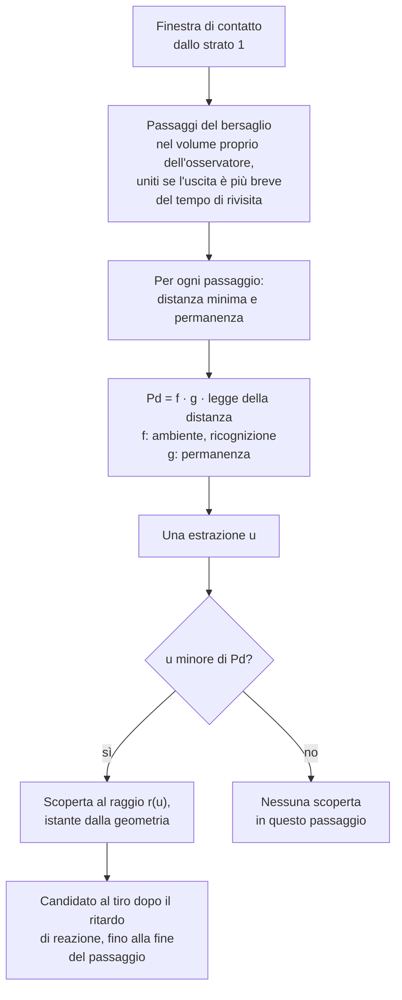

> **Dalla letteratura.** La dipendenza del segnale radar dalla distanza con la quarta potenza viene dall'equazione radar, trattata
> nei testi di base: Skolnik [B 5.4] (sommario con il capitolo sull'equazione radar; contenuto non letto). Le curve di probabilità
> di scoperta per bersagli che fluttuano e la teoria statistica della scoperta radar: Swerling e Marcum [B 5.8] (citazioni
> verificate, **contenuto non letto**). La distinzione fra probabilità di scoperta **per singola scansione** e probabilità
> **cumulativa** lungo una traiettoria, che questa sezione usa per leggere la legge, compare come argomento separato in Mahafza
> [B 5.5] (sommario letto), in DiFranco e Rubin [B 5.6] e, proprio per un bersaglio che si avvicina a un radar a scansione
> uniforme, in Mallett e Brennan [B 5.7] (titolo verificato, **contenuto non letto**). La teoria della ricerca, che descrive la
> scoperta come una successione di «sguardi» e da cui il progetto prende l'idea di una legge cumulativa futura: Koopman [B 5.1],
> [B 5.2], Washburn [B 5.3], Washburn e Kress [B 4.4] (opere verificate; contenuto non letto). La convenzione della portata
> dichiarata a probabilità 0,5 o 0,9: `[FONTE: convenzioni sulla portata dichiarata di un radar]`, **nessuna fonte trovata**. Il
> tempo di scansione dell'osservatore a occhio nudo («Poe 1974»): `[FONTE: scoperta visiva da terra di aerei]`, **non trovata**.
>
> **Scelta del progetto.** Volume sferico senza terreno; probabilità 0,5 al bordo; legge alla quarta potenza; una sola
> estrazione per occasione di scoperta [S per i numeri e la forma, V per il meccanismo]. Una occasione per passaggio, mai la
> somma delle permanenze, fine del tiro all'uscita dal volume [D]. Legge della permanenza nella forma min(1, T_perm/T_riv) [S],
> con un valore fisso per sensore [D]; lasciare la permanenza non additiva fra sessioni e dichiararlo, senza una memoria fra
> sessioni [D].
>
> **Limiti e incertezze.**
> - Nessun orizzonte radar, nessun terreno, nessun settore di copertura nel motore [V]; il costo di calcolo delle finestre con
>   i radar a lunghissima portata non è misurato [NV].
> - Probabilità al bordo 0,5: stima da ricalibrare, giudicata alta dall'utente, una sola per tutti i sensori [S]; salto da 0,5 a 0
>   al bordo [V]; forma alla quarta potenza: semplificazione [S].
> - Fattore ambientale unico per ogni sensore: vista di notte sovrastimata [V]; ambiente e ricognizione non collegati di default
>   [V, 2026-11-20]; nebbia di guerra «debole» e con un difetto noto [V].
> - Tempi di rivisita: valore fisso per sensore, molti stimati [S]; ipotesi di fase casuale non verificata [NV]; vista e ottico
>   approssimati [S].
> - Permanenza non additiva fra sessioni e rilevamento che non passa da una sessione all'altra: la probabilità di scoperta nel
>   tempo dipende dalla durata e dalla cadenza delle sessioni [V; numeri delle prove NV].
> - Mancano sensori contro bersagli di superficie in molti registri [V, dichiarato dal manuale].
> - Le scoperte sono registrate dalla fotografia solo per la serie dedicata; altrove un cambio della legge che non tocca il tiro
>   resta invisibile al confronto [V].
>
> **Nel manuale.** Cap. 3 §3.1-§3.8 (finestre di contatto, sensori, aerei a terra; D3, D70); cap. 4 §4.2 (legge di Pd), §4.18
> (nebbia di guerra, D12), §4.35 (un'estrazione per passaggio, D131, D133), §4.36 (permanenza); cap. 7 §7.4 (ambiente), §7.12
> (dati dei sensori); cap. 8 §8.13-§8.14 (scenari dei sensori e della permanenza); cap. 9 §9.1 «La Pd non distingue radar da
> ottico», «Fog-of-war reale», «Rilevamento per passaggio nella portata propria», «Permanenza nel volume», «Limiti dei sensori EWR
> e visivo».

---

## 6. Lo scontro: reazione, scelta dell'arma, salva, difese, danno, rottura

### 6.1 La catena

Uno scontro (un episodio, sezione 3.5) è risolto dallo strato 2 come una **catena** di passi, sulla sua agenda interna [V]:

1. **scoperta** (sezione 5): ogni osservatore ottiene i suoi candidati al tiro;
2. **ritardo di reazione**: il primo lancio non può avvenire prima di scoperta + reazione;
3. **scelta del bersaglio e dell'arma**, secondo regole di ripartizione del fuoco, regole d'ingaggio della missione, dottrina
   contro lo spreco e scorte;
4. **controllo di portata**: si lancia solo quando il bersaglio è entro la portata dell'arma;
5. **lancio**: bersaglio, arma e numero di colpi sono fissati (carico congelato, sezione 3.6);
6. **impatto**: i colpi che arrivano **insieme** su una forza formano un **evento-salva**;
7. **difese**: i colpi intercettabili sono confrontati con la **capacità di intercettazione**; il surplus passa;
8. **danno colpo per colpo** su ogni unità colpita;
9. **soglia di rottura**: la forza colpita confronta le perdite con la propria soglia e può ritirarsi.

Dopo il primo lancio, un tiratore che ha ancora il bersaglio in traccia ripete il tiro a intervalli regolari (§6.2), finché ha
scorte, bersagli e tempo.

*Diagramma G15 — La catena dello scontro. Deriva da D5 (sequenza della coda degli eventi dentro uno scontro) e dal cap. 4 §4.1.*

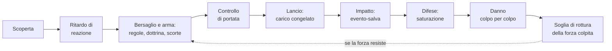

### 6.2 Il ritardo di reazione e l'iniziativa

Dal momento della scoperta al **primo lancio** passa il **ritardo di reazione** del sistema, somma delle quattro fasi della
sezione 2.5 (rilevare, valutare, comandare, attuare) [V]. Le salve successive contro un bersaglio già in traccia sono separate da
un **intervallo di ritiro** più breve, perché non serve scoprire di nuovo: la somma delle sole tre fasi valutare, comandare,
attuare, salvo armi con una cadenza propria [V].

> **istante del primo lancio ≥ istante della scoperta + ritardo di reazione**
>
> e il lancio è possibile solo se questo istante cade **prima della fine** del candidato al tiro (fine della finestra o del
> passaggio, §5.6).

I **totali** «dalla scoperta al lancio» sono ripresi dal documento di analisi del progetto, che li attribuisce a fonti tecniche
non riverificate [NV per le fonti]: circa 26 s per un sistema missilistico a corto raggio di vecchia generazione, circa 28 s per
uno a lungo raggio con posto comando, 5-8 s per un sistema moderno da fermo, 1-2 s per la reazione di un pilota, circa 31 s per un
equipaggio di carro per bersaglio; dove la fonte dà un intervallo si usa il punto medio [V]. La **scomposizione** nelle quattro
fasi è una stima [S]. Navi e sistemi senza profilo ricevono il profilo **più lento** (31 s), di proposito: la mancanza di un dato
non deve regalare l'iniziativa [V]. Un fattore per il livello di addestramento è previsto ma vale 1 per tutti [V].

**Esempio ILLUSTRATIVO** (i numeri della sezione 2.5). Un sistema contraereo scopre un aereo a t = 85 s; la sua reazione è di
26 s, quindi il primo lancio è possibile a 111 s; con 29 s di volo il missile arriva a 140 s. Se l'aereo aveva scoperto il sito a
70 s e ha un'arma già a portata, con 1,5 s di reazione può lanciare a 71,5 s: **chi scopre prima e reagisce più in fretta ha
l'iniziativa**.

### 6.3 Contro chi sparare

Fra i suoi candidati, ogni tiratore sceglie il bersaglio con regole **locali e deterministiche**, applicate sull'intero dominio di
coordinamento (sezione 4.4) [V]:

- **ripartizione a turno**: i bersagli sono ripartiti a rotazione fra i tiratori del dominio; non c'è un'assegnazione ottima delle
  armi ai bersagli, né un peso per il valore del bersaglio;
- **precedenza a chi attacca la propria forza**: un aereo che ha lanciato un'arma aria-superficie contro la forza (o il dominio)
  del tiratore, se il tiratore lo ha già scoperto e lo ha a portata, diventa un bersaglio **prioritario**. I tiratori che avevano
  in programma un lancio su un bersaglio non prioritario vi **rinunciano** e decidono di nuovo dopo il loro intervallo di ritiro
  (il tempo di valutare e assegnare) [V];
- **regole della missione**: bersaglio designato, regole di fuoco e armi designate (sezione 4.6);
- **dottrina contro lo spreco**, due regole di lato [V]:

> **bersaglio saturato** se  **1 − Π (1 − Pk)^colpi ≥ 0,9**
>
> cioè se la probabilità che le salve già dirette contro di esso dalla forza lo distruggano raggiunge 0,9 (Pk = probabilità di
> distruzione per colpo, §6.4); allora nessun tiratore della forza gli aggiunge salve. Inoltre un tiratore non lancia su un
> bersaglio verso cui ha già **2 colpi in volo** («due colpi, poi guarda»).

**Esempio ILLUSTRATIVO.** Pk per colpo 0,6. Un colpo in volo: 0,6; due: 1 − 0,4² = 0,84; tre: 1 − 0,4³ = 0,936, oltre 0,9: il
bersaglio è saturato e la forza smette di aggiungere salve. Le intercettazioni possibili **non** sono contate nella stima, che
quindi è favorevole a chi spara [V]. I valori 0,9 (scelto dall'utente) e 2 sono **stime dichiarate** [S/D]. I bersagli
prioritari sono esenti dalla saturazione, non dal tetto dei colpi in volo [V].

Un tiratore i cui bersagli sono tutti bloccati aspetta il primo impatto previsto e decide di nuovo [V].

### 6.4 Con quale arma

La scelta dell'arma non è dentro il motore: è una funzione **fornita dal chiamante**. Il progetto ne ha una che legge i
**registri d'arma**; alcuni scenari ne usano invece una **tabella di prova** semplificata, senza portate né fasce di quota [V].
Quella dei registri funziona così [V]:

1. le **armi candidate** del tiratore: quelle del suo registro; per un aereo, quelle del **carico assegnato** più il **cannone di
   bordo**, se il carico gli assegna colpi;
2. un **filtro di adeguatezza**: contro un aereo solo armi antiaeree, e con la quota del bersaglio entro la fascia dell'arma
   (letta sulla posizione di partenza delle unità); contro un bersaglio di superficie mai armi solo antiaeree;
3. per ogni arma, dalla riga del registro che corrisponde al tipo e alla taglia del bersaglio, la **probabilità di colpire** (Ph)
   e la **probabilità di distruggere dato il colpo** (Pk|h); il loro prodotto è la **Pk** (probabilità di distruzione per colpo),
   che deve essere maggiore di zero;
4. un **ordine di preferenza**:

> **punteggio = Pk / costo^0,5**
>
> se **tutte** le armi adatte hanno un costo nel registro; altrimenti si ordina per sola Pk. A parità decide un ordine fisso.

A parole: un'arma che costa **quattro volte** tanto deve avere una Pk **doppia** per essere preferita. L'esponente 0,5 è una
**stima** a metà fra «solo efficacia» (esponente 0) e «solo economia» (esponente 1) [S]. Oggi hanno un costo tutte le armi degli
aerei e un solo modello terrestre; per veicoli e navi conta quindi la sola Pk [V].

**Esempio ILLUSTRATIVO.** Un missile con Pk 0,8 e costo 100: punteggio 0,8/10 = 0,08. Una bomba con Pk 0,4 e costo 4: 0,4/2 =
0,20. Si preferisce la bomba; il missile resta come seconda scelta quando la bomba è finita.

Il motore spara con la **prima arma della lista che ha ancora scorta**, e **solo dopo** controlla la portata: il lancio parte
quando la distanza in tre dimensioni scende sotto la portata dell'arma; se non ci scende mai nel tempo del candidato, il
candidato si esaurisce, **anche se un'altra arma della lista potrebbe ingaggiare** (limite dichiarato) [V]. Altri due punti:

- il **tempo di volo** di un missile non dipende dalla distanza vera di tiro: è la metà della portata massima divisa per la
  velocità dell'arma [S]; per le bombe, gittata e tempo di caduta vengono dalla balistica descritta nella sezione 9, calcolata
  alla quota del tiratore sopra il bersaglio [V, 2026-11-20];
- per le missioni aeree, la **politica d'armi** per tipo di missione restringe ancora la lista (sezione 4.6) [V].

### 6.5 Salva e saturazione delle difese

I colpi che arrivano su una forza **nello stesso istante** formano un **evento-salva**; con la finestra di raggruppamento di
default (zero secondi) contano come salva solo gli impatti simultanei [V]. Per ogni evento-salva il motore calcola la **capacità di
intercettazione** del dominio di coordinamento della forza colpita [V, 2026-11-20]:

> **C = Σ_i min(canali liberi_i, scorta di intercettori_i)**
>
> sommata sugli intercettori operativi del dominio; un canale già usato nello stesso istante per un'altra forza del dominio non
> è libero.

Poi scorre le salve, nell'ordine d'impatto, e per ognuna gli intercettori nell'ordine fissato (prima quelli a soli cannoni, poi
gli altri; dentro un'unità prima i cannoni, poi i missili). Un intercettore ferma colpi di quella salva solo se [V]:

1. il colpo è **intercettabile**: missili e bombe guidate sì, proiettili d'artiglieria e di carro no;
2. ha un'arma dichiarata **antimissile** (oggi 6 armi terrestri e 12 navali) e canali e scorta ancora liberi;
3. il **punto di lancio** della salva è **fuori** dal suo volume d'intercettazione: i colpi lanciati da dentro non si intercettano
   mai (il lanciatore è un bersaglio, non si inseguono i suoi colpi);
4. ha una **traccia del colpo e il tempo di reagire**: se aveva scoperto il lanciatore nel passaggio che contiene il lancio, gli
   basta l'intervallo di ritiro a partire dal lancio; altrimenti scopre il colpo quando entra nella sua portata di scoperta e gli
   serve l'intero ritardo di reazione. In entrambi i casi deve fare in tempo prima dell'impatto.

**Ogni canale disponibile ferma un colpo con certezza**: non c'è una probabilità d'intercettazione [V, 2026-11-20]. È
un'ipotesi favorevole alla difesa, dichiarata nel codice e nel manuale, come altre due del meccanismo (il tempo di volo
dell'intercettore e la sezione radar del colpo sono trascurati) [V]. Un cannone consuma 100 colpi per ogni intercettazione [S].
I colpi non fermati **passano tutti** al danno. Se nessun intercettore è escluso dalle condizioni 3 e 4, i colpi fermati sono
**min(colpi intercettabili, C)**; altrimenti meno [V].

**Esempio ILLUSTRATIVO.** Otto missili arrivano insieme su una forza. Nel suo dominio ci sono due intercettori: A con 3 canali e
10 missili (disponibili 3), B con 4 canali ma un solo missile rimasto (disponibile 1): **C = 4**. Se tutte le condizioni sono
soddisfatte, 4 missili sono fermati e **4 passano**, ciascuno risolto con un'estrazione (§6.6). Se invece tutti gli otto fossero
partiti da dentro il volume d'intercettazione di A, A non potrebbe fermarne nessuno: ne fermerebbe uno soltanto B, e ne
passerebbero 7.

Due regole facoltative esistono nel codice e sono **spente** di default, senza alcun chiamante che le accenda: una che limita
quali munizioni una difesa considera bersagli secondo la classe e la taglia del colpo, e una che aggiunge la **fascia di quota**
al volume d'ingaggio delle armi, valutata nel tempo [V].

*Diagramma G16 — Saturazione delle difese (numeri ILLUSTRATIVI, dall'esempio). Deriva da D24 (allocazione per salva) e D33
(difesa per dominio e canali condivisi).*

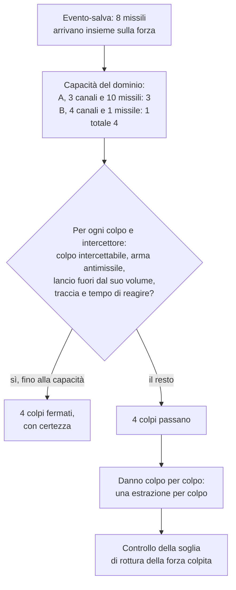

### 6.6 Il danno, colpo per colpo

Ogni colpo che passa è risolto con **una estrazione** u, con tre esiti che si escludono [V, 2026-11-20]:

| Esito | Probabilità | Effetto sulla salute (da 0 a 100) |
|---|---|---|
| **distrutto** | Ph · Pk\|h | salute a 0 |
| **danneggiato** | Ph · (1 − Pk\|h) | perde round(100 · Pk\|h) punti, almeno 1 |
| **mancato** | 1 − Ph | nessuno |

La stessa Pk\|h misura sia la probabilità di distruggere sia l'entità del danno non letale: servono circa 1/Pk\|h colpi a segno
non letali per mettere fuori uso un bersaglio. L'**accumulo** del danno è quindi una conseguenza, non un parametro [V]. L'ordine
delle soglie (prima distrutto, poi danneggiato, poi mancato) fa parte del contratto di riproducibilità [V].

**Gli stati di salute** [V]: sopra 80 l'unità è integra; da 51 a 80 danneggiata ma ancora **operativa**; da 16 a 50 **fuori
combattimento** (non spara più, ma è ancora un bersaglio: il «mission kill»); a 15 o meno **distrutta**: il residuo è il
**relitto**. Un colpo che arriva su un'unità già distrutta è **sprecato** e non consuma estrazioni [V].

**Esempio ILLUSTRATIVO.** Ph = 0,7, Pk\|h = 0,3. Per colpo: distrutto 0,21, danneggiato 0,49 (meno 30 punti), mancato 0,30.
Da salute 100, un colpo che danneggia porta a 70 (ancora operativa), un secondo a 40 (fuori combattimento).

Manca la **penetrazione della corazza**: i registri non hanno il dato, e la Pk\|h per tipo e taglia del bersaglio è l'unico
discriminante [V]. La Pk non dipende dalla posizione del bersaglio nell'inviluppo dell'arma [V].

*Diagramma G17 — Gli stati di salute di un'unità. Deriva da D7.*

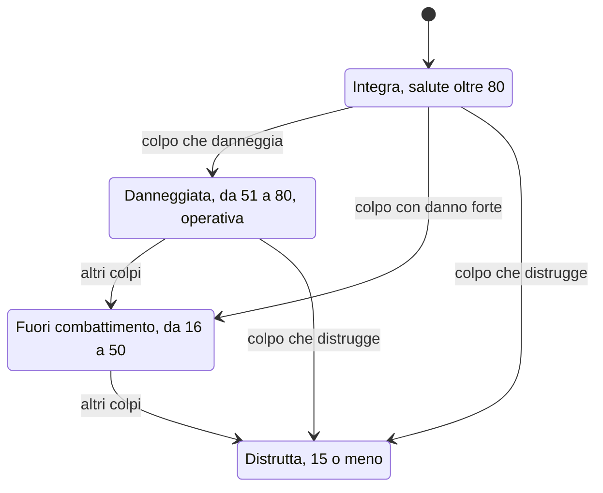

### 6.7 La soglia di rottura

Dopo **ogni** evento-salva la forza colpita (una missione, sezione 4.4) confronta le proprie perdite con la propria **soglia di
rottura** B [V, 2026-11-20]. Le perdite si misurano in due modi, entrambi come frazione delle unità **impegnate all'inizio
dell'episodio**:

> **erosione E** = unità non più operative / unità impegnate   (cumulata nell'episodio)
>
> **shock S** = unità perse **in questa salva** / unità impegnate

La forza **rompe il contatto** (si ritira) se

> **E ≥ B**   oppure   **(perse nella salva ≥ 2  e  S ≥ (0,20 / 0,30) · B)**

e risulta **distrutta** se non le resta nessuna unità operativa: la distruzione prevale anche su una ritirata già decisa, se salve
già in volo finiscono la forza [V].

**La soglia non è un numero fisso.** È estratta e modulata, forza per forza e episodio per episodio [V, 2026-11-20]:

> **B = 1 / (1 + e^−( ln(μ / (1 − μ)) + 0,5 · z ))**
>
> **μ = 0,30 · M · R · U · P**, ricondotta fra 0,05 e 0,95
>
> - **z** viene dalla **tempra** della forza: un numero casuale estratto **una volta per forza e per episodio**, da una sorgente
>   separata (sezione 10), trasformato in uno scarto normale (z = 0 è la tempra media);
> - **M** è il **morale**: previsto, ma oggi nessuno lo fornisce, quindi vale 1;
> - **R** è il **rapporto di forze percepito**: forza propria su forza nemica **scoperta** dal dominio di coordinamento, elevato
>   a 0,5 e ricondotto fra 0,6 e 1,5 (per una forza aerea la minaccia nemica è pesata con l'efficacia attesa dei sistemi
>   contraerei scoperti);
> - **U** è il **fuoco senza risposta**: 1 − 0,3 × la quota di perdite causate da tiratori che il dominio non aveva scoperto;
> - **P** vale 1,2 se la forza è rimasta **ferma** per tutto lo scontro (difesa da posizione), altrimenti 1.

A parole: la soglia **mediana** è il 30% di perdite; una forza ferma, superiore per forze percepite o «fortunata» nella tempra
resiste più a lungo; una forza che subisce perdite da tiratori che non vede si rompe prima. La funzione a «S» (logistica)
mantiene la soglia fra 0 e 1. «Postura» qui significa **soltanto** che la forza è rimasta ferma, non l'etichetta di postura della
sezione 4.5 [V, 2026-11-20].

**Esempio ILLUSTRATIVO** (forza di 5 carri, morale e fuoco senza risposta neutri, forza in movimento, R = 1):

| Tempra | z | Soglia B | Un carro perso per salva, in salve diverse | Due carri persi nella stessa salva |
|---|---|---|---|---|
| media | 0 | 0,30 | si ritira dopo la **seconda** perdita (E = 0,4) | si ritira (erosione e shock) |
| alta | circa +1 | circa 0,41 | resiste anche con 2 perdite (E = 0,4); si ritira alla terza | si ritira **per shock** (S = 0,4 contro 0,28) |
| bassa | circa −1 | circa 0,21 | si ritira dopo la **seconda** perdita | si ritira |

Con R = 2 (forza propria doppia di quella nemica scoperta), μ sale a 0,30 · √2 ≈ 0,42 [ILLUSTRATIVO]. La soglia casuale nasce da
un difetto osservato con le soglie fisse: con una perdita minima di 1/5, cinque carri si ritiravano per un solo carro perso quasi
sempre (7 repliche su 8 nella prova del progetto [NV]).

**Chi può ritirarsi** [V]. Solo le forze **militari**; un blocco logistico o civile combatte fino alla fine. Una forza fatta
solo di aerei a terra non si ritira. La ritirata è della **forza intera**: una parte non può cedere mentre l'altra resiste, e non
c'è contagio fra forze dello stesso lato. Una forza in ritirata non riceve più lanci nuovi, non può più essere scelta come
bersaglio (è «andata via»), e le salve già partite arrivano comunque. Dopo l'episodio, gli **aerei** di una missione in ritirata
rientrano (sezione 7); le forze **terrestri e navali** restano sulla loro rotta, passive (sezione 3.5).

**Lo stato dei numeri.** Tutti i coefficienti (0,30, 0,20, 0,5, 0,3, 0,5 con i limiti 0,6-1,5, 1,2, le 2 perdite minime) sono
**stime di partenza dichiarate, non tarate**, uguali per i tre lati [S]. Per il 30% il codice richiama «una regola empirica diffusa
nella letteratura militare», **senza citarla** [S]. Il codice prevede una ritaratura con un processo interno del progetto che
**non risulta fatta** [NV]. Le perdite di un episodio precedente **non** entrano nell'erosione del successivo, che ha anche una
tempra nuova [V].

*Diagramma G18 — Gli stati di una forza durante uno scontro. Deriva da D6.*

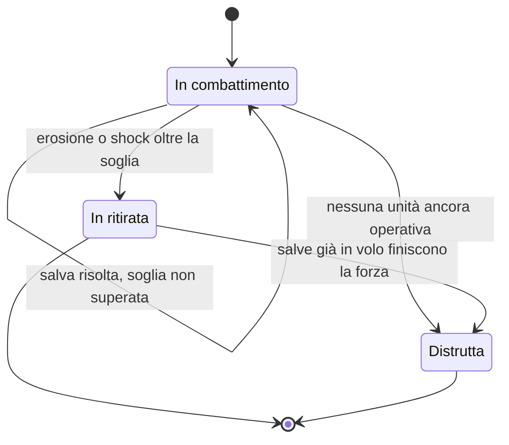

*Diagramma G19 — Da che cosa dipende la soglia di rottura. Deriva da D22.*

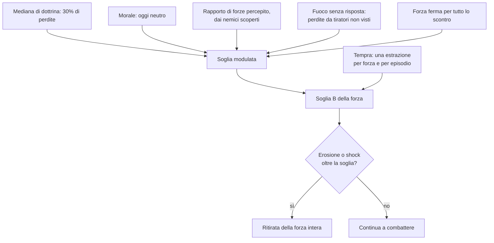

### 6.8 Scontri con più forze

Quando una forza è in contatto con più forze nemiche in finestre vicine, tutte entrano nello **stesso episodio** e sono risolte
in **una sola** agenda condivisa: la salute e le scorte di quella forza evolvono in un'unica storia, consumata da tutti i fronti
nell'ordine esatto degli eventi. Risolvere i fronti separatamente farebbe dipendere l'esito dall'ordine in cui il programma li
esamina [V]. Due missioni dello stesso dominio sono due forze: quando una si ritira, l'altra **continua** a combattere; il dominio
condivide fuoco e percezione, **non** il destino della ritirata (sezione 4.4) [V].

### 6.9 Il fuoco su posizione

Il fuoco su posizione è il **caso a parte** dello scontro: artiglieria o navi sparano su un **punto stimato** («dove il nemico
era»), senza averlo scoperto. Non passa dallo strato 2: è un evento di sessione a sé, risolto all'istante dell'impatto (sezione
3.4) [V, 2026-11-20].

- **Chi e quando.** Una missione di terra o di mare con un bersaglio punto o area e un **ordine di tiro** su un suo punto di rotta;
  l'istante di tiro è l'arrivo a quel punto, con la condizione d'avvio dichiarata. Gli aerei non sparano così, e i missili sono
  esclusi.
- **Con che cosa.** L'arma dichiarata nell'ordine, oppure la prima arma d'artiglieria, di fuoco navale o d'attacco a terra che
  ha scorta e portata; il punto mirato deve essere entro la portata.
- **Dove cadono i colpi.** Il punto mirato è la posizione **stimata** del bersaglio. Ogni colpo cade in un punto casuale,
  uniforme in un **disco di dispersione** di raggio R = max(raggio dichiarato, incertezza della stima, 50 m) [S per i 50 m].
- **Che effetto hanno.** Ogni nemico non distrutto che, all'impatto, si trova entro il **raggio letale** dal punto di caduta
  riceve un'estrazione con la sola Pk\|h dell'arma contro di lui (dentro il raggio il colpo è considerato a segno). Raggio letale =
  **0,25 m per millimetro di calibro** (un calibro da 152 mm dà 38 m), oppure 25 m se il calibro manca [S].
- **Che cosa non fa.** Niente intercettazione, niente fuoco amico (colpisce solo i nemici), niente aerei in volo, e **nessun
  effetto sulla soglia di rottura** del lato colpito [V].
- **Casualità.** Per ogni colpo, due estrazioni per il punto di caduta e una per ogni nemico raggiunto, in quest'ordine, da una
  sorgente **propria** di ogni ordine di tiro, derivata dalla sorgente di sessione: estrae numeri casuali fuori dallo strato 2
  (sezione 10) [V, 2026-11-20].

**Esempio ILLUSTRATIVO.** Dieci colpi da 152 mm su un punto stimato con incertezza 100 m; il bersaglio è davvero lì; Pk\|h = 0,5.
La probabilità che un colpo cada entro 38 m dal bersaglio è (38/100)² ≈ 0,14; per colpo il bersaglio è distrutto o danneggiato
con probabilità circa 0,07; su dieci colpi, almeno un effetto con probabilità circa 0,53. Se il bersaglio si è spostato di 150 m,
nessun colpo può raggiungerlo (100 m di dispersione più 38 m di raggio letale fanno 138 m).

*Diagramma G20 — Il fuoco su posizione. Deriva da D49 (dalla condizione di tiro alle estrazioni) e D50 (l'evento nella coda di
sessione).*

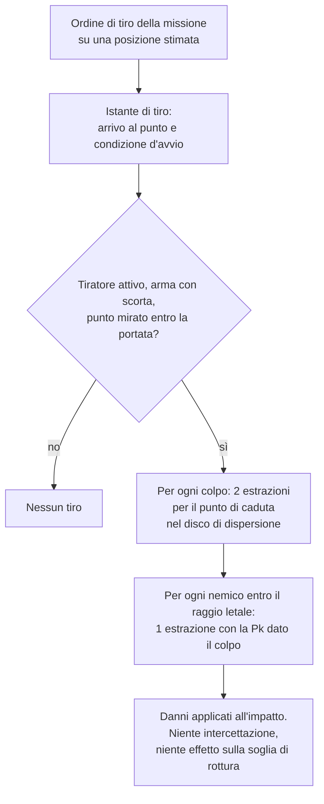

> **Dalla letteratura.** Il confronto fra i colpi di una salva e la capacità difensiva di chi la riceve è il meccanismo del
> modello a salve di Hughes [B 4.2] (citazione verificata, **contenuto non letto**); Lucas e McGunnigle [B 4.5] (titolo, sommario
> e bibliografia letti) discutono perché un modello a salve semplice e trasparente possa essere preferibile a uno complesso;
> estensioni sulla dimensione delle salve e sul fuoco d'area: Armstrong [B 4.6] (**contenuto non letto**). Il motore prende di
> Hughes **il meccanismo** (saturazione per evento-salva, surplus che passa), **non** le equazioni aggregate. Le equazioni di
> logoramento di Lanchester [B 4.1] e i modelli di attrito trattati da Washburn e Kress [B 4.4] sono ciò che il motore **non** usa:
> qui i colpi sono singoli e le perdite per unità. La scomposizione della probabilità di distruzione in Ph e Pk\|h:
> `[FONTE: Ph, Pk e scomposizione della probabilità di distruzione]`. La dottrina «due colpi, poi guarda» e la prevenzione dello
> spreco: `[FONTE: dottrina di tiro shoot-look-shoot]`. I tempi di reazione dei sistemi d'arma: `[FONTE: ciclo OODA e tempi di
> reazione]`. La soglia del 30% di perdite: `[FONTE: soglie storiche di rottura delle unità]`; per dati quantitativi storici sul
> combattimento in generale, come indicazione di lettura, Dupuy [B 8.1] e Lawrence [B 8.2] (**contenuto non letto**: non è
> verificato che trattino le soglie di rottura). L'assegnazione ottima delle armi ai bersagli, che il motore **non** fa: Manne
> [bibliografia, tabella dei segnaposto] e Ahuja e altri (citazioni verificate, **contenuto non letto**).
>
> **Scelta del progetto.** Catena a eventi con ritardi di reazione per tipo di sistema; ripartizione del fuoco locale e a turno;
> precedenza a chi attacca la propria forza, dottrina contro lo spreco con soglia 0,9 e tetto di 2 colpi in volo (decisioni
> dell'utente [D] con valori stimati [S]); preferenza d'arma Pk/costo^0,5 [S]; intercettazione per evento-salva con le quattro
> condizioni [D]; danno a tre esiti senza costanti nuove [V]; soglia di rottura casuale e modulata, per forza intera [D] con
> coefficienti stimati [S]; fuoco su posizione come evento separato, con dispersione uniforme e letalità a soglia [D/S].
>
> **Limiti e incertezze.**
> - Coefficienti della soglia di rottura, del ritardo di reazione (scomposizione), della preferenza d'arma, della dottrina di tiro
>   e del fuoco su posizione: **stime non tarate** [S]; uguali per i tre lati [V].
> - Morale e stima a priori del nemico non alimentati da nessun chiamante: oggi neutri [V].
> - Intercettazione certa per canale, tempo di volo dell'intercettore e sezione radar del colpo trascurati: ipotesi favorevoli
>   alla difesa [V]; nessun collegamento di comando fra batterie [V].
> - Prima arma con scorta, poi la portata: un candidato può esaurirsi anche se un'altra arma potrebbe sparare [V]; tempo di volo
>   dei missili a metà portata, non sulla distanza vera [S]; Pk indipendente dalla posizione nell'inviluppo [V].
> - Ripartizione del fuoco locale, non ottima [V]; finestra di raggruppamento delle salve a zero secondi [S].
> - Ritirata solo della forza intera, nessun contagio [V]; nessuna penetrazione di corazza [V].
> - Parte degli scenari usa una tabella d'armi di prova senza portate: lì i tiri non hanno vincolo di distanza [V].
> - Due regole facoltative spente e senza chiamanti (classe dei colpi intercettabili, fascia di quota del volume d'ingaggio) [V].
>
> **Nel manuale.** Cap. 4 §4.1 (la catena), §4.3-§4.10 (reazione, arma, salva, danno, ritirata, più forze, carico congelato, stato
> ombra; D5, D6), §4.16-§4.17 (arma dai registri e portata), §4.19-§4.20 (scorte, bombe), §4.21-§4.26 (soglia di rottura, D22;
> efficacia contraerea; RWR; difesa dai missili, D24; dottrina di tiro; traccia e tempo di reazione), §4.29 (difesa per dominio,
> D33), §4.34 (arma del fuoco su posizione); cap. 5 §5.1, §5.4 (danno e stati di salute, D7); cap. 6 §6.23 (fuoco su posizione, D49,
> D50); cap. 7 §7.2-§7.3 (dottrina e profili di reazione), §7.5 (capacità di intercettazione); cap. 9 §9.1 «Altri limiti
> dichiarati, minori», «Limiti introdotti o resi evidenti dalle estensioni del 2026-09-28/30», «Bersagli intercettabili dalle
> difese aeree», «Quota nel volume d'ingaggio», «Fuoco su posizione».

---

## 7. Tempo, carburante, munizioni e stato delle unità in una sessione

### 7.1 La vita di un'unità nella sessione

Le unità di superficie sono presenti per tutta la sessione: ferme nel punto di partenza prima di muovere, sulla rotta, ferme
nell'ultimo punto dopo l'arrivo (sezione 4.3). La vita di un **aereo** ha più stati, tutti calcolati in anticipo o al termine di
un episodio, mai durante uno scontro [V].

*Diagramma G21 — La vita di un aereo di missione in una sessione. Deriva da D41.*

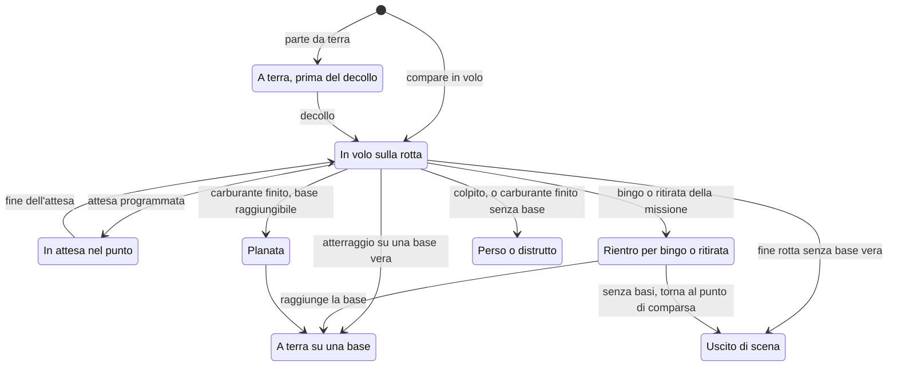

### 7.2 Il carburante vincola il movimento

Il carburante è una **frazione del pieno**, da 0 a 1 [V]. Il motore lo tratta così [V]:

- **consumo per tratto**: ogni tratto di movimento consuma in proporzione alla distanza, alla velocità di **crociera**; ogni
  **sosta** (attesa, orbita, unità ferma a motore acceso) consuma nel tempo **come se fosse in crociera**: per gli aerei in
  attesa è una sovrastima, perché il dato di consumo in attesa non c'è nei registri [V, ipotesi dichiarata];
- **esaurimento calcolato prima**: poiché il consumo dipende solo dai tratti e dal carburante di partenza, il punto in cui il
  carburante finisce si calcola **prima** dei contatti, e oltre quel punto la rotta non esiste;
- **che cosa succede a secco**:
  - un'unità di **terra o di mare** si **ferma** nel punto, resta presente e bersaglio, non è distrutta;
  - un **aereo in volo** **plana** verso la base amica più vicina se è entro **quota × 10** (rapporto di planata 10 [S]: un caccia
    a 3000 m arriva a 30 km), poi resta a terra su quella base;
  - altrimenti è **perso**: la sua salute va a zero senza un evento di danno (non è un colpo), con l'equipaggio considerato
    recuperato.

**Il consumo in combattimento.** Lo scontro **non legge** il carburante (sezione 3.3). Per gli aerei il combattimento costa però
carburante con una regola **a scatto**: a ogni episodio a cui un aereo in volo **partecipa** (lancia, è bersaglio di una salva, o
intercetta), nell'istante della sua prima partecipazione consuma il carburante di **5 minuti alla massima spinta militare**, la
stessa quantità della riserva di disimpegno (§7.3) [V]. La sola scoperta reciproca, senza salve, non costa nulla. Terra e mare
non hanno questo consumo [V].

Il **conto** dei consumi si fa alla **fine** della sessione, tratto per tratto (sezione 3.3); le decisioni intermedie (bingo dopo
un episodio) usano un **residuo calcolato** con la stessa aritmetica [V].

### 7.3 Il bingo: quando un aereo deve rientrare

Il **bingo** è il livello di carburante sotto il quale un aereo deve interrompere la missione e tornare. Il modello attuale, deciso
dall'utente, usa tre grandezze [D, verificate nel codice]:

> **riserva di disimpegno = consumo alla massima spinta militare [kg/h] × 300 s / 3600 / capacità del carico [kg]**
>
> **minimo di pianificazione**: carburante caricato **>** rotta intera + riserva   (lo controlla il validatore, sezione 8)
>
> **soglia di bingo in volo**: residuo **<** resto della rotta fino all'atterraggio + riserva

I 300 s sono il tempo stimato per disimpegnarsi da un'intercettazione e tornare in rotta [S]. Il bingo si valuta **alla partenza**
e **alla fine di ogni episodio** [V]. Con il solo consumo di movimento residuo e resto della rotta calano insieme, quindi la soglia
o scatta subito o mai: è il **consumo in combattimento** che la fa scattare a metà missione.

**Esempio ILLUSTRATIVO.** Un aereo consuma 4500 kg/h alla massima spinta militare e porta 3200 kg: la riserva vale
4500 × 300/3600 = 375 kg, cioè circa 0,12 del pieno. Prima di un episodio ha 0,42 di carburante e il resto della rotta ne chiede
0,20: soglia 0,32, nessun bingo. L'episodio gli costa altri 0,12: residuo 0,30, sotto la soglia di 0,32: **bingo** alla fine
dell'episodio.

**L'albero di decisione** dipende dal tipo di missione [V]:

- **missioni di trasferimento**: se il residuo basta comunque a finire la rotta (senza la riserva), l'aereo **prosegue**
  consumando la riserva;
- **tutte le altre**: l'aereo **interrompe** sempre. Rientra alla **base di partenza**, ripercorrendo la rotta a ritroso, oppure a
  una **base amica alternativa** entro 3 km dalla rotta programmata [S], scegliendo il percorso **più breve** che il residuo
  consente; se nessuna è raggiungibile, va verso la base più vicina in linea retta; se non ce n'è nessuna, vola finché ha
  carburante (§7.2);
- **un aereo comparso in volo senza alcuna base** del suo lato, che dopo un episodio deve rientrare, torna a ritroso fino al
  **punto di comparsa** ed **esce di scena**: non è una perdita.

Una seconda causa di rientro è la **ritirata**: se la forza di un aereo si è ritirata in un episodio, l'aereo rientra con le
regole delle missioni di combattimento **qualunque sia il suo carburante**; se entrambe le cause valgono, vince il bingo [V].
Dal bingo in poi l'aereo **non lancia più salve offensive**, ma resta bersaglio e intercettore [V]. Terra e mare non hanno bingo
[V].

**Lo stato dei dati.** Il consumo «di emergenza» dei registri ha un'**unità non documentata**, dedotta come kg/h; per i caccia con
postbruciatore sottostima di circa sei volte il consumo a postbruciatore pieno. Per questo l'utente ha **definito** la riserva come
«5 minuti alla massima spinta militare» invece che al postbruciatore [D]; sul campione di otto aerei esaminato dal progetto la
riserva va dal 5,2% al 21,4% del pieno [V]. Una regola per gli aerei storici con un'emergenza più breve di 5 minuti è indicata
dall'utente ma **non implementata** [V].

*Diagramma G22 — La decisione al bingo, semplificata. Deriva da D38.*

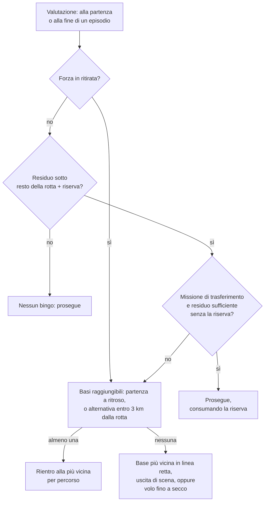

### 7.4 Le munizioni

La scorta è tenuta **per modello d'arma**: ogni arma paga solo con la propria voce [V]. Alcuni punti:

- un missile antiaereo usato **per intercettare** e uno sparato **offensivamente** scalano **la stessa voce**: sono lo stesso
  oggetto [V];
- le armi che i registri contano come impianti e non come colpi (mitragliatrici, cannoni a tiro rapido di difesa ravvicinata)
  **non si esauriscono** nel tiro offensivo; come intercettori le difese ravvicinate navali hanno una scorta propria, e ogni
  intercettazione con un cannone consuma 100 colpi [S] [V];
- il **cannone di bordo** di un aereo è un'arma candidata come le altre, se il carico gli assegna colpi (sezione 6.4) [V];
- **nessun rifornimento** durante la sessione: riarmo e rifornimento avvengono fra le sessioni (sezione 8) [V].

### 7.5 La fine di attività

I **criteri di fine** dichiarati dalla missione (sezione 4.2) chiudono l'**attività** di un'unità senza cambiarne la rotta [V]:

- **munizioni finite**: tutte le voci delle categorie d'arma indicate sono a zero;
- **soglia di danno**: la salute persa, rispetto a quella **a inizio sessione**, supera la soglia (così il danno di episodi diversi
  si somma);
- **bersaglio distrutto**: tutti i bersagli designati (un'unità o un gruppo) sono distrutti, ovunque e comunque;
- **durata massima**: contata dalla partenza della missione.

Dall'istante della fine l'unità **non lancia più salve offensive** e prosegue **passiva** sulla rotta, restando presente,
bersaglio e intercettore. Nessuno di questi criteri fa rientrare un aereo: il rientro è solo del bingo e della ritirata (§7.3);
un aereo danneggiato oltre la soglia resta passivo sulla rotta [V]. L'unità che chiude per uno di questi motivi entra nella regola
dell'esito di missione della sezione 4.7.

### 7.6 Quando si applica che cosa

*Diagramma G23 — Quando si applicano danni, munizioni, carburante e posizioni. Deriva da D9 (coda degli eventi di sessione) e D40
(episodio, contabilità del carburante, ripianificazione).*

Lo stato di ogni unità a fine sessione è quindi: salute, scorte per arma, carburante, una **postura** finale (per esempio in
missione, a terra su una base, uscito di scena, distrutto) e l'esito della sua missione (sezione 4.7) [V].

> **Dalla letteratura.** Pianificazione del carburante, riserve minime e livello di bingo nelle operazioni aeree:
> `[FONTE: pianificazione del carburante e riserve minime nelle operazioni aeree]`, non coperta dalla bibliografia. L'albero di
> decisione, la riserva di disimpegno, il consumo in combattimento a scatto e l'uscita di scena sono **scelte del progetto**.
>
> **Scelta del progetto.** Carburante come vincolo calcolato in anticipo; soste alla crociera; planata con rapporto 10; bingo con
> riserva di 5 minuti alla massima spinta militare, valutato alla partenza e dopo ogni episodio; albero per tipo di missione con
> basi alternative entro 3 km; rientro forzato dopo la ritirata; consumo in combattimento uguale alla riserva; criteri di fine che
> rendono passivi senza cambiare la rotta [D, verificati nel codice; i valori sono stime S].
>
> **Limiti e incertezze.**
> - Dati di consumo di emergenza non tarati, unità dedotta [S]; 300 s, 3 km, rapporto di planata 10: stime [S/D].
> - Soste e attese consumano come la crociera: sovrastima [V]; consumo in combattimento a scatto, non distribuito nel tempo [V].
> - Decisione di rientro solo alla fine dell'episodio; durante lo scontro un aereo a secco continua a volare e combattere [V].
> - Nessuna salva offensiva dopo il bingo, nessun rientro per danno, nessun bingo per terra e mare [V].
> - Il rientro a ritroso ripassa sulle minacce dell'andata [V]; l'idoneità della base per tipo d'aereo non è modellata [V].
> - Regola per gli aerei storici con emergenza breve non implementata [V].
> - La formazione si può dividere: le decisioni sul carburante sono per aereo, la ritirata per forza [V].
>
> **Nel manuale.** Cap. 4 §4.19 (scorta per arma), §4.31 (fine di attività); cap. 5 §5.2 (carburante e bingo: riserva, soglia,
> albero, consumo in ingaggio, uscita di scena; D38, D39); cap. 6 §6.5, §6.15-§6.20 (presenza, attese, carburante per tratto,
> fine di attività, bingo in sessione, episodi e ripianificazione; D40, D41, D42); cap. 7 §7.6 (munizioni e carburante sulle
> unità); cap. 9 §9.1, la voce sui limiti introdotti dalle fasi del carburante e del bingo (il titolo usa le sigle di progetto:
> tabella della sezione 14). L'atlante del carburante è il cap. 10B.

---

## 8. Dalla sessione alla campagna

### 8.1 Il ciclo di campagna

Fra una sessione e l'altra il motore non fa nulla: lo fa un **conduttore di campagna**, esterno al motore e oggi chiamato solo da
test e da uno scenario (sezione 1.5) [V]. Per ogni sessione esegue cinque passi, in quest'ordine [V, 2026-11-20]:

1. **processi fra sessioni**: applica alle unità i riarmi, i rifornimenti e le riparazioni che si sono conclusi **entro l'inizio**
   della sessione;
2. **validazione** dell'ordine di sessione; se l'ordine non è valido si ferma qui e il motore non viene chiamato;
3. **esecuzione** della sessione con il motore DES (il passo che un futuro adattatore DCS sostituirebbe, sezione 1.3);
4. **posizioni finali**: applica alle unità la posizione in cui il motore dice che si trovano a fine sessione;
5. **registro di campagna**: registra la sessione e calcola, per ogni unità, **quando tornerà pronta**.

*Diagramma G24 — Un passo del ciclo di campagna. Deriva da D54 e D128.*

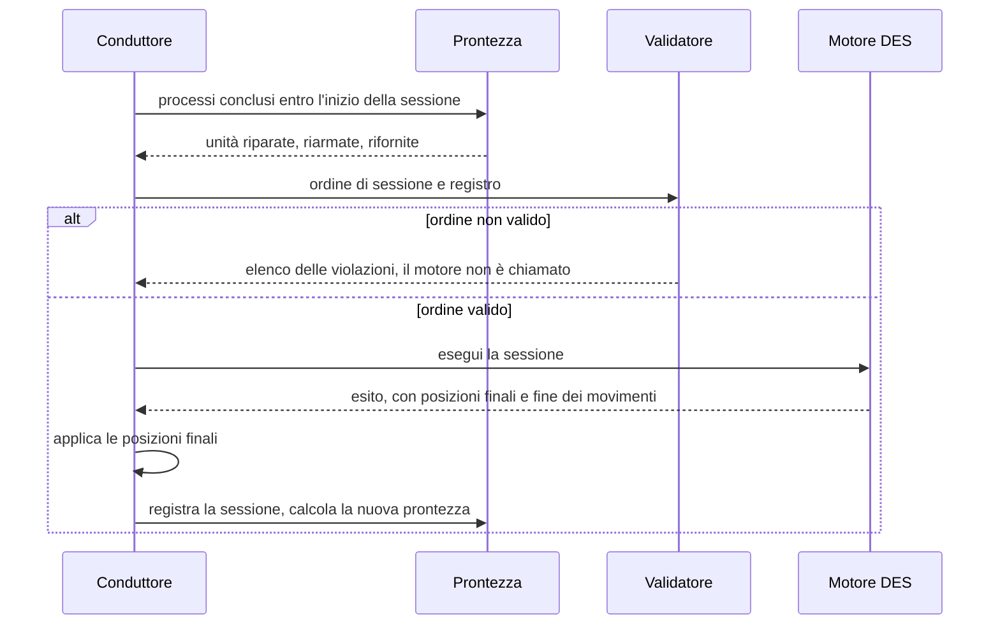

### 8.2 Il validatore

Il validatore raccoglie **tutte** le violazioni, non solo la prima [V]. Controlla:

- la **sessione**: deve avere una fine (niente sessioni aperte), durare al più **4 ore** (2 ore di default) [D], e non cominciare
  prima della fine **effettiva** della precedente, salve in volo comprese;
- per ogni **missione**: che il suo blocco sia fra le forze e le sue unità appartengano a quel blocco; che nessuna unità sia
  **distrutta** o **non ancora pronta** all'inizio della sessione; che partenza e orari siano coerenti; che la **fine pianificata**
  non superi la fine della sessione; che nessun tratto superi la velocità del mezzo più lento (sezione 4.3);
- per le sole missioni **aeree**: il **minimo di pianificazione** e l'assenza di un bingo già alla partenza (sezione 7.3).

Il validatore è **fuori** dal motore: chi chiama il motore direttamente può fargli eseguire anche un ordine che il validatore
rifiuterebbe, ed è ciò che fanno, di proposito, alcuni test e scenari [V]. Il motore stesso, per esempio, non rifiuta un ordine per
carburante: se lo facesse, il bingo in volo non si potrebbe mai osservare [V].

### 8.3 La prontezza

Dopo una sessione un'unità che ha volato, sparato, consumato o subito danni ha bisogno di tempo per tornare impiegabile. Il
registro di campagna, **immutabile**, tiene per ogni unità l'istante in cui sarà pronta [V, 2026-11-20]:

> **pronta da = max( inizio + tempo di ripristino + tempo di riparazione ,  pronta da del processo precedente )**
>
> **inizio** = il più tardo fra la fine del movimento (o l'atterraggio) e l'ultimo danno subito
>
> **tempo di riparazione = riparazione completa del dominio × (100 − salute) / 100**   (lineare nel danno)

Il **tempo di ripristino** (turnaround: riarmo, rifornimento, controlli) vale solo per chi è stato in missione o ha consumato
qualcosa; la riparazione solo per chi è danneggiato. Un'unità **distrutta** (salute 15 o meno) non ha prontezza e non è mai
riparata [V, 2026-11-20].

*Tabella dei tempi del codice (stime o ordini di grandezza; dettaglio delle fonti nel manuale).*

| Unità | Tempo di ripristino | Natura |
|---|---|---|
| caccia, cacciabombardieri, aerei d'attacco, trasporti, classe ignota | 3 h | caccia: una sola fonte verificata sulla pagina originale; gli altri per analogia o stima |
| bombardieri / bombardieri pesanti | 4,5 h / 8 h | fonte riportata e non riverificata / stima di progetto [S] |
| radar volanti (AWACS) / ricognitori / elicotteri | 12 h / 2 h / 1,5 h | confidenza bassa / stima [S] / stima [S] |
| reparti terrestri / navi | 6 h / 48 h | stima di progetto [S] / stima senza fonte numerica [S] |
| **riparazione completa**: aria / terra / mare | 24 h / 24 h / 72 h | ordini di grandezza; per le navi riparazione temporanea in porto |

**Esempio ILLUSTRATIVO** (con i tempi del codice, che sono stime). Un caccia è colpito a 1,2 h dall'inizio della sessione e scende
a salute 70; atterra a 1,5 h. Inizio = 1,5 h; ripristino 3 h; riparazione 24 h × 0,30 = 7,2 h: **pronto da 11,7 h**. Una sessione
che comincia a 8 h non può impiegarlo (il validatore lo rifiuta); in una che comincia a 12 h il conduttore, al passo 1, lo riporta a
salute 100, lo riarma e lo rifornisce. Se invece fosse stato colpito di nuovo sul parcheggio a 1,8 h, l'inizio sarebbe 1,8 h e la
prontezza 12,0 h.

Tre regole che contano [V]:

- **i processi si applicano all'inizio della sessione successiva**, non all'istante in cui l'unità è pronta: fino ad allora l'unità
  conserva salute, scorte e carburante della sessione precedente;
- **la riparazione è a gradino**: la salute torna a 100 solo alla fine, e un'unità parzialmente riparata non è impiegabile;
- **niente logistica**: riarmo, rifornimento e riparazione **non consumano** risorse delle basi e non dipendono da esse, per
  decisione dell'utente [D]. Un aereo senza carico assegnato non viene riarmato né rifornito («non modellato»). Un'unità assente da
  una sessione conserva il suo processo, che le si applica quando torna.

### 8.4 La posizione persistente

Il motore calcola dove si trova ogni unità alla **fine nominale** della sessione, seguendo i tratti definitivi (dopo bingo,
esaurimento e ripianificazioni), ma **non** sposta le unità: lo fa il conduttore, al passo 4 [V]. Eccezioni [V]:

- un aereo **uscito di scena** mantiene la posizione di partenza: si considera rientrato a una base fuori scena, che il motore non
  conosce;
- un aereo **ancora in volo** a fine sessione (possibile solo se l'ordine non è passato dal validatore) riceve comunque la
  posizione, con un avviso: fuori dalla sessione non c'è movimento;
- un'unità distrutta resta dove è caduta.

Chi chiama il motore **direttamente**, senza conduttore, vede le unità ripartire ogni volta dalle posizioni iniziali [V].

### 8.5 Che cosa passa da una sessione all'altra

*Tabella G25 — Che cosa sopravvive fra due sessioni. Nessun diagramma tecnico; dal cap. 6 §6.24-§6.27 e dal cap. 9 §9.1.*

| Passa | Non passa |
|---|---|
| **salute** delle unità (danni), fino alla riparazione [V] | i **rilevamenti**: ogni sessione rifà le sue estrazioni, anche per un contatto appena avvenuto [V; verificato dal progetto con prove temporanee] |
| **scorte per arma** e **carburante**, fino al riarmo e al rifornimento [V] | la **tempra**, la **soglia di rottura** e il **rapporto di forze percepito**: sono di ogni episodio [V] |
| **posizione**, se si usa il conduttore [V] | la **ritirata** e la passività di una forza: valgono nella sessione in cui sono avvenute [V, 2026-11-20] |
| **prontezza** (registro di campagna) [V] | le **operazioni**: valgono per una sessione [V]; il **morale** non è alimentato da nessuno [V] |
| — | se la stima del nemico o la ricognizione di una sessione **usino** i rilevamenti della precedente: **non verificato** [NV] |

**Due effetti di cadenza** [V]. Primo: la probabilità di scoprire un bersaglio **nel tempo** dipende dalla durata delle sessioni e
dalla loro cadenza. Un osservatore e un bersaglio **entrambi fermi** hanno una permanenza pari all'intera sessione, quindi **una
sola estrazione per sessione**: con sessioni più corte e più numerose le occasioni di scoperta aumentano. Secondo: un passaggio
spezzato da due sessioni dà due estrazioni (sezione 5.7). Inoltre le sessioni della **stessa unità** non sono contigue: il tempo di
ripristino la rende di nuovo disponibile solo ore dopo [V].

### 8.6 L'esito delle operazioni

A fine sessione il motore calcola anche l'**esito di ogni operazione** (sezione 4.1), aggregando gli esiti delle sue missioni con
la regola dichiarata (riuscita se riescono tutte, se ne riesce almeno una, o se riesce la principale); un'operazione può risultare
a sua volta «in corso» quando l'esito dipende da missioni ancora in corso [V, 2026-11-20]. Posizioni finali, fine dei movimenti, stato «in corso» ed esiti delle
operazioni **non** sono registrati dalla fotografia di non regressione: li controllano i test [V].

> **Dalla letteratura.** Un modello di campagna a eventi che concatena combattimento e tempo di teatro: Hillestad e Moore [B 7.5]
> (pagina RAND letta per titolo e sintesi); per il collegamento fra livelli diversi di dettaglio: Davis [B 7.1], [B 7.2]. Tempi
> di ripristino e riparazione di aerei, navi e reparti: `[FONTE: tempi di ripristino e di riparazione]`, non coperta dalla
> bibliografia; le fonti che il progetto ha raccolto sono descritte nel manuale, con **una sola** verificata sulla pagina originale.
>
> **Scelta del progetto.** Validatore separato dal motore; registro di prontezza immutabile, non uno stato delle unità; tempi per
> classe e per dominio; riparazione lineare e a gradino; processi applicati all'inizio della sessione successiva; posizione
> persistita dal conduttore; nessuna logistica; durata di 2 ore di default e 4 al massimo [D].
>
> **Limiti e incertezze.**
> - **Nessun chiamante di produzione** del ciclo di campagna: si vede solo in test e in uno scenario [V].
> - Tempi di ripristino e riparazione: ordini di grandezza e stime, uno per classe, uguali per chi ha volato 10 minuti o 2 ore [S].
> - Nessuna logistica [D]; riparazione a gradino [V]; processi applicati in ritardo, all'inizio della sessione successiva [V].
> - Il rilevamento non passa fra sessioni e la permanenza non si somma: effetti di cadenza [V]; uso dei rilevamenti precedenti da
>   parte della stima del nemico o della ricognizione non verificato [NV].
> - Un identificativo che non ricompare lascia il suo processo nel registro per sempre [V].
>
> **Nel manuale.** Cap. 2 §2.10 (tipi della campagna); cap. 6 §6.24-§6.27 (esito per la campagna, validatore D52, prontezza D53,
> conduttore D54); cap. 7 §7.13 (tempi e loro fonti); cap. 8 §8.12 (scenario di campagna); cap. 9 §9.1 «Limiti della campagna» e,
> per la permanenza fra sessioni, «Permanenza nel volume»; atlante 10C (D128).

---

## 9. Attorno al motore: i pianificatori di rotta e d'attacco

### 9.1 Che cosa sono e chi li chiama

Il progetto ha due **pianificatori** che stanno **fuori** dai quattro strati: uno sceglie la **rotta** di un aereo rispetto alle
minacce contraeree, l'altro il **profilo d'attacco** con cui sganciare una bomba. Sono **euristiche deterministiche**: nessuna
estrazione casuale, nessuna garanzia di ottimo [V].

**Chi li chiama oggi** [V, 2026-11-20, ricerca nel codice]: il pianificatore d'attacco è chiamato **solo dai test**; il
pianificatore di rotta è chiamato dal pianificatore d'attacco (per le tratte dalla base al bersaglio e ritorno) e da uno strumento
di visualizzazione. **Né il motore né il ciclo di campagna li chiamano**: le missioni arrivano al motore con la rotta già scritta,
da chi prepara l'ordine. Il loro posto naturale è il livello che dovrà **costruire** le missioni (comando e controllo, sezione
1.4), che non esiste.

**Che cosa condividono con il motore** [V, 2026-11-20]:

- la **stessa legge di probabilità di scoperta**, permanenza compresa, nelle misure di esposizione delle rotte (§9.2);
- la **stessa balistica delle bombe**: il motore, quando un aereo sgancia una bomba, ne ricava gittata e tempo di caduta con la
  stessa funzione fisica del pianificatore d'attacco, alla quota corrente del tiratore («una fisica, due usi»);
- se una missione assegna a un aereo un **profilo d'attacco**, il motore ne legge **l'arma**, che diventa l'arma designata
  (sezione 4.6). **Non** ne legge la distanza di sgancio né il tempo di caduta calcolati dal pianificatore: li ricalcola.

### 9.2 Il pianificatore di rotta

**Due volumi per ogni sito contraereo** [V]. Il **volume d'intercettazione** è la portata dell'**arma**: un cilindro con raggio
orizzontale e fascia di quota. Il **volume di scoperta** è la portata del **sensore**, quasi sempre maggiore: per esempio un
sistema che scopre a 75 km e intercetta a 24 km. Aggirare l'arma **non** è aggirare il sensore. Il volume di scoperta è un
cilindro costruito **alla quota della rotta**, con raggio

> **raggio = min( portata di scoperta, orizzonte radar )**
>
> **orizzonte = √(2·k·R_T·h_antenna) + √(2·k·R_T·h_bersaglio)**
>
> con R_T raggio terrestre (6371 km), **k = 4/3** per il radar (la rifrazione dell'atmosfera standard allunga la vista) e **k = 1**
> per ottico e vista [S]; altezze d'antenna stimate per classe: 5 m un veicolo, 20 m un radar di scoperta, 30 m una nave [S],
> salvo i pochi registri che la dichiarano.

**Esempio ILLUSTRATIVO** (formula del codice). Un radar su un veicolo (antenna a 5 m): un aereo a 100 m di quota è visibile fino a
circa 9,2 + 41,2 = **50 km**; a 30 m, fino a circa **32 km**, anche se la portata del registro è di 75 km. **Nel motore questo
taglio non c'è** (sezione 5.2).

**Tre modi di trattare una minaccia** [V]:

| Modo | Che cosa fa |
|---|---|
| **aggirare** | evita i volumi d'intercettazione (il comportamento storico) |
| **attraversare senza essere intercettati** | entra nei volumi d'intercettazione, ma per una **corda di sicurezza** limitata |
| **aggirare la scoperta** | evita i volumi di scoperta, e attraversa con la corda di sicurezza ogni volume d'intercettazione toccato comunque |

**La corda di sicurezza** [V, 2026-11-20]. Il caso peggiore per chi attraversa: l'aereo entra nel volume e punta dritto sul sito a
velocità v_a; il sito, già pronto, lancia dopo il tempo minimo di tiro t_f; l'intercettore vola dritto a velocità v_i. Detti
k = v_a / v_i, x₀ = R − v_a·t_f (distanza orizzontale dell'aereo al lancio) e h la quota relativa, la distanza ℓ percorsa
dall'intercettore fino all'incontro risolve

> **(1 − k²)·ℓ² + 2·k·x₀·ℓ − (x₀² + h²) = 0**
>
> e la corda massima è **L = v_a · (t_f + ℓ/v_i − t_uscita)**, dove t_uscita è il tempo che serve all'aereo per invertire e uscire;
> senza soluzione positiva (l'intercettore non raggiunge l'aereo) qualunque corda è sicura.

**Esempio ILLUSTRATIVO.** R = 20 km, v_a = 250 m/s, v_i = 800 m/s, t_f = 10 s, h = 1000 m, t_uscita = 10 s. Allora k = 0,3125,
x₀ = 17,5 km, ℓ ≈ 13,4 km, incontro a circa 26,7 s dall'ingresso: la corda di sicurezza è 250 × (26,7 − 10) ≈ **4,2 km**.
L'ipotesi che il sito sia già pronto all'ingresso è sfavorevole all'attaccante; il codice segnala che a bassa quota, con
l'orizzonte, non è sempre vera (passo successivo non implementato) [V].

**Come sceglie fra i percorsi.** Per ogni percorso calcola il **pericolo** d'intercettazione e alcune **misure di scoperta**: il
tempo passato nei volumi di scoperta, l'istante della prima scoperta, il **preavviso** (arrivo meno prima scoperta) e la **massima
probabilità di scoperta**, calcolata con la **stessa legge** del motore e, con la regola accesa, con la stessa permanenza [V]. Nel
modo «aggirare la scoperta» sceglie il percorso con **meno tempo sotto i sensori**, poi meno pericolo, poi il più corto; negli altri
modi, meno pericolo e poi il più corto [V, 2026-11-20]. La probabilità di scoperta **non entra nella scelta**: è una misura, non un
vincolo; e per più attraversamenti è il **peggiore** di essi, non la probabilità di essere scoperti almeno una volta che il motore
darebbe (sezione 5.6) [V].

*Diagramma G26 — Volumi e modi del pianificatore di rotta. Deriva da D14.*

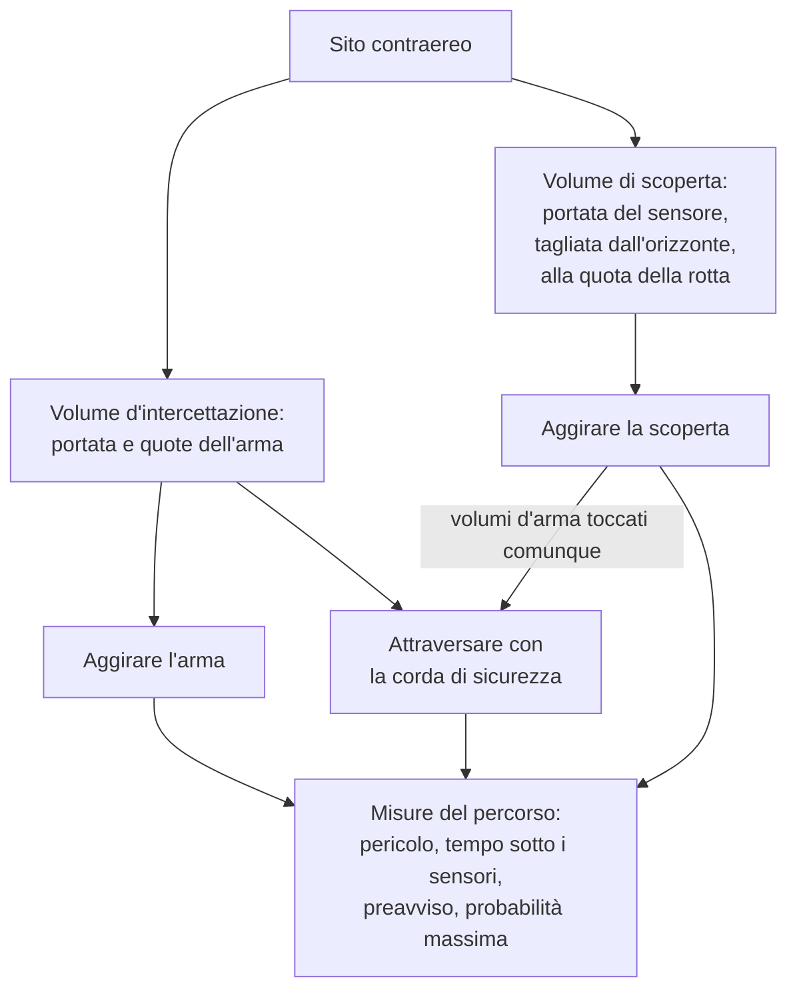

### 9.3 Il pianificatore d'attacco

Decide **da che quota, a che velocità, con quale profilo** (volo livellato, picchiata, cabrata) **e da quale direzione** un aereo
sgancia una bomba su un bersaglio, cercando di esporsi il meno possibile ai sistemi contraerei. Lavora su due livelli [V].

**Livello 1, la fisica del rilascio.** Moto parabolico nel vuoto, poi un correttivo per la resistenza [V, 2026-11-20]:

> **t_caduta = ( v_z + √(v_z² + 2·g·h) ) / g**    **gittata = v · cos(beccheggio) · t_caduta**
>
> dove v è la velocità, v_z = v · sin(beccheggio) la sua componente verticale (negativa in picchiata), h la quota sopra il
> bersaglio e g = 9,81 m/s². Poi i **fattori di resistenza** per classe di bomba [S]: bassa resistenza, gittata −10% e caduta
> +5%; frenata (code a ombrello, paracadute), gittata circa −50% e caduta circa +30%.

Le bombe plananti guidate usano invece un rapporto di planata, e i contenitori di submunizioni plananti la distanza di sgancio
dichiarata dal registro [V]. Se quota o velocità sono fuori dalla **finestra di rilascio** dell'arma, vengono portate al valore
ammesso più vicino, come fa l'intelligenza artificiale di DCS, invece di rinunciare al tiro [V].

**Esempio ILLUSTRATIVO.** Sgancio livellato a 1000 m sopra il bersaglio a 200 m/s: nel vuoto la bomba cade in circa 14,3 s e
percorre circa 2,86 km; con il fattore di bassa resistenza circa 2,57 km in circa 15,0 s, cioè una distanza obliqua dal bersaglio
di circa 2,76 km. È questa distanza che il motore usa come «portata» della bomba (sezione 6.4).

**Livello 2, la ricerca su griglia** [V]. Il pianificatore prova:

- **quote**: 6 quote sulla fascia ammessa (inviluppo d'attacco dell'aereo intersecato con la finestra dell'arma), più i bordi dei
  volumi d'intercettazione che vi cadono;
- **profili**: quelli ammessi dall'arma, con picchiate a 15°, 30°, 45° e 60° e cabrata a 30° [S];
- **direzioni**: 12, una ogni 30°;
- per ogni combinazione, il tratto dal **punto iniziale d'attacco** (10 km prima dello sgancio [S]) allo sgancio e all'uscita, a
  quota e velocità **costanti**.

Per ogni volume d'intercettazione toccato calcola l'**esposizione effettiva**: il sito può lanciare solo dopo aver **visto**
l'aereo con il **proprio** sensore e dopo il suo tempo di tiro [V, 2026-11-20]:

> **t_lancio = max( ingresso nel volume d'arma , primo contatto con il volume di scoperta + tempo di acquisizione ) + tempo minimo di tiro**
>
> **esposizione effettiva = max(0, uscita dal volume d'arma − t_lancio)**
>
> Se il volume di scoperta dello stesso sito non viene mai toccato, l'esposizione effettiva è zero; se il sito non ha un volume di
> scoperta associato, si assume che abbia già l'aereo in traccia.

Sceglie la combinazione con la **minima esposizione pesata** (somma delle esposizioni effettive per il pericolo di ogni sito), poi
la **quota più bassa** (sgancio più preciso), poi la direzione più vicina a quella della base, poi un ordine fisso [V]. **Le minacce
non rendono mai un profilo impossibile** (decisione dell'utente) [D]: decidono solo quale scegliere fra quelli fattibili. Se il
chiamante indica una base, il pianificatore aggiunge le tratte di andata e ritorno con il pianificatore di rotta.

**Esempio ILLUSTRATIVO** (secondi dall'inizio del tratto d'attacco). L'aereo entra nel volume d'arma a 40 s e ne esce a 100 s; tocca
il volume di scoperta a 10 s; tempo di acquisizione 8 s, tempo minimo di tiro 5 s. t_lancio = max(40, 10 + 8) + 5 = 45 s:
esposizione effettiva **55 s**. Se a quota più bassa l'orizzonte nasconde l'aereo fino a 38 s: t_lancio = max(40, 46) + 5 = 51 s,
esposizione **49 s**. Se l'aereo non entra mai nel volume di scoperta: **0**.

*Diagramma G27 — L'esposizione effettiva a un sito (numeri ILLUSTRATIVI, dall'esempio). Deriva dalla regola del cap. 7 §7.9.*

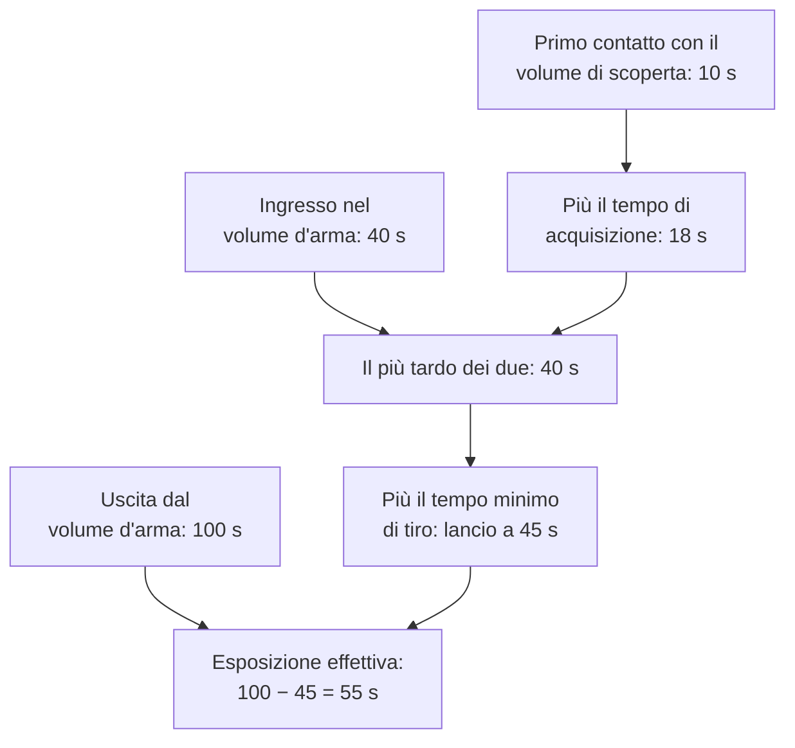

**Il risultato** è un **profilo d'attacco**: arma, quota e velocità di sgancio, profilo, direzione d'ingresso, distanza obliqua di
sgancio, tempo di caduta e le esposizioni a ogni sito [V]. Il progetto lo pensa letto da **due esecutori** nello stesso modo: il
motore DES e un futuro adattatore DCS, che ne trarrebbe quota, direzione, arma e numero di passaggi per i compiti d'attacco del
simulatore. **Oggi il motore ne legge solo l'arma** (§9.1).

*Diagramma G28 — Dal pianificatore d'attacco agli esecutori. Deriva da D15, corretto sul codice per la parte del motore (le
frecce tratteggiate sono letture previste ma oggi non fatte).*

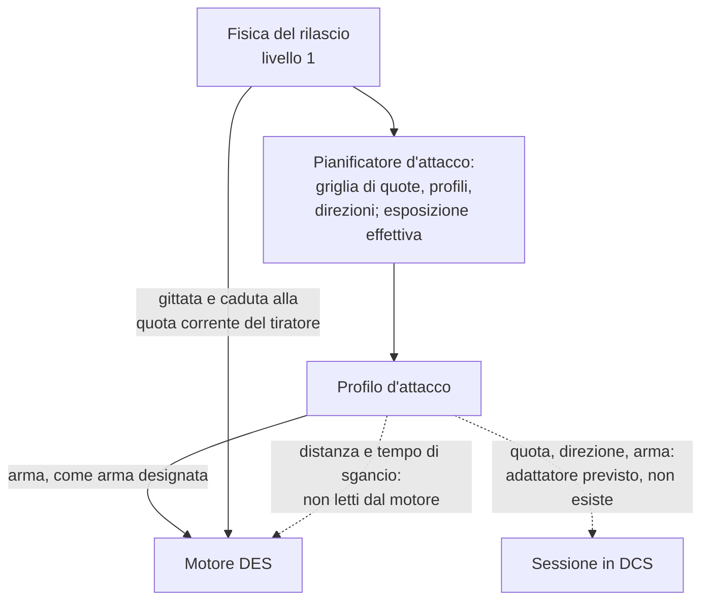

> **Dalla letteratura.** Pianificazione di rotte in presenza di minacce: `[FONTE: pianificazione di rotte militari in presenza di
> minacce]`, non coperta dalla bibliografia. L'orizzonte radar con il raggio terrestre equivalente di 4/3 è un argomento dei testi
> radar: Skolnik [B 5.4] e Mahafza [B 5.5] (opere verificate; **il contenuto specifico non è verificato**). La caduta di un grave
> nel vuoto è fisica elementare; i profili di sgancio e i fattori di resistenza delle bombe: `[FONTE: balistica delle bombe e
> profili di sgancio]`, non coperta.
>
> **Scelta del progetto.** Due volumi distinti per sito, legati dallo stesso identificativo del sito; volume di scoperta a una sola
> quota, tagliato dall'orizzonte; tre modi di trattare le minacce; corda di sicurezza nel caso radiale; misure di scoperta con la
> legge del motore; griglia di ricerca con esposizione effettiva e scelta per esposizione pesata, poi quota; minacce che non
> rendono mai impossibile un profilo [D]; fattori di resistenza, angoli, distanza del punto iniziale e altezze d'antenna stimati [S].
>
> **Limiti e incertezze.**
> - **Nessun chiamante di produzione**: il pianificatore d'attacco è usato solo dai test, quello di rotta dal primo e da uno
>   strumento di visualizzazione [V, 2026-11-20].
> - Volume di scoperta a una sola quota: niente cambi di quota per aggirarlo [V]; niente reti di sensori [V]; l'attraversamento a
>   corda limitata del **solo** volume di scoperta non è fatto [V]; il sito è supposto pronto all'ingresso nel volume d'arma [V].
> - Pianificatore e motore non usano la stessa geometria: cilindro a una quota con orizzonte contro sfera senza orizzonte; possono
>   scegliere sensori diversi; la probabilità di scoperta del percorso è il caso peggiore, non quella cumulata [V].
> - Il tratto d'attacco valutato è a quota costante: la picchiata o la cabrata entrano solo nella balistica, non nell'esposizione
>   [V]; terreno non modellato [V]; solo armi a caduta [V]; fattori di resistenza stimati [S]; la sfera di portata delle bombe nel
>   motore non ha una distanza minima [V].
> - Il motore non legge distanza e tempo di sgancio del profilo d'attacco: li ricalcola alla quota corrente del tiratore [V,
>   2026-11-20].
>
> **Nel manuale.** Cap. 7 §7.8 (pianificatore di rotta: volumi, orizzonte, modi, misure, permanenza; D14), §7.9 (pianificatore
> d'attacco: fisica, griglia, esposizione effettiva, profilo; D15); cap. 4 §4.20 (le bombe nel motore); cap. 9 §9.1 «Limiti del
> pianificatore di rotta e del pianificatore d'attacco». Attenzione: il cap. 7 §7.9 e il diagramma D15 dicono che il motore legge
> distanza e tempo di sgancio del profilo; il codice attuale non lo fa (vedi §9.1 di questa guida).

---

*Fine della parte B. Le sezioni 10-16 (casualità e riproducibilità, verifica, affidabilità, letteratura, guida al manuale,
glossario, bibliografia) seguono in una parte successiva.*
