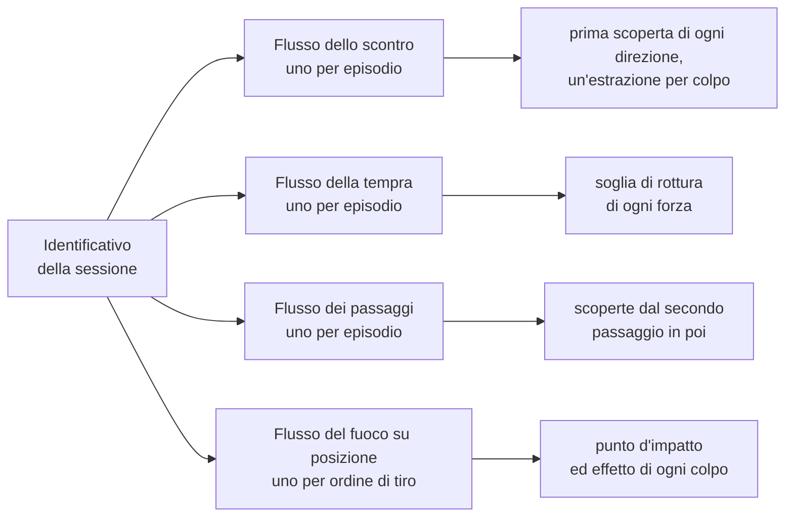
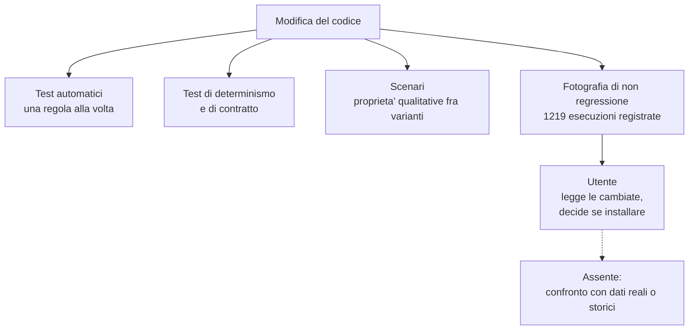
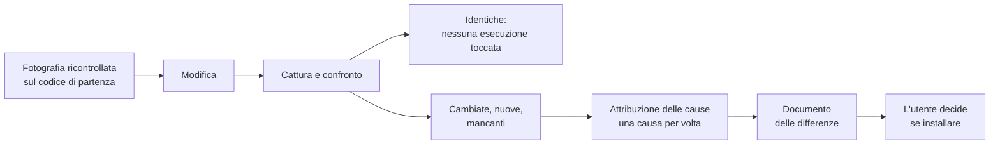
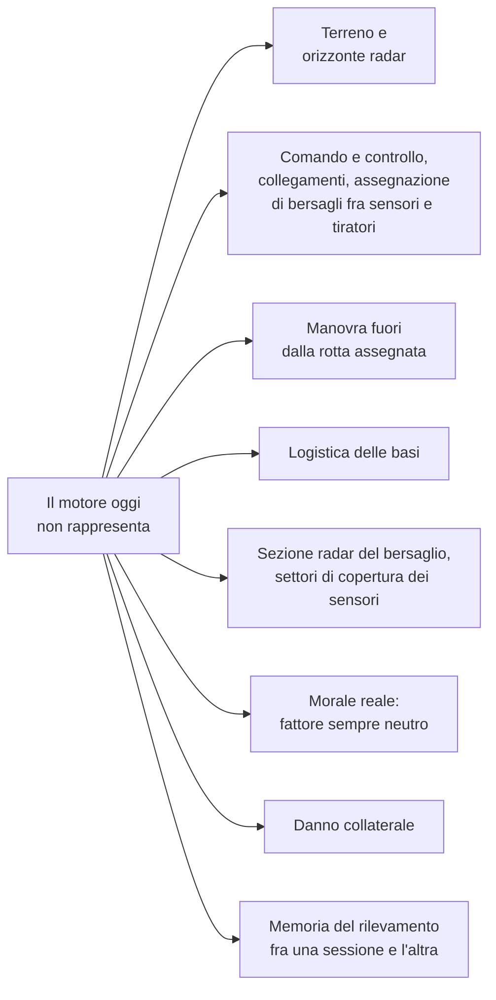
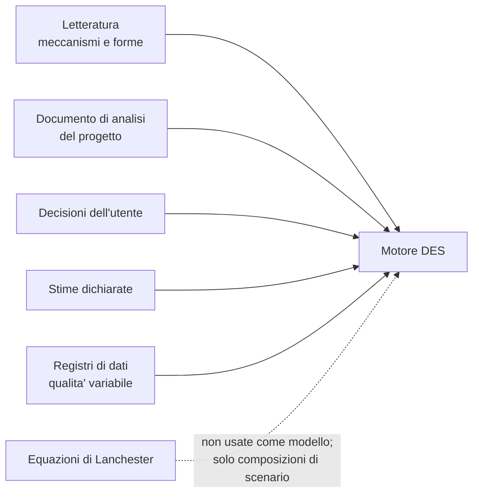

# Guida concettuale al motore DES — Parte C

*Sezioni 10-13. Bozza della fase B (stesura), da rivedere nella fase C (verifica). Riprende le convenzioni della parte A:
etichette [V]/[S]/[D]/[NV], riquadri «Dalla letteratura», «Scelta del progetto», «Limiti e incertezze», «Nel manuale»,
numeri degli esempi ILLUSTRATIVI.*

> **Data**: 2026-11-20.
> **Scritta sul repository al commit `3116813d`** (branch `analysis/dce-dcs-persistence`). L'ultimo commit che tocca il codice è
> `598af98e` (2026-11-19): aggiunge un interruttore **nuovo, spento di default**, per una possibile ricalibrazione della
> probabilità di scoperta al bordo della portata; con l'interruttore spento il comportamento è quello descritto qui. La
> fotografia di non regressione installata è quella del 2026-11-19 (`fdb78b86`). Le affermazioni marcate «[V, 2026-11-20]» sono
> state riscontrate sul codice o sul file della fotografia dall'autore di questa parte; le altre [V] vengono dal manuale, alla
> data indicata lì. **Nessuna suite e nessun confronto sono stati rieseguiti per questa guida.**

---

## 10. Casualità e riproducibilità

### 10.1 Dove entra il caso

Lo stesso incontro, ripetuto, può finire in modi diversi: un radar scopre l'aereo a 40 km oppure a 25, un missile colpisce
oppure no. Il motore rappresenta questa incertezza con **estrazioni casuali**, ma solo in pochi punti, tutti nello scontro e
nel fuoco su posizione [V]:

- **la scoperta**: un'estrazione per ogni coppia osservatore-bersaglio, per ogni direzione e per ogni passaggio del
  bersaglio nel volume del sensore, decide se e a che distanza avviene (sezione 5);
- **il colpo**: un'estrazione per ogni colpo che arriva al bersaglio senza essere intercettato decide fra tre esiti — bersaglio
  distrutto, danneggiato, mancato (sezione 6) [V, 2026-11-20];
- **la tempra**: all'inizio di ogni episodio ogni forza riceve una propria soglia di rottura, estratta a caso attorno a un valore
  centrale (sezione 6);
- **il fuoco su posizione**: per ogni colpo, il punto d'impatto e l'effetto sulle unità nemiche vicine (sezione 6).

Tutto il resto è **deterministico**: la geometria dei contatti, l'ordine degli eventi, i ritardi di reazione, la saturazione
delle difese, le regole d'ingaggio, il carburante [V]. Lo strato dei contatti non estrae mai numeri casuali (sezione 3).

### 10.2 Numeri «casuali» che si possono ripetere

I numeri casuali di un calcolatore sono **pseudo-casuali**: una formula produce una sequenza che ha l'aspetto del caso, ma
che è interamente determinata dal punto di partenza, il **seme**. Stesso seme, stessa sequenza. Il motore usa il generatore
standard del linguaggio Python (l'algoritmo detto Mersenne Twister [B 2.6]) e lo fa partire, ogni volta, da un seme
calcolato in modo fisso [V, 2026-11-20].

Il seme non è scelto a mano: è una **funzione della chiave** di ciò che si sta estraendo. La chiave ha quattro parti, tutte
in termini di dominio: l'identificativo della sessione, quello della missione (quando l'estrazione appartiene a una sola
missione), quello dell'evento, un contatore. La regola è [V, 2026-11-20]:

> **seme = primi 64 bit di SHA-256( versione dello schema, sessione, missione, evento, contatore )**
>
> SHA-256 è un'**impronta crittografica**: trasforma un testo in un numero lunghissimo, sempre lo stesso per lo stesso testo e
> completamente diverso se il testo cambia anche di una lettera. La chiave viene prima scritta in una forma canonica (un testo
> in cui il numero 1 e la scritta «1» restano diversi), poi ridotta a impronta; dell'impronta si tengono i primi 64 bit. A
> parole: *il seme dipende solo da che cosa si sta estraendo, non da quando, da dove o su quale macchina gira il programma*.

La scelta di un'impronta crittografica ha un motivo preciso: la funzione di «hash» interna di Python, applicata ai testi, cambia a
ogni avvio del programma, quindi darebbe semi diversi da un'esecuzione all'altra; l'impronta SHA-256 no [V]. La **versione dello schema**
entra nel calcolo: se un giorno si cambierà il modo di scrivere la chiave, i semi cambieranno in modo dichiarato e non di
nascosto [V].

**Esempio ILLUSTRATIVO** (chiave inventata; i numeri sono stati calcolati per questa guida rifacendo il calcolo del seme
fuori dal motore e servono solo a mostrare il meccanismo). Sessione «S-12», episodio fra le missioni «M-Blu-1» e «M-Rossa-2»,
primo episodio fra loro (contatore 0): le prime tre estrazioni del flusso dello scontro valgono 0,202 - 0,325 - 0,437.
Rieseguendo la sessione si ottengono di nuovo 0,202 - 0,325 - 0,437. Un secondo episodio fra le stesse due missioni (contatore
1) parte invece da 0,800 - 0,988 - 0,684; la stessa chiave in una sessione «S-13» da 0,949 - 0,358 - 0,635.

### 10.3 Un flusso per ogni uso

Il motore non usa un unico generatore per tutta la sessione: apre un **flusso** (una sequenza indipendente, con un proprio
seme) per ciascun uso [V, 2026-11-20]:

| Flusso | Quanti | Chiave | Che cosa estrae |
|---|---|---|---|
| **dello scontro** | uno per episodio | sessione, insieme delle forze dell'episodio, numero d'ordine dell'episodio | la prima scoperta di ogni coppia e direzione, poi un'estrazione per colpo |
| **della tempra** | uno per episodio | come sopra, con un'etichetta diversa | la soglia di rottura di ogni forza |
| **dei passaggi** | uno per episodio | come sopra, con un'altra etichetta | le scoperte dal secondo passaggio in poi |
| **del fuoco su posizione** | uno per ordine di tiro | sessione, missione del tiratore, ordine di tiro | punto d'impatto ed effetto di ogni colpo |

Due dettagli contano. Il primo: l'insieme delle forze entra nella chiave **ordinato alfabeticamente**, quindi il seme non
dipende dall'ordine in cui le forze sono state passate al motore [V]. Il secondo: separare i flussi rende ogni regola
**indipendente dalle altre** nel consumo dei numeri. Quando è stata introdotta la tempra (settembre 2026), le sue estrazioni
sono andate in un flusso nuovo: per costruzione, le scoperte e i colpi di ogni scontro continuano a ricevere gli stessi numeri
che ricevevano prima, e una differenza di esito si può attribuire alla regola nuova e non a un «effetto domino» sui numeri [V].
Lo stesso vale per il flusso dei passaggi, aggiunto a novembre.

### 10.4 Il seme non basta: conta l'ordine

Dentro un flusso, ogni estrazione prende il numero successivo. Se due estrazioni si scambiano di posto, si scambiano anche
i numeri, e la storia cambia. Per questo **l'ordine delle estrazioni fa parte del contratto** del motore [V]:

- nello scontro, prima tutte le estrazioni di scoperta, nell'ordine fisso delle finestre di contatto (per istante d'inizio e
  identificativi) e, per ognuna, prima una direzione poi l'altra; poi un'estrazione per colpo, nell'ordine degli eventi;
- gli eventi simultanei hanno un ordine fisso (sezione 2): scontri, poi fuochi su posizione, poi fine dei movimenti; dentro lo
  scontro, a parità d'istante, prima i lanci e poi gli impatti, così che tutti i lanci di un istante «vedano» lo stato prima
  dei danni;
- per il fuoco su posizione, per ogni colpo due estrazioni per il punto d'impatto e poi una per ogni nemico raggiunto, in
  ordine di identificativo.

**Esempio ILLUSTRATIVO.** Due colpi, A e B, arrivano nello stesso scontro; le due estrazioni successive del flusso valgono
0,12 e 0,71. Il colpo A ha probabilità 0,30 di distruggere il bersaglio. Se A viene risolto per primo riceve 0,12: bersaglio
distrutto. Se l'ordine si invertisse, A riceverebbe 0,71: colpo senza effetto. Stesso seme, storia diversa: per questo
salvare il seme non basta, e l'ordine è fissato una volta per tutte.

Una **precondizione** completa il quadro: gli identificativi delle forze e delle unità devono essere **stabili** fra le
esecuzioni, perché entrano nella chiave e nell'ordine [V]. Il progetto ha dovuto correggerlo: alcuni oggetti del modello
ricevevano un suffisso casuale nel nome alla creazione; oggi chi costruisce le forze può e deve passare identificativi
espliciti, e i test lo controllano [V].

*Diagramma G20 — Dalla chiave al flusso. Deriva da D125 (dalla chiave all'istanza del generatore).*

*Diagramma G21 — I quattro flussi di una sessione. Deriva da D126 (chi apre quale flusso).*

### 10.5 Riproducibile non vuol dire prevedibile, né giusto

Il risultato di tutto questo è che **a parità di ordine di sessione, di dati e di codice il motore produce la stessa storia**,
campo per campo; un test lo verifica costruendo due volte la stessa sessione e confrontando esito e stato delle unità, e
controlla anche il contrario: con un identificativo di sessione diverso gli eventi cambiano, mentre restano uguali le forze
che si incontrano, che dipendono solo dalla geometria [V, 2026-11-20].

Tre conseguenze vanno tenute presenti.

1. **«Deterministico» non vuol dire «senza caso».** Il caso c'è; è solo ripetibile.
2. **Una singola esecuzione è un campione, non «il risultato».** Per sapere che cosa ci si deve aspettare servono
   **repliche**: la stessa sessione con identificativi diversi, quindi semi diversi. Gli scenari di prova del progetto ne
   usano fino a 20 per variante [V]. Con N repliche la media di una grandezza ha un'incertezza che si stima con l'**errore
   standard**:

   > **errore standard = s / √N**
   >
   > dove **s** è la deviazione standard osservata fra le repliche. A parole: *quanto potrebbe spostarsi la media se si
   > rifacessero le stesse N repliche con altri semi*.

   **Esempio ILLUSTRATIVO.** Venti repliche di un attacco danno in media 3,1 aerei persi, con deviazione standard 1,2: l'errore
   standard è 1,2 / √20 ≈ 0,27. Un'alternativa provata allo stesso modo, con la stessa dispersione, ha anch'essa un errore di
   0,27, e la loro **differenza** ha un errore di circa √(0,27² + 0,27²) ≈ 0,38. Se l'alternativa dà 3,2, la differenza (0,1) è
   molto minore di 0,38: non distinguibile. Se dà 1,8, la differenza (1,3) vale più di tre volte 0,38: difficilmente è
   fortuna. Uno scenario del progetto usa proprio una soglia di tre errori standard per dire che una differenza è reale [V].
3. **Un esito diverso dopo una modifica del codice non è un errore di riproducibilità.** La riproducibilità vale a parità di
   codice e di dati: ogni cambio di regola o di registro cambia legittimamente le storie, ed è proprio ciò che la fotografia di
   non regressione rende visibile (sezione 11).

### 10.6 Confronti a parità di caso

C'è un vantaggio pratico. Se due alternative (per esempio due rotte) vengono provate con **gli stessi identificativi di
sessione**, partono dagli stessi numeri casuali: la differenza fra i loro esiti dipende di più dalla differenza fra le
alternative e meno dalla fortuna. Gli scenari del progetto lavorano così: le varianti di uno stesso seme condividono
l'identificativo di sessione [V]. L'allineamento però non è perfetto: se una modifica cambia il numero di estrazioni dentro
un flusso (per esempio una scoperta che ora avviene e prima no, che genera un lancio in più), i numeri successivi di quel
flusso slittano; i flussi separati limitano lo slittamento ai soli usi toccati [V per il meccanismo]. **Quanto** questo
riduca la variabilità dei confronti non è stato misurato [NV].

> **Dalla letteratura.** Generatori pseudo-casuali, semi e analisi delle repliche sono temi standard dei manuali di
> simulazione: Law [B 1.3] e Banks e altri [B 1.2] (opere verificate; i capitoli specifici non sono stati controllati). L'idea
> di **flussi e sotto-flussi** indipendenti e riproducibili per gli esperimenti di simulazione è formalizzata da L'Ecuyer e
> altri [B 2.1]; i generatori «a contatore», che danno un flusso per chiave senza stato condiviso, da Salmon e altri [B 2.7]: lo
> schema del motore (un seme per chiave) è vicino a quest'ultima idea, **valutazione di questa guida**, non dichiarata dal
> progetto. L'algoritmo del generatore: Matsumoto e Nishimura [B 2.6]. L'uso degli stessi numeri casuali per confrontare
> alternative («numeri casuali comuni») e le condizioni in cui riduce la varianza della differenza: Glasserman e Yao [B 2.5]
> (citazione verificata, **contenuto non letto**). Perché una simulazione stocastica non equivale a una simulazione «al valore
> medio» (con soglie, l'esito medio non è l'esito della situazione media): `[FONTE: simulazione stocastica contro simulazione
> al valore medio]`, da cercare nei manuali [B 1.2]-[B 1.3].
>
> **Scelta del progetto.** Una sola sorgente di casualità per sessione, mai il generatore globale del linguaggio; seme da
> impronta crittografica della chiave; un flusso per uso; ordine delle estrazioni e degli eventi simultanei come parte del
> contratto [D, vincolo dell'utente «riproducibilità dal seme»; V nel codice]. Nei moduli del motore non c'è alcuna estrazione
> dal generatore globale [V, 2026-11-20, ricerca nei moduli dello scontro, dei contatti, dell'orchestratore, del fuoco su
> posizione, del danno e del carburante].
>
> **Limiti e incertezze.**
> - Riproducibile **a parità di codice e di dati**: un cambio di regola o di registro cambia le storie [V].
> - Gli identificativi devono essere stabili: chi costruisce le forze senza identificativi espliciti perde la riproducibilità
>   [V].
> - Il generatore e l'impronta sono stabili fra macchine e versioni del linguaggio secondo la documentazione del codice [V];
>   che le stesse fotografie diano «identiche» sulle macchine di lavoro del progetto è dichiarato dai rapporti, non
>   rieseguito qui [NV].
> - Flussi «indipendenti» significa **separati** (semi diversi). L'indipendenza statistica fra sequenze dello stesso
>   generatore avviate da semi diversi non è dimostrata dal progetto: è la pratica comune, non una garanzia formale come nei
>   flussi di [B 2.1] [NV, osservazione di questa guida].
> - **Quante repliche servono** per una stima affidabile nell'uso di campagna non è discusso nel manuale [NV].
> - Seme a 64 bit: secondo il commento del codice una collisione fra due chiavi diventa probabile solo verso i quattro
>   miliardi di chiavi [V per il commento].
>
> **Nel manuale.** Cap. 1 §1.3 (vincolo 2), §1.5; cap. 7 §7.1 (la sorgente di casualità); cap. 6 §6.4 (i tre flussi per
> episodio e il quarto del fuoco su posizione), §6.2 (ordine degli eventi di sessione); cap. 4 §4.11 (ordine delle estrazioni),
> §4.21 (tempra); cap. 8 §8.2 (test di determinismo); atlante 10C §10C.8 (diagrammi D125-D126).

---

## 11. Come si verifica il motore e che cosa significa

### 11.1 Verifica e validazione: due domande diverse

La letteratura sui modelli di simulazione distingue tre domande [B 6.2]:

- **verifica**: il modello è costruito bene, cioè fa ciò che i suoi autori hanno deciso che faccia?
- **validazione**: è il modello giusto, cioè i suoi risultati corrispondono al fenomeno reale, per l'uso previsto?
- **accreditamento**: è adatto a **questo** uso? È un giudizio di chi decide, non un calcolo.

Tutto ciò che il progetto ha costruito per controllare il motore risponde alla **prima** domanda. **Nessuna validazione su dati
reali o storici è stata fatta** [V per l'assenza nel manuale; D: l'utente ha confermato la formulazione]. Il resto di questa
sezione spiega gli strumenti di verifica, che cosa provano e che cosa no.

### 11.2 Gli strumenti

**I test automatici.** Ogni regola ha test che la controllano da sola: una formula su casi noti, un caso limite, un errore
atteso. Insieme formano la **suite**, che l'ultimo commit di codice (2026-11-19) dichiara di **4973 test, tutti superati**
[NV: numero dichiarato, non rieseguito]. Fra i test ce ne sono due famiglie di particolare interesse per un responsabile:

- il **test di determinismo**: la stessa sessione costruita due volte dà esiti e stato delle unità identici, e una sessione
  con altro identificativo dà eventi diversi ma le stesse forze in contatto (sezione 10) [V, 2026-11-20];
- il **test di contratto dell'indifferenza al simulatore**: controlla che le porte del motore trasportino solo valori di
  dominio, che nessun nome di campo contenga termini del simulatore, che nessun modulo del motore importi componenti di DCS, e
  che una catena di tre sessioni consecutive costruite solo in Python giri da capo a fondo passando lo stato solo attraverso
  le unità [V]. Poiché l'adattatore DCS non esiste, non si può fare la prova «togliendolo»: questo test ne è l'equivalente
  verificabile (sezione 1).

**Gli scenari.** Una batteria di scenari, numerati da 1 a 36 e in parte divisi in varianti, mette insieme forze, missioni e
registri veri o dichiarati di prova e controlla **comportamenti attesi** [V]:

- i primi cinque riprendono **le composizioni di forza** (non i numeri) da documenti sui modelli di Lanchester raccolti dal
  progetto; i successivi coprono domini e meccanismi mancanti (navale, bersagli non militari, scala, nebbia di guerra, soglia
  di ritirata, confine fra sessioni, nodi di comando, basi, reti di trasporto); da lì in poi ogni regola nuova ha il suo
  scenario;
- gli scenari controllano **proprietà qualitative o strutturali** — chi perde di più, che cosa accade prima, che una variante
  ha meno scoperte dell'altra — e **mai un numero di taratura** [V];
- molti scenari usano, al posto della scelta dell'arma dai registri, una **tabella di tiro di prova** con valori «di ordine di
  grandezza plausibile ma non calibrati e non presi da una fonte», dichiarati come tali [V];
- le repliche (fino a 20 semi per variante) servono a rendere le proprietà controllabili statisticamente [V].

**La fotografia di non regressione.** È lo strumento più caratteristico. Uno strumento apposito esegue tutti gli scenari e
registra, per ogni esecuzione, un riassunto esatto dell'esito: intervallo della sessione, esiti delle forze in ogni scontro,
stato finale di ogni unità (salute, munizioni per arma, carburante), munizioni consumate, intercettazioni, eventi di
carburante, conteggi e liste complete degli eventi [V]. I numeri con la virgola sono arrotondati a 6 decimali e le voci
ordinate, così che **due catture dello stesso codice sono identiche byte per byte** [V, 2026-11-20]. L'arrotondamento serve
al confronto, non dice nulla sulla precisione fisica dei numeri.

La fotografia installata oggi registra **1219 esecuzioni** [V, 2026-11-20: contate sul file]. È stata installata il
2026-11-19, su richiesta dell'utente, dopo la lettura delle 116 esecuzioni nuove di una serie di scenari sulla permanenza
breve nel volume dei sensori; fino al giorno prima era di 1103. Il confronto fatto subito dopo l'installazione ha dato **1219
esecuzioni identiche**, e lo stesso esito è dichiarato dopo l'ultimo cambio di codice [NV: dichiarato, non rieseguito].

**Il processo.** Ogni modifica del motore segue la stessa procedura [V]: la fotografia viene ricontrollata identica sul codice
di partenza; si modifica il codice; si confronta; ogni esecuzione risulta **identica**, **cambiata**, **nuova** (uno scenario
aggiunto) o **mancante** (uno scenario tolto); le differenze vengono **attribuite alla loro causa**, anche con catture di
controllo in cui una sola causa per volta è attiva; le spiegazioni sono scritte in un documento delle differenze; solo dopo,
e **solo su decisione dell'utente**, si installa una fotografia nuova. Nessun agente di sviluppo la installa da sé.

**Gli interruttori.** Ogni regola nuova del motore entra dietro un **interruttore** il cui stato di default riproduce il
comportamento precedente [V]. Serve a due cose: separare l'effetto della regola da quello di ogni altra modifica, e tenere
un'alternativa pronta. Il principio ha **eccezioni dichiarate**, che il responsabile deve conoscere [V]:

- alcune regole sono state **accese di default** per decisione dell'utente dopo la verifica (la riduzione della scoperta per
  permanenza breve nel volume, il 2026-11-18; lo stato di missione «in corso»): da quel momento il default **non** riproduce più
  il comportamento precedente in assoluto, lo riproduce solo sulle esecuzioni fotografate;
- una regola (una scoperta per ogni passaggio nel volume) è stata resa permanente e il suo interruttore **eliminato**;
- due regole sono costruite e provate ma **spente di default** (quali armi le difese aeree possono intercettare; la quota nel
  volume d'ingaggio), e dal 2026-11-19 lo è anche la possibile ricalibrazione della probabilità al bordo della portata: con questi
  interruttori spenti, quelle regole **non** agiscono nelle sessioni.

*Diagramma G22 — Gli strumenti di verifica. Nessun diagramma tecnico corrispondente.*

*Diagramma G23 — Il processo di non regressione. Dal cap. 8 §8.7; nessun diagramma tecnico corrispondente.*

### 11.3 Che cosa questi strumenti NON dimostrano

- **La fotografia garantisce che il comportamento non cambi per caso, non che sia giusto.** È la storia prodotta dal codice a
  una certa data, non un insieme di risultati «veri» attesi. «1219 identiche» dopo una modifica vuol dire che la modifica non
  tocca quelle esecuzioni; non che la modifica sia corretta, né che le esecuzioni lo fossero [V].
- **«Tutti i test passano» non vuol dire «il modello rappresenta bene la realtà».** I test controllano che il codice faccia ciò
  che il progetto ha deciso; se una decisione o una stima è sbagliata, i test passano lo stesso.
- **La fotografia non vede tutto.** Non registra [V]:
  - i **rilevamenti** (chi ha scoperto chi, a che distanza, con quale probabilità) per **1103 delle 1219 esecuzioni**: li registra
    solo per le 116 della serie sulla permanenza breve [V, 2026-11-20]. Una modifica della legge di scoperta che non cambia
    nessun tiro resta invisibile nelle altre;
  - lo **stato di ogni missione** (completata, abortita, in corso...), le **posizioni finali**, gli istanti di fine movimento e
    gli **esiti delle operazioni**: li controllano solo i test.
- **Copertura parziale.** Diversi sensori con dati reali (alcuni sistemi antiaerei, gli altri radar di scoperta lontana, le
  altre navi, due velivoli radar) non compaiono in nessuna esecuzione fotografata con il loro tempo di rivisita e sono
  provati solo da test sui dati; **nessun radar di scoperta lontana** compare in uno scenario fotografato; il caso con più
  passaggi nel volume è provato da pochi scenari dedicati; lo scenario di scala ha 40 blocchi e 240 unità, non 10.000 [V].
- **Numeri dichiarati.** I conteggi della suite e gli esiti dei confronti riportati qui e nel manuale vengono dai rapporti e
  dai messaggi di commit; non sono stati rieseguiti per questa guida [NV].

> **Dalla letteratura.** La distinzione fra verifica, validazione e accreditamento, e l'accreditamento come giudizio di
> gestione sull'idoneità a un uso specifico: Youngblood e altri [B 6.2] (articolo **letto**). Rassegne dei metodi: Sargent
> [B 6.1], Balci [B 6.3]; schema di VV&A per le simulazioni militari: Davis [B 6.5]; lo standard di documentazione del
> Dipartimento della Difesa USA: MIL-STD-3022 [B 6.6]. Quando un modello di combattimento **non può** essere validato per la
> previsione (deve essere osservabile, strutturalmente stabile, con dati adeguati): Hodges e Dewar [B 6.4] (sintesi della
> pagina RAND). Tentativi di confrontare modelli di logoramento con battaglie storiche, utili a capire perché la validazione è
> difficile: Bracken, Fricker, Lucas e Turkes [B 4.7]; Dupuy [B 8.1]; Lawrence [B 8.2] (citazioni verificate, **contenuto non
> letto**). La tecnica di confrontare l'uscita di un programma con una «fotografia» approvata in precedenza: `[FONTE: test di
> regressione «golden master» / approval testing]` — non coperta dalla bibliografia.
>
> **Scelta del progetto.** Tre livelli (test, scenari, fotografia); scenari che controllano proprietà qualitative e mai
> numeri di taratura; installazione della fotografia riservata all'utente; un interruttore per ogni regola nuova, con le
> eccezioni dichiarate sopra [D, verificato nel codice e nel manuale].
>
> **Limiti e incertezze.** Nessuna validazione su dati reali o storici [V per l'assenza]. Fotografia cieca ai rilevamenti in
> 1103 esecuzioni su 1219 e agli esiti di missione, operazione e posizione [V]. Tabelle di tiro di prova non calibrate in
> molti scenari [V]. Default non più equivalente al comportamento precedente per le regole accese dall'utente [V]. Conteggi
> di suite e confronto dichiarati, non rieseguiti [NV].
>
> **Nel manuale.** Cap. 8 §8.1 (fabbrica di scenari, tabella di tiro di prova), §8.2 (determinismo), §8.3 (contratto),
> §8.4 (la batteria di scenari), §8.7 (lo strumento di non regressione e la storia della fotografia), §8.14 (scenari delle
> regole del 2026-11, serie sulla permanenza breve); cap. 6 §6.21 (interruttori e default); cap. 9 §9.1 («Permanenza nel
> volume», limite della fotografia; «Limiti della campagna»).

---

## 12. Quanto fidarsi dei risultati

### 12.1 La risposta breve

La **struttura** del motore — eventi, geometria dei contatti, catena dello scontro, applicazione per singola unità,
riproducibilità — è verificata sul codice [V]. I **numeri** che la alimentano sono in buona parte **stime dichiarate** o dati
di registro di qualità variabile, e **nessuna taratura su dati reali** è stata fatta. Per questo il motore, oggi, serve a
**confronti relativi fra alternative, con repliche**, e non a previsioni assolute; nessuna validazione su dati reali o storici
è stata fatta [D: formulazione confermata dall'utente].

### 12.2 Tre famiglie di incertezza

1. **La forma del modello**: ciò che il motore non rappresenta affatto (il terreno, l'orizzonte radar, il comando e controllo,
   la manovra libera, la logistica). Nessun valore dei parametri la compensa.
2. **I parametri stimati** [S]: numeri scelti come punto di partenza plausibile, dichiarati come stime nel codice, non tarati.
3. **I dati dei registri**: portate dei sensori, probabilità di colpo, velocità, consumi. Alcuni hanno fonti buone, altri fonti
   contraddittorie o deboli; dove il progetto lo sa, lo scrive nel commento del dato [V].

Un avvertimento sulle etichette: «stima» non vuol dire «inventata a caso» (ha una provenienza scritta), ma nemmeno «misurata».
«Spenta» per una regola non vuol dire «rotta»: vuol dire che non agisce di default.

### 12.3 Area per area

*Tabella G24 — Affidabilità per area. Dal cap. 9 §9.1 e §9.4; etichette secondo la convenzione della guida.*

| Area | Che cosa è solido | Che cosa è stimato, debole o assente |
|---|---|---|
| **Tempo ed eventi** | salto da evento a evento, ordine degli eventi simultanei [V] | tempo di calcolo sul caso grande non misurato [NV] |
| **Contatti** | istanti d'incontro calcolati con la geometria, esatti rispetto al moto a tratti rettilinei [V] | nessuna manovra fuori rotta; nessun terreno né orizzonte radar [V]; guadagno della potatura per blocchi non misurato [NV] |
| **Scoperta** | una legge unica, con una forma che dipende dalla distanza; un'estrazione per passaggio [V] | probabilità al bordo della portata **0,5** [S, da ricalibrare]; forma della legge [S]; fattori di notte e maltempo uguali per radar e ottico [S]; tempi di rivisita in parte stimati [S]; portate di alcuni radar e del sensore a vista deboli o contraddittorie [S] |
| **Reazione e scelta dell'arma** | ritardo come evento futuro; prima arma con scorta in un ordine di preferenza [V] | totali «dal rilevamento al lancio» da fonti citate dal documento di analisi [NV]; scomposizione in quattro fasi [S]; peso costo/efficacia 0,5 [S, confermato dall'utente]; efficacia dell'arma non modulata dalla posizione nell'inviluppo [V] |
| **Salva e difese** | saturazione: colpi contro capacità di intercettazione [V] | finestra di raggruppamento delle salve 0 s di default (punto aperto) [S]; scoperta dei colpi in arrivo con semplificazioni dichiarate favorevoli alla difesa [S]; regole su quali armi si possono intercettare costruite ma spente [V] |
| **Danno** | un'estrazione per colpo, perdite per singola unità [V] | probabilità di colpo e di distruzione lette dai registri, di qualità variabile [V per la lettura, non per i valori] |
| **Rottura e ritirata** | meccanismo per forza intera, soglia casuale per forza [V] | erosione 0,30 come ordine di grandezza; shock 0,20, dispersione e pesi senza fonte [S]; morale e stima del nemico **mai alimentati** da un chiamante: fattore di morale sempre neutro [V] |
| **Fuoco su posizione** | evento separato, estrazioni proprie [V] | dispersione minima 50 m, raggio letale 0,25 m per mm di calibro, ripiego 25 m [S]; niente intercettazione né fuoco amico [V] |
| **Carburante e rientro** | consumo per tratto, albero di rientro [V] | dati di consumo d'emergenza del registro non tarati (sottostima dichiarata di circa 1/6 a postbruciatore pieno) [S]; tempo di disimpegno 5 minuti [D]; planata 10 a 1 [S]; area di una base 3 km [S] |
| **Campagna** | riarmo, rifornimento, riparazione fra sessioni; danni e scorte che passano da una sessione all'altra [V] | tempi di riarmo e riparazione: una sola fonte verificata sulla pagina originale, il resto riportato o stimato, il navale (48 h) stima senza fonte numerica [S]; nessuna logistica [D]; il rilevamento non passa da una sessione all'altra [V]; nessun chiamante di produzione [V] |
| **Pianificatori** | volumi di scoperta e d'intercettazione, orizzonte radar nel pianificatore [V] | pianificatore e motore usano volumi di forma diversa (cilindro contro sfera) e metriche di scoperta diverse [V]; la scelta della rotta non legge la probabilità di scoperta [V] |
| **Riproducibilità** | seme dalla chiave, flussi separati, test di determinismo [V] | numero di repliche necessario non discusso [NV] |

### 12.4 Le stime principali

*Tabella G25 — Mappa delle stime principali. Valori dal manuale e dal codice; tutti dichiarati come stime o decisioni nel codice.*

| Grandezza | Valore oggi | Stato | Che cosa tocca |
|---|---|---|---|
| Probabilità di scoperta al bordo della portata | 0,5 | [S] **da ricalibrare**, giudicata alta dall'utente; vale per ogni sensore | tutte le scoperte, quindi l'iniziativa e i tiri a valle |
| Forma della legge di scoperta (quarta potenza della distanza) | — | [S] di forma: ispirata all'equazione radar, semplificazione monotona | come la scoperta cala con la distanza |
| Fattori di notte e maltempo | 0,7 e 0,8 | [S], unici per tutti i sensori | scoperte notturne, soprattutto dei sensori a vista |
| Tempi di rivisita dei sensori | 53 modelli; 24 dei 43 aggiunti a novembre sono stime | [S] per le stime; vista e visori 3,2 s come approssimazione | riduzione della scoperta per passaggi brevi |
| Scomposizione del ritardo di reazione in quattro fasi | per tipo di sistema | [S] (i totali vengono da fonti citate [NV]) | chi spara per primo |
| Soglia di rottura | erosione 0,30, shock 0,20, dispersione 0,5, pesi | [S] | quando una forza si ritira |
| Peso del costo nella scelta dell'arma | 0,5 | [S], confermato dall'utente | quale arma si usa |
| Dottrina contro lo spreco di colpi | 0,9 e 2 missili in volo | 0,9 [D], 2 [S] | quanti colpi su un bersaglio già condannato |
| Fuoco su posizione | 50 m, 0,25 m/mm, 25 m | [S] | effetti dell'artiglieria e del fuoco navale su posizione |
| Raggio di un bersaglio «punto» | 500 m | [S] | chi è dentro il bersaglio designato |
| Consumo d'emergenza degli aerei | dati di registro | [S], sottostima dichiarata | riserva di rientro e consumo in combattimento |
| Tempi di riarmo e riparazione | per classe | una fonte verificata, il resto [S] | quando un'unità torna disponibile |
| Durata della sessione | 2 h di default, 4 h al massimo | [D] | anche la scoperta, quando un passaggio è tagliato dalla fine della sessione |

**La probabilità al bordo della portata** merita una riga in più, perché tocca tutto. Il valore 0,5 è una stima dichiarata nel
codice come «da ricalibrare»; il commento la lega a una convenzione per cui la portata di un sensore si dichiara a una certa
probabilità di scoperta (0,5 o 0,9), ma **la bibliografia non ha trovato una fonte per quella convenzione** [S; V, 2026-11-20
per il commento]. L'utente lo giudica alto. Una ricalibrazione è **in valutazione**: il codice ha un interruttore nuovo, spento
di default, che permette di provare un valore diverso; il valore non è deciso e l'interruttore non è acceso [V, 2026-11-20].
Questa guida descrive lo stato attuale.

### 12.5 Dove il manuale indica il verso di una distorsione

In alcuni punti il manuale non dice solo «stimato», ma anche **in quale direzione** il motore probabilmente sbaglia. È
un'informazione utile, perché dice quali confronti sono più esposti [V, tutte dichiarate nel cap. 9]:

- la scoperta dei colpi in arrivo da parte delle difese (tempo di volo dell'intercettore trascurato, sezione radar del colpo
  non modellata, traiettoria rettilinea) e la stima di copertura della dottrina di tiro sono semplificazioni **favorevoli alla
  difesa**;
- senza orizzonte radar, un radar vede un aereo **radente** fino alla sua portata piena: la scoperta dei voli bassi è
  **sovrastimata**, e per i radar di scoperta lontana di grande portata il caso è più forte;
- il sensore a vista di notte subisce lo stesso fattore del radar: la sua scoperta notturna è **sovrastimata**;
- i consumi d'emergenza del registro **sottostimano** il consumo a postbruciatore pieno; il consumo durante le attese è
  **sovrastimato** (è pari alla crociera);
- chi osserva un sistema antiaereo lo considera sempre **carico**, anche dopo che ha sparato tutto (decisione dell'utente
  [D]): la minaccia percepita è **sovrastimata** dopo i primi tiri;
- un bersaglio il cui passaggio nel volume di un sensore è spezzato fra due sessioni consecutive (possibile per unità
  terrestri e navali; per gli aerei la missione deve stare dentro la sessione) riceve **due estrazioni** invece di una: la
  probabilità di essere scoperti dipende anche da come la campagna è divisa in sessioni (verificato con prove temporanee,
  numeri non ripetibili dalla suite [NV]).

### 12.6 Che cosa il modello non rappresenta

*Diagramma G26 — Che cosa il motore non rappresenta. Dal cap. 9 §9.1; nessun diagramma tecnico corrispondente.*

### 12.7 Punti non verificati

- Il **tempo di calcolo** sul caso grande e il **guadagno della potatura** per blocchi non sono misurati [NV].
- Quanto la regola sulla permanenza nel volume cambi le **metriche di scoperta del pianificatore** non è misurato [NV].
- Se la stima del nemico o la ricognizione della campagna si alimentino dai rilevamenti della sessione precedente non è
  verificato [NV].
- Il costo di calcolo delle finestre di contatto dei radar di grande portata non è misurato: nessuno scenario fotografato ne
  contiene uno [NV].
- Il collegamento fra la ricognizione della campagna e la probabilità di scoperta esiste, ma il manuale lo dichiara «debole»
  (copre meno casi di quanto il nome suggerisca) e segnala un difetto a monte, non corretto [V per la dichiarazione].
- Il manuale tiene un elenco delle incoerenze trovate fra documenti di progetto e codice. Le voci più recenti sono state
  chiuse il 2026-11-19, salvo la descrizione incompleta di un componente interno nel commento del codice; le voci più
  vecchie che il manuale dà come aperte (stato del 2026-11-05, non ricontrollate dopo) riguardano testi di progetto, regole
  scritte nel codice in forma diversa da quella delle proposte, o ingressi non collegati (morale e stima del nemico, catalogo
  dei ricevitori d'allarme radar). La guida descrive il comportamento del codice, non quello dei documenti [V].

### 12.8 Che cosa il motore NON dice

- **Non** dice quanto vale una campagna né chi la vince: risolve una sessione alla volta, e il ciclo di campagna che le concatena
  non ha ancora un chiamante di produzione.
- **Non** dà perdite assolute affidabili: un «3,1 aerei persi in media» dipende dalle stime della tabella G25.
- **Non** dice nulla su terreno, guerra di comando e controllo, logistica o fattori umani oltre a quanto descritto.
- **Non** dice se una regola corrisponde alla dottrina reale: molte regole sono decisioni dell'utente, verificate nel codice
  ma non confrontate con la realtà.
- **Non** dà un intervallo di confidenza da solo: lo si ottiene con le repliche (sezione 10).

### 12.9 Come usarlo oggi

L'uso sostenibile è quello già praticato dagli scenari: **confronti relativi fra alternative, con repliche**. In concreto:
stessa situazione, due alternative (due rotte, due composizioni di forza, una regola accesa o spenta), molti identificativi di
sessione, confronto delle **distribuzioni** e non di un'esecuzione singola, con l'errore standard (sezione 10) [D: formulazione
confermata dall'utente].

Due cautele, che sono **indicazioni di metodo di questa guida** e non procedure del progetto [NV]:

- un confronto relativo è robusto solo se le stime incerte pesano **allo stesso modo** sulle due alternative. Se un'alternativa
  dipende molto dalla scoperta al bordo della portata (per esempio una rotta che sfiora i volumi dei sensori) e l'altra no, la
  stima incerta entra nella differenza;
- conviene chiedersi se la conclusione resiste a una variazione ragionevole delle stime che toccano le alternative; gli
  interruttori e le bande d'incertezza dichiarate nel codice sono il punto da cui partire.

Le decisioni ancora aperte e le tarature da fare non sono elencate qui: invecchiano in pochi giorni e stanno in un
**documento di stato separato**.

> **Dalla letteratura.** «Tutti i modelli sono sbagliati, ma alcuni sono utili»: Box [B 6.7] (fonte della massima secondo la
> bibliografia di Lucas e McGunnigle; il passo non è stato verificato). Perché un modello semplice e trasparente può valere più di
> uno complesso, proprio per le equazioni a salve: Lucas e McGunnigle [B 4.5] (abstract e bibliografia **letti**). Quando un
> modello di combattimento non può essere validato per predire: Hodges e Dewar [B 6.4] (sintesi della pagina RAND). Sull'uso
> della simulazione per capire più che per predire: Sabin [B 3.1] (opera verificata, pertinenza giudicata su schede e sommari);
> sull'analisi esplorativa: Davis [B 7.1] (sintesi RAND). Che cosa i modelli militari possono e non possono dire: Hughes (a
> cura di) [B 3.3], capitolo introduttivo (**contenuto non letto**; ISBN della 3ª edizione non verificato). Sulla convenzione
> della portata dichiarata a una data probabilità di scoperta: **nessuna fonte trovata** dalla bibliografia.
>
> **Scelta del progetto.** Dichiarare ogni stima come tale nel codice e nel manuale; tenere le regole nuove dietro interruttori;
> non tarare con numeri di fonti non validate; usare il motore per confronti relativi con repliche [D].
>
> **Limiti e incertezze.** È la sezione stessa. In sintesi: struttura [V], numeri in buona parte [S], nessuna validazione,
> nessuna taratura, alcuni punti [NV]. Le direzioni delle distorsioni di §12.5 sono quelle **dichiarate** dal manuale, non
> misurate.
>
> **Nel manuale.** Cap. 9 §9.1 (tutte le sottosezioni: in particolare «Permanenza nel volume», «Pd sul bordo della portata»,
> «Taglio di sessione e sessioni concatenate», i limiti dei sensori radar di scoperta lontana e a vista, i limiti del
> carburante e del rientro, «Fuoco su posizione», «Limiti della campagna»), §9.3 (punti di estensione), §9.4 (stato del motore), §9.6
> (incoerenze fra documenti e codice); cap. 7 §7.3 (statuto dei numeri dei ritardi di reazione), §7.13 (tempi di campagna);
> cap. 4 §4.2 (legge di scoperta), §4.21 (soglia di rottura), §4.36 (permanenza).

---

## 13. Da dove vengono le idee

### 13.1 Letteratura, analisi, decisioni, stime

Il motore ha quattro origini, e conviene tenerle separate riga per riga, perché hanno pesi diversi: la **letteratura** fornisce
meccanismi e forme; il **documento di analisi del progetto** ha fatto le scelte di architettura; l'**utente** ha deciso molte
regole; le **stime** riempiono i numeri che nessuno ha misurato. Il motore prende dalla letteratura **meccanismi**, non
coefficienti di logoramento aggregato.

*Tabella G27 — Idea per idea: da dove viene. «Contenuto non letto» = opera verificata nei dati bibliografici, non nel testo.*

| Idea | Origine | Che cosa viene davvero dalla fonte | Citazione |
|---|---|---|---|
| Simulazione a eventi discreti, agenda degli eventi futuri | letteratura + documento di analisi | il meccanismo generale | [B 1.1]-[B 1.4]; [B 1.5] (contenuto non letto) |
| Istanti d'incontro dal punto di massimo avvicinamento | geometria del moto relativo; scelta del progetto | la formula | `[FONTE: cinematica del moto relativo / anticollisione]` |
| Ritardo di reazione in quattro fasi | documento di analisi | i totali da fonti tecniche citate; la scomposizione è una stima [S] | `[FONTE: ciclo OODA e tempi di reazione]` |
| Scoperta che cala con la quarta potenza della distanza | letteratura (forma) + stima (valori) | la dipendenza dalla distanza dell'equazione radar; la curva reale è a «S», qui semplificata | [B 5.4] (contenuto non letto), [B 5.8] (contenuto non letto) |
| Probabilità 0,5 al bordo della portata | stima [S] | nessuna fonte trovata per la convenzione | — |
| Scoperta per passaggio; probabilità cumulativa | scelta del progetto; la letteratura distingue scoperta per scansione e cumulativa | il concetto | [B 5.5] (sommario letto), [B 5.6], [B 5.7] |
| Riduzione per permanenza breve nel volume | scelta del progetto con giustificazione geometrica [S] | la teoria della ricerca come riferimento **qualitativo** | [B 5.1]-[B 5.3] (contenuto non letto) |
| Tempo di rivisita 3,2 s dei sensori a vista | stima [S] dal valore centrale di una banda attribuita a una fonte del 1974 | — | `[FONTE: Poe 1974]`, nessuna fonte individuata dalla bibliografia |
| Saturazione delle difese per salva | letteratura (meccanismo) | l'idea di confrontare i colpi in arrivo con la capacità di intercettazione; il motore **non** usa le equazioni aggregate del modello a salve | [B 4.2] (contenuto non letto); [B 4.5] |
| Danno colpo per colpo (probabilità di colpo per probabilità di distruzione) | lettura dei campi dei registri; scelta del progetto | la scomposizione, comune nei modelli d'ingaggio | `[FONTE: scomposizione Ph × Pk]` |
| Soglia di rottura casuale | idea di soglie di rottura come distribuzione; valori stimati [S] | l'ordine di grandezza del 30% è detto «regola empirica diffusa» dal codice, senza fonte verificata | `[FONTE: soglie di rottura del 30%]` |
| Dottrina contro lo spreco di colpi | decisione dell'utente (0,9) + stima (2) | — | — |
| Scelta dell'arma per ordine di preferenza | scelta del progetto; **non** un'assegnazione ottima | il problema generale è noto in letteratura | Manne, Ahuja e altri (tabella dei segnaposto della bibliografia; contenuto non letto) |
| Fuoco su posizione | scelta del progetto con costanti stimate [S] | esiste letteratura sul fuoco d'area nel modello a salve, **non usata** | [B 4.6] (contenuto non letto) |
| Rientro al bingo, uscita di scena, politica d'armi, durata della sessione | decisioni dell'utente [D] | — | — |
| Tempi di riarmo e riparazione | ricerca web del progetto, una fonte verificata; il resto stime | — | non nella bibliografia |
| Riproducibilità con flussi separati | letteratura (principio) + scelta del progetto (schema) | l'idea di flussi indipendenti | [B 2.1], [B 2.7] |
| Livelli di risoluzione, motore di sessione dentro un ciclo di campagna | letteratura (inquadramento) | la classificazione dei modelli per risoluzione | [B 7.1]-[B 7.5] |
| Verifica e non regressione | letteratura (VV&A) + scelta del progetto (fotografia) | le definizioni | [B 6.1]-[B 6.6]; golden master: `[FONTE]` |
| Equazioni di Lanchester | **non usate** come modello | — | [B 4.1], [B 4.4], [B 4.7] (vedi §13.2) |

### 13.2 Il motore non è un modello alla Lanchester

Le **equazioni di Lanchester** (1916) descrivono il logoramento di due forze **aggregate** in modo continuo: ogni forza perde
unità a un ritmo proporzionale alla consistenza dell'altra. Nella forma detta «quadratica»:

> **dA/dt = − β · B          dB/dt = − α · A**
>
> dove **A** e **B** sono le consistenze delle due forze e **α**, **β** le loro efficacie per unità. A parole: *ogni istante,
> ciascuna forza perde tanto quanto l'altra è grande e capace*. Una conseguenza nota è che, con efficacie uguali, la quantità
> A² − B² resta costante nel tempo.

**Esempio ILLUSTRATIVO.** A = 100, B = 50, α = β: alla fine B è annientata e ad A restano √(100² − 50²) = √7500 ≈ 87 unità. Il
calcolo non dice **chi** spara, **quando**, **a che distanza**, **con quale arma**, né se le difese saturano: dice solo come
scendono due numeri.

Il motore fa l'opposto [V]:

- le perdite sono **per singola unità**, colpo per colpo, mai «la forza ha perso il 20%»;
- il tempo è fatto di **eventi** (scoperte, lanci, impatti), non di ritmi continui;
- conta **chi spara per primo** (ritardi di reazione) e **dove** (geometria dei contatti);
- le difese **saturano**: oltre una certa capacità i colpi passano.

Dove compare Lanchester nel progetto, allora? In tre punti, tutti marginali [V]:

1. i primi cinque scenari di prova riprendono **le composizioni di forza** da documenti sui modelli di Lanchester raccolti dal
   progetto, **senza i loro numeri**: solo la domanda («il supporto aereo sposta l'esito?»);
2. il progetto conserva un vecchio calcolo aggregato «a rapporto di forze», che il motore **non chiama**: il manuale lo
   dichiara un ripiego, mai il risolutore principale (sezione 1);
3. se quel calcolo verrà riscritto, i suoi coefficienti dovranno venire solo da una taratura interna (il motore dettagliato
   fatto girare offline), **mai** da tabelle scritte a mano né da coefficienti dei documenti esterni raccolti dal progetto
   [V per la dichiarazione nel codice e nel manuale].

Per chi vuole capire perché i coefficienti aggregati sono delicati: il tentativo di adattare le equazioni di
Lanchester a battaglie storiche (le Ardenne, Kursk) è oggetto di una letteratura specifica [B 4.7], che il progetto non ha
letto ma che mostra quanto la stima di quei coefficienti sia difficile.

*Diagramma G28 — Le origini del motore. Nessun diagramma tecnico corrispondente.*

> **Dalla letteratura.** Fonte primaria delle leggi di logoramento: Lanchester [B 4.1] (testo integrale disponibile; il passo
> esatto non è stato localizzato). Un manuale moderno che tratta insieme logoramento e ricerca: Washburn e Kress [B 4.4]
> (capitoli «Attrition Models» e «Search» verificati nel registro; contenuto non letto). Adattamenti a battaglie storiche:
> [B 4.7]. Fonte primaria del modello a salve: Hughes [B 4.2] (citazione verificata, contenuto non letto); perché un modello
> semplice può bastare: Lucas e McGunnigle [B 4.5]. Le pagine del wiki del progetto su Hughes e su Lanchester **non** sono
> citate: derivano da conversazioni con assistenti AI e non sono letteratura.
>
> **Scelta del progetto.** Perdite per singola unità, eventi, geometria, saturazione per salva; nessun coefficiente di
> logoramento aggregato; il vecchio modello aggregato tenuto come ripiego non usato [D, vincoli dell'utente; V nel codice].
>
> **Limiti e incertezze.** Molte righe della tabella G27 hanno l'origine «stima» o «decisione dell'utente»: il fatto che un
> meccanismo venga dalla letteratura **non** rende tarati i numeri che lo alimentano. Diversi segnaposto `[FONTE: ...]` restano
> senza una fonte verificata. La bibliografia è verificata nei dati (autori, titoli, anni), **non** nel contenuto, salvo le
> poche opere indicate come lette.
>
> **Nel manuale.** Cap. 1 §1.1 (perché non i passi fissi e non la sola probabilità), §1.3 (vincolo delle perdite per singola
> unità, ripiego aggregato), §1.5 (le due decisioni di modello: salva e casualità di sessione); cap. 4 §4.2 (legge di
> scoperta), §4.5 (saturazione), §4.21 (soglia di rottura); cap. 7 §7.2 (dottrina), §7.3 (ritardi di reazione); cap. 8 §8.4
> (origine degli scenari); cap. 9 §9.1 «Altri limiti dichiarati, minori» (ripiego aggregato).

---

*Fine della parte C. Le sezioni 14-16 (guida al manuale con la tabella delle sigle, glossario, bibliografia) e la revisione del
riassunto iniziale sono di un'altra parte.*
