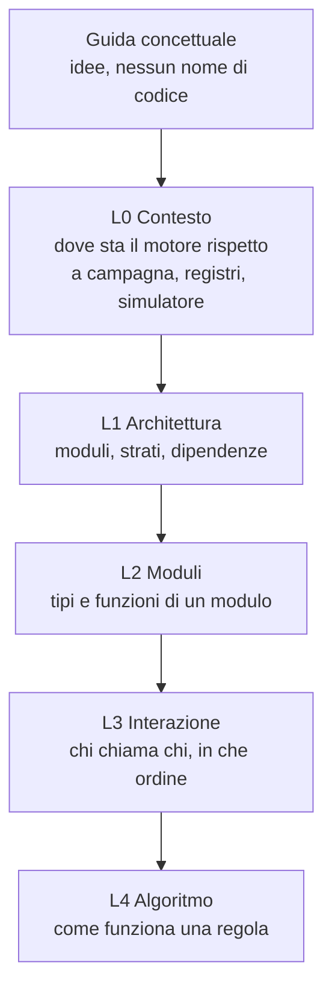

# Guida concettuale al motore DES — Parte D

*Sezioni 14-16. Bozza della fase B (stesura), da rivedere nella fase C (verifica). Riprende le convenzioni della parte A:
etichette [V]/[S]/[D]/[NV], citazioni [B n.m], nessun nome di file, funzione o classe del codice. Le sigle di progetto compaiono
**solo** nella sezione 14, come stabilito in «Come leggere questa guida».*

> **Data**: 2026-11-20.
> **Scritta sul repository al commit `3116813d`**, lo stesso delle parti A, B e C (il checkout di lavoro è oggi su un branch
> diverso, allo stesso commit; nel suo working tree un altro lavoro ha modifiche non committate al codice, che questa parte
> non descrive). Il manuale tecnico è letto all'ultimo commit che lo tocca, `78ebf15b`. La sezione 14 è stata controllata sui
> titoli e sull'indice del manuale; la sezione 15 raccoglie i termini delle parti A, B e C; la sezione 16 riporta la
> bibliografia verificata del 2026-11-19 **senza aggiungere né togliere voci**.

---

## 14. Come leggere il manuale

### 14.1 Com'è fatto il manuale

Il **manuale tecnico** del motore è il documento di riferimento per chi vuole scendere sotto il livello di questa guida: ogni
affermazione sul codice vi è riportata con il punto preciso in cui è stata letta. È diviso in dieci capitoli, più un documento
indice che li elenca, raccoglie le note di aggiornamento e contiene l'elenco completo dei diagrammi.

| Capitolo | Titolo | Che cosa ci si trova |
|---|---|---|
| 1 | Scopo e motivazioni | perché un motore a eventi e non a passi fissi; i quattro strati; i vincoli che il progetto non negozia; le due decisioni di modello (salve e casualità di sessione) |
| 2 | Lo strato 0: il contratto delle porte | ordine ed esito di sessione; la missione e l'operazione; i tipi di missione e le posture; i tipi della campagna |
| 3 | Lo strato 1: lo scheduler dei contatti | rotte e volumi, punto di massimo avvicinamento, potatura per blocchi, finestre di contatto, aerei a terra |
| 4 | Lo strato 2: il risolutore d'ingaggio | il capitolo più lungo: rilevamento, reazione, scelta dell'arma, salve, difese, danno, soglia di rottura, regole di missione, permanenza, passaggi, quota |
| 5 | Lo strato 3: applicazione dello stato | danno per singola unità; carburante, planata, bingo |
| 6 | L'orchestratore | episodi, agenda della sessione, flussi casuali, dalla missione ai movimenti, esito di missione, interruttori, fuoco su posizione, ciclo di campagna |
| 7 | Moduli di supporto trasversali | sorgente di casualità, dottrina, profili di reazione, dati dei registri, pianificatori di rotta e d'attacco, tempi di ripristino e riparazione |
| 8 | Validazione | determinismo, test di contratto, scenari, fotografia di non regressione e sua storia |
| 9 | Limiti noti, punti di estensione e divergenze | limiti dichiarati (§9.1), divergenze con il wiki (§9.2), punti di estensione (§9.3), stato del motore (§9.4), piano della Missione (§9.5), incoerenze fra documenti e codice (§9.6) |
| 10 | Atlante dei diagrammi | i diagrammi ordinati per livello di dettaglio; tre parti aggiuntive, 10A (contatti, scelta dell'arma, risolutore), 10B (missione, carburante, fuoco su posizione), 10C (porte, campagna, danno, casualità, mappe dei dati) |

**Tre avvertenze pratiche** [V, controllate sull'indice del manuale]:

- **La numerazione dei file è sfasata di uno**: il documento del capitolo N ha nel nome il numero N+1 (il capitolo 1 è il
  documento che comincia con «02», l'atlante, capitolo 10, quello che comincia con «11», con le parti 10A-10C in «11a»-«11c»).
- **In testa a ogni capitolo ci sono note datate**: dicono a quale commit il capitolo è stato verificato e che cosa è cambiato
  da allora. Un'affermazione del manuale vale alla data della sua nota, non a quella del documento indice. Il manuale usa
  l'espressione «STIMA DICHIARATA» per i numeri che questa guida marca [S].
- **I diagrammi del manuale si chiamano D1-D134** (D88 e D89 non sono usati); quelli di questa guida si chiamano **G** seguito da
  un numero e indicano in didascalia da quale diagramma D derivano. Attenzione: la lettera G è usata **anche** da una sigla di
  progetto (i passi del modello di bingo, tabella 14.3.1).

**I livelli dei diagrammi.** L'atlante assegna ogni diagramma a uno di cinque livelli, dal più generale al più fine. Questa
guida sta **sopra** i primi due.

*Diagramma G29 — La scala dei livelli dei diagrammi del manuale. Deriva dalla tabella del cap. 10 §10.1.*

### 14.2 Dove cercare che cosa

*Tabella G30 — Dalla domanda del lettore al manuale. Una riga per argomento; la colonna «Guida» indica dove l'idea è spiegata qui.*

| Domanda | Guida | Manuale |
|---|---|---|
| Che cosa risponde il motore e che cosa no? Chi lo usa? | §1 | cap. 1 §1.1-§1.4; cap. 6 §6.7; cap. 10 §10.3 (D57) |
| Perché a eventi e non a passi fissi? Con quali numeri? | §2 | cap. 1 §1.1, §1.5; cap. 3 §3.2 |
| Quali sono i blocchi del motore e in che ordine lavorano? | §3 | cap. 1 §1.2-§1.3 (D1); cap. 6 §6.1-§6.3, §6.8-§6.9 (D8, D9), §6.20 (D40); cap. 10 §10.4-§10.6; atlante 10C §10C.9 |
| Che cosa entra ed esce dal motore? | §1.2, §3 | cap. 2 §2.1-§2.5 (D2) |
| Che cos'è una missione, un'operazione, un dominio di coordinamento? | §4 | cap. 2 §2.6-§2.8 (D16-D18); cap. 4 §4.27-§4.30 (D32); cap. 6 §6.10-§6.16 |
| Contro chi e con quale arma spara una missione? | §4.6 | cap. 4 §4.32-§4.33; cap. 6 §6.22 |
| Come finisce una missione? | §4.7 | cap. 6 §6.11 (D19), §6.18; cap. 4 §4.31 |
| Quando due unità si incontrano? | §2.4, §5.3 | cap. 3 §3.1-§3.9 (D3); atlante 10A §10A.2 (D70) |
| Quando e a che distanza un sensore scopre un bersaglio? | §5.4-§5.7 | cap. 4 §4.2, §4.18 (D12), §4.35 (D131), §4.36; cap. 7 §7.4, §7.12 |
| Che cosa decide chi spara per primo? | §2.5, §6.2 | cap. 4 §4.3; cap. 7 §7.3 |
| Come si sceglie il bersaglio e l'arma? | §6.3-§6.4 | cap. 4 §4.4, §4.16-§4.17 (D10, D11), §4.25 (D26); cap. 7 §7.2, §7.7 |
| Come funzionano salve, difese e saturazione? | §6.5 | cap. 4 §4.5, §4.24 (D24), §4.26 (D27), §4.29 (D33); cap. 7 §7.5 |
| Come si calcola il danno? | §6.6 | cap. 4 §4.6; cap. 5 §5.1, §5.4 (D7) |
| Quando una forza si ritira? | §6.7 | cap. 4 §4.7, §4.21 (D22), §4.22; cap. 7 §7.2 |
| Che cos'è il fuoco su posizione? | §6.9 | cap. 4 §4.34; cap. 6 §6.23 (D49, D50) |
| Come si gestiscono carburante, bingo, rientri? | §7.2-§7.3 | cap. 5 §5.2 (D38, D39); cap. 6 §6.17-§6.20 (D40-D42); atlante 10B §10B.3 |
| Che cosa passa da una sessione all'altra? Quando un'unità torna pronta? | §8 | cap. 2 §2.10; cap. 6 §6.24-§6.27 (D52-D54); cap. 7 §7.13 |
| Come sono scelte le rotte e i profili d'attacco? | §9 | cap. 7 §7.8 (D14), §7.9 (D15); cap. 4 §4.20 |
| Da dove viene la casualità e perché i risultati si ripetono? | §10 | cap. 7 §7.1; cap. 6 §6.4; cap. 4 §4.11; atlante 10C §10C.8 (D125, D126) |
| Come si controlla il motore? Che cos'è la fotografia? | §11 | cap. 8 (§8.2, §8.3, §8.4, §8.7, §8.14) |
| Quali regole sono accese o spente? | §11.2 | cap. 6 §6.21 |
| Quanto fidarsi dei numeri? Dove stanno le stime? | §12 | cap. 9 §9.1, §9.4; cap. 7 §7.2-§7.3, §7.13 |
| Dove il manuale e i documenti di progetto non coincidono? | §12.7 | cap. 9 §9.2, §9.6 |
| Dove si aggancerebbero sviluppi futuri? | — | cap. 9 §9.3 |
| Quali fasi di lavoro sono state fatte? | tabella 14.3 | cap. 9 §9.5 (D29) |

### 14.3 Tabella di corrispondenza delle sigle di progetto

Il manuale usa molte sigle nei titoli dei paragrafi: sono i nomi che il progetto ha dato alle sue **fasi di lavoro**, alle sue
**decisioni** e alle sue **regole**. Una sigla **non è un concetto del motore**: è un'etichetta d'archivio, che dice da quale
decisione o da quale fase viene un pezzo. Qui sotto ogni sigla è spiegata in italiano piano, con la sezione della guida dove
l'idea è spiegata e il punto del manuale dove la sigla compare. Il significato è stato controllato sul manuale [V, 2026-11-20];
dove il manuale **non** spiega una sigla, è scritto.

#### 14.3.1 Il piano della Missione (fasi F0-F9 e passi G1-G5)

Il piano di lavoro che ha portato la missione dentro il motore è diviso in **fasi** F0-F9; il modello del bingo è stato rifatto
in cinque **passi** G1-G5. Fonte: la tabella di stato del cap. 9 §9.5 e il diagramma D29.

| Sigla | Che cosa indica | Guida | Manuale |
|---|---|---|---|
| F0 | la fotografia di non regressione degli scenari | §11.2 | cap. 8 §8.7; cap. 9 §9.5 |
| F1 | i tipi della missione (missione, operazione, bersaglio, punti di rotta, esiti) | §4.1-§4.2 | cap. 2 §2.6 |
| F2 | l'elenco dei tipi di missione e la tabella che li lega alle posture | §4.2, §4.5 | cap. 2 §2.7 |
| F3 | la missione passa dalla porta di sessione; il motore ne ricava rotte, partenze e velocità; prima forma dell'esito di missione; scenari riscritti con le missioni | §4.3 | cap. 2 §2.2-§2.3; cap. 6 §6.10-§6.11; cap. 8 §8.1 |
| F4a (anche «regola A») | una missione si muove alla velocità del mezzo più lento | §4.3 | cap. 6 §6.10; cap. 8 §8.1 |
| F4b | la missione è la forza che combatte; l'esito di un blocco è l'insieme degli esiti delle sue missioni | §4.4 | cap. 4 §4.27; cap. 6 §6.12 |
| F4b+ | il dominio di coordinamento (fuoco e percezione condivisi) | §4.4 | cap. 4 §4.28; cap. 6 §6.13 |
| F4b++ | la difesa dalle salve calcolata sull'intero dominio | §6.5 | cap. 4 §4.29 |
| F4c | la postura continua delle unità senza missione (aerei a terra, superficie in difesa) | §4.5 | cap. 4 §4.30; cap. 6 §6.14 |
| F5-A | gli aerei a terra nel tempo (fino al decollo, dopo l'atterraggio) | §4.3, §7.1 | cap. 3 §3.7; cap. 4 §4.30 |
| F5-B | la presenza fuori dalla rotta e la postura nell'esito | §4.3 | cap. 6 §6.15 |
| F5-C | attese, orari bloccati, orario sul bersaglio per missione | §4.3 | cap. 6 §6.16 |
| F6-A | carburante per tratto, esaurimento, planata | §7.2 | cap. 5 §5.2; cap. 6 §6.17 |
| F6-B1 | criteri di fine attività ed esito di missione a regola unica | §4.7, §7.5 | cap. 4 §4.31; cap. 6 §6.11, §6.18 |
| F6-B2, F6-B2bis | le prime due forme del bingo (rientro rettilineo, poi a ritroso), **superate** dal passo G2 | §7.3 (solo il modello attuale) | cap. 5 §5.2.5; cap. 6 §6.19 |
| F6-B3 | una questione su uno scenario di planata, chiusa senza modifiche | — | cap. 9 §9.5 |
| G1 | la riserva di disimpegno (5 minuti alla massima spinta militare) e il minimo di pianificazione | §7.3 | cap. 5 §5.2.6 |
| G2 | la soglia di bingo in volo e l'albero di decisione con le basi alternative | §7.3 | cap. 5 §5.2.7; cap. 6 §6.19 |
| G3 | il consumo di carburante in combattimento | §7.2 | cap. 5 §5.2.8; cap. 6 §6.20 |
| G4a | gli episodi | §3.5 | cap. 6 §6.20; cap. 3 §3.8 |
| G4b | la ripianificazione dopo l'episodio, il rientro dopo la ritirata, l'uscita di scena | §3.5, §7.3 | cap. 5 §5.2.9; cap. 6 §6.20 |
| G5 | la riorganizzazione degli scenari del bingo e lo scenario del doppio ingaggio | §11.2 | cap. 8 §8.10 |
| F7a | le regole d'ingaggio di missione; nel manuale lo «strato T» (bersaglio designato, regole di fuoco, armi designate) e lo «strato W» (politica d'armi per tipo di missione) | §4.6 | cap. 4 §4.32-§4.33; cap. 6 §6.22 |
| F7b | il fuoco su posizione | §6.9 | cap. 4 §4.34; cap. 6 §6.23 |
| F8a | i tipi della campagna e il validatore di sessione | §8.2 | cap. 2 §2.10; cap. 6 §6.25 |
| F8b | l'esito per la campagna: stato «in corso», esito delle operazioni, posizioni finali | §4.7, §8.4, §8.6 | cap. 2 §2.3-§2.6; cap. 6 §6.24 |
| F8c | la prontezza, il conduttore di campagna, la posizione persistente | §8.1, §8.3-§8.4 | cap. 6 §6.26-§6.27; cap. 7 §7.13 |
| F8-R | la ricerca dei tempi di ripristino e riparazione e la loro applicazione | §8.3 | cap. 7 §7.13 |
| F8d | la logistica delle basi: **non fatta**, per decisione dell'utente | §8.3 («niente logistica») | cap. 9 §9.1, §9.5 |
| F9 | la documentazione del piano (il manuale stesso) | — | cap. 9 §9.5 |
| difetto 26 | un difetto corretto fuori dal piano: le unità assenti da una sessione perdevano il loro processo di prontezza | §8.3 | cap. 6 §6.26; cap. 8 §8.12 |
| E4 | l'avviso per una missione che finisce oltre la fine della sessione (prima il taglio era silenzioso) | §4.8 (limiti) | cap. 6 §6.1, §6.8 (D8), §6.25; cap. 9 §9.5 |

#### 14.3.2 Le regole del rilevamento e delle difese aggiunte a novembre 2026

Queste attività **non** sono fasi del piano della Missione: il cap. 9 §9.5 lo dice espressamente.

| Sigla | Che cosa indica | Guida | Manuale |
|---|---|---|---|
| D-1 … D-8 | le decisioni della proposta sui **volumi di rilevamento e d'intercettazione** del pianificatore di rotta (per esempio D-3 e D-5 per le misure di scoperta del percorso, D-6 per il tempo di acquisizione, D-7 per le reti di sensori, lasciate fuori, D-8 con «B3» per l'esposizione effettiva) | §9.2-§9.3 | cap. 7 §7.8-§7.9 |
| D-4, D-4b, D-4c | D-4: la decisione, a lungo sospesa, sui sensori mancanti; D-4b: i radar di scoperta a lungo raggio nei registri (otto mobili e sette siti fissi, questi ultimi nel «blocco C»); D-4c: la vista come sensore di ripiego dei due semoventi contraerei | §5.2, §5.8 | cap. 3 §3.5; cap. 7 §7.12; cap. 8 §8.13; cap. 9 §9.1 «Limiti dei sensori EWR e visivo» |
| D-5 | nasce come la decisione numero 5 della serie D-1 … D-8 (nella sua «opzione 2»); nei titoli del manuale dal 2026-11 indica **la regola della permanenza nel volume** (riduzione della scoperta quando il bersaglio resta meno del tempo di rivisita) | §5.7 | cap. 4 §4.36; cap. 7 §7.8; cap. 8 §8.14; cap. 9 §9.1 «Permanenza nel volume» |
| DW-1 … DW-9, DW9-1 … DW9-10 | le decisioni dell'utente sulla regola della permanenza; **DW-9** è l'estensione dei tempi di rivisita a 53 modelli di sensore (le DW9-n ne sono le sotto-decisioni) | §5.7 | cap. 4 §4.36; cap. 9 §9.1 |
| FP, FP-1 … FP-10 | la regola **«una scoperta per ogni passaggio nella portata propria»**; FP-10 è l'unione dei passaggi separati da un'uscita più breve del tempo di rivisita; FP-3 (a) la fine del tiro all'uscita dal volume; FP-5 (d) il legame fra intercettazione e passaggio. Il manuale non scioglie la sigla | §5.6 | cap. 4 §4.35, §4.26; cap. 8 §8.14; cap. 9 §9.1 |
| BI, BI-1 … BI-12, R-BI | la regola facoltativa, **spenta**, su **quali munizioni una difesa aerea considera bersagli** (per classe e taglia del colpo). Il manuale non scioglie la sigla | §6.5 | cap. 4 §4.24 «Regola BI» (D130); cap. 8 §8.14; cap. 9 §9.1 |
| VA, VA-1 … VA-8 | la regola facoltativa, **spenta**, che aggiunge la **fascia di quota** al volume d'ingaggio delle armi, valutata nel tempo. Il manuale non scioglie la sigla | §6.5 | cap. 4 §4.37 (D132); cap. 3 §3.2; cap. 8 §8.14; cap. 9 §9.1 |
| PB, PB-1 … PB-6 | la **ricalibrazione della probabilità di scoperta al bordo della portata** («Pd al bordo», secondo il documento di proposta); l'interruttore esiste ed è spento. **Non compare nel manuale** alla data di questa guida | §5.4, §12.4 | — (documento di proposta separato) |

#### 14.3.3 Le regole del risolutore del settembre 2026

| Sigla | Che cosa indica | Guida | Manuale |
|---|---|---|---|
| P1, R2 | le due decisioni sulla **soglia di disimpegno** dello scontro: ritirata della forza intera, misurata con erosione e shock. Sono decisioni registrate nel wiki di progetto; il manuale le cita per sigla | §6.7 | cap. 4 §4.7; cap. 7 §7.2; cap. 9 §9.2 |
| R4 (prima e seconda parte) | prima parte: il **carico congelato** (una salva partita non cambia più); seconda parte: la ripianificazione **dentro** lo scontro, rimandata e oggi fatta solo a livello di sessione, per gli aerei | §3.5-§3.6 | cap. 4 §4.9; cap. 9 §9.2 |
| P3 | la regola degli scenari: si prendono composizione delle forze e domanda, mai numeri attesi | §11.2 | cap. 8 §8.4; cap. 9 §9.2 |
| D1-D9, D4a-D4e | le decisioni della proposta sulla **soglia di rottura casuale** (D4a-D4e per l'efficacia contraerea e i pesi di minaccia). **Non sono** i diagrammi D1-D9, né le divergenze D1-D2 del cap. 9 §9.2 | §6.7 | cap. 4 §4.21-§4.22 |
| E(N) | l'**efficacia difensiva antiaerea**: il numero atteso di aerei abbattuti da un sistema contraereo, usato per pesare la minaccia percepita | §6.7 (rapporto di forze percepito) | cap. 4 §4.22; cap. 7 §7.11 |
| R-CLS | la minaccia riconosciuta dal ricevitore d'allarme radar **solo per classe** pesa con il valore della classe | §5.8 | cap. 4 §4.23 |
| A6 con le regole D, F, L1, L2, L3 | la **difesa dai missili**: D = capacità antimissile dichiarata per arma; F = ordine di consumo (prima gli intercettori a soli cannoni); L1 = i colpi lanciati da dentro il volume dell'intercettore non si intercettano; L2 = priorità a chi attacca la propria forza; L3 = rinuncia e nuova decisione dopo il tempo di assegnazione. **La sigla A6 non è spiegata nel manuale** | §6.3, §6.5 | cap. 4 §4.24 (D24, D25); cap. 7 §7.5 |
| O1-O6 | le decisioni sulla **dottrina contro lo spreco** di colpi (bersaglio saturato, due colpi in volo) | §6.3 | cap. 4 §4.25 (D26); cap. 7 §7.2 |
| R-INT | la regola per cui un intercettore deve avere **la traccia del colpo e il tempo di reagire** | §6.5 (condizione 4) | cap. 4 §4.26 (D27, D134) |
| A1/A3, A2 | A1/A3: la **scorta per modello d'arma**; A2: il **cannone di bordo** come arma candidata | §7.4, §6.4 | cap. 4 §4.19, §4.16bis; cap. 7 §7.6 |
| B1-B6 | le decisioni sul **pianificatore d'attacco** (B2: «una fisica, due esecutori»; B3 con D-8: l'esposizione effettiva; B6: gittata e caduta delle bombe nel motore) | §9.1, §9.3 | cap. 7 §7.9; cap. 4 §4.20 |
| RIV, VAL, COM, ATT | le quattro fasi del ritardo di reazione: rilevazione, valutazione, comando, attuazione | §2.5, §6.2 | cap. 1 §1.1; cap. 7 §7.3 |
| «Strategia 1», «Strategia 2» | le due proposte iniziali scartate: a passi fissi e a sola probabilità | §2.2-§2.3 | cap. 1 §1.1 |

#### 14.3.4 Scenari, prove, numerazioni del manuale

| Sigla | Che cosa indica | Guida | Manuale |
|---|---|---|---|
| S1 … S36 (con varianti, es. S19AD, S21R, S30-CAMPAIGN, S30-ABSENT, S31-VISUAL, S32-DWELL, S33-PASSES, S34-BAND, S35-ADTGT, S36-GRAZE/-CUT/-PASSES/-FAMILIES/-BAND) | gli **scenari** della batteria: S1-S5 riprendono composizioni da documenti su Lanchester; S6-S18 coprono domini e meccanismi; da S19 in poi ogni regola nuova ha il suo scenario (S32-S36 sono quelli delle regole del 2026-11) | §11.2 | cap. 8 §8.4 (tabella), §8.9-§8.14 |
| S-1 … S-5, P-0, E-4 (con il trattino) | **sonde**: prove temporanee fatte durante la scrittura di una proposta, non ripetibili dalla suite. **Non** sono scenari: «S-4» non è «S4». (Il documento di proposta della Pd al bordo numera le sue sonde Q-1, Q-2, …: fuori dal manuale) | §5.7, §12.5 ([NV]) | cap. 4 §4.35-§4.36; cap. 9 §9.1 |
| L0 … L4 | i **livelli** dei diagrammi (diagramma G29) | §14.1 | cap. 10 §10.1 |
| D1 … D134 | i **diagrammi** del manuale (D88 e D89 non usati) | didascalie dei diagrammi G | documento indice del manuale, «Elenco dei diagrammi»; cap. 10 §10.2 |
| 10A, 10B, 10C | le tre parti aggiuntive dell'atlante | §14.1 | cap. 10 §10.2bis |
| «voci» 1-33 | le incoerenze fra documenti di progetto e codice, ciascuna con il suo stato | §12.7 | cap. 9 §9.6 |
| «Fase 1» … «Fase 7» (scritte per esteso) | le sette fasi **originali** di costruzione del motore (settembre 2026). La «Fase 7» **non** è la fase F7 del piano della Missione | §1.5 | documento indice del manuale; cap. 8 §8.5 |
| «decisione 15», «decisioni 17-27», Q1 … Q6, D1.c, D3.b, D5.a, N1 … N3, I1 | codici di decisione dei documenti di proposta e del piano della Missione, citati dal manuale per rintracciare la scelta; il manuale **non** li spiega uno per uno | — | cap. 4 §4.24, §4.26; cap. 6 §6.10, §6.23; cap. 9 §9.1, §9.5 |

### 14.4 Avvertenze sulle sigle

- **Omonimie.** «D1» può essere un diagramma, una decisione sulla soglia di rottura o una divergenza del cap. 9 §9.2; la serie
  «D1-D6» indica anche le decisioni sui dati delle munizioni intercettabili (cap. 4 §4.24); «D-5» (con il trattino) è un'altra
  cosa ancora. «G1» è un passo del bingo nel manuale e un diagramma in questa guida. «S4» è uno scenario, «S-4» una sonda. «F7» è
  una fase del piano, «Fase 7» una fase della costruzione originale del motore. Nel dubbio conta il contesto del paragrafo.
- **Sigle non sciolte.** Il manuale non spiega le lettere di BI, VA, FP e A6: le usa come nomi. Per BI, VA e FP la tabella dà il
  contenuto della regola, che è ciò che serve; per A6 non è nota nemmeno l'origine della sigla.
- **Una sigla non è una garanzia.** Che una regola abbia un nome non dice se è accesa: lo stato degli interruttori è nel cap. 6
  §6.21 (sezione 11.2 di questa guida).

---

## 15. Glossario

Termini introdotti o usati nelle parti A, B e C, in ordine alfabetico, con la sezione della guida dove sono spiegati. Le
definizioni riassumono il testo delle sezioni; in caso di dubbio prevale la sezione citata. Le sigle di progetto sono nella
sezione 14, non qui.

**A**

- **Abortita** (missione) — esito di una missione in cui **ogni** unità superstite ha chiuso per carburante, bingo, ritirata,
  munizioni finite o danno; porta il motivo dell'ultima a chiudere. → §4.7
- **Accreditamento** — il giudizio, di chi decide, che un modello è adatto a **un uso specifico**; non è un calcolo. → §11.1
- **Adattatore DCS** — il pezzo, previsto e **non esistente**, che farebbe eseguire una sessione in DCS al posto del motore,
  con lo stesso contratto di ingresso e uscita. → §1.3, §8.1
- **Agenda (degli eventi)** — l'elenco ordinato nel tempo dei fatti futuri; il motore ne ha una per la sessione e una per ogni
  scontro. → §2.1
- **Aggirare / attraversare / aggirare la scoperta** — i tre modi del pianificatore di rotta di trattare una minaccia: evitare i
  volumi d'intercettazione, entrarci per una corda di sicurezza limitata, evitare i volumi di scoperta. → §9.2
- **Applicazione immediata** — danni e munizioni di un episodio sono applicati alle unità prima di risolvere il successivo. → §3.5
- **Arma antimissile** — un'arma che il registro dichiara capace di intercettare munizioni in volo. → §6.5
- **Arma candidata** — un'arma che il tiratore potrebbe usare: quelle del suo registro o, per un aereo, del carico assegnato più
  il cannone di bordo. → §6.4
- **Armi designate** — le armi che una missione stabilisce di usare contro il suo bersaglio designato, senza ripiego; contro gli
  altri bersagli sono riservate. → §4.6
- **Asset** — nel manuale, la singola unità (aereo, mezzo, nave, sito); la guida dice «unità». → §4.1
- **Attesa** — un tratto in cui l'unità resta ferma in un punto, per una durata o fino a un orario; l'**orbita** è un'attesa senza
  circuito. → §4.3
- **AWACS** — aereo radar di scoperta («radar volante»); fra gli aerei, solo questi hanno un tempo di rivisita. → §5.7, §8.3

**B**

- **Base alternativa** — una base amica, diversa da quella di partenza, entro 3 km dalla rotta programmata [S], che un aereo al
  bingo può raggiungere. → §7.3
- **Base vera** — un'installazione del proprio schieramento (entro 3 km [S]) dove un aereo, finita la rotta, resta a terra
  invece di uscire di scena. → §4.3
- **Bersaglio designato** — le unità nemiche indicate dalla missione, o quelle dentro l'area o la zona del bersaglio all'istante
  del tiro. → §4.6
- **Bersaglio osservato / stimato** — la provenienza del bersaglio di una missione: un'unità nota, oppure una posizione con
  un'incertezza. → §4.2
- **Bersaglio prioritario** — un aereo che ha lanciato contro la forza del tiratore e che il tiratore vede e ha a portata: passa
  davanti agli altri. → §6.3
- **Bersaglio saturato** — un bersaglio contro cui le salve già dirette dalla forza hanno almeno 0,9 di probabilità di
  distruggerlo; non riceve salve nuove. → §6.3
- **Bingo** — il livello di carburante sotto il quale un aereo deve interrompere la missione e tornare. → §7.3
- **Blocco** — un raggruppamento di unità del progetto (una squadriglia, un reparto corazzato, una batteria, un gruppo navale).
  → §1.2
- **Bordo della portata** — la distanza pari alla portata di scoperta: lì la probabilità di scoperta vale 0,5 [S] e appena oltre
  vale zero. → §5.4

**C**

- **Canale** — la capacità di un intercettore di ingaggiare un colpo per volta: nel motore **ogni canale libero ferma un colpo
  per salva**, con certezza. La guida usa il termine nella formula della capacità senza definirlo a parte; il manuale parla di
  «canali d'ingaggio». → §6.5
- **Candidato al tiro** — un bersaglio scoperto su cui l'osservatore può decidere di lanciare, dal termine del suo ritardo di
  reazione fino alla fine del passaggio. → §5.6, §5.8
- **Capacità di intercettazione** — la somma, sugli intercettori operativi del dominio, del minimo fra canali liberi e scorta
  di intercettori. → §6.5
- **Carico** — le armi assegnate a un aereo dalla missione. → §4.2
- **Carico congelato** — bersaglio, arma e numero di colpi di una salva sono fissati al lancio: la salva arriva anche se il
  tiratore è distrutto dopo. → §3.6
- **Cattura** — un'esecuzione dello strumento che fa girare tutti gli scenari e ne registra il riassunto; la fotografia è una
  cattura installata come riferimento. → §11.2
- **Chiave** — la descrizione, in termini di dominio, di ciò che si sta estraendo (sessione, missione, evento, contatore): da essa
  si ricava il seme. → §10.2
- **Ciclo di campagna** — ciò che, fuori dal motore, prepara e chiude ogni sessione: processi fra sessioni, validazione,
  esecuzione, posizioni finali, registro. → §3.9, §8.1
- **Ciclo OODA** — il ciclo decisionale in quattro fasi a cui la guida accosta il ritardo di reazione; la guida non scioglie la
  sigla (in letteratura: osservare, orientarsi, decidere, agire; nessuna fonte nella bibliografia). → §2.5
- **Colpo intercettabile** — un colpo che una difesa può fermare: missili e bombe guidate sì, proiettili d'artiglieria e di carro
  no. → §6.5
- **Colpo sprecato** — un colpo che arriva su un'unità già distrutta; non consuma estrazioni. → §6.6
- **Completata** (missione) — esito di una missione che ha raggiunto l'obiettivo. → §4.7
- **Conduttore di campagna** — il pezzo che esegue una sessione alla volta nel ciclo di campagna; oggi lo chiamano solo test e uno
  scenario. → §1.5, §8.1
- **Consumo in combattimento** — il carburante di 5 minuti alla massima spinta militare che un aereo paga, una volta per episodio,
  quando partecipa a uno scontro. → §7.2
- **Corda di sicurezza** — la lunghezza massima del tratto che un aereo può percorrere dentro un volume d'intercettazione senza
  poter essere raggiunto dall'intercettore, nel caso peggiore. → §9.2
- **Criteri di fine** — le condizioni dichiarate dalla missione che chiudono l'attività di un'unità (munizioni finite, danno,
  bersaglio distrutto, durata, bingo). → §4.2, §7.5
- **Cueing** — il passaggio della traccia di un bersaglio da un sensore a un tiratore che non lo vede: nel motore **non** esiste.
  → §4.4, §5.8

**D**

- **Danneggiata** — stato di salute da 51 a 80: l'unità è ancora operativa. → §6.6
- **DCS** — il simulatore di volo e combattimento con cui si giocano le sessioni con un giocatore. La guida lo nomina senza
  descriverlo. → §1.1
- **DES** (simulazione a eventi discreti) — simulazione che salta da un fatto al successivo invece di avanzare a scatti
  regolari. → §2.1
- **Deterministico** — che, a parità di ingresso, produce sempre la stessa storia; nel motore il caso c'è, ma è ripetibile. → §10.5
- **Deviazione standard** — la misura della dispersione di una grandezza fra le repliche. → §10.5
- **Disco di dispersione** — il cerchio in cui cadono, in modo uniforme, i colpi del fuoco su posizione. → §6.9
- **Disimpegno** — nella **riserva di disimpegno**: lo sganciarsi di un aereo da un'intercettazione per tornare in rotta (300 s
  [S]). Da non confondere con la **ritirata** di una forza, che il manuale chiama «disingaggio». → §3.5, §7.3
- **Distrutta** (unità) — salute 15 o meno; il residuo è il relitto. (Missione) — tutte le unità perse. → §6.6, §4.7
- **Documento delle differenze** — il documento in cui ogni esecuzione cambiata della fotografia è spiegata con la sua causa.
  → §11.2
- **Documento di stato separato** — il documento, fuori da questa guida, che elenca decisioni aperte e tarature da fare. → §12.9
- **Dominio** (di una missione) — aria, terra o mare. → §4.2
- **Dominio di coordinamento** — l'insieme delle missioni di uno schieramento dello stesso blocco o della stessa operazione:
  condividono all'istante fuoco, saturazione, rilevamenti e difesa dai missili; non la ritirata. → §4.4
- **Dottrina contro lo spreco** — le due regole che limitano i colpi su uno stesso bersaglio: bersaglio saturato e al più 2 colpi
  in volo («due colpi, poi guarda»). → §6.3

**E**

- **Efficienza di ricognizione** — un valore fra 0 e 1 che recupera parte della riduzione di scoperta per i blocchi non
  ricogniti. → §5.4
- **Episodio** — un gruppo di finestre di contatto legate fra loro (forze in comune e distanza nel tempo al più 5 minuti),
  risolte insieme. → §3.5
- **Equazione radar** — la relazione dei testi radar per cui il segnale di ritorno cala come la quarta potenza della distanza;
  ispira la forma della legge di scoperta. → §5.4
- **Equazioni di Lanchester** — equazioni del 1916 sul logoramento continuo di due forze aggregate; il motore **non** le usa.
  → §13.2
- **Erosione** — la frazione delle unità impegnate a inizio episodio che non sono più operative, cumulata nell'episodio. → §6.7
- **Errore standard** — l'incertezza della media di N repliche: deviazione standard divisa per la radice di N. → §10.5
- **Esecuzione identica / cambiata / nuova / mancante** — i quattro esiti del confronto fra una cattura e la fotografia. → §11.2
- **Esito di sessione** — ciò che il motore restituisce: esiti degli scontri, eventi colpo per colpo, esiti di missione e
  operazione, posture, posizioni finali. → §1.2
- **Esposizione effettiva** — nel pianificatore d'attacco, il tempo che un aereo passa in un volume d'arma **dopo** che il sito
  può lanciare (ha visto l'aereo e ha avuto il tempo di tiro); l'**esposizione pesata** la somma sui siti, pesata col pericolo.
  → §9.3
- **Estrazione casuale** — un numero casuale preso dalla sorgente di sessione per decidere un evento incerto. → §10.1
- **EWR** — radar di scoperta a lungo raggio: scopre e non spara mai. Nella parte C è detto «radar di scoperta lontana». → §5.2,
  §5.8

**F**

- **Fallita** (missione) — fine senza obiettivo e senza un motivo di rinuncia. → §4.7
- **Fascia di quota** — l'intervallo di quote in cui un'arma può colpire. → §6.4, §6.5
- **Fattore di permanenza** (g) — la riduzione della probabilità di scoperta quando il bersaglio resta nel volume meno del tempo
  di rivisita: g = min(1, permanenza / tempo di rivisita). → §5.7
- **Fattore di riduzione** (f) — il prodotto dei fattori fra 0 e 1 che riducono la probabilità di scoperta: ambiente, ricognizione,
  permanenza. → §5.4
- **Filtro di adeguatezza** — la scelta delle armi adatte al bersaglio (antiaeree contro aerei, entro la fascia di quota; mai solo
  antiaeree contro la superficie). → §6.4
- **Fine di attività** — l'istante dal quale un'unità che ha soddisfatto un criterio di fine non lancia più salve offensive e
  prosegue passiva sulla rotta. → §7.5
- **Fine di movimento** — l'evento di sessione che chiude il movimento di un'unità e produce i suoi consumi. → §3.4
- **Fine nominale** — l'istante di fine della sessione a cui il motore calcola le posizioni finali. → §8.4
- **Finestra di contatto** — un intervallo di tempo in cui due unità nemiche sono entro la maggiore delle loro portate di
  scoperta. → §3.3, §5.3
- **Finestra di raggruppamento delle salve** — quanti secondi possono separare due impatti perché contino come la stessa salva (di
  default zero). → §1.2, §6.5
- **Finestra di rilascio** — le quote e velocità entro cui un'arma a caduta può essere sganciata. → §9.3
- **Flusso** — una sequenza di numeri casuali con un proprio seme, aperta per un solo uso (scontro, tempra, passaggi, fuoco su
  posizione). → §10.3
- **Forza dello scontro** — l'unità che combatte e si ritira: una per missione, più una forza «residua» per le unità di un blocco
  senza missione. → §3.3, §4.4
- **Forza occupata** — una forza impegnata in un episodio, dal suo inizio fino alla fine dell'esito; un suo contatto che
  comincerebbe prima è spostato in avanti. → §3.5
- **Fotografia di non regressione** — il riassunto esatto dell'esito di tutte le esecuzioni degli scenari, registrato in un dato
  momento (oggi 1219 esecuzioni) e usato per vedere ogni cambiamento. → §11.2
- **Fuoco senza risposta** — la quota di perdite causate da tiratori che il dominio non aveva scoperto; abbassa la soglia di
  rottura. → §6.7
- **Fuoco su posizione** — tiro d'artiglieria o navale su una posizione stimata, senza scoperta; è un evento di sessione a sé.
  → §3.4, §6.9
- **Fuori combattimento** — stato di salute da 16 a 50: l'unità non spara più ma è ancora un bersaglio (il «mission kill»). → §6.6

**I**

- **Impronta crittografica** (SHA-256) — trasformazione di un testo in un numero lungo, sempre uguale per lo stesso testo e
  diversissimo per un testo appena diverso; dà il seme. → §10.2
- **In corso** (missione) — a fine sessione almeno un'unità superstite è ancora in rotta o sul posto [D]. → §4.7
- **Indifferente al simulatore** — il vincolo per cui il nucleo del progetto non dipende da DCS e la campagna può girare con sole
  sessioni sintetiche. → §1.3
- **Iniziativa** — il vantaggio di chi scopre prima e reagisce più in fretta: spara per primo. → §2.5, §6.2
- **Intercettore** — un'unità con un'arma antimissile che può fermare colpi in arrivo sul suo dominio. → §6.5
- **Interruttore** — una regola del motore che si può accendere o spegnere; di norma il default riproduce il comportamento
  precedente, con eccezioni dichiarate. → §11.2
- **Intervallo di ritiro** — il tempo fra due salve successive contro un bersaglio già in traccia (le fasi di valutazione, comando
  e attuazione); qui «ritiro» vuol dire «tirare di nuovo», non ritirarsi. → §6.2
- **Inviluppo** — l'insieme di distanze e quote in cui un'arma (o, per l'attacco, un aereo) può operare; la guida usa il termine
  senza definirlo. → §6.6, §9.3

**L**

- **Legge di probabilità di scoperta** (Pd) — la probabilità di aver scoperto il bersaglio alla distanza d: 1 a distanza zero, 0,5
  al bordo [S], con la mancanza che cresce con la quarta potenza di d/R; zero oltre la portata. → §5.4
- **Logistica** — rifornimento delle basi: **non modellata**. Da non confondere con la «funzione logistica», la curva a «S» usata
  per la soglia di rottura. → §1.4, §6.7, §8.3

**M**

- **Massima spinta militare** — la spinta massima del motore senza postbruciatore; misura la riserva di disimpegno. La guida non la
  definisce. → §7.2-§7.3
- **Minimo di pianificazione** — il carburante caricato deve superare rotta intera più riserva; lo controlla il validatore. → §7.3
- **Mission kill** — vedi «fuori combattimento». → §6.6
- **Missione** — l'ordine che il motore esegue: azioni di unità di un solo blocco, con bersaglio, rotta, regole e criteri di fine;
  è anche la forza che combatte. → §4.1, §4.4
- **Missione di trasferimento** — tipo di missione per cui, al bingo, l'aereo prosegue se il residuo basta senza la riserva. → §7.3
- **Morale** — fattore previsto nella soglia di rottura; oggi nessuno lo fornisce e vale 1. → §6.7
- **Motore DES** — il risolutore delle sessioni virtuali descritto in questa guida. → Riassunto, §1

**N**

- **Nebbia di guerra** — nel motore, la riduzione della scoperta dei blocchi che il lato non ha ricognito; pronta ma non
  collegata di default, e giudicata «debole» dal manuale. → §5.4
- **Numeri casuali comuni** — l'uso degli stessi numeri casuali per confrontare alternative, così che la differenza dipenda meno
  dalla fortuna. → §10.6

**O**

- **Occasione di scoperta** — ogni possibilità indipendente di scoprire un bersaglio: una per passaggio, con la sua estrazione.
  → §5.6
- **Operazione** — raggruppamento facoltativo di missioni per uno stesso scopo, con una regola d'esito; vale per una sessione.
  → §4.1, §8.6
- **Orario sul bersaglio** (TOT) — l'istante in cui una missione deve essere sul bersaglio; è di ogni missione. → §4.2-§4.3
- **Orchestratore** — il coordinatore della sessione: mette in fila gli strati, non fa calcoli propri. → §3.2
- **Ordine delle estrazioni** — la sequenza fissa in cui le estrazioni sono fatte; fa parte del contratto di riproducibilità.
  → §10.4
- **Ordine di sessione** — ciò che il motore riceve: identificativo, inizio e fine, forze, finestra delle salve, missioni e
  operazioni. → §1.2
- **Ordine di tiro** — la richiesta di fuoco su posizione legata a un punto della rotta di una missione di terra o di mare. → §6.9
- **Orizzonte radar** — il limite di visibilità dovuto alla curvatura terrestre; c'è nel pianificatore di rotta, **non** nel
  motore. → §1.4, §5.2, §9.2

**P**

- **Passaggio** — un ingresso del bersaglio nel volume di scoperta **proprio** dell'osservatore, fino all'uscita; due passaggi
  separati da un'uscita non più lunga del tempo di rivisita contano come uno. → §5.6
- **Passi fissi** («tick») — modo di simulare in cui un cronometro avanza a intervalli costanti; il motore **non** lo usa. → §2.1
- **Penetrazione della corazza** — non modellata: i registri non hanno il dato. → §6.6
- **Pericolo** — nel pianificatore di rotta, la misura dell'esposizione di un percorso ai volumi d'intercettazione. → §9.2
- **Permanenza** — il tempo che il bersaglio resta nel volume di un sensore durante un passaggio. → §5.7
- **Ph, Pk|h, Pk** — probabilità di colpire; probabilità di distruggere dato il colpo; il loro prodotto, probabilità di distruzione
  per colpo. Pk|h misura anche l'entità del danno non letale. → §6.4, §6.6
- **Pianificatori** — due programmi fuori dal motore che scelgono la rotta di un aereo e il profilo d'attacco di una bomba;
  euristiche deterministiche, oggi chiamate solo da test e da uno strumento. → §9.1
- **Planata** — il volo senza motore di un aereo a secco verso una base entro quota × 10 (rapporto di planata 10 [S]). → §7.2
- **Porte** — l'ingresso (ordine) e l'uscita (esito) del motore, espressi solo in termini di dominio. → §1.2
- **Portata** (di scoperta o acquisizione, d'inseguimento, d'ingaggio) — le distanze dichiarate dai registri per un sensore; il
  motore usa di default quella di scoperta, la maggiore fra i sensori utilizzabili. → §5.2
- **Posizione persistente** — la posizione di fine sessione applicata alle unità dal conduttore, da cui parte la sessione
  successiva. → §8.4
- **Postura** — l'atteggiamento tattico di un'unità terrestre o navale (attacco, difesa, mantenimento, ritirata) e, a fine
  sessione, l'etichetta dello stato di ogni unità; la **postura continua** è quella delle unità senza missione. Nella soglia di
  rottura «postura» vuol dire solo «forza rimasta ferma». → §4.5, §6.7, §7.6
- **Preavviso** — nel pianificatore di rotta, l'arrivo al bersaglio meno l'istante della prima scoperta. → §9.2
- **Primo a scoprire** — chi ha la portata maggiore e può scoprire l'altro prima che la scoperta diventi reciproca. → §5.3
- **Processi fra sessioni** — riarmo, rifornimento, riparazione conclusi entro l'inizio di una sessione, applicati dal conduttore.
  → §8.1, §8.3
- **Profilo d'attacco** — il risultato del pianificatore d'attacco: arma, quota e velocità, profilo, direzione, distanza di sgancio,
  tempo di caduta, esposizioni. Il motore ne legge solo l'arma. → §9.1, §9.3
- **Prontezza** — l'istante da cui un'unità è di nuovo impiegabile dopo ripristino e riparazione. → §3.9, §8.3
- **Pseudo-casuale** — numero prodotto da una formula che sembra caso ma è determinato dal seme. → §10.2
- **Punteggio di preferenza d'arma** — Pk / costo^0,5 [S], se tutte le armi adatte hanno un costo; altrimenti si ordina per sola Pk.
  → §6.4
- **Punto di comparsa** — il punto in cui un aereo comparso in volo è entrato in scena; senza basi, vi torna ed esce di scena. → §7.3
- **Punto di massimo avvicinamento** — l'istante e la distanza in cui due unità in moto rettilineo sono più vicine, calcolati con
  una formula. → §2.4
- **Punto iniziale d'attacco** — il punto di rotta da cui comincia il tratto d'attacco (nel pianificatore, 10 km prima dello
  sgancio [S]). → §4.2, §9.3

**R**

- **Raggio efficace** — il raggio di un bersaglio «punto» senza raggio dichiarato: 500 m [S], più l'incertezza se stimato. → §4.6
- **Raggio letale** — la distanza dal punto di caduta entro cui un colpo del fuoco su posizione può colpire: 0,25 m per millimetro
  di calibro [S]. → §6.9
- **Rapporto di forze percepito** — forza propria su forza nemica **scoperta** dal dominio, usato per modulare la soglia di
  rottura. → §6.7
- **Registri** — gli archivi di dati del progetto su armi, mezzi e sensori; la loro qualità è variabile. → §6.4, §12.2
- **Registro di campagna** — il registro immutabile che tiene, per ogni unità, le sessioni e l'istante in cui sarà pronta. → §8.1,
  §8.3
- **Regole di fuoco** (ROE) — fuoco libero, priorità al designato, solo il designato, solo in risposta, divieto di fuoco (tre di
  esse per terra e mare). → §4.6
- **Relitto** — ciò che resta di un'unità distrutta (salute 15 o meno). → §6.6
- **Replica** — la stessa sessione eseguita con un identificativo diverso, quindi con semi diversi, per conoscere la variabilità.
  → §10.5
- **Riparazione a gradino** — la salute torna a 100 solo alla fine della riparazione; un'unità parzialmente riparata non è
  impiegabile. → §8.3
- **Ripartizione a turno** — la regola per cui i bersagli sono assegnati a rotazione fra i tiratori del dominio; non è
  un'assegnazione ottima. → §6.3
- **Ripianificazione** — il ricalcolo della rotta e dei contatti di un aereo che deve rientrare, alla fine di un episodio; solo per
  gli aerei. → §3.5, §7.3
- **Riserva di disimpegno** — il carburante di 5 minuti alla massima spinta militare, espresso come frazione del pieno [D, valori
  S]. → §7.3
- **Ritardo di reazione** — il tempo fra la scoperta e il primo lancio, somma di quattro fasi (rilevare, valutare, comandare,
  attuare). → §2.5, §6.2
- **Ritirata** (rompere il contatto) — la decisione di una forza intera di lasciare lo scontro quando erosione o shock superano la
  soglia di rottura. → §6.7
- **RWR** (ricevitore d'allarme radar) — l'apparato di un aereo che riconosce chi lo sta illuminando; senza di esso un aereo non
  percepisce i sistemi contraerei. → §5.8

**S**

- **Saturazione** (delle difese) — quando i colpi in arrivo insieme superano la capacità di intercettazione, il surplus passa. → §6.5
- **Scenario** — una situazione di prova (forze, missioni, registri) che controlla un comportamento atteso; ha varianti e
  repliche. → §11.2
- **Scoperta** — l'evento in cui un sensore rileva un bersaglio, decisa da una sola estrazione per occasione; è distinta dal tiro.
  La guida usa anche «rilevamento» come sinonimo. → §5.1-§5.5, §5.8
- **Scoperta reciproca** — il tratto della finestra in cui entrambe le unità sono entro la portata dell'altra. → §5.3
- **Seme** — il punto di partenza di una sequenza pseudo-casuale; nel motore è calcolato dalla chiave. → §10.2
- **Sessione** — un intervallo di tempo di gioco (2 ore di default, 4 al massimo [D]); **virtuale** o **sintetica** se risolta dal
  motore, **giocata** se in DCS. → §1.1
- **Shock** — la frazione delle unità impegnate persa **in una sola salva**. → §6.7
- **Soglia di bingo** (in volo) — si va al bingo quando il residuo scende sotto il resto della rotta più la riserva. → §7.3
- **Soglia di rottura** — il livello di perdite oltre il quale una forza si ritira; casuale e modulata per forza e per episodio,
  con mediana del 30% [S]. → §6.7
- **Sorgente di casualità** — l'unica origine dei numeri casuali della sessione. → §3.1, §10.2
- **Sosta** — attesa, orbita o unità ferma a motore acceso; consuma come la crociera. → §7.2
- **Spenta** (regola) — non agisce di default; non vuol dire rotta. → §12.2
- **Stato ombra** — la copia di lavoro di salute e scorte su cui lavora lo scontro; diventa reale alla fine dell'episodio. → §3.6
- **Stima dichiarata** [S] — un numero o una forma scelti come punto di partenza plausibile, non tarati, dichiarati come tali nel
  codice e nel manuale. → «Come leggere questa guida», §12.2
- **Strati** — le quattro parti del motore: contratto, contatti, scontro, applicazione. → §3.1
- **Suite** — l'insieme dei test automatici del progetto. → §11.2

**T**

- **Tabella di tiro di prova** — una scelta dell'arma semplificata, senza portate né quote, con valori non calibrati, usata in molti
  scenari. → §6.4, §11.2
- **Tempo di acquisizione** — nel pianificatore d'attacco, il tempo che un sito impiega dopo il primo contatto con il volume di
  scoperta. → §9.3
- **Tempo di riparazione** — riparazione completa del dominio per la frazione di salute persa; lineare nel danno. → §8.3
- **Tempo di ripristino** (turnaround) — il tempo di riarmo, rifornimento e controlli dopo una missione, per classe d'unità [S]. → §8.3
- **Tempo di rivisita** — il tempo fra due occasioni di scoperta di un sensore che scandisce (per un'antenna, il giro); valore fisso
  per sensore. → §5.7
- **Tempo di volo** — per un missile, metà della portata massima divisa per la velocità [S]; per una bomba, dalla balistica. → §6.4
- **Tempra** — un numero casuale estratto per forza e per episodio che sposta la soglia di rottura sopra o sotto la mediana. → §6.7
- **Termini di dominio** — identificativi, secondi, metri, frazioni: il linguaggio delle porte, mai concetti di un simulatore. → §1.2
- **Test di contratto** — il test che controlla che il motore resti indifferente al simulatore. → §11.2
- **Test di determinismo** — il test che costruisce due volte la stessa sessione e confronta gli esiti. → §11.2
- **Tratto** — un pezzo di rotta percorso in linea retta a velocità costante; una rotta è una **spezzata** di tratti. → §2.4

**U**

- **Uscita di scena** — la fine della presenza di un aereo che termina la rotta senza una base vera, o che senza basi torna al punto
  di comparsa: non è una perdita. → §4.3, §7.3

**V**

- **Validatore** — il controllo dell'ordine di sessione nel ciclo di campagna, fuori dal motore; raccoglie tutte le violazioni.
  → §1.4, §8.2
- **Validazione** — il controllo che i risultati del modello corrispondano alla realtà per l'uso previsto: **non è stata fatta**.
  → §11.1
- **Verifica** — il controllo che il modello faccia ciò che i suoi autori hanno deciso. → §11.1
- **Versione dello schema** — il numero che entra nel calcolo del seme, così che un cambio nel modo di scrivere la chiave cambi i
  semi in modo dichiarato. → §10.2
- **Vista** — il sensore a occhio nudo di due semoventi contraerei senza radar (6 km [S]); nella parte C «sensore a vista». → §5.2,
  §5.8
- **Volume di scoperta** — nel motore, la sfera con raggio pari alla portata di scoperta; nel pianificatore, un cilindro alla quota
  della rotta, tagliato dall'orizzonte. → §5.2, §9.2
- **Volume d'intercettazione** — la zona in cui un'arma può colpire (nel pianificatore, un cilindro con fascia di quota); i colpi
  lanciati da dentro non sono intercettati da quella difesa. → §6.5, §9.2

---

## 16. Bibliografia

### 16.1 Avvertenza e convenzioni

> **Bibliografia verificata il 2026-11-19, da ricontrollare dal responsabile.** «Verificata» significa che l'esistenza
> dell'opera e i dati di citazione sono stati riscontrati su almeno una fonte affidabile (registro DOI/Crossref, catalogo di
> biblioteca o di editore, pagina dell'ente che pubblica). **Non** significa che le opere siano state lette: i giudizi di
> pertinenza si basano su titolo, sommario o abstract consultati. Le opere di cui è stato letto qualcosa sono indicate.

Convenzioni: **Verifica** = dove sono stati riscontrati i dati; «Crossref» = registro dei DOI; «OL» = Open Library, catalogo
bibliotecario aperto; **★** = opera consigliata dalla bibliografia per il suo argomento; **Citata** = sezioni di questa guida che
la citano (con «tabella» per la tabella G27 della sezione 13). La bibliografia riporta anche gli indirizzi web di controllo: sono
nel file della bibliografia verificata, qui omessi salvo dove sono l'unico identificativo.

### 16.2 Fondamenti della simulazione a eventi discreti

*Opera consigliata a un responsabile non tecnico: 1.1.*

- **[B 1.1] ★** Robinson, S., *Simulation: The Practice of Model Development and Use*, 2ª ed., Palgrave Macmillan / Red Globe
  Press, 2014, 392 pp. ISBN 978-1-137-32802-1. *Verifica*: OL; schede di libreria (indice a 13 capitoli). *Citata*: §2, §13.
- **[B 1.2]** Banks, J.; Carson, J. S., II; Nelson, B. L.; Nicol, D. M., *Discrete-Event System Simulation*, 5ª ed., Prentice
  Hall / Pearson, 2010. ISBN 978-0-13-606212-7. *Verifica*: OL; scheda Pearson. Capitolo sul confronto con il passo fisso **non
  controllato**. *Citata*: §2, §10, §13.
- **[B 1.3]** Law, A. M., *Simulation Modeling and Analysis*, 5ª ed., McGraw-Hill Education, 2015 (esiste la 6ª ed.,
  2023/2024). ISBN 978-0-07-340132-4. *Verifica*: OL; pagina dell'editore. *Citata*: §2, §10, §13.
- **[B 1.4]** Zeigler, B. P.; Praehofer, H.; Kim, T. G., *Theory of Modeling and Simulation*, 2ª ed., Academic Press, 2000,
  510 pp. ISBN 978-0-12-778455-7. *Verifica*: OL; recensione indicizzata da Crossref. *Citata*: §2, §13.
- **[B 1.5]** Al Rowaei, A. A.; Buss, A. H.; Lieberman, S., «The effects of time advance mechanism on simple agent behaviors in
  combat simulations», *Proceedings of the 2011 Winter Simulation Conference*, pp. 2426-2437. DOI 10.1109/WSC.2011.6147952.
  *Verifica*: Crossref. **Contenuto non letto.** *Citata*: §2, §13.

### 16.3 Numeri casuali, riproducibilità, flussi indipendenti, numeri casuali comuni

*Opera consigliata: 1.3 o 1.2 per il quadro; 2.1 per la sola idea di «flussi e sotto-flussi».*

- **[B 2.1] ★** L'Ecuyer, P.; Simard, R.; Chen, E. J.; Kelton, W. D., «An Object-Oriented Random-Number Package with Many Long
  Streams and Substreams», *Operations Research* 50(6), 2002, pp. 1073-1075. DOI 10.1287/opre.50.6.1073.358. *Verifica*: Crossref.
  *Citata*: §10, §13.
- **[B 2.2]** L'Ecuyer, P., «Random numbers for simulation», *Communications of the ACM* 33(10), 1990, pp. 85-97. DOI
  10.1145/84537.84555. *Verifica*: Crossref. Non letta. *Non citata.*
- **[B 2.3]** L'Ecuyer, P., «Good Parameters and Implementations for Combined Multiple Recursive Random Number Generators»,
  *Operations Research* 47(1), 1999, pp. 159-164. DOI 10.1287/opre.47.1.159. *Verifica*: Crossref. *Non citata.*
- **[B 2.4]** L'Ecuyer, P.; Munger, D.; Oreshkin, B.; Simard, R., «Random numbers for parallel computers: Requirements and
  methods, with emphasis on GPUs», *Mathematics and Computers in Simulation* 135, 2017, pp. 3-17. DOI
  10.1016/j.matcom.2016.05.005. *Verifica*: Crossref. *Non citata.*
- **[B 2.5]** Glasserman, P.; Yao, D. D., «Some Guidelines and Guarantees for Common Random Numbers», *Management Science*
  38(6), 1992, pp. 884-908. DOI 10.1287/mnsc.38.6.884. *Verifica*: Crossref. *Citata*: §10.
- **[B 2.6]** Matsumoto, M.; Nishimura, T., «Mersenne twister: a 623-dimensionally equidistributed uniform pseudo-random number
  generator», *ACM Transactions on Modeling and Computer Simulation* 8(1), 1998, pp. 3-30. DOI 10.1145/272991.272995.
  *Verifica*: Crossref (il registro riporta il solo titolo breve; il sottotitolo **non** è riscontrato nel registro).
  *Citata*: §10.
- **[B 2.7]** Salmon, J. K.; Moraes, M. A.; Dror, R. O.; Shaw, D. E., «Parallel random numbers: as easy as 1, 2, 3»,
  *Proceedings of SC '11*, ACM, 2011, pp. 1-12. DOI 10.1145/2063384.2063405. *Verifica*: Crossref. *Citata*: §10, §13.

### 16.4 Wargaming e modellazione di campagne e di guerra

*Opera consigliata: 3.1.*

- **[B 3.1] ★** Sabin, P., *Simulating War: Studying Conflict through Simulation Games*, Continuum / Bloomsbury Academic, 2012,
  363 pp (brossura 2014). ISBN 978-1-4411-8558-7; 978-1-4725-3391-3. *Verifica*: OL; scheda di libreria. *Citata*: §1, §12.
- **[B 3.2]** Perla, P. P., *The Art of Wargaming: A Guide for Professionals and Hobbyists*, Naval Institute Press, 1990, 364 pp.
  ISBN 978-0-87021-050-1. *Verifica*: OL; cataloghi. *Citata*: §1.
- **[B 3.3]** Hughes, W. P., Jr. (a cura di), *Military Modeling for Decision Making*, 3ª ed., MORS, 1997. **ISBN non verificato
  per la 3ª edizione** (la 2ª ed., *Military Modeling*, 1989, ISBN 0-930473-01-9, è verificata su OL). *Verifica della 3ª ed.*:
  scheda del Naval War College Review (1999), presentazione su *Phalanx* (1997), bibliografia di [B 4.5]. *Citata*: §12.
- **[B 3.4]** Caffrey, M. B., Jr., *On Wargaming*, Newport Papers n. 43, U.S. Naval War College Press, 2019. ISBN non riportato.
  *Verifica*: pagina della collana (digital-commons.usnwc.edu/newport-papers/43/). *Non citata.*
- **[B 3.5]** Sabin, P., *Lost Battles: Reconstructing the Great Clashes of the Ancient World*, Hambledon Continuum, 2007 (data di
  catalogo gennaio 2008), 320 pp. ISBN 978-1-84725-187-9. *Verifica*: OL. *Non citata.*

### 16.5 Modelli di attrito: Lanchester e modello a salve di Hughes

*Opera consigliata: 4.5; per Lanchester, la fonte primaria 4.1 (testo integrale disponibile).*

- **[B 4.1]** Lanchester, F. W., *Aircraft in Warfare: The Dawn of the Fourth Arm*, Constable and Company, London, 1916.
  Nessun ISBN per l'edizione originale. *Verifica*: scansioni integrali su Internet Archive; record OL. Passo esatto **non
  localizzato**. *Citata*: §6, §13.
- **[B 4.2]** Hughes, W. P., Jr., «A salvo model of warships in missile combat used to evaluate their staying power», *Naval
  Research Logistics* 42(2), 1995, pp. 267-289. DOI 10.1002/1520-6750(199503)42:2<267::AID-NAV3220420209>3.0.CO;2-Y.
  *Verifica*: Crossref. *Citata*: §6, §13.
- **[B 4.3]** Hughes, W. P., Jr.; Girrier, R. P., *Fleet Tactics and Naval Operations*, 3ª ed., Naval Institute Press, 2018,
  408 pp. ISBN 978-1-68247-337-5. *Verifica*: OL (edizioni precedenti 1986 e 1999/2000 verificate). **Non verificato** che
  contenga le equazioni a salve. *Non citata.*
- **[B 4.4]** Washburn, A.; Kress, M., *Combat Modeling*, Springer, 2009, 277 pp. ISBN 978-1-4419-0789-9; DOI
  10.1007/978-1-4419-0790-5. *Verifica*: Crossref (capitoli «Attrition Models» e «Search»); OL; pagina dell'autore.
  *Citata*: §5, §6, §13.
- **[B 4.5] ★** Lucas, T. W.; McGunnigle, J. E., «When is model complexity too much? Illustrating the benefits of simple models
  with Hughes' salvo equations», *Naval Research Logistics* 50(3), 2003, pp. 197-217. DOI 10.1002/nav.10062. *Verifica*:
  Crossref; copia aperta sul repository dell'NPS. **Letti titolo, abstract e riferimenti.** *Citata*: §6, §12, §13.
- **[B 4.6]** Armstrong, M. J., «Effective attacks in the salvo combat model: Salvo sizes and quantities of targets», *Naval
  Research Logistics* 54(1), 2007, pp. 66-77, DOI 10.1002/nav.20187; Armstrong, M. J., «The salvo combat model with area fire»,
  *Naval Research Logistics* 60(8), 2013, pp. 652-660, DOI 10.1002/nav.21559. *Verifica*: Crossref. **Contenuto non letto.**
  *Citata*: §6, §13.
- **[B 4.7]** Rassegna empirica su Lanchester e dati storici: Bracken, J., «Lanchester models of the Ardennes campaign», *Naval
  Research Logistics* 42(4), 1995, pp. 559-577; Fricker, R. D., Jr., «Attrition models of the Ardennes campaign», *Naval Research
  Logistics* 45(1), 1998, pp. 1-22; Lucas, T. W.; Turkes, T., «Fitting Lanchester equations to the battles of Kursk and
  Ardennes», *Naval Research Logistics* 51(1), 2004, pp. 95-116, DOI 10.1002/nav.10101; Helmbold, R. L., «Letter to the Editor —
  A Modification of Lanchester's Equations», *Operations Research* 13(5), 1965, pp. 857-859. *Verifica*: Crossref (tutti). Il
  legame di Helmbold con le «soglie di ritirata», attribuito dal wiki, **non** è riscontrato. *Citata*: §11, §13 (Helmbold non è
  nominato nel testo).

### 16.6 Teoria della ricerca e del rilevamento

*Opera consigliata: 4.4 (capitolo «Search») per il quadro; 5.4 per il radar. Nessuna opera di questa sezione è priva di formule.*

- **[B 5.1]** Koopman, B. O., *Search and Screening: General Principles with Historical Applications*, Pergamon Press, 1980,
  369 pp (riedizione del rapporto del 1946). ISBN 978-0-08-023136-5. *Verifica*: OL. *Citata*: §5, §13.
- **[B 5.2]** Koopman, B. O., «The Theory of Search», tre parti, *Operations Research* 4(3) 1956, 4(5) 1956, 5(5) 1957. DOI
  10.1287/opre.4.3.324; 10.1287/opre.4.5.503; 10.1287/opre.5.5.613. *Verifica*: Crossref. *Citata*: §5, §13.
- **[B 5.3]** Washburn, A. R., *Search and Detection*, 4ª ed., INFORMS, 2002 (ISBN 978-1-877640-17-9); 5ª ed., CreateSpace, 2014
  (ISBN 978-1-5027-5799-9). *Verifica*: pagina dell'autore; OL. *Citata*: §5, §13.
- **[B 5.4]** Skolnik, M. I., *Introduction to Radar Systems*, 3ª ed., McGraw-Hill, 2001, 772 pp. ISBN 978-0-07-288138-7.
  *Verifica*: OL; scheda di biblioteca ed elenco dei capitoli iniziali riportati dalla ricerca web. **Non verificato** che tratti la
  probabilità cumulativa. *Citata*: §5, §9, §13.
- **[B 5.5]** Mahafza, B. R., *Radar Systems Analysis and Design Using MATLAB*, 2ª ed., Chapman & Hall/CRC, 2005, 638 pp. ISBN
  978-1-58488-532-0. *Verifica*: OL; **sommario aperto e letto** (sezioni sui casi di Swerling e sulla probabilità cumulativa).
  *Citata*: §5, §9, §13.
- **[B 5.6]** DiFranco, J. V.; Rubin, W. L., *Radar Detection*, SciTech Publishing, 2004 (prima ed. 1968), 300 pp. ISBN
  978-1-891121-36-4. *Verifica*: OL; Crossref per il capitolo 13 sulla probabilità cumulativa. *Citata*: §5, §13.
- **[B 5.7]** Mallett, J. D.; Brennan, L. E., «Cumulative probability of detection for targets approaching a uniformly scanning
  search radar», *Proceedings of the IEEE* 51(4), 1963, pp. 596-601, DOI 10.1109/PROC.1963.2207 (correzione 1964, DOI
  10.1109/PROC.1964.3053). *Verifica*: Crossref. *Citata*: §5, §13.
- **[B 5.8]** Swerling, P., «Probability of detection for fluctuating targets», *IRE Transactions on Information Theory* 6(2),
  1960, pp. 269-308, DOI 10.1109/TIT.1960.1057561; Marcum, J., «A statistical theory of target detection by pulsed radar», *IRE
  Transactions on Information Theory* 6(2), 1960, pp. 59-267, DOI 10.1109/TIT.1960.1057560. *Verifica*: Crossref. *Citata*: §5, §13.

**Nota della bibliografia** (riportata): la letteratura distingue probabilità di scoperta per singola scansione e cumulativa
(sommari di 5.5, capitolo di 5.6, titolo di 5.7). La precisazione che nei casi di Swerling a fluttuazione correlata la cumulativa
non è un semplice prodotto è **conoscenza generale dell'agente che ha compilato la bibliografia, non riscontrata su un passo
letto**. Per la convenzione della «portata dichiarata a 0,5 o 0,9» **non è stata trovata una fonte**.

### 16.7 Verifica e validazione dei modelli di simulazione

*Opera consigliata: 6.2.*

- **[B 6.1]** Sargent, R. G., «Verification and validation of simulation models», *Journal of Simulation* 7(1), 2013, pp. 12-24.
  DOI 10.1057/jos.2012.20. *Verifica*: Crossref (versioni precedenti agli atti WSC). *Citata*: §11, §13.
- **[B 6.2] ★** Youngblood, S. M.; Pace, D. K.; Eirich, P. L.; Gregg, D. M.; Coolahan, J. E., «Simulation Verification,
  Validation, and Accreditation», *Johns Hopkins APL Technical Digest* 21(3), 2000, pp. 359-367. Nessun DOI. *Verifica*: PDF
  **aperto e letto**. *Citata*: §11, §13.
- **[B 6.3]** Balci, O., «Verification, validation and accreditation of simulation models», *Proceedings WSC '97*, 1997,
  pp. 135-141, DOI 10.1145/268437.268462; Balci, O., «Principles and techniques of simulation validation, verification, and
  testing», *Proceedings WSC '95*, 1995, pp. 147-154, DOI 10.1145/224401.224456. *Verifica*: Crossref. *Citata*: §11, §13.
- **[B 6.4]** Hodges, J. S.; Dewar, J. A., «Is It You or Your Model Talking? A Framework for Model Validation», RAND,
  R-4114-A/AF/OSD, 1992, 43 pp. *Verifica*: pagina RAND (rand.org/pubs/reports/R4114.html), con sintesi. *Citata*: §1, §11, §12, §13.
- **[B 6.5]** Davis, P. K., *Generalizing Concepts and Methods of Verification, Validation, and Accreditation (VV&A) for Military
  Simulations*, RAND, R-4249-ACQ, 1992, 61 pp. *Verifica*: pagina RAND (rand.org/pubs/reports/R4249.html). *Citata*: §11, §13.
- **[B 6.6]** *MIL-STD-3022 — Documentation of Verification, Validation, and Accreditation (VV&A) for Models and Simulations*,
  Department of Defense Standard Practice, 28 gennaio 2008, con Change 1 dell'aprile 2012. *Verifica*: everyspec.com. *Citata*: §11,
  §13.
- **[B 6.7]** Box, G. E. P., «Robustness in the Strategy of Scientific Model Building», in Launer, R. L.; Wilkinson, G. N. (a
  cura di), *Robustness in Statistics*, Academic Press, 1979, pp. 201-236. DOI 10.1016/B978-0-12-438150-6.50018-2. *Verifica*:
  Crossref; sede citata da [B 4.5] per la massima «tutti i modelli sono sbagliati, ma alcuni sono utili». L'articolo del 1976
  («Science and Statistics», DOI 10.1080/01621459.1976.10480949) è spesso citato per la stessa frase: passo **non verificato**.
  *Citata*: §12.

### 16.8 Modellazione a risoluzione variabile e comando e controllo a livelli

*Opera consigliata: 7.1.*

- **[B 7.1] ★** Davis, P. K., *Introduction to Multiresolution, Multiperspective Modeling (MRMPM) and Exploratory Analysis*,
  RAND, WR-224, 2005, 80 pp. *Verifica*: pagina RAND (rand.org/pubs/working_papers/WR224.html). *Citata*: §1, §3, §8, §12, §13.
- **[B 7.2]** Davis, P. K., *An Introduction to Variable-Resolution Modeling and Cross-Resolution Model Connection*, RAND,
  R-4252-DARPA, 1993, 66 pp. *Verifica*: pagina RAND (rand.org/pubs/reports/R4252.html). *Citata*: §1, §3, §8, §13.
- **[B 7.3]** Davis, P. K.; Hillestad, R., «Families of models that cross levels of resolution: issues for design, calibration and
  management», *Proceedings WSC '93*, 1993, pp. 1003-1012. DOI 10.1145/256563.256913. *Verifica*: Crossref. *Citata*: §3, §13.
- **[B 7.4]** Davis, P. K.; Bigelow, J. H., *Experiments in Multiresolution Modeling (MRM)*, RAND, MR-1004-DARPA, 1998, 86 pp.
  *Verifica*: pagina RAND (rand.org/pubs/monograph_reports/MR1004.html). *Citata*: solo nell'intervallo «[B 7.1]-[B 7.5]» della
  tabella della §13.
- **[B 7.5]** Hillestad, R.; Moore, L. R., *The Theater-Level Campaign Model: A Research Prototype for a New Generation of Combat
  Analysis Model*, RAND, MR-388-AF/A, **1996**, 201 pp. *Verifica*: pagina RAND (rand.org/pubs/monograph_reports/MR388.html). Il
  wiki del progetto riporta il 1994: discordanza. *Citata*: §1, §8, §13.
- **[B 7.6]** Comando e controllo nei modelli a livelli (RAND): Davis, P. K.; Howe, R., N-3232-OSD, 1990; Schwabe, W.; Wilson,
  B., N-3051-NA, 1990; Davis, P. K.; Bankes, S. C.; Kahan, J. P., R-3290-NA, 1986; Wilson, B.; Fox, D. B., *Ground Combat in the
  JICM*, MR-422-NA, 1995; Allen, P. D., *Situational Force Scoring*, N-3423-NA, 1992. *Verifica*: pagine RAND. *Non citata.*
- **[B 7.7]** Alberts, D. S., *Understanding Command and Control*, CCRP, US DoD, 2006, 222 pp. ISBN 978-1-893723-17-7.
  *Verifica*: OL; la coautorietà con R. E. Hayes **non è riscontrata**. *Non citata.*
- **[B 7.8]** Tolk, A. (a cura di), *Engineering Principles of Combat Modeling and Distributed Simulation*, Wiley, 2012, 888 pp.
  ISBN 978-0-470-87429-5; DOI 10.1002/9781118180310. *Verifica*: Crossref; OL. **Contenuto non letto.** *Citata*: §3.

### 16.9 Dati storici e metodi quantitativi sul combattimento

*Opera consigliata: 8.2; 8.1 come classico.*

- **[B 8.1]** Dupuy, T. N., *Numbers, Predictions and War*, Bobbs-Merrill, 1979, 244 pp (rist. Hero Books, 1985). ISBN
  978-0-672-52131-7; 978-0-915979-06-6. *Verifica*: OL. *Citata*: §6, §11.
- **[B 8.2] ★** Lawrence, C. A., *War by Numbers: Understanding Conventional Combat*, Potomac Books, 2017, 390 pp. ISBN
  978-1-61234-886-5. *Verifica*: OL. **Contenuto non letto.** *Citata*: §6, §11.
- **[B 8.3]** Rimando della bibliografia ai lavori di [B 4.7] per le campagne storiche delle Ardenne e di Kursk. *Non è una voce
  a sé.*

### 16.10 Segnaposto coperti da opere verificate fuori dagli argomenti

*Tabella della bibliografia, riportata. Le opere di questa tabella non hanno un numero [B n.m]: la guida le cita per nome.*

| Segnaposto | Opera verificata | Nota |
|---|---|---|
| assegnazione ottima delle armi ai bersagli | Manne, A. S., «A Target-Assignment Problem», *Operations Research* 6(3), 1958, pp. 346-351, DOI 10.1287/opre.6.3.346; Ahuja, R. K.; Kumar, A.; Jha, K. C.; Orlin, J. B., «Exact and Heuristic Algorithms for the Weapon-Target Assignment Problem», *Operations Research* 55(6), 2007, pp. 1136-1146, DOI 10.1287/opre.1070.0440 | Crossref. Contenuto non letto. Citati per nome nelle §4, §6, §13 |
| «tutti i modelli sono sbagliati» | [B 6.7]; [B 4.5] | — |
| livelli dei modelli di difesa | [B 7.5]; [B 7.1]-[B 7.2] | — |
| simulatori a livello di entità, aggregati a passo fisso | **nessuna fonte primaria trovata** | resta pendente |
| Ph/Pk, shoot-look-shoot, tempi di reazione dei sistemi contraerei, soglie di rottura del 30%, golden master, carburante di bingo, tempi di ripristino | **non cercati / non coperti** | fuori dagli otto argomenti richiesti |

### 16.11 Opere non verificate

*Tabella della bibliografia, riassunta. Nessuna di queste è una fonte della guida.*

| Opera | Motivo |
|---|---|
| Hughes (a cura di), *Military Modeling for Decision Making*, 3ª ed.: ISBN | esistenza riscontrata, ISBN no |
| Taylor, J. G., *Lanchester Models of Warfare*, 1983 | editori in contrasto, nessun ISBN |
| Istruzione DoD 5000.61 sulla VV&A | pagine ufficiali non apribili |
| Guida delle pratiche raccomandate VV&A del DoD | nessuna pagina ufficiale apribile |
| Hughes, «A salvo model…», in Bracken, Kress, Rosenthal (a cura di), *Warfare Modeling*, 1995 | libro non trovato nei cataloghi aperti |
| Skolnik [B 5.4]: contenuto sulla probabilità cumulativa e sui casi di Swerling | nessun indice completo aperto |
| «Poe 1974» (osservazione a occhio nudo, bande di scansione 1,75-6 s), citato dal manuale | non cercato a fondo, nessuna fonte individuata |
| convenzioni sulla portata dichiarata di un radar (0,5 o 0,9) | nessuna fonte specifica trovata |
| Peterson (attrito logaritmico), SINDy | non cercati |
| Pace e le linee guida VV&A del DoD in forma di libro | non cercati |
| Biddle, *Military Power*; Epstein, *The Calculus of Conventional War* | errori di accesso ai cataloghi; non inclusi |

**Già nel progetto.** La bibliografia confronta anche le opere citate dal wiki di progetto con le fonti verificate. Due cose
contano per questa guida: le pagine del wiki su Hughes e su Lanchester derivano da **conversazioni con assistenti AI** e **non**
sono citate come letteratura; l'anno di [B 7.5] è il 1996, non il 1994 riportato dal wiki.

**Limiti della ricerca** (riassunti): molte pagine di editori e cataloghi non erano apribili, quindi per i libri si è usato Open
Library; il contenuto non è stato letto salvo [B 6.2], [B 4.5] (titolo, abstract, bibliografia), il sommario di [B 5.5] e le
sintesi delle pagine RAND; nessun numero di capitolo o di pagina interna è citato; per Law e per Hughes e Girrier esistono
edizioni più recenti non esaminate.

### 16.12 Controllo incrociato fra testo e bibliografia

**Citazioni [B n.m] del testo che mancano in bibliografia: nessuna.** Tutte le citazioni numerate delle parti A, B e C
(compresi gli intervalli «[B 1.1]-[B 1.4]», «[B 1.2]-[B 1.3]», «[B 5.1]-[B 5.3]», «[B 6.1]-[B 6.6]», «[B 7.1]-[B 7.5]»)
corrispondono a una voce. Due rimandi **non numerati**: Manne e Ahuja e altri (§4, §6, §13), che stanno nella tabella dei
segnaposto 16.10; «Poe 1974» (§5), che è fra le opere non verificate (16.11).

**Voci della bibliografia non citate nel testo**: [B 2.2], [B 2.3], [B 2.4], [B 3.4], [B 3.5], [B 4.3], [B 7.6], [B 7.7];
[B 7.4] compare solo dentro un intervallo; Helmbold (in [B 4.7]) e il secondo articolo di Balci (in [B 6.3]) non sono nominati.

**Segnaposto `[FONTE: ...]` del testo e loro stato nella bibliografia:**

| Argomento del segnaposto | Dove | Stato nella bibliografia |
|---|---|---|
| classificazione dei modelli di difesa per livello | §1 | **coperto** dalla tabella 16.10 ([B 7.5], [B 7.1]-[B 7.2]): il segnaposto si può chiudere |
| ciclo OODA e tempi di reazione | §2, §6, §13 | non cercato |
| cinematica del moto relativo / anticollisione | §2, §13 | **assente** anche dall'elenco dei non cercati |
| documentazione dei simulatori militari; architetture dei simulatori a livello di entità | §2, §3 | nessuna fonte primaria trovata |
| dottrina pubblica sulla struttura delle missioni e sulle regole d'ingaggio | §4 | **assente** dalla bibliografia |
| convenzioni sulla portata dichiarata di un radar | §5, §12 | nessuna fonte trovata |
| scoperta visiva da terra («Poe 1974») | §5, §13 | non individuata |
| scomposizione Ph × Pk | §6, §13 | non cercata |
| dottrina di tiro «due colpi, poi guarda» | §6 | non cercata |
| soglie di rottura del 30% | §6, §13 | non cercate |
| carburante e riserve minime | §7 | non cercati |
| tempi di ripristino e riparazione | §8 | non cercati (le fonti del progetto sono descritte nel manuale) |
| pianificazione di rotte in presenza di minacce | §9 | **assente** dalla bibliografia |
| balistica delle bombe e profili di sgancio | §9 | **assente** dalla bibliografia |
| simulazione stocastica contro simulazione al valore medio | §10 | indicato da cercare in [B 1.2]-[B 1.3]; la bibliografia rimanda anche a [B 2.1]-[B 2.5] |
| confronto con una fotografia approvata («golden master») | §11, §13 | non cercato |

---

*Fine della parte D. Con le parti A, B e C completa la stesura della guida; il riassunto iniziale va rivisto alla luce
dell'insieme (fase C).*
